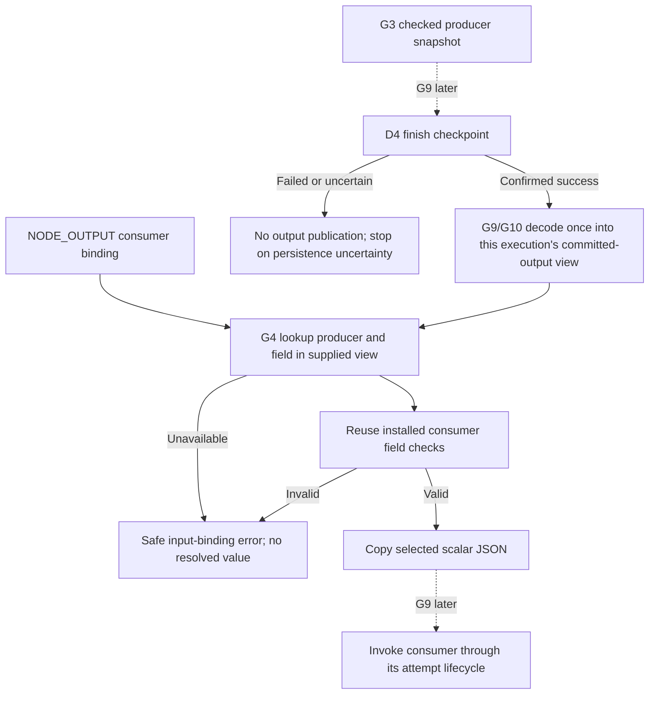

# G4 — Previous-node output bindings

## Overview

G4 extends the existing binding resolver so a consumer can read one field
from a previous node's successful, committed output in the same device
execution. For example, Input Text can read Screenshot's `artifactId` without
the publisher copying that value through intermediate nodes.

G3 checks the producer's returned data. G9/D4 later commit it, and G9/G10
make the confirmed result available in an execution-local view. G4 reads
that view, checks the selected value against the consumer's input contract,
and returns an owned copy. It does not query SQLite or establish commit state.



**Status** — Implemented and verified on Linux on 2026-11-18. The agent and
bindings test package cross-compile for Windows amd64; native Windows execution
was not run. G4 changes only binding resolution and its focused tests. Producer
invocation, checkpoint writes, view publication, runner wiring, and variable
scopes remain separate work.

The [Runtime IR source contract](../contracts/runtime_ir_v1.md#6-input-sources),
[G1 producer-reference checks](g1_runtime_ir_admission.md#6-graph-and-producer-output-rules),
[G2 resolver](g2_direct_input_bindings.md), and
[G3 output validator](g3_handler_output_validation.md) remain authoritative.

## 1. Ownership and prerequisites

| Owner   | Responsibility                                                                                                                                               |
| ------- | ------------------------------------------------------------------------------------------------------------------------------------------------------------ |
| G1      | Check that the producer exists, its referenced output is declared required, declared types are compatible, and every consumer path crosses producer success. |
| G3      | Validate and serialize the producer's successful handler return.                                                                                             |
| G9 / D4 | Establish the actual successful commit; no proposed, failed, or uncertain result may be published as output.                                                 |
| G10     | Own the admitted document and a separate values/view context for each DeviceExecution.                                                                       |
| G4      | Resolve an exact producer/field lookup from that supplied view and check the concrete consumer value.                                                        |
| G5 / G7 | Apply routing and normalize failures later.                                                                                                                  |
| G17     | Add variable reads separately.                                                                                                                               |

G4 does not repeat graph traversal, dominance analysis, source/consumer schema
comparison, handler availability, or whole-producer output validation. Those
checks already have owners. It checks the local source form, availability,
and selected destination value needed to resolve this binding safely.

## 2. Resolver API extension

Keep package `internal/execution/bindings` and `New(definitions)` unchanged.
Both resolver methods now take this explicit execution-local values object:

```go
type Values struct {
    WorkflowInputs   ir.Object
    CommittedOutputs map[string]ir.Object
}

func (r *Resolver) Resolve(
    ctx context.Context,
    node ir.Node,
    field string,
    values Values,
) (json.RawMessage, error)

func (r *Resolver) ResolveInputs(
    ctx context.Context,
    node ir.Node,
    values Values,
) (ir.Object, error)
```

`WorkflowInputs` has G2's existing meaning. `CommittedOutputs[producerID]`
is the already-decoded output object for one successful producer in this
device execution. Its inner keys are output field names and its values are
scalar `json.RawMessage` values from the committed G3 snapshot.

Resolver call sites/tests now pass `Values{WorkflowInputs: ...}` or `Values{}`.
There is no second direct resolver, compatibility overload, variadic source
parameter, or workflow-input fallback. G2's accepted direct resolution and error
behavior remain unchanged, and its callable examples use this current API.

`Values{}` permits literal resolution and empty-input nodes. A missing
workflow-input map still fails an explicit workflow lookup. A missing
committed-output view is valid when unused; an explicit output lookup fails
with the unavailable-output error. No output store is a constructor dependency.

The resolver remains stateless apart from its immutable definition registry.
Never store the latest `Values`, a selected device, or a mutable output map
on the shared resolver. Do not add placeholder variable fields for G17.

## 3. Execution-local view and commit handoff

The values object is an internal read-only view during each resolution call.
The caller supplies the workflow-input map and output view belonging to the
same DeviceExecution. The API contains no global lookup or sibling-device
selector. G4 cannot authenticate the caller's pairing from maps alone; G10
must create and retain that pairing in each execution context.

G9/G10's later publication contract is:

1. G3 returns a checked producer snapshot.
2. G9 submits that snapshot with its successful D4 finish checkpoint.
3. Only after confirmed successful commit, decode the confirmed snapshot once
   into `ir.Object` and insert it under the producer ID in this execution's view.
4. Publish before resolving the next consumer; never re-encode the handler's
   mutable return map to construct this view.

| Producer/checkpoint outcome                                                | View behavior                                                                                                                                                                                |
| -------------------------------------------------------------------------- | -------------------------------------------------------------------------------------------------------------------------------------------------------------------------------------------- |
| Running producer, failed attempt, timeout, cancellation, or invalid output | No eligible producer output is inserted.                                                                                                                                                     |
| G3 passed but finish did not commit or is unresolved                       | No publication or next dispatch. Follow D4's persistence-failure policy.                                                                                                                     |
| Confirmed successful checkpoint, including a positively reconciled commit  | Publish only the confirmed successful snapshot.                                                                                                                                              |
| `AlreadyFinalized` alone                                                   | It authorizes neither publication of the proposed payload nor a second continuation. Existing published data may remain; any reconciliation must establish the durable result through G9/D4. |

This table defines the handoff G4 consumes. G4 does not implement the writer,
interpret checkpoint dispositions, open a transaction, or add a publication API.
Its tests use explicitly prepared views; G9 later verifies the commit-to-view
handoff with real checkpoints.

Failed retry attempts contribute no output. Only a later confirmed successful
attempt supplies the producer's result. The admitted graph is acyclic, so
G4 needs no output-history selector or latest-attempt scan.

Each new DeviceExecution starts with a fresh empty view, even when another
execution uses the same workflow/node IDs. Drop the view when its execution
context is released. SQLite attempt history remains unchanged. After Runtime
restart, D6 interrupts unfinished work; G4 does not rebuild a view to resume
or replay it automatically.

## 4. Exact source and lookup rules

The executable source has exactly three required keys:

```json
{
  "source": "NODE_OUTPUT",
  "nodeId": "capture",
  "field": "artifactId"
}
```

Require a UTF-8 JSON object, the exact tag, and no extra or missing keys.
Use `ir.ValidIdentifier` for the producer ID and `ir.ValidFieldName` for
the output field. Names are case-sensitive and untrimmed. Use the same
last-property-wins JSON behavior as G1/G2. A field is one exact property,
not a dotted path, array index, expression, or template.

The consumer destination must exist and permit `NODE_OUTPUT`, using the
existing `Registry.Input` accessor. Targeting fields remain literal-only:
an output binding to Tap coordinates fails permission checks, not device access.

Use two comma-ok map lookups:

1. `values.CommittedOutputs[producerID]` must exist with a non-nil object.
2. That object must contain the exact requested output key.

An empty object is a real successful output for an empty-output producer,
but it supplies no readable fields. Do not treat an absent producer as `{}`,
select a different producer, search attempt history, or fall back to workflow
inputs. Missing producer and missing output field have distinct safe reasons.

Each read uses indexed producer and field lookups. G9/G10 decode each published
snapshot once, not once per consumer binding. View growth is bounded by the
admitted workflow's node count and G3's per-output ceiling. G4 adds no LRU,
retention job, whole-view copy, or storage lookup in the resolution loop.

A present `false`, `0`, or empty string is not absent. As in G2, apply the
consumer's actual field constraints to decide whether that value is valid.
A present nil/empty raw message or JSON null is invalid, not a missing key.
G1/G3 must still permit the producer/schema in a complete workflow: generic
lookup fixtures do not add new output fields to the installed catalog.

## 5. Selected value validation and ownership

After lookup, use the same scalar/UTF-8 and
`Registry.ValidInputValue(node.Type, node.Config, field, value)` checks as G2.
Do not introduce another field checker or coerce string/number/boolean values.
G1 already checked declared source/destination type compatibility; G4 does
not need producer schema metadata in `Values` to repeat that admission check.

Actual destination constraints still matter. A valid Delay output may contain
`durationMs: 300001`, but another Delay's input permits at most 300000. That
consumer binding fails G4 even though the producer passed G3.

Return an owned copy of the selected raw scalar using G2's common return path.
Preserve JSON type and numeric representation. Mutating the source view after
return must not change the result; mutating the result must not change the
view or another field referencing it. Do not clone or decode the whole view
for each binding. Callers keep the supplied maps/bytes immutable during calls
and mutate a device's view only between its sequential attempts.

`ResolveInputs` retains lexical input-key ordering, first-error behavior,
fresh non-nil empty success maps, and nil results on any failure. It may mix
literal, workflow-input, and output sources. G15 continues to use per-field
resolution so unneeded Switch operands are not resolved eagerly.

## 6. Errors and cancellation

Reuse G2's `InputBindingError`, `OperationError`, safe destination-field
metadata, and `COMMAND_INPUT_UNSUPPORTED` with `retryable: false`.
No new A6 code, dependency sentinel, or logging payload is needed.

| Condition                                                            | Safe message                                       | Fixed reason                |
| -------------------------------------------------------------------- | -------------------------------------------------- | --------------------------- |
| Malformed source, invalid producer ID, or invalid output-field name  | Input binding does not match its contract          | `binding_invalid`           |
| Destination forbids `NODE_OUTPUT`                                    | Input binding source is not supported              | `source_unsupported`        |
| View absent, producer absent, or producer object nil                 | Previous node output is unavailable                | `node_output_unavailable`   |
| Producer object exists but requested field is absent                 | Previous node output field is unavailable          | `node_output_field_missing` |
| Present field is not a valid scalar or violates consumer constraints | Resolved input does not satisfy its field contract | `input_value_invalid`       |

Existing G2 errors for unknown destinations, missing bindings, literal/workflow
sources, and deferred variable sources remain unchanged. `FLOW_VARIABLE` and
`GLOBAL_VARIABLE` stay unsupported until G17. Do not use `NODE_OUTPUT_INVALID`
for a consumer lookup failure; that code belongs to G3's producer validation.

Keep operation `resolve_input_binding`, with `resolve_node_inputs` only for
bulk-only failures. Include only the known consumer field in typed metadata;
never include producer IDs, source field names, values, or raw parser errors
in error messages/details. G4 logs nothing directly. G7/G9 later classify,
record, and log the failure once with the current consumer context.

Check context before work, before returning any local failure, between bulk
fields, and before returning accepted bytes/maps. Preserve cancellation and
deadline errors through `errors.Is`, without fabricating a CommandError.
Add no timer, goroutine, polling, or context-value lookup.

## 7. Examples

An Input Text consumer has:

```json
{
  "text": {
    "source": "NODE_OUTPUT",
    "nodeId": "capture",
    "field": "artifactId"
  }
}
```

| Supplied committed-output view                                      | Result                                                                         |
| ------------------------------------------------------------------- | ------------------------------------------------------------------------------ |
| `{"capture":{"artifactId":"capture-a"}}`                            | Resolve raw `"capture-a"`; bulk input map is `{"text":"capture-a"}`.           |
| The other device's own view contains `capture-b` under the same IDs | That separate call resolves `"capture-b"`; neither call reads the other's map. |
| No `capture` entry                                                  | Unavailable-output error; no workflow-input fallback.                          |
| `{"capture":{}}`                                                    | Missing-output-field error.                                                    |
| `{"capture":{"artifactId":null}}`                                   | Invalid-value error.                                                           |

These views are lookup fixtures. The short IDs illustrate field resolution;
real Screenshot execution must use the confirmed staged artifact ID under
G19/D4. G4 itself does not open or verify that artifact.

A Delay consumer reading a prior Delay's `durationMs: 10.0` receives raw
`10.0`. With `durationMs: 300001`, the same lookup fails the consumer's input
bound. No producer-output revalidation or handler invocation occurs.

## 8. Implementation and review scope

Paths below are relative to `a2matex-runtime`.

| Location                                                 | Planned change                                                                                                                         |
| -------------------------------------------------------- | -------------------------------------------------------------------------------------------------------------------------------------- |
| `internal/execution/bindings/resolver.go`                | Add `Values`, pass it through both methods, and add exact `NODE_OUTPUT` lookup before the existing shared scalar/constraint/copy path. |
| `internal/execution/bindings/resolver_test.go`           | Update G2 calls to the values object and add focused output lookup, isolation, ownership, and failure cases.                           |
| Existing constants, registry helpers, and error wrappers | Reuse without modification.                                                                                                            |

The implementation adds 21 net production lines and 237 net test lines in
these two existing Runtime files, including the API migration. No new runtime
source file, repository method, migration, cache service, graph walker, or handler
registration was introduced. G1/G3, catalog JSON, compiler fixtures, APIs, and
dependency files were not changed. G2's callable examples and the Phase G indexes
are updated alongside this spec; no obsolete resolver signature is retained.

## 9. Verification and completion

Use direct constructor-based tests with the real installed consumer contracts.
Prepare isolated views explicitly; no database or Android device is required.

| Case                                                                                            | Required observation                                                                     |
| ----------------------------------------------------------------------------------------------- | ---------------------------------------------------------------------------------------- |
| Valid committed field and mixed direct/output inputs                                            | Exact owned handler values; no source objects remain in the result.                      |
| G3-validated Delay snapshot decoded into a view                                                 | Valid scalar lookup passes; `300001` fails a Delay consumer's input bound.               |
| Missing view/producer or nil producer object                                                    | Non-retryable `node_output_unavailable`.                                                 |
| Empty producer object or valid-but-wrong-case field name such as `artifactID`                   | `node_output_field_missing`, not a fallback value.                                       |
| Present null, nil/empty bytes, invalid UTF-8, object, array, wrong type, or out-of-bound value  | `input_value_invalid`; no accepted scalar/map.                                           |
| Presence fixtures with `false`, `0`, and empty string in a compatible consumer field            | Presence is checked by map membership; destination rules decide acceptance.              |
| Extra/missing source keys, malformed JSON, trailing JSON, invalid ID/name                       | Safe `binding_invalid` without raw source text.                                          |
| Output source in a literal-only targeting field                                                 | `source_unsupported`; no device operation.                                               |
| Repeated fields reading one producer and result/source mutation after return                    | Independent copied values; producer view remains unchanged.                              |
| Same producer/field IDs in separate execution views, including a fresh empty view               | No cross-device or cross-run fallback.                                                   |
| Shared resolver used concurrently with independent immutable views                              | Correct isolated results and no data race.                                               |
| One field succeeds and a later one fails; multiple invalid fields in different insertion orders | Nil bulk result and stable lexical first error.                                          |
| Cancellation/deadline before or during resolution                                               | Preserved context outcome with no accepted data.                                         |
| G2 literals/workflow inputs and variable deferral                                               | Existing direct behavior remains; only NODE_OUTPUT changes from deferred to implemented. |

Generic presence fixtures test the resolver's lookup contract. They do not
claim that every fixture field/value is produced by a currently enabled node.
Use a real G3-valid producer snapshot for the cross-component case. Commit
eligibility, `AlreadyFinalized` handling, and publishing only after success
must be verified through real checkpoints in G9, where that code is implemented.

Run focused binding tests, G3 and affected validation suites, race checks,
vet, formatting, Linux build, and Windows amd64 cross-compilation. Distinguish
native Windows/real-device acceptance from these component checks.

G4 is complete when both resolver entry points handle `NODE_OUTPUT` from an
explicit execution-local view, preserve the existing contracts, and perform
zero external I/O. G9/G10's commit publication and lifetime wiring, G15's
Switch evaluation, and G17's variable reads remain separately numbered work.

### Implementation verification record

The following checks passed on 2026-11-18:

- `go test ./...` for the complete Runtime suite.
- `go test -race ./internal/execution/bindings ./internal/execution/outputs ./internal/validation/...`.
- `go vet ./...`, `make fmt`, and `make build VERSION=0.1.0`.
- Windows amd64 cross-compilation of `cmd/agent` and the bindings test binary.
- Diff whitespace checks.

Focused tests cover direct-source regression, exact output-source forms,
missing producer/field states, presence/type/bound checks, mixed sources, safe
errors, ownership, lexical bulk failures, execution isolation, concurrent calls,
and cancellation. A cross-component test passes a G3-validated Delay snapshot
to the output view, then demonstrates both successful resolution and rejection
by a stricter consumer input bound. Inspect the named cases with:

```bash
go test ./internal/execution/bindings -v
```

G4 is complete at the supplied-view resolver boundary. These tests prepare the
view explicitly and make no claim that G9/D4 commit publication has been wired.
G9/G10 still own actual commit eligibility and view lifetime. Native Windows
execution and real-device workflow acceptance were not performed for this
pure component.
