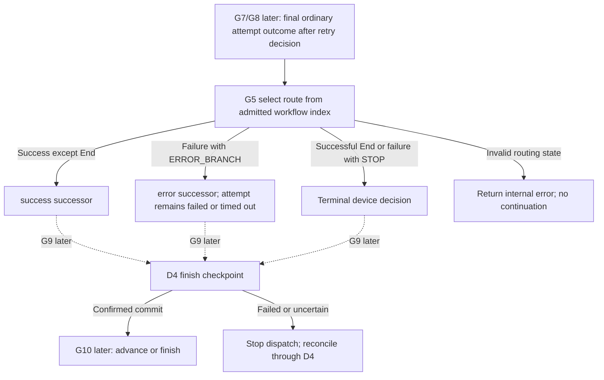

# G5 — Ordinary routing

## Overview

G5 answers one question after an ordinary node's final attempt outcome:
**which node comes next, or has this device execution finished?** Success
follows the `success` edge. A failure either follows the configured `error`
edge or ends the device execution. A successful End completes the execution.

The existing G2–G4 components resolve inputs and validate outputs. They do
not choose the next position. G5 adds a small, read-only routing component;
G9 later commits its decision with the attempt, and G10 dispatches the next
node only after that commit is confirmed.



**Status** — Implemented and verified on Linux on 2026-11-18. The agent and
routing test package cross-compile for Windows amd64; native Windows execution
was not run. G5 delivers the pure routing helper and its tests. G9/G10 still
own checkpoint/runner integration. No HTTP endpoint, database migration,
handler registration, or runtime startup behavior changes here.

The [Runtime IR graph rules](../contracts/runtime_ir_v1.md#7-edge-and-graph-contract),
[A5 execution state](../contracts/execution_state_v1.md),
[D4 checkpoints](../d_persistence/d4_atomic_checkpoint.md), and
[Phase G roadmap](../phases/plan.md#phase-g--workflow-engine) retain their
existing semantics.

## 1. Scope and ownership

| Owner   | Responsibility                                                                                                                |
| ------- | ----------------------------------------------------------------------------------------------------------------------------- |
| G1      | Admit the exact workflow: valid nodes, ports, references, topology, acyclicity, policies, and executable handlers.            |
| G3      | Establish valid output before an attempt can count as successful.                                                             |
| G5      | Index routing metadata once; select an ordinary successor or terminal device decision from the supplied final attempt status. |
| G6/G7   | Observe invocation deadlines and normalize handler/engine results into attempt statuses and safe errors.                      |
| G8      | Decide whether an eligible failure will retry before ordinary failure routing is requested.                                   |
| G9/D4   | Atomically persist the attempt outcome and selected next position before advancement.                                         |
| G10/G11 | Drive the device execution and arbitrate lifecycle cancellation/shutdown.                                                     |
| G15     | Evaluate Switch rules and select a rule/default port; extend route handling when that feature is implemented.                 |

“Ordinary” means any admitted node other than `flow.switch`; `flow.end`
has the terminal special case below. This definition includes Start, Delay,
Android actions, and future enabled ordinary handlers. G5 must not introduce
a hardcoded list of currently implemented Android node types.

Routing does not inspect output values, parse an error message, dispatch a
handler, decide retryability, or calculate RunGroup aggregation. Admission
of a node remains G1/F9's responsibility; constructing a router never enables it.

## 2. Callable contract

Use package `internal/execution/routing`, alongside bindings and outputs.
The callable API is:

```go
type Decision struct {
    NextNodeID   string
    DeviceStatus string
}

func New(ctx context.Context, document ir.Document) (*Router, error)

func (r *Router) Select(
    ctx context.Context,
    nodeID string,
    attemptStatus string,
) (Decision, error)
```

The constructor receives the document admitted by G1, not source Editor Graph
JSON. Store private copies of only routing metadata. `Select` receives the
current node's exact ID and its final normalized attempt status. No execution
ID, device serial, A6 error payload, handler registry, repository, or logger
is required to compute this decision.

Reuse `constants.ExecutionSucceeded`, `ExecutionFailed`, `ExecutionTimedOut`,
and `ExecutionRunning`; reuse the existing error-policy constants. This API
does not introduce another outcome enum ahead of G7.

| Successful result                       | `NextNodeID`             | `DeviceStatus` |
| --------------------------------------- | ------------------------ | -------------- |
| Continue on success or error route      | Exact selected target ID | `RUNNING`      |
| Successful End                          | Empty                    | `SUCCEEDED`    |
| Unhandled failure or timeout under STOP | Empty                    | `FAILED`       |

Every error returns `Decision{}`. Its empty status is invalid and must never
be interpreted as successful End. An empty next-node ID with `err == nil`
is terminal only with the explicit `SUCCEEDED` or `FAILED` status above.
Return values contain strings only and expose no mutable internal maps.

The decision is a proposal, not a committed execution state. G5 cannot
establish whether the supplied status is true or whether an attempt has
already been finalized. G9 owns those preconditions and durable checks.

## 3. Index construction and local consistency checks

Build one private entry per node containing its type, error policy, success
target, and error target. Use indexed node lookups and separate passes over
nodes and edges. A single router can be shared across device executions of
the same admitted document because it retains no current-node cursor,
attempt number, execution status, or outputs.

Construction must reject local inconsistencies that could silently select
the wrong target:

1. Require non-empty nodes and enforce the existing `RuntimeIRMaxNodes` and
   `RuntimeIRMaxEdges` ceilings before allocation. Reject invalid node IDs,
   duplicate node IDs, and policies other than `STOP` or `ERROR_BRANCH`.
2. Require every edge source and target to exist. Reject self-edges and
   duplicate `(sourceNodeId, sourcePort)` pairs, even when both target the
   same node. Never let map overwrite order choose a route.
3. For an ordinary non-End node, require exactly one `success` edge. Allow
   exactly one `error` edge only with `ERROR_BRANCH`; with `STOP`, reject it.
   Reject any other outgoing port for that ordinary node.
4. End must have no outgoing edges and use `STOP`.
5. Retain a Switch marker so selection rejects it explicitly. Switch edges
   still need existing endpoints and unique source-port pairs, but do not
   parse its rule config or reimplement its dynamic-port coverage checks.
   G1 already validates those and G15 owns executing them.

These are checks needed to construct an unambiguous index. Do not repeat G1's
reachability, whole-graph cycle detection, Start counting, input/output
contracts, dominance analysis, capabilities, or installed-handler validation.
An internally fabricated document that passes these local checks is still
not admitted for execution.

Keep the caller's document immutable during construction. After construction,
changes to its node/edge slices must not affect routing. Do not retain the
full document, config/input maps, or pointers into caller-owned slices.
Return no usable router when construction fails; never return a partial index.

## 4. Selection rules

Use exact, case-sensitive IDs, ports, policies, and status constants. Do not
trim strings, accept status aliases, or infer a target from array order.

| Current node                                  | Final attempt status                                            | Policy                 | Required decision                                    |
| --------------------------------------------- | --------------------------------------------------------------- | ---------------------- | ---------------------------------------------------- |
| Ordinary non-End                              | `SUCCEEDED`                                                     | Either accepted policy | Follow `success`, device `RUNNING`.                  |
| Ordinary non-End                              | `FAILED`                                                        | `ERROR_BRANCH`         | Follow `error`, device `RUNNING`.                    |
| Ordinary non-End                              | `TIMED_OUT`                                                     | `ERROR_BRANCH`         | Follow `error`, device `RUNNING`.                    |
| Ordinary node, including End                  | `FAILED` or `TIMED_OUT`                                         | `STOP`                 | Empty next position, device `FAILED`.                |
| End                                           | `SUCCEEDED`                                                     | `STOP`                 | Empty next position, device `SUCCEEDED`.             |
| Switch                                        | Any                                                             | Any                    | Error; no ordinary decision. G15 owns this path.     |
| Any                                           | `RUNNING`, `CANCELLED`, `INTERRUPTED`, empty, or unknown status | Any                    | Error; no ordinary decision.                         |
| Missing current node or absent required route | Any                                                             | Any                    | Error; never infer termination or use another route. |

A timeout stays `TIMED_OUT` on its NodeAttempt. Under STOP the device becomes
`FAILED`, because A5 defines no `TIMED_OUT` DeviceExecution state. With an
error successor, the device stays `RUNNING` and the timed-out attempt remains
in history. G5 never changes the supplied attempt status.

A failure handled by an error route is not remembered as an automatic
terminal device failure. If the later path reaches successful End, the
device can succeed. Its earlier failed attempts and safe errors remain
queryable. D4 remains the sole owner of group-status aggregation.

An ordinary action with no successor is invalid, even after a successful
handler call. Only successful End supplies normal successful termination.
Multiple incoming edges require no joining or waiting: one device follows
one selected edge at a time. No fan-out or parallel branch scheduling exists.

## 5. Retry, cancellation, and commit ordering

The later G9 integration follows this order:

1. Resolve/invoke/check output and use G7 to obtain the attempt outcome.
2. Give a failed/timed-out outcome to G8. If G8 schedules a safe retry, do
   not call ordinary failure routing: keep this node as next position and
   commit the failed attempt plus retry decision through D4.
3. If no retry is selected, call G5 for success or ordinary failure routing.
   A proven non-retryable failure may still use an error route; these are
   independent decisions. G5 never reads `maxAttempts` or `retryable`.
4. Pass the resulting next position with the original attempt status and
   validated output/safe error to `FinishAttempt`. D4 already derives the
   corresponding device state; G5's `DeviceStatus` describes the expected
   result rather than adding a new checkpoint request field.
5. Advance only after G9 establishes a confirmed durable completion that
   authorizes this continuation. `AlreadyFinalized` alone never authorizes
   a second dispatch, publication, or advancement.

The routing call itself uses a live coordination context. A handler's expired
attempt context must not prevent G9 from recording its timeout through D4's
separate bounded completion context. G5 supplies no detached contexts and
does not create deadlines; G6/G9 own that lifecycle.

Cancellation, intentional shutdown, startup interruption, persistence errors,
and unresolved commits bypass ordinary routing. G7/G11/D6 handle their
specific transitions. A `Select` cancellation error is not a node failure
eligible for `ERROR_BRANCH`. A routing invariant error also stops continuation;
G9 must not feed it back into G5 as another ordinary failed attempt. The
safe checkpoint/fatal-stop handling belongs to G7/G9, without inventing a
successful route or retrying an uncertain side effect.

## 6. Worked routing example

Assume admitted edges `start.success → launch`, `launch.success → tap`,
`launch.error → back`, `tap.success → end`, and `back.success → end`.
Launch uses `ERROR_BRANCH`; the other nodes use `STOP`. These are currently
available handler kinds; no deferred Log handler is needed for the example.

| Call                               | Result                                             | Meaning                                              |
| ---------------------------------- | -------------------------------------------------- | ---------------------------------------------------- |
| `Select(ctx, "start", SUCCEEDED)`  | `{"NextNodeID":"launch","DeviceStatus":"RUNNING"}` | Begin the ordinary path.                             |
| `Select(ctx, "launch", SUCCEEDED)` | `{"NextNodeID":"tap","DeviceStatus":"RUNNING"}`    | Launch succeeded; use success edge.                  |
| `Select(ctx, "launch", FAILED)`    | `{"NextNodeID":"back","DeviceStatus":"RUNNING"}`   | Preserve failed launch attempt and handle its error. |
| `Select(ctx, "tap", TIMED_OUT)`    | `{"NextNodeID":"","DeviceStatus":"FAILED"}`        | Tap has STOP; end the device execution.              |
| `Select(ctx, "end", SUCCEEDED)`    | `{"NextNodeID":"","DeviceStatus":"SUCCEEDED"}`     | End completes whichever path reached it.             |

The JSON-like values illustrate an internal Go result, not a new API payload.
These calls do not execute Launch App, Tap, or Back. Whether Back is useful
recovery is the publisher's workflow choice.

## 7. Errors, context, and logging

Use a single sentinel `xerror.ErrRoutingInvalid` in `pkg/x-error/routing.go`
with a fixed safe message such as `workflow routing state is invalid`.
Wrap it in the existing `xerror.OperationError`, with operation
`configure_workflow_routing` or `select_workflow_route` and a fixed `Detail`
reason. Keep reasons small and inspectable:

| Failure                                                                         | Fixed reason                  |
| ------------------------------------------------------------------------------- | ----------------------------- |
| Bounds or invalid/duplicate node metadata                                       | `routing_document_invalid`    |
| Missing endpoint, self-edge, duplicate/invalid port, or required route mismatch | `routing_edges_invalid`       |
| Missing selected node                                                           | `routing_node_unavailable`    |
| Switch sent to ordinary selection                                               | `routing_switch_unsupported`  |
| Non-final, cancellation/interruption, or unknown supplied status                | `routing_outcome_unsupported` |
| Nil/zero-value router or unexpectedly missing indexed route                     | `routing_state_invalid`       |

Preserve `errors.Is` for the sentinel. Constructor and selection return no
`CommandError`, retry advice, admission diagnostics, or raw handler error.
G7 later maps a routing invariant failure to a non-retryable internal engine
failure; it is not a publisher's ordinary command failure.

Check `ctx.Err()` before work, during constructor passes, and before returning
an index or decision. At a detected failure, prefer an already-observable
context error. Wrap cancellation/deadline with the current operation and
preserve `errors.Is(err, context.Canceled/DeadlineExceeded)`; do not replace
it with the routing sentinel. Never return a partial decision on cancellation.

The component returns contextual errors. The later attempt/runner boundary
logs the failure once at ERROR using B4's existing structured style. Include
the operation and fixed reason; do not place workflow inputs, config, route
maps, arbitrary node IDs/types, error payloads, serials, or protected IR in
the error text or `Detail`. No logger dependency or per-success routing log
is needed. This preserves error location without duplicating boundary logs.

## 8. Efficiency and implementation mapping

Construction takes O(nodes + edges) time and memory. Each ordinary selection
uses a node lookup and fixed-field reads: O(1), without scanning all edges.
No database reads/writes, graph traversal, locks, goroutines, callbacks,
network calls, or whole-workflow copies occur in the per-node path.
Concurrent readers are safe after successful construction; callers must not
mutate the router's private maps. Two workflows retain independent indices.

| Runtime file                                | Responsibility                                                                                                                            |
| ------------------------------------------- | ----------------------------------------------------------------------------------------------------------------------------------------- |
| `internal/execution/routing/router.go`      | Public contract, immutable route index, local consistency checks, and ordinary selection.                                                 |
| `internal/execution/routing/router_test.go` | Readable table-driven fixtures covering routing, ownership, cancellation, and concurrent reads.                                           |
| `pkg/x-error/routing.go`                    | One contextual-routing sentinel; reuse `OperationError`.                                                                                  |
| `pkg/constants/runtime_ir.go`               | Add only the missing named success/error port and End/Switch type constants needed by the implementation; reuse any existing equivalents. |

The implementation adds 175 production lines across three runtime files,
plus one focused test file. Tests and docs are reported separately. Reuse
the existing IR models and execution
statuses. Do not add a routing repository, service wrapper, DI provider,
new module dependency, API DTO, or generated wiring. A private entry type
belongs with its router; shared constants and errors stay in their existing
dedicated packages.

## 9. Verification and acceptance

The implementation includes focused table-driven tests in the existing
Go test style. No Android device, SQLite fixture, process runner, or HTTP
server is required to verify a pure routing decision.

| Case                                                                                 | Required evidence                                                                                                            |
| ------------------------------------------------------------------------------------ | ---------------------------------------------------------------------------------------------------------------------------- |
| Start and ordinary success                                                           | Exact success target, RUNNING; ERROR_BRANCH does not override success.                                                       |
| FAILED and TIMED_OUT with ERROR_BRANCH                                               | Exact error target, RUNNING; no change to attempt status.                                                                    |
| FAILED and TIMED_OUT with STOP                                                       | Empty next position, FAILED device decision.                                                                                 |
| End success/failure                                                                  | Success terminates successfully; failed/timed-out End terminates failed.                                                     |
| Error path reaches End                                                               | Failed producer decision continues; later End succeeds without sticky failure.                                               |
| Missing success, missing required error, STOP with error, End with edge              | Constructor rejects; no usable router.                                                                                       |
| Duplicate source-port, including identical targets                                   | Reject instead of accepting map overwrite. Success/error ports may share one target when both are permitted.                 |
| Unknown endpoints, self-edge, duplicate/invalid node ID, invalid policy/port, bounds | Safe construction error; no partial index.                                                                                   |
| Multiple incoming edges and reordered slices                                         | Same selected successor, no fan-out or order dependence.                                                                     |
| Switch fixture                                                                       | Construction tolerates admitted Switch routing metadata; selection rejects every Switch outcome.                             |
| Unknown current ID, unsupported statuses, nil/zero-value router                      | Safe contextual error, zero decision; no inferred termination.                                                               |
| Ownership and concurrent access                                                      | Mutating source slices after construction changes no decision; independent documents and concurrent reads stay isolated.     |
| Cancellation/deadline                                                                | Pre-cancelled calls, cancellation during construction, and final checks return zero results with inspectable context errors. |
| Confidentiality                                                                      | Malicious IDs/types/status values never appear in errors or reason details.                                                  |

Use small readable IR fixtures and fixed assertions on decisions plus
`errors.Is`/`errors.As`; do not test internal map layout or time performance.
Add an existing-limit-sized fixture to establish bounded construction.
Run focused tests, focused race checks, the normal full Go regression suite,
vet, formatter, Linux build, and Windows amd64 cross-compilation. Report
native Windows execution separately; cross-compilation does not establish it.

G5 checkout means the routing helper passes these checks and the phase status
records the evidence. It does not mean a workflow can run end to end. G9/G10
later verify that durable attempts, output visibility, and actual dispatch
match these decisions. G21 verifies terminal aggregation without duplicating
D4's calculator; G22 verifies complete feature interactions.

### Verification record — 2026-11-18

Linux verification passed:

- `go test ./internal/execution/routing` and
  `go test -race ./internal/execution/routing`.
- `go test ./...` and `go vet ./...`.
- `make fmt` and `make build VERSION=0.1.0`.
- Windows amd64/CGO-disabled cross-compilation of the routing test package
  and `cmd/agent`.
- Whitespace checks for tracked and new files; documentation formatting,
  local-link/anchor checks, and roadmap-status consistency.

`router_test.go` verifies the routing decisions, handled failure followed by
successful End, ambiguous/invalid routes, 500-node construction, Switch
exclusion, source-slice ownership, independent routers, concurrent readers,
safe errors, and deterministic cancellation/deadline behavior. These are
in-memory routing fixtures, not G1 admission or durable execution evidence.

To inspect the behavior with named cases, run from the Runtime repository:

```bash
go test ./internal/execution/routing -v
```

Native Windows execution and real-device workflow acceptance were not run.
G5 dispatches no device commands. G9/G10 will verify routing against actual
checkpoint writes and successive handler execution; their completion is
not implied by these tests.

## 10. Deferred work and integration impact

G6–G8 supply deadlines, normalized outcomes, and retries. G9/G10 integrate
the helper with checkpoints and dispatch. G11 handles owner shutdown. G15
adds Switch evaluation and selected-port persistence, including distinct
ports that share a target. G16–G19 add variable and Screenshot integration.

G5 changes no Backend node definition, Studio authoring format, Launcher API,
Runtime IR version, database schema, authentication, or advertised handlers.
Studio developers continue to author the existing success/error edges and
STOP/ERROR_BRANCH policy. Launcher developers consume later committed run
snapshots; this internal helper adds no client integration step or endpoint.
