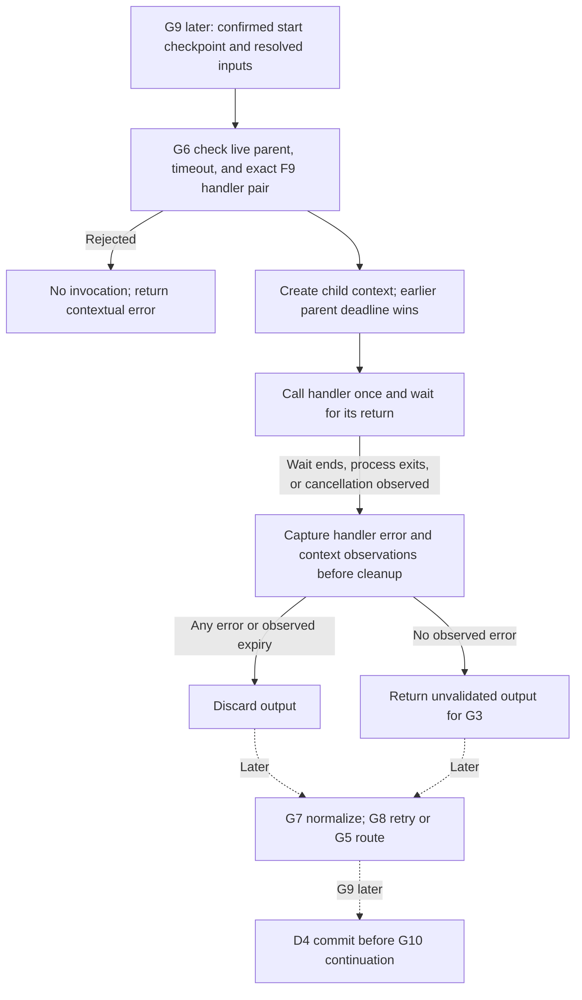

# G6 — Attempt deadlines

## Overview

G6 invokes one registered node handler with the time budget in its admitted
Runtime IR. The budget limits the handler's execution through return, not
only command dispatch. Delay runs inside Runtime: a five-second Delay with
`timeoutMs: 2000` stops waiting after two seconds. An Android handler waits
for its ADB command result even when that command prints no text.

G6 records what the handler and its contexts reported, then releases the
attempt context. G7 later interprets those observations as an attempt status
and safe error. G9 commits the result before G10 can advance.



**Status** — Implemented and verified on Linux on 2026-11-18. The agent and
invocation test package cross-compile for Windows amd64; native Windows
execution was not run. [G7 outcome normalization](g7_execution_outcome_normalization.md)
is also implemented and tested with this invoker. G9 checkpoints, G10 runner
wiring, and G19's real Screenshot staging integration remain pending.

The [IR timeout contract](../contracts/runtime_ir_v1.md#5-node-contract),
[F9 registry](../f_device_commands/f9_handler_registry.md),
[F8 local handlers](../f_device_commands/f8_flow_handlers.md),
[A5 attempt states](../contracts/execution_state_v1.md#5-nodeattempt), and
[D4 completion boundary](../d_persistence/d4_atomic_checkpoint.md#3-completion-boundary)
remain authoritative. G6 adds no API or new persisted state.

## 1. Responsibility and dependencies

| Owner            | Responsibility                                                                                                                |
| ---------------- | ----------------------------------------------------------------------------------------------------------------------------- |
| Compiler/G1      | Supply and admit an effective integer timeout of 1–600,000 ms, exact executable type/key, and validated node/config/bindings. |
| G2/G4, later G17 | Resolve the handler's input values.                                                                                           |
| F9               | Supply an immutable registry of exact type/key pairs and Go callables.                                                        |
| G6               | Invoke at most once per call with a bounded child context; wait for return and capture observations.                          |
| F handlers/E1    | Honor context, finish their local work, and stop/collect local processes when cancelled.                                      |
| G3               | Validate and snapshot a successful return before accepting output.                                                            |
| G7/G8/G5         | Normalize outcome, decide safe retries, and choose the eventual ordinary route.                                               |
| G9/D4            | Permit invocation only after a newly confirmed begin checkpoint; commit completion before publication or advancement.         |
| G10/G11          | Supply the execution lifecycle context and arbitrate cancellation/shutdown.                                                   |

No constructor work invokes a handler or probes ADB. G6 neither recompiles
the workflow nor reads current node-catalog defaults. It does not check
device readiness, resolve selectors itself, implement a retry loop, or
write execution records.

## 2. Callable API

Use `internal/execution/invocation` with the existing IR and registry types:

```go
type Observation struct {
    Output       map[string]any
    HandlerError error
    AttemptError error
    ParentError  error
}

func New(handlers *registry.Registry) (*Invoker, error)

func (i *Invoker) Invoke(
    ctx context.Context,
    node ir.Node,
    call registry.Invocation,
) (Observation, error)
```

The constructor requires a non-nil registry and retains only that immutable
dependency. Calls have no shared mutable state. An empty registry is a valid
dependency, but an invocation whose pair is missing fails before calling.

The caller supplies the admitted node and the existing invocation envelope:
the selected ADB serial, admitted config, already resolved inputs, and the
attempt-scoped Screenshot callback when applicable. G9/G10 must pair this
envelope with the correct node and device execution. G6 forwards it unchanged;
it does not interpret binding-source objects or compare config/input maps
against the node a second time. Keep supplied maps immutable during the call.

There are two distinct returns:

| Return              | Meaning                                                                                                       |
| ------------------- | ------------------------------------------------------------------------------------------------------------- |
| Non-nil outer error | Invocation was rejected before calling the handler. Observation is empty.                                     |
| Nil outer error     | The handler was invoked exactly once and returned. Inspect the observation; this does not imply node success. |

`HandlerError` retains the handler's error with contextual operation metadata.
`AttemptError` records child-context cancellation or deadline expiry observed
at return. `ParentError` separately records the caller context's error or
observed deadline expiry at that boundary. These are internal Go errors,
not A6 payloads or API DTOs.
G7 must inspect them without formatting raw errors into public responses.

No separate `Invoked` flag is needed: the outer-error contract supplies that
distinction for ordinary returns. Handler panics propagate after deferred
context cleanup; G6 adds no panic recovery or synthetic success/failure
result for them.

## 3. Pre-invocation checks

1. Check the parent context first. An already cancelled/expired parent
   returns an inspectable contextual error and performs no invocation.
2. Reject a nil/zero-value invoker or missing registry safely.
3. Require `node.TimeoutMS` from 1 through `validation.NodeTimeoutMaxMS`.
   Reuse the existing shared bound; reject before duration multiplication,
   including values that could overflow `time.Duration`.
4. Call F9 `Lookup(node.Type, node.RuntimeHandler)`. Require the exact pair;
   do not trim IDs, apply aliases, select by type alone, or register anything.
5. Create the child context and check it again immediately before calling.
   If it is already inactive, return an empty observation and outer error.

G1 remains the owner of whole-workflow admission. These narrow checks keep
the invocation boundary safe; they do not repeat graph, schema, capability,
version, or input/output contract validation.

## 4. Time-budget meaning

Create `context.WithTimeout(ctx, time.Duration(node.TimeoutMS)*time.Millisecond)`
immediately before invocation and always defer its cancel function. The
parent's earlier deadline wins automatically. Do not replace the parent
with Background, detach it, store it on the shared invoker, or pass it through
context values.

| Work                                                                                           | Relationship to this budget                                                      |
| ---------------------------------------------------------------------------------------------- | -------------------------------------------------------------------------------- |
| Delay timer                                                                                    | Must complete within the attempt's handler budget.                               |
| Tap selector/display lookup and ADB command                                                    | Share the same child deadline; each command receives the remaining time.         |
| Screenshot capture and supplied staging callback                                               | Share the same child context; G19 supplies the real callback later.              |
| Compilation, scheduling, input resolution, begin/finish checkpoint, G3 validation, retry delay | Outside G6's handler invocation interval; their owners control those boundaries. |

All child operations of one handler share the budget. Do not start a fresh
full node timeout for each ADB subprocess. Existing E/F code already propagates
the handler context and computes remaining process time.

The budget starts fresh for every explicit `Invoke` call. G6 does not schedule
those calls or decide whether calling again is safe. A second call is another
real invocation; G9's committed-start checks and G8's retry decision must
authorize it. G6 does not implement cross-call idempotency.

Use milliseconds consistently: `timeoutMs: 2` means two milliseconds,
not two seconds. A five-second Delay needs a timeout greater than 5,000 ms
to allow successful completion and execution overhead.

## 5. Synchronous invocation and cancellation limits

Call the handler directly with the child context. Do not race a detached
handler goroutine against a timeout channel and return while it keeps running.
G6 returns only after that handler call has returned, so its return cannot
release the next node while the previous Go call is still active.

Context cancellation is cooperative. It signals that work must stop; it
cannot forcibly terminate arbitrary Go code or guarantee an uncooperative
handler returns exactly at its deadline. Trusted handlers must observe the
context, use bounded I/O, and finish cleanup. E1 handles stopping and waiting
for local subprocesses. A deliberately uncooperative test handler can return
late: G6 waits for it, records expiry, and discards its output. A permanently
stuck handler remains stuck; G6 provides no background reaper or unsafe
goroutine termination. B3/G11 retain process/shutdown ownership.

Cancelling a local ADB process does not undo an Android action already sent.
Tap success means the ADB command completed under its command contract; it
does not verify the app's resulting screen or business behavior. No stdout
is required: E1 observes process completion and exit code. A timed-out Tap
may have already reached the device, so G8 must not infer safe replay from
missing text or a timeout alone.

## 6. Observation and output rules

After the handler returns, capture the parent and child context errors
**before** deferred cancellation. Also compare the current time with the
parent's and child's known deadlines: if either deadline has been reached
but its timer has not yet signalled, record `context.DeadlineExceeded` for
that context. Apply the same check before invocation. Equality counts as
expired. Preserve an already observed cancellation instead of replacing it
with this elapsed-time check.

Only retain `Output` when `HandlerError`, `AttemptError`, and `ParentError`
are all nil. Otherwise return nil output without logging or exposing the
discarded payload. Preserve the handler error alongside observed context
errors rather than replacing one with the other.

| Observed return                                                            | Observation behavior                                                        |
| -------------------------------------------------------------------------- | --------------------------------------------------------------------------- |
| On-time return with nil error                                              | Return the original unvalidated output and nil error observations.          |
| Handler returns output and error                                           | Discard output; retain contextual handler error.                            |
| Child deadline expires while parent remains live                           | Record child deadline error; retain any handler error; discard output.      |
| Parent cancellation/deadline is observed                                   | Record parent and observed child signals; discard output.                   |
| Handler returns nil error after its deadline                               | HandlerError remains nil, AttemptError records expiry, output is discarded. |
| Handler reports a deadline/cancellation error while both contexts are live | Retain that handler error; do not invent parent/child context cancellation. |
| Handler returns a nil map with no errors                                   | Preserve nil. G3 later rejects it; G6 must not replace it with `{}`.        |

`Output` is not an owned validated snapshot. G6 does not clone, serialize,
normalize, or persist the map. G3 must produce the checked snapshot before
success or downstream visibility. G6's fake Screenshot callback tests prove
forwarding only, not artifact validity or a committed artifact.

Observations are a return-boundary sample, not an atomic arbitration of all
future lifecycle events. Cancellation can arrive after capture. G7/G9/G11
must still apply lifecycle rules before continuation and final checkpoints.
Deferred cleanup cancelling a successful attempt's child context must never
retroactively turn its stored observation into cancellation.

## 7. Errors, logging, and later normalization

Add one sentinel, `xerror.ErrInvocationInvalid`, in
`pkg/x-error/invocation.go`. Use the existing `OperationError` wrapper:

| Failure                                      | Operation                   | Fixed reason                      |
| -------------------------------------------- | --------------------------- | --------------------------------- |
| Nil constructor registry                     | `configure_node_invocation` | `invocation_registry_unavailable` |
| Nil/zero invoker or missing registry on call | `invoke_node_handler`       | `invocation_registry_unavailable` |
| Timeout outside accepted bounds              | `invoke_node_handler`       | `invocation_timeout_invalid`      |
| Missing/mismatched installed callable pair   | `invoke_node_handler`       | `invocation_handler_unavailable`  |

Guard errors use the fixed message `node invocation is unavailable or invalid`,
never arbitrary IDs, inputs, serials, or protected config. At a detected guard
failure, prefer an already observable parent context error and preserve
`errors.Is` for cancellation/deadline. Pre-call child cancellation also returns
its inspectable context error. Guard errors are not admission diagnostics
or retryable `CommandError` values.

Wrap handler errors through `xerror.WithOperation("invoke_node_handler", err)`
so existing specific operations, typed errors, and `errors.Is`/`errors.As`
chains survive. Handler error text remains internal and may not be safe for
logging. G6 does not log it or classify it by message. G7 owns safe A6 mapping;
G8 owns retry eligibility. The later boundary logs one sanitized failure at
ERROR using B4's current style, without dumping the observation or raw output.

G7/G9 must distinguish a rejected invocation from a returned handler failure.
An invalid invoker/timeout/pair after admission indicates an internal execution
problem and cannot authorize a retry or invented error route. G6 itself
assigns no NodeAttempt status, final device status, route, or retry flag.

## 8. Checkpoint and runner handoff

The later G9 attempt coordinator resolves inputs, confirms a new D4 begin
checkpoint, and calls G6 with the live execution context. It then consumes
the observation with G7 and G3 as applicable, applies G8/G5 decisions, and
commits completion before dispatching anything else.

The cancelled/expired handler child context must not be reused to save its
terminal result. D4 already owns a separately bounded finish context. G6
creates no storage context and performs no commit reconciliation. A lost
HTTP request is not automatically the lifecycle parent of admitted execution;
G10/G11 supply the owner-managed execution context.

No handler or API is newly enabled by this helper. Switch/variables remain
their assigned later features. Screenshot's real stage lifecycle remains
G19/D5; passing the existing callback field does not implement it.

## 9. Implementation mapping and efficiency

| Runtime file                                    | Responsibility                                                                                                            |
| ----------------------------------------------- | ------------------------------------------------------------------------------------------------------------------------- |
| `internal/execution/invocation/invoker.go`      | Immutable registry dependency, pre-call checks, child deadline, synchronous invocation, observation capture, and cleanup. |
| `internal/execution/invocation/invoker_test.go` | Focused fake-handler and real Delay checks, deterministic timing, forwarding, guard failures, and isolation.              |
| `pkg/x-error/invocation.go`                     | Single invocation guard-error sentinel.                                                                                   |

Reuse `ir.Node`, `registry.Invocation`, the F9 registry, standard contexts,
`OperationError`, and `validation.NodeTimeoutMaxMS`. No dependencies,
generated files, registry modifications, or shared models are required.
The implementation has 92 production lines across two files; tests are
reported separately.

Each call performs one indexed lookup, creates one bounded context, and
invokes one function. It stores no execution state between calls. It adds
no goroutine, queue, locks, database I/O, full-workflow copy, result cache,
or per-node schema compilation. Concurrent calls can share the invoker
while keeping their own inputs and contexts isolated.

## 10. Verification and checkout

| Case                                                                                               | Required result                                                                                  |
| -------------------------------------------------------------------------------------------------- | ------------------------------------------------------------------------------------------------ |
| Nil/zero invoker, missing registry, invalid timeout including overflow-sized value, wrong type/key | Safe guard error, empty observation, zero handler calls.                                         |
| Normal return with empty output                                                                    | One call; output preserved for G3; no context error recorded.                                    |
| Successful cleanup                                                                                 | Child context is cancelled after return, parent stays live, observation remains successful.      |
| Invocation fields and context values                                                               | Exact envelope and context-derived values reach the handler; callback is forwarded.              |
| Raw/contextual/typed handler error                                                                 | Error chain and most specific operation survive; output is discarded.                            |
| Five-second Delay with six-second budget                                                           | Completes after five seconds and returns requested duration.                                     |
| Five-second Delay with two-second budget                                                           | Returns after two seconds with deadline evidence and no output.                                  |
| Delay duration equals attempt budget                                                               | Deadline wins; no success at the deadline boundary.                                              |
| Earlier parent deadline                                                                            | Parent and child deadline observations are retained; no longer node budget extends it.           |
| Deadline reached before timer signal                                                               | Reject an already expired parent; discard late output and retain expiry for both contexts.       |
| Pre-cancelled parent or cancellation during wait                                                   | No initial dispatch, or the running handler observes cancellation and returns; no usable output. |
| Late nil-error or error return                                                                     | Wait for the real return; discard output and preserve deadline evidence.                         |
| Handler reports an inner timeout with live contexts                                                | Preserve the error without falsely cancelling parent/attempt.                                    |
| Two explicit calls and concurrent callers                                                          | Fresh per-call budgets, no shared execution state or value leakage.                              |

Use existing `testing/synctest` patterns for duration and cancellation checks,
without real multi-second waits. The real Delay handler is used through a
real F9 registry; fake handlers test execution-boundary behavior without
ADB, Android, SQLite, or an HTTP server.

Focused commands from the Runtime repository:

```bash
go test ./internal/execution/invocation -v
go test -race ./internal/execution/invocation ./internal/handlers/delay
```

Checkout also requires the full Go regression suite, vet, formatter, Linux
build, Windows amd64 cross-compilation, whitespace checks, and consistent
spec/index/roadmap status. Cross-compilation is distinct from native Windows
execution or real-device acceptance.

### Verification record — 2026-11-18

Passed:

- Focused invocation tests and the invocation/Delay race checks above.
- `go test ./...` and `go vet ./...`.
- `make fmt` and `make build VERSION=0.1.0`.
- Windows amd64/CGO-disabled cross-compilation of the invocation test package
  and `cmd/agent`.
- Whitespace checks, documentation formatting, local-link/anchor checks,
  and matching G6 status in the phase index and roadmap.

The tests use fake handlers and the real Delay through a real F9 registry.
They prove invocation forwarding, synchronous return, timeout/cancellation
observations, cleanup, error preservation, and independent calls. They do
not prove G7 status mapping, SQLite persistence, real Screenshot staging,
or end-to-end device execution. Native Windows execution was not run.

## 11. Deferred work and platform impact

G7 normalization, G8 retries, G9 checkpoint coordination, G10 runner wiring,
G11 owner shutdown integration, and G19 real artifact staging stay separate.
G6 changes no Backend node definition, Studio graph schema, Launcher API,
Runtime IR version, authentication behavior, or SQLite table. Both Linux
and Windows use the same context/invocation code and their existing E1
process implementations.
