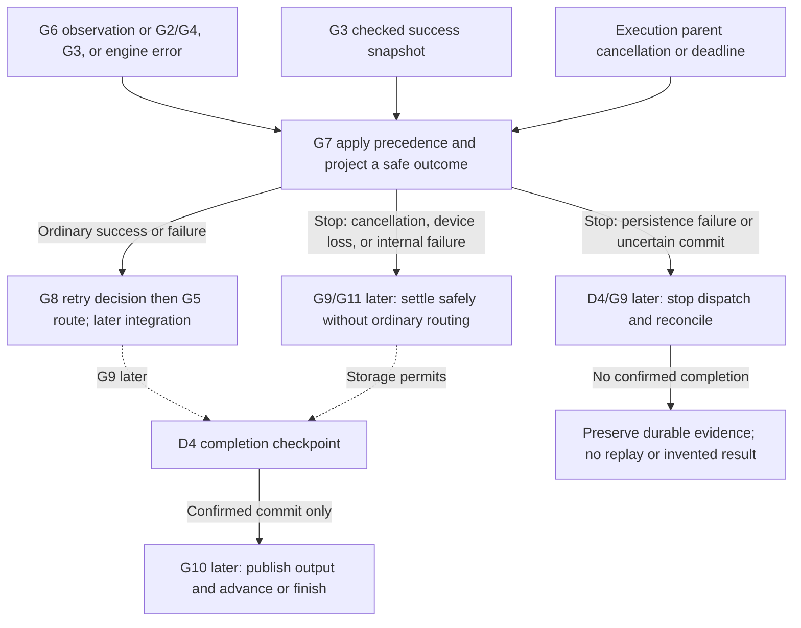

# G7 — Execution outcome normalization

## Overview

G7 translates the evidence from a node attempt into one consistent result:
its status, checked output or safe error, and whether ordinary continuation
is prohibited. For example, a five-second Delay that reaches its two-second
deadline becomes `TIMED_OUT` with `NODE_TIMED_OUT`, no output, and no retry
permission. G6 records the deadline evidence; G7 assigns its execution meaning.

Today G2/G4, G3, G5, and G6 expose their own errors, checked data, routing
decisions, or invocation observations. G7 supplies the common interpretation
G9 will consume. It does not invoke handlers, retry work, select successors,
write SQLite, or publish an execution result.



**Status** — Implemented and verified on Linux on 2026-11-18. The agent and
outcomes test package cross-compile for Windows amd64; native Windows execution
was not run. G7 adds the normalization helper and focused handoff tests only.
G8, G9, G10, and G11 retain their retry, persistence, runner, and lifecycle
responsibilities.

The [A5 attempt states](../contracts/execution_state_v1.md#5-nodeattempt),
[A6 error envelope](../contracts/event_error_v1.md#5-runtimeerror),
[A6 retryability rules](../contracts/event_error_v1.md#7-retryability),
[G6 observation contract](g6_attempt_deadlines.md#2-callable-api), and
[D4 completion boundary](../d_persistence/d4_atomic_checkpoint.md#3-completion-boundary)
remain authoritative. No public error code or execution state is added.

## 1. Scope and existing sources

| Source or owner                                      | G7 uses it for                                                                                                               |
| ---------------------------------------------------- | ---------------------------------------------------------------------------------------------------------------------------- |
| G6 `invocation.Observation`                          | Handler, attempt, and parent errors captured before child cleanup. A nil outer invocation error alone does not mean success. |
| G2/G4 `InputBindingError` and wrapped `CommandError` | Ordinary input-resolution failure versus missing trusted dependencies.                                                       |
| G3 checked snapshot or output-validation error       | Acceptable success bytes or failed output validation.                                                                        |
| `xerror.OperationError`                              | Preserve classification through wrappers; never copy its combined text into the public error.                                |
| `xerror.CommandError`                                | Existing sanctioned code/message/retryable envelope from trusted Runtime producers.                                          |
| Execution/checkpoint sentinels                       | Identify failures where routing, retries, or assuming a durable completion would be unsafe.                                  |
| G5/G8                                                | Consume ordinary status/error decisions; they do not normalize raw handler errors independently.                             |
| G9/G11/D4                                            | Apply the stop instruction and lifecycle arbitration, then persist only when storage permits.                                |

The helper is scoped to an active attempt's result, not start-API admission
errors, authoring diagnostics, SSE cursor errors, or startup recovery.
`INTERRUPTED` remains D6's recovery state; G7 does not resume or recover work.
Group aggregation remains D4's existing calculation.

## 2. Callable contract

The stateless package `internal/execution/outcomes` exposes:

```go
type Result struct {
    Status string
    Output json.RawMessage
    Error  *xerror.CommandError
    Stop   bool
}

func Normalize(
    ctx context.Context,
    observation invocation.Observation,
    checkedOutput json.RawMessage,
    stageError error,
) Result
```

`ctx` is the live device-execution coordination context, not the G6 child
context that deferred cleanup has already cancelled. G7 samples its current
cancellation/deadline in addition to G6's captured evidence. Never store the
context or detach it. There is no registry, repository, logger, constructor,
or new outcome enum dependency.

`stageError` is the one error from outside the returned handler observation:
for example G2/G4 resolution, G6's outer pre-call error, G3 validation, or a
routing/checkpoint failure being projected for safe handling. It is not an
additional handler error or a slot for arbitrary diagnostic text.

The normalizer returns no second Go error: expected cancellation and failure
are the result being produced. An invalid input combination becomes a safe
`FAILED`/`INTERNAL_ERROR` result with `Stop: true`, not a panic or success.
Callers must inspect `Stop` before asking G8/G5 to continue.

| Result                           | Required fields                                                             |
| -------------------------------- | --------------------------------------------------------------------------- |
| Success                          | `Status: SUCCEEDED`, owned checked `Output`, nil Error, Stop false.         |
| Ordinary failure                 | `Status: FAILED`, nil Output, safe Error, Stop false.                       |
| Ordinary attempt/command timeout | `Status: TIMED_OUT`, nil Output, safe non-retryable Error, Stop false.      |
| Cancellation                     | `Status: CANCELLED`, nil Output, nil Error, Stop true.                      |
| Parent execution deadline        | `Status: TIMED_OUT`, nil Output, non-retryable `NODE_TIMED_OUT`, Stop true. |
| Unsafe continuation              | `Status: FAILED`, nil Output, safe non-retryable Error, Stop true.          |

`Stop` is internal scheduling guidance: do not retry or take an ordinary
success/error edge. It is not a new persisted field, a process-exit request,
or permission to commit a result. Never serialize Result directly as an A6/A7
payload. Cancellation/device loss affects the
current execution; D4/B3 decide the broader response to a fatal store failure.
In particular, a proposed FAILED result cannot overwrite uncertain durable
state or authorize another checkpoint on a stopped checkpoint service.

## 3. Input ownership and valid call patterns

| Call pattern                                  | Observation                       | `checkedOutput`   | `stageError`                                  |
| --------------------------------------------- | --------------------------------- | ----------------- | --------------------------------------------- |
| Binding resolution failed                     | Empty                             | Nil               | G2/G4 error.                                  |
| Invocation rejected before calling            | Empty                             | Nil               | G6 outer error.                               |
| Handler returned failure/timeout/cancellation | Actual returned observation       | Nil               | Nil.                                          |
| Handler returned on time; G3 rejected output  | Successful invocation observation | Nil               | G3 error.                                     |
| Handler returned on time; G3 accepted output  | Successful invocation observation | Exact G3 snapshot | Nil.                                          |
| Project a later engine/checkpoint failure     | Empty                             | Nil               | Actual classified failure; no new invocation. |

A non-nil `stageError` together with a non-nil `HandlerError` is not a valid
ordinary producer pattern. Reject it as unsafe internal state after checking
for a higher-priority persistence failure. Likewise, ParentError, AttemptError,
and the current parent signal may contain only cancellation/deadline evidence;
an unrelated error or a single field claiming both signals is invalid internal
state. A typed nil CommandError pointer is malformed, not a value to dereference.

Output accompanying a failure is discarded. Do not treat an already checked
snapshot as overriding a newly observed cancellation, timeout, or fatal error.
In particular G9 may have completed G3 just before owner cancellation arrives.

G7 does not establish that arbitrary bytes were validated. Success requires
the actual G3 snapshot supplied by the coordinator, a non-nil original
handler output, and no error evidence. Require non-empty snapshot bytes at
most `constants.MaxEventBytes`, reusing G3's ceiling to bound the copy;
copy them with `bytes.Clone` for the returned result. Do not serialize the
handler map again or repeat G3 schema validation. Missing success evidence
is `INTERNAL_ERROR` with Stop true, never automatic `{}`. Source bytes and
separate normalization results must not alias.

## 4. Deterministic precedence

Apply this table top to bottom. Scan both `stageError` and HandlerError for
the higher-priority classifications; one safe-looking error must not hide
an unsafe cause in the other slot.

| Priority | Evidence                                                                                                                                                                                                             | Result                                                       |
| -------- | -------------------------------------------------------------------------------------------------------------------------------------------------------------------------------------------------------------------- | ------------------------------------------------------------ |
| 1        | Persistence/commit/checkpoint-stop sentinel in either error chain                                                                                                                                                    | FAILED, `PERSISTENCE_FAILED`, Stop true.                     |
| 2        | Known engine invariant/dependency error, infrastructure error code, unknown raw error, unsupported/malformed typed envelope, malformed producer combination, unsupported multi-cause error, or invalid context field | FAILED, safe infrastructure/internal error, Stop true.       |
| 3        | Current execution parent or captured ParentError says cancelled                                                                                                                                                      | CANCELLED, no error, Stop true.                              |
| 4        | Current execution parent or captured ParentError says deadline exceeded                                                                                                                                              | TIMED_OUT, `NODE_TIMED_OUT`, Stop true.                      |
| 5        | AttemptError or the selected ordinary error chain says cancelled, but no execution-parent cancellation was observed                                                                                                  | FAILED, `INTERNAL_ERROR`, Stop true.                         |
| 6        | AttemptError or the selected ordinary error chain says deadline exceeded                                                                                                                                             | TIMED_OUT, `NODE_TIMED_OUT`, Stop false.                     |
| 7        | Remaining supported typed error                                                                                                                                                                                      | Apply the code table below and safe retryability projection. |
| 8        | No errors, valid success evidence                                                                                                                                                                                    | SUCCEEDED with the copied G3 snapshot.                       |
| 9        | Anything else                                                                                                                                                                                                        | FAILED, `INTERNAL_ERROR`, Stop true.                         |

At priority 2, an unknown error means there is no supported CommandError,
recognized context error, or known sentinel in its ordinary single-cause
chain. An arbitrary outer wrapper around a supported typed cause is not
itself an unknown error. This prevents an unclassified engine failure from
being hidden by a simultaneous cancellation; expected typed command failures
still follow the cancellation/deadline precedence below it.

Use `errors.Is` for wrapped context errors and sentinels and `errors.As`
for typed errors; never match text such as `"timeout"` or `"cancelled"`.
Support both value and pointer forms of `CommandError` through ordinary
single-cause wrappers, including OperationError and InputBindingError.

Current producers use single-cause chains. For `errors.Join` or another
`Unwrap() []error` chain, first recognize persistence sentinels with
`errors.Is`; otherwise return the conservative internal-stop result. Do not
select whichever retryable CommandError happens to be encountered first.
This does not add general multi-error aggregation to the MVP.

Snapshot the current parent signal once for each normalization call. Use
`ctx.Err()` and a deadline/time comparison so an elapsed deadline is not
missed before its timer signal is observed. Preserve an observed cancellation
instead of replacing it with a later clock-based expiry. No timeout context
or goroutine is created by G7. G9/G11 must still recheck lifecycle before
continuation; normalization is not atomic with later cancellation or commit.

Execution cancellation requires the parent evidence at priority 3. A lone
`context.Canceled` from an inner command with live execution parents does
not prove an owner/group cancellation was accepted. Treat it as an internal
stop rather than fabricating a CANCELLED checkpoint. This also covers an
isolated child-cancellation signal paired with the wrong live parent context.
The current G6 invoker releases its own child only after capturing the result;
that cleanup is not an input to this decision. G11 still owns the accepted
cancellation flag required by D4.

Examples of overlapping signals:

- A retryable process-start error plus observed child deadline becomes a
  non-retryable node timeout.
- A failed Android command plus observed owner cancellation becomes
  cancellation without a public error payload.
- A checked successful output plus newly observed parent cancellation
  becomes cancellation, with that output discarded.
- A persistence error plus cancellation remains a persistence stop. It
  must not appear as a safely committed CANCELLED result.

## 5. Code mapping and stop rules

| Recognized evidence                                                                                                                                                                         | Status    | Safe error code                    | Stop                                      |
| ------------------------------------------------------------------------------------------------------------------------------------------------------------------------------------------- | --------- | ---------------------------------- | ----------------------------------------- |
| `ErrExecutionPersistence`, `ErrExecutionCommitUnknown`, `ErrCheckpointFatal`, `ErrCheckpointStopped`                                                                                        | FAILED    | `PERSISTENCE_FAILED`               | True.                                     |
| `ErrInvocationInvalid`, `ErrRoutingInvalid`, `ErrInputBindingDependencies`, `ErrOutputValidationDependencies`, `ErrExecutionInvalidInput`, `ErrExecutionStaleState`, `ErrRecoveryIntegrity` | FAILED    | `INTERNAL_ERROR`                   | True.                                     |
| Typed `PERSISTENCE_FAILED` from a trusted internal producer                                                                                                                                 | FAILED    | `PERSISTENCE_FAILED`               | True.                                     |
| Typed `INTERNAL_ERROR` from a trusted producer                                                                                                                                              | FAILED    | `INTERNAL_ERROR`                   | True.                                     |
| Node/observed deadline evidence                                                                                                                                                             | TIMED_OUT | `NODE_TIMED_OUT`                   | False unless the parent deadline applies. |
| Typed `COMMAND_TIMED_OUT` with no higher-priority context evidence                                                                                                                          | TIMED_OUT | `COMMAND_TIMED_OUT`                | False.                                    |
| Typed `NODE_TIMED_OUT` with no parent stop                                                                                                                                                  | TIMED_OUT | `NODE_TIMED_OUT`                   | False.                                    |
| Typed `COMMAND_START_FAILED`, `COMMAND_INPUT_UNSUPPORTED`, `COMMAND_FAILED`, `NODE_OUTPUT_INVALID`, `ADB_UNAVAILABLE`                                                                       | FAILED    | Preserve the supported code        | False.                                    |
| Typed `DEVICE_NOT_FOUND`, `DEVICE_UNAUTHORIZED`, `DEVICE_OFFLINE`, `DEVICE_NOT_READY`, `DEVICE_DISCONNECTED`                                                                                | FAILED    | Preserve the supported device code | True.                                     |
| Unknown raw error, unsupported/malformed typed code or message, or missing success snapshot                                                                                                 | FAILED    | `INTERNAL_ERROR`                   | True.                                     |

G3 output failure is a failed, non-retryable node outcome. It may follow an
approved error edge; missing trusted definitions are an internal stop.
Device-unavailable errors stop this device execution, consistent with A5's
device-loss rule; they do not cancel unaffected devices or create a reconnect
wait state. `ADB_UNAVAILABLE` is kept distinct because its current adapter
can prove failure before dispatch and explicitly mark safe retryability.

Only the node/command/device codes listed here and the two explicit
infrastructure projections are accepted in an active outcome. API transport,
admission/state, cursor, and recovery-only codes are not silently treated as
node errors, even if the wider A6 envelope recognizes them. In particular,
typed `EXECUTION_INTERRUPTED` is not a live-node interruption instruction:
fall back to INTERNAL_ERROR/Stop and leave startup interruption to D6.

G5 consumes only ordinary results with Stop false, after G8's retry decision.
G7 does not turn a node timeout into a `TIMED_OUT` DeviceExecution status:
that state does not exist in A5. D4 derives a FAILED device when a timed-out
attempt terminates without an allowed successor.

## 6. Safe error projection

Return a new `CommandError` value containing only `code`, `message`, and
`retryable`. Do not reuse a mutable pointer from a producer or serialize a
wrapped error. No raw cause, stack, operation detail, serial, input binding,
config, or process output belongs in this envelope.

For the supported ordinary/device codes, preserve the producer's already
approved sanitized message. Current trusted handlers/adapters produce useful
fixed explanations such as a selector lookup or app-launch rejection; G7
must not replace every one of those with a generic `command failed` message.

Validate UTF-8 and require 1 through `MaxRuntimeErrorMessageChars` Unicode
code points. Empty, invalid, oversized, or unsupported envelopes become the
internal-stop fallback; do not truncate protected text into the result.
Shape/length checks cannot establish that a message contains no secrets:
the trusted producer's sanitization contract and source review remain
required. This is not a general-purpose sanitizer for arbitrary plugin errors.

Use fixed messages for errors synthesized by G7:

| Code                 | Exact message                                           |
| -------------------- | ------------------------------------------------------- |
| `NODE_TIMED_OUT`     | `The node exceeded its execution time limit.`           |
| `PERSISTENCE_FAILED` | `The execution result could not be saved safely.`       |
| `INTERNAL_ERROR`     | `The runtime could not process the node result safely.` |

These synthesized values are non-retryable. Typed INTERNAL_ERROR and
PERSISTENCE_FAILED use the fixed messages too, rather than carrying arbitrary
infrastructure text through to clients. A supported typed NODE_TIMED_OUT or
COMMAND_TIMED_OUT may preserve its producer's approved message unless
context precedence synthesizes NODE_TIMED_OUT instead.

For cancellation, return no error object at all. Do not invent a cancellation
error code or encode a null-message CommandError. Failure/timeout has no
output, and success has no error. G9 serializes the resulting safe value
using existing A6/checkpoint operations; G7 opens no transaction.

## 7. Retryability projection

G7 can retain proven safety, never infer it from a message or empty stdout:

| Candidate                                                                                                     | Returned `retryable`                 |
| ------------------------------------------------------------------------------------------------------------- | ------------------------------------ |
| `COMMAND_START_FAILED` or `ADB_UNAVAILABLE`, producer says true, no higher-priority stop/timeout/cancellation | True.                                |
| The same codes with producer false                                                                            | False; G7 must not upgrade them.     |
| Any other supported code, even if producer supplied true                                                      | False.                               |
| Timeout, invalid output, device loss, unknown failure, cancellation, or fatal stop                            | False, or no error for cancellation. |

The current dispatcher marks command-start and unavailable-tool failures
retryable only before device command dispatch. G7 trusts that narrow producer
guarantee and retains it only for the allowed pair of codes. It does not
inspect an exit-code string, process text, output map, or workflow retry policy
to prove safety. Supporting another retryable occurrence requires an explicit
producer contract update, not a new heuristic here.

`retryable: true` is not a scheduled retry. G8 still checks the admitted
maximum attempts, delay, and lifecycle state. G9 still requires the original
failed attempt to commit before another invocation. An uncertain side effect
is never automatically repeated.

## 8. Worked examples

| Input evidence                                                                                  | Result                                                                                                   |
| ----------------------------------------------------------------------------------------------- | -------------------------------------------------------------------------------------------------------- |
| Delay requested 5,000 ms; G6 observed its 2,000 ms deadline; parent live                        | TIMED_OUT, NODE_TIMED_OUT, no output, retryable false, Stop false.                                       |
| Tap's ADB process exits successfully with empty stdout; G3 validates `{}`                       | SUCCEEDED with `{}`. No printed command response is required.                                            |
| ADB cannot start its process; trusted CommandError says COMMAND_START_FAILED and retryable true | FAILED with safe command error, retryable true, Stop false; G8 decides what happens next.                |
| Launch App's trusted parser rejects the requested application                                   | FAILED with its supported COMMAND_FAILED message, retryable false, Stop false.                           |
| Handler returns output but G3 rejects its schema                                                | FAILED with NODE_OUTPUT_INVALID, no output, retryable false.                                             |
| Owner cancels after handler return but before normalization                                     | CANCELLED, no output or error, Stop true. G11 owns accepted cancellation/checkpoint arbitration.         |
| Finish checkpoint reports unknown commit outcome                                                | FAILED proposal with PERSISTENCE_FAILED/Stop; no claim that this result is durable and no next dispatch. |

These are internal normalized results, not new API payloads or actual writes.
A node failure with Stop false may later be handled by an error branch and
reach a successful End. G7 does not carry a sticky device/group failure flag.

## 9. Logging, persistence, and integration

The helper has no logger dependency and does not log while returning a result.
G9/G11 own the eventual operational record. Use the normalized safe code and
message for that log; do not log the full G6 observation or raw error text.
Retain error-site context only through B4-approved operation/reason metadata
from trusted producers. Never forward arbitrary `OperationError.Detail`
without review. Failed operations log at ERROR; success needs no extra log.

G9's later ordinary path is: G6 returns, inspect failure evidence, validate
eligible output with G3, normalize through G7, then apply G8/G5 only if Stop
is false. Binding/guard errors skip handler invocation and normalize through
the same projection. G7 adds no per-node persistence round trip.

For Stop true, G9/G11 settle the applicable terminal boundary without ordinary
routing or retry. A CANCELLED proposal does not set D4's `GroupCancellation`
flag: accepted owner/group cancellation remains the coordinator's decision.
Storage failures instead use D4's existing stop/read-back rules; do not attempt
to normalize them into another writable ordinary completion indefinitely.
AlreadyFinalized never authorizes a second continuation or output publication.

No result is observable as a successful workflow outcome until its actual
checkpoint is confirmed. D4 still validates the complete event envelope and
ceiling. G7's safe envelope and G3's checked output do not replace that check.

## 10. Implementation mapping and efficiency

| Runtime file                                     | Responsibility                                                                                                                      |
| ------------------------------------------------ | ----------------------------------------------------------------------------------------------------------------------------------- |
| `internal/execution/outcomes/normalizer.go`      | Result contract, precedence, supported-code projection, copy of accepted output, context observation, and retryability restriction. |
| `internal/execution/outcomes/normalizer_test.go` | Table-driven mappings, overlapping signals, ownership, invalid inputs, and safe-envelope compatibility.                             |
| `pkg/constants/execution.go`                     | Add NODE_TIMED_OUT and the fixed safe messages; reuse the existing PersistenceFailed constant from artifact.go.                     |
| `pkg/constants/adb.go`                           | Add the missing DEVICE_DISCONNECTED constant from the existing closed A6 set.                                                       |

The implementation adds 184 production lines across three runtime files,
plus a 435-line focused test file. Tests/docs are reported separately.
Do not modify existing handler signatures,
G6 observations, G3 validation, G5 routing, repositories, or generated wiring
to implement this helper. Reuse the current error envelope rather than adding
new sentinel classes or a public error category field. No dependencies are
needed beyond current packages and the standard library.

Classification is a fixed set of checks over code-owned error chains plus
message bounds. Success copies one already bounded output snapshot. The
helper scans no workflow graph, reads no database, creates no goroutine or
timer, retains no per-execution map, and changes no shared mutable state.
Concurrent calls remain independent. It does not repeat schema compilation
or handler-output serialization.

## 11. Verification and acceptance

| Test group                                                                                    | Required evidence                                                                                                                                                |
| --------------------------------------------------------------------------------------------- | ---------------------------------------------------------------------------------------------------------------------------------------------------------------- |
| Checked success and empty-output success                                                      | Exact copied G3 bytes; no error or Stop; source/result mutation cannot affect another result.                                                                    |
| Missing success snapshot or nil original handler output                                       | Safe internal stop, never `{}` or success.                                                                                                                       |
| Every supported code and both CommandError forms                                              | Correct status/code/message/Stop through current wrappers; preserve approved ordinary messages.                                                                  |
| Retryability flags                                                                            | Only the two proven pre-dispatch codes can retain true; never upgrade false; timeout/output/device/unknown errors cannot retry.                                  |
| Node versus command timeout                                                                   | Context expiry synthesizes NODE_TIMED_OUT; a command-only timeout keeps COMMAND_TIMED_OUT.                                                                       |
| Current/captured parent cancel or deadline                                                    | Correct no-output result, cancellation has no error, parent deadline prohibits continuation.                                                                     |
| Isolated inner cancellation with live parent                                                  | Internal stop; no invented owner cancellation or D4 GroupCancellation flag.                                                                                      |
| Overlapping parent/attempt/handler signals                                                    | Exact precedence; start-failure retryability cannot override timeout or cancellation.                                                                            |
| Persistence plus cancellation or retryable handler error                                      | Persistence stop wins; no ordinary continuation permission.                                                                                                      |
| G2/G4 resolution, G6 rejection, G3 validation failure                                         | Correct stage-error projection with no invented invocation, revalidation, or dispatch.                                                                           |
| Unsupported code, typed nil pointer, untyped secret-bearing error, or unsafe message envelope | Fixed internal fallback without panic, raw cause, wrapper text, or arbitrary details.                                                                            |
| Joined errors and malformed observations                                                      | Safe stop instead of selecting the first convenient retryable cause.                                                                                             |
| Envelope compatibility                                                                        | Build representative existing A6 attempt events and pass `execution.ValidEvent`; cancellation omits error, success uses checked output, failure uses safe error. |
| Isolation                                                                                     | Parallel calls share no output bytes, CommandError pointers, or mutable execution state.                                                                         |

Use the real G6 invoker and Delay in one focused handoff test: request
5,000 ms under 2,000 ms, normalize the observation, and assert the timeout
status, code, false retryability, nil output, and ordinary-stop distinction.
Use `testing/synctest` as in G6 so this takes no real multi-second wait.
Use G3 to create the success snapshot in at least one test rather than
calling arbitrary bytes a validated result. Fake registry handlers may
exercise other classified errors without Android or a persistence store.

Run focused tests/race checks, full Go regression tests, vet, formatter,
Linux build, Windows amd64 cross-compilation, and whitespace checks. Native
Windows execution, real-device behavior, and durable engine integration
are separate acceptance evidence. Do not label G7 implemented until the
normalizer and its focused tests meet this contract.

### Verification record — 2026-11-18

Passed:

- `go test ./internal/execution/outcomes`.
- `go test -race ./internal/execution/outcomes ./internal/execution/invocation ./internal/execution/outputs`.
- `go test ./...` and `go vet ./...`.
- `make fmt` and `make build VERSION=0.1.0`.
- Windows amd64/CGO-disabled cross-compilation of the outcomes test package
  and `cmd/agent`.
- Tracked/new-file whitespace checks, documentation formatting, local links
  and anchors, and matching phase-index/roadmap status.

Tests exercise every supported ordinary/device code, value/pointer/wrapped
errors, fatal/cancellation precedence, malformed and joined evidence, safe
message bounds, output/error ownership, parallel calls, and existing A6 event
validation. Focused handoffs use real G2/G4 resolution, G6 rejection, G3 output
validation, and G6 with the actual Delay handler. The five-second Delay is
tested with both a two-second timeout and a six-second successful budget
using synthetic time.

The event fixtures validate projection only; they write no SQLite rows and
prove no durable completion. G8/G9/G10 integration, native Windows execution,
and real-device workflow acceptance remain separate work. Pre-existing G6
runtime edits were preserved unchanged.

Inspect named cases from the Runtime repository with:

```bash
go test ./internal/execution/outcomes -v
```

## 12. Deferred work and platform impact

G8 implements retry scheduling, G9 composes actual attempts/checkpoints,
G10 executes the graph, and G11 arbitrates shutdown. G19 supplies real
Screenshot staging. G21/D4 retain final-result/group aggregation, while
G22 verifies complete workflows. G7 does not implement these through its
test fixtures.

No Backend node definition, Studio graph format, Launcher endpoint, Runtime
IR version, SQLite schema, or authentication contract changes. The internal
Stop flag never appears in A6/A7 JSON. Integration guides will describe the
actual committed execution API when that API is implemented and verified.
