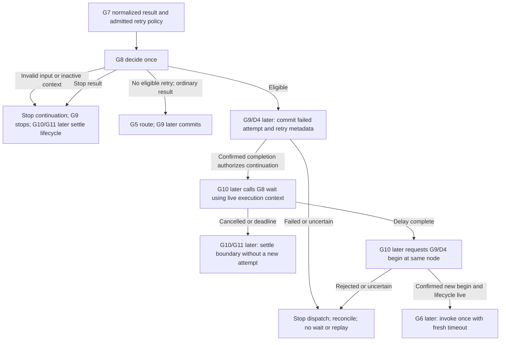

# G8 — Safe retry policy

## Overview

G8 decides whether one failed node may be attempted again and provides the
cancellable wait before that retry. It combines the admitted retry policy,
the completed attempt number, the live execution context, and G7's normalized
result. It never retries a timeout or assumes that missing command output
means an Android action was not dispatched.

For example, `maxAttempts: 3` and `delayMs: 1000` allow at most three total
attempts, including the first. A proven pre-dispatch failure on attempt 1
can lead to attempt 2 after a one-second delay. G9 must first commit the
failed attempt and retry decision. G10 then waits and requests another G9
attempt, which must confirm a new RUNNING checkpoint before invoking again.



**Status** — Implemented and verified on Linux on 2026-11-18. The agent and
retry test package cross-compile for Windows amd64; native Windows execution
was not run. G8 delivers decision and wait helpers. G9/G10 compose them into
the attempt lifecycle later; G11 owns shutdown settlement, including
cancellation between attempts. No retry loop or checkpoint integration is
implied by this helper delivery.

The [IR retry policy](../contracts/runtime_ir_v1.md#5-node-contract),
[A6 retryability rules](../contracts/event_error_v1.md#7-retryability),
[A5 checkpoint rules](../contracts/execution_state_v1.md#6-safe-boundary-and-checkpoint-rules),
[G7 projection](g7_execution_outcome_normalization.md#7-retryability-projection),
and [D4 checkpoint boundaries](../d_persistence/d4_atomic_checkpoint.md)
retain their business meaning. G8 adds no public error code or stored state.

## 1. Scope and existing owners

| Owner                 | Responsibility                                                                                                 |
| --------------------- | -------------------------------------------------------------------------------------------------------------- |
| Compiler/G1           | Supply and admit effective `maxAttempts` and `delayMs`; do not defer defaults to execution.                    |
| Trusted E/F producers | Prove whether the occurrence happened before command dispatch.                                                 |
| G7                    | Normalize status/error/Stop and preserve retryability only for sanctioned pre-dispatch failures.               |
| G8                    | Check policy and remaining attempts, decline unsafe retries, and provide a cancellable fixed wait.             |
| G5                    | Select the final ordinary success/error route after G8 declines retry and the lifecycle still permits routing. |
| G9/D4                 | Commit each failed attempt/retry decision and each new RUNNING attempt; reject stale or repeated work.         |
| G6                    | Invoke the next authorized attempt once with a fresh per-attempt deadline.                                     |
| G10/G11               | Own execution state, lifecycle context, and cancellation at or between attempt boundaries.                     |
| Phase H               | Coordinate multi-device scheduling and later Pause/Resume behavior.                                            |

G8 does not inspect ADB output, reclassify handler errors, resolve inputs,
scan attempt history, query device readiness, read SQLite state, or dispatch
anything. It operates on the caller's current execution state and values.
The database remains authoritative for whether a new begin is permitted.

## 2. Callable contract and reuse

Package `internal/execution/retry` exposes two functions:

```go
func Decide(
    ctx context.Context,
    policy ir.RetryPolicy,
    attemptNumber int,
    result outcomes.Result,
) (*execution.RetryDecision, error)

func Wait(ctx context.Context, delayMS int) error
```

Reuse the existing D4 metadata type from `internal/execution/checkpoint.go`:

```go
type RetryDecision struct {
    MaxAttempts int
    DelayMS     int
}
```

This avoids a second retry DTO or an extra Allowed flag. It is internal
metadata, not a JSON API response or a persisted retry entity.

| `Decide` return             | Meaning                                                                                                                         |
| --------------------------- | ------------------------------------------------------------------------------------------------------------------------------- |
| Non-nil decision, nil error | Retry is eligible under the supplied policy/result/context. The decision contains the policy's bounded MaxAttempts and DelayMS. |
| Nil decision, nil error     | No retry is selected. The caller must still honor G7 Stop and lifecycle rules before considering G5.                            |
| Nil decision, non-nil error | Invalid internal input or inactive context. Stop continuation; never interpret this as ordinary retry exhaustion.               |

An eligible next attempt number is `attemptNumber + 1`; it is not the
decision's MaxAttempts. The policy/attempt bounds below guarantee this is
at most three. G9 supplies that next number to BeginAttempt and keeps the
node ID unchanged. No next-node field is needed on RetryDecision.

Return a fresh decision value for each eligible call. Do not retain the
policy, result pointer, execution context, or latest attempt on a shared
object. The caller keeps `result.Error` immutable during the decision call.
No constructor, registry, logger, callback, or repository is required.

`Wait` receives a validated delay value, not a workflow or retry decision.
It provides waiting only: calling it cannot prove that a retry was eligible
or that a checkpoint committed. G9 must establish those conditions first.

## 3. Policy and attempt bounds

Use the exact admitted `ir.RetryPolicy`, whose fields are int64:

- MaxAttempts must be 1 through `constants.MaxNodeAttemptNumber` (three).
- DelayMS must be 0 through `constants.MaxRetryDelayMS` (60,000 ms).
- attemptNumber must be at least 1 and no greater than policy.MaxAttempts.

Validate before converting policy values to int or duration. Large integers,
negative values, omitted zero MaxAttempts, and an attempt above its admitted
limit are errors. Do not clamp them, apply defaults, or continue under a
different policy. attemptNumber equal to MaxAttempts is valid exhaustion;
greater than it indicates inconsistent internal state.

Compiled nodes already contain defaults of one total attempt and zero delay.
`maxAttempts: 1` therefore permits no retry. The policy is total attempts,
not additional retries. G8 does not consult the current catalog or modify
the policy after a workflow has been admitted.

## 4. Decision rules

Apply the following order, with a context check before work and before
returning either a decision or an ordinary no-retry result:

| Order | Condition                                                                      | Return                                                                                                        |
| ----- | ------------------------------------------------------------------------------ | ------------------------------------------------------------------------------------------------------------- |
| 1     | Execution context cancelled or deadline already reached                        | Context error, no decision.                                                                                   |
| 2     | Policy outside accepted limits                                                 | Guard error, no decision.                                                                                     |
| 3     | attemptNumber outside 1..MaxAttempts                                           | Guard error, no decision.                                                                                     |
| 4     | G7 result has Stop true                                                        | No retry. This is not permission to route or clear Stop.                                                      |
| 5     | Status is SUCCEEDED or TIMED_OUT                                               | No retry. A timeout is never retried, even if a fabricated result claims otherwise.                           |
| 6     | Status is neither of those nor FAILED                                          | Guard error. RUNNING/QUEUED/PAUSED/INTERRUPTED and CANCELLED without Stop are not eligible ordinary outcomes. |
| 7     | FAILED has nil Error                                                           | Guard error; a required G7 failure envelope is missing.                                                       |
| 8     | FAILED has Error.Retryable false                                               | No retry.                                                                                                     |
| 9     | Retryable FAILED has a code other than COMMAND_START_FAILED or ADB_UNAVAILABLE | Guard error; this contradicts the current G7 safety contract.                                                 |
| 10    | Completed attempt equals MaxAttempts                                           | No retry; the approved total has been used.                                                                   |
| 11    | Eligible failure, another attempt remains, context live                        | Return the fresh RetryDecision with the admitted policy values.                                               |

G8 trusts that the result came from G7; it does not repeat G7's message
sanitization, full error-code validation, error-chain precedence, or output
schema checks. The narrow status/nil-error/eligible-code guards prevent
accidental replay at this boundary. The Output field and message text have
no role in retry eligibility and are not copied or inspected.

The current eligible pair is deliberately narrow. An ADB process that could
not start or an unavailable tool may be proven pre-dispatch failures. Missing
stdout, a nonzero result after possible dispatch, an app-launch timeout,
invalid output, device loss, and unknown side effects provide no such proof.
A publisher's larger MaxAttempts cannot override that safety decision.

An earlier safe failure does not make a later attempt safe to replay. G9
must pass the newest attempt number and G7 result each time; G8 stores no
remembered retryability. After attempt 2 times out, attempt 1's retryable
error cannot authorize attempt 3.

## 5. Fixed delay and lifecycle behavior

`Wait` takes the live execution coordination context, not G6's completed
child context. A child context cancelled by G6 cleanup would incorrectly
abort the wait. G8 must never detach the caller context or create a new
Background context to force a retry through shutdown.

1. Check the context and accepted 0..60,000 ms range before converting to
   `time.Duration`. At a detected input error, prefer an already observable
   context failure.
2. For zero delay, check the context again and return immediately. Zero
   skips sleeping only; it skips no commit or lifecycle check.
3. For a positive delay, create one `time.NewTimer`, defer Stop, and select
   between its channel and `ctx.Done()`. Do not busy-poll or launch a waiter
   goroutine.
4. After the timer wakes, recheck cancellation/deadline before returning
   nil. If both events are ready, an observable context failure wins.

Check `ctx.Err()` and the clock against any known parent deadline, as in
G6/G7, so already reached deadlines are not accepted before their timer
signal is observed. Preserve an existing cancellation signal rather than
replacing it with a later clock-based timeout. Context errors must remain
inspectable through `errors.Is`.

Delay starts when Wait is entered after the previous completion is confirmed.
It is the full fixed delay, not an absolute retry timestamp calculated before
checkpoint I/O. Checkpoint latency is not deducted from it. Do not add
exponential backoff, jitter, a mutable retry queue, a new retry deadline,
or persisted timer state to the MVP.

The next node-attempt budget begins later, when G6 invokes that next attempt.
The retry delay does not consume the next attempt's TimeoutMS. A shorter
execution-parent deadline still stops waiting or prevents the next begin.
Nil from Wait means only that its delay completed while the sampled context
was live. G9/D4 must check lifecycle/state again before dispatch.

Pause/Resume is not implemented by G8. The later Phase H coordinator decides
whether a device worker can proceed at this safe boundary. G8's context and
Stop checks do not establish that SQLite still says RUNNING or bypass a
scheduler pause. D4's expected-state checks remain the final begin gate.

## 6. Checkpoint handoff and cancellation between attempts

The [G9 coordinator](g9_checkpointed_node_attempt.md) and later G10 runner
use an eligible decision in this order:

1. G9 keeps the original normalized failed attempt/error, sets the finish
   request's NextNodeID to this same node and Retry to the decision, and
   commits through D4. Existing terminal-attempt and retry-scheduled events
   remain authoritative; retry does not overwrite the failed attempt.
2. G9 returns the committed retry metadata only after confirmed completion.
   A failed, stale, duplicate, or uncertain finish releases no continuation.
   AlreadyFinalized alone is insufficient. G9 neither waits nor invokes again.
3. G10 rechecks lifecycle, then calls Wait with the live execution context
   and decision.DelayMS. Only a confirmed retry finish authorizes this wait
   as a path to another dispatch.
4. After waiting and rechecking lifecycle, G10 allocates a fresh attempt ID
   and calls G9 for the same node with attemptNumber + 1, the preceding
   attempt ID, and the original admitted limit. D4 validates the predecessor
   and assigns the next sequence. Only a newly confirmed begin permits G6.
5. That G9 call invokes once with a fresh timeout, normalizes through G7,
   and decides using the new attempt's evidence. G10 owns the outer loop.

During the delay, DeviceExecution stays RUNNING at the same NextNodeID. Its
latest NodeAttempt is already FAILED; no new RUNNING attempt exists yet.
There is no RETRYING attempt status or PENDING attempt record. G7 currently
makes every timeout non-retryable, although D4's generic checkpoint schema
can represent a retryable failed/timed-out attempt.

**Cancellation during this gap needs a boundary-state transition, not another
attempt completion.** Wait returns the context error and the worker must not
create a dummy attempt or invoke again. The previous failed attempt and its
retry-scheduled event remain valid history, even if that retry never occurs.
G10 hands the stopped boundary to G11, which must settle the
DeviceExecution/RunGroup through the appropriate no-active-attempt lifecycle
transaction. The current D4 FinishAttempt only
finalizes RUNNING attempts; it cannot rewrite the already failed attempt
as CANCELLED or reuse its ID for another finish.

That no-active-attempt lifecycle settlement belongs to G11, coordinated
by G10 using G9's confirmed-begin evidence; it is not part of G8 or G9. Its later acceptance must include cancellation
after retry finish commits, before Wait starts, during Wait, and after Wait
returns but before a new begin. Parent-deadline/fatal boundary handling must
likewise avoid inventing an invocation or changing finalized attempt history.

An application crash during the wait leaves durable non-terminal execution
state and the previous failed attempt. D6 interrupts unfinished execution
on restart; it does not restore a timer or resume the retry. A new user run
starts new execution records under the normal admission flow.

## 7. No-retry and error behavior

If no retry is selected and the G7 result is ordinary, G9 can ask G5 for
the success/error successor or terminal result and persist that outcome.
Exhaustion keeps the final failure's code and message; it does not replace
them with a new retry-exhausted error. No new public code is needed.

G7 Stop true, a cancellation/deadline error from G8, or a guard error never
authorizes the ordinary G5 path. A retry-decision guard error can be projected
through G7 as an internal stop; the coordinator must not silently treat it
as exhausted attempts. A Wait error happens after the earlier attempt was
finalized and must instead use the boundary handling above, not a second
finish of that attempt.

Use one sentinel `xerror.ErrRetryInvalid` in `pkg/x-error/retry.go` with the
fixed message `node retry state is invalid`. Wrap it in OperationError:

| Failure                                                                           | Operation           | Fixed Detail            |
| --------------------------------------------------------------------------------- | ------------------- | ----------------------- |
| Invalid admitted policy                                                           | `decide_node_retry` | `retry_policy_invalid`  |
| Invalid current attempt number                                                    | `decide_node_retry` | `retry_attempt_invalid` |
| Unsupported ordinary outcome, missing failed error, or unsupported retryable code | `decide_node_retry` | `retry_outcome_invalid` |
| Invalid direct wait delay                                                         | `wait_node_retry`   | `retry_delay_invalid`   |

Context cancellation/deadline uses the current operation wrapper and preserves
the actual context error instead of adding ErrRetryInvalid. Every failure
returns nil decision or non-nil wait error; no partially usable decision is
returned. Existing G7 unknown-error fallback already produces an internal
stop for this guard sentinel, so G7 needs no new mapping or signature change.

G8 returns contextual errors and adds no logger dependency. G10/G11 later log
one sanitized failure at ERROR through the existing B4 boundary. Error text
and Detail contain no node IDs, device serials, policy dumps, inputs, raw
handler messages, or protected IR. A zero-delay retry needs no special log.
The durable retry event is already owned by D4; G8 emits none.

## 8. Worked example

Policy: MaxAttempts 3, DelayMS 1,000. The node uses ERROR_BRANCH when no
eligible retry remains.

| Step                                                                               | G8 result                                  | Later G9/G10/G11 behavior                                                            |
| ---------------------------------------------------------------------------------- | ------------------------------------------ | ------------------------------------------------------------------------------------ |
| Attempt 1 fails before process dispatch; G7 returns retryable COMMAND_START_FAILED | Decision `{MaxAttempts: 3, DelayMS: 1000}` | G9 commits attempt 1 FAILED and retry metadata; G10 waits and requests G9 attempt 2. |
| Attempt 2 has the same proven failure                                              | Same policy decision                       | G9 commits attempt 2 FAILED and retry metadata; G10 waits and requests G9 attempt 3. |
| Attempt 3 has the same failure                                                     | Nil decision, nil error: exhausted         | G5 selects the existing error successor; G9 commits that final failure and route.    |
| Any attempt's Tap times out after possible dispatch                                | Nil decision: unsafe to retry              | G5 handles the timeout under the node's error policy; no repeat tap.                 |
| Owner cancels during the first delay                                               | Wait returns context cancellation          | No attempt 2; G11 settles the boundary and preserves attempt 1 as FAILED.            |

ERROR_BRANCH does not skip an eligible retry. STOP does not prohibit an
eligible retry either: both error policies apply to the final failure once
G8 declines. G8 therefore needs no error-policy or edge argument.

These rows describe the future integrated flow. G8 unit tests prove decisions
and waits without claiming that any attempt, route, or event was persisted.

## 9. Implementation mapping and efficiency

| Runtime file                             | Responsibility                                                                                                                   |
| ---------------------------------------- | -------------------------------------------------------------------------------------------------------------------------------- |
| `internal/execution/retry/retry.go`      | Stateless Decide/Wait operations, bounded policy/attempt checks, eligibility, context handling, and one fixed timer when needed. |
| `internal/execution/retry/retry_test.go` | Table-driven decisions, cancellation/timing, real G7 handoff, decision ownership, and independent calls.                         |
| `pkg/x-error/retry.go`                   | Single safe guard-error sentinel; reuse OperationError.                                                                          |

The implementation adds 106 production lines across two files and a 368-line
focused test file, for three runtime files total. Tests and docs are reported
separately. Reuse ir.RetryPolicy, outcomes.Result,
execution.RetryDecision, MaxNodeAttemptNumber, and MaxRetryDelayMS. There
is no new dependency, constant limit, DTO, database table, or generated wiring.

Do not modify G6 invocation, G7 normalization, G5 routing, checkpoint request
types, or storage services while delivering G8. In particular, recording the
no-active-attempt lifecycle requirement above does not implement G11 early.

Each decision is O(1) and allocates at most its small returned metadata value.
A positive wait owns one timer, releases it on exit, and blocks only its caller;
zero delay requires none. There are no internal goroutines, polling loops,
mutable shared maps, history queries, schema checks, or database operations.

## 10. Verification and acceptance

| Test group                                     | Required evidence                                                                                                                                              |
| ---------------------------------------------- | -------------------------------------------------------------------------------------------------------------------------------------------------------------- |
| Eligible start/tool failure                    | Correct fresh existing RetryDecision for COMMAND_START_FAILED and ADB_UNAVAILABLE after real G7 normalization.                                                 |
| Policy defaults and attempt bounds             | One total attempt means no retry; limits 1 and 3 work; current equals max is exhaustion; invalid/overflow-sized policy and invalid current number fail safely. |
| Retryable false                                | No retry even when attempts remain; no message or output heuristic upgrades safety.                                                                            |
| G7 Stop true                                   | No retry, without clearing Stop or returning routing permission.                                                                                               |
| Success and timeout                            | No retry, including a malformed timeout result with a true retry flag.                                                                                         |
| Malformed ordinary result                      | Unsupported status, nil failed error, or unsupported retryable code produces the contextual guard error.                                                       |
| Different latest outcomes                      | An earlier eligible failure cannot authorize replay after the newest timeout/non-retryable failure.                                                            |
| Decision ownership                             | Caller mutation does not change policy, another result, or a later call; returned limits convert safely to D4's int fields on Linux/Windows.                   |
| Zero delay                                     | Immediate success only with live context; pre-cancelled/expired context still fails.                                                                           |
| Positive delay                                 | Waits the fixed duration; no handler or checkpoint is invoked.                                                                                                 |
| Cancellation/deadline during delay             | Stops before the full delay and returns an inspectable context error; no later invocation is implied.                                                          |
| Timer/context tie and already elapsed deadline | An observed lifecycle failure wins over timer completion; do not miss a deadline before its signal.                                                            |
| Concurrent calls                               | Independent decisions and waits; no shared latest-attempt state or value leakage.                                                                              |
| Error confidentiality                          | Fixed operation/reason and safe sentinel text; no metadata, raw result message, or input values appear.                                                        |

Use the existing Go test style and `testing/synctest` for waits, cancellation,
and timer ties. No test should sleep for real multi-second retry delays.
At least one handoff test must produce a retryable failure through actual
G7 Normalize and feed it into Decide; another must show that G7's timeout
result cannot retry. Do not add real SQLite, Android, subprocesses, or a fake
scheduler to prove these standalone operations.

The later G9/G10/G11 acceptance, outside G8, must verify real begin/finish
checkpoints, same-node retry position, new attempt IDs/sequences, event order,
no dispatch on uncertain commit, and no-active-attempt cancellation settlement.
Helper tests cannot substitute for those durable integration checks.

Run focused tests/race checks, the full Go regression suite, vet, formatter,
Linux build, Windows amd64 cross-compilation, and whitespace checks when
implementing. Report native Windows execution and real-device acceptance
separately. G8 completion is at the callable-helper boundary; the G9/G10/G11
durable integration requirements above remain separate.

### Verification record — 2026-11-18

Passed:

- `go test ./internal/execution/retry`.
- `go test -race ./internal/execution/retry ./internal/execution/outcomes`.
- `go test ./...` and `go vet ./...`.
- `make fmt` and `make build VERSION=0.1.0`.
- Windows amd64/CGO-disabled cross-compilation of the retry test package and
  `cmd/agent`.
- Whitespace checks for tracked/new files, documentation formatting, local
  links/anchors, and matching phase-index/roadmap status.

Tests cover policy/attempt boundaries, real G7 normalization handoff, unsafe
and exhausted results, error classification/confidentiality, independent
metadata, zero/max waits, parent deadlines, cancellation during waiting,
timer/deadline ties, and concurrent calls. Synthetic time avoids real
multi-second waits. The retry guard also passes through G7's existing internal
stop fallback without modifying the normalizer.

These tests invoke no Android command and write no checkpoint. Persisted retry
events, new attempt identity/sequence, commit uncertainty, and cancellation
with no active attempt remain G9/G10/G11 integration evidence. Native Windows
execution and real-device workflow acceptance were not run. Existing G6/G7
runtime files were preserved unchanged.

Inspect the named cases from the Runtime repository:

```bash
go test ./internal/execution/retry -v
```

## 11. Deferred work and platform impact

G9 connects retries to durable attempts, G10 drives successive execution,
and G11 settles owner shutdown at every boundary. Phase H owns Pause/Resume,
queue coordination, and multi-device lifecycle behavior. No automatic crash
resume, replay of uncertain Android actions, backoff strategy, or persistent
retry queue is introduced by G8.

Backend node definitions and Studio already expose the admitted retry policy.
G8 changes no Backend catalog, Studio graph format, Launcher API, Runtime IR
version, SQLite schema, or authentication behavior. Client integration guides
will describe the actual execution APIs once those APIs are implemented and
verified. Both supported operating systems use the same Go decision/timer code.
