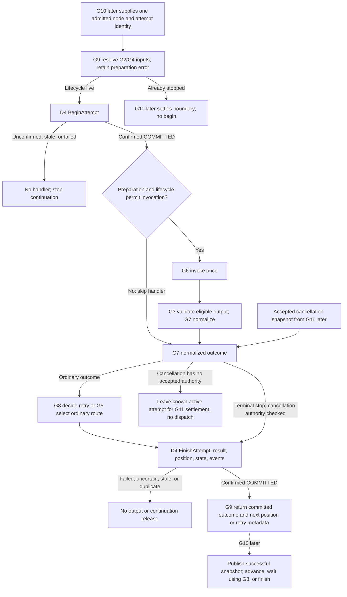

# G9 — Checkpointed node attempt

## Overview

G9 connects G2–G8 to the existing D4 checkpoint writer for **one node
attempt**. It prepares inputs, confirms a RUNNING checkpoint before a handler
can dispatch, invokes once, validates/normalizes the result, and commits the
result together with its selected next position. Only that confirmed finish
can release successful output or continuation information.

For example, Tap may reach Android before Runtime crashes. Its previously
committed RUNNING attempt then remains evidence of uncertain work. G9 must
not repeat the tap or assume success because the handler returned. D4 owns
atomic storage and bounded commit read-back; G9 owns their correct ordering
around the execution helpers.



**Status** — Implemented and verified on Linux on 2026-11-18. The agent and
attempt test package cross-compile for Windows amd64; native Windows and
real-device execution were not run for this phase. G10 owns
the workflow/retry loop and execution-local output view. G11 owns accepted
shutdown and settlement between attempts. G9 does not implement those phases
or add an execution API.

The [A5 checkpoint rules](../contracts/execution_state_v1.md#6-safe-boundary-and-checkpoint-rules),
[D4 implemented boundary](../d_persistence/d4_atomic_checkpoint.md#8-implemented-boundary),
[G4 output handoff](g4_previous_node_output_bindings.md#3-execution-local-view-and-commit-handoff),
[G6 invocation](g6_attempt_deadlines.md), [G7 outcomes](g7_execution_outcome_normalization.md),
and [G8 retry decision](g8_safe_retry_policy.md) retain their contracts.

## 1. One-attempt ownership

| Owner    | Responsibility                                                                                                                    |
| -------- | --------------------------------------------------------------------------------------------------------------------------------- |
| G1 / G10 | Supply the exact admitted node from the immutable checked document; retain device inputs and the matching per-device output view. |
| G9       | Coordinate one preparation/begin/invocation/completion cycle and return only confirmed continuation data.                         |
| G2/G4    | Resolve supplied literal, workflow-input, and committed previous-node output bindings without SQLite lookups.                     |
| G3/G7    | Produce the checked snapshot and consistent safe outcome.                                                                         |
| G8       | Decide eligibility; provide Wait for the later runner. G9 calls Decide only.                                                      |
| G5       | Select the ordinary successor or terminal decision after retry is declined.                                                       |
| D4       | Validate identities/expected state, allocate sequence, persist state/events atomically, and reconcile its own uncertain commits.  |
| G10      | Call G9 successively, publish committed output to its own view, and perform G8 Wait before requesting another attempt.            |
| G11      | Own cancellation authority, the current shutdown deadline, and no-active-attempt settlement.                                      |

One Run call never follows the next node, sleeps for retry, invokes a second
attempt, or admits a workflow. A caller may drive several calls in a test,
but that harness is not G10 implementation. No new SQLite table, migration,
repository, event type, or durable attempt state is introduced.

## 2. Callable API and dependencies

Use package `internal/execution/attempts`. Define the narrow checkpoint
interface at this consumer; the existing services.CheckpointService satisfies it:

```go
type Checkpoints interface {
    BeginAttempt(context.Context, execution.BeginAttemptRequest) (execution.CheckpointResult, error)
    FinishAttempt(context.Context, execution.FinishAttemptRequest) (execution.CheckpointResult, error)
}

type Dependencies struct {
    Bindings    *bindings.Resolver
    Invoker     *invocation.Invoker
    Outputs     *outputs.Validator
    Routes      *routing.Router
    Checkpoints Checkpoints
    Now         func() time.Time
}

type Control struct {
    GroupCancellation bool
    ShutdownDeadline  time.Time
}

type Request struct {
    Ref                  execution.AttemptRef
    Node                 ir.Node
    ExpectedDeviceStatus string
    AttemptNumber        int
    PreviousAttemptID    string
    ADBSerial            string
    Values               bindings.Values
    Control              func() Control
}

type Result struct {
    Began      bool
    Finished   bool
    Sequence   int64
    Cursor     string
    Outcome    outcomes.Result
    NextNodeID string
    Retry      *execution.RetryDecision
}

func New(dependencies Dependencies) (*Coordinator, error)
func (c *Coordinator) Run(ctx context.Context, request Request) (Result, error)
```

Require the five execution/checkpoint dependencies. A nil Now uses time.Now.
Store no current execution, request, context, or output map on the shared
coordinator. The route index belongs to the same admitted workflow as Node;
G10 constructs/reuses that pairing once, not per attempt. The composition
caller must not supply a typed-nil Checkpoints implementation.

Control is a trusted, nonblocking in-memory lifecycle snapshot function,
not a workflow callback or HTTP DTO. Nil means no accepted cancellation and
no shutdown deadline. G11 later supplies its actual authority; tests can
supply a controlled snapshot. G9 never accepts, initiates, or broadcasts a
group cancellation by calling it. Keep this hook free of database/network
I/O and panics; synchronization belongs to the lifecycle owner.

The caller creates each fresh lowercase UUID v4 AttemptID using the existing
UUID package. A repeated request retains that attempt identity; it must not
invent another ID to bypass a rejected begin. D4 assigns Sequence. G9 creates
neither run/device IDs nor request-id replay records.

## 3. Result and error meaning

| Return                       | Meaning                                                                                                                                                                      |
| ---------------------------- | ---------------------------------------------------------------------------------------------------------------------------------------------------------------------------- |
| Nil error                    | Both begin and finish were confirmed for this call; Began and Finished are true. Outcome, NextNodeID/Retry, Sequence, and finish Cursor describe that committed result.      |
| Error before confirmed begin | No dispatch authorization; result is empty. This does not prove an uncertain transaction left no durable row.                                                                |
| Error after confirmed begin  | Began true and Sequence identify the known active attempt; Finished is false. Outcome, NextNodeID, Retry, and Cursor are empty. No publication or continuation is permitted. |

Outcome contains the copied G3/G7 output only for a committed successful
attempt. It is a per-attempt result, not proof that the whole device/run
succeeded. For a handled failure the committed attempt stays FAILED while
NextNodeID identifies its error successor and the device remains RUNNING.
For a retry NextNodeID is the same node and Retry contains G8's metadata.

Return values are internal control data; never serialize Result directly as
an A7 response. A normal committed node failure returns nil Go error with
its normalized failed Outcome. The Go error channel means this call could
not release an authoritative completed result, not another ordinary error
branch to retry or route.

Do not return the proposed output/route alongside a failed finish. A caller
must not infer continuation from a prepared handler result, a nonzero
sequence alone, an existing SQLite row, or an AlreadyFinalized disposition.

## 4. Entry guards and preparation

Before calling a handler or writing a checkpoint:

1. Require a live execution context and no already accepted cancellation.
   Read Control at entry; an accepted stop exits without starting work even
   if context cancellation propagation is still in progress.
2. Validate Ref with existing execution.ValidID/ValidNodeID helpers; require
   Ref.NodeID equal to Node.ID. ExpectedDeviceStatus must be QUEUED or
   RUNNING. Validate the policy/attempt bounds before int conversion.
3. First attempt requires an empty PreviousAttemptID. Later attempts require
   a valid preceding UUID different from this AttemptID. D4 still proves
   that the actual preceding durable attempt is correct and retryable.
4. Reject known special/deferred execution types before begin: Switch,
   Set Variable, Wait Variable, Screenshot, and Log. Their routing, atomic
   writes, stage callbacks, or disclosure rules belong to G15–G19/H/F8.
   Reuse/add named type constants in the existing constants package. Ordinary
   enabled handlers are not restricted to a hardcoded Android allowlist.
5. Resolve inputs with G2 ResolveInputs(ctx, Node, Values). Retain either
   the resolved map or the error. Never partially invoke a node on a
   partially resolved input map.
6. Recheck context and accepted cancellation before BeginAttempt. A lifecycle
   stop during preparation returns without starting an attempt; G11 owns
   settlement of the queued/between-attempt execution boundary.

An ordinary binding failure is still a node-attempt failure to record: with
the lifecycle live, proceed through begin, skip G6 entirely, normalize that
preparation error, and finish it through D4. This preserves failure history
and the configured error route without dispatch. A missing trusted dependency
is instead an internal Stop result under G7. G9 must not resolve the inputs
again or repeat a handler while trying to record either failure.

G1 is not rerun here. The caller must supply the admitted node, the matching
route index and definition/handler build, exact selected device serial, and
the correct values view. G9 does not authenticate unrelated maps from their
contents, fetch mutable catalog defaults, or repeat graph/dominance analysis.

## 5. Confirmed start and single invocation

Capture one begin timestamp from Now, convert to UTC, and require a nonzero
value. Pass Ref, expected device status, attempt number, bounded admitted
MaxAttempts, PreviousAttemptID, and that timestamp to D4 BeginAttempt using
the live execution context.

| Begin return                                            | Required G9 behavior                                                                                 |
| ------------------------------------------------------- | ---------------------------------------------------------------------------------------------------- |
| COMMITTED, valid positive sequence and committed cursor | Set Began/Sequence and continue. This includes D4's positively reconciled own begin.                 |
| STALE                                                   | Return classified stale-state error; invoke no handler.                                              |
| Any error, including unknown commit outcome             | Stop; do not call the handler or try a new attempt identity. D4 owns reconciliation/fatal reporting. |
| Unexpected disposition or malformed success metadata    | Internal error with no dispatch authorization.                                                       |

After confirmed begin, check lifecycle again. Invoke G6 only when preparation
passed and no accepted cancellation or context stop prohibits invocation.
Construct registry.Invocation inside G9 from Request.ADBSerial, Node.Config,
and the resolved inputs. No screenshot stage callback is supplied in G9.
Do not pass executable binding-source objects as handler inputs.

G6 invokes exactly once and joins the handler's return. No SQLite transaction
spans its work; even a long Delay keeps no checkpoint transaction open.
If G6 rejects before invocation, normalize its outer error as stageError.
If it returned an observation, retain its actual error signals rather than
treating a nil outer error as success. Handler panics propagate; D6 can later
interrupt the RUNNING evidence. G9 adds no panic recovery or automatic replay.

Two concurrent Run calls for the same execution/node cannot gain permission
through an in-memory flag. D4's expected node/state and active-attempt checks
authorize only a valid new begin. G10 later serializes each device's calls;
independent device calls may share this coordinator without a handler-wide
mutex. D4's existing writer gate covers transactions/read-back only.

## 6. Output, normalization, and complete-event ceiling

Only an observation with nil HandlerError, AttemptError, and ParentError
is eligible for G3. Call G3 with the original returned map and admitted node
type. Capture either its exact checked bytes or its validation error.
Do not convert nil output to an empty map, strip invalid fields, or re-encode
the mutable handler map after validation.

Normalize the actual evidence through G7, using the live execution context.
Preparation/invocation-rejection/output-validation errors occupy stageError
under G7's valid call patterns. They must not be combined with an unrelated
HandlerError to manufacture a different outcome.

Before accepting a successful candidate, verify that its **complete success
attempt event** fits A6. G3's output-only MaxEventBytes check is necessary
but insufficient once IDs, status, attempt number, timestamp, and the event
envelope are included. Build a local preflight PendingEvent for the exact
Ref with Status SUCCEEDED, this attempt number, G3 bytes, and the proposed
finish timestamp, then reuse execution.ValidEvent. Its existing full-envelope
check reserves the widest cursor. Do not append or notify this probe event.

If validated output cannot fit that event, discard it and normalize a safe
non-retryable NODE_OUTPUT_INVALID stage error with the existing fixed message
`Node output exceeds the execution event limit`. Select the resulting error
route/terminal result normally. Do not first attempt to persist oversized
success and leave an avoidable RUNNING row on an invalid-event rejection.
Do not truncate output, raise the event limit, or introduce a public payload
variant. D4 still validates every actual complete event before writing.

Local event preflight uses only the admitted/validated fields and existing
A6 shape; it is not a second persistence/event publisher. A private success
probe may mirror the three-field status/attemptNumber/output projection,
with compatibility tests against D4 events to prevent shape drift.

## 7. Lifecycle snapshot and accepted cancellation

Read Control again after the handler/preparation result and once more when
freezing the finish request, after continuation has been prepared. Sample
the live parent context at that final boundary too. Use the latest snapshot's
shutdown deadline for finish. A value captured at Run entry is not enough
for a shutdown that begins during a long handler.

An accepted GroupCancellation is authoritative lifecycle evidence even if
the parent context has not yet signalled. It overrides ordinary success,
ordinary node failure, or timeout with CANCELLED/Stop, no output, and no
error. Preserve an already classified INTERNAL_ERROR or PERSISTENCE_FAILED
stop; cancellation must not hide an infrastructure failure. This narrow
coordinator override adds no new G7 status or error mapping.

If accepted cancellation or a newly observed parent stop changes an ordinary
candidate after retry/route selection, discard the proposed NextNodeID,
Retry, and output. Do not rerun a handler, wait, or ask G5 for a different
error branch. Use the terminal/handoff rules below. A final G7 check may
reuse the original observation, checked bytes, and original stageError;
G3 serialization does not run again.

For an accepted cancellation, skip G8/G5 and supply GroupCancellation true
with empty NextNodeID and no Retry to D4. For a preserved internal failure,
the accepted flag may still accompany the terminal finish: D4 retains the
attempt failure and applies its existing accepted group-cancellation aggregate.
G9 never finalizes sibling devices or calculates group state itself.

If G7 yields CANCELLED but Control reports no accepted cancellation, do not
invent the authority required by D4 validFinish. Return a contextual
context.Canceled error with reason `attempt_cancellation_unsettled`, preserve
Began/Sequence, and release no completion data. The attempt remains known
RUNNING for G11's authoritative settlement. With nil Control this is the
safe behavior for a mid-call owner/process cancellation; it is not a graceful
shutdown acceptance claim.

Parent deadline expiry without accepted cancellation can finish as TIMED_OUT
with G7's Stop true and empty next position. The separate D4 finish context
allows that terminal result to commit after the invocation context expires.
If its supplied shutdown deadline has also passed, treat a failed finish
as unconfirmed and stop. No detached handler continues after G6 returns.

These snapshots are not an atomic lock against all future lifecycle changes.
Once G9 has frozen a finish candidate, a later stop belongs to G10/G11's next
safe-boundary settlement. G10 must check lifecycle again before publication,
retry waiting, new begin, or dispatch. A successful finish must never be
followed by a second FinishAttempt just to change it into cancellation.

## 8. Retry and route selection

| Normalized candidate                                                                                | G9 continuation preparation                                                                                              |
| --------------------------------------------------------------------------------------------------- | ------------------------------------------------------------------------------------------------------------------------ |
| PERSISTENCE_FAILED stop from execution evidence                                                     | Do not attempt another ordinary finish through a possibly failed store; return an unconfirmed error for D4/G11 handling. |
| CANCELLED without accepted authority                                                                | Hand off the known active attempt as above.                                                                              |
| Other Stop true, including accepted cancellation, internal failure, device loss, or parent deadline | No retry or ordinary route; empty next position.                                                                         |
| Ordinary failed candidate eligible under G8 Decide                                                  | Same node as NextNodeID and returned RetryDecision; no G5 call.                                                          |
| Ordinary candidate without retry                                                                    | G5 selects success/error successor or terminal result.                                                                   |

A retry decision or routing guard error is an internal stop, not exhaustion
or another chance to call the handler. Project it through G7 as a fresh stage
error with an empty observation, clear proposed output/route/retry, and
prepare a safe failed terminal finish where storage is healthy. Do not
combine that guard with an old HandlerError or recursively ask G5 to route
its own invariant failure.

A context error returned by G8/G5 instead requires a lifecycle recheck using
the original invocation/preparation evidence, not that malformed combination
of two error stages. Apply the final cancellation-authority/deadline rules
before finish. Preserve a newly normalized invariant failure during any final
recheck. These are bounded preparation/final checks, not an unbounded
normalization or finish loop.

For ordinary candidates, use G5's expected DeviceStatus for consistency with
the normalized attempt status/next position. The finish request still contains
the original attempt status; D4 derives device/group state. A TIMED_OUT attempt
never becomes an unsupported TIMED_OUT DeviceExecution. Successful End alone
provides normal successful device termination.

G9 does not call G8 Wait. It returns committed RetryDecision metadata to G10,
which waits with the live execution context before requesting attemptNumber

- 1 with a fresh ID and the preceding ID. D4 proves the predecessor, but does
  not independently prove that the delay elapsed: obeying Wait is the runner's
  precondition. There is no persisted retry timer or hidden G9 retry loop.

## 9. Finish request and commit dispositions

Capture one finish timestamp after invocation/output validation and before
event preflight and continuation selection. Use UTC and a value no earlier
than the captured begin timestamp; a backwards wall clock reading is clamped
to that begin timestamp. Freeze the timestamp used
for event preflight and the actual finish request. The injected clock affects
record timestamps only, not G6 deadlines or G8 timing.

Serialize only G7's safe CommandError value when present; success uses the
exact checked snapshot, cancellation has neither output nor error. Build
execution.FinishAttemptRequest using the same Ref, NodeType, normalized status,
chosen NextNodeID/Retry, current cancellation authority, and shutdown deadline.
Artifact and DiscardArtifactID remain unset in G9.

Pass the execution context to FinishAttempt even when it is cancelled or
expired. D4 already creates its own bounded completion context, limited to
five seconds or the earlier ShutdownDeadline. G9 adds no independent detached
context, unbounded persistence retry, raw SQL, or separate event transaction.

| Finish return                                                 | Required G9 result                                                                                                        |
| ------------------------------------------------------------- | ------------------------------------------------------------------------------------------------------------------------- |
| COMMITTED, matching begin sequence and valid committed cursor | Set Finished true and release the committed outcome, next position/retry, sequence, and finish cursor.                    |
| STALE                                                         | Error; no output or continuation.                                                                                         |
| ALREADY_FINALIZED                                             | Error; existing durable history remains authoritative. Do not publish the proposed payload or advance a second time.      |
| Persistence failure or unresolved commit                      | Error; no new dispatch, route, retry, output visibility, or optimistic completion.                                        |
| Invalid request/event or unexpected success metadata          | Error and stop continuation, even if D4 did not mark its service globally fatal. A side effect may already have happened. |

D4 may positively reconcile an uncertain commit and return COMMITTED with
its original result. Accept that returned confirmation, not a row guessed
from an extra G9 read. Reuse D4's one read-back; add no second reconciliation
query or a retry of the finish transaction in G9. Actual events and observer
wakeups remain D3/D4-owned, including read-back notification.

On any unconfirmed finish, retain only Began/Sequence in Result and return
the contextual classified error. Do not normalize the persistence error into
another ordinary completion and call FinishAttempt again. D6 later interrupts
remaining RUNNING evidence if the process exits before safe settlement.

## 10. Committed output publication and retry gaps

G9 does not mutate Request.Values.CommittedOutputs. It returns the confirmed
successful snapshot for G10 to decode once into ir.Object and insert under
this producer's ID in that device execution's view. All failed, timed-out,
cancelled, rejected, or unconfirmed results contribute no output. A repeated
result must not be published or advanced twice.

G10 must apply the snapshot before resolving the next consumer and keep
different device/run views separate. Publishing does not re-marshal the
handler map. Dropping a view on termination and D6 no-auto-resume behavior
remain the G4/G10 contract. G9 tests demonstrate the confirmed-snapshot
handoff with a caller-owned view; they do not implement that runner cache.

After a committed retry finish, the previous attempt is FAILED and no new
RUNNING attempt exists during G10's wait. Cancellation then requires G11's
no-active-attempt boundary transaction. G9 cannot rewrite the failed row,
create a dummy attempt, or perform another handler call to settle it. This
applies before Wait, during Wait, and after Wait before the next begin.

This boundary settlement remains an explicit G11 integration requirement.
Likewise, a cancellation before G9 confirms begin leaves no known active
attempt for this call. The coordinator passes ownership to G11 using the
known execution identity and begin-confirmation evidence, without pretending
that a lifecycle transaction already ran.

## 11. Errors, logs, and confidentiality

Add a fixed-message ErrAttemptInvalid sentinel in `pkg/x-error/attempts.go`
for constructor/request/unsupported-node/unexpected-result guards. Reuse
existing stale-state, persistence, checkpoint, and context errors for those
actual cases. Preserve errors.Is/errors.As and a specific existing OperationError.
Never match error text to authorize dispatch or continuation.

Use `configure_node_attempt` and `run_node_attempt` for new guard operations,
with fixed reasons such as `attempt_dependencies_unavailable`,
`attempt_request_invalid`, `attempt_node_unsupported`,
`attempt_begin_unconfirmed`, `attempt_finish_unconfirmed`, and
`attempt_cancellation_unsettled`. Reuse existing execution.ParseEventCursor
to validate nonempty positive checkpoint cursors and require positive/matching
sequences. No arbitrary IDs, serials, raw output, or protected values belong
in error text or Detail.

G9 returns contextual errors without another logger dependency. G10/G11 or
the existing fatal-store supervisor boundary logs the operation once at ERROR
under B4. Log only normalized safe codes/messages and approved fixed operation
metadata; do not stringify a handler error, checkpoint cause, full Request,
values view, or Outcome.Output. Ordinary progress events come from D4, not
new G9 logs or transient event substitutes.

## 12. Implementation mapping and review size

| Runtime file                                                  | Responsibility                                                                                                                              |
| ------------------------------------------------------------- | ------------------------------------------------------------------------------------------------------------------------------------------- |
| `internal/execution/attempts/coordinator.go`                  | Request/result/dependency types, consumer checkpoint interface, constructor, entry/preparation/begin, and one-call orchestration.           |
| `internal/execution/attempts/completion.go`                   | G3/G7 completion preparation, full-event preflight, lifecycle snapshot, retry/route decision, and finish/result release helpers.            |
| `internal/execution/attempts/coordinator_test.go`             | Focused guards, dependency ordering, zero-dispatch failures, control snapshots, and disposition checks with narrow controlled dependencies. |
| `internal/execution/attempts/coordinator_integration_test.go` | Real file-backed SQLite, actual D4 service and execution helpers, controlled handlers, durable rows/events, and fault injection.            |
| `pkg/x-error/attempts.go`                                     | One safe coordinator guard sentinel; reuse OperationError and existing classifications.                                                     |
| `pkg/constants/runtime_ir.go`                                 | Missing named special-node type constants for scope gating.                                                                                 |

Target roughly 250–350 production lines across four or fewer production
files; report tests and docs separately. Use small helpers with these actual
responsibilities instead of placing a workflow runner in this phase. If
substantial preparation beyond that scope is discovered, identify it before
implementation rather than expanding into G10/G11 or changing phase numbers.
No new module dependency, generated wiring, startup component, database logic,
or API DTO is needed. Default composition happens when G10 is implemented.

Normal execution uses one begin and one finish checkpoint. Handler invocation
and binding loops perform no database writes. No transaction spans ADB, Delay,
output validation, or subscriber delivery. Reuse immutable helper/catalog
dependencies and the once-built route index; do not reload the catalog,
re-admit the IR, or reopen SQLite per node. Failed/rejected transitions add
no extra polling or per-field queries.

## 13. Verification and acceptance

| Scenario                                         | Required evidence                                                                                                                                                  |
| ------------------------------------------------ | ------------------------------------------------------------------------------------------------------------------------------------------------------------------ |
| Valid ordinary success and End                   | RUNNING row is committed before handler entry; one terminal attempt and matching next position/state/events after finish.                                          |
| Binding failure                                  | Begin/failed finish history with zero handler calls; correct ordinary error route or terminal failure.                                                             |
| Handler error, output error, timeout             | Real G6/G3/G7 results persist under the correct statuses/codes; failed output never becomes downstream data.                                                       |
| Safe retry                                       | G8 metadata commits with same-node position; G9 returns without waiting/invoking again; test driver uses Wait then a fresh request/ID to verify the next sequence. |
| Retry exhaustion / unsafe replay                 | Final ordinary route/terminal result is correct; timeout or uncertain action is never invoked again.                                                               |
| Duplicate/concurrent begin                       | Only the authorized call invokes; no duplicate dispatch using the same request or competing fresh identity.                                                        |
| Duplicate/stale finish                           | No release of proposed output/route/retry, second advancement, or extra events.                                                                                    |
| Begin write fault or unconfirmed begin           | No handler invocation; preserve actual durable evidence for D4/D6.                                                                                                 |
| Finish fault after simulated side effect         | Prior RUNNING row/events remain on rollback; no retry, successor dispatch, or output release.                                                                      |
| D4 positive read-back                            | Exact confirmed begin/finish is honored once without another G9 write/read-back loop.                                                                              |
| Whole-event overflow                             | A G3-valid output below its own ceiling but too large for A6 becomes a safe NODE_OUTPUT_INVALID failed checkpoint, not oversized success.                          |
| Successful output view handoff                   | Only confirmed snapshot bytes enter a caller-owned per-device view; a later G4 consumer sees that value, not the mutable handler map or another device's view.     |
| Accepted cancellation during preparation/handler | No dispatch when stopped before begin; after begin, accepted stop can commit cancellation with bounded finish and no error/output.                                 |
| Cancellation without accepted authority          | Known active-attempt evidence is handed off, no invalid CANCELLED finish is attempted, and no continuation data is returned.                                       |
| Current shutdown deadline                        | Finish receives the latest snapshot deadline and respects D4's shorter bound.                                                                                      |
| Scope guards and confidentiality                 | Special/deferred nodes reject before begin; malformed identities/dependencies/dispositions fail safely without secrets in errors.                                  |

Use a temporary file-backed SQLite store with its real migrations,
repositories, D4 service, and G2–G8 components. Follow existing D4 repository
fixtures/fault patterns; keep SQL in test setup/fault injection, not coordinator
production code. Register controlled Go handlers through the real F9 registry
so tests can assert durable begin state at invocation and count side effects.
Do not require real ADB or a public run endpoint for this phase.

The current shipped ordinary outputs are small, and the installed catalog
has no public test-definition loader. The ceiling test therefore uses the
existing Screenshot string output schema with real G3, then calls completion
preparation directly to prove full-event rejection becomes NODE_OUTPUT_INVALID.
It does not invoke a Screenshot handler, persist a Screenshot, or bypass the
public Run guard in application code. Separate tests prove Run rejects it
before begin. This verifies the output/event boundary without changing the
production catalog or adding a test-only production extension point.

Keep real SQLite I/O outside synthetic-time bubbles; G6/G8 already test timers
deterministically. Use zero-delay retry fixtures or narrow controlled
boundaries for G9 persistence tests.

Run focused unit/integration checks, focused race checks, full Go regression
tests, vet, formatter, Linux build, Windows amd64 cross-compilation, and
whitespace checks. Report native Windows and real-device acceptance separately.
Passing G9 proves one durable attempt, not a running complete workflow or
implemented shutdown integration. Record actual evidence before marking code
complete.

## 14. Deferred work and platform impact

G10 implements the sequential workflow/retry loop and committed-output view.
G11 supplies accepted owner control and all no-active-attempt settlement.
G12–G14 add admission/snapshot/start coordination and APIs. G15–G19 extend
the attempt path for Switch, variables, and real Screenshot staging; G20
exposes artifacts. G21/G22 verify final results and complete interactions.

G9 changes no Backend node catalog, Studio workflow/IR format, Launcher
endpoint, local authentication, or SQLite schema. The internal Control and
Result fields never become public A6/A7 payload additions. Integration guides
continue to track the actual implemented API build rather than this internal
attempt interface.

## 15. Implementation and verification record

The implementation adds 297 production lines across the coordinator,
completion helper, and error-sentinel files, plus three named constants in
the existing constants file. Two test files cover the coordinator contract
and real file-backed SQLite integration. No composition-root, repository,
migration, generated file, dependency, or API change is required.

Verified on Linux:

- `go test ./...` — regression suite, including G9 unit/integration checks.
- `go test -race ./internal/execution/...` — execution helpers and real G9
  checkpoint integration under the race detector.
- `go vet ./...` — static checks.
- `make fmt build` — formatter and Linux agent build.
- `GOOS=windows GOARCH=amd64 CGO_ENABLED=0 go build -buildvcs=false -o /tmp/a2matex-g9-agent.exe ./cmd/agent`.
- `GOOS=windows GOARCH=amd64 CGO_ENABLED=0 go test -c -o /tmp/a2matex-g9-attempts.test.exe ./internal/execution/attempts`.
- Markdown formatting, local links/anchors, and tracked/new-file whitespace
  checks for the changed files.

SQLite checks verify RUNNING is durable at handler entry, ordinary success
and failure routes, End completion, binding failure without invocation,
nonretryable timeout, safe retry metadata/exhaustion, committed output handoff,
competing/repeated begins, duplicate finish, write rollback, positive and
unresolved commit read-back, accepted/unaccepted cancellation, and an expired
shutdown deadline. Unit checks additionally exercise late cancellation,
infrastructure-error priority, malformed acknowledgements, scope guards,
whole-event overflow, and backward clock clamping.

This is an internal callable coordinator. It is not wired into agent startup
or a public execution endpoint. G10 still supplies the sequential runner and
output-view owner; G11 supplies real shutdown authority and boundary settlement.
