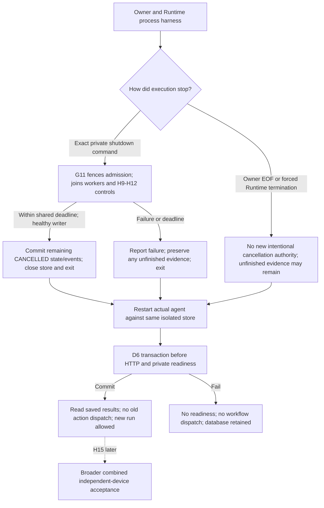

# H14 — Scheduler shutdown and recovery acceptance

## Overview

H14 verifies that group execution and lifecycle controls stop safely with their
owning desktop app, and that a later Runtime startup reports unfinished work
without executing it again. It extends the existing G11 shutdown and D6 recovery
checks to multi-device, paused and cancelling groups. It is primarily a focused
test/handoff delivery; change production code only for a demonstrated defect.

If Launcher sends the private shutdown command during a workflow, Runtime fences
new work, joins workers and accepted controls, commits cancellation, closes the
store and exits. If Launcher disappears or Runtime is killed, unfinished records
can remain. Before the next readiness signal, D6 marks those records INTERRUPTED.
Neither case resumes the old workflow or repeats an Android action.



**Status — H14 implemented and verified for Linux controlled acceptance on 2026-11-23.**
Section 13 maps S1–S15 to executed tests and records remaining platform limits.
Focused H14 additions were approved before tests were added.
G11/D6 and H9–H13 are implemented foundations, including the authenticated action
route and focused built-agent acceptance. H14 can use those real implementations
for its broader process/control scenarios. Do not replace missing
dependencies with production stubs or report a partial
run as complete H14 acceptance. New test additions require scope agreement under
Runtime AGENTS.md before coding.

## 1. Handoff scope and required reading

The assigned member should read this document, then the relevant source/test
locations in section 3. Whole-roadmap rereading is unnecessary for this delivery.
The behavioral sources are:

- [B3 owner lifetime and supervisor](../runtime_process_foundation/b3_supervisor.md).
- [Shared managed launch/shutdown protocol](../integration/managed_runtime.md).
- [G11 runner shutdown](../g_workflow_engine/g11_runner_shutdown.md).
- [D6 startup recovery](../d_persistence/d6_startup_recovery.md).
- [H9–H11 live Pause/Resume](h9_h11_pause_resume.md).
- [H12 live Cancel](h12_run_cancellation.md) and
  [H13 action HTTP contract](h13_lifecycle_action_api.md).
- [A5 states](../contracts/execution_state_v1.md) and
  [A6 events/errors](../contracts/event_error_v1.md).

H14 owns proof that these behaviors compose during process exit/restart. It does
not redesign process ownership, add another cancellation writer, restore RAM,
build a background daemon or introduce an automatic restart service.

| Included | Outside H14 |
| --- | --- |
| Intentional owner stop with queued, active, paused and pending-control work. | New Pause/Resume/Cancel algorithms: H9–H12. |
| Store-close ordering, joined callbacks, deadline/failure behavior. | New public action route or DTO: H13. |
| Owner loss, forced exit, startup recovery, retained history and no replay. | Cross-run resume, durable variables or reconstruction of old workers. |
| Focused process fixtures and any proven local correctness fixes. | New packaging/updater, emulator orchestration or catalog sync. |
| Precise platform and failure evidence for another member/client owner. | H15's full node/variable/failure-isolation/independent-device acceptance matrix. |

Old documents may label intentional process cancellation as H6. The authoritative
implementation is G11; H6–H8 now mean deferred Wait Variable work. Do not implement
waiters or an obsolete capacity limit to satisfy those old phase references.

## 2. Prerequisite contracts and parallel-work boundary

| Dependency | Required behavior to consume | Work possible before it lands |
| --- | --- | --- |
| G11/B3 | `PrepareStop(reason, deadline)` closes global work gate; `Shutdown(ctx)` joins registered work before settlement/store close. Exact managed `shutdown\n` is intentional; bare owner EOF is owner loss. | Inspect/reuse current tests and actual-agent startup/exit paths. |
| H9–H11 | Pause parks the same workers at confirmed boundaries; accepted controls remain counted in shutdown drain; Resume commits before release. | Active/paused/pending-Pause/Resume shutdown checks can use implemented internal services. |
| H12, implemented | Group Cancel retains owner through settlement/cleanup; joins older controls; uses group-only authority; participates in G11 drain and never extends an existing deadline. | Reuse implemented Cancel and its focused stop-race evidence; extend wider H14 process coverage. |
| H13, implemented | Authenticated POST `/runs/{id}/actions`; 202 submission, 200 already target, 409 conflict; response failure does not undo an accepted action. | Reuse the real route and existing focused process acceptance; no temporary Runtime endpoint. |
| D6 | One atomic interruption transaction before HTTP/readiness; no worker reconstruction or action dispatch. | Extend file-backed reopen/startup-failure checks now. |

No additional exported lifecycle API is required by H14. The test harness may
use package-local transaction/handler gates through existing fixtures. If a
necessary production seam is absent, first reuse repository wrappers, child test
processes and controlled executable fixtures. Do not add production debug flags,
sleep hooks or bypass authentication to make a race test convenient.

Final H14 acceptance must identify the actual H12/H13 implementation revision
used. If those dependencies are missing, report the affected cases as pending,
not skipped-as-passed or completed through a fake Cancel.

## 3. Current implementation and reusable test map

Paths below are relative to `a2matex-runtime`; names are verified at spec creation.

| Source/test | Existing responsibility | H14 work |
| --- | --- | --- |
| `internal/supervisor/supervisor.go` | Store → recovery → artifacts → retention → checkpoints → lifecycle → HTTP → readiness startup; reverse shutdown; PrepareStop before drain. | Verify order/shared deadline; keep this supervisor. |
| `internal/services/executionlifecycle/lifecycle.go` | Global gate, stop reason/authority, worker/control drain and final cancellation. | Focused fixes only if new group/control scenarios expose an ordering defect. |
| `internal/services/executionlifecycle/group.go`, `control.go` and eventual H12 files | Retained group RAM, worker/control ownership, pause fences and retirement. | Verify no premature owner/RAM release or stale control continuation during exit. |
| `internal/services/checkpoint_cancellation.go`, `checkpoint_control.go` | Existing serialized writes and post-commit visibility. | Reuse fault wrappers and writer gates; no second writer. |
| `internal/services/execution_recovery.go`, `internal/repositories/execution_recovery.go` | Full stored membership, conditional interruption and atomic events. | Verify reopen/idempotence/rollback for current group shapes. |
| `internal/discovery/owner.go` | Reads private shutdown frame/EOF and preserves reason. | Reuse exact frame and owned pipe lifetime. |
| `internal/platform/processrunner/runner.go` | Cancels and joins owned ADB client process with bounded cleanup. | Verify controlled client cleanup; do not kill shared ADB server or emulator. |
| `internal/supervisor/execution_shutdown_test.go` | Existing active stop, pre-authority root cancellation, deadlines, owner loss and retry-gap checks. | Extend/reuse instead of duplicating each single-device test. |
| `internal/services/executionlifecycle/control_test.go` | Includes stop joining an in-flight Resume checkpoint and mixed failure/intentional stop. | Retain existing evidence; add only missing combinations. |
| `internal/repositories/execution_recovery_test.go` | Reopen exactly once, queued/paused siblings, integrity rejection and deterministic event ordering. | Extend mixed membership/large residual cases where not already covered. |
| `cmd/agent/recovery_test.go` | Recovery write failure blocks composed-agent startup and readiness. | Reuse real store/transaction rollback proof. |
| `cmd/agent/h4_acceptance_linux_test.go`, `cmd/agent/testdata/h4_acceptance.py` | Builds actual agent, managed start/HTTP/SQLite/restart with controlled devices. | Reuse launch and HTTP helpers; add a focused H14 scenario file if needed. |
| `internal/discovery/testdata/managed_parent.py` | Linux inherited pipes, readiness, auth, contention, owner EOF and replacement. | Reuse protocol helpers, not a second owner protocol. |

Keep test files organized by responsibility. Prefer a small H14 process driver
and extensions to existing fixture owners over a new test framework. New fixture
JSON and explanations can live in `examples/h14`; executable harnesses needed
by CI belong in tracked `cmd/agent/testdata`, not ignored `test_demo` directories.

## 4. Shutdown contract to prove

### 4.1 One ordering and one deadline

Intentional managed shutdown uses the exact bytes `shutdown\n` on the owner
command pipe. Closing that pipe without the command is a different case. The
parent awaits process exit; readiness pipe EOF or an HTTP failure alone does not
prove that Runtime has released its store or resources.

The required shutdown ordering is:

1. Supervisor latches the trusted reason and creates its shared deadline from
   configured `shutdown_timeout`; PrepareStop closes admission/control/dispatch
   authority before HTTP draining. Root cancellation can already be visible;
   preserve G11's handling of that race.
2. Signal owned group/worker contexts, including parked workers. Prevent new
   attempt permissions, retries and late Resume releases.
3. Drain accepted start leases and group/control work. Join handlers/processes,
   checkpoint publication and artifact cleanup before retiring their RAM.
4. If intentional and persistence is healthy, settle remaining unfinished work
   through existing cancellation checkpoints. Preserve confirmed results.
5. Close checkpoint/store components only under their established ordering;
   release the exclusive store lock and exit. Never report successful drain
   while tracked work remains.

No stage may reset the deadline for every device, control, transaction or retry.
H12's earlier Cancel budget can only be shortened by owner shutdown. Repeated
stop requests cannot extend time or upgrade owner-loss/failure authority into an
intentional stop. Separate explicit Cancel already accepted for its group remains
authorized as specified by H12.

On a deadline failure, return/log failure and exit under the bounded process
policy; do not wait indefinitely for an uncooperative handler. Do not falsely
close RAM still in use or accept its late writes/publication after checkpoints
have closed. A permanently stuck worker is not proof of graceful cleanup; tests
must release their controlled gate during teardown so the test process itself
does not leak. Forced process exit releases OS memory; it does not manufacture
successful application-level settlement.

### 4.2 Trigger and expected durable result

| Trigger | Authority/result | Next startup |
| --- | --- | --- |
| Healthy explicit managed shutdown | Unfinished work CANCELLED; completed siblings unchanged; clean exit. | No recovery changes for this group. |
| Standalone development Ctrl+C/accepted signal | Existing standalone intentional-stop policy; same unfinished settlement. | No recovery changes if clean. This is not the primary desktop-owner test. |
| Bare owner command-pipe EOF | Owner loss: stop Runtime without inventing intentional group cancellation. Unfinished records may remain. | Remaining work INTERRUPTED before readiness. |
| Malformed owner command | Existing fail-closed protocol/failure path; no intentional upgrade. | Interrupt any unfinished evidence. |
| Runtime forcibly killed | No graceful settlement promise or log requirement. | Interrupt unfinished rows; retain already terminal rows. |
| Storage error or expired join/settlement deadline | Failure outcome, no false clean-stop claim. | D6 handles only the records actually still non-terminal; do not insist every row must remain unfinished. |
| Explicit H12 Cancel had already been accepted before owner loss | Group's accepted Cancel may finish within its remaining budget. | Already CANCELLED stays CANCELLED; any remaining unfinished work becomes INTERRUPTED. |

Do not turn an ordinary device failure into global shutdown, or rewrite an
already SUCCEEDED/FAILED/CANCELLED device because a sibling is interrupted.
On clean intentional cancellation with survivors, group CANCELLED can coexist
with failed/successful terminal sibling counts.

## 5. Recovery contract and exact row expectations

Restart the actual agent against the **same isolated state directory**. D1
acquires exclusive ownership; D6 runs synchronously before HTTP/readiness. No old
worker, variable scope, retry timer, route choice or pending action is restored.

| Persisted record before recovery | Expected after successful recovery |
| --- | --- |
| RUNNING/PAUSED group | INTERRUPTED; finished_at set. |
| QUEUED/RUNNING/PAUSED member of that group | INTERRUPTED; next_node_id null; finished_at set; started_at preserved, including null. |
| RUNNING attempt under an affected running device | INTERRUPTED; finished_at set; output_json absent; safe EXECUTION_INTERRUPTED error. |
| Previously SUCCEEDED/FAILED/TIMED_OUT/CANCELLED/INTERRUPTED attempt | Same ID, sequence, status, outputs/errors and timestamps. |
| Terminal device/group, including successful siblings | Retained exactly; recovery does not recalculate them into another outcome. |
| Confirmed artifact row/file for a successful attempt | Retained under D5 rules; no recapture. Uncommitted/orphan files follow separate artifact reconciliation. |
| Old request ID | Still maps to the same group. Replay returns its stored result and dispatches nothing. |

Recovery makes one atomic transaction with deterministically ordered attempt,
device and group events, using complete stored membership and bounded event
batches. A queued/paused member without an active attempt gets its own transition,
not a fabricated NodeAttempt. A second clean reopen adds no further recovery
events or timestamp changes for the group.

Use the same safe error object as D6 (`EXECUTION_INTERRUPTED`, non-retryable),
not raw SQLite/process errors. A clock change must not produce finish timestamps
earlier than creation/start or cause a rewrite of already terminal evidence.

Recovery failure rolls back every row/event change and suppresses readiness.
An unknown commit is not claimed as confirmed recovery; startup fails and a
later reopen uses existing D6 idempotence. Preserve the store for diagnosis.
After success, GET-by-ID reports history, GET-active is 404 if no other group
exists, and a distinct new request can run with fresh RAM.

## 6. Required scenario matrix

Reuse existing passing cases rather than adding a duplicate test for each row.
Every row needs a named existing or new test/evidence entry in the final report.

| ID | Scenario and deterministic setup | Required evidence |
| --- | --- | --- |
| S1 | Idle managed Runtime, exact shutdown frame. | Bounded clean exit; store lock released; no new execution events; immediate restart works. |
| S2 | Two devices in active Delay; one earlier successful attempt each. | Intentional stop cancels unfinished work, keeps earlier attempts, no successor dispatch, clean reopen does not recover those rows. |
| S3 | Controlled ADB action in flight on one member, another member terminal. | Owned ADB client is cancelled/joined; terminal sibling unchanged; no repeated command; emulator/shared server remains outside Runtime ownership. |
| S4 | Fully PAUSED group with no RUNNING attempt. | Parked workers wake on stop without Resume; devices/group CANCELLED; no invented attempt or continuation. |
| S5 | Pause pending, then intentional stop. | Pause cannot wait out a long handler/Delay before stop; no stale pause transaction/continuation after settlement; all tracked controls joined. |
| S6 | Resume transaction paused by a repository wrapper, then stop. | Store stays available until that operation resolves; no post-stop worker release; no deadlock waiting on the control's own drain registration. |
| S7 | H12 Cancel accepted, optionally after PAUSE, then owner shutdown/loss. | Accepted Cancel and older controls are joined; exact group settled at most once; earlier deadline retained; no double RAM close. Requires real H12. |
| S8 | Admission has committed but handoff/registration is held; stop wins. | Start lease drains, no new worker permission; queued rows are included in final settlement. No stale admitted group escapes cancellation. |
| S9 | Bare owner EOF with active and paused runs in separate cases. | Runtime exits without a new intentional-stop authority; restart interrupts remaining members before readiness; no old dispatch. |
| S10 | Force-kill actual Runtime during a journal-confirmed ADB invocation. | Restart retains exactly one old attempt identity, interrupts it if still RUNNING, and does not append another external invocation. No external-side-effect success inference. |
| S11 | Force-kill paused group; terminal sibling preserved. | Group/unfinished paused members INTERRUPTED; no attempt inserted; terminal sibling/history/artifacts unchanged; no old RAM reconstructed. |
| S12 | Recovery event append fails in isolated store via existing trigger/fault fixture. | Entire recovery rolls back; no ready frame/HTTP startup; no command dispatch; lock released on exit; removing only the injected fixture fault permits recovery. |
| S13 | Worker join deadline or residual settlement fails. | Original contextual failure preserved; no execution_shutdown_completed success claim; no dispatch reopening; remaining evidence is recoverable. |
| S14 | Reopen twice, replay old request ID, then submit new request ID. | Recovery transitions once, replay dispatch zero, fresh run succeeds with new group and clean variable state. |
| S15 | Complete residual membership spanning more than one event batch. | Reuse current large fixtures (for example 128 members); no count truncation, complete updates, atomic event batches. No product device limit introduced. |

S2/S4/S9/S11 should include mixed terminal/non-terminal member assertions through
fixture reuse. Retry-gap and publication/artifact cleanup races may reference
existing G11/G18/G19/H9–H12 tests if their assertions already prove the required
ownership ordering. Do not multiply the whole matrix by every Android handler;
one cancellable external command plus Delay and existing handler regressions is
the MVP coverage boundary.

## 7. Deterministic harness and no-redispatch oracle

### 7.1 Actual-agent process layer

Use the existing Linux Go-wrapper/Python-managed-parent pattern. Build the real
`cmd/agent` binary with a compatible version (existing fixtures use 0.1.0), then
run it with real Wire composition, migrated SQLite, private readiness and normal
HTTP authentication. An alternative router or direct repository-only test cannot
prove process ownership/restart behavior.

The process fixture must:

1. Create its own state/runtime directories and absolute controlled ADB executable.
   Set `XDG_STATE_HOME`, `XDG_RUNTIME_DIR` and
   `A2MATEX_RUNTIME_ADB_EXECUTABLE_PATH` on Linux children; use isolated
   `LOCALAPPDATA` for native Windows storage checks. Keep these overrides on the
   child only. Never touch the user's live DB, Documents/platform-tools,
   credentials or running emulator configuration.
2. Inherit only the correct command/readiness pipe ends. Close the parent's
   duplicate child ends; keep retained ends out of unrelated subprocesses so EOF
   actually represents owner loss. Drain/redirect stdout and stderr separately.
3. Wait for the bounded private ready frame, then probe with that session token.
   Retain the same fixture directory and invocation journal across restarts.
4. Support trusted resolver/discovery/boot-completed fixture commands plus one
   real handler command, such as Press Home. Do not bypass normal adapter code.
5. Append an invocation journal entry containing fixture serial/operation and
   safe node/test identity **before** blocking or completing that controlled
   action. Flush/close, and use a durable acknowledgement if the crash test needs
   it; do not rely on buffered stdout that can vanish on kill.
6. Trigger shutdown/EOF/kill only after an explicit handler/transaction/row barrier
   proves the desired state. Bound readiness, barriers, process exit and teardown.
7. Kill/reap all remaining **fixture-owned** processes and close handles in a
   finally/cleanup path, including failing assertions. Never use adb kill-server
   or terminate a user's emulator as test cleanup.

The invocation journal is the external dispatch oracle. SQLite attempt count
alone cannot prove whether Android was invoked twice. Compare journal entries
for action commands separately from allowed version/discovery/boot probes.
Starting a new fixture/agent must not truncate or recreate the journal.

### 7.2 Service-layer race controls

Use existing real-SQLite lifecycle fixtures and repository wrappers to hold
Begin/Finish/Pause/Resume/Cancel at exact boundaries. Use channels/events rather
than assuming a sleep means a transaction is in flight. Do not require the
actual-agent process layer to expose every internal writer barrier.

Crash tests at process level should stop on durable row plus journal evidence;
rollback/commit/deadline races belong in the narrower deterministic layer.
Synthetic QUEUED members can be created through existing repository admission
fixtures for recovery tests. Do not introduce a one-worker setting merely to
manufacture a queue: all admitted members already have capacity.

### 7.3 Evidence to capture per scenario

Capture the run/request/device/attempt IDs, last observed snapshot cursor,
targeted pre/post SQL projections, action-journal counts, process exit outcome,
and relevant safe lifecycle log events. Compare terminal rows by ID and values,
not total table counts alone. Event cursors are Runtime-wide, not assumed to
start at one or to be contiguous per group when other components append events.

After restart: wait for readiness; read old group by ID; verify no active old
group; check old action-journal count unchanged through GET and replay; reopen
again to prove idempotence. Use original request bytes for replay. Only an
explicit fresh request ID is allowed to create new dispatch entries.

Keep fault fixtures below the configured retention threshold when asserting
exact historical events. Retention can prune old events; do not disable the
production retention contract or mistake pruning for an uncommitted rollback.

## 8. Database inspection contract for the implementer

Use an independent read-only SQLite connection, including while the child is
alive. Read multiple comparison queries inside one read transaction when a
consistent boundary matters. Do not copy only the main `.sqlite3` file from a
live WAL database and assume it contains the latest committed state.

These queries match the current migration schema. Bind `:group_id` to the fixture
group; examples are inspection queries, not Runtime business logic:

```sql
SELECT id, request_id, status, created_at, finished_at
FROM run_groups WHERE id = :group_id;

SELECT id, adb_serial, admission_ordinal, status, next_node_id,
       created_at, started_at, finished_at, terminal_error_json
FROM device_executions
WHERE run_group_id = :group_id ORDER BY admission_ordinal;

SELECT a.id, a.device_execution_id, a.sequence, a.node_id, a.attempt_number,
       a.status, a.started_at, a.finished_at, a.output_json, a.error_json
FROM node_attempts a
JOIN device_executions d ON d.id = a.device_execution_id
WHERE d.run_group_id = :group_id ORDER BY d.admission_ordinal, a.sequence;

SELECT cursor, event_type, device_execution_id, node_attempt_id,
       node_id, occurred_at, payload_json
FROM execution_events WHERE run_group_id = :group_id ORDER BY cursor;

SELECT f.id, f.attempt_id, f.file_key, f.byte_length, f.digest
FROM artifacts f
JOIN node_attempts a ON a.id = f.attempt_id
JOIN device_executions d ON d.id = a.device_execution_id
WHERE d.run_group_id = :group_id ORDER BY f.id;
```

Timestamps are stored as integer milliseconds, while API projections are UTC
strings. Compare normalized values, not their display formatting. Cancelled
attempts have no output/error; interrupted attempts carry the safe interruption
error. Never print real private outputs just to demonstrate a fixture assertion.

## 9. Platform and resource boundaries

The Runtime behavior applies to Linux and Windows. Reuse portable service/SQLite
tests for both builds. The existing `pass_fds`, `select` and executable shebang
process harness is Linux-specific; cross-compiling that wrapper is not Windows
process evidence.

| Evidence | Required reporting |
| --- | --- |
| Linux automated process/service cases | Execute on a host permitting loopback and child processes; report exact tests/scenarios. |
| Windows agent and affected Go test cross-build | Required compatibility check; label build-only. |
| Native Windows owner/pipe/termination/reopen | Reproduce the same scenarios using the existing Windows launch contract and explicitly inherited handles; run on a Windows host before claiming native acceptance. If unavailable, identify the case/owner and retain the K4 release gate. |
| Controlled ADB executable | Proves adapter invocation, process cleanup and no-redispatch under the fixture; does not prove Android side effects or independent emulator behavior. |
| Live Android | Optional targeted stop demonstration here; broad independent-device coverage belongs to H15. Normal single-instance Waydroid is not two independent devices. |

Cancellation only manages processes Runtime owns. Android/emulator processes and
the host's shared ADB server can remain alive. Keeping them alive must not cause
the next Runtime startup to execute old work. Do not add a device-count ceiling,
background disconnect watcher, RAM persistence or per-device shutdown loop.

## 10. Expected files, execution order and checks

Suggested small implementation sequence for the assigned member:

| Delivery slice | Work | Review result |
| --- | --- | --- |
| 1 | Agree missing-test scope, inventory reused cases, add readable fixture/scenario README and journal/barrier support where needed. | Reviewer sees trigger, observation and expected rows for each scenario before race implementation. |
| 2 | Extend deterministic shutdown/control/recovery tests; apply only defects those tests demonstrate. | Small service/repository/supervisor diffs with a failing/passing causal test. |
| 3 | Actual-agent managed shutdown/EOF/kill/reopen/replay scenarios; integrate H12/H13 cases after they land. | Built process, HTTP, SQLite and external journal evidence agree. |
| 4 | Platform builds and concise shared-guide/roadmap evidence update. | Implemented/verified/pending boundaries are explicit for the next member. |

Expected new files, only if existing fixtures cannot hold the work cleanly:
`cmd/agent/h14_acceptance_linux_test.go`,
`cmd/agent/testdata/h14_acceptance.py`, and
`examples/h14/README.md` plus readable workflow JSON. Reuse managed-parent helpers
and existing tests from section 3. Do not put mandatory harnesses in ignored
paths. Production changes need an observed correctness reason, not speculative
cleanup; follow current service/repository layout and contextual logging.

Suggested verification from the Runtime root after test scope is approved:

```bash
go test ./internal/services/executionlifecycle ./internal/supervisor ./internal/repositories ./cmd/agent
go test -race ./internal/services/executionlifecycle ./internal/supervisor ./internal/repositories
go test ./...
go vet ./...
make fmt
make build
git diff --check
```

The actual-agent test wrapper should build a compatible binary as H4 does.
Use targeted `-run` selections for short development cycles, then the applicable
regressions. Execute independent checks efficiently; do not rerun the entire
process matrix after documentation-only edits.

Windows build-only checks from a Linux development host can use:

```bash
GOOS=windows GOARCH=amd64 go build -buildvcs=false -o /tmp/a2matex-h14-windows.exe ./cmd/agent
GOOS=windows GOARCH=amd64 go test -c -o /tmp/a2matex-h14-lifecycle.test.exe ./internal/services/executionlifecycle
GOOS=windows GOARCH=amd64 go test -c -o /tmp/a2matex-h14-repositories.test.exe ./internal/repositories
```

These commands compile; they do not execute Windows tests or validate inherited
handles. Add an affected-package cross-build if a focused fix touches another
platform-sensitive package.

The known absent `cmd/agent/testdata/g22_acceptance.py` can fail the existing full
suite. Check its current presence; if still absent, report that baseline failure
separately and list any filtered run exactly. Do not silently skip it, claim full
suite success or rebuild unrelated G22 work inside H14.

If loopback or subprocess creation is sandbox-blocked, report the environment
restriction and rerun on an authorized host; a mock-only replacement does not
satisfy actual-agent acceptance. Do not install new dependencies without need.

## 11. Manual handoff and completion evidence

The implementation must leave a readable `examples/h14/README.md` explaining
the actual test command and an inspectable demonstration. Prefer extending a
managed-parent driver with named scenarios over many unrelated shell commands.
Document the fixture directory, SQLite path, group IDs, action journal and safe
logs. Permit an explicit keep-results option for inspection; default CI cleanup
can remain automatic. Avoid exposing credentials in saved reports.

The manual scenario should let another member:

1. Launch the owned Runtime and start the supplied public fixture on controlled
   devices or their chosen real device.
2. Choose intentional stop, confirm exit, restart against the same fixture data,
   and inspect preserved CANCELLED results without recovery changes.
3. Repeat with forced Runtime termination after a confirmed dispatch marker;
   restart and inspect INTERRUPTED rows with unchanged external dispatch count.
4. Repeat with a PAUSED group and confirm no automatic Resume after restart.
5. Replay the original POST request, confirm the same group and zero dispatch,
   then use a fresh request ID and observe new execution.

Label controlled versus real Android evidence. A demo that simply opens a seeded
SQLite database is useful for D6 but insufficient to demonstrate owner exit or
no redispatch. Public Postman action steps require real H13; owner shutdown still
uses the private pipe, not a new shutdown HTTP endpoint.

Final report checklist:

- Scenario IDs mapped to actual existing/new tests and observed results.
- H12/H13 revisions tested, plus exact source changes and why they were necessary.
- Clean-stop, owner-loss and forced-exit database outcomes, event/identity
  preservation, no-redispatch oracle, second-reopen and fresh-run evidence.
- Deadline/fault cases distinguish confirmed settlement from unfinished evidence.
- Linux execution, Windows build-only/native execution, and controlled/live Android
  evidence separately labeled. Pending external-host checks remain visible.
- Updated H14 status in this spec and both roadmap indexes; shared guide changes
  describe verified behavior only. No assertion that deferred waits are implemented.

H14's implementation can be marked complete for the verified host scope when
the required automated cases and dependency integration pass. Native Windows
acceptance must remain separately pending if not executed; release acceptance
still belongs to K4. Missing H12/H13 integration cannot be relabeled a platform
limitation or passed H14 case.

## 12. Deferred work and completion boundary

H14 proves exit/recovery composition for currently supported nodes. H15 combines
the wider multi-device business flow, variable visibility, independent targets
and control scenarios using this evidence. H6–H8 waiter teardown/wakeup cases
remain deferred until Wait Variable exists. Phase I owns live SSE/client UI;
Phase J owns protected-package authorization expiry, plaintext cleanup and
reauthorization. Those later features must reuse these owner/stop boundaries.

No process restart can resume old Flow/Global variables or uncertain actions.
The persisted data is history and interruption evidence, not an execution queue
to restart. The implementation evidence below applies only to its stated host/scope.

## 13. Implementation and acceptance evidence — 2026-11-23

H14 adds a tracked actual-agent Go wrapper, a focused Python acceptance harness,
a controlled ADB executable fixture and a readable workflow/inspection guide in
`examples/h14`. It reuses the managed-parent launch helper, extended only with
optional log redirection. **No production Runtime behavior, constructor, route,
schema, migration or dependency changed:** the new checks demonstrated no defect
requiring a production fix.

The harness executes the real compiled agent, H13 endpoints, migrated SQLite,
artifact retrieval and private owner protocol. Each isolated scenario preserves
its invocation journal across restarts. It compares named-column SQL projections
and terminal identities, verifies retained PNG length/digest, reopens twice,
replays the original request without dispatch, then runs a distinct fresh group.
An explicit fixture-only event trigger verifies recovery rollback and startup
failure; the user's store is never opened or modified.

| Spec case | Executed evidence |
| --- | --- |
| S1 | Process `idle`: clean exit/reopen, no execution events and released exclusive store ownership. |
| S2 | Process `delay-stop`: two active Delays cancel, earlier Start attempts survive, no Home/Screenshot dispatch or recovery rewrites. |
| S3 | Process `command-stop`: blocked Home client joined; successful sibling and committed PNG retained; journal unchanged on reopen/replay. |
| S4 | Process `paused-stop`; existing `TestPauseMixedDeviceFailureAndIntentionalStop`: parked work cancels without fabricated attempts. |
| S5 | Process `pause-pending-stop`: private shutdown interrupts the blocked command and joins pending Pause. |
| S6 | Existing `TestOwnerStopJoinsResumeCheckpointBeforeClosingStore` and `TestCancelGroupJoinsPendingResumeAndOwnerStop`: held real Resume write joins before store close; no late continuation. |
| S7 | Process `cancel-stop` / `cancel-owner-loss`, plus the deterministic held-Resume H12 test above: accepted group cancellation remains authorized and joined under stop. |
| S8 | New `TestGroupStopBeforeCommittedHandoffSettlesEveryMember`, plus existing `TestExecutionLifetimeAdmissionFenceAndDeadline`: handoff/start lease fences, two queued rows settle, zero fabricated attempts. |
| S9 | Process `owner-loss-active` / `owner-loss-paused`: no intentional-stop upgrade, unfinished work interrupts before new readiness. |
| S10 | Process `crash-active`: journal-confirmed Home has the same existing attempt interrupted after kill; no startup/replay dispatch. |
| S11 | Process `crash-paused`, plus existing paused-sibling recovery tests: terminal sibling/artifact retained; no Resume or recapture. |
| S12 | Process `recovery-failure` and existing `TestRecoveryFailureBlocksComposedAgentStartup`: real rollback, empty ready pipe, unavailable HTTP, lock release and successful reopen after removal of the injected fault. |
| S13 | Existing uncooperative-worker and residual-failure tests; new `TestFailedExecutionShutdownDoesNotLogCompletion`: original failure survives, no false completion record and no late writes. |
| S14 | Every non-idle process scenario: second reopen is unchanged, old request replay dispatches zero, new request succeeds. Existing G16–G18/H12 tests additionally prove fresh/retired RAM semantics. |
| S15 | New `TestRecoveryCompleteGroupAcrossEventBatches`: 128 queued members, complete interruption, 258 total admission/recovery events and unchanged second reopen; existing large cancellation checks also pass. |

Executed commands and outcomes:

```bash
go test ./cmd/agent -run '^TestH14ShutdownRecoveryAgentAcceptance$' -count=3 -v
go test -race ./internal/supervisor ./internal/repositories -run 'TestFailedExecutionShutdown|TestRecoveryCompleteGroup' -count=3
go test -race ./internal/services/executionlifecycle -run '^TestGroupStopBeforeCommittedHandoffSettlesEveryMember$' -count=3
go test -race ./internal/services/executionlifecycle ./internal/repositories ./internal/supervisor -count=1
go test -race ./... -count=1
go test -race ./cmd/agent -skip '^TestG22CombinedEngineAcceptance$' -count=1 -v
go vet ./...
make fmt
make build
git diff --check
```

The 12 process scenarios pass repeatedly; the available agent race run includes
H14 and existing H4/H13 actual-agent acceptance. All packages in the full race
run pass except the known G22 test with missing
`cmd/agent/testdata/g22_acceptance.py`. This remains an open baseline regression
gate, not an unqualified full-suite pass. The H14 service/repository additions
also pass repeated focused race checks.

Windows amd64 agent and affected lifecycle/repository/supervisor test binaries
cross-compile. **Native Windows remains unverified and K4 stays open.** Controlled
ADB is not live Android; H15 retains independent-target acceptance. H6–H8 wait
coverage remains deferred. The actual tested working tree includes H12/H13;
`report.json` records the Runtime version, host/architecture and binary/fixture
SHA-256 fingerprints rather than pretending earlier uncommitted changes are a
published release.

The [H14 walkthrough](../../../../a2matex-runtime/examples/h14/README.md) supplies
the actual short runner command and an explicit results directory with readable
pre/post records, original request files, logs, SQLite and dispatch journal.
The documented `crash-active` command was run against version 0.1.0 and retained
locally: one INTERRUPTED member and one SUCCEEDED sibling, eight unchanged attempt
identities, three prior dispatch entries, then exactly four fresh-group actions.
No old invocation was added by either startup, history read or replay.
