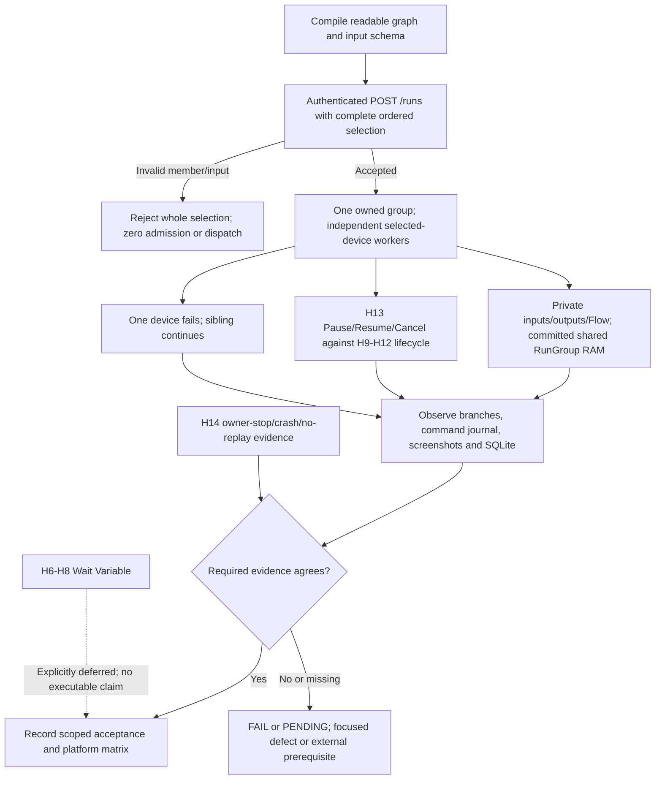
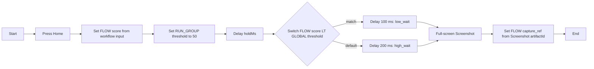

# H15 — Combined multi-device acceptance

## Overview

H15 proves that the currently supported Phase H features work together through
the real Runtime: complete device admission, independent execution, isolated
inputs/outputs/Flow variables, committed Global visibility, group controls and
correct saved results. It consolidates earlier evidence and fills concrete gaps;
it is not another engine implementation or an invitation to rewrite the handlers.

A publisher compiles one graph, selects two devices with different inputs and
starts one RunGroup. Both execute independently, take their expected branches,
and create correctly owned screenshots. Pause/Resume preserves their live state;
Cancel stops the group while Runtime stays usable. Failure on one device leaves
its sibling running. Saved snapshots, SQLite records and actual command evidence
must agree. H14 supplies owner-exit/crash/recovery acceptance.



**Status — acceptance pack implemented; Linux controlled acceptance verified on 2026-11-23. Live independent-target acceptance remains PENDING.**
H1–H5 and H9–H14 provide existing implementations/evidence. H14's Linux controlled
process acceptance is verified; reuse its evidence while retaining native host
and independent-device limits. Full H15 acceptance is still pending; section 14 records executed evidence.
Replacing missing
production controls with mocks does not complete this phase. Agree on new test
scope before adding tests under Runtime AGENTS.md.

## 1. What completion means

H15 accepts the **current supported feature set**, with H6–H8 Wait Variable
explicitly deferred. Global means one RunGroup on one Runtime, not a persistent
account-wide, cross-process or cross-run store. Variables remain RAM-only and
restart never resumes old executions.

The completion decision has separate evidence levels:

| Level | Required evidence | Permitted claim |
| --- | --- | --- |
| Controlled automated acceptance | Real agent/HTTP/SQLite plus controlled ADB and deterministic service-layer races pass the required criteria. | Supported engine/group behavior verified under controlled devices on the executed host. |
| Live multi-device acceptance | The specified business scenarios run against at least two independent Android targets, with identities and observable outcomes recorded. | Multi-device execution verified against real independent targets on that host. |
| Native host acceptance | Actual process/ADB/storage/control behavior executed on the named OS; cross-builds listed separately. | Verified on that host, not all platforms. |

A Linux-scoped Phase H acceptance requires its required controlled checks,
H12/H13/H14 integration and independent-target live evidence. Windows can remain
explicitly pending for K4 if no Windows host is available; that is not a claim of
complete cross-platform acceptance. Controlled-only results are useful progress
but must not be labeled completed live multi-device acceptance.

## 2. Prerequisites, sources and entry gate

Read [Phase H](../phases/phase_h.md),
[H4 admission](h4_public_multi_device_start.md),
[H5 disconnect handling](h5_device_disconnect_handling.md),
[H9–H11 controls](h9_h11_pause_resume.md),
[H12 cancellation](h12_run_cancellation.md),
[H13 action API](h13_lifecycle_action_api.md), and
[H14 shutdown/recovery](h14_scheduler_shutdown_and_recovery.md).
Use [A5 states](../contracts/execution_state_v1.md),
[A7 API/snapshots](../contracts/local_api_v1.md),
[variable bindings](../contracts/workflow_bindings.md), and
[G20 artifact retrieval](../g_workflow_engine/g20_artifact_api.md)
as the detailed contracts; H15 does not change them.

| Entry check | Required condition |
| --- | --- |
| Build identity | Record Runtime version/commit, plan revision, OS/architecture and actual node catalog/fixture source. Use a build version satisfying the compiled IR. |
| Capabilities | Runtime Info advertises the exact executable pairs used by the fixtures. Set Variable, Switch and Screenshot must be real registered handlers; no Wait Variable claim. |
| Lifecycle dependencies | Real H12 Cancel and H13 route satisfy their specs. H14 evidence refers to the same build or an unchanged verified implementation. |
| Storage and owner | Isolated real migrated SQLite, exclusive Runtime owner, current readiness/authentication and no accidental second Runtime. |
| Test assets | Readable graph/input-schema fixtures, per-device inputs, expected branches/counts and observable dispatch/artifact identities. |
| Environment | Automated child-process/loopback support; for live evidence, at least two independent READY targets reachable by the chosen trusted ADB executable. |

Mark an unmet entry check PENDING with its owner. Do not bypass compilation,
capability checks, authentication or admission to make an acceptance run pass.

## 3. Reuse map and expected deliverables

Paths are relative to `a2matex-runtime`; existing files are verified at spec
creation. Reuse passing tests by naming them and their covered criteria.

| Existing asset | Reuse / limitation |
| --- | --- |
| `internal/api/multi_device_start_test.go` | Complete selection, per-device inputs, rejected-selection no-writes and replay checks. |
| `internal/services/executionlifecycle/group_completion_test.go` | Concurrent workers, ordinary failure isolation, aggregation, large membership and shared-RAM cleanup. |
| `internal/services/executionlifecycle/control_test.go` and `control_failure_test.go` | Pause/Resume continuation, private outputs/RAM, retry identity and shutdown races; internal methods alone do not prove H13 HTTP. |
| `internal/api/variables_test.go` and G16–G18 store/attempt tests | Actual bindings, publication/rollback and fresh scopes; extend only missing cross-device composition. |
| `internal/api/start_test.go` | Compile/start/Switch routing, replay, request-disconnect behavior and consecutive groups. |
| `internal/api/final_result_integration_test.go` | G21 final projections and stopped/interrupted outcomes. |
| `cmd/agent/h4_acceptance_linux_test.go`, `cmd/agent/testdata/h4_acceptance.py` | Actual built agent, owner protocol, HTTP, file-backed SQLite and controlled discovery. |
| H12–H14 tests/harnesses once implemented | Cancellation and process evidence; cite instead of copying their complete race matrices. |
| `examples/g18/compile-score.json`, `examples/g19/compile-screenshot.json` | Readable fixture patterns for scoped values, branches and screenshots. |
| `examples/g22/compile-workflow.json` | Useful handler coverage only; not a ready-made deterministic multi-device Global test. |

Create a small tracked `examples/h15` acceptance pack during implementation:

- `README.md`: setup, actual runner command, scenario choices, exact expected
  outcomes, SQLite/journal/artifact inspection and platform limitations.
- `compile-multi-device.json`: the reference graph plus input schema in section 4.
- `device-inputs.example.json`: clearly marked editable serial/input selection;
  no live credentials or private device data.
- Scenario variants or expected-result manifest only where needed for explicit
  criteria; do not copy the main graph into many almost-identical files.

If process coverage needs a new wrapper, use tracked
`cmd/agent/h15_acceptance_linux_test.go` and
`cmd/agent/testdata/h15_acceptance.py`, reusing managed-parent/H14 helpers.
Ignored smoke scripts may supplement demonstrations but cannot be mandatory CI
dependencies. No production debug endpoint or new test framework is needed.

## 4. Reference happy-path workflow and exact result

The implementation must supply the readable, compilable graph described below.
This is the fixture contract, not an unimplemented node proposal.



Use these stable node IDs: `start`, `home`, `set_score`, `set_threshold`, `hold`,
`choose`, `low_wait`, `high_wait`, `capture`, `remember_capture`, `end`.
Set all error policies to STOP and retries to one attempt for exact counts.
Use unique valid edge/rule IDs, explicit `FULL_SCREEN` Screenshot mode and
timeouts longer than valid Delay durations. The low rule uses a stable valid
rule ID/source port; the high path uses the existing `default` port.

The schema requires integer `score` from 0 to 100 and integer `holdMs` from 0
to 5,000; reject additional input properties. Give `hold` a 10,000 ms timeout,
and use supported explicit timeouts for other nodes. `holdMs=0` is the normal
happy run; controls variants use a longer hold and a deterministic pause gate
in automated tests.

| Selected position | Per-device inputs | Required route |
| --- | --- | --- |
| A | `{"score":25,"holdMs":0}` | `low_wait`; never `high_wait`. |
| B | `{"score":75,"holdMs":0}` | `high_wait`; never `low_wait`. |

Both members write the **same** Global threshold 50. That makes this reference
run deterministic without a Wait Variable node. It proves scope use, but is not
by itself proof that a value written only by A can be read by B; section 6 adds
that required case. Do not use arbitrary sleep durations as cross-device locks.

Expected final evidence with no injected failures:

| Projection/effect | Exact result |
| --- | --- |
| Group | One SUCCEEDED group, same request ID, finishedAt non-null. |
| Summary | total=2, succeeded=2; queued/running/paused/failed/cancelled/interrupted all zero. |
| Devices | Exactly A/B in submitted order; unique IDs, correct serial/input association, SUCCEEDED, nextNodeId null, terminalError null. |
| Attempts | Exactly 10 SUCCEEDED attempts per device, sequences 1–10, attemptNumber=1; 20 total. |
| Ordered node history | start → home → set_score → set_threshold → hold → choose → expected branch → capture → remember_capture → end. |
| Device action invocations | Exactly one Home and one Screenshot invocation per selected serial; exclude discovery/version/readiness/display probes from this count. |
| Artifacts | Two unique artifact IDs/attempt owners, one per successful capture; both authenticated downloads decode as PNG and match their metadata. |
| Variables | Private Flow score/capture_ref per device; current group's Global threshold=50 while live; no variable rows or new migration. |
| After full cleanup | GET-active 404, GET-by-ID retains the result, old request replay returns 200 with the same IDs and no extra dispatch/artifacts. |

The two PNGs may have identical bytes/digests if their screens match. Distinct
artifact identity/attempt ownership is required; distinct image content is not.
An immediate terminal snapshot can precede final in-process retirement; use the
normal bounded handoff/cleanup evidence rather than treating GET-active 404 as
proof that every callback has returned.

## 5. Acceptance criteria matrix

Every required row must map to concrete test/live evidence in the final report.
An existing test can satisfy a row if its actual assertions cover it on the
accepted build. A test name alone or a repeated historical PASS is insufficient.

| ID | Criterion | Pass condition | Required evidence layer |
| --- | --- | --- | --- |
| A01 | Complete admission and input pairing | One 201 admits exactly the selected members in order; differing inputs stay paired with their serials. | Actual agent + HTTP + SQLite; live reference run. |
| A02 | Whole-selection rejection | Empty/duplicate/malformed selection or any invalid/unavailable member rejects the whole request under H4's exact 400/422 rules; zero new execution rows/events/actions. | Existing/new deterministic API tests and one actual-agent case. |
| A03 | Concurrent independent progress | All selected workers enter a controllable operation before any is released; completion or ordinary device/node failure on one does not stop siblings. | Deterministic lifecycle/SQLite barriers; live independent-target progress. |
| A04 | Flow/input/output isolation | Different scores take correct branches; same node IDs and variable names never expose another device's values or artifact output. | Reference run plus explicit private-output/Flow assertions. |
| A05 | Committed Global publication | A real Set Variable write becomes visible to another member only after confirmed checkpoint/publication; rollback exposes no candidate; ordered overwrites obey last committed write. | Real store/coordinator/SQLite with deterministic gates; section 6. |
| A06 | Failure/disconnect isolation | Selected A's confirmed command-observed loss causes its documented non-retryable device failure (DEVICE_DISCONNECTED when the serial is missing); B continues; group remains RUNNING while B runs, then FAILED. No reconnect replay. | Focused H5 transport checks, actual agent with controlled ADB, live disconnect scenario. |
| A07 | Pause/Resume continuity | 202 pending → PAUSED at safe boundaries; no new attempt while parked; Resume continues same IDs/RAM/output/retry identity without repeated completed actions. | Real H13 + lifecycle + SQLite; live control run. |
| A08 | Live Cancel and next run | Real H12/H13 cancels active/paused work; terminal history survives; no successor redispatch; joined retirement permits a fresh run without Runtime restart. | Actual agent + real controls + SQLite/journal; live Cancel. |
| A09 | Replay/conflicts/response loss | Same admitted request ID returns same group/IDs with no redispatch; new request while active is 409; lost responses do not create duplicate work. | HTTP/SQLite/journal; H4/H13 reuse allowed. |
| A10 | Snapshots, aggregation and artifacts | Complete summaries/history and artifact ownership agree at controlled stable boundaries; downloads return confirmed PNGs only. | Reference run + SQL + G20 API and existing fault checks. |
| A11 | Complete large membership | Existing 33-member public start and above-one-event-batch cases remain complete; no old count/concurrency ceiling or truncated history/settlement. | Actual-agent 33-member evidence plus existing 64/128-member service/repository cases. |
| A12 | Scope retirement and process recovery | New group has fresh RAM; prior group cannot affect it; owner stop/crash results and no replay satisfy H14. | H12/H14 same-build evidence plus consecutive-run checks. |
| A13 | Executable capability and auth boundary | Fixtures use advertised executable pairs; bearer is required; no Wait Variable/Log claim, private values or tokens leak through new logs/fixtures. | Registry/auth regressions and evidence inspection. |
| A14 | Independent-device/host acceptance | At least two independent targets pass required live scenarios; host/build/ADB/target identities and observed outcomes are recorded separately from controlled fixtures. | Live checklist in section 9; platform matrix. |

H5 previously retained focused mapping/race/disconnect acceptance as unverified
under its existing-tests-only implementation scope. A06 cannot inherit that gap
as a PASS. H15 must identify the missing approved tests/live observations or
keep disconnect acceptance PENDING; scope approval is needed before new tests.

## 6. Required Global and private-value checks

There is no variable-read HTTP endpoint and H15 must not add one. Observe reads
through normal binding-driven branches/actions, and use existing private-store
test access for narrowly scoped publication/race assertions. Do not persist RAM
values just to make acceptance easier.

### 6.1 One writer, another device reads

Use a compiled role-based variant: only A executes a `RUN_GROUP` Set Variable
for `shared_score=37`; B never writes that name. Hold B before its read using a
controlled fixture operation. Release B only after A's real publication path has
completed. B reads GLOBAL_VARIABLE `shared_score` in a Switch and takes its
37-match branch. A's writer runs once; B's writer branch has zero attempts.

Establish the order through existing runner/handler/store test barriers or a
normal successor marker after Set Variable, not a production wait primitive.
SQL success observed before an owned publication callback returns is not alone
proof that publication has completed. All candidates/checkpoints/publications
must use real G16/G18 code, not `map[name]=value` in a fake handler.

### 6.2 Unconfirmed candidate and ordered replacements

Reuse G16/G18's existing gate/fault fixtures with at least two device views:

1. Confirm value 10 through a real successful assignment.
2. Begin candidate 20 and hold checkpoint confirmation. A competing reader must
   not observe 20; blocking behind the existing store gate is valid. Do not
   require a non-blocking stale read when the approved implementation serializes.
3. Roll back/fail that checkpoint: no candidate 20 is published. If the failure
   is fatal at coordinator level, assert fencing and inspect the retained view
   only at the appropriate store test boundary; do not require a new workflow
   to continue after fatal persistence failure.
4. In a healthy separate case, release confirmed writes 20 then 30 in that
   exact commit/publication order. A reader released afterward observes 30.

Do not assert which writer wins an uncontrolled simultaneous race. Invocation
start time, device selection order and wall-clock timestamps are not commit
order. Switch-then-Set remains two operations; no atomic maximum/increment or
compare-and-swap guarantee is introduced.

### 6.3 Private outputs, false-like values and new scopes

Both members use the same node IDs and Flow key names. Their distinct captured
artifact IDs must feed their own `remember_capture` attempt; verify via real
binding resolution/private views or an observable own-value branch while live.
Do not expect Set Variable attempt outputs/events to serialize its scalar value.

Reuse existing checks that false, zero and empty string count as present, missing
keys/type mismatches fail at consumption, and bounds still apply. H15 needs a
traceable combined read/write check, not a rerun of every scalar-boundary test.

After retirement, start a new group which reads `shared_score` before writing it.
It follows the documented missing-binding failure path; it must not receive 37
or 30 from the prior group. Repeat with a private Flow key. Retry with a proper
new initialization and verify success. No cross-run table is added.

Do not run `examples/g22/compile-workflow.json` on multiple devices unchanged
and expect its shared `capture_ref` to equal each member's private artifact ID.
Concurrent distinct writes can legitimately replace that Global value. Use the
reference fixture's Flow capture_ref or the designated-writer ordering above.

## 7. Control, failure and result scenario details

### 7.1 Pause/Resume — A07

Use the reference graph with both members inside `hold` and positive holdMs.
In automation, acknowledge both entries before submitting PAUSE through H13.
Expect 202; current status may remain RUNNING until permitted work settles.
After confirmed PAUSED, each member has completed `hold` (sequence 5), has
`choose` next, and has no RUNNING attempt. With no unrelated action, repeated
PAUSE is 200 and adds no events. Terminal siblings, if any, never become PAUSED.

Take two stable observations while parked; attempt rows and action-journal count
must not advance. Resume with the same group ID, expect 202, then the exact
10-attempt successful reference history per device. No second Home, lost score,
changed device ID, restarted runner or repeated Delay. Use H9–H11's existing
gated test for retry predecessor/number retention; do not invent a retry in every
reference run. Cover pending-opposite 409 and Cancel supersession with H13 cases.

### 7.2 Cancel — A08

Run a separate two-device reference variant; after both finish Home and enter
`hold`, send CANCEL. Confirm retained Home results, no `choose`/capture/End
dispatch and terminal CANCELLED survivors/group. If both were at this precise
position, each has five attempts: start/home/set_score/set_threshold SUCCEEDED
and active hold CANCELLED. An accepted cancellation race can leave a different
already-confirmed outcome; exact-count assertions require the controlled barrier.

Repeat after confirmed PAUSED: the completed hold stays SUCCEEDED, no extra
attempt is fabricated, and still no `choose`/capture/End dispatch. Duplicate
Cancel during cleanup may be 202 even when SQLite is CANCELLED; after retirement
it is 200. Start a new distinct request in the same Runtime process and verify
success with fresh scopes and unchanged live session. Reuse H12's stop/cleanup
races rather than reimplementing them here.

### 7.3 Failure isolation and command-observed disconnect — A06

Use a dedicated Start → Delay → Home → End fixture with STOP policy. Ensure
both are admitted READY. While A is in Delay, make A unavailable to the controlled
ADB discovery and make its subsequent Home invocation exit nonzero. Leave B's
endpoint available and hold its action until A's failure has committed.

Expected stable intermediate snapshot: group RUNNING, total=2, failed=1,
running=1; A FAILED with `DEVICE_DISCONNECTED`, B RUNNING. Release B; final group
FAILED, failed=1 and succeeded=1. No End attempt for A, no sibling cancellation,
no action retry; reconnecting A produces no old-run dispatch. Nonzero failure
with serial still connected retains the original command failure; an unsuccessful
diagnostic discovery does not invent a proven disconnect. Reuse focused H5 tests
for those mappings and cancellation/deadline precedence.

No background detection is expected during Delay, Switch or RAM-only work.
The first failing ADB operation is the observation point. A workflow containing
only local nodes can finish without detecting a temporary disconnect. Do not
fail acceptance for absent continuous monitoring or add a watcher in H15.

### 7.4 Saved results and aggregation — A10

At stable boundaries require summary.total to equal admitted membership, and
all queued/running/paused/succeeded/failed/cancelled/interrupted counts to sum
to total. Terminal members have finishedAt and null nextNodeId. Group cannot be
SUCCEEDED while a member is unfinished or failed. Ordinary failures remain
isolated; accepted cancellation has its existing final aggregation precedence.

For each attempt verify unique identity, per-device sequence, node/type-contract
output/error, retry identity if present and correct device parent. A Switch's
chosen route is proven by the succeeding attempted node IDs; do not add a new
selected-port snapshot field. Read attempts through existing repository/SQL
inspection: the public attempt-history endpoint is still I1, not an H15 dependency.

For each capture, match successful attempt output artifactId to the artifacts
row, committed metadata and G20 download. Verify media type, byte length, digest,
decoded PNG dimensions and parent identities; requesting a nonexistent ID remains
404 and missing bearer 401. Reuse existing screenshot failure/discard tests for
unconfirmed bytes; no need to multiply every crop-mode case across both devices.

Snapshots are consistent individually but not frozen across HTTP requests. If
state changes between observations, compare at a fixture barrier or use committed
cursor/row evidence. Do not report an ordinary timing difference as data loss.

## 8. Automation, persistence inspection and race evidence

The actual-agent runner must use production composition, compile the readable
graph through POST workflow-compilation, admit its returned IR, and drive the
normal routes with the current session token. Build version must satisfy that IR;
do not alter minimumRuntimeVersion to force admission. Service-level gated tests
supplement this path for exact interleavings.

Use H14's isolated directories, bounded child/HTTP waits, pipe handling,
read-only SQL and persistent invocation journal. Discovery/readiness calls are
not action dispatches. A journal entry must name the selected serial and operation;
an attempt row alone cannot prove that an external command was not repeated.

Use independent read-only SQLite connections and transactionally consistent
comparison reads; see [H14 inspection queries](h14_scheduler_shutdown_and_recovery.md#8-database-inspection-contract-for-the-implementer).
Inspect current schema names, including `artifacts.attempt_id`, rather than
guessing columns. Keep variable values off SQL/logs/events. Historical event
retention remains active; keep exact-event fixtures small or reason from retained
watermarks instead of assuming all old events exist forever.

For A11 reuse existing actual-agent 33-member coverage and 64/128-member atomic
membership/event tests; do not create 128 emulators. If gaps remain, add only
the focused case. No fixture count is a supported maximum or performance SLA.
Prove concurrent progress using per-member gates, not a wall-clock speedup ratio.
Long-running soak, precise memory benchmarking and broad fault/fuzz campaigns
remain K5/K6; unexpected races/leaks observed here still require a focused fix.

## 9. Live independent-device acceptance checklist

Run against two independently addressable Android systems. Separate emulator
instances, separate hosts/VMs or distinct physical devices are acceptable.
Two Waydroid windows from one Android instance, or two aliases for the same
endpoint, are not independent targets. Do not install a heavier emulator merely
to run controlled tests; acquire suitable targets for this separate gate.

| Step | Action | Required observation |
| --- | --- | --- |
| L1 | Record host/runtime/ADB versions, two serials, model and current display sizes; refresh inventory. | Two distinct READY targets; both selected explicitly; no invented max-devices setting. Keep private identities out of published reports. |
| L2 | Compile/run the reference fixture with A score25 and B score75. | Both Home actions visible, correct low/high histories, two successful owned screenshots, exact final summary. |
| L3 | Retrieve both PNGs through authenticated G20 and inspect them. | PNGs correspond to their target screens/metadata; artifact IDs map to the correct device attempts. |
| L4 | Repeat with holdMs long enough to Pause, inspect parked state, then Resume. | PAUSED confirmed before continuation; both continue same executions; no repeated Home or lost variable-derived branch. |
| L5 | Run again, Pause then Cancel; start a distinct new request. | CANCELLED results retained, no post-cancel capture/action; Runtime stays alive and new run succeeds. |
| L6 | Run the dedicated disconnect fixture and disconnect only A after admission, before its next ADB action. | If discovery confirms A missing, its failure is DEVICE_DISCONNECTED; offline/unauthorized endpoints use their documented H5 mapping. B completes; reconnect causes no redispatch. |
| L7 | On targets with different sizes/orientations, run one safe percentage Tap/Swipe variant. | Each action uses that serial's current dimensions and the approved F3/F4 conversion. No first-device measurement reused across siblings. |
| L8 | Run or cite same-build H14 owner shutdown/restart evidence. | Clean cancellation versus crash interruption and no replay match H14; emulator can remain alive. |

For L7 choose a harmless screen and publisher-supplied coordinates, record actual
sizes and expected per-target coordinates from the existing F3/F4 contract. If
both available targets have identical geometry, report the live different-size
case PENDING and retain deterministic two-size adapter evidence. Never change
the targeting conversion in an acceptance phase to make observations match.

Use readable fixtures and existing APIs; no Studio UI or Phase I SSE is required
to accept Runtime behavior. Preserve brief observation notes and redacted images
where useful. Polling by-ID is sufficient; one HTTP request does not stream the
entire execution or remain open until completion.

## 10. Failure classification and decision rules

Use these result labels for every criterion/scenario and host combination:

| Label | Meaning | Effect on completion |
| --- | --- | --- |
| PASS | Required setup executed and every stated observable assertion passed on the identified build. | Satisfies that criterion for that evidence layer/host only. |
| FAIL | Executed setup exposed a contract violation or assertion failure. | Required criterion blocks acceptance; record a focused reproducible defect. |
| PENDING | Prerequisite, permission, device/host access or observation is missing. | Required criterion remains unsatisfied; never silently convert to PASS. |
| DEFERRED | Requirement explicitly outside current scope, such as H6–H8. | Does not block current supported scope; keep the named deferred owner. |

Do not use DEFERRED for missing H12/H13 code, untested H5 disconnect behavior or
required independent-target evidence: those are PENDING. Cross-compilation is
PASS for a build check, not PASS for native Windows execution.

Acceptance is scoped by host and evidence layer. The supported-scope milestone
requires A01–A14 with their stated required evidence and same-build H14 results.
If live geometry L7 cannot be exercised, describe that narrower outstanding case
explicitly; any acceptance excluding a required case needs the user's explicit
scope decision. Do not self-approve an exception in the implementation report.

Recheck the known missing `cmd/agent/testdata/g22_acceptance.py` at execution
time. If absent, record the exact baseline suite failure and any filtered command.
It is not an H15 pass or an automatic authorization for unrelated G22 repair.
An unqualified full-regression/Phase H completion claim requires the applicable
gate to pass or an explicitly accepted, named scope exception; focused H15
results can still be reported while that baseline gate is open.

## 11. Implementation order and verification commands

Deliver in small reviewable pieces:

1. Inventory existing evidence against A01–A14; identify genuinely missing tests
   and agree their scope. Do not blanket-regenerate test suites.
2. Build the readable reference fixture and expected-result pack. Compile it
   through the real API before adding orchestration.
3. Add only missing controlled publication/isolation/control combinations and
   the small actual-agent acceptance runner, reusing H4/H12–H14 helpers.
4. Perform live L1–L8 on the available host/targets; record missing host/device
   cases honestly. Fix reproducible defects in focused changes with causal tests.
5. Publish the result matrix, artifact/SQL/journal inspection steps and exact
   platform limitations; update spec/roadmap status from observed evidence.

Run focused tests/race checks for changed areas, then applicable existing API,
lifecycle, adapter and process regressions, `go test ./...`, `go vet ./...`,
`make fmt`, `make build` and `git diff --check`. Cross-build the Windows agent
and affected test binaries as H14 describes. Run native Windows scenarios only
on a Windows host and identify them separately.

No new dependencies, migrations, count settings, generated-code edits by hand
or broad refactoring are expected. New production behavior discovered to be
necessary needs its own explanation/scope; acceptance should first produce a
clear failing scenario rather than silently expanding the feature set.

## 12. Evidence report and handoff template

Store the acceptance README with tracked safe fixture assets. Generated output
may be kept in an ignored explicitly selected results directory; mandatory test
code must remain tracked. Do not commit bearer tokens, raw private workflow data
or customer screenshots/serials. Save synthetic/redacted evidence only.

The report must contain:

| Field | Required content |
| --- | --- |
| Build | Runtime and plan revision, version, OS/architecture, ADB version and fixture identity/hash. |
| Scope | Supported nodes/scenarios, H6–H8 deferral and any explicit user-approved exception. |
| Criterion matrix | A01–A14, PASS/FAIL/PENDING/DEFERRED, actual test/live case, command/result evidence and remaining owner. |
| Reference run | Request/group/device/attempt identities, branch sequences, per-device attempt/action counts, summary and two owned artifacts. |
| Concurrency/variables | Deterministic barrier/commit ordering, one-writer cross-device read, Flow/output isolation and no unconfirmed publication. |
| Controls/recovery | H12/H13/H14 build linkage, duplicate/conflict handling, cleanup/fresh run and no-replay evidence. |
| Live/platform matrix | Controlled versus independent Android, Linux execution, Windows build-only/native execution, current geometry and missing cases. |
| Reproduction | Actual short runner command, fixture/input editing instructions, read-only database path/queries, journal and artifact lookup. |
| Failures/gaps | Concrete defect reproduction, exact baseline failures and prerequisite/platform limitations; no unexplained skipped tests. |

Update the [shared Runtime guide](../integration/managed_runtime.md) and short
[Studio](../integration/studio.md)/[Launcher](../integration/launcher.md) handoff
references only with verified capabilities/examples. Keep one authoritative
shared route description. Studio/Launcher application implementation remains
with their owners; protected `.a2m` start/authorization remains Phase J.

## 13. Final completion checklist and next phase

- All required A01–A14 evidence is mapped and passes for the declared scope;
  exact reference counts, private values, artifact ownership and final summaries agree.
- Real controls and H14 lifecycle evidence are integrated; no missing phase is
  substituted by a mock or a saved-state-only check.
- Independent Android evidence is present for the claimed host; native Windows
  and different-geometry gaps remain explicit if not executed.
- Applicable regressions/build/race checks pass, or named baseline/scope exceptions
  have an explicit user decision. Failed/pending checks are not presented as done.
- The readable acceptance pack and report let another member reproduce results;
  no private credentials, debug API or durable variable store was introduced.
- Phase H/current-spec status reflects **supported-scope** acceptance, retaining
  deferred Wait Variable H6–H8. Phase I can then build observation/SSE/client UI
  on the accepted APIs without implying Phase J/K or all-platform release completion.

This specification alone completes no acceptance criterion and changes no
Runtime code. H15's outcome is an evidence-backed acceptance decision and a
small reproducible pack, plus only any focused defect fixes demonstrated by it.

## 14. Implementation and verification evidence — 2026-11-23

The [readable H15 pack](../../../../a2matex-runtime/examples/h15/README.md) and
tracked `cmd/agent/h15_acceptance_linux_test.go` / `testdata/h15_acceptance.py`
use actual production composition, compilation, authenticated admission/actions,
file-backed SQLite and G20 downloads. H14's owner, isolated storage, snapshot,
credential-safe logging and dispatch-journal helpers are reused. There are no
production Runtime logic changes, dependencies, migrations or debug routes.

### Executed evidence and criterion mapping

PASS below means **Linux controlled evidence**, including the named companion
Go tests executed on this working tree. A row with required live observations
is not fully accepted until those observations exist. The standalone Python
report covers its process scenarios only; it explicitly names companion evidence
and does not claim to execute the Go suites itself.

| Criterion | Controlled result and actual evidence | Required live/platform gap |
| --- | --- | --- |
| A01 | PASS — `reference`: 201, exact ordered serial/input association, two distinct member IDs and correct low/high histories. | Independent-target reference pending. |
| A02 | PASS — `rejection`: five whole-selection failures, exact 400/422 and zero writes/actions; existing `TestMultiDeviceStartRejectsWholeInvalidSelection` passes. | None beyond required reference setup. |
| A03 | PASS — `reference` holds both real Home processes until both enter; `disconnect` proves sibling progress. Existing `TestGroupSQLiteConcurrentOutcomesAndCompleteHistory` passes with concurrent gates. | Independent-target progress pending. |
| A04 | PASS — `reference`/`private-output` use private scores and captured outputs; real Switch compares each Flow capture_ref with its own output, with no wrong route. Existing `TestGroupPauseResumePreservesOutputsRAMAndWorkerIdentity` explicitly checks same-node output/input pairing after Resume. | Independent-target branch/control observations pending. |
| A05 | PASS — `global-and-fresh-scopes`: A alone writes 37; B is released after A's real publication and normal successors and reads 37 without an assignment. New `TestAssignmentCrossDevicePublicationWithSQLite` checks blocked competing views before confirmation, ordered 10→20→30 and real SQLite rollback/fencing. | No live-only publication race claim. |
| A06 | PASS — `disconnect` records A FAILED/DEVICE_DISCONNECTED while group and B remain RUNNING, then FAILED group with B SUCCEEDED, one action/member, no A End or replay. New `TestTransportObservationMappingAndContextPrecedence` covers missing/connected/offline/unauthorized, failed diagnostic, cancellation/deadline precedence and no redispatch. | Live independent-target disconnect pending. |
| A07 | PASS — `pause-resume`: real H13 202/409/200 mappings, both real Delay entries, exactly five confirmed attempts/member when parked, stable rows/events/journal and original 10-attempt continuations. Existing retry/pending-control races pass. | Live Pause/Resume pending. |
| A08 | PASS — `cancel-active`/`cancel-paused`: exact retained/cancelled attempts, no successor capture, joined cancellation and fresh same-process successful run; H12 cancellation/cleanup/deadline cases pass. | Live Cancel/fresh run pending. |
| A09 | PASS — terminal replay adds no records/dispatches; new ID while active is 409. Existing H4 actual-agent lost-response replay and H13 action conflict tests pass in the same suite. | No additional live gate. |
| A10 | PASS — reference summary total2/succeeded2, 20 unique successful attempts and four actions; two distinct owned artifacts, authenticated CRC/decoded-PNG/size/digest checks, 401/404 retrieval checks. Existing screenshot/final-projection regressions pass. | Live target screenshots/metadata pending. |
| A11 | PASS — existing H4 actual-agent 33-member run, 64-member concurrent lifecycle case, 128-member recovery and large cancellation/event tests pass; no new ceiling setting. | No 128-emulator requirement. |
| A12 | PASS — consecutive Global/Flow missing-key failures then initialized success; same-suite H14 S1–S15 tests and 12 process cases preserve histories/artifacts and never replay old commands. | Native Windows process behavior pending. |
| A13 | PASS — compiled fixture pairs checked against Runtime Info; bearer/unknown-artifact guards pass, no Wait Variable/Log capability claim, private scalar outputs remain empty and H14 helper scans logs for session-token leaks. Existing registry/auth tests pass. | Native host auth/process acceptance pending. |
| A14 | PENDING — `/home/dino/Documents/platform-tools/adb devices -l` executed successfully but listed no connected targets on this host. Controlled endpoints are not independent Android evidence. | Owner must provide two independent targets and execute L1–L8; native Windows remains unexecuted. |

### Build, commands and readable records

Executed on Linux x86_64, Runtime version `0.1.0`, working tree based on Runtime
`4ce135be885d452603df73dfb94c245f72cd6e75` and Plan
`5e5f9ad02869ee7f59a6a17ff2fd07595c23b267`. These revisions are base identities,
not a claim that uncommitted H9–H15 work is included in those commits. The
production binary SHA-256 is
`66be891112f1b166c76b75d250efd1e35dd6b6fb70b5f679b94fa9706fbae859`, matching
the retained H14 manual build; production sources did not change for H15.
Generated `report.json` records the executed binary/reference/catalog hashes,
versions, OS, base revisions, process criterion coverage and pending gates.

```bash
make fmt
make build
python3 cmd/agent/testdata/h15_acceptance.py bin/a2matex-runtime --results-dir test_demo/h15-final-20261123
go test -race ./cmd/agent -run '^TestH15CombinedMultiDeviceAgentAcceptance$' -count=3 -v
go test -race ./internal/execution/attempts ./internal/platform/adb -run 'TestAssignmentCrossDevicePublicationWithSQLite|TestTransportObservationMappingAndContextPrecedence' -count=3
go test -race ./... -count=1
go vet ./...
git diff --check
```

The documented runner passes all eight scenarios. Three repeated process runs
pass (24 scenario executions); repeated focused publication/transport tests pass.
The final reference fixture explicitly fixes one attempt/no retry delay. Adding
that explicit default is verified again with the retained final runner command.
The reference uses 20 successful attempts and four actions. The private-output
variant adds one Switch/member (22 attempts) without extra device actions.
Read-only inspection of retained evidence confirms two unique 74-byte 2×2 PNGs,
correct artifact/attempt parents and complete per-device histories. The final
directory contains exact requests/graphs, HTTP snapshots, named-column SQL
records, PNGs, journals and owner logs. `test_demo` stays ignored.

`go vet`, formatting, build and whitespace checks pass. Windows amd64 agent,
attempt-test and ADB-test binaries cross-build successfully; they were not run
on Windows. The full race suite passes every other package and H4/H14/H15 agent
cases but **fails** existing `TestG22CombinedEngineAcceptance`: its tracked
`cmd/agent/testdata/g22_acceptance.py` is absent. No G22 repair or regression
exception is approved here; the full regression gate remains open.

### Acceptance decision and next work

The acceptance implementation and Linux controlled checks are delivered.
**H15 and supported-scope Phase H acceptance are not complete:** required live
independent-target observations (including disconnect and geometry) and the named
G22 regression issue remain open. Native Windows host evidence separately retains
its K4 ownership; no all-host acceptance is claimed.
Existing `TestSwipeModes` passes with two serials and different portrait/landscape
display sizes; this retains deterministic geometry coverage without substituting
for live L7. Execute the README/L1–L8 checklist when targets are available and record the
host/geometry/build evidence before closing the relevant gate. H6–H8 remains
DEFERRED; Studio/Launcher UI, Phase I observation and Phase J protected package
execution were not implemented by this acceptance phase.
