# H1 — Group execution ownership

## Overview

**Current public policy:** [H4](../h_multi_device_execution/h4_public_multi_device_start.md)
now exposes the complete non-empty selection through POST /runs. Any one-device
public gate described below records this step’s original delivery boundary;
that gate and AdmitSingleDevice are removed. Earlier test evidence remains scoped
to the step that produced it.

H1 gives each newly admitted RunGroup one in-memory owner for its checked
workflow, ordered device work, cancellation context, and shared variable store.
It is the lifetime boundary on which H2 will build scheduling. It does not run
all selected devices or introduce a worker pool.

Today, `StartService.Start` creates a store for one device and hands its cleanup
to `executionlifecycle.Dispatch`. That works for G14, but attaching the same
cleanup to several workers would let the first finishing device close RAM that
its siblings still need. H1 moves store creation, device-view binding, and
cleanup into a group owner within the existing execution lifecycle service.

The smallest implemented flow will remain: admit one device, transfer its work
to the group owner, run it through G10/G11, and release the group's RAM after
the worker and synchronous checkpoint callbacks return. HTTP disconnection
after admission must not abandon that work. Owner shutdown retains G11's
bounded stop and D6's restart behavior.

```mermaid
flowchart TD
    A[G14 StartService: hold existing start lease] --> B{G12 admission result}
    B -->|EXISTING or rejected| X[Existing response; no new group or RAM]
    B -->|Confirmed CREATED| C[H1 validate and own the complete prepared work]
    C --> V[One group context and variable store; isolated device views]
    V --> G{G11 dispatch gate}
    G -->|Open: current one-device path| R[G10 sequential worker under group context]
    G -->|Known owner stop| N[No worker starts; G11 retains unfinished-row settlement]
    R --> J[Join worker and checkpoint callbacks]
    J --> F[Close shared RAM once; release group ownership]
    N --> F
    F --> L[Start lease and lifecycle drain can finish]
    C -->|Invalid work or uncertain handoff| E[G11 failure fence; preserve D6 evidence]
    O[Owner stop or loss] --> G
    O --> J
    H[H2-H4 later: queue, slots and public multi-device start] -. Reuse group ownership .-> V
```



**Status — Implemented and Linux-verified on 2026-11-20.** The actual G14 start
now hands work to `DispatchGroup`; group-bound RAM, copied inputs/device views,
bounded prior-group joining, and cleanup-before-drain are implemented. Focused
ownership/SQLite/API checks, full Go and race suites, vet, Linux build, and
Windows amd64 agent/affected-test cross-compilation pass. The existing built-agent
G22 process scenarios pass with controlled ADB. Native Windows and real Android
execution were not performed for H1; no multi-device scheduling is enabled.
The public API still accepts exactly one device. The revised constructor
policy has no fixed membership ceiling. H2 aligned that code on 2026-11-22;
the existing larger ownership fixture now verifies 128 members. Earlier
1/32-member fixtures remain historical evidence, not a supported maximum.
Current available race/API/process checks pass; the unfiltered full suite is
blocked by the missing G22 Python harness documented in H2.
No H1-only path may dispatch a multi-member list
as unbounded parallel work or leave its extra members silently unexecuted.

## 1. Scope and direct dependencies

| Owner   | Responsibility                                                                                       |
| ------- | ---------------------------------------------------------------------------------------------------- |
| G12/D2  | Validate and atomically admit work; preserve request-ID replay and one non-terminal RunGroup.        |
| H1      | Own one admitted group's live resources and transfer/cleanup them safely.                            |
| G10     | Execute sequential nodes and retain each running device's committed output view.                     |
| G11     | Fence admission/dispatch, supervise workers, preserve stop authority and join before storage closes. |
| G16-G18 | Supply bounded RAM scopes, identity-bound reads, and checkpoint-confirmed assignments.               |
| D4/D6   | Persist authoritative results and interrupt unfinished work after restart without replay.            |
| H2-H4   | Add queue/slots, worker completion scheduling, and public multi-device admission.                    |

Authoritative references are the [H roadmap](../phases/phase_h.md),
[G14 ownership contract](../g_workflow_engine/g14_start_run_api.md#5-single-device-execution-ownership),
[G11 shutdown](../g_workflow_engine/g11_runner_shutdown.md),
[G18 store lifetime](../g_workflow_engine/g18_set_variable_execution.md),
[G16 RAM storage](../g_workflow_engine/g16_scoped_variable_storage.md), and
[A5 execution state](../contracts/execution_state_v1.md).

H1 changes no HTTP DTO, route, response status, node definition, handler pair,
IR version, SQLite schema, migration, checkpoint transaction, or process-owner
protocol. It adds no dependency. One active group remains the MVP policy.

## 2. Implementation approach and current source mapping

Keep the group owner in `internal/services/executionlifecycle`. This service
already owns the Runtime execution context, admission leases, worker tracking,
the stop fence, and shutdown joining. A separate scheduler service is premature
in H1 and would duplicate lifetime authority.

| Current source                                                               | Change needed for H1                                                                                                                                                      |
| ---------------------------------------------------------------------------- | ------------------------------------------------------------------------------------------------------------------------------------------------------------------------- |
| `internal/services/runadmission/types.go`: `PreparedRun`                     | Reuse its checked runner and ordered `[]runner.Request`; introduce no duplicate workflow representation.                                                                  |
| `internal/services/runadmission/start.go`: CREATED branch                    | Pass the entire admitted work list to group handoff; remove local variable-store construction and the device-zero cleanup callback. Keep the one-device admission policy. |
| `internal/services/executionlifecycle/dispatch.go`: `BeginStart`, `Dispatch` | Retain start leases and worker registration; add the group handoff boundary and consume cleanup on known stop.                                                            |
| `internal/services/executionlifecycle/lifecycle.go`: worker join/drain       | Track group resource ownership through cleanup and retain the existing error/stop policy.                                                                                 |
| `internal/execution/variables/store.go`                                      | Reuse `New`, `Get`, and `Close` without changing scalar, quota, or publication rules.                                                                                     |

An internal `groupExecution` record is sufficient. It holds the RunGroup ID,
checked runner reference, ordered owned device requests, one owner-derived
context/cancel function, the shared store, and minimal completion metadata.
Keep its fields private; no generic group manager, event bus, plugin interface,
public group handle, or second persisted state machine is required.

Its lifecycle metadata answers only: is this work owned, is any execution still
using it, and has cleanup completed? It must not mirror SQLite statuses,
attempt history, summaries, or outputs.

## 3. Prepared-work contract

Construct a group only from a confirmed CREATED result. EXISTING/replay,
validation rejection, unavailable-device rejection, and BUSY create no store,
context tree, worker, or group owner.

Validate the complete list before publishing ownership or starting a worker:

| Input             | Required rule                                                                                                                                         |
| ----------------- | ----------------------------------------------------------------------------------------------------------------------------------------------------- |
| RunGroup ID       | Use the existing UUID validation; every member matches the admitted group.                                                                            |
| Runner            | Non-nil checked G10 runner supplied by G12; do not parse or compile IR again.                                                                         |
| Member count      | Non-empty complete admitted membership, without a fixed count ceiling. H2 aligned the constructor; current public/live handoff remains one until H4. |
| Device identity   | Valid, unique DeviceExecution IDs and unique accepted ADB serials; preserve their input order. Reuse existing validators.                             |
| Workflow inputs   | Non-nil checked per-device objects. Do not merge inputs between devices or add defaults here.                                                         |
| Runtime authority | Prepared requests contain no preinstalled `Control`, variable store, variable lookup, or variable-view identity. The owner supplies these.            |

Use one bounded pass and sets for uniqueness. Do not repeat device preflight,
G1 validation, database admission, or database lookups per member. An invalid
later member must result in zero worker invocations and no published group.

Copy the device slice and each input map/raw JSON byte value so later caller
mutation cannot change owned work. The checked runner/IR remains a shared
immutable reference, following G10's existing contract. Do not clone the graph
once per device. Store/view attachment must not modify `PreparedRun.Devices`.

Create exactly one `variables.Store` using the complete accepted member ID list.
Attach the same trusted write store to owned requests, but bind each read view
to its own group/device identity. Each lookup closure captures its specific
DeviceExecution ID. Do not expose a caller-selected device ID in node bindings.

## 4. Group handoff boundary

Add a group operation to the existing execution owner interface, with this
intended shape:

```go
DispatchGroup(
    runGroupID string,
    worker *runner.Runner,
    devices []runner.Request,
) error
```

It has no HTTP request context: after admission, work belongs to the Runtime.
The service already retains the trusted owner context from `Start`. There is
no new public constructor dependency or import from `executionlifecycle` back
to `runadmission`; use runner types to avoid a package cycle.

In H1, `DispatchGroup` rejects live lists other than one **before dispatch**.
The revised constructor contract accepts every admitted member without a
fixed count ceiling. H2 policy alignment removes the old constructor guard;
H3 supplies multi-member execution before H4 opens the public path. Do not implement a temporary multi-device serial loop,
launch a goroutine for each member, or acknowledge unscheduled extra members.
H2-H4 will enable complete-list scheduling and public expansion together.

| Return                 | Ownership meaning                                                                                                                                                                                             |
| ---------------------- | ------------------------------------------------------------------------------------------------------------------------------------------------------------------------------------------------------------- |
| `nil`, running path    | Group and its current worker are registered; lifecycle owns completion and cleanup. The start lease may be released.                                                                                          |
| `nil`, known-stop path | No new handler starts. Any constructed RAM is cleaned before acknowledgement; the still-held start lease protects admitted rows until G11/D6 settlement can proceed.                                          |
| Non-nil                | No untracked worker may remain. Release resources constructed by this failed handoff, preserve existing owned work, and return the contextual failure. StartService retains its existing fatal handoff fence. |

Register group ownership and worker tracking before acknowledging a running
handoff. Starting a goroutine and registering it afterward is forbidden.
Use the same lifecycle mutex/gate to order registration against stop; never
hold it while executing a worker, closing RAM, or waiting for a group to join.

Keep existing low-level `Run`/`Dispatch` behavior for G11 internal callers and
tests unless a mechanical adapter is necessary. In particular, direct `Run`
does not acquire ownership of a caller-owned variable store. Production G14
starts use the group path; they must not allocate a second store alongside it.

## 5. StartService sequence

Preserve the existing G14 ordering:

1. Acquire `BeginStart` and its request/owner-linked admission context.
2. Call `AdmitSingleDevice`, retaining replay lookup before replacement-body
   semantics. Rejected/BUSY/EXISTING paths keep their current results.
3. For CREATED, verify the returned work belongs to the admitted group and
   call `DispatchGroup` with its entire ordered device list.
4. Retain the outer start lease until group handoff or known-stop cleanup is
   acknowledged. Do not let shutdown see an admitted-but-unowned gap.
5. On handoff error, invoke the existing `Fail` fence and release the lease
   on the existing deferred path. Do not delete admitted rows or retry admission.
6. After successful acknowledgement, release the lease and read the existing
   authoritative snapshot for the response.

A request that disconnects after confirmed admission does not cancel group
execution. Snapshot-read or response-write failure after handoff does not undo
ownership. Repeating the request ID retrieves existing state without another
group, store, or action dispatch.

### 5.1 Final-checkpoint versus cleanup race

SQLite can report the previous group terminal before its worker's RAM cleanup
has finished. A rapid new POST can therefore pass D2 while the previous live
owner is retiring. H1 must not misclassify that normal overlap as a corrupt
handoff and stop an otherwise healthy Runtime.

For a different newly admitted group, join the prior owner's completion signal
before installing the new owner. Do not require an in-memory finishing flag:
the final checkpoint may commit just before the worker returns or publishes
that flag. A live pointer alone does not establish a corrupt admission.

Wait outside lifecycle/store locks, under the existing bounded cleanup budget
capped by any owner shutdown deadline. Recheck the gate after waking. No
handler for the new group may start while the old group still uses shared
resources. Do not poll SQLite, spin, create a pending-group queue, or add a
database transaction to solve this race.

A prior owner that cannot join within that budget, or a cleanup failure, remains
a lifecycle contract/infrastructure failure. Never overwrite that owner. If a
new group was already admitted, retain its rows for G11/D6 instead of inventing
an ordinary post-admission BUSY response or pretending it was never created.

## 6. Context and authority ownership

```text
Runtime owner context (existing B3/G11 lifetime)
└── RunGroup context (H1)
    └── DeviceExecution context (existing G11 worker)
        └── NodeAttempt deadline (existing G6/G9)

HTTP request context → admission and response only
```

Use `context.WithCancel` under the trusted Runtime context and release every
created cancel function. The group lifetime must not inherit the request's
deadline, depend on a detached request, or use a new `context.Background`.
Typed IDs and work stay in explicit fields, not context values.

G11 remains the sole source of attempt cancellation authority and shutdown
deadline. Cancelling the group context does not, by itself, authorize writing
CANCELLED. Preserve intentional stop versus owner loss/failure exactly as
implemented. H12 will later add a separately approved live group-cancel path.

Normal group completion releases only group resources. It must not close the
Runtime execution gate, owner channel, checkpoint service, database, or HTTP
server. A later new run must remain possible.

## 7. RAM lifetime, cleanup and drain

The group owns its store for the entire lifetime of its members. A per-device
completion must not independently close shared Flow/Global RAM. G10 continues
to own each running device's committed-output view; H1 adds no output cache.

For the current one-device path:

1. Let the worker and all synchronous G9 checkpoint/publication/artifact
   callbacks return.
2. Close the group store exactly once through the existing bounded cleanup
   mechanism, using cancellation-independent cleanup capped by G11's deadline.
3. Cancel/release group context resources and remove retained work references.
4. Mark group cleanup complete and release lifecycle registration/drain tracking.

This also applies to worker errors. A constructed group that never dispatches
still releases its RAM; no cleanup callback may run concurrently with a worker
that can read/write that store. Preserve the existing G11 ordering for residual
intentional-stop SQLite settlement after work has drained.

Drain requires all start leases released, all registered workers joined, and
all owned group cleanup complete. Store-close failure is a real lifecycle
failure, not successful drain. Do not hide it or extend the shared shutdown
deadline. A deadline failure retains G11/D6 recovery semantics.

Future H2/H3 membership completion will reuse this lifetime boundary. Queued,
waiting and paused members must eventually count as live owners too; their
scheduling/control behavior is deliberately not implemented in H1.

## 8. Failure and stop behavior

| Situation                                                         | Required H1 behavior                                                                                                                   |
| ----------------------------------------------------------------- | -------------------------------------------------------------------------------------------------------------------------------------- |
| Invalid prepared identity, duplicate member or injected authority | Reject before group publication/worker start; close any transient resources. Use existing contextual contract errors.                  |
| Same group handed off twice                                       | Reject duplicate ownership; do not rerun, replace, cancel or close the first owner's store. HTTP replay must never call this path.     |
| Stop before commit                                                | Keep G14's existing cancellation/admission outcome rules.                                                                              |
| Stop after commit but before worker registration                  | Acknowledge the known-stop path only after transient cleanup; retain the start lease until acknowledgement. Start zero handlers.       |
| Stop racing with registration                                     | Either tracked execution or the no-dispatch stop path wins; never an untracked worker.                                                 |
| Intentional owner stop during execution                           | G11 signals/join work, releases group RAM, and performs existing accepted cancellation settlement before storage closes.               |
| Owner loss, forced exit or infrastructure failure                 | Retain the failure fence and D6 INTERRUPTED fallback; do not acquire intentional-cancel authority or redispatch.                       |
| Ordinary node failure confirmed by G9/G10                         | Preserve its persisted result. Returning a durable FAILED result does not itself make the Runtime component fail.                      |
| Group construction, cleanup or handoff uncertainty                | Surface the error through existing G11 supervision; stop further dispatch. Do not retry side effects or construct a replacement owner. |

Keep existing A6 error codes and `pkg/x-error` operation wrapping. If a new
sentinel proves necessary, place it in the existing lifecycle error file;
do not invent public error codes or inline enums for private bookkeeping.

## 9. Synchronization, efficiency and diagnostics

- Protect ownership publication and completion metadata with the existing
  lifecycle mutex; retain G16's own gate for RAM access. Avoid nested locks.
- Never perform SQLite I/O, wait on completion, invoke cleanup/cancel callbacks,
  or execute a runner while holding the lifecycle mutex.
- Keep O(device count) construction over the complete admitted membership. Allocate
  one store; scope maps remain lazy and retain G16's existing quotas.
- H1 adds no scheduling goroutine, per-member idle goroutine, polling ticker,
  periodic database check, semaphore, or worker-limit configuration.
- Report failures through the existing contextual logging/supervision boundary.
  Use a clear operation such as `handoff_admitted_group` or
  `release_group_resources`, preserving causes and safe group/device correlation.
  Do not add a new logger dependency just for this ownership refactor.
- Never log workflow bodies, input values, variable names/values, tokens,
  raw ADB output, or image bytes. There is no new component-ready event: group
  creation is work ownership, not process readiness.

## 10. Expected implementation diff

All production paths below are relative to `a2matex-runtime/`.

| File                                                  | Expected responsibility                                                                                                                                   |
| ----------------------------------------------------- | --------------------------------------------------------------------------------------------------------------------------------------------------------- |
| `internal/services/executionlifecycle/group.go` — new | Private group owner, validated owned requests, RAM/view attachment, group handoff and cleanup coordination. Split only if it becomes difficult to review. |
| `internal/services/executionlifecycle/lifecycle.go`   | Add minimal group ownership/drain bookkeeping; preserve worker result and stop authority.                                                                 |
| `internal/services/executionlifecycle/dispatch.go`    | Reuse worker handoff/cleanup with the group parent and registration ordering.                                                                             |
| `internal/services/runadmission/start.go`             | Replace local store/device-zero dispatch with the group handoff interface. Preserve public single-device admission and response ordering.                 |
| Existing lifecycle/start tests plus `group_test.go`   | Focused ownership/race tests and mechanical adaptation of owner doubles.                                                                                  |

No constructor change is expected at `cmd/agent`; the same lifecycle service
implements the revised owner interface. No Wire regeneration, repository
method, migration, handler change, Backend change, or client code is expected.
If inspection reveals a larger prerequisite, report it before widening scope.

Aim for the roadmap's small reviewable production diff, approximately 3-6 files
and 100-300 changed production lines. Report tests and documentation separately.
Do not introduce a premature scheduler abstraction to meet a line-count target.

## 11. Acceptance and verification plan

The following matrix defines H1's acceptance scope. Focused test additions were
approved before implementation; the execution evidence is recorded below.

| Check                                                                              | Expected evidence                                                                                                                                                                                    |
| ---------------------------------------------------------------------------------- | ---------------------------------------------------------------------------------------------------------------------------------------------------------------------------------------------------- |
| Constructor with 1 and 128 members                                                  | Ordered, independent input copies; one shared store; correctly bound device views; zero worker starts.                                                                                               |
| Invalid later member / duplicate IDs or serials / mixed group / prebound authority | Zero published owners and handlers; no leaked resources or mutation of prepared work.                                                                                                                |
| Store identity/isolation                                                           | Flow values stay device-local, Global is shared only within this group, and the last member's closure does not replace earlier view identities. Reuse existing trusted variable checkpoint fixtures. |
| Live one-device handoff                                                            | Group and worker ownership precede acknowledgement; compiled workflow completes through real SQLite checkpoints.                                                                                     |
| Internal multi-device live handoff in H1                                           | Rejected before starting any member; no silent partial execution.                                                                                                                                    |
| Request cancellation after CREATED / snapshot response failure                     | The tracked run continues; same-ID replay returns it without another owner/store/dispatch.                                                                                                           |
| Duplicate handoff                                                                  | Existing owner remains intact and usable; no second invocation or premature store closure.                                                                                                           |
| Store cleanup deliberately blocked after final checkpoint                          | Lifecycle drain waits; a rapid second admitted run waits for retirement and then starts normally, without an infrastructure false alarm.                                                             |
| Worker uses RAM during final callback                                              | Store remains available until callback/worker return; cleanup happens once afterward.                                                                                                                |
| Owner stop in commit-to-handoff and registration gaps                              | Either zero handlers plus known-stop cleanup, or one tracked worker; no lease/drain race or orphan.                                                                                                  |
| Cleanup failure or shared deadline expiry                                          | Contextual failure is observable; no false successful drain, new dispatch or action replay.                                                                                                          |
| Normal completion followed by a new request ID                                     | Runtime stays ready; the second group has a fresh store, no prior Flow/Global values and no active-owner conflict.                                                                                   |

Prefer existing channel barriers and `testing/synctest` for lifecycle races,
with narrowly scoped real-SQLite/API integration. Reuse G14 replay, stop-gap and
request-disconnect tests, G18 variable-publication tests, and G22 built-agent
acceptance rather than creating another process harness. Keep direct `Run`'s
caller-owned-store regression.

### 11.1 Verification evidence — 2026-11-20

| Evidence                                                       | Result                                                                                                                                                                                                         |
| -------------------------------------------------------------- | -------------------------------------------------------------------------------------------------------------------------------------------------------------------------------------------------------------- |
| `TestNewGroupOwnsOrderedInputsAndIsolatedViews`                | Historical PASS for 1 and 32 members; H2 now verifies the adapted existing fixture with 1 and 128: owned map/byte copies, preserved order, shared Global and device-local Flow views. No workers dispatched.                                                                           |
| `TestNewGroupRejectsInvalidWorkBeforeOwnership`                | PASS for 14 invalid-work cases, including duplicate/mixed identities, late invalid members and injected authority.                                                                                             |
| `TestDispatchGroupWaitsForPriorCleanupAndRetainsFreshRAM`      | PASS: duplicate handoff preserves the current group, next handoff waits for cleanup, and the next run has fresh RAM.                                                                                           |
| `TestDispatchGroupKnownStopAndSingleDeviceGuard`               | PASS: zero partial multi-device dispatch, known-stop cleanup, and start lease retained through acknowledgement.                                                                                                |
| `TestDispatchGroupShutdownJoinsCleanupAndReportsDeadline`      | PASS: shutdown waits for store release; deadline failure is surfaced instead of successful cleanup.                                                                                                            |
| Start-service tests                                            | PASS: complete prepared-work transfer, existing replay/order/error fences, and real-SQLite stop between commit and handoff.                                                                                    |
| `TestStartHTTPConsecutiveGroupsRetainHistoricalReplay`         | PASS with real SQLite: two distinct successful groups, unchanged historical replay and exact attempt/event counts.                                                                                             |
| Existing API and G22 process checks                            | PASS: single-device rejection, concurrent replay, post-admission disconnect, managed stop/owner loss/crash, variable/artifact rollback and run isolation. G22 uses the actual built agent with controlled ADB. |
| `go test ./... -count=1`                                       | PASS.                                                                                                                                                                                                          |
| `go test -race ./... -count=1`                                 | PASS. Child agents built by existing process tests are ordinary builds; this does not claim independent race instrumentation of those child binaries.                                                          |
| `go vet ./...`, formatting, whitespace checks and `make build` | PASS.                                                                                                                                                                                                          |
| Windows amd64 agent and lifecycle/admission/API test binaries  | Cross-compilation PASS; native Windows execution unverified.                                                                                                                                                   |

No new real Android test was performed. The control/fault tests use temporary
stores and controlled work; they do not establish H15 independent-device
acceptance or close G22's remaining live-device/native-Windows gates.

## 12. Manual check and platform handoff

H1 has no new public API. Use the existing compile/start/poll procedure and
the [G22 example](../../../../a2matex-runtime/examples/g22/README.md):

1. Compile and run the example with one READY device and a fresh request ID.
2. Poll its committed snapshot and inspect its existing PNG/attempt records.
3. Replay the same start: expect HTTP 200, the same group ID, and no new actions.
4. Start a fresh request ID immediately after completion: expect HTTP 201 and
   a fresh run without stale variables or ownership errors.
5. Send a new request with two devices: it remains rejected by G14's current
   public limit. Only H4 changes this behavior.
6. Repeat the existing managed Stop and exit check during work; restart reads
   saved results and never resumes the old run. Use the current token after restart.

Manual polling cannot prove internal cleanup ordering or race freedom; the
focused controlled checks above provide that evidence. Real-device actions
must use an appropriate emulator screen; automated ownership checks need no ADB.

Studio and Launcher have no new fields or routes to integrate in H1. Keep
their existing readiness/authentication/start/poll behavior. H4 will document
multi-device selection/start, and H13 will document lifecycle actions using
the verified API. Backend node catalog and authoring contracts are unchanged.

## 13. Completion boundary and deferred work

H1 is complete when the production single-device start uses group ownership,
the admission-to-owner lease boundary is retained, RAM/view isolation and
joined cleanup pass the checks above, and later starts remain usable.
Record actual test/build/platform evidence in this file and the Phase H index.
Specification delivery alone is not code completion.

| Later owner | Deferred responsibility                                                                                 |
| ----------- | ------------------------------------------------------------------------------------------------------- |
| H2-H3       | Queue membership, bounded worker slots, slot release and device completion scheduling/isolation.        |
| H4-H5       | Public multi-device starts without a fixed count ceiling, and disconnect behavior.                                    |
| H6-H8       | Atomic waiter registration, releasing/reacquiring worker capacity and Wait Variable handler enablement. |
| H9-H13      | Pause checkpoints, pause/resume/cancel coordination and action APIs.                                    |
| H14-H15     | Full scheduler shutdown/recovery and independent real-device acceptance.                                |
| I/J/K       | Observation APIs, client UI integration, protected package execution and installed release acceptance.  |

Do not add dormant pause/wait/queue flags, persisted variable state, new run
statuses, display-size caching, or cross-Runtime Global storage in this step.
