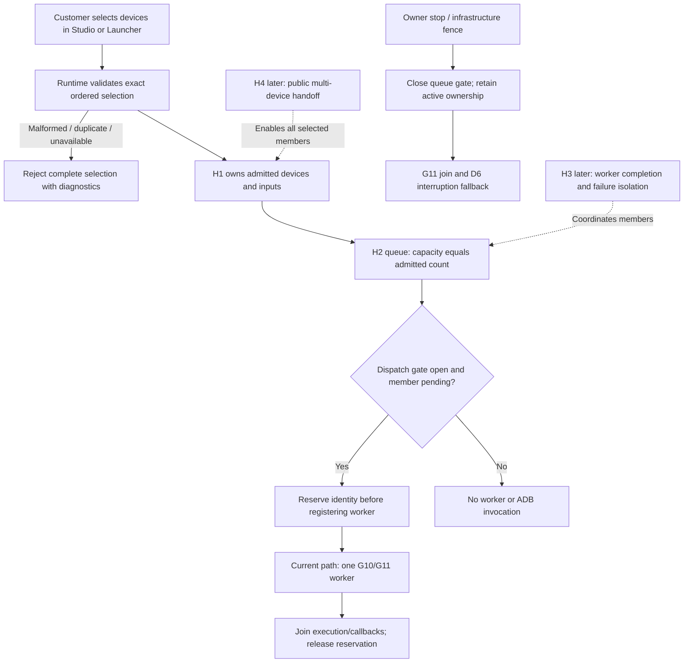

# H2 — Bounded queue and worker slots

## Overview

**Current public policy:** [H4](../h_multi_device_execution/h4_public_multi_device_start.md)
now exposes the complete non-empty selection through POST /runs. Any one-device
public gate described below records this step’s original delivery boundary;
that gate and AdmitSingleDevice are removed. Earlier test evidence remains scoped
to the step that produced it.

H2 gives the H1 RunGroup owner an ordered queue and a reservation for each
admitted device. The selected device list determines execution capacity:
selecting 10 devices permits 10 concurrent executions; selecting 4 permits 4.
There is no separate maximum-device setting in Runtime, Studio or Launcher.
Practical capacity depends on the customer's hardware.

For devices A, B and C, the queue reserves A, B and C once each, in selection
order. Their workers may run concurrently after H3/H4 connect the complete
multi-device dispatch path. Each reservation covers one device's sequential
workflow execution. It is not a per-node slot or a preallocated block of RAM.

H2 implements the private queue and integrates it with the existing one-device
start. H3 owns worker completion and failure isolation; H4 opens public
multi-device admission and dispatch. The temporary one-device API guard must
remain until that complete handoff can execute every admitted member.



**Status — Implemented and Linux-verified on 2026-11-22.**
The optional capacity field, parser, default, constructor argument and composition
wrapper are removed. Wire now injects the ordinary lifecycle constructor. Queue
storage/reservations derive only from complete admitted membership. Existing
configuration/queue/ownership/API tests and the available race suite pass; full
verification details and the missing G22 fixture are recorded in section 12.1.
H3/H4 multi-device dispatch and native Windows/live-device acceptance remain
separate work; the current public start still accepts one device.

## 1. Scope and ownership

| Owner | Responsibility |
| --- | --- |
| Client | Send the exact selected ADB serials and corresponding per-device inputs; no separate concurrency preference. |
| E6/G1/G12/D2 | Validate the complete selection and inputs, preflight readiness, preserve request-ID replay and atomically admit all members. |
| H1 | Copy owned work, bind inputs/variables to identities, own group context and shared RAM, and join cleanup. |
| H2 | Ordered pending membership, identity reservation/release and stop fencing, with capacity equal to admitted count. |
| G10/G11 | Existing sequential execution, worker lifetime, stop authority, bounded joining and supervised infrastructure failures. |
| G9/D4 | Persist authoritative node/device/group state and atomic events. |
| H3 | Track real worker completions, isolate ordinary device failures, fence uncertainty and finish group ownership only after all members settle. |
| H4 | Expand the current single-device admission and dispatch guards together, enabling complete public multi-device handoff. |
| H11; deferred H7 | Resume execution ownership without restarting workflows. Variable-wait scheduling is deferred and must be reassessed under membership-derived capacity. |

Follow [H1 ownership](h1_group_execution_ownership.md),
[A5 execution states](../contracts/execution_state_v1.md),
[G11 shutdown](../g_workflow_engine/g11_runner_shutdown.md), and the
[G14 expansion checklist](../g_workflow_engine/g14_start_run_api.md#15-phase-h-expansion-checklist).

One active RunGroup remains the MVP policy. Only explicitly selected, admitted
devices can execute. Discovery of other devices must not create workers.
No HTTP field, setting endpoint, handler, IR version, schema migration, queue
table or dependency is added by H2. Byte/schema/per-variable limits and operation
deadlines remain independent of device cardinality.

## 2. Selection and capacity contract

1. Studio or Launcher lets the customer select the devices for this run.
2. The run request carries exact ADB serials and their corresponding inputs.
3. Runtime rejects an empty selection, malformed serial, duplicate serial,
   unknown endpoint or unavailable selected endpoint under the existing contracts.
4. Do not silently deduplicate or filter. Duplicate entries may carry different
   inputs; silently dropping an unavailable member would misrepresent the run.
5. After complete admission, let `N = len(admitted members)`. The group's
   execution capacity is exactly N. There is no separate default or maximum.
6. Selection changes apply to the next run without restarting Runtime.
   A later run starts with its own fresh membership and RAM state.
7. Do not silently reduce selection using CPU/RAM heuristics. Real resource
   exhaustion or deadline failures remain reportable failures, never permission
   to replay an uncertain device action.

Until H4, the public API still requires exactly one device. Internal large-group
fixtures prove the foundations, not public or hardware-level multi-device support.

## 3. Configuration removal

Runtime has no execution-concurrency YAML, environment or CLI setting. Remove
the former execution section from checked-in examples and Config, together with
its parsing, validation and default constant. Do not replace it with a differently
named device-count cap or a per-request maximum.

Keep B2's normal strict unknown-YAML-key behavior. A local file containing the
removed execution field must be corrected before startup; no compatibility shim
or automatic local-file rewrite is required. An obsolete, unregistered environment
variable has no effect under the existing loader. Other configuration fields and
precedence remain unchanged.

Studio and Launcher must not add a **Maximum simultaneous devices** preference,
write capacity YAML or inject a capacity environment variable. Their device
picker is the customer's resource control. No new startup command or settings
integration is needed. Do not silently restart active work.

## 4. Construction and composition

Use the existing `executionlifecycle.New(checkpoints)` constructor. It requires
no Config object or concurrency argument. `Service.Start` retains dependency
and lifecycle validation without an obsolete concurrency check.

The group constructor accepts owned device work without a capacity parameter.
Its private queue receives only the ordered member IDs. Derive capacity from
that immutable membership before allocating reservation storage. A small slice,
position and active-membership map are sufficient.

Wire should provide `executionlifecycle.New` directly. Remove the capacity-only
composition wrapper; regenerate `wire_gen.go` using `make wire`, never by hand.
Keep unrelated construction and checkpoint dependencies unchanged.

## 5. Queue state and operations

| State | Meaning |
| --- | --- |
| Members and next position | Complete immutable admitted order and next unreserved member. |
| Active membership | IDs whose executions have reserved ownership; at most N. |
| Closed dispatch gate | No new reservation after stop; active and pending identities remain owned for settlement. |

Use references/indices into H1 work or a copied identity list. Do not copy inputs,
workflow bodies or outputs again. Queue state is private RAM bookkeeping; it
cannot replace A5 statuses, checkpoints, summary counts or event cursors.

```text
newDeviceQueue(orderedMemberIDs) -> queue or contextual error
take() -> original member index and found flag
release(memberID) -> success or contextual stale/invalid error
stop() -> idempotently fence future selection
```

Construction validates non-empty unique canonical Runtime UUIDs. No count cap
or capacity argument exists. Operations use the existing lifecycle mutex and
perform no SQLite, handler, device-discovery or ADB calls. No per-pending-member
blocked goroutine, additional lock or scheduler framework is needed.

## 6. Reservation invariants

```text
N = complete admitted member count, N >= 1
capacity = N
0 <= active reservations <= N
0 <= next position <= N
```

- Initially all N members are pending, with no reservation.
- `take` reserves the next member exactly once before returning its index.
  Initial selection follows FIFO order; actual Android arrival order is not promised.
- A stopped or exhausted queue returns no member without advancing its position.
- All N members can hold reservations concurrently. There is no artificial
  two-slot/three-device waiting policy or customer-selected throttle.
- `release` removes one active reservation. Unknown, pending, duplicate or foreign
  identity release is a contextual stale-state error, with no membership change.
- Release never restarts, requeues or advances another member implicitly.
- Stop prevents new reservations. Returning active work can release ownership,
  but release cannot reopen the dispatch gate.

Member count bounds the queue's storage; no inventory maximum or guessed
hardware capacity determines allocation. Keep explicit finite membership and
existing byte/deadline protections. No adaptive sizing, priority, weighted slots,
work stealing or persistent queue is introduced.

## 7. Current one-device integration and H3/H4 boundary

1. Preserve replay-before-replacement semantics, `AdmitSingleDevice`, the outer
   start lease and `DispatchGroup`'s current one-member guard.
2. Under the existing owner mutex, check stop/failure authority, reserve the
   next identity and register its worker with no untracked stop-visible gap.
3. Run the existing G10/G11 worker under the group/owner context tree.
4. Release its reservation only after execution and synchronous callbacks return.
   Preserve H1 RAM cleanup, bounded prior-group join and drain ordering.
5. Infrastructure failure must fence further dispatch before another member
   could become eligible. H2 does not implement multi-member production dispatch.

An in-memory reservation does not itself write RUNNING. G9 records the first
attempt; no pending member gains a fabricated attempt, started timestamp or
ADB invocation. Reuse D4 and existing snapshot reads without status polling or
queue persistence.

H3 consumes actual worker results and coordinates every member's completion.
H4 removes the public and handoff single-device guards together. Do not weaken
those guards while only the first member is dispatched: that would accept work
and strand the rest. No production test-executor bypass is allowed.

## 8. Stop, failure and cleanup

The existing lifecycle mutex linearizes reservation against `PrepareStop` and
failure fencing. A racing member is either fully registered tracked work or
remains pending; no unregistered worker starts after stop wins.

Never hold that mutex during handler execution, cancellation callbacks, store
closure, worker join or SQLite operations. Stopping the queue does not cancel
stored rows by itself, close shared RAM or release running work prematurely.
G11 owns intentional cancellation authority/joining; D6 owns crash interruption.
Cancelled context alone cannot authorize a terminal status.

HTTP disconnect or subprocess cancellation alone does not release ownership.
Wait for the tracked execution and synchronous callbacks to return. Uncertain
side effects must not be repeated to recover a reservation.

Delay and retry delay retain ownership. H6–H8 are deferred; H7's variable-wait
release/reacquisition design must be reassessed because all admitted members
already have capacity. Do not build scarce-slot scheduling for the deferred
feature. H9 is next and defines pause boundaries for current executable work.
These operations preserve group ownership and membership-derived capacity,
without introducing a setting. See the [deferral decision](../phases/phase_h.md#wait-variable-deferral--approved-2026-11-22).

## 9. RAM and persistence policy

Queue/reservation state stays in group RAM and is not restored after restart.
Reuse H1 inputs and its shared variable store. No fixed per-slot memory block,
total-RAM setting or emulator-memory control is added.

Variable limits remain 64 KiB per value, 512 names and 1 MiB of name/value
payload per scope. An N-device group can retain up to `(N + 1) MiB` of variable
payload, plus maps, inputs, outputs and other memory. This is not a process-memory
limit or an up-front allocation. Screenshots can consume decoded buffers larger
than encoded PNG limits. Fewer selected devices reduce concurrent work; actual
resource behavior belongs to K5 measurements, not a hidden product count cap.

Admission, snapshots, sibling aggregation, cancellation and D6 recovery handle
all accepted/stored members. Never use current selection to truncate an older
group. Bound SQL insert/event append batches inside the same state transaction;
any batch failure rolls back all state/events and only confirmed commit wakes
readers. Existing code has removed the old fixed cardinality checks; no migration
is needed solely for this policy.

## 10. Errors and diagnostics

Reuse contextual lifecycle/stale-state errors and existing supervised ERROR
boundaries. Unknown/duplicate release or corrupted ownership is an internal
contract failure. Stopped/exhausted `take` is an ordinary result and needs no log.

Existing B2 unknown-key rejection covers removed YAML fields. Do not log entire
configuration, workflow bodies, variable values, credentials, inputs or raw
Android output. Add no per-probe logs or mandatory readiness component for the
private queue. H2 introduces no public error code or response shape.

## 11. Implementation mapping

| Files | Change |
| --- | --- |
| `internal/config/config.go`, former `internal/config/execution.go` | Remove the typed capacity field, default, parser and validation; retain strict ordinary configuration. |
| `pkg/constants/execution.go` | Remove the capacity default; retain independent event/batch/deadline constants. |
| `internal/services/executionlifecycle/queue.go` | Construct from membership only; derive storage/capacity from its size. |
| `internal/services/executionlifecycle/group.go`, `lifecycle.go` | Remove constructor/service capacity settings; preserve reservation, release, stop and ownership behavior. |
| `cmd/agent/execution.go`, `wire.go`, generated `wire_gen.go` | Remove the capacity wrapper and inject the ordinary constructor directly. |
| `configs/config.example.yaml`, `README.md` | Remove customer capacity settings; explain selection-driven concurrency and current H4 boundary. |
| Existing config/lifecycle/composition tests | Adapt obsolete setting/slot expectations; retain identity, FIFO, stop, cleanup and one-device regressions. |

Do not add dependencies, migrations, Backend/client code or adjacent-phase
execution behavior. The earlier no-ceiling query/batch alignment remains in place.
This revision removes configuration complexity instead of adding another policy.

## 12. Acceptance and verification

Use existing tests only, as requested. Adapt existing cases/fixtures and remove
obsolete configuration-only tests; do not add test files or cases in this pass.

| Check | Expected evidence |
| --- | --- |
| Configuration removal | Normal defaults load without an execution section; removed YAML fields fail as unknown keys; obsolete environment values cannot affect capacity. |
| Selected capacity | Existing 1/64/128-member queue fixtures can reserve their complete membership, without a limit argument. |
| Identity/FIFO | Copied membership, exact ordered indices, invalid/duplicate identities and invalid/double release remain verified. |
| Concurrency and stop | Owner-lock reservations are unique; stopped queues cannot select more members even after release. |
| Group cleanup | Stop retains live RAM until workers/callbacks return; rapid runs, owner loss and cleanup deadlines remain safe. |
| Large-group persistence | Existing 128-member admission/replay, snapshots, cancellation batches and queued recovery remain verified. |
| Public regression | Single-device start/poll/replay works; a multi-device POST is rejected without partial writes/dispatch until H4. |
| Composition | Regenerated Wire uses the ordinary constructor; Linux build and Windows cross-build compile. |

Run focused and full/race existing tests, `make fmt`, `make wire`, `make build`,
`go vet` and diff checks. Use the existing managed-parent process acceptance.
The existing G22 test references a missing Python harness; report that failure
instead of silently claiming an unfiltered full-suite pass. No native Windows
or real multi-device Android acceptance is implied by controlled fixtures.

### 12.1 Current removal verification — 2026-11-22

| Existing check | Result |
| --- | --- |
| Configuration tests | PASS: ordinary defaults; removed execution YAML rejected, including empty-map values that Viper otherwise discards; obsolete environment values have no effect. |
| FIFO/bounds and owner tests | PASS: complete 1/64/128-member reservation, identity copies, pending/unknown/double release, concurrent reservation/stop and live-RAM cleanup. No capacity argument remains. |
| Admission/repository/API regressions | PASS: existing 128-member admission/replay, cancellation batches and queued recovery; current single-device public start/poll/replay and stop behavior. |
| `go test ./... -count=1` | FAIL only in the existing `TestG22CombinedEngineAcceptance`, whose `cmd/agent/testdata/g22_acceptance.py` file is missing. Other packages pass with local socket permissions. |
| `go test -race ./... -skip '^TestG22CombinedEngineAcceptance$' -count=1` | PASS for all available existing tests. |
| `make wire`, `make fmt`, `make build`, `go vet ./...` | PASS. Generated construction calls `executionlifecycle.New(checkpointService)` directly. |
| Windows amd64 agent cross-build | PASS; native Windows execution remains unverified. |
| Existing managed-parent acceptance against the rebuilt agent | PASS: launch/readiness/authentication, competing launch, shutdown, owner EOF, external kill and replacement after probe timeout. |

Only existing tests were adapted; the obsolete capacity-provider-only test was
removed with its provider. No test files/cases or dependencies were added. The
missing G22 harness was neither replaced nor silently treated as a passing gate.
Controlled large groups do not prove independent real-device capacity. No schema
or migration change was required.

## 13. Client integration and manual checks

Customer resource control is the selected device list. Launcher and Studio must
send exact serial/input pairs, display complete rejection diagnostics and avoid
silent filtering. No maximum-device preference, capacity field, YAML/env injection,
settings endpoint or restart is needed when changing the next run's selection.

Repeat the [G22 one-device procedure](../../../../a2matex-runtime/examples/g22/README.md)
for compile/start/poll/replay and a fresh run. Current builds accept one selected
device through the public API. H4 updates the client pickers/guides to permit
multiple selections after complete dispatch is verified. Do not advertise that
capability before the H4 gate.

## 14. Completion and deferred work

Removal is complete when capacity configuration/wiring/examples are absent,
queue capacity is derived from admitted membership, the existing stop/cleanup
and persistence checks pass, and affected specs/guides describe the same policy.
Record actual evidence here and in the roadmap; retain explicit regression gaps.

| Later owner | Deferred responsibility |
| --- | --- |
| H3 | Actual multi-worker completion, failure isolation, uncertainty fencing and all-member group retirement. |
| H4-H5 | Public complete-group admission/dispatch and device-disconnect behavior. |
| H6-H8 | Deferred variable waiting; reassess reservation release/reacquisition before resuming this feature. |
| H9-H13 | Checkpointed pause/resume/cancel coordination and action API. |
| H14-H15 | Scheduler shutdown/recovery and independent real-device/native-host acceptance. |
| K5 | Sustained resource/fault measurement; future resource policy requires separate approval. |

No restart-and-resume, persisted variables/queue, display cache, cross-Runtime
variables, new node modes or automatic hardware throttle is introduced.
