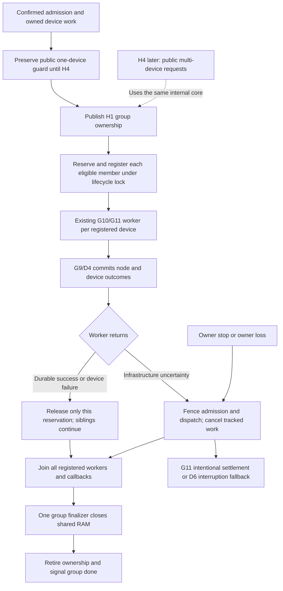

# H3 — Worker completion and failure isolation

## Overview

**Current public policy:** [H4](../h_multi_device_execution/h4_public_multi_device_start.md)
now exposes the complete non-empty selection through POST /runs. Any one-device
public gate described below records this step’s original delivery boundary;
that gate and AdmitSingleDevice are removed. Earlier test evidence remains scoped
to the step that produced it.

H3 connects the H1 group owner and H2 device queue to the existing device
runners. Every admitted device can execute concurrently, while nodes within
one device remain sequential. Each returning worker releases its own reservation;
the group releases shared RAM only after every worker and synchronous callback
has returned. A workflow failure on one device leaves its siblings running.
An infrastructure failure fences dispatch and stops work through the existing
Runtime lifecycle.

For example, A succeeds after two seconds, B fails after one second and C
succeeds after five seconds. B's failure does not cancel A or C. D4 keeps the
RunGroup RUNNING while another device is unfinished, then commits FAILED when
all devices are terminal. Shared Global variables remain available until C and
all final callbacks return; only then can group cleanup finish.

H3 builds and verifies this internal coordination. The public `POST /runs` and
`DispatchGroup` entry points still require one device until H4 changes both
policies together. There is no maximum-device configuration, separate throttle
or automatic hardware sizing. Capacity equals the complete admitted membership.



**Status — Implemented and Linux-verified on 2026-11-22.**
The private complete-group coordinator registers all selected workers, releases
member reservations independently and joins every callback before shared-RAM
cleanup. Ordinary device failure is isolated; infrastructure failure fences
Runtime work. Public single-device guards remain in place for H4. Verification
and the missing G22 regression fixture are recorded in section 12.1; native
Windows and real multi-device Android acceptance are not claimed.

## 1. Scope, dependencies and boundaries

| Owner | Responsibility |
| --- | --- |
| G1/E6/G12/D2 | Validate complete input/device selection, preserve replay and atomically admit immutable identities. |
| H1 | Own copied work, contexts, variable views, group RAM and bounded previous-group joining. |
| H2 | Ordered unique membership, reservations, release and stop fencing, bounded by admitted member count. |
| H3 | Register and launch workers, consume completion, isolate ordinary failures and retire the group after all workers return. |
| G10/G9 | Execute each device's workflow, route errors and apply existing timeout/retry policy. |
| D4 | Serialize authoritative checkpoint writes, aggregate device/group states and commit events. |
| G11/B3 | Fence process-owned work and join it before intentional shutdown settlement/storage closure. |
| D6 | Interrupt unfinished persisted work after crash or forced exit without redispatch. |
| H4 | Remove public and live-handoff single-device guards together; update client/API acceptance. |

Direct prerequisites are H1, H2 and D4; reuse G10/G11 behavior rather than
creating another execution engine. At most one live group owner is published.
A retiring terminal group can temporarily precede a newly admitted group, but
the new group must wait for prior ownership cleanup before starting workers.

H3 adds no endpoint, DTO, node type, Runtime IR version, schema/migration,
repository interface, concurrency setting, dependency or Studio/Launcher code.
Wait Variable, pause/resume, live group cancellation and disconnect monitoring
remain with their later H steps. Existing handler-reported device failures
already use the ordinary failure path described here.

## 2. Baseline before H3 and required changes

| Baseline source | Required H3 behavior |
| --- | --- |
| `executionlifecycle.DispatchGroup` reserves and starts one member | Preserve its external one-device guard; extract/reuse a private complete-group coordination path. |
| Worker calls `runRegistered(..., g.close)` | Run each member without a shared-group cleanup callback; one returning member must not close sibling RAM. |
| Worker immediately cancels the group and clears `l.group` | Retire only this member; cancel/clear the group once after all registered workers return. |
| `runRegistered` already fences unexpected Go errors | Preserve failure publication before another dispatch can pass the owner gate. Consume normal FAILED results without converting them into Runtime failure. |
| `signalDrained` requires no workers, no leases and no group | Keep the group published throughout initial dispatch, joins and cleanup, including zero-worker stop races. |
| D4 already aggregates siblings when a device becomes terminal | Reuse that transaction; do not add completion-time status polling or duplicate group-finalization writes. |

Keep the actual scheduling/completion logic private to
`internal/services/executionlifecycle`. A small helper split is acceptable when
it gives launch/join behavior a clear responsibility; avoid a generic worker
framework, injectable production test executor or parallel scheduling subsystem.

## 3. Entry points and ownership transfer

The public Go shape remains:

```go
func (l *Service) DispatchGroup(
    id string,
    worker *runner.Runner,
    devices []runner.Request,
) error
```

Keep its `len(devices) == constants.MaxStartDevices` check in H3. A private
helper, for example `dispatchGroup`, handles any non-empty complete admitted
group and is the implementation used by this entry point. Same-package tests
may call that actual private path with multiple committed members. This is
not a second worker implementation or an exported guard-bypass API. H4 later
changes the external policy while retaining the same core.

Preserve H1's complete work validation before publishing ownership or starting
any handler: valid group/device UUIDs, exact serials, unique identities/serials,
matching group IDs, checked non-nil input maps and no prebound execution authority.
Copy inputs and attach the shared store/per-device views once. Reuse the
immutable checked runner across workers; G10 keeps mutable inputs, committed
outputs, visited nodes and retry position local to each `Run` call.

Before publishing a group, reject any device identity already registered in
`l.workers`. Check all proposed members, not just index zero. Preserve duplicate
active-group rejection and bounded prior-group joining outside the owner lock.
A rejected/unpublished group is cleaned up exactly once using the existing
bounded cleanup context, with no device invocation.

A successful handoff means the Runtime owns execution and retirement; it does
not mean the workflow completed. The HTTP context must not become a worker
parent. Preserve the outer start lease across confirmed admission and handoff.
No snapshot/read failure after ownership transfer may abandon admitted work.

## 4. Initial dispatch algorithm

Use a finite initial dispatch loop with one registration per admitted identity.
All N members may run concurrently. There is no slot-throttle refill policy:
completion does not make another copy of a device execution eligible.

Recommended implementation sequence:

1. Construct and validate H1-owned work outside the lifecycle mutex.
2. Join a previous owner using the existing bounded H1 path, then recheck the
   lifecycle gate under the mutex. Publish `l.group = g` before any worker can
   start or shutdown can observe an unowned dispatch producer.
3. For each next member, under that same mutex: check stop/failure authority,
   reserve the H2 queue index, create an owner/group-derived child context,
   register its cancel function in `l.workers`, and increment the worker join
   count before launching its goroutine. Registration and reservation are one
   stop-visible operation.
4. Unlock and launch the existing `runRegistered` path for that request. The
   worker receives its own copied inputs, identity/serial and variable view.
   Never invoke a handler, checkpoint or cancellation callback while locked.
5. Repeat until membership is exhausted or the owner gate closes. Registration
   follows admission order, but handler arrival/completion order is unconstrained.
6. Seal initial dispatch before starting the final join. Arrange one tracked
   group finalizer even if stop/failure left zero workers or some members pending.
7. Return promptly after initial registration/launch is complete and retirement
   is owned; do not wait for workflow completion in the handoff call.

A local `sync.WaitGroup` is sufficient: add before each goroutine, finish the
initial producer loop, then let one finalizer wait. Never call `Wait` while a
zero join count can still receive its first concurrent `Add`. One coordinator
finalizer plus at most N device goroutines is enough; no per-node or per-pending
member goroutines, polling loop or completion-result channel is required.

If stop wins before group publication, retain H1's known-stop cleanup behavior.
After publication, stop never causes a direct cleanup of live sibling resources:
stop registration, join started work and leave pending rows for G11/D6 settlement.
A known supervisor stop without infrastructure failure consumes the handoff as
before. An observed fatal registration/worker failure returns the existing
contextual failure while preserving owned retirement for already-started work.
Never partially register a group and then run unpublished-group cleanup.

## 5. Worker completion and result classification

The member wrapper executes `runRegistered(ctx, g.worker, request, nil)` or an
equivalent reuse of the existing registered-run path. Passing `g.close` to an
individual member is forbidden: that callback owns resources used by siblings.

| Observed completion | Required action |
| --- | --- |
| `err == nil`, confirmed `DeviceStatus == SUCCEEDED` | Ordinary completion; release this reservation and keep siblings running. |
| `err == nil`, confirmed `DeviceStatus == FAILED` | Ordinary terminal device failure; preserve its safe terminal error and keep siblings running. |
| A failed node uses an error route or eligible retry and the runner continues | No worker completion yet; G9/G10 own the behavior. Do not release its reservation or schedule a second worker. |
| `err == nil`, confirmed `DeviceStatus == CANCELLED` | Consume the existing G11-authorized result; it must not create cancellation authority. |
| Context cancellation/deadline during an accepted supervisor stop or owner loss | Expected lifecycle exit under existing G11 classification; do not synthesize success, failure or cancellation from context alone. |
| Non-nil unexpected Go error, invalid runner result, failed/uncertain checkpoint or ownership corruption | Infrastructure failure: fence Runtime admission/dispatch and cancel tracked work through the existing failure path. |

A `TerminalError` inside a confirmed FAILED result is not itself a Go execution
error. An unhandled node timeout can produce a FAILED device result with
`err == nil`; that must not stop healthy siblings. Conversely, a Go error is
not made harmless merely because its result contains earlier attempt evidence.
Consume G10's checked result rather than guessing completion from `LastAttempt`,
`NextNodeID`, subprocess exit or a callback having started.

Completion ordering is:

1. Let the existing runner and synchronous callbacks return.
2. Publish any unexpected-error fence through `runRegistered` under the owner
   lock before another registration can observe a free/healthy dispatch gate.
3. Unregister the finished worker through the existing tracked-run path.
4. Under the owner lock, release only that member's H2 reservation. A release
   error publishes the infrastructure fence before unlocking; invoke captured
   cancellation callbacks outside the lock.
5. Cancel/release the child context and finish this member's join count only
   after its release/error handling is complete.

Do not cancel `g.ctx`, clear `l.group`, close the store or signal `g.done` here.
Do not copy large node outputs into a group completion map. Joining requires
only bounded ownership metadata, not another source of execution status.

## 6. Infrastructure failure and dispatch races

Keep the existing sticky first-failure behavior in `recordFailure`/`Fail`:
close admission, stop H2 selection, publish the failure to supervision, then
invoke worker/group cancellations outside the mutex. Follow-on cancellation
errors must not replace the original infrastructure cause or reopen the gate.

If a worker fails while the initial producer is still registering members,
that producer checks the gate before each reservation. After the fatal fence
wins the mutex, no later member may be registered. A member registered before
the fence remains tracked even if its goroutine has not begun; cancellation
must reach that child context. Preserve G10/G9 context/authority checks before
further attempts. Already-issued Android commands may have occurred and are
never undone or redispatched by H3.

Do not release a reservation merely because cancellation was requested. Its
worker and callbacks must actually return before release/join. Do not retry a
worker, rebuild its runner or resubmit its last node after a storage failure.
D4 alone owns permitted uncertain-commit read-back; unresolved uncertainty
stops the Runtime and leaves actual persisted truth for D6.

## 7. Group finalization and shared RAM lifetime

Exactly one finalizer is created for each published group. It runs after the
initial producer is sealed and all registered workers have returned, completed
synchronous callbacks, unregistered and released their reservations.

1. Confirm that no member reservation/worker remains. A mismatched ownership
   record is fatal; do not hide it by resetting a map or decrementing a counter.
2. Outside the owner mutex, invoke `g.close` once through the existing bounded
   cleanup path. That path detaches normal owner cancellation and honors the
   existing checkpoint cleanup timeout and any earlier supervisor deadline.
3. After cleanup returns, cancel the group context to release its resources.
4. Under the owner mutex, retire only this group's published pointer, close its
   `done` channel once and call the existing drain signal check. A finalizer
   must never clear a different/new group.
5. Surface cleanup failure through the existing fatal path before advertising
   retirement. `g.done` means the owner/finalization path returned; it is not a
   second success result. A cleanup failure remains visible in `Wait`/`Shutdown`
   and cannot permit a fresh run or be reported as clean shutdown.

The group remains published during cleanup even if its final SQLite checkpoint
already made the group terminal. A newly admitted run waits for that owner to
retire under H1's bounded prior-group join. Its workers cannot race an old
finalizer clearing `l.group` or closing shared resources.

If a worker fails to return before the supervisor deadline, shutdown reports
the join failure; never close RAM underneath the live worker to manufacture a
successful drain. Process exit/crash leaves D6 interruption evidence. H3 adds
no detached background process or execution that survives Runtime termination.

Flow/Global state remains available to surviving siblings. The first completed
device does not delete its scope or close the shared store. Terminal retirement
releases the store and copied requests together. Restart never restores those
values or continues the old run.

## 8. Checkpoints, aggregation and observable data

D4 remains the sole authority for node/device/group transitions. Existing
checkpoint-service serialization and SQLite write transactions are expected;
Android handler execution can still proceed concurrently across devices.
H3 adds no database operation per completion or node, no status polling and no
manual final group UPDATE. A reservation alone cannot create a RUNNING attempt.

| Example | Required persisted result |
| --- | --- |
| A succeeds while B remains queued/running | A is SUCCEEDED; group remains RUNNING and unfinished. |
| B fails while A/C still run | B is FAILED with its existing safe error; group remains RUNNING. |
| Every device succeeds | The last necessary D4 checkpoint commits SUCCEEDED. |
| All devices are terminal and at least one failed | D4 commits FAILED; successful siblings retain their original results. |
| Intentional owner stop | G11 settles unfinished admitted members as CANCELLED after joining; completed history is preserved. |
| Crash/owner loss without accepted intentional stop | D6 later interrupts unfinished records without replay; existing terminal rows are unchanged. |

Concurrent terminal checkpoints must not finalize the group twice or lose a
sibling result. Preserve per-device attempt sequences, ordered admission
snapshots, derived counters and Runtime-wide event cursors. Events from
concurrent devices may interleave; never assert dispatch/completion order from
adjacent global cursors. State/events remain atomic and wakeups occur after
commit. Existing large-group batched settlement stays in place.

A snapshot can show a terminal group while its last worker/callback cleanup is
still returning. This is why persisted completion and in-memory retirement are
different boundaries. No new public status, progress field, SSE endpoint or
completion API is introduced.

## 9. Stop, ownership loss and HTTP lifetime

Preserve `PrepareStop` ordering: publish stop authority/deadline, fence new
registration/selection, then cancel worker/group contexts outside the mutex.
The group pointer keeps drain incomplete while initial dispatch or finalization
still owns work, even when `l.workers` happens to be empty.

`Shutdown` retains its shared deadline and existing authority rules. It must
join all started workers and cleanup before intentional group cancellation
settlement and storage closure. Pending members never get fabricated attempts.
An expired deadline or infrastructure failure is observable; it must not be
acknowledged as completed intentional cancellation.

An HTTP disconnect after admission does not cancel group execution. Request-ID
replay never calls the coordinator again. A later fresh run receives fresh
worker contexts, copied requests and RAM after bounded prior-owner retirement.
Do not add resume-after-restart, automatic reconnect loops or new owner policy.
H14 later broadens scheduler-state acceptance without replacing these rules.

## 10. Efficiency, safety and diagnostics

- Initial membership validation/registration is O(N). There is no product count
  cap, separate maximum setting, semaphore smaller than N or CPU/RAM heuristic.
- Reuse H1 input copies and immutable runner configuration. Per-device runner
  state remains local; Global writes keep G16/G18's existing synchronization.
- Keep the existing owner mutex as the reservation/failure/stop ordering point.
  Never hold it during SQLite/device I/O, waits, cancellation callbacks or store
  closure. Do not nest it with the variable-store gate.
- Use one device goroutine per registered member and one group finalizer. Avoid
  a second work queue, per-node goroutines, unbounded completion buffers or
  goroutine-per-pending-member waits.
- Existing command deadlines, bounded process output, checkpoint timeouts and
  variable/image quotas remain in force. H3 adds no total-memory guarantee.
- Use existing contextual errors and structured ERROR supervision boundaries.
  Safe group/device IDs and an operation such as `release_device_slot` or
  `release_group_resources` locate failures. Preserve the first fatal cause.
- Ordinary terminal workflow failures already have persisted diagnostics; avoid
  duplicate per-node/group ERROR logs, polling logs or a new logger dependency.
  Never log tokens, workflow/input bodies, variable values, raw ADB output or
  screenshot bytes. No new component-ready event is required.

## 11. Implementation map and review scope

Paths below are relative to `a2matex-runtime/`.

| File | Expected change |
| --- | --- |
| `internal/services/executionlifecycle/group.go` | Retain guarded public handoff; add/reuse private complete-group registration and exactly-once retirement. Move shared cleanup out of the member callback. |
| `internal/services/executionlifecycle/lifecycle.go` | Preserve existing error/stop authority, registered-run behavior and drain accounting; make only necessary completion-integration changes. |
| `internal/services/executionlifecycle/queue.go` | Reuse H2 reservation/release/stop unchanged unless a proven ownership issue requires a focused correction. |
| Existing `group_test.go`, `dispatch_test.go`, `queue_test.go` | Preserve H1/H2 races, single-device regression, cleanup deadline, replay/lease and stop behavior. |
| Focused same-package group completion tests | Exercise the actual private coordinator using existing registry/runner fixtures and real SQLite where persistence is asserted. |

Prefer the existing group file. A private `group_workers.go` is justified only
if launch/join helpers make the responsibilities clearer; do not spread a small
feature across many tiny files. No `cmd/agent`, Wire, Config, API/DTO, repository,
handler or migration change is expected. Reuse concrete `runner.Runner` and its
existing injected dependencies instead of adding an executor interface solely
for testing.

Keep the production diff focused, approximately 100–300 changed lines as the
roadmap's review guide, with reused test fixtures. If implementing the contract
requires changing adjacent owners or broad refactoring, surface that prerequisite
before widening this step. Do not implement H4 through a hidden test switch.

## 12. Acceptance and verification

Focused H3 additions were approved before implementation. Existing concrete
runner construction is reused from `dispatch_test.go`; the focused cases live
in `group_completion_test.go`. Use controlled barriers and existing
`testing/synctest` patterns, not sleeps or real emulators to prove scheduling
and lifetime order. Existing timeout/retry, cleanup-deadline and API/process
regressions remain part of verification.

| Scenario | Observable evidence |
| --- | --- |
| Three workers held at a handler barrier | All admitted members enter with their own serial/input pair before any is released; no artificial throttle or unselected member starts. |
| Different completion order | Release B, A, then C; reservations retire exactly once and shared RAM remains usable until C/callbacks finish. |
| One ordinary FAILED result | B's failure is committed; A/C continue and group stays RUNNING until all terminal. `l.failure` remains nil. |
| Node timeout/error route/retry | Existing G9/G10 semantics remain intact; a terminal node timeout fails only its device and a retry never creates another device worker. |
| Concurrent terminal finishes with SQLite | All-success and mixed-success/failure groups have correct final state, complete summaries/attempts and committed events; no duplicate group-finalization event. |
| Fatal worker error during initial dispatch | Once failure wins the owner gate, no later registration passes. Already registered work is joined and first cause preserved. No uncertain action is retried. |
| Stop before first reservation and during registration | Either no worker starts or every started worker is tracked; zero-worker/partial groups still own retirement and pending rows are settled by existing G11 authority. |
| Last checkpoint before callback/cleanup return | A rapid next fresh run waits for prior retirement; no early RAM close or stale finalizer clearing the new group. |
| Cleanup failure/shared deadline expiry | Stop cannot report clean completion; failure is visible and no new dispatch occurs. Live workers are never treated as joined prematurely. |
| Duplicate handoff/replay/HTTP disconnect | Existing H1/G14 behavior remains unchanged, with no duplicate owner/worker or request-bound cancellation. |
| Larger finite membership | Reuse an above-32 fixture to prove exact membership and complete joining, without defining a new count ceiling or claiming hardware capacity. |
| Public guard and actual-agent regression | Current multi-device POST/live handoff is still rejected; existing one-device compile/start/poll/replay and managed-process checks remain valid. |

Tests with multiple members call the actual same-package private coordination
path after real internal admission or equivalent trusted fixtures. Use real G10
runners with controlled existing handler registrations; use D2/D4 SQLite for
state/event assertions. Do not invent a test-only production endpoint, exported
bypass, alternate runner or new external dependency.

Run focused lifecycle/queue/runner/checkpoint tests, existing API/supervisor
regressions, full/race suites, `make fmt`, `make build`, `go vet` and diff checks.
Cross-build the Windows amd64 agent and affected tests. Native Windows and
independent real Android acceptance remain explicitly unverified until run.

The existing `TestG22CombinedEngineAcceptance` references a missing
`cmd/agent/testdata/g22_acceptance.py`. Restore it to claim an unfiltered full
suite pass. If still absent, record the exact failure and any explicit skip in
the available-suite command; do not silently remove or mark that gate green.

### 12.1 Execution evidence — 2026-11-22

| Check | Result |
| --- | --- |
| `TestGroupCompletionKeepsSiblingRAMAndJoinsFatalCallbacks` | PASS: three callbacks enter concurrently; out-of-order completion releases only its member; shared Global data remains available until the last callback joins. Fatal checkpoint/unknown-commit cause stays sticky while siblings are joined. |
| `TestGroupRegistrationOwnerLossRetiresZeroAndPartialWork` | PASS: owner loss fences the actual initial producer before its first reservation and after a partial prefix of a 64-member group. No worker/reservation/group owner leaks or false Runtime failure. |
| `TestGroupFatalFenceRetiresUnstartedWork` | PASS: an existing fatal fence prevents all new reservations, preserves the first failure and still retires the zero-worker group. |
| `TestGroupRejectsAlreadyRegisteredLaterMember` | PASS: a later identity collision is rejected before publication or worker start, preserving the existing registration. |
| `TestGroupSQLiteConcurrentOutcomesAndCompleteHistory` | PASS: real G10/D4/SQLite with controlled handlers, distinct serial/input pairs, 3-member success/mixed failure and 64-member concurrent groups. Group stays RUNNING while siblings execute; complete histories, derived counters and exactly one terminal group event are preserved. |
| `TestGroupIntentionalStopJoinsAndCancelsEverySQLiteMember` | PASS: all three active handlers join, all devices/attempts commit CANCELLED and no successor is dispatched. |
| Existing H1/H2/G9/G10/G11/API/supervisor tests | PASS in focused and available full/race runs, including timeout/retry behavior, rapid starts, duplicate/replay guards, cleanup lifetime/deadline and stop authority. |
| Focused `TestGroup` checks repeated ten times | PASS before the final zero-worker fatal-fence case was added; the complete final lifecycle package also passes the race detector. |
| `go test ./... -count=1` | FAIL only at `TestG22CombinedEngineAcceptance`: `cmd/agent/testdata/g22_acceptance.py` is missing. Other packages pass with local socket permissions. |
| `go test -race ./... -skip '^TestG22CombinedEngineAcceptance$' -count=1` | PASS for all available packages; the final added fatal-fence case also passes in the focused lifecycle race run. |
| Formatting, `make build`, `go vet ./...` and diff checks | PASS. Production changes are confined to `internal/services/executionlifecycle/group.go`; no dependency, Wire, Config, schema, repository or public API change. |
| Existing managed-parent script against the rebuilt agent | PASS: readiness/authentication, contention, shutdown, owner EOF, external kill and replacement after probe timeout. |
| Windows amd64 agent and lifecycle-test cross-builds | PASS; native Windows execution remains unverified. |

The new tests exercise private production coordination, not a test executor or
public bypass. The public `MaxStartDevices = 1` policy is unchanged. Controlled
serials are not real multi-device acceptance; H4/H15 retain those integration
and platform gates. The missing G22 harness remains an explicit regression gap.

## 13. Manual testing and integration outcome

H3 introduces no public multi-device demo. Continue using the existing
[G22 one-device API walkthrough](../../../../a2matex-runtime/examples/g22/README.md)
to verify compile/start/poll/replay, a fresh subsequent run and intentional
owner shutdown. The one-device API response shapes and session authentication
remain unchanged. A multi-device request remains rejected before partial work.

Internal controlled multi-member tests provide H3 concurrency evidence. H4
then supplies runnable multi-device API examples and updates Launcher/Studio
integration guides after the external guards are changed and verified. H15
requires independent real targets; one Waydroid instance or simulated serials
are not equivalent hardware acceptance.

## 14. Completion and deferred work

H3 is complete when the private complete-group coordinator uses the existing
runner for every registered member, ordinary device failures remain isolated,
fatal failure/stop fences precede new registration, and one finalizer joins all
workers/callbacks before shared cleanup and ownership retirement. Existing
single-device behavior and D4 aggregation remain verified. Record actual test,
build and platform evidence here and in the Phase H index/roadmap; this spec
alone does not mark implementation complete.

| Later owner | Deferred responsibility |
| --- | --- |
| H4 | Public multi-device request/live-handoff policy and complete API/client integration examples. |
| H5 | Explicit device-disconnect handling beyond consuming existing runner outcomes. |
| H6-H8 | Variable wait registration, wakeup, reservation release/reacquisition and Wait Variable node integration. |
| H9-H13 | Pause checkpoints, pause/resume/live cancellation coordination and lifecycle-action API. |
| H14-H15 | Combined scheduler shutdown/crash-state and independent real-device/native-host acceptance. |
| K5 | Sustained load/resource measurements and broader fault testing. |

No fixed count ceiling, maximum-device preference, persisted queue/variables,
automatic restart/resume, new scheduling priority, public endpoint or duplicate
SQLite result calculator is introduced by H3.
