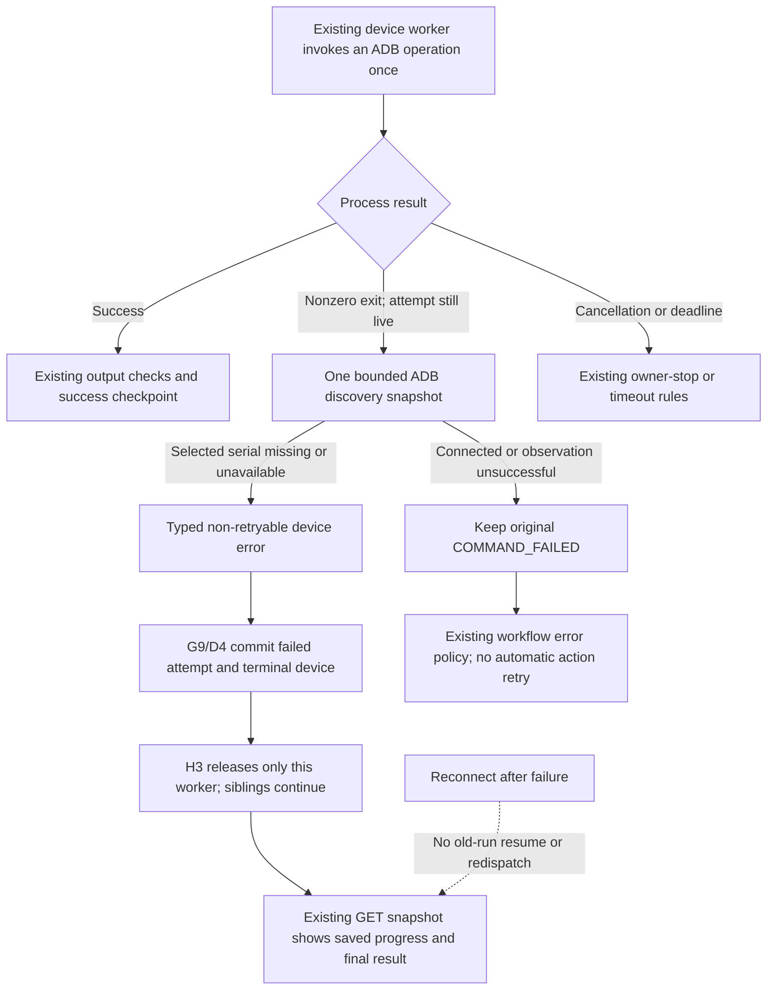

# H5 — Device-disconnect handling

## Overview

H5 identifies a selected Android device becoming unavailable during an ADB
operation and ends only that device's execution with a clear, saved error.
Other devices in the RunGroup continue. Reconnecting the device does not resume
the failed execution or repeat an action whose outcome may be uncertain.

H4 already checks every device before admitting the complete selection. Before
H5, the shared ADB dispatcher reduced most nonzero command results to
`COMMAND_FAILED`. H5 adds one bounded transport observation after
such a result. The existing outcome normalizer, checkpoints and H3 coordinator
already support stopping an individual device without stopping its siblings.

For example, A and B run Start → Delay → Press Home → End. A disconnects during
the delay. Its next ADB operation fails, discovery confirms A is missing, and
Runtime commits A as FAILED with `DEVICE_DISCONNECTED`. B continues to End.
The group remains RUNNING until B finishes, then becomes FAILED.



**Status — Runtime code implemented on 2026-11-22; H15 verifies focused transport
mapping and Linux controlled two-device disconnect acceptance on 2026-11-23.**
The earlier existing-tests-only evidence is retained in section 10.1; section 13
records the approved H15 additions. Live independent-target acceptance is pending.
This is command-observed disconnect handling. It deliberately adds no background
watcher, repeated readiness probes or detection guarantee during RAM-only work.
A disconnect during Delay, Switch or variable operations is observed only if a
later ADB process fails. A workflow can finish without noticing a temporary
disconnect if it has no failing device operation. Continuous monitoring is
deferred; it must not be implied by the H5 completion label.

Read alongside the implemented [H4 start contract](h4_public_multi_device_start.md),
[H3 failure isolation](h3_worker_completion_and_failure_isolation.md), and shared
[A6 error contract](../contracts/event_error_v1.md). Their existing ownership,
persistence and error envelopes remain authoritative.

## 1. Responsibility and existing foundations

| Owner | Responsibility |
| --- | --- |
| E6/G12/H4 | Fresh whole-selection readiness before admission; invalid selections create no partial run. Unchanged. |
| E1/E2 and `adb.Resolver` | Trusted executable, bounded process execution and strict parsing of ADB transport snapshots. |
| H5 / shared ADB adapter | After a qualifying process failure, observe the selected serial and return a safe typed device error when the observation establishes unavailability. |
| G6/G7/G8/G9 | Attempt deadlines, normalization, retry/routing and confirmed completion checkpoints. |
| D4/G13 | Durable attempts/device state/events, derived group results and current JSON snapshots. |
| H1–H3 | Process-owned work, independent device completion, reservation release and joined group-RAM cleanup. |
| G11/D6 | Intentional shutdown settlement, crash interruption and no automatic old-run restart. |

Use the existing selected serial and device-execution identity. Do not create a
second scheduler, connectivity database, device replacement policy or API.
The complete admitted membership, per-device inputs and one-active-group rule
remain unchanged. There is no maximum-device setting or count ceiling.

## 2. Detection strategy and its limits

| Approach | Cost and behavior | H5 decision |
| --- | --- | --- |
| Parse command stderr alone | Avoids another process, but Android errors can include application text and ADB wording varies. A generic nonzero result does not prove disconnect. | Do not use arbitrary substring matching as authoritative evidence. |
| Run readiness checks before every node/command | Adds processes even to successful work and still cannot eliminate the race between check and action. | Excluded. |
| Observe transport after a nonzero command result | Adds work only on failure, reuses strict discovery and supplies evidence without repeating the action. | MVP implementation. |
| Continuous inventory/track-devices watcher | Can detect loss during Delay or variable waits, but needs worker cancellation authority, observer lifetime and race handling. | Deferred, including any new detection-latency promise. |

The observation is a fresh `adb devices -l` snapshot, not a new boot-readiness
probe. Do not call full selection preflight or `ProbeReadiness` from the
dispatcher. Successful discovery with a CONNECTED entry proves transport is
currently listed, not that the application accepted the preceding action.

A device may disappear and reconnect before discovery completes. If the fresh
snapshot reports it CONNECTED, keep the original failure. Do not invent a past
disconnect or turn an uncertain action into success. Likewise, a successful
command must not be retroactively failed because the device disappears later.

## 3. Qualifying failures and shared adapter boundary

Integrate classification into `Dispatcher.runDevice`, where commands already
carry a validated exact serial and a caller-owned attempt deadline. This covers
typed actions, display measurement, hierarchy operations and binary screenshot
capture through one shared path, without copying logic into each node handler.

| Existing result | H5 behavior |
| --- | --- |
| Successful process with zero exit | Return the current result; no discovery. Preserve downstream launch/display/XML/PNG validation. |
| `processrunner.NonzeroExit`, with live caller context | Make at most one transport observation for that failed process and apply section 4. Never run the original process again. |
| Caller already cancelled or deadline expired | Return the existing context error; no observation and no fresh context. |
| Process timeout/cancellation | Keep existing timeout/cancellation handling; no post-deadline device diagnosis. |
| Executable resolution failure or process start failure | Keep current `ADB_UNAVAILABLE` / `COMMAND_START_FAILED` behavior. The command was not successfully launched; H5 does not change G8 eligibility. |
| Invalid command, invalid dispatch contract or command-line limit | Preserve current input/internal error; no transport observation. |
| Application/output failure after a zero exit | Preserve current node error. Missing launcher activity, selector ambiguity, malformed display/XML or invalid screenshot content is not disconnect evidence. |

An existing empty Input Text no-op remains a no-op. H5 adds no device check to
it. For percentage or selector actions, a classified failure during display or
hierarchy lookup prevents the later gesture command from being dispatched.

Keep best-effort hierarchy cleanup best-effort. Its errors must not replace the
primary operation error, create an additional node attempt or change a confirmed
outcome. Do not add reconnect, ADB-server restart, kill-server, emulator restart
or arbitrary shell commands to the failure path.

## 4. Observation and error mapping

Use `Resolver.Discover` and its existing `Endpoint.State` values. Search the
complete checked snapshot for the exact submitted serial; discovery ordering
does not matter. Do not compare prefixes, IP addresses without ports, display
names or positions in inventory.

| Fresh observation after nonzero exit | Returned code | Fixed safe message |
| --- | --- | --- |
| Selected serial absent from a successfully parsed snapshot | `DEVICE_DISCONNECTED` | `device disconnected during command execution` |
| `Offline` | `DEVICE_OFFLINE` | `device is offline` |
| `Unauthorized` | `DEVICE_UNAUTHORIZED` | `device is unauthorized` |
| `OtherUnavailable` | `DEVICE_NOT_READY` | `device is not ready` |
| `Connected` | Preserve original `COMMAND_FAILED` | Preserve existing safe command-failure message. |
| Discovery fails, times out, returns malformed/truncated data, or cannot establish an observation | Preserve original `COMMAND_FAILED`, unless the caller context has stopped | Do not claim the selected device disappeared. |

All classified device errors have `retryable: false`. Reuse the existing error
codes and typed `xerror.CommandError`; do not add error strings as a new public
protocol. Admission continues to use `DEVICE_NOT_FOUND` for a serial not found
before work starts. `DEVICE_DISCONNECTED` describes an admitted serial missing
when a failed running operation is diagnosed; it does not claim when the
physical connection was lost or whether the action took effect.

Observation failure must not become a new retryable `ADB_UNAVAILABLE` outcome:
the original command process already ran. Keeping its non-retryable failure
preserves the existing action-safety boundary. Also do not promote an ordinary
observation failure to Runtime-wide infrastructure failure.

Implementation outline, not a new exported API:

```text
result = execute existing typed process once
if caller context stopped: return its context error
original = existing process-result error
if result is not NonzeroExit: return result/original as today

observe with a bounded child of the same caller context
if caller context stopped during observation: return its context error
if snapshot unavailable: return original
if selected serial missing: return non-retryable DEVICE_DISCONNECTED
if selected serial unavailable: return its non-retryable device-state error
return original
```

Preserve the original operation wrapper (`dispatch_command`, `read_display`,
`dump_hierarchy`, `capture_screenshot`, etc.) so handler logging still identifies
where the workflow failed. Optional diagnostic detail may identify the fixed
observation stage and state; never attach raw stdout/stderr or application text.

## 5. Deadlines, cancellation and race precedence

The original command and diagnostic discovery share the node attempt's deadline.
The observation may use a child deadline bounded by the existing
`constants.ADBDiscoveryTimeout` (currently five seconds) and the remaining
attempt time, whichever expires first. Bound the complete observation, including
resolver waits. Do not use `context.Background`, detach cancellation, extend the
node timeout or start an independent cleanup-budget diagnosis.

Recheck caller cancellation before and after observation. A diagnostic child
timeout with a live caller preserves the original command failure; expiry of
the caller's attempt deadline follows the existing timeout outcome. This means
a command that uses its whole timeout cannot also promise a disconnect code.
The five-second bound is an implementation constant, not a new user setting.

Do not cancel the device worker's parent context to represent a disconnect.
Return a typed error through the normal handler/attempt pipeline. Parent
cancellation is already reserved for lifecycle authority, and treating device
loss as generic cancellation could stop siblings or mislabel the result.

Existing G9/G11 precedence remains authoritative: intentional group shutdown
observed before completion freezes can settle CANCELLED; a confirmed earlier
device failure is not rewritten by a later shutdown. Infrastructure/persistence
uncertainty still fences Runtime work. H5 must not add a second completion,
perform a second database write to correct a committed result, or reinterpret a
timeout/shutdown as a more certain transport diagnosis.

## 6. Attempt completion and failure isolation

The existing normalizer already recognizes these device errors and sets
`Status=FAILED`, `Stop=true`, and `Retryable=false`. Keep that behavior:

1. Complete the current failed attempt through G9/D4 once.
2. Set no next node and no retry decision. Do not enter ERROR_BRANCH even when
   that node has an error edge; device unavailability stops the execution.
3. Persist terminal device status/error and existing events through the same
   checkpoint transaction. Do not publish output from the failed operation.
4. Return the confirmed failed device result as an ordinary execution outcome,
   not an infrastructure error from `runner.Run`.
5. Let H3 release that worker's reservation. Do not cancel siblings, close their
   Flow/Global storage or release group RAM before all workers/callbacks join.

Existing committed results, variables and artifacts remain intact. This error
does not retroactively roll back previous nodes or actions on the device.
If a screenshot operation fails, it cannot publish a new successful artifact;
existing staging/discard ownership remains D5/G19's responsibility.

D4 keeps a mixed group RUNNING while siblings remain active and derives FAILED
after all members are terminal if any member failed. H5 adds no cached summary
or special DISCONNECTED execution status. A checkpoint write/commit failure is
still a Runtime infrastructure failure, with G11/D6 fallback rather than an
unconfirmed success response.

## 7. Reconnect, replay and client observation

Reconnect changes future device availability, not saved execution state. Never
resume the failed member, resend its last action, or create another member in
the same group automatically. Reposting the admitted requestId returns its saved
group without dispatch. A deliberate new run requires a new requestId, complete
fresh admission and the usual idle-group condition; the remaining siblings are
not silently replaced to make room for it.

No HTTP route, DTO field, migration or backend node-definition update is needed.
Use existing authenticated JSON snapshots:

- `GET /api/v1/runs/{runGroupId}` shows every saved member and terminal error.
- `GET /api/v1/runs/active` shows the group while it remains non-terminal.
- `POST /api/v1/runs` retains H4's 201 new / 200 replay semantics. A 201 response
  is admission acknowledgement, not a promise the device remains connected.

For A failed and B running, the snapshot has group status RUNNING with
`summary.total=2`, `failed=1`, `running=1`. A has `status=FAILED`,
`nextNodeId=null`, and this `terminalError` object:

```json
{
  "code": "DEVICE_DISCONNECTED",
  "message": "device disconnected during command execution",
  "retryable": false
}
```

After B succeeds, expect group FAILED, `failed=1`, `succeeded=1` and no active
group. Polling remains JSON, not SSE. Display the serial from its existing member
record and the safe terminal error; do not interpret `retryable: false` as a ban
on a deliberate fresh user run.

The shared and Studio integration guides describe the implemented behavior and
its verification limits. Launcher may reuse snapshot/error display, but encrypted
Production start/authorization remains Phase J. Code inspection and passing
existing regressions do not establish real-device disconnect acceptance.

## 8. Efficiency, security and logging

- Successful ADB operations have no additional processes or database reads.
  Failed qualifying operations add at most one diagnostic discovery invocation
  each, bounded by the attempt and discovery deadlines.
- Use one checked snapshot search, not a per-inventory-device boot-probe loop.
  Do not add a global poller, goroutine per tick, long-lived connectivity cache,
  database writes for observations or mutex held through external I/O.
- Concurrent failed operations may each obtain a snapshot. Reuse the resolver's
  existing toolchain sharing; discovery single-flight/caching is not needed for
  this MVP and must not introduce stale observations.
- The requested serial is already validated and passed as a separate argument.
  Keep trusted executable resolution, bounded output and existing Linux/Windows
  process-runner behavior. No command concatenation or shell interpolation.
- Reuse contextual handler ERROR logging and authoritative checkpoint errors.
  Include the existing operation, node/device correlation and classified code
  through current logging boundaries. Do not log a second generic failure at
  every layer or add a new ready component.
- Do not log tokens, inputs, selector text, raw ADB output, screenshots or
  protected workflow content. A fixed diagnostic reason is enough to distinguish
  failed observation from a confirmed unavailable endpoint.

## 9. Implementation map and review boundary

Paths are relative to `a2matex-runtime/`.

| Location | Work |
| --- | --- |
| `internal/platform/adb/dispatcher.go` | Add failure-only classification at the shared process-result boundary; preserve all other result/error paths. |
| `internal/platform/adb/transport.go` | Private exact-serial snapshot mapping and bounded observation helper. Reuses `Resolver.Discover` and existing unavailable-state messages. |
| `internal/platform/adb/dispatcher_test.go` and existing adapter fixtures | Cover qualifying/nonqualifying results, mappings, bounds and unchanged dispatch counts. |
| Existing runner/outcome/attempt tests | Reuse stop/non-retry/error-branch and committed terminal-result behavior. Adjust production code only if a demonstrated integration gap requires it. |
| H3/H4 SQLite/API/process fixtures | Verify one disconnected member, successful siblings, replay and shutdown races through normal wiring. |
| Shared/Studio integration guides | Add tested error/snapshot and manual disconnect scenario after implementation. |
| This spec and phase indexes | Record exact completion evidence and platform limitations. |

Target one focused adapter change plus approved tests. No runner dependency,
Wire provider, new watcher, repository method, schema migration, HTTP endpoint,
configuration field, new dependency or per-handler disconnect implementation
is planned. If continuous monitoring or cross-layer cancellation becomes
necessary, propose that as separate work before expanding H5.

## 10. Proposed verification scope

This section defines the desired acceptance coverage. The user selected
**Use existing tests only** before implementation; no H5 test cases or process
fixtures were added. The existing dispatcher outcome test was adapted to count
the diagnostic invocation separately from the one original action. The following
cases remain the acceptance checklist, not a claim of executed new coverage.

| Case | Required observation |
| --- | --- |
| Successful command | One command, zero diagnostic discoveries; current output unchanged. |
| Nonzero exit then missing/offline/unauthorized/other-unavailable | One diagnostic snapshot; exact safe non-retryable code, no command redispatch. |
| Discovery includes similar serials | Match exact serial including port; no prefix or inventory-order mix-up. |
| Nonzero exit then CONNECTED, including reconnect before observation | Original COMMAND_FAILED remains; no inferred success or disconnect. |
| Discovery error/malformed/truncated output or diagnostic timeout | Original failure remains unless caller context stopped; no synthetic retryable tool error. |
| Deadline/cancellation before or during discovery | No detached work; process and observation respect caller deadline and existing timeout/stop precedence. |
| Start failure, input failure, output parse failure, success, empty-text no-op | Existing behavior and diagnostic invocation counts remain unchanged. |
| Display/selector preparation or screenshot process fails due to missing device | Same typed device result; no later gesture or successful artifact publication. |
| Device failure with retries and ERROR_BRANCH configured | Exactly one failed attempt for that operation; no retry/error-edge action and no success output. |
| Two-device actual-agent run | Both admitted; A fails after transport loss, B succeeds; exact per-device terminal errors, derived FAILED group and no duplicate attempts/events. |
| Reconnect and request-ID replay | Saved IDs/results retained; zero new command dispatch, attempts or scopes. |
| Owner stop races with diagnosis | Existing cancellation authority wins when sampled; no orphan process or repeated completion; confirmed results survive restart without redispatch. |

Run focused adapter/engine integration tests, available regression/race tests,
format/build/vet and diff checks. Cross-build Windows amd64 and separate native
Windows execution from compilation. Preserve and report the known missing G22
Python harness; do not remove that test or claim the whole suite passes.

### 10.1 Implementation and verification evidence — 2026-11-22

Production changes are confined to the shared dispatcher and private transport
helper. The observation is a child of the same attempt context and is bounded by
the existing discovery timeout. Exact-serial mapping reuses existing device-state
messages. No node handler, execution engine, SQLite schema, API DTO, dependency or
Wire provider changed.

| Check | Actual result |
| --- | --- |
| Existing ADB/outcome/retry/attempt/lifecycle tests | Pass. The existing process-outcome case now verifies one diagnostic invocation only for nonzero exit, one original action, preserved failure on failed discovery and no raw diagnostics in the returned error. Existing normalizer/H3 tests independently cover recognized device-error stopping and sibling isolation. |
| `go test ./... -count=1` | All packages except cmd/agent pass. The existing G22 test still fails because cmd/agent/testdata/g22_acceptance.py is missing; H4 actual-agent acceptance passes. |
| `go test -race ./... -skip '^TestG22CombinedEngineAcceptance$' -count=1` | Available existing suite passes, including the unchanged H4 actual-agent fixture. This does not add a running-command disconnect scenario. |
| `make fmt`, `make build`, `go vet ./...` | Pass. |
| Windows amd64 agent and ADB test cross-build | Pass; native Windows execution was not performed. |

Not verified by focused H5 tests: successful post-failure snapshot mappings
(missing/offline/unauthorized/other/connected), observation timeout/stop races,
and the full adapter-to-SQLite two-device disconnect/reconnect scenario. Existing
discovery and outcome tests cover those components separately; they do not
prove the new composition. No independent Android disconnect trial was run.

H5 code is delivered with existing regression evidence. The full focused
acceptance gate remains open; it must not be marked fully verified from these
results alone. The manual scenario below remains available for actual devices.

## 11. Manual acceptance after implementation

Use two independent READY devices for the isolation scenario. One ordinary
Waydroid instance can verify failure reporting but cannot prove sibling isolation.
Use temporary/inspectable execution state and normal local authentication.

1. Compile Start → Delay (5000 ms) → Press Home → End. The action type is
   `android.press_home`; it has empty config/bindings. Connect success edges in
   that order. Give both devices the same workflow or input-driven delay values.
   Set Delay and Press Home node timeouts to 10000 ms so the delay can finish
   and the failed action has room for its bounded diagnostic observation.
   Unlike the unmodified H4 Delay-only example, this workflow actually performs
   a device operation after the interruption window.
2. Submit both exact serials under one fresh requestId and keep the POST body.
   Poll by returned group ID. Wait until both delay attempts are active.
3. For a TCP-connected Waydroid endpoint A, run `adb disconnect <A-serial>` using
   the same configured ADB executable/server; leave B connected. Confirm A is
   absent with `adb devices -l`. For other emulators, detach/stop only A using
   its supported controls. The fault must remain in effect through A's action.
4. Do not expect an immediate update during Delay. After the delay, A's Press
   Home fails and diagnosis reports DEVICE_DISCONNECTED. B reaches End. Poll
   until the group is FAILED with one failed and one succeeded member.
5. Inspect that group's SQLite rows read-only: A has successful Start/Delay and
   one failed Press Home attempt, no End attempt and no retry. B has four
   successful attempts. This fixture totals seven attempts; event ordering may
   interleave, so do not compare a fixed global cursor or completion order.
6. Reconnect A, repost the retained request, and confirm HTTP 200 with unchanged
   group/member identities and no new attempts. For a deliberate rerun after
   the group is terminal, generate a new requestId and pass fresh readiness.

If transport reports OFFLINE rather than removing A, expect DEVICE_OFFLINE
instead; do not force a false disconnected label. If the fault disappears before
the action or the command succeeds, that trial does not prove disconnect
handling. Record controlled-fixture evidence and real-device evidence separately.

## 12. Completion and deferred work

H5 is complete when the shared adapter classifies observed post-admission
transport failures, deadlines and original action uncertainty remain intact,
the failed member is durably terminal without cancelling siblings, and tests
prove no action redispatch. Publish the exact verification evidence and updated
client observations before marking implementation complete.

Deferred: continuous disconnect monitoring during RAM-only work, immediate
loss notification, automatic reconnect, old-run resume, device replacement,
new lifecycle controls, SSE and encrypted Production admission. H6–H8 wait
registration/capacity and H9–H14 lifecycle work must explicitly revisit any later
observer interaction; H15 owns combined independent-device/platform acceptance.

## 13. H15 follow-up evidence — 2026-11-23

The approved H15 scope adds `TestTransportObservationMappingAndContextPrecedence`
to the existing dispatcher tests: missing/connected/offline/unauthorized serials,
unsuccessful diagnostics, owner cancellation and deadline precedence all preserve
one action invocation with at most one qualifying observation. Repeated race
checks pass. H15's actual-agent `disconnect` case proves confirmed missing A,
stable failed-A/running-B aggregation, B's successful completion and reconnect
replay with zero extra actions. These are Linux controlled endpoints, not live
Android. See [H15 evidence](h15_combined_multi_device_acceptance.md#14-implementation-and-verification-evidence--2026-11-23)
for exact commands and outstanding independent-target/native-host gates. H5
production sources required no change.
