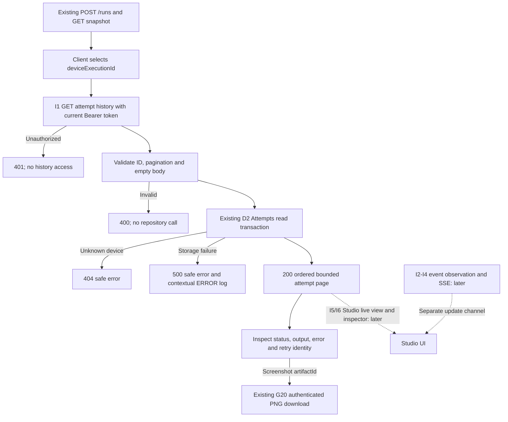

# I1 — Node-attempt history API

## Overview

I1 lets a publisher inspect the saved steps of a workflow through HTTP. Today
the run snapshot identifies each device execution but does not include its node
attempts. The publisher must query SQLite to find node results or a Screenshot's
artifact ID. I1 exposes the existing paginated repository read so Postman and
Studio's native client can obtain that information directly.

The smallest flow is: start a workflow, take a `deviceExecutions[i].id` from its
snapshot, request that device's attempts, then inspect each node's saved status,
output or safe error. For a successful Screenshot, read `output.artifactId` and
download the PNG through the existing G20 endpoint. Reading history does not
dispatch commands or require the Android target to remain connected.



**Status — implemented and Linux-verified on 2026-11-24.**
This document defines the route, request decoding, DTO, paging behavior,
implementation boundaries and acceptance checks. Section 12 records the executed
evidence and remaining regression/platform limits. H6–H8 Wait Variable remains
deferred. Phase H acceptance repair and
independent-target observations keep their existing ownership; I1 does not close
those gates.

Read with [A7 history](../contracts/local_api_v1.md#9-execution-reads-and-lifecycle-control),
[A5 NodeAttempt](../contracts/execution_state_v1.md#5-nodeattempt),
[A6 safe errors](../contracts/event_error_v1.md),
[D2 repository](../d_persistence/d2_execution_repository.md#3-snapshots-and-history),
[G13 snapshots](../g_workflow_engine/g13_run_snapshot_apis.md), and
[G20 artifacts](../g_workflow_engine/g20_artifact_api.md).

## 1. Scope and ownership

| Area | I1 responsibility |
| --- | --- |
| Public API | One authenticated GET for one DeviceExecution's ordered attempts. |
| Request validation | Canonical path ID, two optional pagination parameters, empty body and strict malformed-query handling. |
| DTO | Reuse the existing exact A5/A7 attempt/page projections; provide discoverable API aliases/types. |
| Persistence | Call existing `ExecutionRepository.Attempts` once. D2 owns SQL, existence checks and read consistency. |
| Composition | A dedicated API package, router registration and Wire binding to the same process-owned repository. |
| Client handoff | Exact Postman/Linux/Windows examples, active-history refresh rules, Screenshot discovery and verified limitations. |
| Later work | I2–I4 event observation/SSE; I5/I6 Studio consumption/inspector; Phase J protected package admission. |

No migration, new table/index, worker/lifecycle change, admission lease, ADB
probe, event append, polling daemon, durable variable map, new dependency or
generic pagination framework is needed. Keep the existing start/snapshot/action
handlers' constructor contract intact; this endpoint has its own narrow reader.
History remains available for RUNNING, PAUSED and terminal executions.

## 2. Route and strict request contract

```http
GET /api/v1/device-executions/550e8400-e29b-41d4-a716-446655440002/attempts?afterSequence=0&limit=100
Authorization: Bearer <current Runtime session token>
Accept: application/json
```

`apiBaseUrl` already ends in `/api/v1`. The ID comes from a run snapshot's
`deviceExecutions[i].id`, not the RunGroup ID, request ID, ADB serial or node ID.
Reuse `execution.ValidID`; do not trim, lowercase, add a UUID regex or decode
the Gin path parameter a second time. Reject uppercase/non-v4/noncanonical IDs
with 400 before repository access.

| Input | Allowed value / default |
| --- | --- |
| `afterSequence` omitted | 0: read from the beginning. |
| `afterSequence` present | ASCII decimal digits representing 0 through 9223372036854775807 inclusive. |
| `limit` omitted | Existing `constants.MaxAttemptPageSize`, currently 100. |
| `limit` present | ASCII decimal digits representing 1 through `MaxAttemptPageSize` inclusive. Explicit zero is invalid. |
| Body | Empty. No JSON body or Content-Type is required. |
| Accept | JSON is recommended; no custom Accept negotiation is introduced. |
| Other query keys | Rejected, including `cursor`, `runGroupId`, `nodeId`, `status`, `offset`, `sort` and `token`. |

Query keys are case-sensitive. Each allowed key may occur at most once,
including escaped-equivalent names. An empty value (`?limit=` or bare `?limit`)
is invalid. Reject signs, spaces, decimal points, exponents, non-ASCII digits,
overflow and out-of-range values. Leading zeros are accepted and parsed as
base-10 integers: `afterSequence=0002&limit=01` means 2 and 1. Do not silently
clamp invalid limits or map public `limit=0` to the repository's internal default.

Parse `Request.URL.RawQuery` with an error-returning standard query parser such
as `url.ParseQuery`; reject malformed percent escapes and invalid semicolon
separators. Do not rely only on Gin query binding or `URL.Query`, which can hide
parse errors or choose one duplicate value. Decode query names/values once,
validate the complete allowed-key set, then parse integers. A valid percent
encoding of a digit has its usual decoded meaning. An empty query, including a
bare trailing `?`, uses defaults. Standard empty query separators need no new
custom URL grammar.

Check the empty body using the existing GET pattern: reject positive
ContentLength immediately; otherwise inspect at most one byte for empty versus
nonempty input. Reject `{}`, whitespace, unknown-length nonempty content and
body-read errors with 400. Do not reuse `runs.validRequest` unchanged because
that helper deliberately rejects all nonempty query strings.

Existing authentication middleware runs first for requests reaching the route.
An unauthorized malformed-ID/query request returns 401 without invoking the
reader. Missing/extra path segments, trailing slashes, HEAD and other unmatched
methods retain the current router/no-route policy; add no redirect or method
alias. Register inside the existing `/api/v1` group.

## 3. Exact response and node-attempt semantics

Success is HTTP 200, JSON and `Cache-Control: no-store`. The root contains
exactly `attempts` and `nextAfterSequence`. It has no group summary, event cursor,
total count, serial, node type, Runtime IR or filesystem path.

| Attempt field | Wire representation |
| --- | --- |
| `id`, `deviceExecutionId` | Existing attempt ID and its owning DeviceExecution ID. |
| `sequence` | Positive JSON integer ordering attempts within this device execution. |
| `nodeId` | Runtime IR node ID; repeated attempts may have the same node ID. |
| `attemptNumber` | Existing per-node retry number, starting at 1. |
| `status` | RUNNING, SUCCEEDED, FAILED, TIMED_OUT, CANCELLED or INTERRUPTED. |
| `startedAt` | A1 UTC RFC3339 timestamp with milliseconds. |
| `finishedAt` | Timestamp when terminal; explicit null while RUNNING. |
| `output` | Existing validated output object on success, including `{}` for empty-output nodes; otherwise null. |
| `error` | Existing A6 safe error when applicable; otherwise explicit null. |

Preserve the existing projections and null fields. Do not invent QUEUED,
PAUSED or RETRYING attempt statuses, infer attempts for nodes that never began,
collapse retries by node ID, serialize SQL column names, or recalculate outcomes.
RUNNING has null finishedAt/output/error. CANCELLED has null output/error.
Successful Set Variable exposes `{}`, not its assigned scalar; Flow/Global maps
and resolved bindings are not readable through this route.

Example first page for a known completed execution, requested with `limit=2`:

```json
{
  "attempts": [
    {
      "id": "550e8400-e29b-41d4-a716-446655440003",
      "deviceExecutionId": "550e8400-e29b-41d4-a716-446655440002",
      "sequence": 1,
      "nodeId": "start",
      "attemptNumber": 1,
      "status": "SUCCEEDED",
      "startedAt": "2026-11-23T08:00:00.000Z",
      "finishedAt": "2026-11-23T08:00:00.001Z",
      "output": {},
      "error": null
    },
    {
      "id": "550e8400-e29b-41d4-a716-446655440004",
      "deviceExecutionId": "550e8400-e29b-41d4-a716-446655440002",
      "sequence": 2,
      "nodeId": "wait",
      "attemptNumber": 1,
      "status": "SUCCEEDED",
      "startedAt": "2026-11-23T08:00:00.002Z",
      "finishedAt": "2026-11-23T08:00:01.002Z",
      "output": {"durationMs": 1000},
      "error": null
    }
  ],
  "nextAfterSequence": 2
}
```

The continuation is 2 only if another attempt existed in that page's read
transaction. The next request is `?afterSequence=2&limit=2` for the same device.
A final page has null continuation even when it contains exactly `limit` items.
A known device with no attempts, or a boundary at/beyond its last sequence,
returns 200:

```json
{"attempts":[],"nextAfterSequence":null}
```

An unknown device ID returns 404, not an empty success. A RunGroup ID with no
matching DeviceExecution is also a missing device; do not interpret ID types by
guessing or search other entities.

For a successful Screenshot the exact output is `{"artifactId":"<UUID>"}`.
The client calls G20 `GET /artifacts/{artifactId}` with the same current bearer.
I1 does not open image files, fetch PNG bytes or add image dimensions/path fields.
An earlier screenshot remains discoverable if a later node fails or is cancelled.

## 4. Pagination, active execution and consistency

D2 already implements one read transaction containing the owner-existence check
and ordered query with `sequence > afterSequence` and at most `limit + 1` rows.
Return its detached `execution.AttemptPage` directly. The extra row decides
whether another page exists; it is not returned. Use the existing index/order;
do not add COUNT queries, one lookup per attempt, OFFSET paging, a response cache
or a second independent existence query in the HTTP layer.

| Situation | Required behavior |
| --- | --- |
| Same device/node retries | Distinct attempt IDs and increasing sequence; preserve attemptNumber. |
| Several devices share node IDs | Only the requested DeviceExecution's records are returned. |
| Concurrent node completion | Each page is committed and internally consistent; later requests may see a newer status/output. |
| Attempt appended between page requests | It can appear in a later page; the endpoint does not freeze the complete traversal. |
| No more items currently | Null continuation is a paging result, not evidence that execution finished. Read the run snapshot for completion. |
| Boundary greater than current last sequence | Empty 200 for a known device; not an SSE future-cursor error. |
| Runtime restarted or device disconnected | Read retained attempts using the current Runtime token. No ADB or execution replay is required. |

**Sequence pagination is not an update feed.** A RUNNING attempt at sequence 5
can later become SUCCEEDED at sequence 5. Polling only `afterSequence=5` would
miss that update. During active execution, refresh a window that still includes
the observed RUNNING attempt and upsert by attempt ID. For a simple inspector,
refresh the selected page with its original `afterSequence`; for a short run,
refresh the first page. After observed attempts are terminal, append-only paging
can advance to discover later attempts. Stop ongoing polling when the selected
run is terminal and its displayed history has been refreshed, or the view closes.

I1 supplies no per-page event watermark and must not manufacture one. Later
I2–I5 use the existing Runtime-wide event cursor for live update/reconnect
correctness. Neither attempt sequence nor `nextAfterSequence` is an SSE cursor.

## 5. Error handling and contextual logging

| Condition | HTTP / public code | Reader call |
| --- | --- | --- |
| Missing/invalid current bearer | 401 UNAUTHORIZED, existing auth envelope. | None. |
| Invalid ID/query/body | 400 INVALID_REQUEST, `request is invalid`. | None. |
| Known device, empty result | 200 normal empty page. | Once. |
| `ErrExecutionNotFound` | 404 RESOURCE_NOT_FOUND, `resource was not found`. | Once. |
| `ErrExecutionPersistence`, `ErrExecutionCommitUnknown`, `ErrRecoveryIntegrity` | 500 PERSISTENCE_FAILED, `unable to read node attempt history`. | Once. |
| Missing trusted reader, unexpected error or repository invalid-input error after valid decoding | 500 INTERNAL_ERROR, `internal server error`. | No call for missing reader; otherwise once. |

All errors use exactly the existing envelope:

```json
{
  "error": {
    "code": "RESOURCE_NOT_FOUND",
    "message": "resource was not found",
    "retryable": false
  }
}
```

Do not add `validation`, `snapshot`, a stack trace or partial `attempts` on
failure. Context cancellation/deadlines are propagated through the request and
repository read; preserve the existing read-handler policy instead of adding a
new 408/499 response contract. A disconnected read never cancels workflow work.
Do not convert a cancelled/failed database read into an empty 200. There is no
handler retry or background continuation for a failed history request.

Reuse `api/response.AbortWithCause` and the request-logging middleware. Use safe
operation context such as `validate_attempt_history_request`,
`configure_attempt_history_reader` and `read_attempt_history`. Any reason value
must be a fixed classification, not raw query/header/body data. Preserve ERROR
severity for all 4xx/5xx. Do not add another handler-level completion log or log
tokens, workflow contents, variable values, output/error payloads or SQL paths.
Normal successful reads retain the existing INFO request-log behavior.

## 6. Implementation mapping and handler algorithm

Use a dedicated `internal/api/attempts` package, following `api/artifacts` and
`api/devices`. This keeps history responsibility visible and avoids adding an
attempt reader to the existing run starter/controller constructor.

```go
type Reader interface {
    Attempts(context.Context, string, int64, int) (execution.AttemptPage, error)
}

type PageResponse = execution.AttemptPage

type PageQuery struct {
    AfterSequence int64
    Limit         int
}

func NewHandler(reader Reader) *Handler
func (h *Handler) ByDeviceExecution(ctx *gin.Context)
```

`PageQuery` is a decoded query DTO, not a body DTO. Put API-facing types in
`dto.go`; the domain page/attempt JSON shapes already exist in
`internal/execution/repository.go`. Use explicit decoding, not permissive
automatic binding/defaulting. Normal composition supplies a non-nil Reader;
missing trusted dependencies must never look like an empty database.

Handler order:

1. Existing middleware authenticates and applies no-store/request logging.
2. Validate canonical path ID, complete query and empty body. On error, return
   400 without dependency access. All invalid combinations remain 400; no
   special field-error response ordering is required.
3. Check the trusted handler/reader dependency.
4. Call `reader.Attempts(ctx.Request.Context(), id, query.AfterSequence, query.Limit)`
   exactly once. Pass the concrete default limit; no history-specific timeout
   configuration or `context.Background` detached read is introduced.
5. Map classified errors using section 5. Serialize a successful PageResponse
   directly as JSON 200. Do not rebuild/revalidate each returned trusted row.

| File/area relative to `a2matex-runtime` | Planned change |
| --- | --- |
| `internal/api/attempts/handler.go` | Reader/constructor, one GET handler and safe response mapping. |
| `internal/api/attempts/dto.go` | PageResponse alias and PageQuery. |
| `internal/api/attempts/decode.go` | Strict query/ID/body decoding with standard library and existing ID/constants helpers. |
| `internal/api/attempts/handler_test.go` | Focused transport, mapping, context and exactly-one/no-call tests. |
| `internal/api/attempts_integration_test.go` | Real router/repository/SQLite API checks; reuse existing API fixtures. |
| `internal/api/router.go` | Inject the attempts handler; register `v1.GET("/device-executions/:deviceExecutionId/attempts", attemptHistory.ByDeviceExecution)`. Preserve the shared base group. |
| `cmd/agent/wire.go` / generated `wire_gen.go` | Bind `attempts.Reader` to the existing ExecutionRepository, construct the handler and regenerate via `make wire`. |
| Existing router constructor call sites/tests | Supply the new handler parameter explicitly; adapt existing test setup only as required. No unrelated test rewrite. |
| `pkg/constants/api.go` | Named safe attempt-history read-failure message if needed; reuse existing status/error codes. |
| `examples/i1/README.md` | Tracked manual compile/start/history/artifact walkthrough and expected results using existing readable fixtures. |

No repository production edit is planned. If implementation reveals a genuine
D2 defect, show the failing case and keep the fix focused; do not redesign D2
as part of this HTTP adapter. Keep Wire generated output generated.

## 7. Resource, security and lifecycle boundaries

- Reuse B5 local-session authentication and the existing loopback server. Keep
  credentials in the native owner; never add token query support or browser
  credential workarounds. A valid local session can inspect retained history;
  no new cloud account/product authorization is invented here.
- The page limit is a history-response bound, not a concurrent-device limit.
  Group membership and customer-selected execution capacity are unchanged.
- Each request materializes at most 100 returned attempts, with the existing
  per-output/error bounds. End the read transaction before sending JSON and
  let ordinary Go request memory be reclaimed. Do not retain pages in a singleton.
- Handler calls are context-aware. A long-running workflow does not hold the
  history GET open; the GET reads its currently committed page and returns.
- Reads do not acquire worker reservations/start leases or interfere with
  Pause/Resume/Cancel. They must not write events, update timestamps or touch
  variable stores. Compare no-write evidence at a stable boundary so ordinary
  concurrent worker commits are not mistaken for read side effects.
- G20 owns artifact files and PNG streaming. Return only the approved artifact
  ID from a committed output. Do not include staged bytes, file keys or paths.

## 8. Focused tests and acceptance criteria

Agree new test additions with the user under Runtime AGENTS.md before adding
tests. This specification defines the intended scope; creating this spec is not
approval to add tests or implement code. Reuse
`TestAttemptHistoryUsesSequenceAndPreservesNull`, existing real SQLite/API
fixtures, G13 read error/auth tests and G19/G20 screenshot setup. No new Python
framework, emulator fleet or mandatory ignored smoke script is required.

| ID | Case | Required assertion |
| --- | --- | --- |
| I1-01 | Defaults and explicit pagination | Omitted query calls Reader with 0/100; explicit valid values and leading zeros decode correctly. One valid request makes exactly one read with its original context/device ID. |
| I1-02 | Invalid query matrix | Unknown/case-mismatched keys, duplicates/escaped duplicates, empty values, negative/plus signs, whitespace, decimals, exponents, non-ASCII digits, overflow, limit0/101, malformed encoding and semicolons return 400 without reads. Accept afterSequence int64 maximum for a known device. |
| I1-03 | ID/body/auth | Canonical UUID checks; positive/unknown-length bodies and read errors rejected. Missing bearer returns 401 before ID/query checks. Existing no-route/redirect policy remains unchanged. |
| I1-04 | Exact projection | All approved fields, timestamps, explicit nulls and output/error objects match existing domain values; empty history is `[]`, not null. No additional fields. Cover RUNNING and all terminal attempt states without creating another state enum. |
| I1-05 | Existence and mapping | Unknown device404, known empty200, each classified storage failure500, unexpected/missing-reader500. Public errors remain sanitized and 4xx/5xx contextual logs are ERROR with no token/output leakage. |
| I1-06 | Real SQLite paging | A completed Start/Delay/End history with limit1 yields sequences1,2,3 without duplication; first/second continuation1/2, third null. Exact-full-last-page has null; at/beyond-last returns empty200. |
| I1-07 | Isolation and retries | Two members with identical node IDs expose only their own attempts/outputs. Retry attempts preserve separate IDs, increasing sequence and original attemptNumber. Reuse existing retry fixtures rather than adding device retries. |
| I1-08 | Active update semantics | Observe an existing RUNNING sequence, complete it, refresh the same window and observe terminal fields at the same ID/sequence. Reading after that sequence does not magically return the update. Concurrent reads remain individually consistent. |
| I1-09 | Read-only and retained results | Stable paused/terminal reads change no rows/events/cursor; disconnecting a read does not stop execution. Existing retained/recovered history is readable without ADB dispatch or a fresh execution. |
| I1-10 | Screenshot bridge | Actual committed Screenshot attempt returns only its artifactId; authenticated G20 download succeeds and belongs to that attempt/member. Staged/unconfirmed captures remain undiscoverable under existing G19/G20 guarantees. |
| I1-11 | Built agent | Production router/Wire serves the endpoint using real migrated SQLite, current auth and retained/synthetic attempts. Verify route, paging and safe missing/auth cases, no ADB action for reads and clean process exit. |
| I1-12 | Client handoff | Shared/Studio inventories and examples describe exact request/response/errors, active refresh and Screenshot discovery; Linux/Windows examples distinguish executed evidence from references. |

For I1-11, reuse existing tracked managed-parent/process fixtures and bounded
temporary file-backed store setup; seeded retained synthetic history is enough
to verify the read API without real Android. State that evidence scope. Reuse
an actual compiled run for the separate API integration/manual case. Agree a
small tracked process wrapper only if existing fixtures cannot exercise the new
production composition. Do not copy the complete H14/H15 acceptance matrix.

Run focused handler/API/repository tests and affected race checks, `go vet`,
`make fmt`, `make wire`, `make build`, `git diff --check`, then the applicable
full regression/race suite. Cross-build the Windows agent and affected test
binaries. Native Windows acceptance requires a Windows host; cross-build is
not native evidence. No benchmark/soak gate is introduced for this small read API.

## 9. Manual Postman and saved-data acceptance

This is the walkthrough to publish after the endpoint is implemented/verified:

1. Start Runtime and obtain its current URL/token from the
   [authentication guide](../integration/local_authentication.md). In Postman,
   set API_BASE_URL/SESSION_TOKEN and Bearer auth. Probe runtime-info with the
   current session before the requested operation. No Postman script is needed.
2. Compile the readable [H4 Start/Delay/End graph](../../../../a2matex-runtime/examples/h4/compile-workflow.json),
   submit a fresh `/runs` request with the returned complete IR and actual READY
   serial/input pairs. Use `delayMs=1000` and retain the request/run IDs. Two
   independent targets can demonstrate member isolation; one is enough for
   basic endpoint acceptance. Existing input schema/timeouts remain authoritative.
3. Poll GET `/runs/{runGroupId}` to terminal. Copy a `deviceExecutions[i].id`
   into DEVICE_EXECUTION_ID. This differs from the RunGroup ID and serial.
4. Send GET `{{API_BASE_URL}}/device-executions/{{DEVICE_EXECUTION_ID}}/attempts?afterSequence=0&limit=1`,
   Body none, Bearer SESSION_TOKEN. Expect Start sequence1, continuation1.
   Request afterSequence1 then2: Delay sequence2/continuation2, End sequence3/null.
   No node/action is executed again by any GET.
5. Request afterSequence3: expect the exact empty200 page. Repeat the first
   page: same saved IDs/results. Use a valid unknown device UUID:404; limit0,
   duplicate limit or invalid ID:400; missing bearer:401. Invalid reads create
   no attempts/events.
6. Start a distinct longer valid Delay run and read while Delay is RUNNING.
   Refresh the same page/window after it finishes: that attempt has the same
   ID/sequence, now terminal with output/timestamp. Confirm that advancing the
   boundary beyond that attempt would omit its status change. Never infer
   workflow completion from a null page continuation.
7. For Screenshot discovery, compile/run the existing
   [H15 reference graph](../../../../a2matex-runtime/examples/h15/compile-multi-device.json)
   with supported nodes and actual inputs (one device is allowed for this I1
   manual check). Expect 10 successful attempts/member; locate capture's
   `output.artifactId`, GET `/artifacts/{artifactId}` with Bearer and preview/save
   PNG. No SQL or file path is needed to obtain the ID. A one-device I1 check
   does not satisfy H15's independent-target acceptance gate.

Optional read-only SQL comparison, substituting the actual device ID:

```sql
SELECT id, device_execution_id, sequence, node_id, attempt_number, status,
       started_at, finished_at, output_json, error_json
FROM node_attempts
WHERE device_execution_id = '550e8400-e29b-41d4-a716-446655440002'
ORDER BY sequence;
```

Use SQL for developer verification only; Studio and Launcher must use the API.
Compare timestamp instants because SQLite stores epoch milliseconds while the
API returns A1 strings. Compare an active row at a controlled boundary or refresh
it; sequential HTTP/SQL reads can legitimately observe different committed states.

## 10. Integration documentation and later-phase handoff

Update these guides in the I1 code delivery, with verified examples rather than
advertising a planned endpoint as already callable:

- [Shared Runtime guide](../integration/managed_runtime.md): authoritative route,
  exact DTO/errors, pagination, empty versus missing, read-only behavior,
  Linux/Windows/Postman requests and actual verification scope.
- [Studio guide](../integration/studio.md): obtain the selected member ID from
  its snapshot, load/refresh paged history, upsert attempt updates by ID, show
  safe outputs/errors and fetch Screenshot bytes through the native client.
  Replace the current output-discovery blocker with I1 once verified.
- [Launcher guide](../integration/launcher.md): short link to the shared history
  reference for future admitted runs; this read API adds no Production package
  authorization/start support. Actual Launcher UI remains its owner's work.

I6 owns the inspector UI, not I1. I5 owns SSE reconnect/reconciliation using
I2–I4, not an improvised attempt-sequence update protocol. Test-one-node,
arbitrary run-from-node, publisher logs, new filters and database cleanup remain
outside this endpoint. Keep pending Phase H and native-host gates explicit.

## 11. Completion decision and preparation baseline

I1 is complete when the route/DTO/query contract, all applicable I1-01–I1-12
criteria, real production composition, context/error/logging behavior and
client-guide examples are implemented and verified for the stated host. Record
exact commands/results and separate pending device/native-platform observations.
Do not claim Phase I complete after its first endpoint.

At spec preparation on 2026-11-23 the Runtime has no attempt-history route. D2's
existing reader and domain DTO already provide the needed data. The known full
suite gaps are missing G22/H14/H15 Python harness files and H14/H15 controlled-ADB
scripts; the managed-parent helper also lacks the expected H14 output argument.
These remain separate acceptance-pack repairs, not dependencies to silently
rewrite or bypass inside I1. Recheck their actual state during implementation.
Report full-suite failures and any focused commands explicitly; previous PASS
records are not a current unqualified regression pass or an approved exception.

The preparation baseline above is historical. Section 12 records the delivered
I1 code/tests and updated client guides. I1 adds no migration and does not change
Phase H completion status.

## 12. Implementation and verification evidence — 2026-11-24

The Runtime now serves the planned route through `internal/api/attempts`, the
existing `/api/v1` router and regenerated Wire composition. It uses the same
ExecutionRepository singleton and unchanged D2 query/domain projections. The
existing run-handler constructor, database schema, execution engine and variable
storage are unchanged. The I1 focused test scope was approved before additions.

| Acceptance | Executed evidence / result |
| --- | --- |
| I1-01 | `TestHistoryQueryDefaultsAndRequestContext` passes omitted/empty/separator queries, explicit/escaped/zero-padded values and int64 maximum, checking exact request context/ID/limit and one reader call. |
| I1-02 | `TestHistoryRejectsInvalidInputBeforeReading` passes the invalid numeric/query/duplicate/encoding matrix with no reader calls; compiled SQLite test accepts an int64-maximum empty boundary. |
| I1-03 | Same handler tests cover UUID/body/read-error cases; actual router tests prove authentication precedence and unchanged method/trailing-slash/no-redirect behavior. |
| I1-04 | `TestHistoryProjectionPreservesEveryAttemptState` verifies exact JSON/nulls for all six states. Reused G21 API fixtures compare HTTP history with real checkpointed terminal projections. |
| I1-05 | `TestHistoryErrorMappingAndSafeContextualLogs` verifies missing/storage/unknown-commit/integrity/unexpected/missing-reader/cancellation/deadline mapping, one ERROR request record, safe operation context and no token/private-driver leakage. Known-empty and unknown-owner are separately exercised. |
| I1-06 | `TestHistoryCompiledMultiDeviceRunPagingAndActiveRefresh` compiles the readable H4 graph through the real API, starts two members and verifies limit1 pages1/2/3 with continuations1/2/null, exactly-full final page and beyond-last empty page. |
| I1-07 | That compiled test checks member identity and distinct duration outputs at identical node IDs. Existing `TestG21RunnerFinalResults`/`TestG21StoppedAndInterruptedFinalResults` now also compare returned history, retaining retry IDs/numbers and all saved outcomes. |
| I1-08 | Both real Delay attempts are gated while history reads RUNNING. A refreshed overlapping window observes SUCCEEDED at the same attempt ID/sequence; an advanced boundary omits the old row as specified. |
| I1-09 | A cancelled history read fails while the same workflow later succeeds. Stable read counts/events and fake-device/handler counters do not advance. Recovered/interrupted projections and actual file-backed retained history across two agent sessions are readable. |
| I1-10 | Existing `TestArtifactDownloadOfG19CommittedPNG` now discovers output IDs through I1 before its G20 download checks. Full-screen/cropped committed PNG ownership/retrieval and unconfirmed-stage404 regressions pass. |
| I1-11 | New `TestI1AttemptHistoryAgentAcceptance` and tracked `cmd/agent/testdata/i1_acceptance.py` build the actual agent, reopen real migrated SQLite with synthetic committed history, use the current bearer/private owner pipes, verify paging/auth/errors and no execution-data writes, then restart and repeat with fresh credentials. No Android is needed or exercised. Three repeated race-enabled runs pass. |
| I1-12 | Shared/Studio/Launcher inventories and examples plus `examples/i1/README.md` document exact usage, strict pagination, active refresh and SQL-free Screenshot discovery. Linux HTTP is exercised by tests; Windows examples are references and native execution remains pending. |

Verification commands executed in the Runtime repository:

```bash
make wire
make fmt
make build
go vet ./...
go test -race ./internal/api/... -count=1
go test -race ./cmd/agent -run '^TestI1AttemptHistoryAgentAcceptance$' -count=3 -v
go test -race ./... -count=1
git diff --check
```

Wire/format/build/vet and final affected API race tests pass. Repeated actual-agent
I1 acceptance passes across six child sessions. Windows amd64 agent and affected
API/attempt-handler test binaries cross-build successfully. No native Windows,
Studio UI or real-Android execution was performed for I1; those results are not
implied by controlled HTTP/SQLite tests.

The full race suite still **fails** `TestG22CombinedEngineAcceptance`,
`TestH14ShutdownRecoveryAgentAcceptance` and
`TestH15CombinedMultiDeviceAgentAcceptance` because their preexisting Python
entry scripts are missing. Other packages and the I1 agent test pass. These are
named open regression gates, not an unqualified full-suite pass or a silently
approved exception. The existing artifact real-HTTP tests initially hit sandbox
loopback restrictions; they pass when executed with local socket permission.

The new Python I1 source is tracked as part of the acceptance delivery and must
be included with its Go wrapper; it does not depend on the missing H14/H15 files
or their missing output-helper revision. It reuses the currently available
managed-parent launcher without changing it. The manual walkthrough uses normal
Postman/API requests and the existing readable H4/H15 graph files.

I1 implementation and scoped Linux verification are delivered. I2–I8, Phase H
acceptance repairs/live independent targets and native-host acceptance remain
under their existing owners. No SSE route, inspector UI, production package API,
migration or new dependency was added.
