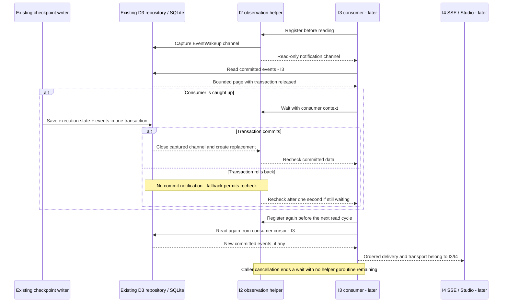

# I2 — Committed-event observation

## Overview

I2 lets a monitoring consumer wait efficiently until execution data may have
changed. It does not execute nodes or decide their position. The existing runner
and checkpoint service already save each attempt's start/result, the device's
next node and the corresponding events in SQLite. D3 already signals readers
after an event transaction commits. I2 provides the small, cancellable waiting
primitive that the later event-delivery service will use.

The smallest flow is: register for the next commit notification, read committed
events, and wait only after catching up. A commit or the D3 one-second fallback
wakes the caller to read again. Cancellation ends the wait and releases its timer.
The notification carries no execution data; SQLite remains authoritative.



**Status — implemented and Linux-verified on 2026-11-24.** Section 12 records
the implementation, executed checks and remaining verification limits.
D3 notifications/replay and D4 checkpoints are existing code.
I3 owns cursor progression and replay/live continuity. I4 owns the authenticated
SSE endpoint and connects stream lifetime to disconnect and Runtime shutdown.
There is no new public endpoint to test in Postman after I2 alone.

Read with [D3 event repository](../d_persistence/d3_event_repository.md),
[D4 checkpoints](../d_persistence/d4_atomic_checkpoint.md),
[A6 events](../contracts/event_error_v1.md),
[A7 streaming contract](../contracts/local_api_v1.md#10-sse-replay-and-live-delivery),
and the [Phase I index](../phases/phase_i.md).

## 1. Scope and ownership

| Area                | I2 responsibility                                                           | Existing or later owner                                    |
| ------------------- | --------------------------------------------------------------------------- | ---------------------------------------------------------- |
| Commit notification | Reuse the repository's current read-only wakeup channel.                    | D3 owns channel replacement and notification after commit. |
| Registration        | Give the consumer a channel before its next read cycle.                     | I3 determines the cursor and performs replay reads.        |
| Waiting             | Wait for notification, fallback or caller cancellation.                     | I3 decides when it is caught up and should wait.           |
| Cleanup             | Release the wait's timer on every return; start no goroutines.              | I4 cancels the complete stream on disconnect/Runtime stop. |
| Resources           | Constant-size helper state; no event copies or subscriber registry.         | I3 bounds delivery memory; I4 bounds socket writes.        |
| Verification        | Prove observation races and cancellation with existing repository fixtures. | Actual replay/SSE/client acceptance remains I3–I8.         |

Do not add a broker, subscription table, migration, background polling worker,
per-device notification channel, new event type, external dependency or Runtime
configuration setting. No execution, handler, admission, variable-store or
Pause/Resume/Cancel behavior changes. Device-count policy is unchanged.

## 2. Current implementation to reuse

Paths below are relative to `a2matex-runtime`.

| Current code                                     | Existing guarantee                                                                                                                                                                         |
| ------------------------------------------------ | ------------------------------------------------------------------------------------------------------------------------------------------------------------------------------------------ |
| `internal/repositories/execution.go`             | `EventWakeup()` returns the current channel under a mutex. `notifyEvents()` closes that channel and installs a new one under the same mutex. All readers holding the old channel can wake. |
| `internal/repositories/execution_transaction.go` | `WithWriteTx` notifies only after a successful commit containing appended events. Rollback does not notify. Writers never wait for consumers.                                              |
| `internal/repositories/execution_events.go`      | `ReplayEvents` reads a bounded ordered page and replay floor/watermark in one read transaction; `EventWatermark` reads durable stream state.                                               |
| `internal/repositories/execution_checkpoint.go`  | `NotifyRecoveredCheckpoint` can wake readers after existing read-back logic confirms an otherwise uncertain commit.                                                                        |
| `internal/execution/events.go`                   | Existing `EventReader`, event envelope, page/state types and cursor parsing remain authoritative.                                                                                          |
| `internal/services/event_retention.go`           | Retention has a separate coalesced maintenance signal. Observation must not consume it.                                                                                                    |

Several observers may receive the same channel. This is a broadcast of
availability through channel closure, not a queue in which one observer steals
a notification from another. A new registration after a commit gets the new,
open channel. The subsequent durable read sees that earlier commit.

An event channel is never closed by its receiver. Cancelling one consumer must
not close a repository channel or affect any other consumer.

## 3. Internal contract and proposed types

Implement a small service package, `internal/services/eventobservation`, following
the existing responsibility-based service folders. Use a consumer-owned narrow
source interface rather than depending on the concrete SQLite repository:

```go
type Source interface {
    EventWakeup() <-chan struct{}
}

type Observer struct { /* immutable source dependency */ }

func New(source Source) *Observer
func (o *Observer) Register(ctx context.Context) (<-chan struct{}, error)
func (o *Observer) Wait(ctx context.Context, wakeup <-chan struct{}) error
```

`ExecutionRepository` already satisfies `Source`. Reuse that same repository
instance when I3/I4 compose the consumer. Do not create another repository/store
or extend the domain `EventReader` just to add these helper methods.

| Method     | Required behavior                                                                                                                                                                                                                   |
| ---------- | ----------------------------------------------------------------------------------------------------------------------------------------------------------------------------------------------------------------------------------- |
| `New`      | Retain the trusted source only. Do not access SQLite, subscribe, start a goroutine or allocate a timer.                                                                                                                             |
| `Register` | Check caller cancellation, validate the required dependency, call `EventWakeup()` exactly once and return its non-nil read-only channel. Recheck cancellation before returning it. No cursor/read/write work.                       |
| `Wait`     | With a valid channel and active caller context, block until channel closure or the fallback interval; return `nil` to request another read. Cancellation/deadline returns the original context error. Stop the timer on every path. |

Neither registration nor waiting acknowledges an event or advances a cursor.
There is no `Close` subscription operation: the helper keeps no subscriber
entry. Returning from `Wait` releases its only temporary resource. The caller
discards old channel references and cancels its own context when finished.

Use `constants.EventObservationRecheckInterval = time.Second`, placed beside
existing event constants in `pkg/constants/execution.go`. This implements D3's
existing fallback requirement; it is not a new heartbeat or user-facing setting.
Use one `time.NewTimer` per blocked `Wait`, stopped on return. Do not introduce
a ticker, a sleep loop or a goroutine to forward notifications. Tests in the
same package may use an unexported duration-aware helper for deterministic short
fallback checks; production callers always use the named one-second constant.

## 4. Registration, read and wait ordering

The following is an **I3 usage contract**, not an instruction to implement
the replay loop in I2:

```text
repeat while the consumer context is active:
    wakeup = observer.Register(ctx)
    page = repository.ReplayEvents(ctx, consumerCursor, boundedLimit)
    deliver this page under the later I3/I4 delivery rules
    if more data is available:
        continue immediately, registering before the next read
    observer.Wait(ctx, wakeup)
```

Stop on an error from registration, replay, delivery or waiting; do not continue
with a missing channel, unread page or cancelled context. I3/I4 classify those
errors and decide how to end or reject a stream. The sketch omits that error
handling and cursor advancement solely to show I2's registration ordering.

Read transactions finish before waiting or delivering to a network. I2 itself
performs no query and holds no database connection, cursor, page or payload.
The page's `More` flag, connection-time watermark, cursor advancement and
delivery success are I3 responsibilities. An omitted replay cursor must still
use A7's connection-time watermark; I2 does not invent a starting cursor.

The ordering covers these races:

| Commit timing                                             | Why the data is not missed                                                                                 |
| --------------------------------------------------------- | ---------------------------------------------------------------------------------------------------------- |
| Before registration                                       | Registration captures the replacement channel; the following read sees the committed data.                 |
| Between registration and read                             | The captured channel closes; the read sees the data or the closed channel causes an immediate recheck.     |
| During a read, after that read's snapshot was established | The read may return the older view, but the captured channel closes and prevents an indefinite wait.       |
| After an empty read, before `Wait`                        | Waiting on an already-closed channel returns immediately.                                                  |
| While waiting                                             | Closure releases every waiter holding that channel.                                                        |
| Several commits before the next registration              | Signals can coalesce; the cursor-based read retrieves all retained newer events, not one event per wakeup. |

Always reacquire a channel before another read cycle. Reusing a closed channel
would cause an immediate-return loop and consume CPU. A wakeup is a reason to
read, not evidence that a particular run changed. Retention or another consumer
may have changed what is available; I3 handles the resulting replay state.

## 5. Cancellation and Runtime shutdown

The helper is synchronous and stateless between calls. It has no process
component `Start`, `Wait` or `Shutdown` lifecycle and needs no supervisor watcher.
The method named `Wait` above waits for one observation opportunity only.

| Situation                              | Required behavior                                                                                                                                          |
| -------------------------------------- | ---------------------------------------------------------------------------------------------------------------------------------------------------------- |
| Already-cancelled registration         | Return the original context error without source access.                                                                                                   |
| Context cancelled while waiting        | Return promptly, stop the timer and release references when the caller returns.                                                                            |
| Deadline reached                       | Return `context.DeadlineExceeded`; do not convert it to a commit notification.                                                                             |
| Commit and cancellation are both ready | Recheck the context before returning success. If cancellation is observed, return it; no ordering is promised against cancellation occurring after return. |
| One consumer disconnects               | Its caller cancels its context; other consumers and execution continue.                                                                                    |
| Runtime stops                          | I4 must cancel stream contexts before waiting for HTTP handlers to drain; existing stop/checkpoint rules continue independently.                           |

**Important current boundary:** `internal/platform/httpserver/server.go` does not
currently bind request contexts to its startup context through `BaseContext`.
Calling `http.Server.Shutdown` alone does not cancel active handlers. Therefore
I2 tests with a cancelled parent context prove this helper's stop behavior only;
they do not prove actual-agent SSE shutdown. I4 must implement and test the
request/Runtime cancellation linkage before exposing long-lived streams.

Do not pass execution-worker cancellation to an unrelated monitoring consumer.
An execution finishing or being cancelled does not terminate a Runtime-wide
observation connection. Conversely, observation cancellation never cancels a run.
No `context.Background`, detached context or stored caller context is needed
inside this helper.

## 6. Failures and contextual logging

| Condition                                           | Internal outcome                                                                                                                                  | Ownership                                                          |
| --------------------------------------------------- | ------------------------------------------------------------------------------------------------------------------------------------------------- | ------------------------------------------------------------------ |
| Commit notification                                 | `nil`; caller reads again.                                                                                                                        | I2; no event data implied.                                         |
| Fallback elapsed                                    | `nil`; caller reads again even if there are no changes.                                                                                           | I2; never manufacture a durable event.                             |
| Caller cancellation/deadline                        | Preserve `ctx.Err()` for `errors.Is`.                                                                                                             | Normal consumer completion; no per-wait ERROR log.                 |
| Missing observer/source or nil notification channel | Return `ErrExecutionPersistence` with operation context `register_event_observation` or `wait_event_observation`, using existing x-error helpers. | Trusted configuration/dependency defect, not malformed HTTP input. |
| Replay expired/future/storage failure               | Not returned or handled by this helper.                                                                                                           | Existing D3 classification, interpreted by I3/I4.                  |
| Slow consumer/socket write failure                  | No handling in I2.                                                                                                                                | I3/I4 bounded delivery and disconnect policy.                      |

Check context cancellation before dependency/channel validation, and before a
successful return from `Wait`. Preserve `ctx.Err()` rather than wrapping it as
a storage failure. Use the existing error/operation helpers and constants;
do not create a new public error code, response DTO or duplicate error package.

Do not log successful registration, every wakeup or every fallback tick. On
unexpected observation setup failures, the eventual delivery/HTTP boundary logs
one contextual ERROR with the operation and safe error code using existing
logging conventions. It must not log event payloads, credentials, workflow
inputs, raw Android output or filesystem paths. I2 introduces no socket handler
to log or sanitize a public response.

## 7. Resource and security boundaries

- The helper retains one source reference. Each active caller retains one
  channel reference and, while blocked, one timer; waiting occurs in the
  caller's goroutine. There is no helper-owned goroutine, event queue, subscriber
  map or event-memory growth while the consumer is idle or slow.
- Do not add a global subscription/device ceiling as part of I2. Later transport
  resource policy must be explicit; this phase does not silently change H2.
- A fallback recheck is demand-driven by active consumers. No consumers means
  no timers, fallback queries or background observation workload.
- Repository notification stays a short in-memory action. Never hold its mutex
  during a database read, timer wait, logging or network write. No producer waits
  for observation, acknowledgement or client speed.
- All platforms use standard Go channels, timers and contexts. No Linux-only
  process primitive is required; native Windows evidence remains separate from
  cross-compilation.
- This package is internal. It adds no unauthenticated route or token exchange.
  I4 must reuse B5 authentication and loopback transport before creating a stream.
- Observation does not change retention. If required events are pruned, I3/I4
  must report expiry/close according to A7 rather than treating a wakeup as proof
  that an entire history remains available.

## 8. Implementation mapping

| File/area relative to `a2matex-runtime`                                 | Planned I2 change                                                                                                              |
| ----------------------------------------------------------------------- | ------------------------------------------------------------------------------------------------------------------------------ |
| `internal/services/eventobservation/observer.go`                        | Narrow `Source`, `Observer`, constructor, registration and one cancellable timed wait. Keep the small responsibility together. |
| `internal/services/eventobservation/observer_test.go`                   | Focused deterministic registration, notification, fallback, dependency and cancellation checks after test-scope approval.      |
| `internal/repositories/execution_events_test.go`                        | Reuse existing SQLite/event fixtures; add only missing helper-to-real-repository observation cases after approval.             |
| `pkg/constants/execution.go`                                            | Named one-second fallback constant beside existing event limits.                                                               |
| Existing repository, checkpoint and retention production files          | No planned changes. Reuse the notification and transaction guarantees.                                                         |
| `cmd/agent/wire.go`, generated `wire_gen.go`, supervisor and API router | No I2 change. I3/I4 compose the helper with the same repository when they introduce an actual consumer.                        |

Do not introduce an unused singleton into production composition merely to
produce a component-ready log. I2 delivers the reusable primitive and its tests.
If implementation reveals a repository defect, first demonstrate the failing
case and keep any proposed D3 fix separate and reviewable.

## 9. Focused test matrix and acceptance criteria

Discuss test additions with the user before implementing them, as required by
Runtime AGENTS.md. Approval of this spec does not approve code or new tests.
Reuse `TestEventRollbackPublishesNothing`,
`TestConcurrentEventAppendsAndSlowSubscriber`,
`TestEventSnapshotAndEmptyReplayHandoff`, checkpoint commit-read-back tests and
the existing file-backed SQLite setup. No emulator, new dependency, Python
harness, ignored smoke script or process fleet is needed for this internal phase.

| ID    | Scenario                         | Required assertion                                                                                                                                                                                                                           |
| ----- | -------------------------------- | -------------------------------------------------------------------------------------------------------------------------------------------------------------------------------------------------------------------------------------------- |
| I2-01 | Registration and dependencies    | Exactly one source call; return the same read-only channel. Already-cancelled context makes no source call. Missing receiver/source and nil channel yield classified contextual errors, not panic.                                           |
| I2-02 | No commit yet                    | An open channel does not complete the wait before a controlled notification/cancellation/fallback. Do not rely on fragile millisecond timing to establish readiness.                                                                         |
| I2-03 | Successful real commit           | Register, append using existing transaction fixtures, commit and observe prompt release. A subsequent durable read sees the committed events. Do not infer an exact wake count.                                                              |
| I2-04 | Rollback and no-event write      | Existing rollback leaves state/events/watermark unchanged and the captured channel open. A successful write without appended events does not notify. A later fallback recheck is not a rollback publication.                                 |
| I2-05 | Several consumers                | Two waiters holding the same channel both release after a commit. Cancelling one waiter does not close the shared channel or prevent another waiter from observing a later commit.                                                           |
| I2-06 | Register/read/wait races         | Use controlled barriers to cover a commit between registration and read, and a commit after an empty read before waiting. No indefinite wait or hidden replay gap at this boundary.                                                          |
| I2-07 | Coalesced commits                | Several commits before the next read can produce one observed release; bounded repository pages still expose every retained newer event in order. Page/delivery orchestration remains an I3 test.                                            |
| I2-08 | Rearm after closure              | Old channel is closed; a fresh registration gets the replacement open channel. It waits until another commit, fallback or cancellation instead of spinning.                                                                                  |
| I2-09 | Fallback                         | A shortened internal test interval releases the wait without a commit; the channel remains open and SQLite rows/watermark are unchanged. Production uses the named one-second constant.                                                      |
| I2-10 | Cancellation/deadline and races  | Active wait returns the exact context error; already-cancelled context wins over an already-closed channel. Commit/cancel races terminate without panic; accept either result when cancellation follows the final check.                     |
| I2-11 | Parent stop and repeated cleanup | Cancelling a shared test parent releases all remaining waits. Repeated register/wait/cancel cycles join all test goroutines and stop timers, without adding a global leak-testing dependency. No repository channel is closed by the helper. |
| I2-12 | Read-only behavior and isolation | At a stable fixture boundary, helper activity does not mutate rows/cursors, dispatch Android work, consume retention maintenance signals or affect execution controls.                                                                       |

Use channels/barriers and bounded test deadlines for interleavings. If checking
rollback/no-event behavior, inspect the channel before the fallback or check it
directly; a timer returning `nil` must not be mistaken for a commit notification.
Do not use `runtime.NumGoroutine` as an exact flaky leak assertion. Join all
goroutines started by the test and verify the helper starts none of its own.

Suggested implementation verification, run from `a2matex-runtime`:

```bash
make fmt
go test -race ./internal/services/eventobservation ./internal/repositories -count=1
go vet ./...
make build
git diff --check
```

Also run applicable full regressions and cross-build the Windows agent and the
new package's test binary. Use the existing build targets/flags. Report native
Windows, actual-agent SSE and Studio checks as unexecuted until performed.
Do not repair unrelated missing acceptance harnesses or claim a full-suite pass
when known G22/H14/H15 harness gaps still fail. Recheck that baseline at code
implementation time rather than copying an older result as current evidence.

## 10. Developer walkthrough and handoff

I2 has no manual HTTP demo. Its observable developer scenario is a focused
repository integration test with readable committed event values:

1. Create the normal temporary SQLite fixture and admit one synthetic execution.
   Retain the existing watermark; do not require an Android device.
2. Register and read after that watermark; expect an empty page.
3. Commit an existing valid checkpoint/event transaction through the fixture.
   The wait releases and a new read returns the committed transition.
4. Register again, attempt a transaction that appends and then rolls back.
   Its channel remains open and no new event appears. Cancel this wait before
   fallback, or observe fallback separately without claiming a notification.
5. Register two consumers; cancel one and commit another valid transition.
   Only the cancelled caller exits with cancellation; the other sees the commit.
6. Cancel the parent used by the test consumers and join them. Saved execution
   records remain unchanged by observer cleanup.

Keep integration guides truthful: existing snapshots and I1 attempt history are
callable; continuous SSE is not delivered by this phase. Update guides with
verified stream requests only in I4. I3 must consume the register-before-read
contract, use existing numeric cursors/pages and handle expiry. I4 must provide
authentication, Runtime/disconnect cancellation, heartbeat/write deadlines and
proper HTTP streaming before Studio uses it. I5/I6 map committed correlation
IDs to the correct run/device/node; the helper itself never infers progress.

## 11. Completion decision and preparation baseline

I2 is complete for a stated host when its helper, named fallback interval and
applicable I2-01–I2-12 criteria pass, real repository commit/rollback semantics
are exercised, resource/error behavior is reviewed, and verification commands
and limits are recorded. No event-consumer daemon or public SSE endpoint is
required to complete I2. Internal context-cancellation evidence must not be
reported as production stream-shutdown evidence.

At preparation on 2026-11-24, D3 already provides `EventWakeup`, ordered replay,
durable watermark/floor and post-commit notifications; D4 includes confirmed
commit read-back notification. There is no `eventobservation` package or SSE
route. I1 has its own implemented read API and verification record. Existing
uncommitted I1 code/documentation must be preserved. This document adds no code,
tests, integration route or new verification claim.

The paragraph above records the historical preparation baseline. The delivered
I2 implementation and verification follow; no SSE endpoint is delivered by I2.

## 12. Implementation and verification evidence — 2026-11-24

`internal/services/eventobservation/observer.go` implements the approved `Source`,
`Observer`, `New`, `Register` and `Wait` contract. The helper captures the existing
repository channel and waits synchronously for closure, cancellation or the
named one-second fallback. It rechecks cancellation before returning success
and stops its timer on return. It owns no subscriber list, goroutine or database
read. The public wait uses the production interval directly; no private test
duration hook was needed because standard-library `testing/synctest` controls
time deterministically. No dependency was added.

The focused test scope was approved before additions. Existing event repository
tests were extended to exercise the helper with real SQLite fixtures instead of
copying their setup. Repository/checkpoint/retention production code, the router,
Wire composition, supervisor and HTTP server are unchanged by I2.

| Criteria            | Executed evidence                                                                                                                                                                                                                                                                                                                    |
| ------------------- | ------------------------------------------------------------------------------------------------------------------------------------------------------------------------------------------------------------------------------------------------------------------------------------------------------------------------------------ |
| I2-01               | `TestRegisterCapturesChannelAndRechecksCancellation` checks inert construction, exact source calls/channel identity and cancellation during registration. `TestObservationRejectsMissingDependencies` checks contextual persistence errors and cancellation precedence.                                                              |
| I2-02, I2-05        | `TestWaitBroadcastAndIndependentCancellation` uses a synctest barrier to prove all callers are blocked, cancels one independently, and releases the other two through shared channel closure.                                                                                                                                        |
| I2-03, I2-06, I2-08 | Extended `TestEventSnapshotAndEmptyReplayHandoff` covers registration before commit/read, an empty read followed by commit before waiting, immediate observation, a fresh open replacement channel, and durable event visibility.                                                                                                    |
| I2-04, I2-12        | Extended `TestEventRollbackPublishesNothing` checks rollback and a committed no-event write, unchanged saved state/cursor, open notification channel, unaffected maintenance signal and cancelled observer completion. Helper-only waits have no repository read/write or Android dependency.                                        |
| I2-07               | Extended `TestConcurrentEventAppendsAndSlowSubscriber` registers both consumers through I2, commits 20 events before observing and verifies both registrations wake and all 20 events remain replayable in order. Existing repository paging tests also pass.                                                                        |
| I2-09, I2-10        | `TestWaitFallbackAndDeadline` proves the exact production interval with virtual time, an earlier context deadline, no source call during waiting and no receiver channel closure. `TestWaitCommitCancellationRace` joins 32 concurrent commit/cancel interleavings and verifies already-cancelled contexts win over closed channels. |
| I2-11               | `TestWaitParentStopAndRepeatedCleanup` cancels four groups of 16 waits and joins every caller. Synctest requires all test goroutines to exit; the helper starts none.                                                                                                                                                                |

Executed in the Runtime repository:

```bash
make fmt
go test -race ./internal/services/eventobservation ./internal/repositories -count=1
go test -race ./internal/services/eventobservation -count=20 -cover
go vet ./...
make build
go test -race ./... -count=1
git diff --check
```

Formatting, focused race tests, repeated helper tests, vet and Linux build pass.
The repeated helper run reports 100% statement coverage. The Windows amd64 agent
and observation test binary cross-build successfully; native Windows, actual
SSE shutdown/reconnect and Studio UI remain untested and owned by later steps.

The host Snap wrapper/default Go cache initially prevented some commands from
starting or resolving build-cache entries. Successful verification used the
installed `/snap/go/current/bin` tools and writable
`GOCACHE=/tmp/a2matex-d5-go-cache`; no project configuration was changed. The
full race suite was rerun with local socket/child-process permission after the
sandbox blocked real-HTTP and agent checks.

That full run fails only `TestG22CombinedEngineAcceptance`,
`TestH14ShutdownRecoveryAgentAcceptance` and
`TestH15CombinedMultiDeviceAgentAcceptance`: their existing Python entry scripts
are missing. The other packages, including I1/actual-agent and real-HTTP checks,
pass. This remains an open regression baseline, not an unqualified full-suite
pass or a repair delivered by I2.

I2 is complete for its internal primitive and scoped Linux acceptance. I3/I4
still own replay/delivery, production composition and stream shutdown wiring.
