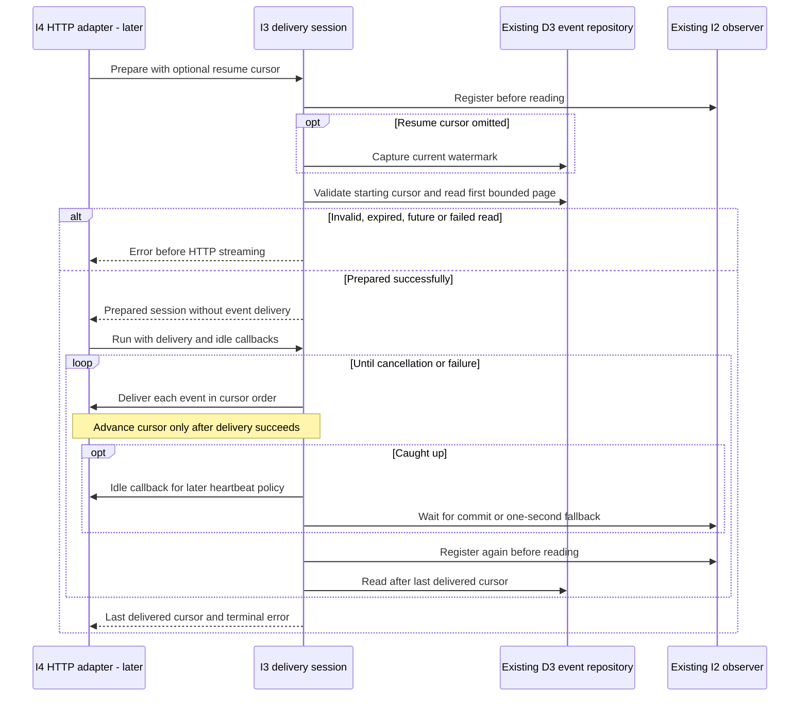

# I3 — Replay-to-live continuity

## Overview

I3 turns saved execution events into a continuous, ordered internal feed. A
consumer can resume after a known event cursor, receive the events it missed,
and continue receiving new committed events without a gap. It uses the same
SQLite table for historical and new events, and the implemented I2 helper to
wait when caught up. Reading an event never executes a workflow command again.

The smallest flow is: prepare a cursor and first page, deliver that page, drain
any remaining pages, then wait for a commit or fallback and read again. The
service advances its connection cursor only after a delivery callback succeeds.
It stops on cancellation, expiry or any read/delivery error. There is no separate
live-event queue to reconcile with replay.



**Status — implemented and Linux-verified on 2026-11-24.** Section 11 records
the executed evidence and remaining verification limits. I1, D3/D4 and I2 already
exist. This phase adds an internal service and tests, not `GET /api/v1/events`. I4 owns
authentication, HTTP/SSE framing, write deadlines, heartbeat timing, stream
cancellation on Runtime shutdown and production composition. Implementation
evidence is recorded separately at the end of this document when verified.

Read with [D3 replay and retention](../d_persistence/d3_event_repository.md),
[I2 observation](i2_committed_event_observation.md),
[A6 events](../contracts/event_error_v1.md),
[A7 SSE](../contracts/local_api_v1.md#10-sse-replay-and-live-delivery),
and the [Phase I index](../phases/phase_i.md).

## 1. Responsibilities and limits

| Area                  | I3 responsibility                                                                                    | Existing or later owner                                          |
| --------------------- | ---------------------------------------------------------------------------------------------------- | ---------------------------------------------------------------- |
| Initial cursor        | Distinguish omitted cursor from explicit positive cursor.                                            | I4 parses `Last-Event-ID` using existing A6 helpers.             |
| Preparation           | Register, capture watermark when needed, and read the first bounded page before returning a session. | I4 maps preparation errors before writing streaming headers.     |
| Replay and live       | One loop reads D3 pages and delivers in ascending numeric cursor order.                              | D3 owns SQL consistency, floor, watermark and retention.         |
| Waiting               | Register before each read cycle and use I2 waits when caught up.                                     | I2 owns notification/fallback/cancellation behavior.             |
| Delivery position     | Advance only after the callback returns success.                                                     | Studio later reconnects from its last processed cursor.          |
| Idle period           | Call the supplied idle callback before waiting.                                                      | I4 decides whether 15 seconds of inactivity require a heartbeat. |
| Slow/failing consumer | Keep no growing queue and stop on callback error.                                                    | I4 bounds actual socket writes and closes a blocked connection.  |

No new endpoint, event type, schema, migration, persisted subscriber offset,
broker, worker pool, global subscriber/device ceiling or dependency is needed.
Keep execution, variable stores, artifacts and H controls unchanged. No
supervisor component or Wire edit is required until I4 supplies the real HTTP
consumer. Preserve unrelated working-tree changes.

## 2. Proposed internal API

Implement `internal/services/eventdelivery` using constructor injection and the
existing domain reader:

```go
type Sink interface {
    Deliver(context.Context, execution.Event) error
    Idle(context.Context) error
}

type Service struct { /* reader and I2 observer */ }
type Session struct { /* first page, registered channel and initial cursor */ }

func New(reader execution.EventReader) *Service
func (s *Service) Prepare(ctx context.Context, after *int64) (*Session, error)
func (s *Session) Run(ctx context.Context, sink Sink) (int64, error)
```

The constructor creates no goroutine, timer or database read. It constructs
the I2 helper around that same `EventReader`, which already provides
`EventWakeup`. Do not create a duplicate repository, wrap the entire execution
engine or alter the domain reader to add delivery-specific operations.

A session is for one connection and may be run once. Use a single atomic
claim to reject duplicate/concurrent `Run` calls with the existing stale-state
error, without reading another runner's mutable page. A duplicate call returns
cursor zero as a sentinel, not as an assertion about the active runner's
position. Independent preparations produce independent sessions. There is no
singleton current cursor, subscriber registry or durable acknowledgement table.

`Run` returns the last successfully delivered numeric cursor when it exits.
This can still be the initial cursor when nothing was delivered. Zero can be
returned for a fresh empty database or an unusable session. It is internal and
does not make `Last-Event-ID: 0` valid. No concurrent cursor getter is needed.

## 3. Starting cursor and preparation

| Input/state                       | Required behavior                                                                                                                      |
| --------------------------------- | -------------------------------------------------------------------------------------------------------------------------------------- |
| `after == nil`                    | Follow new events after a connection-time watermark. Do not replay earlier history.                                                    |
| `after != nil` and value positive | Copy the value, validate it through D3's first replay read and resume strictly after it. Do not mutate or retain the caller's pointer. |
| Explicit zero or negative         | Return `ErrExecutionInvalidInput` before source access.                                                                                |
| Cursor below replay floor         | Preserve `ErrEventCursorExpired`.                                                                                                      |
| Cursor equal to floor             | Replay subsequent retained events.                                                                                                     |
| Cursor above watermark            | Preserve `ErrEventCursorFuture`.                                                                                                       |
| No saved events                   | Omitted cursor captures zero internally and prepares an empty page.                                                                    |

Preparation order:

1. Check cancellation, explicit cursor validity and required service/reader.
2. Register with I2 before any watermark/replay read.
3. For an omitted cursor, call `EventWatermark(ctx)` once and copy its watermark.
   For an explicit cursor, skip that extra read.
4. Call `ReplayEvents(ctx, cursor, constants.MaxEventPageSize)` once, currently
   at most 100 returned events plus D3's bounded lookahead.
5. Recheck cancellation and return the prepared session, initial page and
   previously registered channel. Deliver no events during preparation.

Preparation does not hold a database transaction open. I4 can safely map any
initial error before sending a 200 streaming response. If events commit after
watermark capture but before the first read, they are newer than the starting
cursor and must be included. Do not recapture the watermark and silently skip
them. If retention overtakes the cursor during preparation, return expiry.

I4 must call `Run` promptly with the same request/Runtime lifetime. An error
after preparation, including later expiry, closes the running stream rather
than attempting to replace its response with JSON. A session discarded without
running owns only its bounded page/channel references and needs no `Close`.

## 4. Ordered delivery loop

```text
claim this session once
take ownership of its prepared page and notification channel
cursor = initial cursor
repeat:
    check cancellation
    for each event in the page:
        check cancellation
        parse its cursor numerically and require cursor < event cursor <= page watermark
        deliver(ctx, event)
        on success, advance cursor to this event
    remember page.More and release the page
    if not page.More:
        check cancellation
        idle(ctx)
        observer.Wait(ctx, registered channel)
    register a fresh notification channel
    read the next bounded page after cursor
stop immediately on any error and return cursor plus that error
```

The first loop iteration uses the page prepared earlier. Do not requery and
replace it before delivery. On entering `Run`, transfer its page/channel out of
the session so the prepared first page is not retained for the whole connection.
Release each completed page before waiting or reading the next one. Require a
nonempty page when `More` is true to avoid a malformed trusted source causing
an immediate empty-page loop. Reuse existing cursor parsing; do not revalidate
the complete event/node/output contract or construct another A6 envelope.

Cursors increase numerically and may have gaps. Never compare strings
lexicographically, require adjacency or infer progress percentage from a cursor.
Malformed, repeated, backwards or above-watermark event cursors are trusted
read failures: stop with contextual persistence failure before delivering that
event. Earlier successful deliveries remain reflected in the returned cursor.

Delivery success means the sink returned `nil`. For I4, this must mean its full
event frame/write/flush step succeeded. It is not an acknowledgement that Studio
processed the event. A partial/failed write does not advance the cursor, and
the failed session does not retry the callback. The client later reconnects
from its own processed cursor and may receive some events again. This phase
does not promise exactly-once delivery across reconnections.

## 5. Continuity and retention cases

| Interleaving                                      | Required result                                                                                          |
| ------------------------------------------------- | -------------------------------------------------------------------------------------------------------- |
| Commit before explicit-cursor preparation         | The first read includes later retained events.                                                           |
| Commit between registration and read              | The read sees it or the captured channel is closed for an immediate recheck.                             |
| Commit after a read's snapshot but before waiting | The already-registered channel prevents a missed wakeup.                                                 |
| Commit while a page is being delivered            | Producers do not block on the sink. A later cursor-based read includes the new event.                    |
| More than 100 replay events                       | Drain bounded pages immediately in order without an idle wait between full pages.                        |
| Several commits share one observed wakeup         | Read every retained event after the cursor, not one event per signal.                                    |
| Fresh database with no events                     | Start internally at zero, then deliver event one after its commit.                                       |
| Pruning while the consumer is idle or slow        | The next read detects expiry when necessary and terminates. Do not silently jump to the floor/watermark. |

An already-materialized page contains committed events and may be delivered even
if its SQLite rows are subsequently pruned. Subsequent reads must still honor
D3's current floor. The connection cannot claim to have delivered rows missing
between its last successful cursor and the next available page.

The feed is Runtime-wide and unfiltered. Identical node IDs on two devices are
distinguished by existing run/device/attempt correlation IDs, not by separate
per-device cursors. I3 does not reconstruct execution state from logs or expose
RAM variable maps. G13 snapshots and I1 attempt history remain available.

## 6. Sink, backpressure and heartbeat handoff

`Deliver` and `Idle` are synchronous callbacks in the caller's goroutine. They
must respect cancellation and return after a bounded external operation. I3
does not spawn a goroutine to race a permanently blocked callback against a
timer, because that would leave the callback and its resources running.

With one page at a time there is no unbounded live-event queue and no overflow
drop policy to invent. Existing page/event limits bound I3-owned payload memory
per session; a slow sink stops further reads until it returns. Other sessions
and checkpoint writers remain independent. A sink must not retain unlimited
event copies or mutate an event's shared payload.

`Idle` runs once after a caught-up page before the I2 wait. It is not an A6
event, has no cursor and does not acknowledge data. After a wakeup/fallback the
loop reads again and can call `Idle` again. I4 tracks the last successful write
and emits a heartbeat only when due. A one-second I2 fallback is not a
one-second heartbeat. No idle callback is made between pages with `More=true`.

I4 must implement finite per-write/flush deadlines and a cancellation/close
path for blocked network I/O. It maps slow-client failure to stream closure,
never a silent event skip. It also disables ordinary request write timeouts
appropriately for SSE and connects cancellation to Runtime shutdown before
HTTP drain. I3 tests only context-aware callback cancellation, not real socket
timeouts or actual-agent stream shutdown.

## 7. Errors, cleanup and contextual logging

| Failure                                | Required result                                                                                                                                                                         |
| -------------------------------------- | --------------------------------------------------------------------------------------------------------------------------------------------------------------------------------------- |
| Caller cancellation/deadline           | Preserve matching through `errors.Is`; check before preparation, reads and each callback. A successful callback advances cursor even if cancellation is observed immediately afterward. |
| Invalid explicit numeric cursor        | `ErrExecutionInvalidInput` before dependency access. I4 remains responsible for malformed header text.                                                                                  |
| Initial or later expired/future cursor | Preserve existing D3 classification with safe operation context.                                                                                                                        |
| Missing service/reader/session/sink    | Contextual `ErrExecutionPersistence`, never an empty successful feed.                                                                                                                   |
| Duplicate/concurrent session run       | Contextual `ErrExecutionStaleState`; do not disturb the original run.                                                                                                                   |
| Read, registration or wait failure     | Stop, preserving the error chain and last successful cursor.                                                                                                                            |
| Deliver/idle callback failure          | Stop without retrying or advancing for the failed callback. Preserve the cause for the I4 adapter.                                                                                      |
| Malformed trusted page/cursor          | Contextual persistence failure, no busy loop or invalid event delivery.                                                                                                                 |

Use the existing `pkg/x-error` errors and operation helper. Operation names
should identify preparation, stream read, event delivery or idle delivery; keep
more specific repository operation context. Add no new public error enum or
response DTO. The future HTTP boundary logs unexpected failures once at ERROR
with safe operation/code/connection cursor, not raw sink error text or payloads.
Routine cancellation and periodic idle activity require no per-event log.

The service retains no caller context. Its methods receive the consumer context
explicitly. Cleanup releases local pages/channels on return. No subscription
row, acknowledgement update, worker cancellation, event append or file operation
occurs when a consumer disconnects. Do not send secrets, protected workflow
content, raw process output or paths into events or logs.

## 8. Implementation mapping

| File/area relative to `a2matex-runtime`                  | Planned change                                                                                                                           |
| -------------------------------------------------------- | ---------------------------------------------------------------------------------------------------------------------------------------- |
| `internal/services/eventdelivery/service.go`             | Service/Sink types, constructor and first-page preparation using the existing reader and I2 helper.                                      |
| `internal/services/eventdelivery/session.go`             | One-use session and ordered delivery loop, cursor tracking, page release and error propagation.                                          |
| `internal/services/eventdelivery/service_test.go`        | Focused controlled-reader/sink tests, cursor preparation, pagination, cancellation, ordering guards and independent sessions.            |
| `internal/repositories/execution_event_delivery_test.go` | Reuse existing file-backed SQLite/admission/event fixtures for replay/live commits, no-gap handoff, retention and independent consumers. |
| Repository/domain/I2 production files                    | No planned changes.                                                                                                                      |
| API/router, Wire, HTTP server and supervisor             | I4 integration only; unchanged by I3.                                                                                                    |

Standard-library atomics, contexts, timers/I2 and existing domain types are
enough. Use `testing/synctest` for deterministic waiting scenarios and ordinary
channels/barriers around SQLite I/O. Do not put SQLite operations in a fake-time
bubble or add testing dependencies or OS-specific production code.

## 9. Focused tests and acceptance criteria

The user approved focused I3 tests for preparation, pagination, commits during
replay, delivery failure, cancellation, expiry and independent consumers before
implementation. Reuse existing SQLite fixtures and I2 tests rather than
recreating their entire matrices.

| ID    | Scenario                         | Required assertion                                                                                                                                                             |
| ----- | -------------------------------- | ------------------------------------------------------------------------------------------------------------------------------------------------------------------------------ |
| I3-01 | Explicit and omitted preparation | Registration precedes reads. Explicit positive cursor skips watermark lookup and copies its value. Omitted captures watermark once. Preparation delivers nothing.              |
| I3-02 | Empty start and watermark race   | Internal zero is valid only through omitted capture. A commit after capture but before first read is delivered. Historical rows at/below the captured watermark are skipped.   |
| I3-03 | Pre-stream errors                | Explicit nonpositive, future, expired, missing dependency, cancellation and read failure return no usable session. No sink callback or streaming work occurs.                  |
| I3-04 | Ordered pagination               | More than 100 real events drain in numeric order without idle waits between pages; all IDs/payloads are preserved. Gaps are accepted.                                          |
| I3-05 | Replay/live handoff              | Commits during delivery and between an empty read and waiting appear after earlier events with no gap or duplicate inside that session.                                        |
| I3-06 | Delivery/idle failure            | Stop at the first failure, return the prior successful cursor and preserve the cause. Do not call later callbacks or requery after the error.                                  |
| I3-07 | Waiting and fallback             | A caught-up consumer blocks through I2, wakes on commit, and rechecks after fallback even without a signal. Idle is non-event activity and does not move the cursor.           |
| I3-08 | Cancellation                     | Cancellation while waiting, during a context-aware blocked sink and between callbacks ends the run without leaked test goroutines or additional deliveries.                    |
| I3-09 | Retention                        | Floor equality works. Initial expiry fails preparation; expiry after streaming begins returns the last successful cursor and stops. Never skip to retained history.            |
| I3-10 | Isolation and pressure           | Two sessions progress independently. A blocked sink does not block SQLite commits or the other session. No next page is loaded while its sink is blocked.                      |
| I3-11 | Single use and malformed source  | Duplicate/concurrent Run is rejected safely. Empty `More` page, malformed/backwards/repeated/above-watermark cursors terminate without spin or invalid delivery.               |
| I3-12 | Read-only/platform boundaries    | Consumption does not change rows/watermark or redispatch commands. Focused/race checks, vet and builds pass for stated hosts. SSE/native Windows remain separately unverified. |

Run focused package/repository race tests, repeated deterministic service tests,
`make fmt`, `go vet ./...`, `make build` and whitespace/link checks. Cross-build
the Windows agent and new test binaries. Run applicable full regressions and
report existing missing G22/H14/H15 harness failures explicitly. Socket sandbox
restrictions are environment failures, not successful application acceptance.

## 10. Developer demonstration and completion

No new Postman call is available after I3 alone. A readable repository test can
prepare after the current cursor, commit 205 valid synthetic events, run a
recording sink, commit another event while delivering the first page, and assert
all 206 events arrive in order. A second case prepares an empty live session,
commits afterward and observes the first delivery. Cancel the consumer to stop
the test and compare saved rows/cursor before and after reading.

For a failure demonstration, make the sink reject one known event. Its return
cursor must still identify the preceding successful delivery, and that same
event must remain available through a fresh explicit-cursor preparation. No
Android action is performed by these synthetic event fixtures.

I3 is complete when its internal service, preparation boundary, one-page loop,
context/error behavior and applicable I3-01–I3-12 checks pass with explicit host
evidence. I4 must still compose the same repository/service into authenticated
SSE, enforce callback/write deadlines, heartbeat and Runtime shutdown, and
publish verified client integration examples. No HTTP/SSE completion claim is
made by this phase.

## 11. Implementation and verification evidence — 2026-11-24

The Runtime now has `internal/services/eventdelivery/service.go` for preparation
and `session.go` for the single-use delivery loop. The implementation uses the
existing domain `EventReader` and I2 helper, retains one bounded page, advances
the cursor only after sink success, releases prepared-page references when
running, and stops on read/sink/cancellation errors. Idle opportunities are
callbacks, not new events or goroutines. No new dependency, repository production
change, route, Wire binding or supervisor component was introduced.

The approved focused tests use existing file-backed SQLite fixtures and standard
Go synctest for deterministic waits. The implementation is 160 production lines
across two responsibility-specific files; tests remain separately reviewable.

| Criteria     | Executed evidence                                                                                                                                                                                                                                                                                                        |
| ------------ | ------------------------------------------------------------------------------------------------------------------------------------------------------------------------------------------------------------------------------------------------------------------------------------------------------------------------ |
| I3-01        | `TestPrepareCursorAndRegistrationOrder` proves register/watermark/read ordering, original context/page limit, no delivery during preparation, copied explicit cursor and release of prepared references.                                                                                                                 |
| I3-02        | `TestPrepareIncludesCommitAfterWatermarkCapture` verifies the first read includes events newer than the captured watermark. `TestEventDeliveryEmptyStartAndIdleHandoff` covers a fresh internal zero, its first real admission, omitted-cursor history suppression and a commit after an empty read.                     |
| I3-03        | `TestPrepareRejectsInvalidInputAndReadFailures` covers nonpositive cursors before dependency access, nil/missing service, cancelled preparation, watermark failure, expired/future/read errors and an invalid empty More page.                                                                                           |
| I3-04, I3-05 | `TestEventDeliveryReplayAndNewCommits` appends 205 events through existing batched writes and commits another during first-page delivery. All 206 retain their IDs/payloads and arrive in order across three bounded pages, with no idle callback between replay pages. The empty-read/wait handoff is separately gated. |
| I3-06        | That repository test rejects event five after successfully delivering four and reconnects after four to observe five again. `TestRunCursorGuardsAndDeliveryFailure` verifies immediate failure propagation, prior cursor, no later send/requery and idle failure after the final successful event.                       |
| I3-07        | `TestRunFallbackAndLaterReadFailure` uses virtual time to prove two exact I2 fallback intervals trigger reads without a signal and idle does not advance the cursor. Real repository tests exercise closed-channel commit wakeups.                                                                                       |
| I3-08        | `TestRunDependencyGuardsAndCancellationBoundary` checks cancellation before Run and after a successful callback, with no subsequent delivery. `TestRunSingleUseAndCancellation` cancels a caught-up wait. The independent-consumer test joins a context-aware blocked sink after cancellation.                           |
| I3-09        | `TestEventDeliveryRetention` prepares a 100-event page, prunes beyond its cursor and proves that cached committed rows deliver but the next read expires without skipping. Initial expiry and equality at the replay floor are checked separately.                                                                       |
| I3-10        | `TestEventDeliveryIndependentConsumers` blocks one sink, successfully commits another event and advances a second session, then cancels and joins the blocked one. The slow failed callback never advances its cursor.                                                                                                   |
| I3-11        | Focused unit cases reject malformed/backwards/repeated/above-watermark cursors and empty More pages, accept numeric gaps and reject concurrent/repeated use of one session.                                                                                                                                              |
| I3-12        | Real replay leaves the durable watermark at the exact count of synthetic writes and never invokes a workflow/device handler. Focused/race tests, vet, formatting/build and Windows test/agent cross-compilation pass.                                                                                                    |

Executed in the Runtime repository:

```bash
make fmt
go test -race ./internal/services/eventdelivery ./internal/repositories -run 'Test(Prepare|Run|EventDelivery)' -count=1
go test -race ./internal/services/eventdelivery -count=20 -cover
go vet ./...
make build
go test -race ./... -count=1
git diff --check
```

Focused checks and 20 repeated service runs pass; service statement coverage is
91.7%. Windows amd64 agent and the new service/repository test binaries
cross-build successfully. Linux tests use synthetic committed events, actual
SQLite, controlled sinks and contexts. No real Android, native Windows,
HTTP SSE heartbeat/deadline, Studio UI or actual-agent stream shutdown was
exercised by I3.

As in I2, successful commands use the installed `/snap/go/current/bin` toolchain
and writable `GOCACHE=/tmp/a2matex-d5-go-cache` rather than the restricted Snap
wrapper/default cache. The full race suite ran with local socket/child-process
permission. It still fails only the existing `TestG22CombinedEngineAcceptance`,
`TestH14ShutdownRecoveryAgentAcceptance` and
`TestH15CombinedMultiDeviceAgentAcceptance` because their Python entry scripts
are absent; other packages pass. This is an open full-regression gate, not an
unqualified full-suite pass or an I3 acceptance-harness repair.

I3 is complete for its internal delivery scope and stated Linux verification.
I4 still owns authentication/header validation, production composition, SSE
framing, heartbeat timing, write deadlines, slow-client socket closure and
Runtime shutdown wiring. Existing polling/history guides remain usable; no
callable event endpoint or new stream usage guide is advertised here.
