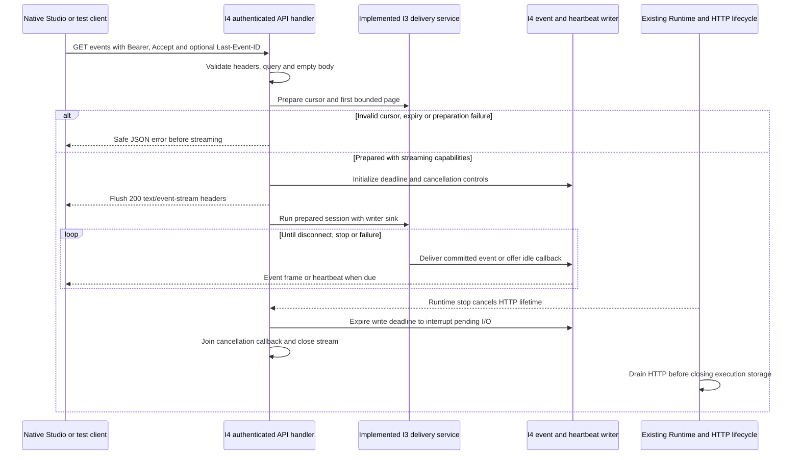

# I4 — Authenticated SSE endpoint

## Overview

I4 exposes the implemented I3 event-delivery service through one authenticated
HTTP connection: `GET /api/v1/events`. Studio's native client can follow saved
execution changes continuously and reconnect after its last processed event.
The Runtime still executes workflows independently of monitoring connections.
The stream is Runtime-wide, so clients select the relevant run/device/node
using the existing event correlation IDs.

The smallest flow is: authenticate, validate the request, prepare I3 before
sending headers, flush a 200 SSE response, and run one synchronous writer for
events and heartbeats. Failure before streaming produces the normal JSON error.
Failure after streaming closes the connection without appending JSON. Client
disconnect or Runtime stop cancels the reader and interrupts any blocked write.



**Status — implemented and Linux-verified on 2026-11-24.** Section 13 records
the executed evidence and remaining platform/regression limits. D3/I2/I3
already provide durable events, wakeups and ordered delivery. This document
defines the missing transport and lifecycle adapter. I5–I8 own actual Studio
consumption, inspector/control views and UI acceptance. No endpoint becomes
callable merely because its specification is written.

Read with [A7 SSE](../contracts/local_api_v1.md#10-sse-replay-and-live-delivery),
[A6 events/errors](../contracts/event_error_v1.md),
[A8 fixtures](../contracts/contract_fixtures_v1.md),
[I3 delivery](i3_replay_to_live_continuity.md),
[B5 authentication](../runtime_process_foundation/b5_local_authentication.md),
and the [Phase I index](../phases/phase_i.md).

## 1. Scope and existing foundations

| Area             | I4 change                                                                                    | Reuse unchanged                                                                  |
| ---------------- | -------------------------------------------------------------------------------------------- | -------------------------------------------------------------------------------- |
| Transport        | One GET route, request decoder, event writer and JSON error mapping.                         | Existing Gin router, B5 authentication, cache/error/recovery conventions.        |
| Delivery         | Supply I3's synchronous Deliver/Idle sink.                                                   | Existing `eventdelivery.Service.Prepare` and `Session.Run`.                      |
| Streaming I/O    | Error-aware flush, finite write deadlines and cancellation interruption.                     | Standard Go HTTP controllers and the installed Gin writer's `Unwrap` capability. |
| Runtime lifetime | Bind request contexts to a server-owned cancellable context and cancel before HTTP drain.    | Supervisor component order and H execution-stop/checkpoint behavior.             |
| Composition      | Inject I3 using the existing singleton ExecutionRepository and regenerate Wire.              | Current SQLite store, event schema, retention, admission and execution services. |
| Handoff          | Publish verified shared/Studio/Linux/Windows/Postman stream examples with the code delivery. | Existing readiness/token/process-management guides.                              |

No new database table, migration, event type, subscriber queue, broker,
acknowledgement API, replay query parameter, cloud credential or device limit is
introduced. Do not implement Studio UI or protected-package admission here.
Keep the SSE connection open after a run ends because it follows the Runtime,
not one workflow. It must not retain a run lease or affect Pause/Resume/Cancel.

## 2. Route and exact request contract

```http
GET /api/v1/events
Authorization: Bearer <current Runtime session token>
Accept: text/event-stream
Last-Event-ID: 42
```

`Last-Event-ID` is optional. `apiBaseUrl` from the owner handshake/connection
file already includes `/api/v1`; append `/events` once. Register the literal
route inside the existing `v1` router group, not as another base-path constant.

| Input                 | Accepted behavior                                                                                                                                                                                                                 |
| --------------------- | --------------------------------------------------------------------------------------------------------------------------------------------------------------------------------------------------------------------------------- |
| Authorization         | Existing exact B5 Bearer verification. No token in a URL, cookie or SSE data. Authentication runs before endpoint decoding.                                                                                                       |
| Accept                | Exactly one parsed header value equal to `text/event-stream`, case-insensitively after trimming HTTP optional surrounding whitespace. This MVP route does not negotiate lists, wildcards or parameters.                           |
| Last-Event-ID omitted | Pass `nil` to I3 preparation for its connection-time watermark. Do not replay older history.                                                                                                                                      |
| Last-Event-ID present | Exactly one nonempty header value accepted by `execution.ParseEventCursor`: positive ASCII decimal through int64 maximum. Leading zeros are accepted numerically.                                                                 |
| Invalid cursor        | Reject zero, signs, internal/retained whitespace, decimal/exponent syntax, non-ASCII digits, overflow, comma-combined or duplicate values with 400. Validate the values supplied by net/http, not reconstructed raw header bytes. |
| Query                 | `RawQuery` must be empty. Reject `cursor`, `after`, run/device filters, tokens and all other nonempty query strings. A bare trailing `?` with empty RawQuery is harmless.                                                         |
| Body                  | Empty. Reject positive content length immediately; for an unknown-length body, probe for one byte using the existing strict empty-body pattern. An EOF-only body is empty; a byte/read error is invalid.                          |
| Content-Type          | Not required because there is no request body. Other ordinary HTTP headers do not become replay inputs.                                                                                                                           |

Missing/unsupported Accept or any invalid endpoint input returns the existing
400 `INVALID_REQUEST`, not a new 406 or field-error DTO. Missing/invalid Bearer
returns 401 first. Preserve current no-route, no-redirect and unsupported-method
behavior. Request header/body read limits remain the existing server limits;
do not clear read deadlines before validating the body.

Header multiplicity must be checked with `Header.Values`, not only `Get`.
Reuse existing cursor parsing; do not write a UUID validator or another decimal
parser. Header values are never echoed in errors or logs.

## 3. Handler order and preparation errors

1. Existing middleware authenticates and establishes no-store/request logging.
2. Decode the complete request. On error return 400 without I3/repository access.
3. Validate trusted delivery/logger dependencies and check request cancellation.
4. Call `delivery.Prepare(request.Context(), cursor)` exactly once. Preparation
   performs the initial cursor/floor/watermark read before any streaming output.
5. Resolve the underlying response controller and validate flush/deadline
   support without flushing or committing success headers. Probe a finite write
   deadline. Unsupported streaming capability is a safe internal error.
6. Install cancellation interruption, set the success headers, commit 200 and
   flush immediately under the bounded deadline. Do not wait for the first
   event or heartbeat before the client receives the response headers.
7. Run the prepared I3 session exactly once with the event/idle writer.
8. On return, finish stream logging and callback cleanup, then close the stream
   using the existing post-response abort convention. No event/sink retry occurs.

| Failure before successful streaming                                           | Status and safe JSON error                                                                                                                                           |
| ----------------------------------------------------------------------------- | -------------------------------------------------------------------------------------------------------------------------------------------------------------------- |
| Invalid request/header or `ErrExecutionInvalidInput` / `ErrEventCursorFuture` | 400 `INVALID_REQUEST`, existing generic message, retryable false.                                                                                                    |
| `ErrEventCursorExpired`                                                       | 410 `EVENT_CURSOR_EXPIRED`, message `event history has expired; refresh the execution snapshot`, retryable false. Recovery requires a new snapshot, not blind retry. |
| Known persistence/commit-unknown/recovery-integrity failure                   | 500 `PERSISTENCE_FAILED`, message `unable to read execution events`, retryable false.                                                                                |
| Missing trusted dependency, unsupported controller or unexpected error        | 500 `INTERNAL_ERROR`, existing generic message, retryable false.                                                                                                     |
| Disconnected/cancelled request                                                | Stop without inventing 499, changing execution state or sending a fabricated successful stream. A client that has gone away may receive no response.                 |

Use the existing `response.AbortWithCause` and safe operation metadata. Add only
the required missing cursor-expiry code/messages to shared constants; preserve
the A7 envelope with no ad hoc cursor/data fields. Before a JSON failure, clear
any staged success-only headers if necessary. Once 200 is committed, cursor
expiry, storage failure and write failure must close the stream, never append
a JSON error, change the status or emit a fabricated A6 failure event.

## 4. Success headers and frame format

```http
HTTP/1.1 200 OK
Content-Type: text/event-stream; charset=utf-8
Cache-Control: no-store
X-Accel-Buffering: no
```

Do not set Content-Length, Content-Encoding, a manual Transfer-Encoding or
Connection header. The HTTP server owns transfer framing. This route must
bypass any future compression/buffering middleware; currently none is installed.
Do not hijack the connection or change loopback binding/authentication/CORS.

Each committed A6 event has this UTF-8 frame, terminated by one empty line:

```text
id: 42
event: NODE_ATTEMPT_STATE_CHANGED
data: {"cursor":"42","type":"NODE_ATTEMPT_STATE_CHANGED","occurredAt":"2026-11-24T03:00:00.000Z","runGroupId":"550e8400-e29b-41d4-a716-446655440001","deviceExecutionId":"550e8400-e29b-41d4-a716-446655440002","nodeAttemptId":"550e8400-e29b-41d4-a716-446655440003","nodeId":"tap","payload":{"status":"RUNNING","attemptNumber":1}}

```

- `id` is exactly the event cursor, `event` exactly its approved A6 type, and
  `data` the complete existing `execution.Event` JSON. Preserve optional fields
  and payload types; do not replace data with a run snapshot or output alone.
- Use `json.Marshal` to produce one compact JSON line, including compacting raw
  payload JSON. Escaped newlines in string values remain JSON escapes. Do not
  concatenate unescaped values into JSON or pretty-print the data across lines.
- Use LF frame delimiters and no BOM. There is no MVP `retry:` directive, initial
  synthetic event, diagnostic comment or alternate log-event type.
- Write through the tracked Gin writer so response status/size remain correct.
  A callback succeeds only after full frame write and error-aware flush succeed.
  Detect short writes as failure. Do not retry part of a frame.
- I3 advances its server cursor after callback success. The client saves its
  cursor only after processing the event. Reconnect can legitimately replay
  an event after an ambiguous write; this is not exactly-once delivery.

## 5. Heartbeats through the single writer

Use shared `constants.SSEHeartbeatInterval = 15 * time.Second`. Initialize the
last-successful-write time after the initial header flush. On a successful event
or heartbeat write/flush, update it. `Idle(ctx)` sends exactly this comment only
when the interval has elapsed:

```text
: heartbeat

```

Heartbeats have no ID, event name, JSON payload or persisted record, and never
advance the replay cursor. I3 offers idle callbacks while caught up; I2's
one-second fallback normally supplies idle rechecks. Do not send a heartbeat on
every callback or create a ticker/goroutine that writes concurrently with events.
For healthy idle reads, allow the existing recheck/scheduling interval after the
15-second threshold. Heartbeats are not a guarantee during a stuck database
operation; storage/cancellation failures still end the stream.

Events during active delivery keep the connection active. There is no need for
an interleaved heartbeat between every replay page. The stream remains open
after group completion, with heartbeats continuing during idle periods.

## 6. Error-aware flushing and write deadlines

Use shared `constants.SSEWriteTimeout = 5 * time.Second` as a fixed MVP
per-write/flush budget, not a connection-duration limit or new configuration
option. Keep existing ordinary HTTP timeout configuration unchanged.

The installed Gin v1.11.0 writer exposes `Unwrap()` on its concrete wrapper,
but its `Flush()` returns no error. A ResponseController created directly around
that wrapper can select the void Flush method and hide the underlying error.
Therefore resolve the original HTTP writer through the `Unwrap` interface for
control operations, while preserving the tracked Gin writer for body writes.
Require an error-aware underlying `FlushError() error` path and deadline support;
do not silently fall back to a flush that cannot report failure. The production
net/http writer provides these capabilities. Unit writers must model them.

For initial headers, every event frame and each due heartbeat:

```text
check cancellation
set a write deadline of now plus SSEWriteTimeout
write the complete tracked frame, if any
flush through the underlying error-aware controller
clear the deadline only while the stream context remains active
return success and update last-write time
```

Clearing the deadline after successful activity prevents the ordinary configured
30-second WriteTimeout, or a previous five-second frame deadline, from killing
a healthy idle connection. Setting the next finite deadline before each write
still bounds slow clients. This override is connection-local for the active SSE
response; do not set `http.Server.WriteTimeout = 0` globally. Normal requests
must retain their configured deadlines, including subsequent requests.

Resolve capabilities before sending 200. Any SetWriteDeadline, write, short
write, flush or clear-deadline error is a failed callback. If output is already
committed, log the safe failure and abort the stream. A deadline-clear error
after a successful flush still makes delivery ambiguous; reconnect uses the
client's processed cursor. Never continue by silently dropping the event.

## 7. Cancellation and HTTP server lifetime

The current server uses its startup context to bind the listener but does not
attach it to requests. I4 must create a server-owned `context.WithCancel(ctx)`
during Start, set `http.Server.BaseContext` before Serve, and retain only its
cancel function for lifecycle control. Cancel on bind/serve failure and at the
beginning of Shutdown, before `http.Server.Shutdown` waits for active handlers.
Direct Shutdown must work even when the parent context is not already cancelled.
No server constructor context or supervisor interface expansion is required.

Request cancellation alone does not interrupt a blocked response write. The
stream writer must register a short `context.AfterFunc` callback that sets its
underlying write deadline to `time.Now()` on cancellation. This callback performs
no event/header/body write and captures no Gin context. It is the only extra
cancellation task, not another delivery/heartbeat worker.

Serialize deadline updates with a small writer-owned mutex and check cancellation
inside that critical section. Hold no lock across body write or flush. This
prevents this shutdown race:

```text
cancellation expires the deadline
    then a racing sender sets a new future or zero deadline
        and the blocked write accidentally survives cancellation
```

Once cancelled, normal deadline operations must leave an expired deadline and
return cancellation, never overwrite it with a future/zero deadline. The
cancellation callback must finish before the handler releases its writer:
stop the AfterFunc and, if it already started, join its completion channel.
Check/categorize control errors safely; a closed connection during cancellation
must not trigger repeated raw-error logs or new writes.

Preserve the existing supervisor sequence: signal Runtime stop, call execution
PrepareStop under its established policy, withdraw discovery, drain HTTP, stop
workers/checkpoints and close SQLite in their existing reverse component order.
The server-owned context is also cancelled by the supervisor's parent stop.
Do not delay HTTP drain until executions finish or require final lifecycle events
to reach every monitor. Those changes remain persisted and readable on reopen.

| Stop case                                   | Required result                                                                                                                      |
| ------------------------------------------- | ------------------------------------------------------------------------------------------------------------------------------------ |
| Client disconnect while waiting             | Request cancellation releases I2/I3 and all stream resources. Runs continue.                                                         |
| Client disconnect/slow client during write  | Error/deadline ends the sink and connection without holding a database transaction or stopping other clients.                        |
| Owner shutdown or owner loss                | Server lifetime cancellation releases idle/read/write handlers before HTTP drain. Existing H/D stop/recovery policies are unchanged. |
| Direct server Shutdown in tests             | Cancel BaseContext first, even with a live parent, then drain normally.                                                              |
| Handler cancellation races a deadline reset | Cancellation cannot be undone by the sender's deadline update.                                                                       |
| Stream ends after 200                       | Use the existing `http.ErrAbortHandler` path to close the response without a JSON suffix or an unbounded final write.                |

Recovery already rethrows ErrAbortHandler without logging a stack or appending
JSON. Keep that convention. Stop/join the cancellation callback before aborting.
Do not add a subscriber registry to the supervisor. New HTTP parent cancellation
also reaches ordinary active requests; verify their existing error, admission,
control and detached final-checkpoint guarantees rather than changing them.

## 8. Errors, logging and resource bounds

Before streaming, use the existing one-record ERROR logging for 4xx/5xx through
middleware and response failure metadata. Do not duplicate those records in
the handler. After streaming, status remains 200 and normal completion middleware
may not run because the response is aborted. Record one explicit stream-close
summary with safe method/route/status, duration, last successful server cursor,
outcome, operation/reason and stable error code when relevant.

Unexpected storage/serialization/control/write/timeout failures use ERROR.
Expected request cancellation/Runtime stop can use DEBUG without a fabricated
failure code. Never use WARN for failed HTTP requests. Do not log headers,
tokens, complete frames, payloads, protected workflow data, raw socket/driver
error strings or filesystem paths. A stream-open INFO record may identify the
route and start mode without the raw Last-Event-ID header.

I3 retains one bounded event page and no queue. I4 adds only one bounded frame,
last-write timestamp and cancellation/deadline controls per active request.
Marshal only one event at a time. The four A6 event types and D3 byte limits
remain authoritative; no command output, heartbeat or artifact bytes enter
SQLite through this endpoint. No stream holds a transaction while sending.

Do not count a disconnect as a run cancellation or release another client's
owner credentials. No subscriber/device ceiling, cloud login, cookie auth or
token-query workaround is introduced. Studio uses a native HTTP streaming client
that can set Authorization. Browser EventSource credential restrictions do not
change the local authentication contract.

## 9. Implementation mapping

| File/area relative to `a2matex-runtime`                       | Planned I4 change                                                                                                                                                                  |
| ------------------------------------------------------------- | ---------------------------------------------------------------------------------------------------------------------------------------------------------------------------------- |
| `internal/api/events/handler.go`                              | Handler constructor, Prepare/Run order, safe pre-stream mapping and one post-stream closure summary. Depend on the implemented I3 service rather than redesigning its session API. |
| `internal/api/events/decode.go`                               | Strict Accept/Last-Event-ID/query/empty-body decoding with the existing cursor helper.                                                                                             |
| `internal/api/events/dto.go`                                  | Discoverable request type for the optional numeric cursor; reuse `execution.Event` for event data. No new envelope/event model.                                                    |
| `internal/api/events/writer.go`                               | Deliver/Idle sink, single-frame serialization, error-aware controller, heartbeat timing and deadline/cancellation controls. Keep small related helpers here.                       |
| `internal/api/router.go`                                      | Inject events handler and register `v1.GET("/events", eventStream.Stream)` alongside existing routes.                                                                              |
| `pkg/constants/api.go`                                        | Shared heartbeat/write durations, cursor-expiry transport constant and safe event-read/expiry messages. Reuse current error codes otherwise.                                       |
| `internal/platform/httpserver/server.go`                      | Owned BaseContext cancellation before drain, cleanup on failed startup/serve and unchanged normal timeout configuration.                                                           |
| `cmd/agent/wire.go` and generated `wire_gen.go`               | Bind existing repository to `execution.EventReader`, construct I3/events handler and run `make wire`. Do not hand-edit generated output.                                           |
| Existing router constructor call sites/tests                  | Adapt the explicit handler dependency with focused fixture changes only.                                                                                                           |
| Focused events/writer/HTTP tests and agent acceptance fixture | Reuse existing router, I3, SQLite and managed-owner fixtures; add missing transport/cancellation evidence after test-scope approval.                                               |

No production edit is planned to I2/I3, execution workers, checkpoint SQL,
retention, artifact streaming or supervisor component ordering. If implementation
reveals an actual prerequisite defect, demonstrate it and keep the correction
focused. Do not create another generic stream framework or logging middleware.

## 10. Tests and acceptance criteria

Discuss test additions with the user before implementation, as required by
Runtime AGENTS.md. Spec approval alone is not approval for code/tests. Use
standard-library synctest/controlled clocks for heartbeat/deadline unit cases,
writer doubles that expose FlushError/deadline behavior, real TCP HTTP servers
for actual flush/blocked-write behavior, and existing SQLite/owner fixtures.
Do not use a plain ResponseRecorder as proof of supported production deadlines.

| ID    | Scenario                          | Required assertion                                                                                                                                                                                                                                                                                    |
| ----- | --------------------------------- | ----------------------------------------------------------------------------------------------------------------------------------------------------------------------------------------------------------------------------------------------------------------------------------------------------- |
| I4-01 | Strict request/auth               | Correct Bearer/Accept succeeds; missing auth wins over malformed cursor. Invalid/missing/duplicate/list Accept, duplicate/empty/invalid/future cursors, queries and body/read-error cases are safe failures before service/streaming as applicable. Leading-zero cursor and omitted cursor follow A7. |
| I4-02 | Preparation/error response        | Expired410, future/invalid400, known persistence500, missing/unsupported dependency500. Exact A7 envelope/codes, no partial SSE and one ERROR request log. Initial cancellation does not create a false success.                                                                                      |
| I4-03 | Exact framing                     | Parse real received frames and compare all fields with source events. Exercise all four A6 types, optional correlation fields and payload strings with newline/Unicode content. Compact single-line JSON and blank-line boundaries are preserved.                                                     |
| I4-04 | A8 conformance                    | Consume the approved `local_api/valid_node_attempt_event.sse` and referenced JSON fixture. If not already vendored, copy only those unchanged fixture bytes with provenance into focused testdata rather than requiring a sibling Plan checkout. Do not modify frozen fixtures.                       |
| I4-05 | Real replay/live                  | With real SQLite and HTTP, replay more than 100 events and commit during delivery. No gaps/within-session duplicates, numeric ordering and correlation identity. Without cursor, skip history and follow new events.                                                                                  |
| I4-06 | Heartbeat/longevity               | Initial headers arrive immediately. No heartbeat before 15 seconds, one when due, no cursor/data on comments, event activity resets the interval. A healthy stream survives the configured ordinary WriteTimeout. No concurrent writes.                                                               |
| I4-07 | Short write/flush/control failure | Initial capability failure is JSON500. After start, partial write, flush error, deadline-set/clear error or serialization failure closes the stream with no JSON/extra A6 event; failed delivery is not acknowledged or retried.                                                                      |
| I4-08 | Slow client and pressure          | A real client stops reading sufficient bytes to block the socket, or controlled server writer blocks. Finite frame deadline closes it; a second client and execution/checkpoint writes continue. Do not assume a single small frame will fill TCP buffers.                                            |
| I4-09 | Disconnect and cancellation race  | Disconnect during idle, read and blocked write releases the handler and AfterFunc. Race cancellation with setting/clearing deadlines and prove an expired deadline cannot be overwritten. No goroutine/controller access remains after return.                                                        |
| I4-10 | Actual shutdown                   | Direct HTTP Shutdown with a live parent and managed-agent owner stop/loss both end open streams within the existing shutdown budget, including blocked output. SQLite results remain intact and ordinary requests/controls/checkpoints retain their guarantees.                                       |
| I4-11 | Expiry and reconnect              | Initial expired cursor yields JSON410. Expiry after headers closes without JSON. Snapshot/current cursor plus reconnection catches intervening commits. Resume uses last client-processed cursor and never redispatches a workflow action.                                                            |
| I4-12 | Security/logging                  | No token in URL/events/logs, no buffering/compression, headers exact, safe one-record pre-stream failures and explicit safe post-stream closure summaries. Panic recovery never writes JSON into a started stream.                                                                                    |
| I4-13 | Production composition/platform   | Built agent serves the route with actual local auth and the existing repository. Test idle, replay, fresh credential sessions and owner stop. Linux execution and Windows cross-build/native-host evidence are separately recorded.                                                                   |
| I4-14 | Client handoff                    | Shared/Studio/Launcher guide references and a readable manual example describe exact API, statuses, replay, frames, heartbeats, disconnect/reconnect, readiness and owner stop. Planned versus verified behavior remains explicit.                                                                    |

Prefer one small tracked agent extension to an existing managed-owner fixture,
not another copied H14/H15 matrix. Test real HTTP flushing with local socket
permission when the sandbox blocks it. Run focused package/API/server tests,
race checks, `make fmt`, `make wire`, `go vet ./...`, `make build`, whitespace
checks, applicable full regressions and Windows agent/affected-test cross-builds.
Report existing missing G22/H14/H15 harness failures separately; neither repair
nor an implicit exception is part of I4. Native Windows requires a real host.

## 11. Manual Linux, Windows and Postman scenario

This is the walkthrough to publish **after implementation and verification**.
It adds no requirement to hand-create credentials. First use the existing
[authentication guide](../integration/local_authentication.md) and current
Runtime readiness information. Set `API_BASE_URL` to the exact supplied base URL
and `SESSION_TOKEN` to the current session token. Do not assume a retained token
survives a Runtime restart. Native applications follow the owner startup guide
before opening/reopening the connection.

Linux, after those shell variables are populated:

```bash
curl -N --http1.1 "$API_BASE_URL/events" \
  -H "Authorization: Bearer $SESSION_TOKEN" \
  -H "Accept: text/event-stream"
```

Windows PowerShell, after the equivalent environment variables are populated:

```powershell
curl.exe -N --http1.1 "${env:API_BASE_URL}/events" `
  -H "Authorization: Bearer $env:SESSION_TOKEN" `
  -H "Accept: text/event-stream"
```

The request stays open. Initially there may be no event data; with no execution
activity a heartbeat appears around each 15-second idle threshold. Leave it open
for over 40 seconds to check that it survives the default ordinary 30-second
write timeout. This idle check needs no Android target. Ctrl+C disconnects only
the monitor and does not stop the Runtime or a workflow.

Then test actual workflow progress:

1. In Postman, use GET `{{API_BASE_URL}}/events`, Bearer SESSION_TOKEN, exactly
   one Accept header `text/event-stream`, no query and Body none. Omit
   Last-Event-ID on the first connection. Use curl above to inspect exact raw
   framing if the client presents decoded events instead.
2. In another request/tab compile the existing readable
   [H4 Start/Delay/End graph](../../../../a2matex-runtime/examples/h4/compile-workflow.json)
   and POST `/runs` with its returned IR, a fresh request ID, a real READY device
   and valid `delayMs` such as 1000. Do not change its schema/timeouts for SSE.
3. Observe RUNNING and terminal attempt events for Start/Delay/End, device next
   positions and the eventual group status. Match run/device IDs to the POST
   response. Compare a fresh GET snapshot and I1 history with the committed
   state; unrelated Runtime events may also appear.
4. Save the cursor of an event actually processed by the client. Disconnect the
   stream, start another run, then reconnect with `Last-Event-ID` set to that
   saved positive value. Both curl commands accept an additional
   `-H "Last-Event-ID: 42"`, replacing 42 with that real cursor. Expect all
   retained later events followed by live delivery; no workflow command repeats.
5. Missing Bearer returns401; missing Accept, `Last-Event-ID: 0`, invalid header
   syntax, query token/filter or a future cursor returns400. A syntactically
   valid expired cursor returns410 only if retention has actually advanced.
   Use the automated small-retention fixture for that case rather than editing
   the customer's SQLite database or deleting data manually.
6. While monitoring, request owner Stop and exit (or stop the standalone process
   used for manual development). The stream closes and the process exits within
   its existing budget. After a fresh launch, obtain fresh readiness/credentials
   before reading retained results. This does not resume old workflow execution.

For expiry recovery, get an authoritative snapshot of the relevant known run,
apply its state and reconnect after its watermarked cursor. The replay stream
is global; repair all locally monitored run views as needed. Preserve cursor
strings in client storage and compare snapshot/event ordering numerically only
where required. I5 defines the actual Studio view reconciliation behavior.

## 12. Documentation delivery and completion

During verified I4 code delivery, update:

- [Shared Runtime guide](../integration/managed_runtime.md): endpoint inventory,
  exact headers/error matrix/frame examples, initial/reconnect behavior, expiry,
  heartbeat, timeouts, current-credential handling and Linux/Windows commands.
- [Studio guide](../integration/studio.md): native Authorization-capable stream,
  processed-cursor persistence, correlation filtering, snapshot repair and
  owner/readiness behavior. UI work remains I5–I8.
- [Launcher guide](../integration/launcher.md): concise shared-stream reference
  for admitted runs, without implying that Phase J package execution exists.
- Runtime `examples/i4/README.md`: the short runnable manual scenario above,
  actual route availability and verification limitations.

I4 is complete for a stated host when its route, request/error contract, exact
frames, I3 continuity, heartbeat/deadline controls, disconnect/shutdown cleanup,
production composition and applicable I4-01–I4-14 criteria pass with current
evidence and guides. A unit fake's cancellation is not real socket or owner-stop
proof. Native Windows, actual Studio integration and full-suite missing harnesses
must retain explicit status until their own checks are performed.

At preparation on 2026-11-24 there is no `/events` router entry. I3 has the
required Prepare/Run and Deliver/Idle contracts. The HTTP server still has fixed
normal request timeouts and no owned BaseContext cancellation. Existing recovery
already rethrows ErrAbortHandler. These are the precise adaptation points; no
new broker, event repository or execution-state mechanism is required.

The preparation paragraph above is historical. The delivered changes and
verification follow; Studio/Launcher UI and native Windows remain separate work.

## 13. Implementation and verification evidence — 2026-11-24

The Runtime now registers `GET /api/v1/events` through `internal/api/events`,
with explicit header DTO/decoding, I3 first-page preparation and one synchronous
event/heartbeat sink. The writer resolves the underlying error-aware controller
while tracking Gin body/status writes, bounds each frame/flush, serializes
cancellation/deadline changes and joins AfterFunc before releasing its writer.
HTTP server Start/Shutdown now owns request-context cancellation through
BaseContext. Wire constructs the delivery service from the existing repository
singleton and was regenerated normally. I2/I3, checkpoint/repository production
code, SQLite schema, supervisor order and ordinary timeout configuration are
unchanged.

The user approved focused I4 tests before additions. Existing router fixtures
were adapted only for the new handler argument. The I1 retained-data process
fixture now has a shared helper and an I4 test entry, avoiding another owner
launcher/SQLite setup implementation. The unchanged A8 SSE/JSON fixture bytes
are copied with provenance into local testdata so tests need no Plan checkout.

| Criteria     | Executed evidence                                                                                                                                                                                                                                                                                                                                                                                   |
| ------------ | --------------------------------------------------------------------------------------------------------------------------------------------------------------------------------------------------------------------------------------------------------------------------------------------------------------------------------------------------------------------------------------------------- |
| I4-01, I4-02 | `TestEventRequestAndPreparationFailures` covers auth precedence, strict Accept/query/body/cursor rules, safe 400/401/410/500 mappings, zero source calls for invalid requests and one sanitized ERROR record. Missing dependencies and cancelled preparation have their own checks with no false 200.                                                                                               |
| I4-03, I4-04 | `TestWriterFramesAndA8Conformance` compares the exact A8 frame bytes and JSON input, preserves Unicode/escaped-newline payloads and frames all four event types. The real HTTP and agent tests parse frames against committed event identity/data.                                                                                                                                                  |
| I4-05        | `TestEventStreamRealSQLiteHTTPReplayAndLive` gets an actual HTTP snapshot, commits 205 events before subscribing after its cursor, receives those plus a new commit in order, follows only new events on an omitted-cursor connection and checks read-only record counts.                                                                                                                           |
| I4-06        | Virtual-time writer tests prove the 15-second threshold, no duplicate idle heartbeat and event activity resetting the clock. `TestI4EventStreamAgentAcceptance` receives three real heartbeats over 45 seconds through the built agent with its default 30-second ordinary write timeout. Other authenticated requests remain usable.                                                               |
| I4-07        | Writer tests propagate flush, write, short-write, deadline-set and deadline-clear failures through the Gin unwrap path. Started encoding/expiry failures abort with no JSON suffix. Callback failure/cursor rules reuse implemented I3 checks.                                                                                                                                                      |
| I4-08, I4-09 | `TestWriterBlockedIODeadlineAndCancellation` uses net.Pipe and virtual time to prove the exact five-second budget and immediate cancellation. `TestCancellationCannotBeOverwrittenByDeadlineReset` races future/zero deadline updates and cancellation. Real HTTP clients disconnect cleanly; I3's existing real SQLite isolation test retains pressure coverage for independent consumers/writers. |
| I4-10        | `TestShutdownCancelsStreamAndBlockedWrite` runs the actual HTTP server with a controlled net.Pipe body writer and error-aware HTTP header flushing. Direct Shutdown with a live parent and parent cancellation both interrupt pending I/O within a one-second grace budget without forced close. The managed agent separately passes owner shutdown and owner EOF with an open stream.              |
| I4-11        | Real SQLite/HTTP pruning yields pre-stream410. `TestStartedEventExpiryClosesWithoutJSON` delivers its prepared event then expires on recheck, preserving 200/frame bytes and logging the expiry safely. Snapshot-to-subscribe replay and I3 delivery-failure reconnect tests pass without action dispatch.                                                                                          |
| I4-12        | Request/close log tests prove no token/private cause exposure, exact headers/no compression and one explicit close summary. Existing HTTP panic/abort and all API regressions pass with the shared recovery middleware.                                                                                                                                                                             |
| I4-13        | The built agent uses real local Bearer/owner pipes and migrated SQLite, replays retained events against expected JSON, emits real heartbeats, starts two fresh credential sessions and stops through both owner-command and owner-loss paths without changing saved data. No Android is required or exercised.                                                                                      |
| I4-14        | Shared, Studio and Launcher guides plus `examples/i4/README.md` document exact requests, frames, statuses, cursor handling, expiry/reconnect, heartbeat/deadlines, process ownership and verification limits. Native UI implementation remains I5–I8.                                                                                                                                               |

Executed in the Runtime repository:

```bash
make wire
make fmt
go test -race ./internal/api/... ./internal/platform/httpserver -count=1
go test -race ./internal/api/events -count=20 -cover
go vet ./...
make build
go test -race ./... -count=1
git diff --check
```

Focused HTTP/server tests, repeated event tests, vet and Linux build pass. The
full race run includes the successful 45-second actual-agent I4 case and still
fails only `TestG22CombinedEngineAcceptance`,
`TestH14ShutdownRecoveryAgentAcceptance` and
`TestH15CombinedMultiDeviceAgentAcceptance` because their preexisting Python
entry scripts are absent. Other packages pass. This is not an unqualified
full-suite pass or a repair/exception for those acceptance gates.

The local testdata `.gitattributes` preserves LF fixture bytes on Windows and
allows the `.sse` fixture's required final blank line without disabling other
whitespace checks. Both copied fixture files are byte-identical to A8.

As in I2/I3, commands use installed `/snap/go/current/bin` tools and writable
`GOCACHE=/tmp/a2matex-d5-go-cache`. Real HTTP/agent checks ran with local socket
and child-process permission. Windows amd64 agent and events/API/httpserver
test binaries cross-build; native Windows, real Android and actual Studio or
Launcher UI were not exercised. Linux controlled tests verify the transport and
lifecycle, not live-device business results or Phase J package admission.
