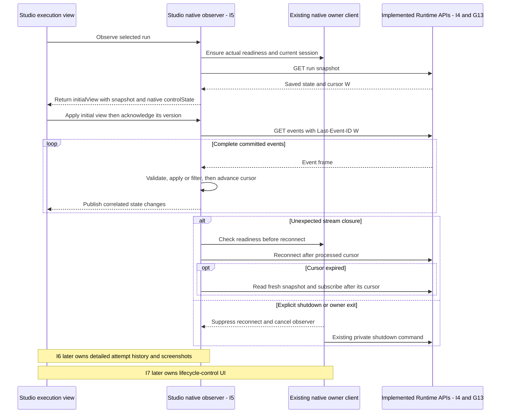

# I5 — Studio event and reconnect integration

## Overview

I5 connects Studio's execution view to the implemented Runtime event stream.
The publisher can watch the selected run and device, lose the connection, and
return to a correct saved state without starting the workflow again. Runtime
continues executing independently of this observer.

Studio first reads a run snapshot, then subscribes after its cursor. It applies
complete events in order and reconnects after the last event it processed. If
that history has expired, Studio reads a new snapshot and subscribes again.
An intentional Runtime shutdown stops this automatic behavior.



**Status — specification ready for Studio implementation; not implemented or
UI-verified by this document.** I1–I4 are implemented Runtime foundations.
Studio source was subsequently inspected read-only at revision
`dd7c604172e7712d3de7dff6db9a1e3d84b1dba0`. The
[single I5–I7 Studio handoff](../integration/studio_observability.md) maps this spec to
its existing Electron/Main/preload/React files and records integration gaps.
No Studio code was changed. Native Linux client acceptance remains pending;
the inspected Studio managed-startup code explicitly rejects Windows until
its process/pipe prerequisite is implemented and verified.

Read with [Phase I](../phases/phase_i.md),
[A6 events](../contracts/event_error_v1.md),
[A7 snapshots and SSE](../contracts/local_api_v1.md),
[I4 transport](i4_authenticated_sse_endpoint.md), and the
[shared owner/client guide](../integration/managed_runtime.md) and
[Studio guide](../integration/studio.md#live-execution-events--i4).

## 1. Responsibility and MVP boundary

| Area           | I5 deliverable                                                                          | Existing or later owner                                                          |
| -------------- | --------------------------------------------------------------------------------------- | -------------------------------------------------------------------------------- |
| Connection     | One native, authenticated, incrementally read event stream per Studio Runtime session.  | I4 owns the server; the shared native client owns child startup and credentials. |
| Execution view | Observe one selected run, its device rows and the selected device's live node activity. | Runtime owns all execution decisions and persisted results.                      |
| Continuity     | Processed cursor, reconnect, snapshot repair and protection against stale responses.    | D3/I3 own retained replay; G13 owns authoritative snapshots.                     |
| View state     | Distinguish connecting, connected, reconnecting, unavailable and intentionally stopped. | I7 owns Pause/Resume/Cancel and Stop and exit UI implementation.                 |
| History        | Mark live attempt facts as partial when earlier activity was not observed.              | I6 loads complete attempt history, outputs and screenshots using I1/G20.         |

Keep only the selected run's live projection in I5. Changing runs replaces that
projection through a fresh bootstrap. Multiple independent historical live
panels, persisted client cursors and a general event-cache framework are outside
the MVP. Do not add Runtime endpoints, migrations, event fields, background
services or dependencies merely to implement the client.

## 2. Existing APIs and exact usage

All requests use the current native owner's `apiBaseUrl` and Bearer token.
The base URL already ends in `/api/v1`. Readiness is checked before every new
snapshot request and every stream connection attempt through the existing
shared gate; receiving each frame does not require another HTTP probe.

| Operation              | Request                              | Use                                                                                             |
| ---------------------- | ------------------------------------ | ----------------------------------------------------------------------------------------------- |
| Select known run       | `GET {apiBaseUrl}/runs/{runGroupId}` | Authoritative state even after completion.                                                      |
| Discover active run    | `GET {apiBaseUrl}/runs/active`       | Existing Test Run flow may use this to discover the current group; 404 means no active run.     |
| Subscribe or reconnect | `GET {apiBaseUrl}/events`            | Exactly `Accept: text/event-stream`, Bearer header, optional `Last-Event-ID`; no query or body. |
| Detailed attempts      | Existing I1 attempts route           | I6 integration; do not embed full history in snapshot state.                                    |

An explicit positive snapshot/processed cursor is sent as `Last-Event-ID`.
There are no run/device subscription parameters. Do not send a token in the
URL, use a renderer's unauthenticated EventSource, or introduce a cursor query.
Use the existing native streaming HTTP facility if available. If it is absent,
the Studio implementer must propose the smallest supported adapter before
adding a library. Keep credentials and process control on the trusted side of
the desktop bridge.

A successful stream returns 200 and `text/event-stream; charset=utf-8`.
Read frames continuously; do not await the whole body or call a whole-body
JSON decoder. Keep bounded connect/header deadlines, but remove the ordinary
whole-request timeout from the open body. Heartbeats arrive after approximately
15 seconds of inactivity. A healthy idle stream must survive beyond 40 seconds.

## 3. Observer state and ownership

Use one controller owned by the existing native Runtime client, with these
conceptual fields. Adapt names to Studio conventions rather than building a
second process manager.

| State                                        | Meaning                                                                                                              |
| -------------------------------------------- | -------------------------------------------------------------------------------------------------------------------- |
| `sessionGeneration`                          | Local identity of the current owned Runtime child/credentials. It is not an API field.                               |
| `observationGeneration`                      | Increments on run replacement, repair, stop or observer disposal. Old callbacks cannot modify the new observation.   |
| `selectedRunId`, `selectedDeviceExecutionId` | Current view identity; node IDs alone are insufficient.                                                              |
| `processedCursor`                            | Runtime-wide decimal string for the last fully handled event, or the bootstrap snapshot cursor before events arrive. |
| `snapshotCursor`                             | Watermark covered by the selected run/device snapshot. It is separate from the processed stream cursor.              |
| `snapshot`, `liveAttempts`, `pendingRetry`   | Current run/device projection and bounded, partial live-node facts.                                                  |
| `connectionState`, `lastActivityAt`          | Observation health, independent of execution status.                                                                 |
| cancellation and refresh state               | Own the current body read, retry timer, in-flight snapshot and one refresh-needed flag.                              |

Do not keep a durable cursor in browser storage. On a new app/Runtime session,
bootstrap from saved APIs again. A replacement Runtime can reuse the same
database, but its token and callbacks belong to a new local generation. Never
assume that its store has the same cursor history.

All mutations are serialized through the client's existing state owner or one
serial reducer. Native-to-renderer messages carry the local generation and
correlation IDs, never credentials. The renderer discards old-generation
updates. A slow renderer must not create an unbounded native message queue:
publish coalesced current view state, with at most one pending publication per
view, rather than queueing every raw event for rendering.

### Local bridge startup and acknowledgement

The local bridge must return the initial view through its invoke response,
not an event that can arrive before the renderer knows its observation ID:

```text
observeRun({runGroupId})
  -> HostResult<{observationId, initialView: ObservationEnvelope}>
onObservationChanged(listener: (view: ObservationEnvelope) => void) -> unsubscribe
ackObservation({observationId, version}) -> HostResult<void>
stopObserving({observationId}) -> HostResult<void>
```

Concrete method names may follow Studio conventions; this ordering and payload
contract are required. Each envelope includes observationId, sessionGeneration,
observationGeneration, publication version, selected run/device identity,
snapshot/live/health data and the selected run's Main-owned `controlState`
defined in [I7](i7_studio_lifecycle_controls.md#5-local-pending-state-and-button-eligibility).
Publication versions are positive safe integers local to an observation; they
are not SSE cursors or action submission versions.

1. Renderer installs its listener **before** invoking observeRun and records
   a local request generation. Until startup succeeds, keep controls loading.
2. Main creates the observation, loads its snapshot and captures a detached,
   immutable initialView version 1 with the latest controlState in its serial
   state owner. Later reductions create new projections rather than mutate it.
   Return the ID and that complete envelope in the successful invoke response.
   Do not also send version 1 through onObservationChanged.
3. Main may open/read SSE after capturing version 1. Until its acknowledgement,
   coalesce changes into one latest pending projection without publishing it.
   Runtime execution and SSE consumption never wait for renderer progress.
4. Renderer checks its local request generation, stores the returned ID and
   applies the initial envelope including controlState before acknowledging
   version 1. If disposed/replaced while the invoke was pending, call
   stopObserving with that returned old ID instead of applying/acknowledging it.
5. Main accepts an acknowledgement only from the observation's owner for the
   exact outstanding version. It then publishes the latest pending envelope
   and again permits only one outstanding envelope. Duplicate acknowledged
   versions are harmless; future/unsent versions and wrong-owner requests
   cannot release a newer publication. No ACK advances the SSE cursor.
6. Arm a named 10-second initial-ACK deadline immediately before returning
   success. Missing initial ACK, including a lost invoke reply, disposes only
   this observation and its read/timer resources. Clear this deadline on a
   valid initial ACK or disposal. A newer observeRun for that owner replaces
   its abandoned observation. Runtime and Main's control intent
   remain alive. No raw publication queue or Runtime restart is created.

Late ACKs for disposed/replaced observations return a safe local-state failure.
The renderer treats that startup as stale and may bootstrap again under the
current permitted observation intent, never replay a control action. Later
missing publication ACKs keep one outstanding and one pending projection until
ACK/disposal; they do not add timers or block native event consumption. A
replaced child invalidates the observation, so an old successful invoke reply
cannot activate a stream for that old session.

## 4. Cursor and frame processing

Treat cursors as decimal strings. Numeric ordering must be exact through signed
64-bit maximum; JavaScript Number is unsuitable. Prefer an existing exact
integer facility or compare canonical positive decimal strings by length and
then lexicographically. Never subtract cursors or require contiguous values.

The parser must:

1. Decode UTF-8 incrementally across arbitrary network chunks. Preserve split
   characters, lines and frame terminators; support LF and CRLF line endings.
2. Dispatch only after a blank line completes a frame. A partial frame at EOF
   is discarded without advancing the cursor.
3. Treat comment-only heartbeat frames as connection activity, with no event,
   state change, history row or cursor update. Empty frames are harmless.
4. For an event frame, require one valid `id`, one known `event` and a JSON
   `data` value conforming to the existing A6 union. Require the frame ID/type
   to match the JSON cursor/type. Validate payload and correlation fields.
5. Apply or deliberately filter the event in the serial reducer, then advance
   `processedCursor`. Advance even for another run's valid event, because the
   stream cursor is Runtime-wide. Do not advance merely upon reading an ID.

Runtime currently emits one compact data line per event; a standard SSE parser
may join multiple data lines according to SSE rules before JSON validation.
An SSE `retry` field must not override the client's retry policy. Unknown frame
fields can be ignored per SSE parsing rules; unknown A6 event types or invalid
payloads cannot be silently acknowledged.

Duplicate or older cursors already processed in this generation are ignored
without another mutation or backwards cursor movement. A malformed complete
event is a protocol/compatibility failure: cancel, preserve the last good
cursor and displayed state, and show a safe diagnostic. Do not repeatedly
reconnect to the same offending event or skip it to appear healthy.

Use a named 32 KiB maximum for one incomplete/event frame, accommodating the
A6 16 KiB JSON limit and framing. The parser consumes a received chunk in
segments and dispatches complete frames before retaining more bytes; a large
chunk containing many valid frames is not an oversized single frame. An
oversized frame closes the local stream as a protocol failure. No replay array
or unlimited event log is accumulated.

## 5. Bootstrap and selection changes

For a known run:

1. Cancel the previous observation and increment its generation. Retain any
   last view only as visibly stale until the replacement snapshot succeeds.
2. Pass readiness, read `GET /runs/{id}`, and verify the generation and returned
   group ID before accepting the response.
3. Replace run/device state and set both cursors to snapshot watermark W.
   Clear old partial attempt/retry facts. Return that snapshot and current
   controlState in initialView using the startup/ACK contract in section 3.
4. Pass readiness and open the stream with `Last-Event-ID: W`. Events committed
   between steps 2 and 4 are replayed; never omit a positive W for convenience.
5. Start serial frame processing and retain the stream after the run completes.

An admitted saved run has committed creation events, so its snapshot supplies
a positive cursor. If an unexpected zero watermark is received for that run,
report an incompatible snapshot instead of sending invalid `Last-Event-ID: 0`
or silently opening an omitted-cursor stream. When no run is selected, an
optional connection may follow new events with the header omitted; selecting
a run still performs the complete bootstrap. Do not infer a new selected run
from another run's event alone. Until an omitted-cursor stream processes its
first event, it has no public resume cursor; reconnecting without one is valid
only for this unselected, new-activity view, not for a monitored saved run.

Switching devices within the same selected run does not open another stream
or reset its global cursor. Clear or select the device-specific live facts;
I6 may load that device's history separately. Switching runs restarts bootstrap
with a new observation generation. A delayed snapshot, frame, EOF callback or
timer from the old run must have no effect.

A 404 for a known run after successful readiness is a missing saved resource,
not proof of a dead Runtime. Show that result and stop that observation. Do
not relaunch or change to an unrelated active run automatically.

## 6. Applying events without inventing state

| Event                            | Live update                                                                                                                       | Required limit                                                                                                       |
| -------------------------------- | --------------------------------------------------------------------------------------------------------------------------------- | -------------------------------------------------------------------------------------------------------------------- |
| `RUN_GROUP_STATE_CHANGED`        | Set matching group status and request a coalesced snapshot refresh.                                                               | Payload has no summary/timestamps. Do not derive completion from one node or device.                                 |
| `DEVICE_EXECUTION_STATE_CHANGED` | Set matching member status, nextNodeId and provided terminal error; request refresh.                                              | Payload has no full saved member projection. nextNodeId means next position, not proof of dispatch.                  |
| `NODE_ATTEMPT_STATE_CHANGED`     | Update that device's live attempt fact using attempt ID, node ID, number and status; display a running highlight only on RUNNING. | Terminal facts clear only the same attempt's highlight. Node IDs can repeat across devices, retries and loop visits. |
| `NODE_RETRY_SCHEDULED`           | Show pending retry with its next attempt number and delay for that device/node.                                                   | It refers to the completed failed attempt; it is not a running attempt and never triggers client dispatch.           |

Only matching `runGroupId` affects the selected projection. Device and attempt
events must also reference a member of that run. An unknown member in an
otherwise valid event invalidates the view: request a snapshot and do not
attach it to a similarly named device. Device selection uses
`deviceExecutionId`; ADB serial is display data from the snapshot.

Keep at most the latest live attempt/retry facts per member for this MVP, not
all node outputs. Preserve full history in Runtime and load it through I6.
Starting the next attempt clears the corresponding pending retry. Run/device
terminal state clears active highlights and pending retries for that scope.
If a device is PAUSED, retain a pending retry as suspended; never count it down
into a client-side dispatch. Resume behavior remains Runtime-owned.

A terminal attempt event reports the saved outcome and validated output/error.
It does not prove that an Android UI visibly changed. Do not manufacture
stdout, screenshot bytes, generic log events or per-node percentages.

### Snapshot refresh while streaming

Use one in-flight refresh and a refresh-needed flag. Coalesce requests with a
named 250 ms minimum refresh-start interval; complete frames continue to be
processed during the wait. Another trigger marks the flag rather than starting
parallel requests. The final trigger must eventually get a successful refresh
or a visible read error; it must not be lost when a request finishes.

On a refresh response with watermark S:

- Accept it only for the current session/run/observation generation.
- If S is older than `processedCursor` at application time, discard it and
  schedule another coalesced refresh. This conservative rule prevents an older
  saved status from overwriting newer event facts without a second event log.
- Otherwise replace the run/device projection and set `snapshotCursor` to S.
  Do **not** move `processedCursor` to S. Events not yet delivered still need
  processing, especially attempt/retry events absent from snapshots.
- Subsequent group/device events at or below `snapshotCursor` cannot overwrite
  those snapshot-covered fields. They can still be acknowledged by the stream.
  Attempt/retry events are processed normally because snapshots do not cover
  attempt history. Never discard them solely using the snapshot watermark.

An accepted snapshot's terminal group/member status also clears that scope's
running highlight and pending retry. Replayed older attempt/retry facts may
still be handled, but cannot reopen activity in a snapshot-confirmed terminal
scope. For example, snapshot S=120 showing SUCCEEDED followed by replayed
RUNNING attempt event 118 must keep the device terminal with no running
highlight. A node can have live activity again only in an eligible current
scope established by authoritative state, never from an old attempt event.

While exact summary/timestamp data is waiting for refresh, expose it as updating
rather than presenting stale aggregate values as current. At high event rates,
an old snapshot may be discarded repeatedly; live status remains usable and a
final refresh after activity settles must converge. No per-event replay buffer
is required. Selection/bootstrap/expiry repair cancels the old stream first,
so they use a direct snapshot replacement rather than this background rule.

### Inspected state is separate from active-run ownership

A selected-run snapshot updates that view. It may update Main's execution/
exit guard only when its run ID and current ownership/session generation match
the owned group, with a non-older owned-state watermark. The current Studio
coordinator's unconditional runById → acceptReadSnapshot behavior must not be
reused unchanged: reading completed run B while run A executes can otherwise
clear A's active snapshot. Inspection of another ID, including a 404, has no
effect on A's ownership, pending admission or controls.

Only validated admission/recovery or explicit active-run discovery establishes
ownership; view selection and historical events never do. Apply the detailed
rules in [I7](i7_studio_lifecycle_controls.md#6-conflicts-cancellation-cleanup-and-run-ownership)
to matching snapshots and guard reconciliation. A Runtime-wide event for the
owned group may refresh that guard even while another run is selected; do not
write it into the inspected run's projection.

## 7. Lost connection, expiry and process replacement

| Signal                                                 | Studio response                                                                                                                                                                                                              |
| ------------------------------------------------------ | ---------------------------------------------------------------------------------------------------------------------------------------------------------------------------------------------------------------------------- |
| EOF, body-read error or idle watchdog                  | Mark reconnecting, cancel/join the old read, check actual readiness, reconnect after the last processed cursor if the same session is healthy.                                                                               |
| 410 `EVENT_CURSOR_EXPIRED` before streaming            | Cancel observation, increment generation, clear partial live attempt/retry facts and bootstrap the selected run from a new snapshot.                                                                                         |
| 400 `INVALID_REQUEST`                                  | Stop automatic stream retry and report a client-contract error. A future cursor on a healthy unchanged session is not fixed by dropping the header.                                                                          |
| 401                                                    | Consult the native owner's current session; retry only after readiness with its current credentials. If ownership/readiness fails, use the existing shared replacement path. Do not adopt another process's connection file. |
| 500 before streaming                                   | Preserve the displayed result as stale, show the safe error and check readiness. Retry observation on a healthy process; do not label the run failed or restart a healthy process just because its event read failed.        |
| Child exit, broken control channel or failed readiness | Let the existing owner client perform one shared replacement attempt. When ready, bootstrap from snapshots using fresh credentials and generations.                                                                          |
| Explicit shutdown, app exit or observer disposal       | Cancel reader, retries and refreshes; invalidate callbacks. No automatic launch or reconnect until an explicit permitted action.                                                                                             |

Use one cancellable retry timer with delays 1, 2, 4, 8 and then 15 seconds
between consecutive failed connection attempts, including repeated expiry
repairs; do not spin on repeated 200 headers followed immediately by EOF.
Reset the failure streak after one valid
event or heartbeat. A successful replacement/bootstrap does not retry a run
start or any node command. Keep the owner client's existing bounded startup
and replacement-attempt policy; the observer never creates competing children.

Use a named 45-second idle watchdog after headers/last valid frame, with a
monotonic clock. It allows the normal 15-second heartbeat and transient host
delays. On expiry close the reader and use the same reconnect path. It is a
client monitoring timeout, not a workflow/node timeout or proof of execution
failure. Constants belong in the Studio client's existing configuration area,
not a new Runtime config field or user-facing device limit.

An expired cursor repairs only the selected run/device snapshot. It does not
recover missed attempt history: show live node activity as **Not synchronized**
until a new attempt event arrives or I6 hydrates the selected device's history.
Never infer a RUNNING attempt from `nextNodeId`. The UI must distinguish this
from a known terminal/no-active-attempt state.

## 8. UI behavior, cleanup and privacy

Observation health and execution status are separate. A saved RUNNING run can
be displayed with **Reconnecting**; an SSE 200 means **Connected**, not that
the workflow has finished. Show the selected device's live highlight and a
small observation status. Preserve committed results on connection loss, with
staleness visible. Do not show heartbeat rows or a fake success/failure badge.

Closing an execution panel may dispose its subscription while leaving Runtime
and the run alone. Reopening bootstraps again. If Studio chooses to keep one
shared observer while other execution views remain open, disposal of one view
must not cancel another view's ownership; maintain that subscription through
the existing app lifecycle rather than a new background daemon.

On explicit Runtime shutdown, synchronously suppress observer reconnect before
the native owner sends `shutdown\n`. Cancel the body read, timers, pending
refreshes and bridge publications. Wait for bounded read-task cleanup through
the existing cancellation mechanism. Old callbacks must not clear a new
session. No stream disposal sends Pause, Cancel, start, ADB or shutdown commands.

Diagnostic logs include operation, safe error code, connection state, local
generation and safe correlation IDs when needed. Use the Studio logging
convention for failed operations. Never log tokens, ready-pipe records, raw
event/output bodies, protected workflows or device contents. Auth headers stay
native. Retain no event/output cache beyond the selected in-memory view.

## 9. Implementation map and reviewable order

The Studio owner must reuse existing equivalents before introducing modules.
The read-only checkout inspection confirms Electron, React, TypeScript, Axios
and Zod, with a JSON Runtime client and snapshot polling already present. Use
the [source-mapped handoff](../integration/studio_observability.md#1-shared-source-map-and-current-gaps)
for concrete existing paths, proposed additions and process-lifetime gaps.
Implement in small slices:

| Slice                 | Responsibility                                                                                | Verification before proceeding                              |
| --------------------- | --------------------------------------------------------------------------------------------- | ----------------------------------------------------------- |
| Parser/decoder        | Incremental framing, exact cursor handling, A6 validation and bounded partial-frame memory.   | Pure chunk/fixture tests; no child process required.        |
| Native observer       | Reuse readiness/auth, cancellation, one connection and retry/watchdog state.                  | Controlled stream/lifecycle tests; no Android required.     |
| Selected-view reducer | Bootstrap, identity filtering, generations, partial attempt facts and snapshot refresh rules. | Ordered/reordered-response tests with deterministic clocks. |
| View binding          | Publish coalesced projection and observation status; preserve explicit stop.                  | Real Studio/Runtime run and reconnect scenarios below.      |

Expose the local startup/publication contract in section 3, selected-device
changes and disposal, plus read-only projection updates. Exact symbol names
may follow Studio conventions; initialView, controlState, version/ACK ordering
and ownership isolation are required semantics, not optional SDK features.
Reuse the existing owner readiness/client and typed API DTOs. Do not read
Runtime SQLite or import Go internals into Studio.

At delivery, update the shared/Studio guides with actual Studio paths,
client startup/disposal entry points and verified host evidence. Keep planned
acceptance separate from executed tests. Runtime changes are justified only
by a demonstrated contract defect and receive a separate focused scope.

## 10. Focused tests and acceptance criteria

These are required implementation acceptance cases, not claims of tests run
by this documentation task. Discuss additions under the Studio checkout's
instructions before writing tests. Reuse I4/A8 fixtures and existing native
client fakes; do not recreate a Runtime event repository.

| ID    | Scenario                                                                                                      | Required observable result                                                                                                                                                        |
| ----- | ------------------------------------------------------------------------------------------------------------- | --------------------------------------------------------------------------------------------------------------------------------------------------------------------------------- |
| I5-01 | Split UTF-8, lines and terminator across chunks; multiple frames in one chunk.                                | Each complete event is decoded once, in order. Partial EOF never advances the cursor.                                                                                             |
| I5-02 | Heartbeat-only idle stream for more than 40 seconds.                                                          | Connection stays healthy, no history/cursor update, no ordinary whole-request timeout.                                                                                            |
| I5-03 | Cursor above JavaScript safe-integer range, gaps, duplicate frames and mismatched id/type.                    | Exact ordering, no duplicate mutation; malformed complete events stop safely without acknowledgment.                                                                              |
| I5-04 | Oversized single frame versus a large chunk of valid small frames.                                            | Oversized frame fails within the buffer bound; valid chunk is consumed incrementally without false rejection.                                                                     |
| I5-05 | Commit an event between snapshot response and stream subscription.                                            | Last-Event-ID uses the snapshot watermark and the event is replayed. Zero is never sent.                                                                                          |
| I5-06 | Same node ID across two device executions and repeated attempts.                                              | Only correlated member/attempt changes, selected device highlight remains correct, retry never dispatches a command.                                                              |
| I5-07 | Unrelated run events arrive.                                                                                  | Selected run is unchanged, global processed cursor still advances after validation/filtering.                                                                                     |
| I5-08 | Older refresh returns after newer event, or snapshot returns ahead of delivered events.                       | Older response cannot regress the view; newer snapshot does not skip subsequent attempt/retry delivery. Final snapshot converges.                                                 |
| I5-09 | Switch run/device while reads and callbacks are pending.                                                      | One active stream, old run/generation responses ignored, device switch requires no new stream.                                                                                    |
| I5-10 | Lose the connection after some complete frames and one partial frame.                                         | Reconnect sends the last processed cursor; partial event is replayed, no workflow/node redispatch occurs.                                                                         |
| I5-11 | Force a retained-cursor expiry.                                                                               | Fresh snapshot repairs run/device state; partial node facts are marked unsynchronized; new subscription uses fresh watermark.                                                     |
| I5-12 | 400, 401, 404 snapshot and 500 read responses.                                                                | Exact failure policy from section 7; no blind token reuse, healthy-process restart or invented terminal run state.                                                                |
| I5-13 | Repeated immediate EOF, watchdog expiry and cancellation during retry.                                        | Bounded retry rate, one cancellable timer/read task, no leaked stream or reconnect after disposal.                                                                                |
| I5-14 | Runtime killed and replaced, including a new/empty store.                                                     | Shared owner replacement only, fresh token/generations, snapshot bootstrap rather than stale-cursor replay. Missing run is shown explicitly.                                      |
| I5-15 | Shut down Runtime or close owner while stream/refresh is active.                                              | Observer suppression occurs first; no restart, stale bridge updates or residual reader tasks.                                                                                     |
| I5-16 | Fast event burst and slow renderer.                                                                           | Bounded parser/live-fact memory and coalesced publications/refreshes, final visible state correct; no raw event queue growth.                                                     |
| I5-17 | Initial snapshot ready before invoke reply; idle completed run and updates before initial ACK.                | Initial view arrives in the invoke result exactly once; listener is installed first and the latest pending view publishes after its valid ACK without a new event being required. |
| I5-18 | Lost invoke reply, initial-ACK timeout, rapid remount, duplicate/future/wrong-owner ACK or child replacement. | Abandoned observation is disposed, late startup cannot activate it, only the current outstanding version releases publication, and Runtime/control intent remain unaffected.      |
| I5-19 | Inspect completed/missing run B while group A runs; late A read after new B admission.                        | Inspected view and owned guard stay independent; stale identity/generation cannot clear/replace the current owner or bypass its exit prompt.                                      |

### Manual Studio acceptance

1. Start the verified Runtime through Studio's existing native owner client.
   Observe a known run and confirm one authenticated stream, no credentials
   in renderer state and no stream query/body.
2. Test a graph containing Start, Delay and supported Android actions, using
   two READY ADB devices for multi-device identity acceptance. Use distinct
   device input values and enough Delay to observe transitions. One device
   verifies transport/UI basics but does not satisfy multi-device isolation.
3. Compare displayed group/device state with `GET /runs/{id}`. Confirm running
   highlights come from attempt events and that terminal group state is not
   inferred from the first device finishing. Detailed output/gallery UI is I6.
4. Interrupt only the observer connection while the workflow continues, then
   reconnect. Check the processed cursor and missed transitions; verify the
   workflow was not started again. Use a controlled transport/test adapter
   for this fault, rather than killing Runtime and calling it a reconnect test.
5. Use a deterministic fixture/test adapter to return 410 and delayed snapshots.
   Observe repair and stale-response rejection. A real retention test may
   additionally generate enough retained events; do not expose a production
   prune or fault-injection endpoint to make the demo convenient.
6. Kill the owned Runtime separately to exercise replacement, then deliberately
   shut it down through the existing owner control. Only the unexpected-loss
   path may relaunch. Closing the execution view alone must not stop the run.

Record Studio revision, Runtime revision/build version, host OS, client HTTP
adapter, test command/scenario, expected/observed result and remaining limits.
Run native Linux and Windows acceptance; cross-builds of Runtime alone do not
verify a Studio streaming client on either host.

## 11. Completion and deferred work

I5 is complete when its native observer, selected-run projection and UI binding
are implemented, the focused acceptance cases pass, and the verified usage is
linked from the Studio guide. Publishing this spec alone completes none of
those implementation/host gates.

I6 owns complete attempt history, restoring historical/current attempt details,
output/error inspection and screenshots. I7 owns lifecycle-control buttons and
pending/achieved action views. I8 consolidates the full Studio business-flow
acceptance. Production `.a2m` admission remains Phase J. Persistent subscriber
offsets, multi-run live dashboards, custom user log events, remote subscriptions
and general-purpose event caching remain deferred.
