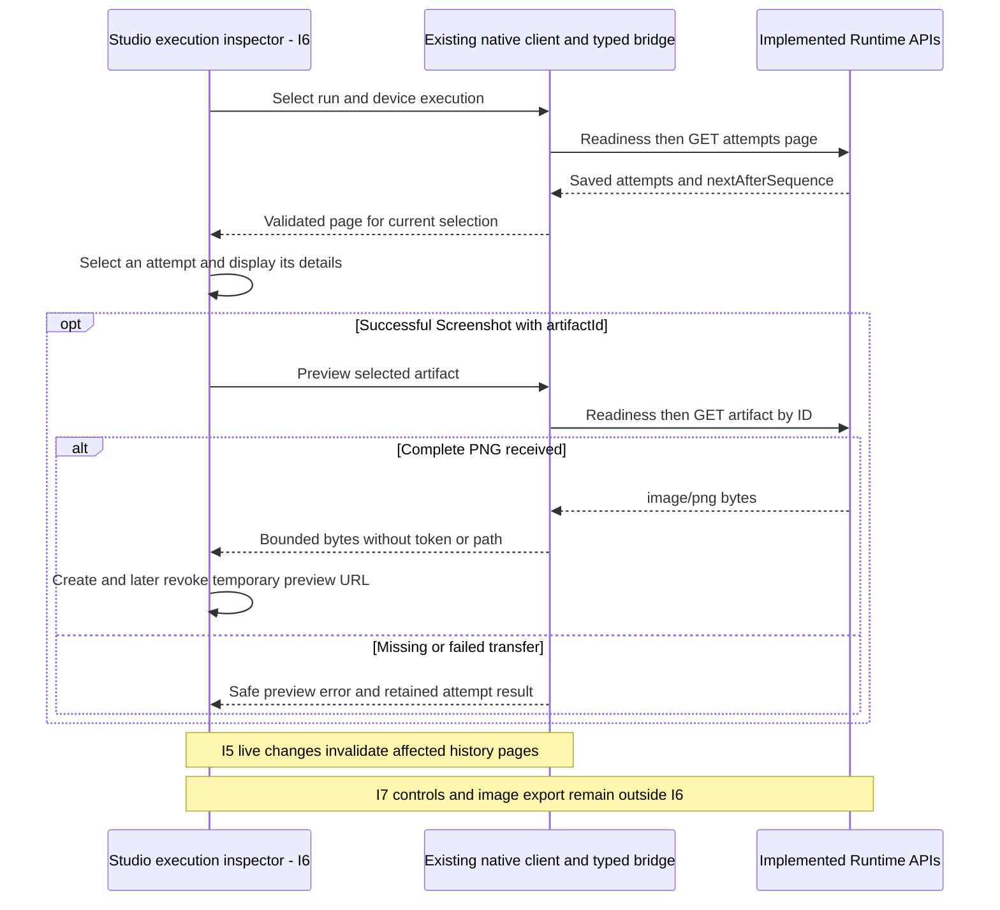

# I6 — Studio execution inspector

## Overview

I6 lets a publisher select a run, device and node attempt to inspect the saved
result: execution order, retry number, timestamps, output, error and any
committed screenshot. It works during a run and after completion, including
when the Android device is no longer connected.

Studio reads a bounded page of attempts for the selected device execution.
Selecting a row shows its saved details. A successful Screenshot output
provides an artifact ID; Studio's native client fetches that PNG and passes
bounded bytes to the renderer for a temporary preview. Reading history or
previewing an image never executes a node or captures the device again.



**Status — specification and Studio handoff only.** I1 history and G20 artifact
retrieval already exist. Studio implementation, focused tests and native UI
acceptance are pending. Studio was inspected read-only at revision
`dd7c604172e7712d3de7dff6db9a1e3d84b1dba0`; this phase does not authorize edits
to that checkout by the Runtime team.

Read with [I1](i1_node_attempt_history_api.md),
[G20](../g_workflow_engine/g20_artifact_api.md),
[A5 saved state](../contracts/execution_state_v1.md),
[A7 local API](../contracts/local_api_v1.md),
[I5](i5_studio_event_reconnect_integration.md) and the
[I6 section of the single Studio handoff](../integration/studio_observability.md#4-i6-attempt-history-and-screenshot-inspection).

## 1. Responsibility and delivery boundary

| Area       | I6 responsibility                                                                 | Reuse or later owner                                             |
| ---------- | --------------------------------------------------------------------------------- | ---------------------------------------------------------------- |
| Selection  | One selected run/device/page/attempt, with separate view and loading states.      | G13 supplies member identity; I5 owns the live observer.         |
| History    | Ordered paging, stable attempt identity, same-sequence refresh and saved details. | Existing I1 endpoint and Studio getNodeAttempts bridge.          |
| Screenshot | Native authenticated binary read and one disposable preview.                      | G20/D5 own stored content and integrity.                         |
| Recovery   | Reload selected history after reconnect/expiry and reject obsolete replies.       | Existing owner readiness and I5 session/observation generations. |
| Acceptance | Deterministic page/preview tests and explicit host evidence.                      | I8 consolidates full Studio acceptance.                          |

No Runtime endpoint, database table, migration, event type, ADB command or
new execution behavior is required. Do not introduce an artifact listing API,
history search endpoint or automatic image gallery. Studio owns this feature;
the Runtime team's deliverable is the spec and integration handoff.

## 2. Identity and view model

Select a member by `deviceExecutionId` from the selected run's snapshot.
Display its ADB serial as a label; do not use the serial, node ID or array
position as the history identity. Preserve the following distinctions:

| Field             | Meaning                                                              |
| ----------------- | -------------------------------------------------------------------- |
| runGroupId        | Which workflow admission is being inspected.                         |
| deviceExecutionId | Which member's execution and history are being read.                 |
| attempt.id        | Stable identity for a displayed attempt and its updates.             |
| sequence          | Ordering within that device execution, also used for paging.         |
| nodeId            | Node in the run's captured graph; repeats across devices and visits. |
| attemptNumber     | Retry number for a node visit, not a unique history key.             |
| artifactId        | Opaque ID returned by a committed Screenshot output.                 |

Keep session, inspector-selection and page-request generations. Increment the
selection generation on run/device/page replacement or disposal. A late page,
image, decode callback or error from another generation cannot modify the
current view. Cancellation is an optimization; generation checks remain
mandatory because a response can complete concurrently with cancellation.

The page state contains its original `afterSequence`, up to 100 saved rows,
continuation, selected attempt ID and read/refresh state. Keep only the current
page and one current preview in the MVP. Offer **First page**, **Next page**,
**Refresh** and row selection; replacing a page releases the previous page's
outputs and preview. Do not continuously traverse the whole execution or keep
every page/output in renderer memory. Back-page caching, latest-first queries
and indexed historical search can be added later.

## 3. History request and exact saved data

```http
GET {apiBaseUrl}/device-executions/{deviceExecutionId}/attempts?afterSequence=0&limit=100
Authorization: Bearer <current native-owned session token>
Accept: application/json
```

Use the existing readiness gate for every request. The base URL already ends
in `/api/v1`; no request body or additional query keys. Canonical lowercase
UUIDv4 identifies the member. `afterSequence` defaults to zero; `limit` is
1 through 100. Use the returned continuation exactly, without incrementing it.

The 200 body contains exactly `attempts` and `nextAfterSequence`. Preserve all
I1 fields: id, deviceExecutionId, sequence, nodeId, attemptNumber, status,
startedAt, finishedAt, output and error. Validate member identity, increasing
sequence, row count, DTO nullability and continuation progress before display.
Reuse existing schemas and strengthen semantic validation where necessary;
do not create a competing history DTO. Sequence values must remain exact;
reject values the client's numeric representation cannot safely preserve.

| Status                           | Detail behavior                                                                         |
| -------------------------------- | --------------------------------------------------------------------------------------- |
| RUNNING                          | finishedAt, output and error are null. Duration is provisional.                         |
| SUCCEEDED                        | Show saved output, including a legitimate empty object. No error.                       |
| FAILED / TIMED_OUT / INTERRUPTED | Show saved safe code/message/retryable error and terminal timing. No successful output. |
| CANCELLED                        | Terminal timing, null output/error. Cancellation is not a fabricated failure message.   |

PAUSED is a member/group state, not an attempt status. Do not invent QUEUED,
PAUSED or RETRYING attempt rows for nodes that never began. Render JSON output
as text/tree data, never executable HTML. A successful Set Variable returns
`{}`; I6 does not expose assigned scalars, resolved inputs or Flow/Global maps.

Display the actual node ID at minimum. Add a friendly label/type only from
the source captured for that run. A current edited Project Draft or overwritten
IR cache is not proof of the historical source. If that source is unavailable
after reopening, use the saved node ID and state that source labels are
unavailable. Inspection must not compile or start the workflow to recover them.

## 4. Paging and active refresh

`nextAfterSequence: null` means no more rows in that read, not that execution
has finished. An empty page for a known member is a normal 200. A new attempt
can be appended after the final-page response.

For a RUNNING row at sequence 5, completion stays at sequence 5. Refresh using
the displayed page's original boundary, such as `afterSequence=0`, and upsert
by attempt ID; asking only for `afterSequence=5` misses its terminal update.
Keep row selection by ID when replacing a refreshed page. No duplicate rows
or collapsed retries are allowed.

Use one history read in flight, one dirty flag and the I5 250 ms minimum
refresh-start interval when live invalidations are available. Relevant I5
attempt/member/terminal events, reconnect repair and explicit Refresh invalidate
the selected page. Unrelated devices and heartbeat comments do not. At the
current tail, an appended-attempt event also invalidates paging availability.
Do not fetch all history pages on every run snapshot update.

I1 has no page event watermark. Track a local selected-device change revision
at request start. If relevant I5 facts change before the page response is
applied, retain the old view as updating and schedule another page read rather
than overwriting newer facts. Keep full saved history DTOs separate from I5's
partial attempt facts. In particular, a replayed RUNNING event must not turn
an already saved terminal attempt back into RUNNING. Refresh establishes the
complete timestamps/output/error instead of synthesizing them from events.

When I5 is not yet integrated, a serialized one-second refresh of the selected
page while its member is nonterminal is an acceptable temporary adapter. Do
not run both recurring polling and I5-triggered refresh. Pause suspends
periodic reads after a final refresh; Resume or explicit Refresh restarts the
applicable path. After terminal observation, complete one final displayed-page
refresh and stop automatic reads. Errors leave the view visibly stale with
Retry available; no unbounded retry loop is required.

After I5 expiry/Runtime replacement, invalidate page reads and rebuild the
selected member against the fresh run snapshot. Never advance the SSE cursor
from history sequence or a history response. The first 100 rows may not include
the current running attempt in a large execution. Mark current-node details
unsynchronized unless a relevant I5 fact or loaded saved row establishes them;
do not claim the first page restores the execution tail. The user can page
forward; automatic tail scans/new APIs are deferred.

## 5. Screenshot discovery and binary request

Offer preview only when a selected successful attempt has the validated
Screenshot output `{"artifactId":"<canonical UUIDv4>"}`. Check against its
captured node/output contract when available; do not treat arbitrary output
strings as paths, URLs or image content. When historical source is unavailable,
the exact canonical artifact-reference shape may be offered as a stored
artifact preview without inventing a node label or type.

```http
GET {apiBaseUrl}/artifacts/{artifactId}
Authorization: Bearer <current native-owned session token>
Accept: image/png
```

No body, query, filename, Range or cache validator is needed. Success is
200 `image/png`, recorded `Content-Length`, `Cache-Control: no-store` and raw
PNG bytes. It is not JSON/Base64 on the HTTP wire. G20 does not expose an
artifact path, checksum, dimensions or filename. A known artifact is readable
after device disconnect and even if a later node failed or the run was stopped.

Use a dedicated native binary operation. Studio's ordinary JSON client has a
2 MiB response cap; valid screenshots can be up to **16 MiB**, so do not raise
every API limit or try to decode the image as JSON. Require a positive length
within 16 MiB, count received bytes, reject overflow/truncation, and validate
the response media type before accepting it. Validate PNG signature/IHDR and
declared dimensions before preview: up to 4,096 per axis and 12,000,000 pixels,
matching D5. An image decode failure is a preview failure, not run failure.

Reuse the current finite request budget initially; no SSE-style infinite
binary read. For a non-200, parse only a bounded safe JSON error. A transfer
that fails after PNG headers produces no appended JSON; discard partial
bytes. A cancelled preview does not request an automatic retry or child
replacement. A later explicit retry repeats only this safe read after readiness.

## 6. Preview bridge, lifetime and security

Reuse Studio's established bounded `Uint8Array` bridge and renderer Blob/object
URL pattern from the Android Inspector. A proposed `getArtifactPreview`
operation returns `{mimeType: 'image/png', bytes: Uint8Array}` through the typed
host bridge. The renderer builds its own Blob URL and revokes it on replacement,
close, run/device/page/attempt switch or unmount. Native bytes and request
resources are also released. Keep one transfer/decoded preview per inspector;
no eager screenshot preload or permanent image cache.

The preview is a stored execution image. Do not call Studio's Android Inspector
capture service or reuse its selector overlay as if a hierarchy accompanied
the image. A cropped Screenshot is already cropped; display its actual pixel
dimensions without inventing original-device coordinates or selector bounds.

Bind IPC requests/cancellation to a trusted sender and the current preview
request ID. Do not accept arbitrary URLs or filesystem paths. Never return
the Runtime token/base URL, native HTTP objects, local artifact path or raw
Axios error to React. Do not place tokens in `` or a query parameter.
Do not save PNGs to Studio's project database, disk cache, gallery or export
folder as part of I6. User-controlled export is separate work.

Preview failures preserve the successful attempt record and output reference.
Missing/invalid content is not repaired by recapture, workflow restart or file
deletion. Logs contain safe operation/error/identity context, never PNG bytes,
raw output bodies, credentials or device content.

## 7. Errors, cancellation and owner lifecycle

| Result                             | Inspector behavior                                                                                                                  |
| ---------------------------------- | ----------------------------------------------------------------------------------------------------------------------------------- |
| Empty 200 history                  | Known member with no rows on this page; distinguish it from loading/failure.                                                        |
| 400                                | Invalid request/contract; surface safe error without automatic repetition.                                                          |
| 401                                | Use existing owner/session readiness policy; no token guessing or adoption of another child.                                        |
| History 404                        | Selected saved member missing; no synthetic empty success or automatic device/run change.                                           |
| Artifact 404                       | Preview unavailable; preserve history/output and allow explicit retry.                                                              |
| 500                                | Show history/preview read error separately from saved execution failure. A healthy Runtime remains running.                         |
| Truncated/invalid PNG              | Release bytes and show transfer/preview error; do not mark it loaded.                                                               |
| Selection change/disposal          | Cancel owned reads and ignore obsolete replies; execution is unaffected.                                                            |
| Explicit Runtime shutdown/app exit | Suppress automatic work before read cancellation, dispose previews and use existing owner shutdown. No observer-triggered relaunch. |

Keep existing displayed rows on same-selection read failure, visibly stale;
clear them when changing to another run/device so private output is never
mislabelled. Preserve the distinction between read readiness and device ADB
readiness: stored history/artifacts do not require an attached emulator.

## 8. Implementation map and reviewable slices

The [single I5–I7 Studio handoff](../integration/studio_observability.md) maps actual
files and proposed additions. Implement in this order:

| Slice            | Main responsibility                                                                  | Completion check                                                                      |
| ---------------- | ------------------------------------------------------------------------------------ | ------------------------------------------------------------------------------------- |
| Page controller  | Selection, one-page read, First/Next/Refresh and stale-response guards.              | More than 100 attempts can be inspected without full-history reloads.                 |
| Saved details    | Exact row/status/output/error display with captured-source identity.                 | Retries and repeated node IDs remain distinct across devices.                         |
| Binary preview   | Native authenticated bounded PNG read and typed cancellable bridge.                  | Correct preview plus missing/truncated/oversized failure behavior.                    |
| Live composition | Relevant I5 invalidation or temporary serialized polling, final refresh and cleanup. | Same-sequence completion, reconnect/expiry and explicit stop work without redispatch. |

Reuse existing types, HTTP manager, channels/preload and Blob cleanup patterns.
No dependency is expected. Do not add a second owner manager, artifact repository
or generic browser HTTP bridge. Screenshot paging/preview can be delivered
before I5 UI exists by using the temporary selected-page polling policy.

## 9. Acceptance criteria

These define future Studio tests and manual evidence, not tests executed while
writing this document. Agree test additions under the Studio team's workflow.

| ID    | Case                                                                             | Required result                                                                                                                                          |
| ----- | -------------------------------------------------------------------------------- | -------------------------------------------------------------------------------------------------------------------------------------------------------- |
| I6-01 | Choose two devices sharing node IDs.                                             | Separate ordered rows and selection by execution/attempt ID; no first-member assumption.                                                                 |
| I6-02 | More than 100 attempts and repeated retries/loop visits.                         | First/Next pages use returned boundaries, preserve distinct IDs and bound retained page data.                                                            |
| I6-03 | RUNNING row finishes at the same sequence.                                       | Refresh original page boundary; upsert terminal timing/output/error without duplication.                                                                 |
| I6-04 | Empty page/null continuation while member still runs.                            | Display correct page state without declaring the run complete.                                                                                           |
| I6-05 | Old read completes after selection/session change or newer relevant event.       | Old generation/revision cannot overwrite the current page; a dirty refresh is not lost.                                                                  |
| I6-06 | SSE replay is older than a saved terminal row.                                   | Saved outcome never regresses to RUNNING; no synthetic history DTO from partial events.                                                                  |
| I6-07 | Success {}, failed/timed-out/cancelled/interrupted attempts and paused member.   | Exact saved nullability and errors; no fabricated output, variable values or attempt states.                                                             |
| I6-08 | Source edited or unavailable after reopening.                                    | Show captured label only when known; otherwise node ID/source-unavailable state.                                                                         |
| I6-09 | Screenshot success followed by later failure/device disconnect.                  | Existing artifact previews without ADB, recapture or a new run.                                                                                          |
| I6-10 | Valid PNG above 2 MiB and full-frame/cropped PNGs.                               | Dedicated binary path supports D5 bounds; actual image/crop shown correctly.                                                                             |
| I6-11 | 400/401/404/500, wrong MIME, length mismatch, oversized or decode-invalid image. | Safe distinct read/preview errors; partial bytes discarded and attempt result unchanged.                                                                 |
| I6-12 | Close/switch preview during transfer or image decode.                            | No stale image, token/path exposure, unrevoked object URL or residual automatic retry.                                                                   |
| I6-13 | I5 unavailable, reconnect/410 repair, terminal run and explicit stop.            | One applicable refresh path, final displayed-page update, unsynchronized tail clearly marked and no relaunch after deliberate stop.                      |
| I6-14 | Host/platform acceptance.                                                        | Record real Linux Studio evidence; Windows managed startup remains blocked by the inspected Studio prerequisite until implemented and natively verified. |

For manual acceptance, inspect a saved run with Delay, a Screenshot and a
later failing node; keep a RUNNING row visible through completion, inspect a
retry, page a history longer than 100 rows, preview the earlier image after
device disconnect, then change selections and close the panel during a read.
Use controlled fixtures for transfer faults and races, not corruption of the
user's stored PNG/database. Record Studio/Runtime revisions, host, scenario,
expected/observed result and remaining limitations.

## 10. Completion and deferred work

The documentation handoff is complete when this spec, the source-mapped guide
and phase references are reviewed. I6 client implementation is complete only
after its page/detail/preview code and focused acceptance are delivered by
the Studio owner. No client implementation completion is claimed here.

I7 owns lifecycle-control UI; I8 owns full business-flow acceptance. Permanent
image galleries/export, thumbnails, bulk image download, latest-first/search
APIs, automatic full-history scans and a variable-store debugger are deferred.
