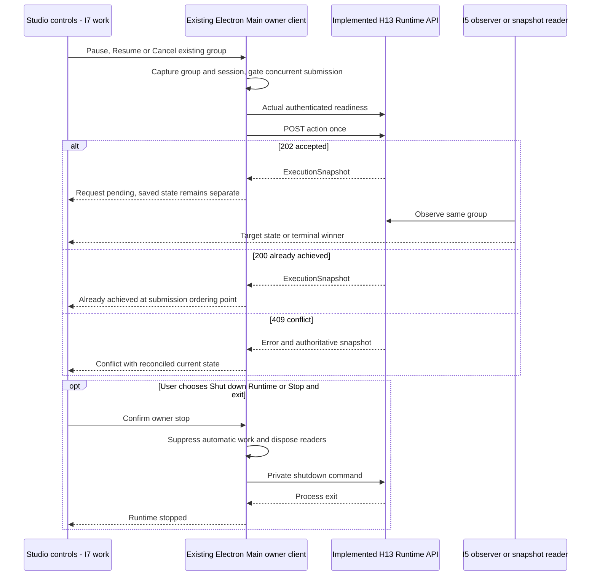

# I7 — Studio lifecycle controls

## Overview

I7 lets the publisher Pause, Resume or Cancel the current RunGroup and manage
the Runtime process from Studio. The controls must distinguish a submitted
request from the state Runtime has actually committed. Pause keeps live
workers and RAM variables; Cancel ends unfinished work while leaving Runtime
available. Shutting down Runtime ends the owned process and suppresses
automatic relaunch.

The smallest flow is: capture the selected group and session, check actual
readiness, submit one action POST, display its disposition, then observe the
same group's committed state through I5 or serialized snapshot reads. App
exit follows the existing private owner shutdown protocol, not the run-action
endpoint. No new Runtime execution behavior is needed.



**Status — specification and Studio integration handoff only.** H13 and the
B3/B5 owner protocol already exist. Studio source at revision
`dd7c604172e7712d3de7dff6db9a1e3d84b1dba0` was inspected read-only. The
Runtime team does not modify Studio code for this delivery. I7 implementation
and native client acceptance remain the Studio developer's responsibility.
I8 is reserved for review and end-to-end acceptance after the user pulls the
implemented Studio code; no I8 execution or completion is claimed here.

Read with [H13](../h_multi_device_execution/h13_lifecycle_action_api.md),
[shared action reference](../integration/run_actions.md),
[A7](../contracts/local_api_v1.md#post-runsrungroupidactions),
[managed ownership](../integration/managed_runtime.md),
[I5](i5_studio_event_reconnect_integration.md),
[I6](i6_studio_execution_inspector.md) and the
[single I5–I7 Studio handoff](../integration/studio_observability.md).

## 1. Scope and existing foundations

| Responsibility       | I7 client work                                                                        | Reuse unchanged                                                 |
| -------------------- | ------------------------------------------------------------------------------------- | --------------------------------------------------------------- |
| Run controls         | Typed action bridge and Pause/Resume/Cancel buttons for the complete group.           | H13 action route and H9–H12 lifecycle.                          |
| Action feedback      | Submitting, accepted/pending, visible target, conflict, uncertainty and safe failure. | Existing saved group/device statuses; no new server state enum. |
| State reconciliation | Consume response snapshots and later I5/read updates without regression.              | G13 snapshots, I5 cursor/generation policy and I6 inspector.    |
| Process controls     | Explicit shutdown suppression, reader cleanup and owner exit confirmation.            | Existing manager, private pipes and child shutdown deadlines.   |
| Handoff              | Source-specific implementation slices and acceptance cases for Studio owner.          | Existing shared API examples and Linux Runtime verification.    |

No new server endpoint, actionId, requestId, pending-status API, per-device
control, migration, RAM persistence or restart/resume feature is introduced.
Launcher protected-package admission remains Phase J. Do not build a general
command queue or change the existing run-start orchestration in this phase.

## 2. Control semantics the UI must explain

| Control           | Meaning                                                                                 | Visible limit                                                                  |
| ----------------- | --------------------------------------------------------------------------------------- | ------------------------------------------------------------------------------ |
| Pause             | Fence new attempts; permitted actions and retry delays finish before live workers park. | Active Delay is not frozen. The response does not wait for the pause boundary. |
| Resume            | Release the same live paused workers with their inputs, outputs and RAM scopes intact.  | A restarted Runtime cannot resume an old run from SQLite.                      |
| Cancel run        | Interrupt/settle unfinished members, preserve committed results and retire the group.   | Already dispatched Android actions cannot be undone; Runtime stays alive.      |
| Shut down Runtime | Stop the owned server and its unfinished work through the private owner command.        | Suppress automatic launch until a new explicit permitted action.               |
| Stop and exit     | Perform managed shutdown, then close Studio.                                            | Staying open must leave both app and Runtime usable.                           |

Actions always target `runGroupId` returned by the original admission, never
the request ID, device ID or newly generated UUID. Switching the inspected
device does not narrow the action: every admitted member is controlled.
Use clear **Cancel run** and **Shut down Runtime** labels rather than one
ambiguous Stop button.

## 3. Exact HTTP contract and typed client boundary

```http
POST {apiBaseUrl}/runs/{runGroupId}/actions
Authorization: Bearer <current native-owned token>
Content-Type: application/json
Accept: application/json

{"action":"PAUSE"}
```

The only other bodies are `{"action":"RESUME"}` and
`{"action":"CANCEL"}`. No query, force flag, device selection or action
request ID. The strict UTF-8 body limit is 1,024 bytes; unknown/duplicate keys,
lowercase/padded actions, arrays, null and trailing JSON are rejected.
`apiBaseUrl` already includes `/api/v1`; use the private ready-pipe address,
which need not be port 6810 in Studio's managed session.

| HTTP result   | Exact body                     | Meaning                                                   |
| ------------- | ------------------------------ | --------------------------------------------------------- |
| 202           | ExecutionSnapshot at the root. | Accepted or same action still pending.                    |
| 200           | ExecutionSnapshot at the root. | Already-target disposition; no additional action created. |
| 409           | Exactly error and snapshot.    | INVALID_EXECUTION_STATE with a current snapshot.          |
| Other failure | Standard error-only envelope.  | No assumed snapshot or successful action disposition.     |

Preserve HTTP status independently of snapshot status. A 202 can already show
the target or a terminal race winner. A 200 or 409 snapshot may also reflect
a later concurrent transition; submission and snapshot read are separate
ordering points. Use the [complete shared examples](../integration/run_actions.md#3-complete-response-examples)
rather than inventing another wire DTO.

Add an action-specific success DTO retaining an ACCEPTED versus ALREADY_TARGET
disposition and the snapshot. These are local client labels, not wire fields.
Preserve a validated 409 snapshot in the typed failure path with HTTP status,
safe Runtime code/message and retryable flag. Studio's existing
`runtimeAdmissionErrorSchema` rejects an error-plus-snapshot object, and its
RuntimeError/HostError do not currently carry that snapshot. Do not send this
response through the generic admission decoder unchanged or drop its state.

## 4. Submit once and reconcile uncertain outcomes

Main owns one in-flight action POST for the active group. Capture group ID,
action, session generation and a local submission generation before readiness.
The local generation is never serialized as a new Runtime field. Double-clicks
share/reject that in-flight submission without another POST.

Split readiness from mutation replay. The current `withReadyRuntime` wrapper
can catch timeout/unavailable/session errors from the whole operation callback,
replace Runtime and invoke the operation again. I7 must use a manager seam
that allows shared readiness/replacement **before sending**, but never
automatically resends an action whose transport started. Do not bypass actual
readiness, create another process manager or disable read recovery globally.

After POST dispatch, a timeout, malformed response, lost IPC reply, disconnect
or 500 can leave the outcome unknown. In particular, an action may be accepted
before its response snapshot read fails. Preserve intent and show
**Action outcome unknown**; do not claim rejection or automatically send an
opposing action. Read the same group after readiness to reconcile. A fresh
session means snapshot bootstrap, not replay of a command against old workers.

An explicit **Retry same action** is allowed only after reconciliation, for
the same group and a still-eligible current session. It remains subject to
Runtime's pending/achieved/conflict rules. **Cancel run** can explicitly
supersede a pending Pause/Resume. Do not queue automatic opposing transitions.
No HTTP action cancellation rolls back an accepted lifecycle operation.

Closing/switching a view detaches UI listeners but must not erase Main's
pending/uncertain intent or run-exit guard. Retain that intent for the original
group until reconciled, superseded explicitly, or invalidated by owner stop/
replacement. A late response cannot clear a newer Cancel or mutate a newly
selected run. Bound this to the current run controller, not a durable queue.

## 5. Local pending state and button eligibility

Keep saved execution status, local action intent and connection/read health
separate. No synthetic PAUSING/CANCELLING value is written into a run snapshot.

### Main-owned control state returned to the renderer

Use this local DTO in the I5 observation envelope and its initialView response.
It describes native client intent, not fields provided by the Runtime API:

```typescript
type RunControlState = {
  runGroupId: string;
  sessionGeneration: number;
  submissionVersion: number;
  action: "PAUSE" | "RESUME" | "CANCEL" | null;
  phase: "IDLE" | "SUBMITTING" | "PENDING" | "UNCERTAIN" | "RESOLVED";
  resolution:
    | "TARGET_OBSERVED"
    | "ALREADY_TARGET"
    | "TERMINAL_WINNER"
    | "CONFLICT"
    | "REJECTED"
    | "SESSION_ENDED"
    | null;
  lastError: {
    code: string;
    message: string;
    retryable: boolean;
    httpStatus?: number;
    runtimeCode?: string;
  } | null;
};
```

Native state is retained for the current owned/control group, independently of
renderer/observer lifetime. IDLE has null action/resolution/error and version
zero. Increment the local positive safe-integer submissionVersion for each
new admitted local user intent, including an explicit superseding Cancel or
retry. Main enforces eligibility before admission; double-click sharing and
locally rejected opposing controls do not replace the retained intent or
create another version. Only a callback matching the current group, child
generation and submissionVersion may change it.

sessionGeneration identifies the intent's original child. A retained RESOLVED/
SESSION_ENDED record may refer to an older child for display only; SUBMITTING,
PENDING and UNCERTAIN must never carry into a new session as actionable work.
With no retained intent, initial IDLE uses the current session generation.

| Native transition                                             | Control state                                                   |
| ------------------------------------------------------------- | --------------------------------------------------------------- |
| Submission begins                                             | SUBMITTING, resolution null.                                    |
| HTTP 202                                                      | PENDING, resolution null.                                       |
| Outcome cannot be established after dispatch                  | UNCERTAIN with allowlisted safe error if available.             |
| Follow-up target/terminal observation                         | RESOLVED with TARGET_OBSERVED or TERMINAL_WINNER.               |
| HTTP 200 / 409 / known rejection without ambiguity            | RESOLVED with ALREADY_TARGET / CONFLICT / REJECTED.             |
| Owning session ends or explicit owner stop invalidates intent | RESOLVED with SESSION_ENDED; never replay it in the next child. |

Resolution is non-null only in RESOLVED; it does not claim cancellation cleanup
retirement. Saved run/member state remains authoritative. Preserve the 200/202
ordering distinction from section 3 when settling targets, rather than using
an old response's snapshot to resolve a newer intent.

On observeRun/reopen, capture this selected run's current controlState with the
initial view after snapshot reconciliation. A historical group with no retained
intent gets IDLE for that requested group; never copy another group's pending
action. Disable controls until the initial view is applied/acknowledged under
I5's handshake. If Pause remains pending, reopening must immediately display
Pause requested and keep Resume disabled, even if SQLite still says RUNNING.

Publish subsequent native controlState transitions through the same bounded
I5 view channel, even when no SSE event arrives or the stream is reconnecting.
They increment publication version without fabricating/advancing an SSE cursor.
No second control-state subscription or new Runtime endpoint is required.
The submitRunAction result is not the only delivery path: if its IPC reply is
lost, a live publication or later initialView still restores the native intent.
View disposal never resets it to IDLE. A stale response/ACK cannot settle it.

| Current client condition                 | Pause                           | Resume                          | Cancel run                                             |
| ---------------------------------------- | ------------------------------- | ------------------------------- | ------------------------------------------------------ |
| Current RUNNING group, no pending action | Enabled                         | Disabled                        | Enabled                                                |
| Current PAUSED group, no pending action  | Disabled                        | Enabled                         | Enabled                                                |
| Action POST in flight                    | Disabled                        | Disabled                        | Disabled until submission settles                      |
| Pause accepted/pending                   | Disabled                        | Disabled                        | Enabled to supersede                                   |
| Resume accepted/pending                  | Disabled                        | Disabled                        | Enabled to supersede                                   |
| Cancel accepted/pending                  | Disabled                        | Disabled                        | Disabled; observe result                               |
| Uncertain outcome or stale session/state | Disabled pending reconciliation | Disabled pending reconciliation | Explicit supersession only after refreshed eligibility |
| Terminal group / no known group          | Disabled                        | Disabled                        | Disabled                                               |

Shut down Runtime remains an explicit owner action even while a run control
is pending. Check-state/read retry remains available independently of run
mutation. Repeating achieved controls through the API is valid, but duplicate
buttons are not required for MVP.

For 202 show **Pause requested**, **Resume requested** or **Cancel requested**,
then confirm through subsequent committed observation. If the response snapshot
already contains a target, display that saved state immediately but retain the
202 submission distinction while obtaining follow-up state. Reconcile a response
snapshot through I5's watermarked rules; it never advances the processed SSE
cursor. An older action response must not overwrite newer events/snapshots.

- Pause is visibly achieved at PAUSED; a terminal winner ends that intent
  without claiming the workflow paused.
- Resume is visibly achieved at RUNNING, which may include QUEUED members.
  A fast terminal winner is also possible; never replace it with RUNNING.
- Cancel normally produces CANCELLED, but natural completion/failure may win.
  Preserve the actual terminal result and already terminal siblings.

Use I5 observation and coalesced by-ID refresh. Without I5, use a serialized
500 ms by-ID check while this local action needs confirmation, not a second
permanent poller. Stop on achieved/terminal outcome, safe visible read failure,
view disposal or owner stop; keep the Main intent for later reconciliation.
An observation timeout is not proof the action failed: show delayed/unknown
state and let the user check again or explicitly stop Runtime.

## 6. Conflicts, cancellation cleanup and run ownership

Runtime remains the authority even if the UI's last saved status looks eligible:

| Actual lifecycle situation                       | Result to handle                                  |
| ------------------------------------------------ | ------------------------------------------------- |
| Same pending Pause/Resume/Cancel repeated        | 202; do not create another client operation.      |
| Opposing Pause/Resume while one is pending       | 409, even if SQLite's status appears to allow it. |
| Cancel during pending Pause/Resume               | 202; Cancel supersedes the earlier intent.        |
| Pause/Resume after Cancel accepted               | 409.                                              |
| CANCELLED saved but joined cleanup still running | Repeated Cancel can still be 202.                 |
| Retired CANCELLED group                          | Repeated Cancel is 200.                           |
| SUCCEEDED, FAILED or INTERRUPTED group           | Controls return 409.                              |

A CANCELLED snapshot proves saved cancellation, not independent completion of
every in-process cleanup task. Show **Run cancelled** once observed, but do not
announce **Cleanup complete** or clear native ownership based solely on that
snapshot. No cleanup-status endpoint is added. If a new run is requested, the
existing Runtime admission/handoff joins residual cleanup; do not force an
extra client Cancel loop or shutdown first. An explicit duplicate Cancel can
check its normal disposition when needed.

### Matching ownership updates instead of inspection side effects

Keep Main's owned-run identity/guard separate from the selected view. In the
inspected coordinator, runById unconditionally calls acceptReadSnapshot and
any terminal result clears activeSnapshot. Change that behavior as part of
integration; a general inspection read must not acquire, replace or release
another group's ownership.

Use these ownership rules for every read/event/action response:

| Input                                                                               | Ownership/guard effect                                                                                                                                                                   |
| ----------------------------------------------------------------------------------- | ---------------------------------------------------------------------------------------------------------------------------------------------------------------------------------------- |
| Validated new admission or pending-admission recovery matched by original requestId | Establish that group under the current session and increment ownership generation.                                                                                                       |
| Explicit GET runs/active discovery during startup/recovery                          | May establish the discovered group only if the captured session/ownership generation is still current. A late discovery cannot replace a newer admission.                                |
| Snapshot/read/event/action response for the owned group                             | Update its guard only for matching group/session/ownership generation and a non-older owned-state cursor. Keep this watermark separate from the selected view cursor.                    |
| Inspection of another group, including terminal result or 404                       | Update that view only; never clear/change owned-run, pending-admission or control state.                                                                                                 |
| Late reply for a prior owner/session after a new admission                          | Ignore for current ownership, even if it is terminal or has a larger store cursor.                                                                                                       |
| Current owned group becomes terminal                                                | Update its saved outcome; the execution exit guard may settle once no submission/uncertain intent remains. This never clears Runtime process ownership or proves joined cleanup retired. |
| Owned-run read fails or is unexpectedly missing                                     | Preserve ownership conservatively and expose a reconciliation error; do not treat it as a successful historical empty result.                                                            |

An ID equality check alone is not sufficient across child replacement; use the
captured generation as well. An active-discovery 404 must not clear unresolved
admission/control or a newer owned run. Only a current explicit reconciliation
with no such work may conclude there is no active execution.

While the global stream is open, route owned-group facts to this native guard
before filtering the selected view. If the view/stream was disposed, perform a
fresh matching owned-group read when evaluating the next-run/exit decision.
If reconciliation fails, keep the unresolved guard and offer the existing
explicit stop decision; do not silently skip confirmation. This requires no
background daemon. In-flight, PENDING and UNCERTAIN controls count as unresolved
for exit even when the last saved snapshot looks terminal.

Example: A is running and the user inspects completed B. B can display SUCCEEDED
without clearing A, so closing Studio still offers Stay open / Stop and exit.
After validated admission of C, a delayed terminal A reply cannot clear C.
Reopening A while its Pause is pending returns A's retained controlState and
never derives Resume eligibility from snapshot status alone.

## 7. Intentional shutdown and app close

Use one native stop path for the existing shutdown IPC and app exit:

1. Obtain the user's explicit shutdown/exit decision. For unresolved work,
   offer Stay open or Stop and exit before irreversibly closing its window.
   Stay open preserves the current window, Runtime and run; it must not merely
   cancel quit after the last window has already been destroyed.
2. Set automatic-work suppression in Main synchronously. Invalidate operation
   generations and gate observer reconnect, inspector refresh/preview and
   automatic workflow validation before cancellation callbacks can run.
3. Dispose I5 readers/timers and I6 page/preview resources. Prevent new control
   dispatch; do not interpret any pending POST's cancellation as a rollback.
4. Use the existing private `shutdown\n` command and manager's bounded child
   exit/termination path. Do not substitute POST CANCEL for server shutdown.
5. Clear only that child's credentials/ownership. Report Stopped after exit
   confirmation; a timeout/failure is visible and must not relaunch it.
6. For Stop and exit, complete the normal app cleanup and exit. For Shut down
   Runtime, leave Studio open with automatic work suspended.

The current manager has STOPPING/STOPPED status but no persistent automatic
suppression flag; `ensureReady()` can start a child on a later request.
Renderer validation suspension on STOPPING alone is insufficient after remount
or a queued native operation. Centralize the stop-intent gate in the existing
owner client and allow only a new explicit permitted Runtime operation to clear
it after the old child exits. Do not use generic READY/STOPPED events as user
consent or let stale callbacks affect a replacement child.

Route window close, system Quit and before-quit through the same guarded
decision/stop flow, without duplicate prompts or recursive shutdown. The
inspected bootstrap already has an unresolved-run before-quit prompt; the
Studio developer must verify it also preserves the window on close-button
Stay open. Do not add tray/background behavior. An unexpected owner loss still
uses the Runtime's existing cleanup/recovery policy.

## 8. Failures, privacy and source-specific implementation

| Failure                         | Required behavior                                                                                                                       |
| ------------------------------- | --------------------------------------------------------------------------------------------------------------------------------------- |
| 400 / 413                       | Safe contract/payload error; no mutation retry loop.                                                                                    |
| 401                             | Resolve actual current session; a possibly dispatched old action remains uncertain.                                                     |
| 404                             | Target unavailable; no new run ID, automatic admission or empty success.                                                                |
| 409                             | Preserve error plus validated snapshot, reconcile and report conflict.                                                                  |
| 500 / response decoding failure | Possibly accepted action; reconcile by-ID, do not announce rejection.                                                                   |
| 503 stopping                    | Show stopping/unavailable and respect suppression; do not relaunch during deliberate stop.                                              |
| Child replacement               | Fresh readiness/bootstrap; unfinished old run becomes INTERRUPTED under existing recovery. Never reconstruct RAM or resume old workers. |

Use the [consolidated source map](../integration/studio_observability.md#1-shared-source-map-and-current-gaps).
Implement as three reviewable slices: action DTO/HTTP/typed bridge; Main
intent/reconciliation plus buttons; centralized owner-stop/close wiring.
Reuse existing Zod, RuntimeError/HostResult, process manager, channels, preload,
run coordinator and Test Run components. No dependency is expected.

Record safe operation/action/group/error/status context using Studio's logger;
failed HTTP/control operations use ERROR. Keep credentials, raw response bodies,
workflow data, device content and exception internals out of logs/renderer.
No generic command/HTTP IPC bridge, control token or public shutdown endpoint.

## 9. Focused acceptance criteria

These are implementation requirements for the Studio developer, not executed
tests. Test additions follow that checkout's agreed workflow. Use controlled
lifecycle/transport fixtures for races rather than relying on fast manual clicks.

| ID    | Scenario                                                                                                                | Required result                                                                                                                                            |
| ----- | ----------------------------------------------------------------------------------------------------------------------- | ---------------------------------------------------------------------------------------------------------------------------------------------------------- |
| I7-01 | Valid/invalid action bridge input and auth.                                                                             | Exact group/action validation, current native credentials, no generic URL/body escape.                                                                     |
| I7-02 | 200, 202 and 409 including target-looking 202 snapshot.                                                                 | Preserve HTTP disposition and conflict snapshot; saved status remains separate.                                                                            |
| I7-03 | Pause during active Delay then Resume.                                                                                  | Delay completes, no next attempt starts while paused, same group/inputs/RAM continue after Resume.                                                         |
| I7-04 | Repeated/rapid/opposing actions.                                                                                        | One POST in flight, no opposing auto-queue; authoritative 409 handled without a retry loop.                                                                |
| I7-05 | Cancel pending Pause/Resume and active/paused run.                                                                      | Explicit Cancel supersedes; committed results survive and Runtime stays available.                                                                         |
| I7-06 | Saved CANCELLED before cleanup retirement; fresh next run.                                                              | No false cleanup-complete claim or duplicate Cancel loop; normal admission joins cleanup.                                                                  |
| I7-07 | Natural terminal winner or stale response after newer action/event.                                                     | Exact result preserved; no status regression or old intent clearing newer state.                                                                           |
| I7-08 | Lost POST response, timeout, failed snapshot read or IPC delivery.                                                      | Outcome unknown and by-ID reconciliation; no automatic mutation replay/child replacement based only on operation error.                                    |
| I7-09 | Switch/close view with pending control.                                                                                 | UI callbacks are isolated; Main retains original group intent and exit guard.                                                                              |
| I7-10 | Actual child loss/replacement while paused or uncertain.                                                                | New session reads saved interrupted/terminal result; no old-run Resume or RAM reconstruction.                                                              |
| I7-11 | Explicit shutdown while I5/I6/control/validation work is active.                                                        | Native suppression first, bounded resource cleanup, child exit and no automatic relaunch.                                                                  |
| I7-12 | Window close, system Quit, repeated exit and Stay open.                                                                 | One prompt/stop path; Stay open preserves window and Runtime; Stop and exit waits for bounded shutdown.                                                    |
| I7-13 | Safe errors, multi-device scope and native hosts.                                                                       | Full-group control and no secret leakage; record real Linux evidence and pending Windows prerequisite/acceptance separately.                               |
| I7-14 | Pending Pause/Cancel or uncertain action survives panel disposal, remount or lost submission IPC reply.                 | InitialView restores the matching Main controlState before buttons enable; subsequent native transitions publish without requiring an SSE event.           |
| I7-15 | Delayed prior submission reply, duplicate/future publication ACK, or replacement session.                               | Current submission version cannot be resolved by an older response or UI ACK; replacement invalidates prior intent without mutation replay.                |
| I7-16 | Run A active while completed/missing B is inspected; terminal A reply after newer C admission or active-discovery race. | Matching owner/session/ownership generation preserves active-run exit/admission guards; unrelated reads and stale discovery never acquire/clear ownership. |

The [single Studio handoff](../integration/studio_observability.md#5-i7-run-controls-and-owner-lifecycle)
provides requests, proposed source changes and a manual scenario. The user will
pull the implementation before requesting the separate I8 code review and
end-to-end acceptance. Do not mark I8 ready/passed from these future test cases.

## 10. Completion and deferred work

This delivery completes the I7 documentation handoff only. Client completion
requires the action bridge/controller/UI, centralized stop behavior and focused
evidence above. Native Windows managed startup is explicitly unsupported by
the inspected Studio checkout until its process/pipe work is implemented and
verified. Per-device controls, restart/resume, action history, cloud/remote
controls and tray/background operation remain outside the MVP.
