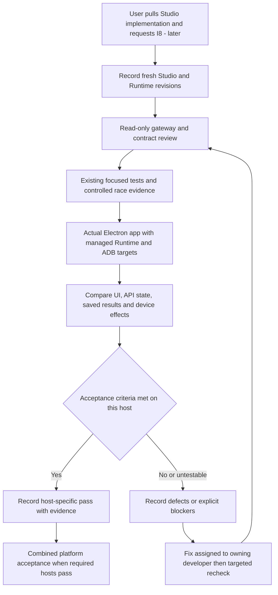

# I8 — Studio gateway review and end-to-end acceptance

## Overview

I8 verifies the implemented Studio-to-Runtime integration after the user pulls
the Studio developer's changes. It reviews the native gateway against I5–I7,
then checks the full publisher flow: edit/compile, start, observe, inspect,
control, reconnect and exit. Its deliverable is an evidence-based acceptance
report and actionable defects, not another execution feature or Runtime API.

Here **gateway** means React's typed `window.studioHost.runtime` bridge,
preload/IPC, Electron Main services/process ownership and the local Runtime
HTTP connection. Testing only an HTTP endpoint or the small system-information
HostGateway does not verify this complete boundary.

**Status — spec prepared; gateway review and acceptance NOT RUN.** This
documentation task does not pull source, implement tests, build Studio, launch
Runtime, dispatch Android actions or execute I8. The user will return to this
phase after obtaining the implementation. No I5–I7 client or Phase I completion
is implied by writing acceptance criteria.

Read with the single [I5–I7 Studio handoff](../integration/studio_observability.md),
[I5](i5_studio_event_reconnect_integration.md),
[I6](i6_studio_execution_inspector.md),
[I7](i7_studio_lifecycle_controls.md),
[Studio authoring/run APIs](../integration/studio.md),
[managed ownership](../integration/managed_runtime.md),
[A6](../contracts/event_error_v1.md) and [A7](../contracts/local_api_v1.md).

## 1. Scope, ownership and entry conditions

| Area          | I8 verifies                                                                                                            | Boundary                                                                    |
| ------------- | ---------------------------------------------------------------------------------------------------------------------- | --------------------------------------------------------------------------- |
| Gateway       | Typed request/event data, trusted sender, credentials, cancellation and generations across renderer/preload/Main/HTTP. | Studio owns its implementation. Runtime team reviews read-only.             |
| Business flow | Source snapshot through admission, live state, saved inspection and group controls.                                    | Runtime remains authoritative for execution and persistence.                |
| Reliability   | Lost replies, reconnect, expiry, stale callbacks, pending controls and owner exit.                                     | Controlled faults supplement actual-app acceptance; they do not replace it. |
| Evidence      | Reproducible results, per-host disposition and defects assigned to their platform.                                     | No implementation/host pass inferred from plans or compilation alone.       |

Before beginning the later I8 run:

1. The user has pulled the intended Studio changes and requested gateway
   review/acceptance. Record both repositories' actual revisions, dirty paths
   and the Runtime binary/build version. Do not pull/reset/stash or overwrite
   unrelated work as an acceptance prerequisite.
2. Studio claims I5–I7 implementation against the current handoff, including
   initialView/ACK, independent run ownership and restored controlState.
   Missing features are recorded as gaps, not silently substituted with mocks.
3. Resolve the trusted Runtime executable, ADB executable and execution-store
   configuration. Stop competing owners intentionally before a managed test;
   do not terminate unrelated processes or adopt their credentials.
4. Have one working ADB endpoint for basic device effects, and two independent
   endpoints for multi-device acceptance. One Waydroid instance does not prove
   independent two-device behavior. Record any unavailable environment gate.
5. Use test-owned workflows, accounts, device state and writable storage.
   Prefer an isolated Runtime store/configuration supported by the actual
   build, or a disposable test profile. Do not delete user SQLite, screenshots
   or historical runs to obtain a clean result.

The earlier handoff inspected Studio revision
`dd7c604172e7712d3de7dff6db9a1e3d84b1dba0`. It is a navigation baseline only;
do not review that old revision as if it were the later pulled implementation.
Native Windows managed startup was explicitly rejected in that baseline.
Refresh that fact at I8 time rather than assuming it remains fixed or broken.

## 2. Verification layers and required proof

| Layer                      | Evidence                                                                                | What it cannot establish alone                                                    |
| -------------------------- | --------------------------------------------------------------------------------------- | --------------------------------------------------------------------------------- |
| Static gateway review      | Trace real symbols/files from React through preload, IPC, Main services and local HTTP. | That the desktop build loads the correct preload or manages real child resources. |
| Focused automated checks   | Existing parser/DTO/controller/transport tests, controlled clocks and lifecycle faults. | That a real Android app visibly reacted or packaged Studio works on another OS.   |
| Actual desktop integration | Native Electron renderer and preload communicating with Main and its managed Runtime.   | Correct independent-device behavior if all device replies are mocked.             |
| Actual ADB/device flow     | Known device action and saved Screenshot/history agree with intended workflow/input.    | Exhaustive race correctness; use controlled tests for exact interleavings.        |
| Native host acceptance     | Actual child launch, private handoff, stream and shutdown on that host.                 | A pass on other hosts from cross-build output.                                    |

Reuse the 19 I5, 14 I6 and 16 I7 focused cases. Map the existing 49 criteria to
evidence; do not create 49 new slow E2E tests or duplicate the Runtime suites.
A focused test may satisfy several requirements if its assertions demonstrate
each one. Capture known missing coverage before deciding whether additional
tests are necessary; agree additions under the repository/team instructions.

## 3. Gateway code-review checklist

Inspect the paths in the [source map](../integration/studio_observability.md#1-shared-source-map-and-current-gaps)
and their actual replacements in the pulled checkout. Trace complete causal
paths rather than reviewing only renderer buttons or type declarations.

| Boundary                      | Required review                                                                                                                                                      |
| ----------------------------- | -------------------------------------------------------------------------------------------------------------------------------------------------------------------- |
| React → preload               | All required methods exist in the runtime build, not just TS interfaces; listeners are installed/removed safely across mount/unmount.                                |
| Preload → Main                | Narrow allowed channels, trusted-sender checks, ID/action validation and sender-bound cancellation/publication. No raw ipcRenderer or arbitrary HTTP/command bridge. |
| Main → Runtime                | Current private URL/token and actual readiness before operations; no fixed managed port, proxy/redirect leak or adopted standalone session.                          |
| SSE → view                    | Initial view returned in invoke result; correct version/ACK startup, bounded publication, cursor advancement and stale-response protection.                          |
| History/PNG → view            | Same-sequence refresh, complete saved DTOs, separate bounded binary read and disposable Blob URLs. No current-device recapture.                                      |
| Action → lifecycle            | HTTP disposition/conflict snapshot retained, one POST in flight, uncertain result reconciliation and no automatic mutation replay.                                   |
| View → owner guard            | Selecting an old run never owns/clears the current group. Matching child/group/ownership generation and watermark control updates.                                   |
| Native intent → reopened view | Main retains pending/uncertain control state and returns it before controls enable, independent of SSE progress or a lost action reply.                              |
| UI stop → process lifetime    | Native suppression precedes reader cancellation/session clearing; close/quit stays guarded and child exit is confirmed.                                              |

Treat authentication exposure, uncontrolled redispatch, wrong-group mutation,
lost owner guards, data loss and a Runtime that relaunches after explicit stop
as acceptance failures. Cosmetic layout/preferences are not equal-severity
blockers for this MVP. Do not change Studio code during review: report defects
to its developer. Runtime defects receive a separate focused authorized fix.

## 4. Reproducible business scenarios

Prepare valid source fixtures using the installed node catalog/Runtime
compiler, not hand-written assumed IR. Keep test graph/schema/inputs and the
exact compiled source provenance with the evidence. Reuse the
[H4 example](../../../../a2matex-runtime/examples/h4/compile-workflow.json),
[G22 binding example](../../../../a2matex-runtime/examples/g22/compile-workflow.json)
and existing I1/I4 manual references where appropriate; adapt only test data.

### Scenario A — successful managed Test Run and pause/resume

Use a small supported graph such as Start → Delay → Tap → Screenshot → End.
Choose a benign visible target in the test Android app and a long enough Delay
to request Pause before the next attempt. Screenshot uses its own FULL_SCREEN
or approved crop mode; Tap uses its selected valid targeting mode.

1. Start Studio through its normal desktop entry point. Trigger validation/
   compilation with the current graph/schema, inspect diagnostics and start
   through the normal Test Run flow with valid device-specific inputs.
2. Keep the exact requestId, runGroupId, deviceExecutionIds and source revision.
   Confirm the admitted IR corresponds to that captured source. A later editor
   change must not relabel the already running graph.
3. Observe initial snapshot/cursor, stream startup and running Delay. Pause:
   display requested state, let Delay finish, then confirm PAUSED before Tap.
   At this boundary the Tap must not have been dispatched.
4. Resume the same live group. Confirm the target changes once, Screenshot
   completes and the group ends with the committed per-device outcomes.
   A separate existing binding fixture verifies RAM values survive live pause;
   do not introduce a variable-debug API or expect Set Variable scalar output.
5. Inspect saved attempts and preview the committed Screenshot through the
   native bridge. Compare the picture with the known expected device effect.
   SUCCEEDED alone is not proof that coordinates hit the intended item.

Use two independent devices for the isolation variant, with distinguishable
input/target values and the same graph node IDs. If Studio's start picker is
still intentionally single-device, a valid Runtime API-created multi-device
run may test observation/control; report that exact scope. Do not claim a
multi-device Studio admission UI was verified by that substitute.

### Scenario B — retained history, cancellation and another run

Use a distinct admitted run with Screenshot before a long Delay/later action.
Cancel while active or paused. Confirm committed Screenshot/earlier attempts
survive, unfinished work settles and Runtime remains ready. Preview the stored
PNG after disconnecting the test device; no capture/ADB command should occur.
Refresh/reconnect the device before a fresh intentional run. Its new requestId
and group must start normally, with Runtime joining any residual cancellation
cleanup. Do not report joined cleanup complete from a CANCELLED snapshot alone.

Use a valid longer fixture for more than 100 attempts and one retry. Verify
First/Next/Refresh without full-history accumulation; retries/loop visits have
distinct attempt IDs. A terminal update retains the same sequence. Separate
execution errors from history/preview transport failures.

### Scenario C — gateway faults and owner lifecycle

Use controlled streams/transports/clocks for initial reply loss, future/old
ACK, delayed snapshot, retention 410 and lost action replies. Run the tests
through the actual relevant bridge/controller seam, not only a disconnected
copy of its reducer logic. No production prune/fault endpoint is required.

Then verify actual app behavior: close/reopen a panel during pending Pause,
interrupt only observation while execution continues, inspect completed run B
while A is active, and exercise deliberate Runtime shutdown and the window
close/quit decision. Unexpected Runtime termination is a separate case from
observer disconnect; only actual readiness/owner loss permits replacement.
No case may resume a previous run after a Runtime restart.

## 5. Consolidated acceptance criteria

**Every criterion below is NOT RUN at spec creation.** Record one result per
host/evidence variant at verification time; mock and actual-device results
must not be conflated. See section 7 for status rules.

| ID    | Scenario                                      | Acceptance and evidence required                                                                                                                                                                                                   |
| ----- | --------------------------------------------- | ---------------------------------------------------------------------------------------------------------------------------------------------------------------------------------------------------------------------------------- |
| I8-01 | Fresh source/build baseline                   | Record actual revisions/dirty paths, supported APIs/methods, executable version and host. Review the pulled implementation, not the old handoff baseline.                                                                          |
| I8-02 | Actual desktop gateway and managed startup    | Real Electron preload/IPC/Main path starts one owned Runtime, uses private credentials/dynamic address and passes actual authenticated readiness before operations. Browser-only preview cannot satisfy it.                        |
| I8-03 | Source capture, validation and compile/admit  | Display invalid diagnostics; valid input compiles and submits the intended captured graph/schema/inputs. Cached stale IR cannot substitute for edited source.                                                                      |
| I8-04 | Start response loss/idempotency               | Original requestId and exact body resolve uncertain admission without a second group or Android dispatch. Replayed completed result is not a new run.                                                                              |
| I8-05 | Initial view/ACK handshake                    | Idle completed run renders from initialView once. Updates before ACK coalesce; wrong/future/old ACK cannot release the current message. Lost startup reply times out/disposes observation only.                                    |
| I8-06 | Replay/live ordering and longevity            | Exact cursor strings, split frames/UTF-8 and duplicates handled correctly. Healthy actual stream survives over 45 idle seconds with heartbeats and no whole-request timeout.                                                       |
| I8-07 | Observer loss, snapshot race and expiry       | Reconnect uses processed cursor; old snapshot cannot regress state; 410 repairs from a fresh snapshot. No workflow redispatch, false terminal result or healthy-child replacement.                                                 |
| I8-08 | Device/attempt isolation and selected history | Two independent member records with repeated node IDs remain distinct; page selection never defaults silently to member zero or another run. Report actual versus controlled-device evidence separately.                           |
| I8-09 | Active ownership versus inspected run         | With A running, completed/missing B cannot clear A's exit/admission guard. Late A response/discovery after C admission cannot replace C. Verify both source path and controlled interleaving.                                      |
| I8-10 | History paging and same-sequence completion   | More than 100 attempts, retry/visit identities, null continuation and RUNNING→terminal at the same sequence work. One current page is retained; I5 events never fabricate full history DTOs.                                       |
| I8-11 | Saved details and source provenance           | Exact status/null/output/error/timing displayed; {} is valid, variable maps remain private, and missing historical source uses IDs rather than a changed draft's labels.                                                           |
| I8-12 | Stored full-frame/cropped screenshots         | Complete authenticated PNG preview matches the committed artifact, including above 2 MiB within 16 MiB. Earlier image remains after later failure/cancel/device loss; no recapture or new run.                                     |
| I8-13 | Preview/read failures and resource bounds     | Wrong MIME, excessive/truncated length, decode failure and 404/500 preserve saved execution outcome. Switching/disposal releases bytes/Blob URLs and does not replace Runtime. No unbounded frame/publication/history/image queue. |
| I8-14 | Pause/Resume across the bridge                | Pause during Delay does not freeze it or permit the next attempt; Resume keeps group/device identities and RAM scopes. 200/202 distinction and natural terminal winner are preserved.                                              |
| I8-15 | Cancel and fresh next run                     | Explicit Cancel supersedes pending Pause/Resume, preserves committed results and leaves Runtime alive. Saved cancellation is not a cleanup-retirement claim; new admission handles remaining cleanup.                              |
| I8-16 | Action conflict and uncertain result          | Full 409 error+snapshot survives HTTP/IPC mapping; timeout/500/lost reply causes reconciliation, not automatic POST replay or an invented failure. One mutation in flight and no opposing auto-queue.                              |
| I8-17 | Restored native control intent                | Pending/uncertain Pause/Cancel survives view closure or lost action IPC reply. InitialView restores controlState before buttons enable; updates need no SSE event, and old submission reply cannot clear newer Cancel.             |
| I8-18 | Explicit Runtime shutdown                     | Native suppression precedes I5/I6/control/validation cancellation. Confirm child exit and resource release; no automatic relaunch from timers, remounts or late callbacks. Studio remains open when requested.                     |
| I8-19 | Window close, Quit and pending work           | One guarded Stay open / Stop and exit flow. Stay open preserves actual window/Runtime; Stop and exit waits for bounded shutdown. Pending/uncertain controls and active inspected-other-run cases still require confirmation.       |
| I8-20 | Unexpected child loss and fresh session       | Replacement is single-flight with fresh credentials/generations. Saved unfinished work becomes interrupted under existing recovery; no restart/resume of old workers or RAM reconstruction.                                        |
| I8-21 | Security and safe failures                    | No token/raw workflow/PNG/private output in logs, renderer URLs or generic IPC. Auth/ID/body errors and missing resources stay distinct from device/execution outcome; no unrelated process or user data is modified.              |
| I8-22 | Host-specific evidence and final report       | Record native Linux and Windows results separately with reproducible evidence/defects. Known unsupported startup is a blocker on that host, never a pass inferred from Runtime cross-compilation.                                  |

## 6. Test execution and observation plan for the later session

Inspect the pulled checkout's scripts and test configuration before executing
anything. The inspected baseline defines typecheck/test/lint/build:desktop
package scripts, Vitest patterns and Playwright tests/e2e configuration; their
existence is not proof that the I5–I7 tests are present or sufficient.

Start with the relevant existing focused cases, then run the normal Studio
checks when ready. Capture commands, exit results and any environment failures.
Do not upgrade dependencies, edit lock/env files or rewrite build configuration
merely to make acceptance appear green. A missing harness is reported and
assigned before adding tests under the agreed scope.

Use the actual Electron entry point for native gateway checks. Vite web preview
or a renderer with mocked window.studioHost does not prove installed preload,
Main IPC, private pipe handling or child lifetime. The baseline Playwright
timeout is 30 seconds: a greater-than-45-second idle stream check requires an
explicit per-test budget including setup/cleanup, not disabled timeouts across
the suite. Apply the same principle to process termination/fault cases.

Compare the view to authenticated run snapshots, attempts and artifact bytes.
For dispatch-once claims, use a controlled persistent dispatch journal or a
known observable device action; empty ADB stdout is not evidence of no dispatch.
Take before/after API records for group/member IDs, statuses, relevant attempt
IDs/sequences and screenshot references. Optional SQLite inspection is read-only
and limited to the test's records; UI must never read the database directly.

Do not infer event replay completeness from contiguous numbers: cursors are
Runtime-wide and may have gaps. Do not infer screenshot equality from a success
badge, history completion from null continuation, control completion from 202,
or cleanup retirement from CANCELLED alone.

Use targeted rechecks after a fix, then the affected business path. Broaden
regression checks when the touched contract or an observed failure justifies
it. Record unrelated baseline failures using actual current evidence; do not
declare an old known failure unrelated without checking the pulled baseline.

## 7. Evidence, defects and completion rules

The later report must contain:

| Field        | Required record                                                                                                                                              |
| ------------ | ------------------------------------------------------------------------------------------------------------------------------------------------------------ |
| Baseline     | Date, Studio/Runtime revisions and dirty files, build/runtime versions, host, app entry point and relevant executable/ADB configuration without credentials. |
| Coverage     | Each I8 ID plus mapped I5/I6/I7 criteria and actual test/manual evidence. Identify mocks, controlled processes and real device checks.                       |
| Result       | PASS, FAIL, BLOCKED or NOT RUN per host/variant. Every PASS has a concrete observed result and evidence reference.                                           |
| Reproduction | Test-owned graph/schema/inputs, exact request/run/device/attempt identities as needed, steps and safe relevant snapshots.                                    |
| Defects      | Severity, source location, trigger, expected/actual effect, reproduction and owner: Studio, Runtime or environment.                                          |
| Limits       | Untested host/device/package variants, missing prerequisites and baseline test failures. No generic unqualified completion claim.                            |

PASS means the expected behavior was observed. FAIL means a demonstrated
implementation mismatch. BLOCKED means a named external prerequisite prevents
execution; NOT RUN means no execution evidence yet. Code review alone cannot
pass an actual-app/device criterion, and an environment blocker is not a
passing implementation result.

A host's MVP integration can pass only when its applicable required criteria
have evidence and no unresolved functional/security blocker. Outstanding cosmetic
items may be listed separately. Missing I5–I7 behavior is a functional gap,
not automatically out of scope. Report a Linux-only result as Linux-only;
full cross-platform Phase I acceptance remains open until required native
Windows evidence also passes or the user explicitly changes release scope.

The Runtime team reports Studio defects read-only for its developer to fix.
Runtime fixes, new tests or infrastructure changes require their own appropriate
authorization/scope. Re-review the resulting revision before closing a defect.
This file does not authorize commits, deployment or modification of Studio.

## 8. Deferred work and current disposition

Current disposition: **spec ready; all I8 criteria NOT RUN**. Gateway review
and execution wait for the user's later request after pulling implementation.
Keep that distinction in Phase I and the shared handoff until evidence exists.

I8 does not add product/package authorization, Launcher `.a2m` admission,
automatic updates, new node handlers, restart/resume, remote access, gallery/
export or a general load-testing platform. Packaging/release-wide acceptance
continues under Phase K; record the particular desktop build exercised here.
