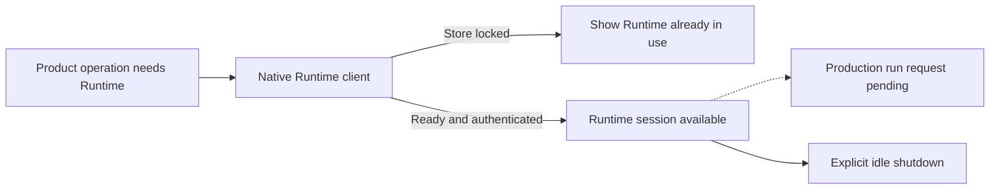

# Launcher Runtime integration

## Overview

Launcher starts Runtime as a native child when a product operation needs it.
The implemented lifecycle covers startup, authenticated readiness, conflicting
ownership, and idle shutdown. Production package execution remains pending. G14 provides a Development
single-device start API; its owned run can be cancelled by process shutdown.

## Start and check the session

Browsing installed products can leave Runtime stopped. When an operation
requires it, call the native Runtime client described in the
[managed lifecycle guide](managed_runtime.md). The currently available
integration check is the authenticated `GET {apiBaseUrl}/runtime-info` request.
Apply the same readiness and replacement rules to every later operation.

If Studio owns the store, the competing managed launch exits with code `2`.
Show **Runtime already in use** and let the user release Runtime in the owning
app before trying again. Launcher keeps its own credentials for the process it
starts.

## Stop the owned process

Expose **Shut down Runtime** while Launcher owns the idle process. Send the
control command, wait for exit, and keep Launcher open. If Launcher itself
closes, stop the owned child as part of app shutdown.

The production run example depends on the verified package admission API.
Add the exact package request, run status, and **Stop and exit / Stay open**
flow once production execution and H6 are verified. The Studio plaintext
authoring endpoints remain scoped to authoring.

## Current API inventory

| Route | Launcher use |
|---|---|
| `GET /api/v1/runtime-info` | Authenticate to the owned Runtime, verify readiness for each operation, and read compatibility information. |
| `GET /api/v1/health` | Optional troubleshooting check for HTTP liveness. A successful health response cannot release waiting operations. |
| `GET /api/v1/devices` | Read the last successful device inventory in the current session. |
| `POST /api/v1/devices/refresh` | Scan ADB and return the updated device inventory. |
| `GET /api/v1/runs/active` | Read the saved non-terminal RunGroup or receive 404 when idle. |
| `GET /api/v1/runs/{runGroupId}` | Read the requested saved progress or terminal result. |

Use the [shared API reference](managed_runtime.md#shared-api-reference) for
request headers, response examples, and error codes. A Launcher smoke test
starts its managed child, reads the private ready record, successfully probes
Runtime Info, sends the private shutdown command, and waits for process exit.
A competing-launch test should show **Runtime already in use** and leave the
first owner's process running.

Launcher has snapshot read routes. The current build also has a Development
[POST /runs route](managed_runtime.md#single-device-start-api), but no Production
package admission/start or HTTP run-control route. Do not send customer product
content through the plaintext Development API. Document those remaining
calls here as they become available, including package
input, authorization and compatibility, run identity, status and event
consumption, retry behavior, and the active-run shutdown flow. Plaintext
workflow validation and compilation belong to the [Studio guide](studio.md).

## Android device picker

When the customer opens device selection for a product, refresh the list
through Launcher's owned Runtime session. The cached read is available for
redisplaying the last successful result in that session. Provide a
**Refresh devices** action and keep Launcher ownership handling in the
native client. See the [shared E7 requests and responses](managed_runtime.md#device-inventory-api).

Use `adbSerial` as the selection key. G14 Development tests select exactly one
device; Production selection follows its later I2/H contract. Enable selection for `READY` entries,
show reasons for unavailable entries, and flag any selection lost after a
successful refresh. If refresh fails, show the failure even when the previous
result is still visible. Inventory calls require the local session token.
Product package authorization and the final live readiness recheck belong
to the future production run request.

## Read progress and retained results

Use the [shared run snapshot contract](managed_runtime.md#run-snapshot-apis) for
the exact response, errors, auth headers, Linux/Windows/Postman requests, and
[saved-result demo](managed_runtime.md#optional-saved-result-fixture-without-android).
These reads require no ADB call and are available before Production package
execution is integrated. They do not implement package authorization or start
execution from a saved record.

Use active to populate a current-run view. A 404 means idle, not a Runtime
readiness failure. Preserve a known RunGroup ID so by-ID can display its result
after it finishes or when another run is active. Read the same ID with the
current owned session after reconnecting; never reconstruct or repeat a start
from the returned nextNodeId. Store identity matters: a run in a different
state directory is not present in this database.

Use the native readiness gate before each request, pass the current session
token, and send no body or query. Show the group status/summary and ordered
device states with safe terminal errors. Keep the last displayed result separate
from a read failure. Stop automatic polling for a confirmed terminal run or a
closed view, with at most one outstanding poll per view. Cancelling a GET only
cancels that read; it does not stop the workflow or the owned Runtime process.

Run controls and owner-process shutdown remain distinct. Use the existing
private owner channel for shutting down Runtime, not these GET endpoints.
G14 owns the current single-device Development start flow; I2 owns
Production package authorization and its future Launcher start endpoint. Snapshot API/router and built-agent checks
pass on Linux and cross-compile for Windows; native Windows execution remains
unverified.

## G14 Development API and Phase H boundary

The Studio developer owns the current plaintext Test Run request. The
[shared start reference](managed_runtime.md#single-device-start-api) documents
its exact DTO, auth, 201/200 responses, identity replay, errors, and manual
examples for both client developers. The Launcher Production API will accept
an authorized package/path under I2; G14 does not supply that authorization.

For lifecycle integration, a single-device run belongs to the Runtime owner,
not its HTTP connection. Private shutdown fences dispatch and commits G11
cancellation before storage closes; owner loss uses D6 recovery. Expose
**Stop and exit / Stay open** for any active execution owned by Launcher once
its Production start path is delivered. HTTP Pause/Resume/Cancel remains later.

Phase H must add the bounded multi-device queue and configured concurrency,
expand the accepted device count, and update both client guides/pickers and
acceptance checks together. Follow the [G14 expansion checklist](../g_workflow_engine/g14_start_run_api.md#15-phase-h-expansion-checklist).
