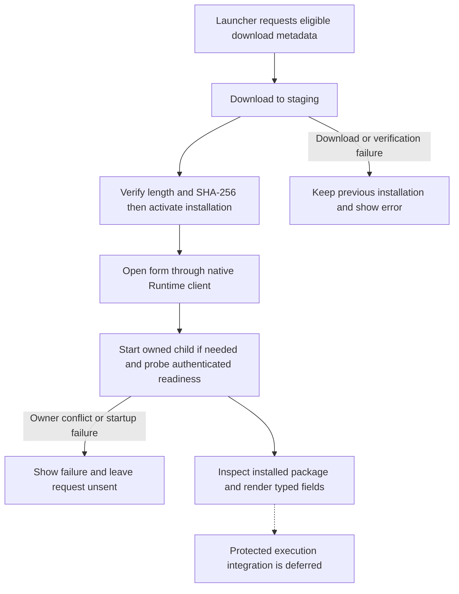

# Launcher Runtime integration

<a id="current-api-inventory"></a>

## API inventory

Use this table to check what Launcher can integrate today. Runtime paths below
include `/api/v1`; the ready record's `apiBaseUrl` already includes that prefix.
Backend uses its separately configured API prefix. Never combine their addresses
or credentials.

| Service | Method and path | Availability and Launcher use | Integration instructions |
| --- | --- | --- | --- |
| Backend | `GET /products/{productId}/package-download` | Available: obtain eligible Release identity, exact filename, byte length, SHA-256 and temporary download URL. | [Download](#backend-package-download) |
| Package storage | `GET <downloadUrl>` | Available: download encrypted `.a2m` bytes without Backend/Runtime credentials. | [Install](#download-and-activate-an-installation) |
| Runtime | `GET /api/v1/runtime-info` | Available: authenticated readiness check before every Runtime operation and build compatibility information. | [Owned process](#start-and-check-the-session) |
| Runtime | `GET /api/v1/health` | Available: optional unauthenticated HTTP liveness diagnosis. It is not an authenticated readiness gate. | [Health reference](managed_runtime.md#get-apiv1health) |
| Runtime | `POST /api/v1/product-packages/input-schema` | Available: inspect an installed package and return public identity/schema/actual ZIP hash. No execution starts. | [Input form](#open-a-package-input-form) |
| Runtime | `GET /api/v1/devices` | Available: read this Runtime session's last successful inventory. | [Device picker](#android-device-picker) |
| Runtime | `POST /api/v1/devices/refresh` | Available: scan ADB and refresh inventory. | [Device picker](#android-device-picker) |
| Runtime | `GET /api/v1/runs/active` | Existing engine read: current non-terminal group, or 404 when idle. Not a protected Product projection. | [Snapshots](#read-progress-and-retained-results) |
| Runtime | `GET /api/v1/runs/{runGroupId}` | Existing engine read: live or retained result. Not a protected Product projection. | [Snapshots](#read-progress-and-retained-results) |
| Runtime | `POST /api/v1/runs/{runGroupId}/actions` | Existing engine controls: Pause, Resume or Cancel an admitted group. Does not admit a Product package. | [Controls](#run-controls) |
| Runtime | `GET /api/v1/device-executions/{deviceExecutionId}/attempts` | Existing engine history: paged committed node attempts/outputs, for developer diagnostics. | [Attempt history](#saved-node-attempt-history) |
| Runtime | `GET /api/v1/artifacts/{artifactId}` | Existing engine artifacts: retrieve screenshot PNG bytes by committed artifact ID. | [Artifacts](#screenshot-artifacts) |
| Runtime | `GET /api/v1/events` | Existing engine SSE: committed Runtime-wide events, for developer diagnostics. | [Events](#continuous-execution-events) |

**Customer Product execution is not available yet.** Package-session preparation,
Backend execution authorization, protected start, renewal, reauthorization and
customer-safe Product monitoring are not ready to integrate. Keep customer Run
disabled. Existing plaintext `POST /runs`, workflow validation and compilation
belong to Studio/Development; do not send customer `.a2m` packages through them.

Starting/stopping Runtime uses native process APIs and private pipes, not HTTP.
The [integration order](#integration-order) below is the starting point for a new
Launcher developer; endpoint details appear where that integration uses them.

<a id="production-integration-prerequisites"></a>

## Overview

Launcher owns downloading/installing customer packages and presenting their input
forms. Runtime is a separate native child process that Launcher starts when a
local operation needs it. Runtime owns safe package inspection and Android
inventory. Backend owns customer eligibility and download metadata; storage
serves the encrypted file. Launcher does not decrypt workflows or call ADB itself.



Available Runtime behavior has Linux verification and Windows cross-build
evidence. Native Windows process/pipe/file behavior and the actual Launcher UI
still require acceptance on that host. This guide defines Launcher work; it does
not claim the Launcher team has implemented it.

<a id="installation-and-input-form-implementation"></a>

## Integration order

Implement the native/UI responsibilities in this order. Each row links to the
complete instructions and defines an observable result before moving on.

| Order | Build | Check before continuing |
| --- | --- | --- |
| 1 | [Configure clients and local state](#configure-clients-and-local-state) | Backend, storage and Runtime use the correct separate credentials; executable, root and Launcher version have explicit sources. |
| 2 | [Own the Runtime process](#start-and-check-the-session) | Start child, receive private readiness, authenticate Runtime Info, handle a competing owner, then shut down cleanly. |
| 3 | [Download and install a Product](#download-and-install-a-product) | Verify a real download's exact length/hash and activate one installation record without destroying a previous working installation. |
| 4 | [Open and validate the input form](#open-a-package-input-form) | Inspect that installed selection, render typed fields and ignore stale responses. |
| 5 | [Integrate the device picker](#android-device-picker) | Refresh actual ADB inventory, select READY serials and show refresh failures. Customer Run remains disabled. |
| 6 | [Wire existing run diagnostics when needed](#existing-run-diagnostics) | Observe an existing Development/test group through APIs, without exposing its internals as customer Product monitoring. |
| 7 | [Perform Launcher acceptance](#manual-checks-and-acceptance) | Run process, install, form, error and cleanup cases through the Launcher UI/native bridge on Linux and Windows. |

## Configure clients and local state

Resolve these values before implementing HTTP calls. Example UUIDs and paths in
this guide are test data, not a deployed customer's installation.

| Value | Source |
| --- | --- |
| Backend base URL | Launcher environment/configuration, including the Backend API prefix. |
| Backend customer access token | Existing signed-in customer authentication state. The account needs active CUSTOMER membership, download permission and usable entitlement. |
| Selected Product ID | The customer's selected Product in the existing cloud/customer view; real download tests require an eligible Product. |
| Runtime executable | Trusted absolute path supplied by desktop packaging; Linux binary or Windows `a2matex-runtime.exe`. Do not search arbitrary user folders/PATH. |
| Runtime API URL and session token | Fresh private readiness record from the exact child Launcher owns. Do not hardcode the port or generate a token in Launcher. |
| Launcher version | Launcher's own numeric build version, such as `0.1.0`, supplied as `launcherVersion` during inspection. |
| Package root | Actual OS Documents folder plus `a2matex/products` by default, or the customer's selected absolute folder. |

| HTTP client | Credential/behavior |
| --- | --- |
| Backend client | Backend customer Bearer; responses wrap the value in `data` and `statusCode`. Never attach the local package-directory header. |
| Storage download client | Returned presigned URL only; do not forward either Bearer or the directory header. Do not log/persist the signed URL. |
| Native Runtime client | Current child-local Bearer; loopback only, bypass proxies and reject redirects. Runtime DTOs have no Backend wrapper and are no-store. |

### Component responsibilities and local state

Reuse Launcher's existing storage, native process client and UI patterns. This
contract does not require another local database, table or Runtime endpoint.

| Owner | Implementation responsibility |
| --- | --- |
| Native download/install service | Backend authentication, separate storage download client, bounded staging writes, SHA-256/length verification, installation activation and cleanup. |
| Existing Launcher installation storage | One active installed Release per Product; persist identity and filename/hash only after successful installation. |
| Existing native Runtime client | Own child/pipes/token, readiness for every Runtime operation, directory-header encoding and schema HTTP request. |
| Form UI | Render the returned reduced schema, collect typed values, display field errors, and discard stale form results. |
| Runtime | Inspect package safety/content/compatibility; return public schema/identity. It does not download or install packages. |

Keep the selected root in Launcher settings. An installed record contains
`productId`, `installedReleaseId`, `version`, actual local `fileName` and the
download-verified `packageHash`. Retain the version returned with download
metadata for display and form identity checks. Persist neither the
presigned URL nor the Runtime session token in this record. The selected root
and record generate the reference; do not scan folders to guess a Release.

Example installation record, stored through Launcher's existing mechanism:

```json
{
  "productId": "11111111-1111-4111-8111-111111111111",
  "installedReleaseId": "22222222-2222-4222-8222-222222222222",
  "version": "1.0.0",
  "fileName": "package.a2m",
  "packageHash": "09ec3f0a6a578539e18362027fa907be68257a5590d6a8b8eb6072481ad71d01"
}
```

Form state is session-local: captured installation identity/root, returned schema
and actual hash, raw edit values, validated typed values, and field errors.
Keep Runtime credentials and filesystem access in the native layer. The UI gets
safe state/schema data; it does not need the token or presigned URL. Do not log
entered workflow inputs or automatically save them as permanent user preferences.

## Start and check the session

<a id="existing-native-process-integration"></a>

Build one native Runtime manager per Launcher process. Browsing installed
Products or downloading a package can leave Runtime stopped. A schema/inventory
operation goes through this manager; the UI does not launch executables or retain
tokens itself.

1. Resolve the packaged executable and create two anonymous pipes. Parent retains
   the command-write and readiness-read ends. Child inherits command-read and
   readiness-write ends; close unused copies and prevent unrelated inheritance.
2. Spawn the executable directly with an argument array, using the descriptor or
   handle numbers **as seen by the child**. Do not construct a shell command.

```text
<absolute-runtime-executable>
  --owner-command-pipe <child-command-read-end>
  --owner-ready-pipe <child-readiness-write-end>
```

The optional `--listen-address 127.0.0.1:6810` overrides the configured loopback
listener; it is not required. Use the returned URL even when the default is used.
Keep stdout/stderr separate from the private pipes and drain them if captured.
See [Linux descriptor and Windows handle requirements](managed_runtime.md#start-the-child).

3. Await one bounded UTF-8 JSON line within a startup deadline:

```json
{"apiBaseUrl":"http://127.0.0.1:6810/api/v1","sessionToken":"<fresh-local-token>"}
```

Validate its loopback URL and `/api/v1` suffix. Keep both values in native memory,
associated with this child. Managed mode uses this pipe, not a connection file.
The connection file is for [standalone manual testing](local_authentication.md).

4. Send the readiness probe with no body/query and exactly one Bearer header:

```http
GET {apiBaseUrl}/runtime-info
Authorization: Bearer <sessionToken>
```

Expect 200 with `runtimeVersion`, `runtimeIrFormatVersions` and `supportedNodes`.
Check compatibility independently of process readiness. A package inspection
still checks the package's minimum versions/capabilities.

5. **Before every Runtime operation**, verify child/control-channel liveness and
   make this bounded authenticated probe. Only then send the requested API.
   Concurrent callers share one start/replacement attempt, and each waiting
   operation still passes readiness. A single remembered ready flag is insufficient.

| Signal | Native manager action |
| --- | --- |
| Exit code `2` before readiness | Show **Runtime already in use**; leave pending requests unsent and the other app's process alone. |
| Missing executable, malformed ready line, other startup exit or deadline | Report startup failure, close pipes and ensure the child exits. |
| Child exits, command channel breaks or authenticated probe fails | Clear only that child's credentials, stop any surviving old child and confirm exit, then make one shared replacement attempt for pending work. Failure ends that attempt for all waiting callers. |
| Valid API-specific 400/404/422 after readiness | Handle the request/package result; it is not evidence that Runtime needs restarting. |
| Explicit Runtime shutdown/app exit | Suppress automatic launch/reconnect and complete the owner shutdown below. Only an explicit Runtime action clears suppression. |

The full replacement/race rules are in the
[shared process lifecycle](managed_runtime.md#map-the-child-lifecycle-to-app-state).
A public `/health` success alone never releases pending operations. The Runtime
local token changes after restart and must never go into renderer state, URLs,
logs, screenshots or exported Postman environments.

### Stop the owned process

Expose **Shut down Runtime** while Launcher owns the process. Send exactly
`shutdown\n` (a line ending in LF) through the retained command pipe, await child
exit, then clear the session and display Stopped. Launcher may remain open.
Closing Launcher must also shut down its owned Runtime; do not leave a background
child running. Use bounded termination if graceful shutdown fails.

If the child owns an active test/run, offer **Stop and exit / Stay open** before
closing; shutdown fences dispatch and commits cancellation before SQLite closes.
After a crash/forced exit, unfinished work becomes INTERRUPTED on next startup;
Runtime never resumes an old run automatically. Pause/Resume/Cancel controls keep
Runtime alive and are distinct from owner shutdown. Use the
[verified shutdown contract](managed_runtime.md#failure-and-shutdown) for deadlines
and owner-loss behavior, and verify native Windows separately.

## Download and install a Product

Download metadata is frozen for one installation attempt. The following
subsections follow the actual network → filesystem → activation order.

<a id="backend-package-download--step-3"></a>

### Backend package download

**Available in Backend.** Confirm customer permissions and storage configuration
in the target environment before testing this call. Use the Backend client and
customer token configured earlier; no Runtime process is needed for downloading.

First the operator runs the normal permission discovery seed in the target
environment (`npm run seed:permissions`) and grants its unscoped
`GET <API_PREFIX_PATH>/products/:productId/package-download` permission to CUSTOMER
through existing Role management. Preserve other permissions; use that management
flow so role-cache invalidation occurs. The seed alone grants Admin, not Customer.
The caller must be ACTIVE and hold an active CUSTOMER membership plus usable
entitlement. Admin/Publisher role alone does not bypass those requirements.

Set separate Postman variables `backend-base-url` (Backend origin plus configured
API prefix), `backend-token` (customer access token) and `product-id`. These are
not the local Runtime URL/token.

```http
GET {{backend-base-url}}/products/{{product-id}}/package-download
Authorization: Bearer {{backend-token}}
```

Select **Body: none**, with no query for the current Release. To download a known
eligible installed/supported Release explicitly, add `releaseId=<release UUID>`.
Do not pass customer IDs, Static IDs, a local directory header or the Runtime
session token. Unknown query fields, repeated/array IDs and malformed/noncanonical
UUIDs receive existing Backend 422 validation errors.

HTTP 200, with `Cache-Control: no-store`, returns:

```json
{
  "data": {
    "package": {
      "productId": "11111111-1111-4111-8111-111111111111",
      "releaseId": "22222222-2222-4222-8222-222222222222",
      "version": "1.0.0",
      "packageHash": "<64 lowercase SHA-256 hexadecimal characters>"
    },
    "fileName": "auto-farming-1.0.0.a2m",
    "packageSizeBytes": "4356",
    "downloadUrl": "https://storage.example.invalid/test-only-presigned-url",
    "expiresAt": "2026-11-25T00:15:00.000Z"
  },
  "statusCode": 200
}
```

The values above illustrate the shape, not an installed Product or usable URL.
Read inside `data`. Open the returned URL with Postman's **No Auth** and no
Backend/Runtime Authorization header, then save/download the binary response with
the server `fileName` or a chosen local safe name such as `package.a2m`.
Launcher records the actual local name and uses a separate storage HTTP client to avoid
forwarding application credentials. Parse the byte-size string without precision
loss, verify downloaded length and SHA-256, then install atomically under the
selected root's `<productId>/<fileName>` location. The 4 MiB package
bound and portable 255-byte basename are checked by Backend; Launcher still
checks downloaded bytes. It never renders or logs the presigned URL.

Use the metadata's Release ID, not UUID/timestamp sorting or a mutable product
slug, to update the installation record. Request a new URL after expiration;
this GET creates no order, entitlement, lease or Runtime run. A newly issued URL
uses current eligibility, but an earlier URL can remain usable until its storage
expiry. That does not authorize executing its encrypted contents.

| Download integration check | Expected result |
| --- | --- |
| Eligible customer, current published Release | 200 with selected identity/hash, exact filename, size and URL |
| Eligible explicit older Release | 200 only when published/non-disabled and same Product |
| Missing/expired/revoked entitlement or inactive customer | 403 `Error.ExecutionAuthorizationDenied`; no URL |
| No selected Release, disabled/building/foreign Release, missing/unsafe file or missing R2 object | 404 `Error.ProductPackageUnavailable` after entitlement succeeds |
| Missing/invalid token or missing route permission | Existing 401/403 authentication/permission response |
| Invalid UUID, extra query field or repeated Release ID | Existing 422 field-validation response |
| Archived Product with usable entitlement | Download still succeeds for an eligible Release |
| Suspended/deleted Product | Access denied; no URL |
| Storage HEAD/presigner unavailable | 503 `Error.ExecutionAuthorizationUnavailable`; no URL/private error details |
| Saved `.a2m` | Filename and byte length match metadata; SHA-256 equals `packageHash`; exact three ZIP entries |

For the final row, Linux commands are `sha256sum <file>` and `unzip -Z1 <file>`;
Windows checksum is `Get-FileHash <file> -Algorithm SHA256`. Expected ZIP entries
are exactly `manifest.json`, `workflow.enc` and `input-schema.json`. Manifest
Product/Release/version must match metadata, and workflow stays encrypted.
Run these checks with actual customer, entitlement and Release data in the
target environment before enabling downloads for customers.

### Package installation and location contract

Implement this installation layout in Launcher. Schema inspection is available;
session preparation and protected execution remain unavailable.

Launcher owns the selected package root. Default to the host's actual Documents
folder plus `a2matex/products`, allowing a user-selected absolute
folder later. Resolve relocated/localized Documents through OS APIs. Do not use
Runtime's SQLite state directory or assume the executable's folder. Use lowercase
`a2matex/products` on both hosts. In particular, redirected Documents may be
`C:\Users\Admin\OneDrive\Documents`; do not append another Documents component.
The header contains the `products` root, not its Product UUID subfolder. Ensure
cloud-backed `.a2m` files are locally readable before calling Runtime; it does
not implement OneDrive download/retry logic.

```text
<selected package root>/
└── <productId>/
    ├── package.a2m
    └── other Launcher-owned files
```

The implemented Backend customer download response includes `fileName`, sourced from
`Static.originalFileName`, alongside package identity/hash, size, URL and expiry.
That is the server download name, not a mandatory local name. Default the local
file to `package.a2m`, or use a chosen safe `.a2m` basename, and store the actual
local `fileName` in the installation record. Never infer Release identity from
that name, mutable Product slugs or the R2 URL. Product identity is checked against
the Product folder; Release ID/version come from the validated package manifest.
Renaming a file does not change its package hash. A rename must update the local
record and invalidate old forms/sessions while the Product is unused. R2 object
naming and Backend response fields are unchanged.

Store the selected root and installation record as defined in
[local state](#component-responsibilities-and-local-state). A record chooses the
installed Release; filenames and UUID ordering do not choose it.

For schema inspection, send the root in the header and exactly `packageRef` and
`launcherVersion` in the JSON body, as shown in the
[schema request](#read-the-installed-packages-input-schema). Separate IDs and a
request hash are not accepted. Later session preparation/protected starts will
have their own contracts; do not call an unavailable endpoint or use Development
`/runs` to substitute for it. Never send the directory header to Backend/R2 or add
it to Studio's Development requests.

Encode the absolute native root once as RFC 3986 UTF-8 percent encoding (4 KiB
encoded maximum). Encode spaces as `%20`; `+` is not a space escape. For Windows,
`C:\Users\Admin\OneDrive\Documents\a2matex\products` becomes
`C%3A%5CUsers%5CAdmin%5COneDrive%5CDocuments%5Ca2matex%5Cproducts`.
Keep `/` between the two JSON `packageRef` segments on both hosts; do not
percent-encode that JSON field. Runtime decodes the header once and rejects
malformed/repeated headers and unsafe paths. Use the same encoding rules on both
hosts. This is not a generic local-file read API.

### Download and activate an installation

1. Resolve the selected Product and root. Serialize install/update work for that
   Product; a second click shares the operation or shows it is already in progress.
   Do not replace a Product with a preparing session or active/paused execution.
2. Call the [customer download API](#backend-package-download) with the Backend
   customer token. Omit `releaseId` for the selected current Release, or provide
   the explicit supported Release intended for installation. Capture one response
   as the operation's immutable metadata. Match its Product and any explicitly
   requested Release; do not combine a new URL with an old hash or filename.
3. Download through the separate storage client to a uniquely named staging file
   under the selected root, on the same filesystem as the destination. Forward
   neither application Bearer token nor the local directory header. Show byte
   progress without exposing the signed URL. Support cancellation and bounded
   network timeouts. Reject downloads above the declared length or the 4 MiB
   package limit; do not rely only on an HTTP Content-Length header.
4. Count actual saved bytes and calculate SHA-256 in the native layer. Parse
   `packageSizeBytes` as its canonical decimal value without precision loss;
   compare exact length and the lowercase hexadecimal digest with the captured
   metadata. Any mismatch rejects the staged file. Do not unzip/decrypt the
   workflow or use the Runtime inspection hash as a substitute for this check.
5. After verification and a fresh unused-Product check, install at
   `<root>/<productId>/<fileName>`, normally `<productId>/package.a2m`. Validate
   the chosen portable basename. Rename the verified staging file on the same
   filesystem so no partial download appears as active. If the destination
   already contains the expected verified bytes, reuse it. For a different
   idle installed package at that same name, retain an operation-owned backup
   until the installation-record switch succeeds. Serialize this work with
   reads/runs for that Product; restore the old file if activation fails.
6. Update the active installation record only after the final file exists.
   Treat this record as the activation point. Discard any old package-bound form,
   then notify the UI of the installed identity. Remove only the previous
   package/backup owned by this operation after activation, as specified in the
   [replacement flow](#package-update-flow-one-installed-release-per-product).

Download cancellation, disk/permission errors, hash mismatch or a failed record
write leave the previous active record/file usable. Cleanup only files created
by that failed operation. A completed unselected file after interruption is not
an installation: the saved active record still selects the old Release. On the
next relevant operation, check that record's exact file exists; show repair if
it is missing or its hash/identity disagrees with the record. After a crash
between file replacement and record activation, restore the old backup or
show repair before allowing Run. Do not silently activate an orphan or
delete the Product folder or its unrelated Launcher files.

If the presigned URL has expired, obtain fresh metadata and restart the bounded
download. If the returned identity/hash has changed, treat it as a new candidate;
do not merge partial bytes or automatically change a form already on screen.
An available update is optional. Inspecting an installed older compatible Release
must not automatically replace it with the current Release.

### Package update flow: one installed Release per Product

Backend's selected current Release is authoritative; publishing alone does not
change `currentReleaseId`. The download metadata call without `releaseId`
resolves that current eligible Release. Compare the returned Release ID with the
installed record when checking an offered update; do not choose by UUID, filename
or timestamp ordering, or use Publisher/Admin APIs as customer authorization.

Update installation follows the same staged verification/activation procedure
above. Keep the old active record/file until the replacement is installed and the
record switch succeeds, then clear the old form and remove only the old package
or temporary backup. Keep the Product folder and all other Launcher files.
Cleanup failure is retryable housekeeping, not a reason to revert the new record.
Do not replace/move a Product used by a preparing session or active/paused run;
a paused expired run will still need its original package for reauthorization.

An update is optional. No permanent local multi-version cache, version picker or
rollback is required. Changing the selected root affects future lookups and does
not move files or redirect live/prepared work. Backend Release history and Runtime
execution-history retention are independent of package-folder cleanup.


## Open a package input form

The installed record and root from the previous section are the inputs to this
flow. Its output is a typed, locally validated object bound to that package.

### Open a form and reject stale results

1. Snapshot the active installation record and selected root. Build
   `packageRef = productId + "/" + fileName`.
   Opening the form does not require redownloading or querying the newest Release.
2. Through the shared native client, ensure actual authenticated Runtime readiness
   for this operation. Concurrent form requests share process startup/replacement.
   If another app owns Runtime, show **Runtime already in use**; leave the schema
   request unsent. Explicit Runtime shutdown suppresses automatic relaunch until
   the next explicit Runtime action, following the shared lifecycle policy.
3. Call the [schema API](#read-the-installed-packages-input-schema) using the
   captured root, reference and actual Launcher version. Send only `packageRef`
   and `launcherVersion` in the JSON body; retain the full installation identity
   internally rather than adding separate IDs/hash to the request.
4. Associate the response with that captured selection and a local request
   generation. If the user changes Product/root, replaces the package, closes the
   form or starts a newer inspection before it completes, discard the old result
   and its errors. A late response must never replace another Product's form.
5. Check returned Product/Release/version against the captured installation
   metadata. Keep the returned actual hash with the form. A hash different from
   the installation record's download-verified hash means the local file changed:
   show **Package changed — repair installation**, invalidate this form and stop.
   This is a local identity check; do not fetch the newest Backend Release/hash or
   send an expected hash to the inspection API. Never rewrite the verified record
   to accept an unexpected new digest.
6. Render the schema and collect values. Editing values performs local validation;
   it does not call package inspection on every keystroke. Reinspect after a
   relevant installation/root change or an explicit retry/refresh. Runtime restart
   refreshes credentials through the process manager; no form creates a lease.

Changing the selected directory does not move installed files. Invalidate forms
using the old setting and inspect the selection under the new root. If its file
is absent, offer installation/repair there. Do not redirect a prepared/live
execution or remove its original files during a settings change.

### Read the installed package's input schema

**Available now:** `POST {apiBaseUrl}/product-packages/input-schema`.
Use it when opening the customer's input form, before preparing execution or
requesting a lease. It works offline with no Android device connected.

Use the current owned process's ready record, then perform the authenticated
Runtime Info readiness check described in [managed startup](managed_runtime.md#readiness-and-authentication).
For a standalone manual session, obtain `apiBaseUrl` and `sessionToken` from the
[local authentication guide](local_authentication.md). Never create a token/file
by hand or use the Backend customer token for this local request.

Send exactly these headers and body. Header root comes from Launcher settings;
`packageRef` comes from the installation record; `launcherVersion` is the actual
Launcher numeric release version. Do not send the current Runtime version here.

```http
POST http://127.0.0.1:6810/api/v1/product-packages/input-schema
Authorization: Bearer <current-local-runtime-token>
Content-Type: application/json
X-A2MaTeX-Package-Directory: %2Fhome%2Fdino%2FDocuments%2Fa2matex%2Fproducts
```

```json
{
  "packageRef": "11111111-1111-4111-8111-111111111111/package.a2m",
  "launcherVersion": "0.1.0"
}
```

There are no separate Product/Release IDs, request hash, input values or upload
bytes. Unknown/missing/duplicate body keys fail. Send one UTF-8 JSON object, at
most 4 KiB, with no query parameters or Content-Encoding. The filename is the
actual local file, which may differ from Backend download metadata. Product ID
is matched against the reference folder; Release ID/version come from the
validated manifest. The old Product/Release/filename reference is rejected.

HTTP 200 returns exactly the following shape, without Backend `data` wrapping:

```json
{
  "package": {
    "productId": "11111111-1111-4111-8111-111111111111",
    "releaseId": "22222222-2222-4222-8222-222222222222",
    "version": "1.0.0",
    "packageHash": "09ec3f0a6a578539e18362027fa907be68257a5590d6a8b8eb6072481ad71d01"
  },
  "inputSchema": {
    "type": "object",
    "properties": {
      "packageName": {"type": "string", "minLength": 3, "maxLength": 255},
      "tapY": {"type": "integer", "minimum": 0, "maximum": 100000}
    },
    "required": ["packageName", "tapY"],
    "additionalProperties": false
  }
}
```

This example is the public package fixture. A real Product returns its own schema,
version and hash. Use the reduced schema to render fields and validate entered
values. Treat schema text as data, never HTML or code. Keep the form and entered
values associated with the returned package identity/hash; replacing/moving the
installation invalidates that form and requires another inspection.

Runtime checks safe bounded package access, identity, member hashes, schema,
minimum versions and supported capabilities. `packageHash` is SHA-256 of the
current ZIP. **This response does not attest that it is the original Backend
download and does not authorize execution.** Verify the download once during
installation as described in
[download verification](#download-and-activate-an-installation). An older compatible
installed Release can be inspected without checking the newest Backend Release
or forcing an update.
No lease, session, decryption, run, SQLite execution write or ADB command occurs.

| HTTP / code | Launcher behavior |
| --- | --- |
| 400 `INVALID_REQUEST` | Fix headers/body/version/reference; no automatic retry of the same invalid request. |
| 401 `UNAUTHORIZED` | Recheck owned Runtime readiness/credentials through the native process manager; do not reuse a stale token. |
| 404 `RESOURCE_NOT_FOUND` | Selected installation is missing; repair/redownload it before reopening the form. |
| 413 `PAYLOAD_TOO_LARGE` | Fix the JSON request; it exceeds 4 KiB. |
| 422 `VALIDATION_FAILED` | Package is malformed, changed internally or has invalid identity/schema. Repair the installation. |
| 422 `RUNTIME_INCOMPATIBLE` | Show an unsupported requirement and update the relevant Runtime/Launcher; do not retry endlessly. |
| 503 `INTERNAL_ERROR`, retryable true | Recheck readiness and permit a bounded retry; file access/cancellation failed. |
| 500 `INTERNAL_ERROR`, retryable false | Surface failure and collect safe Runtime diagnostics. |

All responses have `Cache-Control: no-store`. Messages are generic and expose no
local paths, manifest, protected workflow or validation report. The full error
shape is in the [shared reference](managed_runtime.md#http-error-envelope).

### Field rendering and typed values

Use the [reduced schema contract](../contracts/runtime_ir_v1.md#3-reduced-field-schema).
It is a flat object with at most 100 properties and `additionalProperties: false`.
Use exact property names as labels/payload keys and mark names in `required`.
A stable field-name order is sufficient; JSON property order is not business
logic. No separate publisher label, description, enum or default metadata exists
in this schema vocabulary.

| Schema type | Form control and validation | Value in validated input object |
| --- | --- | --- |
| `string` | Text input; apply `minLength`/`maxLength` when present. Length uses UTF-16 code units, matching JavaScript string length and Runtime. Preserve the entered text; do not silently trim it. | JSON string. |
| `integer` | Numeric edit field; require a finite integral value within JavaScript's safe range and any inclusive `minimum`/`maximum`. Reject an empty edit, decimals or unsafe integers. | JSON number, not a quoted string. |
| `number` | Numeric edit field; require a finite value and any inclusive bounds. | JSON number. |
| `boolean` | Explicit true/false choice. Preserve an unset state for optional fields, for example an Include control. | JSON boolean; `false` is a supplied valid value. |

A required field must be present. A string `""` is supplied and valid only when
its length constraints allow it. Optional fields may be omitted; omission is
different from `""`, `0` or `false`. Provide a clear unset/omit action instead of
converting every empty control to an invented default. Never emit `null`, unknown
keys, arrays or nested objects. An empty properties/required schema produces an
empty input object `{}` and needs no field controls.

Raw numeric edit text can be held while the user types, but validate it before
constructing the JSON number. Do not use permissive partial parsing that turns
`"12abc"` into `12`, or convert an empty edit into zero. Unsupported schema
features/types produce **Unsupported input form**; do not silently skip fields
or submit a partial object. Runtime remains authoritative at future admission.

For the schema API's existing example, a valid locally collected object is:

```json
{
  "packageName": "org.lineageos.jelly",
  "tapY": 450
}
```

This object is a form result, not another input-schema request. It stays in
session memory for the future protected run integration. Do not send it to the
schema endpoint or substitute a Development `/runs` request. The customer **Run**
action stays disabled until protected execution integration is available.

### UI states and failure handling

| State | UI behavior |
| --- | --- |
| Not installed / missing file | Show Install or Repair; no usable input form. |
| Downloading / verifying / installing | Show progress and the selected candidate; prevent competing install/update activation. Cancellation keeps the previous installation. |
| Installed | Show the installed version; Open input form can request Runtime readiness/inspection. |
| Starting Runtime / loading schema | Show loading; keep current selection identity so a late result can be discarded. |
| Form ready | Show fields and inline validation. Indicate execution is unavailable in this build. |
| Package changed / malformed / incompatible | Invalidate the form; show repair or compatibility action from the existing API error table. |
| Runtime in use / unavailable | Show ownership/startup failure and an explicit retry; retain a valid installation. |

Apply [schema error handling](#read-the-installed-packages-input-schema) and
[managed process replacement](managed_runtime.md#failure-and-shutdown). A failed
readiness probe follows that replacement policy. A package-level 400/404/422
response after successful readiness does not by itself justify killing/relaunching
Runtime. Cancel a download without shutting down a healthy Runtime; app exit
still shuts down an owned Runtime through the private owner channel.

## Android device picker

When the customer opens device selection, pass through native Runtime readiness,
then call `POST {apiBaseUrl}/devices/refresh` with local Bearer, no query and no
body. `GET {apiBaseUrl}/devices` reads only this process session's last successful
inventory; before the first refresh it can correctly return an empty array.

```json
{"devices":[{"adbSerial":"192.168.240.112:5555","status":"READY"}]}
```

Use `adbSerial` as the exact selection key. Enable READY entries, show unavailable
reasons and flag selections lost after a successful refresh. Provide **Refresh
devices**. If refresh fails, show the error even when displaying the previous
cached list. `503 ADB_UNAVAILABLE` after successful readiness is an ADB refresh
failure, not an instruction to restart the Runtime child. A replacement child
starts with an empty inventory. Allow for the documented 20-second refresh budget
and cleanup in the [full device contract](managed_runtime.md#device-inventory-api).

Runtime configuration/desktop packaging supplies the trusted ADB executable path;
the Launcher UI does not execute arbitrary ADB commands. An available emulator
must also be connected to that ADB server to appear in inventory. Package form
inspection itself does not require ADB or an Android device.

### Device selection and execution capacity

Customers select the devices to use; there is no Maximum simultaneous devices
setting, capacity YAML/environment override or per-request concurrency field.
Hardware determines practical capacity. Existing Development admission validates
exact serial/input pairs for syntax, uniqueness and fresh readiness and accepts
or rejects the complete selection. Do not silently deduplicate/filter a selection
with different per-device inputs. Selection does not reserve a device or prove
it will remain READY until future Product admission.

Customer selection can be integrated now while Run stays disabled. The protected
start DTO and its authorization/readiness checks will be documented when available.
Use the [existing multi-device test walkthrough](../../../../a2matex-runtime/examples/h4/README.md)
only for Development engine acceptance.

## Existing run diagnostics

These APIs exist for admitted Development/test runs and retained engine data.
They are optional for this package/form handoff. They are not customer-safe
protected Product monitoring APIs. Keep workflow/node detail out of customer
Product screens and do not query Runtime SQLite directly.

### Development API and Production boundary

Studio owns plaintext validation, compilation and Test Run admission. Its
[Development start reference](managed_runtime.md#workflow-start-api) documents
`POST /runs`, 201 new admission, 200 saved replay and exact serial/input pairs.
Launcher must wait for protected package admission rather than extracting a
workflow or submitting an encrypted package through that route.

### Read progress and retained results

After native readiness, call active/by-ID with local Bearer and no body/query.
`GET /runs/active` returning 404 means idle. Preserve a known RunGroup ID to
read its terminal result later using the current owned session; a run in a
different Runtime state directory will not be present in this store.

Display authoritative group status/summary and per-device status/errors. The
GET returns the current snapshot immediately; it does not wait for completion
and is not SSE. `cursor` is an event position, not a node index. Never recreate a
start from `nextNodeId` or a retained snapshot.

Poll with at most one outstanding read per view and stop for a closed view or
confirmed terminal result. Keep the last displayed data separate from read
failure. Cancelling a GET does not cancel the workflow. Full response/error and
[Linux/Windows examples](managed_runtime.md#run-snapshot-apis) are shared, including
an [Android-free saved-result demo](managed_runtime.md#optional-saved-result-fixture-without-android).

### Run controls

`POST {apiBaseUrl}/runs/{runGroupId}/actions` takes exactly
`{"action":"PAUSE"}`, `{"action":"RESUME"}` or `{"action":"CANCEL"}`.
Use current local Bearer and JSON Content-Type after actual readiness. HTTP 202
means accepted/pending; 200 means achieved; 409 can include the authoritative
snapshot. Reconcile by snapshot and follow the
[control/retry guide](run_actions.md) for duplicate or lost responses.
Cancel keeps Runtime alive; it is not process shutdown.

<a id="saved-node-attempt-history--i1"></a>

### Saved node-attempt history

Take `deviceExecutionId` from the selected snapshot, then use the
[paged attempt API](managed_runtime.md#node-attempt-history-api). It returns
committed node attempts and outputs and needs no connected Android device.
Same-sequence status updates require overlapping refresh; its pagination is not
an event-stream cursor. Correlate by IDs and never guess device execution IDs.

### Screenshot artifacts

Take committed screenshot artifact IDs from attempt outputs, then call
`GET {apiBaseUrl}/artifacts/{artifactId}` through the authenticated native client.
The response is PNG bytes, not a local file path or Backend JSON wrapper.
Use the [artifact reference](managed_runtime.md#screenshot-artifact-download-api)
for retrieval/errors. Do not inspect artifact storage folders or send local
paths as artifact IDs.

<a id="continuous-execution-events--i4"></a>

### Continuous execution events

After actual readiness, open one native-owned `GET {apiBaseUrl}/events` with
current Bearer, `Accept: text/event-stream`, and optional positive decimal
`Last-Event-ID`. Send no query/body. Forward only safe decoded event data to UI.
This is the continuous stream; snapshot GETs remain ordinary requests.

Apply committed events by selected group/device correlation IDs, then save the
processed cursor as a string. Heartbeat comments are not execution progress.
Reconnect after the processed cursor; a pre-stream 410 requires snapshot repair
and reconnect after the repaired cursor. A broken stream alone is not proof of
workflow failure or Runtime death: check actual owned readiness before replacement.
Explicit owner shutdown suppresses reconnect/relaunch. Follow the
[SSE framing and recovery reference](managed_runtime.md#execution-event-stream).

The [combined engine walkthrough](../../../../a2matex-runtime/examples/h15/README.md)
can supply admitted test runs for diagnostics. It does not authorize customer
packages or close native Windows/Launcher UI acceptance.

## Manual checks and acceptance

There are two distinct checks. A fixture proves the local schema/form integration
without Backend or Android. A real eligible download proves Backend, storage,
installation and the Launcher UI/native bridge together. Record which check was
performed; an API success alone does not establish full Launcher integration.

### Prepare an isolated form test

Use the Runtime checkout's public test fixture. On Linux, from the Runtime
repository root:

```bash
PACKAGE_ROOT="$(xdg-user-dir DOCUMENTS)/a2matex/products"
PACKAGE_DIR="$PACKAGE_ROOT/11111111-1111-4111-8111-111111111111"
mkdir -p "$PACKAGE_DIR"
cp internal/platform/productpackage/testdata/j1-valid.a2m "$PACKAGE_DIR/package.a2m"
make build
./bin/a2matex-runtime
```

Leave the Runtime terminal running and open another terminal/Postman for requests.

For Windows, copy the same fixture as `package.a2m` into the Product UUID folder below the configured
native package root and launch the built `a2matex-runtime.exe`. Wait for ready and
read the standalone connection record using the
[Linux/Windows authentication instructions](local_authentication.md#2-find-the-connection-file).
Use a build whose reported version satisfies the manifest; the fixture requires
Runtime and Launcher versions at least `0.1.0`. A `0.0.0-dev` Runtime fails strict
compatibility. Shut down an app-owned Runtime before starting a standalone one.

For actual Launcher acceptance, use its managed child/private handoff instead
of this standalone launch. The fixture's encryption material is public test data;
it proves schema inspection, not real Backend download or execution authorization.

### Postman check on Linux or Windows

1. Install a valid package at `<root>/<productId>/<fileName>`, normally
   `<productId>/package.a2m`. Use a Runtime build whose `/runtime-info` version
   satisfies the manifest; `0.0.0-dev` cannot pass strict package compatibility.
2. Create local Postman variables `apiBaseUrl` and `sessionToken` from the two
   current connection-record fields. Create POST
   `{{apiBaseUrl}}/product-packages/input-schema`; the base already includes
   `/api/v1`. Select Bearer Token and set its Token field to `{{sessionToken}}`.
   First send authenticated GET `{{apiBaseUrl}}/runtime-info` with no body/query
   and confirm 200, then send the schema POST using that same session.
3. Copy the directory header and JSON body from the
   [schema request](#read-the-installed-packages-input-schema), substituting
   the installed reference and Launcher version. Postman must send JSON, not
   multipart, binary, query parameters or a ZIP upload.
4. Send: expect 200 and schema/identity/hash. Repeat: same data, no run created.
5. Remove Bearer: expect 401. Add `packageHash` to the body: expect 400. Select a
   missing filename: expect 404. Use a Launcher version below the package minimum:
   expect 422 incompatible. Test damaged ZIP contents only on a disposable copy:
   expect 422 validation failure.

The prepared public fixture returns the exact schema/hash shown in the
[schema success example](#read-the-installed-packages-input-schema).

### Linux request

Use `CONNECTION_FILE` from the
[Linux connection-file lookup](local_authentication.md#2-find-the-connection-file).
Load the values into this shell before sending the request; Runtime does not
export shell variables. Keep shell tracing off when handling credentials.

```bash
connection_values=$(python3 - "$CONNECTION_FILE" <<'PYTHON'
import json, sys
with open(sys.argv[1], encoding="utf-8") as file:
    connection = json.load(file)
print(connection["apiBaseUrl"])
print(connection["sessionToken"])
PYTHON
)
mapfile -t runtime_connection <<< "$connection_values"
API_BASE_URL="${runtime_connection[0]}"
SESSION_TOKEN="${runtime_connection[1]}"
PACKAGE_ROOT="$(xdg-user-dir DOCUMENTS)/a2matex/products"
PACKAGE_HEADER=$(python3 -c 'import sys, urllib.parse; print(urllib.parse.quote(sys.argv[1], safe=""))' "$PACKAGE_ROOT")
curl --noproxy '*' --fail --silent --show-error --max-time 5 \
  --header "Authorization: Bearer $SESSION_TOKEN" \
  "$API_BASE_URL/runtime-info" >/dev/null &&
curl --noproxy '*' --request POST "$API_BASE_URL/product-packages/input-schema" \
  --header "Authorization: Bearer $SESSION_TOKEN" \
  --header 'Content-Type: application/json' \
  --header "X-A2MaTeX-Package-Directory: $PACKAGE_HEADER" \
  --data '{"packageRef":"11111111-1111-4111-8111-111111111111/package.a2m","launcherVersion":"0.1.0"}'
```

### Windows PowerShell request

Use `$ConnectionFile` from the
[Windows connection-file lookup](local_authentication.md#2-find-the-connection-file),
then read the current values explicitly. Resolve Documents through Windows:

```powershell
$Connection = Get-Content -LiteralPath $ConnectionFile -Raw -ErrorAction Stop | ConvertFrom-Json -ErrorAction Stop
$ApiBaseUrl = $Connection.apiBaseUrl
$SessionToken = $Connection.sessionToken
$PackageRoot = Join-Path ([Environment]::GetFolderPath('MyDocuments')) 'a2matex\products'
$Headers = @{
  Authorization = "Bearer $SessionToken"
  'X-A2MaTeX-Package-Directory' = [Uri]::EscapeDataString($PackageRoot)
}
$Body = @{
  packageRef = '11111111-1111-4111-8111-111111111111/package.a2m'
  launcherVersion = '0.1.0'
} | ConvertTo-Json -Compress
Invoke-RestMethod -Method Get -Uri "$ApiBaseUrl/runtime-info" `
  -Headers @{ Authorization = "Bearer $SessionToken" } -ErrorAction Stop | Out-Null
Invoke-RestMethod -Method Post -Uri "$ApiBaseUrl/product-packages/input-schema" `
  -Headers $Headers -ContentType 'application/json' -Body $Body
```

These are equivalent requests. A Windows cross-build does not prove native
Windows/UNC or Launcher integration acceptance; run the Postman cases on that host.

### Launcher acceptance checklist

Run these cases through the actual Launcher UI/native bridge on Linux and Windows.
Use the public package fixture for isolated form tests and a real entitled
Backend download for download/install acceptance. A manual Runtime request alone
cannot close the Launcher acceptance cases. The public package covers string
and integer inputs. Use form-component fixtures for number/boolean/optional and
unsupported-schema cases; a valid Runtime response cannot contain an unsupported
schema. Use real Backend-issued packages for full download acceptance.

| Case | Expected observable result |
| --- | --- |
| Fresh install with valid entitlement | Backend metadata → storage download → exact saved length/hash → one active installation record with the chosen local filename; other Launcher files preserved. |
| Denied download or expired URL | Show denial, or obtain fresh metadata for URL expiry; no half-installed selection or forwarded application credentials. |
| Download cancel, wrong length/hash, disk failure | Candidate rejected/cleaned; previous active installation still selected and readable. |
| Replacement/activation failure | Old record/file stays active; an orphan candidate never becomes selected by folder scanning. |
| Optional update | Existing installed compatible Release remains usable for schema inspection until the user chooses replacement. |
| Open form with Runtime stopped | One managed child starts; authenticated readiness precedes inspection; returned schema renders correctly. |
| Concurrent opens / competing owner | Share one startup attempt; a conflicting owner yields Runtime already in use without stealing its process. |
| Four field types and optional values | Correct typed object; missing required, out-of-range and unsafe numbers fail inline; `0`/`false` survive and omitted fields stay absent. |
| Empty or unsupported schema | Empty object renders without controls; unsupported vocabulary is rejected visibly. |
| Switch Product/root during a delayed response | Previous success/error is ignored; no stale form or previous values appear for the new selection. |
| File changed since installation | Different returned digest invalidates the form without overwriting the stored download-verified hash or checking the newest Release. |
| Replace installed package | Old form/values are cleared; new form uses the newly activated identity. |
| Runtime restart / owner shutdown | Refresh credentials after restart; explicit shutdown does not cause background relaunch. |
| Public inspection only | No lease/session/run/ADB work; customer Run stays disabled. |

Record host, installed identities, safe HTTP status/error codes and observed UI
results. Exclude tokens, signed URLs and input values from screenshots/log exports.
Deliver the Launcher changes separately; this guide specifies the work and does
not claim it has been implemented or accepted.
