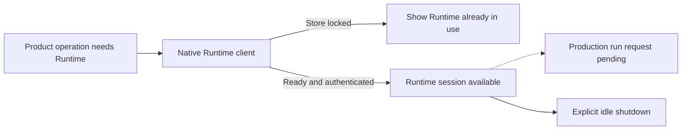

# Launcher Runtime integration

## Overview

Launcher starts Runtime as a native child when a product operation needs it.
The implemented lifecycle covers startup, authenticated readiness, conflicting
ownership, and idle shutdown. Production package execution and active-run
shutdown are pending.

## Start and check the session

Browsing installed products can leave Runtime stopped. When an operation
requires it, call the native Runtime client described in the
[managed lifecycle guide](managed_runtime.md). The currently available
integration check is the authenticated `GET {apiBaseUrl}/runtime-info` request.
Apply the same readiness and replacement rules to every later operation.

If Studio owns the store, the competing managed launch exits with code `2`.
Show **Runtime already in use** and let the user release Runtime in the owning
app before trying again. Launcher keeps its own credentials for the process it
starts.

## Stop the owned process

Expose **Shut down Runtime** while Launcher owns the idle process. Send the
control command, wait for exit, and keep Launcher open. If Launcher itself
closes, stop the owned child as part of app shutdown.

The production run example depends on the verified package admission API.
Add the exact package request, run status, and **Stop and exit / Stay open**
flow once production execution and H6 are verified. The Studio plaintext
authoring endpoints remain scoped to authoring.

## Current API inventory

| Route | Launcher use |
|---|---|
| `GET /api/v1/runtime-info` | Authenticate to the owned Runtime, verify readiness for each operation, and read compatibility information. |
| `GET /api/v1/health` | Optional troubleshooting check for HTTP liveness. A successful health response cannot release waiting operations. |
| `GET /api/v1/devices` | Read the last successful device inventory in the current session. |
| `POST /api/v1/devices/refresh` | Scan ADB and return the updated device inventory. |

Use the [shared API reference](managed_runtime.md#shared-api-reference) for
request headers, response examples, and error codes. A Launcher smoke test
starts its managed child, reads the private ready record, successfully probes
Runtime Info, sends the private shutdown command, and waits for process exit.
A competing-launch test should show **Runtime already in use** and leave the
first owner's process running.

Launcher has no production package, run, or run-control route in the current
build. Document those calls here as they become available, including package
input, authorization and compatibility, run identity, status and event
consumption, retry behavior, and the active-run shutdown flow. Plaintext
workflow validation and compilation belong to the [Studio guide](studio.md).

## Android device picker

When the customer opens device selection for a product, refresh the list
through Launcher's owned Runtime session. The cached read is available for
redisplaying the last successful result in that session. Provide a
**Refresh devices** action and keep Launcher ownership handling in the
native client. See the [shared E7 requests and responses](managed_runtime.md#device-inventory-api).

Use `adbSerial` as the selection key. Enable selection for `READY` entries,
show reasons for unavailable entries, and flag any selection lost after a
successful refresh. If refresh fails, show the failure even when the previous
result is still visible. Inventory calls require the local session token.
Product package authorization and the final live readiness recheck belong
to the future production run request.
