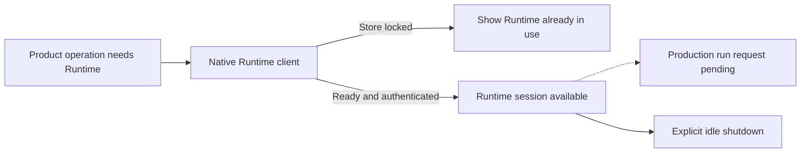

# Launcher Runtime integration

## Overview

Launcher starts Runtime as a native child when a product operation needs it.
The implemented lifecycle covers startup, authenticated readiness, conflicting
ownership, and idle shutdown. Production package execution remains pending. H4 provides a Development
multi-device start API; its owned run can be cancelled by process shutdown.

## Start and check the session

Browsing installed products can leave Runtime stopped. When an operation
requires it, call the native Runtime client described in the
[managed lifecycle guide](managed_runtime.md). The currently available
integration check is the authenticated `GET {apiBaseUrl}/runtime-info` request.
Apply the same readiness and replacement rules to every later operation.

If Studio owns the store, the competing managed launch exits with code `2`.
Show **Runtime already in use** and let the user release Runtime in the owning
app before trying again. Launcher keeps its own credentials for the process it
starts.

## Stop the owned process

Expose **Shut down Runtime** while Launcher owns the idle process. Send the
control command, wait for exit, and keep Launcher open. If Launcher itself
closes, stop the owned child as part of app shutdown.

The production run example depends on the verified package admission API.
Add the exact package request, run status, and **Stop and exit / Stay open**
flow once production execution is verified. H6–H8 variable waiting remains deferred. The Studio plaintext
authoring endpoints remain scoped to authoring.

## Current API inventory

| Route | Launcher use |
|---|---|
| `GET /api/v1/runtime-info` | Authenticate to the owned Runtime, verify readiness for each operation, and read compatibility information. |
| `GET /api/v1/health` | Optional troubleshooting check for HTTP liveness. A successful health response cannot release waiting operations. |
| `GET /api/v1/devices` | Read the last successful device inventory in the current session. |
| `POST /api/v1/devices/refresh` | Scan ADB and return the updated device inventory. |
| `GET /api/v1/runs/active` | Read the saved non-terminal RunGroup or receive 404 when idle. |
| `GET /api/v1/runs/{runGroupId}` | Read the requested saved progress or terminal result. |
| `POST /api/v1/runs/{runGroupId}/actions` | Pause, Resume or Cancel an existing group; use the [shared action guide](run_actions.md). This does not supply Production package admission. |

Use the [shared API reference](managed_runtime.md#shared-api-reference) for
request headers, response examples, and error codes. A Launcher smoke test
starts its managed child, reads the private ready record, successfully probes
Runtime Info, sends the private shutdown command, and waits for process exit.
A competing-launch test should show **Runtime already in use** and leave the
first owner's process running.

Launcher has snapshot read routes. The current build also has a Development
[POST /runs route](managed_runtime.md#workflow-start-api), but no Production
package admission/start route. H13 group controls are documented in the
[shared action guide](run_actions.md). Do not send customer product
content through the plaintext Development API. Document those remaining
calls here as they become available, including package
input, authorization and compatibility, run identity, status and event
consumption, retry behavior, and the active-run shutdown flow. Plaintext
workflow validation and compilation belong to the [Studio guide](studio.md).

## Android device picker

When the customer opens device selection for a product, refresh the list
through Launcher's owned Runtime session. The cached read is available for
redisplaying the last successful result in that session. Provide a
**Refresh devices** action and keep Launcher ownership handling in the
native client. See the [shared E7 requests and responses](managed_runtime.md#device-inventory-api).

Use `adbSerial` as the selection key. Development tests can select one or more
READY devices; Production selection follows its later package-admission contract. Enable selection for `READY` entries,
show reasons for unavailable entries, and flag any selection lost after a
successful refresh. If refresh fails, show the failure even when the previous
result is still visible. Inventory calls require the local session token.
Product package authorization and the final live readiness recheck belong
to the future production run request.

## Read progress and retained results

Use the [shared run snapshot contract](managed_runtime.md#run-snapshot-apis) for
the exact response, errors, auth headers, Linux/Windows/Postman requests, and
[saved-result demo](managed_runtime.md#optional-saved-result-fixture-without-android).
These reads require no ADB call and are available before Production package
execution is integrated. They do not implement package authorization or start
execution from a saved record.

Use active to populate a current-run view. A 404 means idle, not a Runtime
readiness failure. Preserve a known RunGroup ID so by-ID can display its result
after it finishes or when another run is active. Read the same ID with the
current owned session after reconnecting; never reconstruct or repeat a start
from the returned nextNodeId. Store identity matters: a run in a different
state directory is not present in this database.

Use the native readiness gate before each request, pass the current session
token, and send no body or query. Show the group status/summary and ordered
device states with safe terminal errors. Keep the last displayed result separate
from a read failure. Stop automatic polling for a confirmed terminal run or a
closed view, with at most one outstanding poll per view. Cancelling a GET only
cancels that read; it does not stop the workflow or the owned Runtime process.

Run controls and owner-process shutdown remain distinct. Use the existing
private owner channel for shutting down Runtime, not these GET endpoints.
H4 owns the current multi-device Development start flow; Production package
authorization and its future Launcher start endpoint remain separate work. Snapshot API/router and built-agent checks
pass on Linux and cross-compile for Windows; native Windows execution remains
unverified.

## Development API and Production boundary

The Studio developer owns the current plaintext Test Run request. The
[shared start reference](managed_runtime.md#workflow-start-api) documents
its exact DTO, auth, 201/200 responses, identity replay, errors, and manual
examples for both client developers. The Launcher Production API will accept
an authorized package/path under Phase J; G14 does not supply that authorization.

For lifecycle integration, the whole admitted run group belongs to the Runtime owner,
not its HTTP connection. Private shutdown fences dispatch and commits G11
cancellation before storage closes; owner loss uses D6 recovery. Expose
**Stop and exit / Stay open** for any active execution owned by Launcher once
its Production start path is delivered. H13 HTTP Pause/Resume/Cancel is now
implemented; follow the [shared guide](run_actions.md) for bearer, body, 200/202/409
responses, polling and lost-response handling. A Cancel button keeps Runtime
alive; Shut down Runtime and app exit still use the private owner channel.

H4 exposes the H1–H3 coordinator through the existing Development route.
Use exact ordered serial/input pairs and highlight indexed unavailableDevices
diagnostics. This route does not authorize a customer Product package. Follow the [G14 expansion checklist](../g_workflow_engine/g14_start_run_api.md#15-phase-h-expansion-checklist).

## Device selection and execution capacity

Customers control resource usage by selecting devices for each run. There is no
separate **Maximum simultaneous devices** setting. Send the exact selected ADB
serials and corresponding inputs; Runtime validates syntax, uniqueness and fresh
readiness, then admits or rejects the complete selection. Do not silently filter
unavailable entries or deduplicate entries carrying different inputs.

Capacity equals admitted membership. The owner does not write capacity YAML,
inject a capacity environment variable or restart Runtime when the next run's
selection changes. There is no per-request concurrency field or settings API.
Hardware determines practical capacity; actual byte/schema/deadline failures
still apply independently of device count.

H4 public multi-device Development starts are implemented. Use the
[H4 walkthrough](../../../../a2matex-runtime/examples/h4/README.md) for developer
integration tests, while keeping customer Product execution disabled until the
Production package/authorization API is delivered. The
[shared API reference](managed_runtime.md#workflow-start-api) documents exact
requests, availability diagnostics, replay and complete snapshots.

The [combined H15 acceptance pack](../../../../a2matex-runtime/examples/h15/README.md)
verifies the existing Development routes, complete per-device results, artifacts
and group controls under Linux controlled ADB. Use it for developer integration
checks; live independent Android/native Windows acceptance remains pending. This
does not introduce or authorize the Phase J protected Product-package API.
