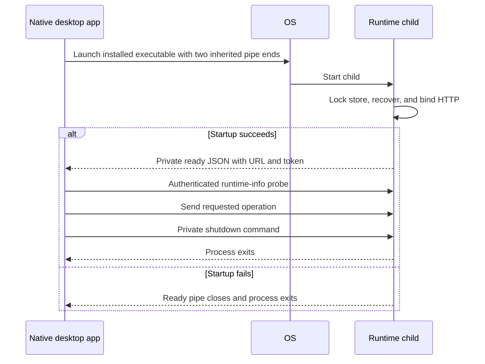

# Managed Runtime integration

## Overview

The native Studio or Launcher process owns the Runtime child it starts. The
child hands back its API address and bearer token after recovery and HTTP
startup. The parent checks the session before each operation and owns the
decision to replace a failed child. This protocol has been verified on Linux
with the Runtime test parent. Windows has a successful cross-build and still
requires a native parent acceptance run.



## Start the child

1. Resolve the trusted absolute executable path from the desktop installation.
   The packaging configuration supplies the location for each app and OS.
2. Create two anonymous pipes. Keep the command write end and readiness read
   end in the parent. Inherit only the command read end and readiness write end
   in the child. Close the parent's copies of the child ends after launch and
   prevent unrelated subprocesses from inheriting the retained ends.
3. Launch directly with an argument array. Supply the numeric descriptor or
   handle **as seen by the child**. Keep stdout and stderr separate from both
   pipes and drain or redirect them if captured.

```text
<absolute-runtime-executable>
  --owner-command-pipe <child-command-read-end>
  --owner-ready-pipe <child-readiness-write-end>
  --listen-address 127.0.0.1:6810
```

`--listen-address` is optional and defaults to `127.0.0.1:6810` in the
default configuration. An override must be a loopback IP and a nonzero port.
On Linux, pass the child descriptors through the process spawn API. The Runtime
repo's Linux acceptance harness is
`internal/discovery/testdata/managed_parent.py`. On Windows, the executable is
`a2matex-runtime.exe`. The native launcher must explicitly pass the two pipe
handles through process creation. Verify that path on Windows before shipping.

## Readiness and authentication

Read one bounded UTF-8 JSON line from the private readiness pipe within a
startup deadline. The current record has two fields and ends in LF.

```json
{"apiBaseUrl":"http://127.0.0.1:6810/api/v1","sessionToken":"<fresh bearer token>"}
```

Keep the address and token in native process memory. Check that the address
uses HTTP on a loopback IP with the `/api/v1` suffix before using it. Bypass
proxies and reject redirects for local requests. Keep the token out of logs,
URLs, and renderer state. Managed mode sends credentials through the pipe.
Standalone development uses the protected connection file.
See the [local authentication guide](local_authentication.md) for locating
the file and testing bearer requests on Linux and Windows.

For every operation, confirm the owned child and control channel are live, then
make a bounded authenticated `GET {apiBaseUrl}/runtime-info` request using
`Authorization: Bearer <sessionToken>`. Send the requested operation only
after a valid authenticated response. Check compatibility separately from
readiness. The readiness probe itself goes directly to the current address.

Use one native client per desktop app. Requests arriving while it starts or
replaces a child share that attempt. After replacement, each waiting operation
still passes the readiness gate before sending HTTP.

## Map the child lifecycle to app state

| Client state | What pending operations do |
|---|---|
| Stopped | Request one launch when work first needs Runtime and automatic launch is allowed. |
| Starting | Wait for the same launch attempt. Apply a startup deadline. |
| Ready | Check the child and control channel, then probe the authenticated session for this operation. |
| Replacing | Wait for the old child to exit and the new child to announce readiness. A stale child exit must only clear the session belonging to that child. |
| Stopping or explicitly stopped | Leave automatic work unsent. Allow a new launch after process exit and an explicit Runtime action. |

Observe child exit and pipe closure in native code independently of window
visibility, renderer reloads, and HTTP stream state. Cancel waiting work that
is no longer relevant to the app, such as validation of an older draft.

## Failure and shutdown

| Signal | Parent behavior |
|---|---|
| Child exits with code `2` before readiness | Show **Runtime already in use**. Leave waiting requests unsent. |
| Child exits with another code before readiness, sends a malformed record, or exceeds the startup deadline | Report startup failure. Close the pipes and ensure the child exits. |
| Child exits unexpectedly, the control channel breaks, or the readiness probe fails | Discard that child's URL and token. For pending work, stop any surviving child and confirm exit within a deadline, then start one shared replacement and probe its fresh session. A failed replacement ends the attempt for all waiting requests. |
| User selects **Shut down Runtime** or exits the owning app | Suppress automatic launch, clear the session, send the exact bytes `shutdown\n` on the command pipe, and await process exit before displaying **Stopped**. Use bounded termination if the process fails to exit. Only an explicit Runtime action clears suppression. |
| Parent disappears | Closing the command pipe produces EOF in the child and triggers bounded cleanup. D6 handles unfinished execution records at the next start. |
| API operation returns diagnostics or an ordinary error | Surface the result while retaining the healthy session. |

A transport failure after sending a request can leave an unknown outcome.
Validation and compilation can be retried after the session is ready again.
For a future run-start retry, reuse the original request ID and exact payload.
Active-run cancellation through H6 and the execution endpoints still require
their own verification.

To reproduce the verified Linux lifecycle from the Runtime repo, run
`make build`, then
`python3 internal/discovery/testdata/managed_parent.py bin/a2matex-runtime`.

See [Studio authoring](studio.md) and [Launcher ownership](launcher.md) for app
integration examples.

## Shared API reference

Build request URLs from the ready message. For example, an `apiBaseUrl`
ending in `/api/v1` becomes `{apiBaseUrl}/runtime-info`. Append the route
suffix once. Local responses carry `Cache-Control: no-store`.

### GET /api/v1/health

Use this unauthenticated request to diagnose HTTP liveness. It takes no query
parameters or body. The exact route returns HTTP 200 with `{"status":"UP"}`.
A query string returns HTTP 400. HTTP liveness alone does not confirm child
ownership, authentication, or execution compatibility.

### GET /api/v1/runtime-info

Use the bearer token from the current ready message. Send no query parameters
or body. HTTP 200 returns this shape, with the version coming from the build.

```json
{
  "runtimeVersion": "1.2.3",
  "runtimeIrFormatVersions": [1],
  "supportedNodes": []
}
```

`runtimeIrFormatVersions` describes IR format support. `supportedNodes`
advertises executable node type and handler pairs. The current build returns
an empty list while execution is pending. Studio can still validate and
compile with its owned Runtime. Treat a failed authenticated probe according
to the replacement policy above. A valid response with an incompatible
version is a compatibility result to display, independent of child readiness.

### HTTP error envelope

```json
{
  "error": {
    "code": "UNAUTHORIZED",
    "message": "local session token is missing or invalid",
    "retryable": false
  }
}
```

| HTTP status | Code | Meaning in the current API |
|---|---|---|
| 400 | `INVALID_REQUEST` | Unexpected query, malformed request envelope, or invalid request transport |
| 401 | `UNAUTHORIZED` | Missing or invalid bearer credential |
| 404 | `RESOURCE_NOT_FOUND` | Authenticated request to an unknown route or unsupported method |
| 413 | `PAYLOAD_TOO_LARGE` | A documented request size limit was exceeded |
| 500 | `INTERNAL_ERROR` | Unexpected Runtime failure with a generic response |
| 503 | `ADB_UNAVAILABLE` | Device refresh could not complete |

Device refresh failures with `ADB_UNAVAILABLE` set `retryable` to `true`.
The other errors in this table set it to `false`. Apply the lifecycle
and operation-specific retry rules when a request fails at the transport
level. The private shutdown command and managed launch exit codes are process
signals outside this HTTP error envelope.

### Device inventory API

Both [E7 routes](../e_device_subsystem/e7_device_api.md) are available on the
Runtime build. Each request uses the owning app's current `apiBaseUrl` and
bearer token. Send no query parameters
or body, including on refresh. For example, run these calls from an authorized
development shell with `API_BASE_URL` and `SESSION_TOKEN` set from the current
Runtime handoff. Keep the token out of shell tracing and logs.

```sh
curl --noproxy '*' -fsS -H "Authorization: Bearer ${SESSION_TOKEN}" \
  "${API_BASE_URL}/runtime-info" >/dev/null &&
curl --noproxy '*' -sS -i -H "Authorization: Bearer ${SESSION_TOKEN}" \
  "${API_BASE_URL}/devices"
```

```sh
curl --noproxy '*' -fsS -H "Authorization: Bearer ${SESSION_TOKEN}" \
  "${API_BASE_URL}/runtime-info" >/dev/null &&
curl --noproxy '*' -sS -i -X POST -H "Authorization: Bearer ${SESSION_TOKEN}" \
  "${API_BASE_URL}/devices/refresh"
```

Both operations return `200` with the same JSON shape, for example
`{"devices":[{"adbSerial":"emulator-5554","status":"READY"}]}`. A cached
read can return `{"devices":[]}` before the first scan. Refresh queries ADB
and can return the same empty response when no devices are found. Entries
marked `UNAVAILABLE` carry an `error` with the device reason.

Handle `400 INVALID_REQUEST` by fixing the request, and `401 UNAUTHORIZED`
by rechecking the current owned session. A `503 ADB_UNAVAILABLE` after a
successful readiness probe is a refresh failure. It leaves the cached list
available and does not trigger child replacement. Show the refresh error
and let the user retry after addressing ADB availability. Allow enough time
for the 20-second refresh budget and process cleanup. If the child exits
during the operation, apply the managed readiness and replacement flow
before the next request. A replacement child starts with an empty list.

## Adding an API in later phases

Before handing off an API, update the guide for the app that calls it and mark
its implementation and verification status. Add shared routes here and link
to them from both app guides. Use the relevant Runtime contract as the source
for the wire format. Each API section should cover:

- The calling app, user action, native process responsibility, and prerequisites.
- Method, path, authentication, headers, query parameters, request body,
  limits, and a runnable example.
- Response fields and examples for success, invalid input, and applicable errors.
- Side effects, correlation IDs, compatibility checks, retry and idempotency
  rules, and what to do if Runtime exits mid-request.
- For streaming APIs, how to reconnect, resume from a cursor, or read a snapshot.
- The acceptance checks run against the Runtime build and any host-specific gaps.

When the launch protocol, shutdown behavior, or readiness rules change,
update this shared guide and check both app flows against the new behavior.
