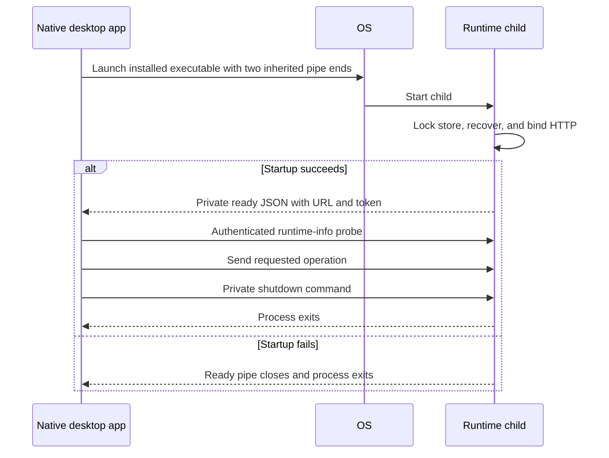

# Managed Runtime integration

## Overview

The native Studio or Launcher process owns the Runtime child it starts. The
child hands back its API address and bearer token after recovery and HTTP
startup. The parent checks the session before each operation and owns the
decision to replace a failed child. This protocol has been verified on Linux
with the Runtime test parent. Windows has a successful cross-build and still
requires a native parent acceptance run.



## Start the child

1. Resolve the trusted absolute executable path from the desktop installation.
   The packaging configuration supplies the location for each app and OS.
2. Create two anonymous pipes. Keep the command write end and readiness read
   end in the parent. Inherit only the command read end and readiness write end
   in the child. Close the parent's copies of the child ends after launch and
   prevent unrelated subprocesses from inheriting the retained ends.
3. Launch directly with an argument array. Supply the numeric descriptor or
   handle **as seen by the child**. Keep stdout and stderr separate from both
   pipes and drain or redirect them if captured.

```text
<absolute-runtime-executable>
  --owner-command-pipe <child-command-read-end>
  --owner-ready-pipe <child-readiness-write-end>
  --listen-address 127.0.0.1:6810
```

`--listen-address` is optional and defaults to `127.0.0.1:6810` in the
default configuration. An override must be a loopback IP and a nonzero port.
On Linux, pass the child descriptors through the process spawn API. The Runtime
repo's Linux acceptance harness is
`internal/discovery/testdata/managed_parent.py`. On Windows, the executable is
`a2matex-runtime.exe`. The native launcher must explicitly pass the two pipe
handles through process creation. Verify that path on Windows before shipping.

## Readiness and authentication

Read one bounded UTF-8 JSON line from the private readiness pipe within a
startup deadline. The current record has two fields and ends in LF.

```json
{"apiBaseUrl":"http://127.0.0.1:6810/api/v1","sessionToken":"<fresh bearer token>"}
```

Keep the address and token in native process memory. Check that the address
uses HTTP on a loopback IP with the `/api/v1` suffix before using it. Bypass
proxies and reject redirects for local requests. Keep the token out of logs,
URLs, and renderer state. Managed mode sends credentials through the pipe.
Standalone development uses the protected connection file.
See the [local authentication guide](local_authentication.md) for locating
the file and testing bearer requests on Linux and Windows.

For every operation, confirm the owned child and control channel are live, then
make a bounded authenticated `GET {apiBaseUrl}/runtime-info` request using
`Authorization: Bearer <sessionToken>`. Send the requested operation only
after a valid authenticated response. Check compatibility separately from
readiness. The readiness probe itself goes directly to the current address.

Use one native client per desktop app. Requests arriving while it starts or
replaces a child share that attempt. After replacement, each waiting operation
still passes the readiness gate before sending HTTP.

## Map the child lifecycle to app state

| Client state | What pending operations do |
|---|---|
| Stopped | Request one launch when work first needs Runtime and automatic launch is allowed. |
| Starting | Wait for the same launch attempt. Apply a startup deadline. |
| Ready | Check the child and control channel, then probe the authenticated session for this operation. |
| Replacing | Wait for the old child to exit and the new child to announce readiness. A stale child exit must only clear the session belonging to that child. |
| Stopping or explicitly stopped | Leave automatic work unsent. Allow a new launch after process exit and an explicit Runtime action. |

Observe child exit and pipe closure in native code independently of window
visibility, renderer reloads, and HTTP stream state. Cancel waiting work that
is no longer relevant to the app, such as validation of an older draft.

## Failure and shutdown

| Signal | Parent behavior |
|---|---|
| Child exits with code `2` before readiness | Show **Runtime already in use**. Leave waiting requests unsent. |
| Child exits with another code before readiness, sends a malformed record, or exceeds the startup deadline | Report startup failure. Close the pipes and ensure the child exits. |
| Child exits unexpectedly, the control channel breaks, or the readiness probe fails | Discard that child's URL and token. For pending work, stop any surviving child and confirm exit within a deadline, then start one shared replacement and probe its fresh session. A failed replacement ends the attempt for all waiting requests. |
| User selects **Shut down Runtime** or exits the owning app | Suppress automatic launch, clear the session, send the exact bytes `shutdown\n` on the command pipe, and await process exit before displaying **Stopped**. Use bounded termination if the process fails to exit. Only an explicit Runtime action clears suppression. |
| Parent disappears | Closing the command pipe produces EOF in the child and triggers bounded cleanup. D6 handles unfinished execution records at the next start. |
| API operation returns diagnostics or an ordinary error | Surface the result while retaining the healthy session. |

A transport failure after sending a request can leave an unknown outcome.
Validation and compilation can be retried after the session is ready again.
For a future run-start retry, reuse the original request ID and exact payload.
Active-run cancellation through H6 and the execution endpoints still require
their own verification.

To reproduce the verified Linux lifecycle from the Runtime repo, run
`make build`, then
`python3 internal/discovery/testdata/managed_parent.py bin/a2matex-runtime`.

See [Studio authoring](studio.md) and [Launcher ownership](launcher.md) for app
integration examples.

## Shared API reference

Build request URLs from the ready message. For example, an `apiBaseUrl`
ending in `/api/v1` becomes `{apiBaseUrl}/runtime-info`. Append the route
suffix once. Local responses carry `Cache-Control: no-store`.

### GET /api/v1/health

Use this unauthenticated request to diagnose HTTP liveness. It takes no query
parameters or body. The exact route returns HTTP 200 with `{"status":"UP"}`.
A query string returns HTTP 400. HTTP liveness alone does not confirm child
ownership, authentication, or execution compatibility.

### GET /api/v1/runtime-info

Use the bearer token from the current ready message. Send no query parameters
or body. HTTP 200 returns this shape, with the version coming from the build.

```json
{
  "runtimeVersion": "1.2.3",
  "runtimeIrFormatVersions": [1],
  "supportedNodes": []
}
```

`runtimeIrFormatVersions` describes IR format support. `supportedNodes`
advertises the node type/handler pairs registered in the running build. Read
the actual list for compatibility rather than assuming it is empty. Studio
can validate and compile with its owned Runtime. Treat a failed authenticated probe according
to the replacement policy above. A valid response with an incompatible
version is a compatibility result to display, independent of child readiness.

### HTTP error envelope

```json
{
  "error": {
    "code": "UNAUTHORIZED",
    "message": "local session token is missing or invalid",
    "retryable": false
  }
}
```

| HTTP status | Code | Meaning in the current API |
|---|---|---|
| 400 | `INVALID_REQUEST` | Unexpected query, malformed request envelope, or invalid request transport |
| 401 | `UNAUTHORIZED` | Missing or invalid bearer credential |
| 404 | `RESOURCE_NOT_FOUND` | Unknown route/method, missing saved run, or no active run |
| 409 | `RUNTIME_BUSY` | Another workflow group is active; no new run admitted |
| 422 | `VALIDATION_FAILED`, `RUNTIME_INCOMPATIBLE`, or a device availability code | New run rejected before admission; see start API |
| 413 | `PAYLOAD_TOO_LARGE` | A documented request size limit was exceeded |
| 500 | `INTERNAL_ERROR` | Unexpected Runtime failure with a generic response |
| 500 | `PERSISTENCE_FAILED` | Admission or execution snapshot persistence failed |
| 503 | `ADB_UNAVAILABLE` | Device refresh or admission preflight could not complete |
| 503 | `INTERNAL_ERROR` | Runtime is stopping before accepting new work |

ADB availability errors, RUNTIME_BUSY, and confirmed device-availability
rejections set retryable to true. Validation, persistence, transport, and
internal errors set it to false. Apply the lifecycle
and operation-specific retry rules when a request fails at the transport
level. The private shutdown command and managed launch exit codes are process
signals outside this HTTP error envelope.

### Device inventory API

Both [E7 routes](../e_device_subsystem/e7_device_api.md) are available on the
Runtime build. Each request uses the owning app's current `apiBaseUrl` and
bearer token. Send no query parameters
or body, including on refresh. For example, run these calls from an authorized
development shell with `API_BASE_URL` and `SESSION_TOKEN` set from the current
Runtime handoff. Keep the token out of shell tracing and logs.

```sh
curl --noproxy '*' -fsS -H "Authorization: Bearer ${SESSION_TOKEN}" \
  "${API_BASE_URL}/runtime-info" >/dev/null &&
curl --noproxy '*' -sS -i -H "Authorization: Bearer ${SESSION_TOKEN}" \
  "${API_BASE_URL}/devices"
```

```sh
curl --noproxy '*' -fsS -H "Authorization: Bearer ${SESSION_TOKEN}" \
  "${API_BASE_URL}/runtime-info" >/dev/null &&
curl --noproxy '*' -sS -i -X POST -H "Authorization: Bearer ${SESSION_TOKEN}" \
  "${API_BASE_URL}/devices/refresh"
```

Both operations return `200` with the same JSON shape, for example
`{"devices":[{"adbSerial":"emulator-5554","status":"READY"}]}`. A cached
read can return `{"devices":[]}` before the first scan. Refresh queries ADB
and can return the same empty response when no devices are found. Entries
marked `UNAVAILABLE` carry an `error` with the device reason.

Handle `400 INVALID_REQUEST` by fixing the request, and `401 UNAUTHORIZED`
by rechecking the current owned session. A `503 ADB_UNAVAILABLE` after a
successful readiness probe is a refresh failure. It leaves the cached list
available and does not trigger child replacement. Show the refresh error
and let the user retry after addressing ADB availability. Allow enough time
for the 20-second refresh budget and process cleanup. If the child exits
during the operation, apply the managed readiness and replacement flow
before the next request. A replacement child starts with an empty list.

## Run snapshot APIs

G13 exposes two ordinary JSON reads. They return immediately during a run or
after completion; they do not wait for completion or stream logs. Both require
the current bearer token, take no query parameters or body, and return
`Cache-Control: no-store` for both success and errors.

| Route | Result |
|---|---|
| `GET {apiBaseUrl}/runs/active` | The one RUNNING/PAUSED RunGroup, including a newly admitted group whose devices are still QUEUED. Returns 404 when no non-terminal group exists. |
| `GET {apiBaseUrl}/runs/{runGroupId}` | The requested saved run, including terminal results. Requires a lowercase canonical UUID v4. Returns 404 for an unknown valid ID and 400 for an invalid ID. |

Keep the RunGroup ID returned by admission, not the request ID or a device
execution ID. When a run finishes, the active route stops returning it, while
its by-ID route remains available. If a newer run is active, reading an older
ID still returns the older run.

### Snapshot response

HTTP 200 returns the direct A7 object below. This example is a queued run;
RUNNING is already the group's status before its first device starts.

```json
{
  "cursor": "2",
  "runGroup": {
    "id": "550e8400-e29b-41d4-a716-446655440001",
    "requestId": "550e8400-e29b-41d4-a716-446655440000",
    "status": "RUNNING",
    "createdAt": "2026-11-18T08:00:00.000Z",
    "finishedAt": null,
    "summary": {
      "total": 1,
      "queued": 1,
      "running": 0,
      "paused": 0,
      "succeeded": 0,
      "failed": 0,
      "cancelled": 0,
      "interrupted": 0
    }
  },
  "deviceExecutions": [
    {
      "id": "550e8400-e29b-41d4-a716-446655440002",
      "adbSerial": "emulator-5554",
      "status": "QUEUED",
      "nextNodeId": "start",
      "createdAt": "2026-11-18T08:00:00.000Z",
      "startedAt": null,
      "finishedAt": null,
      "terminalError": null
    }
  ]
}
```

| Field | Client interpretation |
|---|---|
| `cursor` | Decimal string containing the Runtime-wide event watermark read with this snapshot. Preserve it as a string; it is not progress percentage or this run's attempt count. SSE integration is still pending. |
| `runGroup` | Saved identity, originating request ID, status, UTC millisecond timestamps, and device counts. All summary fields remain present even when zero. |
| `deviceExecutions` | One through 32 selected devices in admission order, with status, saved next-node position, timestamps, and terminal error. Optional fields are explicitly null. |
| `nextNodeId` | Saved A5 execution position; it may be an active node, retry node, or pending successor. It is not a separate live-handler measurement. |
| `terminalError` | Null or the existing safe `{code,message,retryable}` error. It contains no raw ADB output or workflow values. |

The state, device list, derived summary, and cursor come from one SQLite read
transaction. A simultaneous finish can yield the consistent earlier snapshot
or the later terminal/not-found result. Refresh for newer state; do not assume
that an already received snapshot continues changing. Snapshot GETs create no
records/events, invoke no ADB command, and do not change execution state.

### Snapshot errors

Use the [shared error envelope](#http-error-envelope).

| HTTP | Code | Meaning and next action |
|---|---|---|
| 400 | `INVALID_REQUEST` | Fix the ID, remove query parameters, and set the request body to none. Even `{}` or whitespace is forbidden. |
| 401 | `UNAUTHORIZED` | Credentials do not belong to the current process; apply the shared readiness/session replacement flow. |
| 404 | `RESOURCE_NOT_FOUND` | No active group or the requested saved ID does not exist. After a successful readiness probe this is a data result, not a reason to relaunch Runtime. |
| 500 | `PERSISTENCE_FAILED` | SQLite could not provide a safe snapshot. Message: `unable to read execution snapshot`. Show the read failure without inferring run completion. |
| 500 | `INTERNAL_ERROR` | Unexpected or cancelled read; the response remains generic. A disconnected client may receive no response. |

All these error envelopes set `retryable` to false. Read-only GETs have no
execution side effects; a later user refresh is possible after restoring the
session or fixing the failure. Do not retry a failed start or reconstruct
execution from snapshot data. Missing ADB/emulator connectivity does not prevent
these reads. Attempt history, node outputs, workflow inputs/IR, artifacts, and
live logs are not part of this response.

### Linux curl

First load credentials using the Linux example in the
[authentication guide](local_authentication.md#linux-terminal). That example
leaves `runtime_connection` in the shell. The server does not export shell
variables for you. Set the ID to a real saved RunGroup ID:

```bash
API_BASE_URL="${runtime_connection[0]}"
SESSION_TOKEN="${runtime_connection[1]}"
RUN_GROUP_ID="<saved RunGroup UUID>"

runtime_snapshot() {
  printf 'header = "Authorization: Bearer %s"\n' "$SESSION_TOKEN" |
    curl --config - --noproxy '*' --max-time 5 -fsS \
      "${API_BASE_URL}/runtime-info" >/dev/null || return
  printf 'header = "Authorization: Bearer %s"\n' "$SESSION_TOKEN" |
    curl --config - --noproxy '*' --max-time 5 -sS -i \
      "${API_BASE_URL}$1"
}
runtime_snapshot "/runs/active"
runtime_snapshot "/runs/${RUN_GROUP_ID}"
```

Each call probes actual authenticated readiness before the snapshot request.
The snapshot call prints headers and error bodies, including an expected idle
404. The helper stops on a failed probe; the native application's shared owner
client performs the actual replacement/relaunch policy. Keep tokens in local
memory, disable shell tracing, and do not export credential-bearing output.

### Windows PowerShell

Load `$Connection` using the Windows example in the
[authentication guide](local_authentication.md#windows-terminal), then:

```powershell
$APIBaseUrl = $Connection.apiBaseUrl
$SessionToken = $Connection.sessionToken
$RunGroupId = '<saved RunGroup UUID>'

function Get-RuntimeSnapshot([string]$Path) {
    $CurlConfig = 'header = "Authorization: Bearer {0}"' -f $SessionToken
    $CurlConfig | curl.exe --config - --noproxy '*' --max-time 5 -fsS "$APIBaseUrl/runtime-info" | Out-Null
    if ($LASTEXITCODE -ne 0) { throw 'Runtime readiness failed; refresh the owned session.' }
    $CurlConfig | curl.exe --config - --noproxy '*' --max-time 5 -sS -i "$APIBaseUrl$Path"
}
Get-RuntimeSnapshot '/runs/active'
Get-RuntimeSnapshot "/runs/$RunGroupId"
```

This uses Windows `curl.exe`, not PowerShell's older `curl` alias. These commands
follow the verified protocol and Windows store-path implementation; native
Windows command execution remains unverified. The Runtime agent and affected
API tests cross-compile for Windows amd64.

### Postman on either host

Use current local `API_BASE_URL` and `SESSION_TOKEN` values from the
[authentication guide](local_authentication.md#postman-on-linux-or-windows).
Before each operation, confirm `GET {{API_BASE_URL}}/runtime-info` succeeds.
Create GET requests to `{{API_BASE_URL}}/runs/active` and
`{{API_BASE_URL}}/runs/{{RUN_GROUP_ID}}`. Set Authorization to Bearer Token
`{{SESSION_TOKEN}}`, Body to none, and leave Params empty. apiBaseUrl already
includes `/api/v1`; append that prefix only once.

Expected checks: active/saved state returns 200, idle active returns 404,
`/runs/invalid` or `?limit=1` returns 400, and removing Authorization returns
401. Keep credential values local to Postman, not shared/exported collections.

### Optional saved-result fixture without Android

G14 now provides the [public start route](#single-device-start-api). To inspect
only saved cancellation data without an Android device,
reuse the Git-ignored G12 smoke from the repository root. Stop any other owner
of that demo store first. It prints a group ID and cancels its queued run before
releasing SQLite. Keep that printed RunGroup ID for the requests above.

Linux, terminal 1:

```bash
(cd test_demo/g12-smoke && go run .)
make build
XDG_STATE_HOME="$PWD/test_demo/g12-smoke/state" ./bin/a2matex-runtime
```

Windows PowerShell, terminal 1:

```powershell
Push-Location .\test_demo\g12-smoke
go run .
Pop-Location
$env:LOCALAPPDATA = (Resolve-Path '.\test_demo\g12-smoke\state').Path
New-Item -ItemType Directory -Force .\bin | Out-Null
go build -buildvcs=false -o .\bin\a2matex-runtime.exe .\cmd\agent
.\bin\a2matex-runtime.exe
```

Wait for Runtime readiness, then use a second terminal/Postman. On Windows, set
that same LOCALAPPDATA override in the second terminal before locating its
connection file; the variable is local to each terminal. Linux's state override
does not change its B5 connection-file selection. Read fresh credentials from
this running agent, not from the exited smoke tool. The normal Runtime database
is separate; the smoke's data stays in its readable `state` folder.

By-ID must return the saved CANCELLED group/device, and active must return
404. The demo SQLite node_attempts table remains empty; attempt history is not
a field in the snapshot response. The built Linux agent was verified using a temporary
copy of this smoke database: the snapshot calls and clean process shutdown left
all row/event counts unchanged. The Linux curl helper was also exercised against
that build. Active-to-terminal reads and concurrent checkpoint/cursor consistency
are covered by real-SQLite authenticated router tests; native Windows acceptance
remains pending.

## Single-device start API

### POST /api/v1/runs — Start a Development workflow

Use this endpoint when the publisher presses **Test Run** in Studio. It accepts
compiled Runtime IR and one device's inputs, persists admission, hands the
execution to the Runtime owner, and returns a snapshot. The HTTP response waits
for admission/handoff, not workflow completion. Execution continues after the
request disconnects. This endpoint is available now for one device per new run.
Production package/path admission remains I2.

| Request setting | Exact value |
|---|---|
| Method | POST |
| URL | `{apiBaseUrl}/runs`, normally `http://127.0.0.1:6810/api/v1/runs` |
| Authorization | Exactly one `Authorization: Bearer <current-session-token>` header |
| Content-Type | `application/json`, optionally `charset=utf-8` |
| Body | One raw JSON object with `requestId`, `runtimeIr`, and `devices` |
| Query parameters | None |
| Content encoding | None |

`apiBaseUrl` comes from the Runtime's private ready record or standalone
connection file and already includes `/api/v1`; append `/runs` once. The port
is configurable, so native clients use that published URL. Credentials stay
inside the trusted native client. See [readiness/authentication](#readiness-and-authentication)
for the process gate that runs before every request.

```mermaid
sequenceDiagram
    participant Studio as Studio native client
    participant Compile as Compilation API
    participant Runs as POST /runs
    participant Worker as Owned device execution
    Studio->>Compile: Editor Graph + Input Schema
    Compile-->>Studio: validation + runtimeIr
    Studio->>Runs: New requestId + runtimeIr + one device/input object
    alt New request passes admission
        Runs->>Worker: Persist and register owned work
        Runs-->>Studio: 201 + snapshot and runGroup.id
        Worker->>Worker: Execute asynchronously
    else RequestId was already admitted
        Runs-->>Studio: 200 + saved snapshot; no new execution
    else Invalid, unavailable, or busy
        Runs-->>Studio: Error; no new admission
    end
    Studio->>Runs: GET /runs/runGroupId
    Runs-->>Studio: Current committed result
```

### Prerequisites

Before starting, the owned Runtime must pass authenticated readiness, support
the compiled workflow's version/handlers, and see the selected device READY.
Studio first compiles the captured graph/schema and refreshes device selection;
admission still performs its own fresh E6 check.

For manual Linux testing from the Runtime repository root:

```bash
make build VERSION=0.1.0
A2MATEX_RUNTIME_ADB_EXECUTABLE_PATH="$HOME/Documents/platform-tools/adb" \
./bin/a2matex-runtime
```

For Windows PowerShell, use the installed Windows platform-tools directory:

```powershell
New-Item -ItemType Directory -Force .\bin | Out-Null
go build -buildvcs=false -ldflags "-X github.com/A2MaTex/a2matex-runtime/internal/buildinfo.Version=0.1.0" -o .\bin\a2matex-runtime.exe .\cmd\agent
$env:A2MATEX_RUNTIME_ADB_EXECUTABLE_PATH = Join-Path $HOME 'Documents\platform-tools\adb.exe'
.\bin\a2matex-runtime.exe
```

These are standalone examples. Desktop integration uses the [managed launch](#start-the-child),
not shell commands or a Postman environment script. Each restart supplies new
credentials. The shared version/ADB-default refactor is not implemented;
`0.0.0-dev` can serve authoring/read requests but G1 rejects execution with
`422 RUNTIME_INCOMPATIBLE`. The current catalog requires at least `0.1.0` for
this example. Check the actual `runtimeVersion` from Runtime Info.

### Request fields and where Studio obtains them

| JSON field | Type | Studio source and rule |
|---|---|---|
| `requestId` | String | Generate one canonical lowercase UUID v4 for a new Test Run intent. Retain it and the request through submission/retry. |
| `runtimeIr` | Object | Use `compilationResponse.runtimeIr` from a successful `POST /workflow-compilation` for the captured graph/schema revision. Require VALID or VALID_WITH_WARNINGS and non-null IR. |
| `devices` | Array | Exactly one device object for a new run. Do not send several selected devices yet. |
| `devices[0].adbSerial` | String | Copy the exact selected READY serial from `POST /devices/refresh`, including `:5555` when present. |
| `devices[0].inputs` | Object | Values from Studio's workflow-input form matching the compiled `runtimeIr.inputSchema`. Use `{}` for an empty schema. |

Send the value of `runtimeIr`, not the entire compilation response containing
`validation`. It stays a JSON object, not a JSON-encoded string. Editor Graph
uses `bindings` with `kind`; compiled IR uses `inputs` with `source`. Studio
must use compiler output directly rather than rename fields or compile it itself.
Do not send editorGraph, inputSchema, sessionToken, runtimeVersion, concurrency,
or product-package fields at the root of this start request.

Limits are 1 MiB for the raw IR object and 4 MiB for the full UTF-8 body,
including envelope/whitespace. Unknown public fields, null/wrong types,
duplicate keys at any depth, invalid UTF-8, trailing JSON, unsupported
headers/query, and invalid request IDs are rejected. The current MVP only
accepts one device on a new ID; zero or multiple devices produce 400.

### Complete request example

This is a valid Start → Delay ten seconds → End request, also available as
[a readable JSON file](../../../../a2matex-runtime/examples/g14/start-delay-end.json).
Replace the serial with your READY device and generate a fresh requestId for a
new execution. The fixed UUID is illustrative: repeatedly sending it after
admission only reads its saved run. The graph performs no Android UI action;
its delay makes polling observable and device preflight still requires READY.

```json
{
  "requestId": "550e8400-e29b-41d4-a716-446655440000",
  "runtimeIr": {
    "formatVersion": 1,
    "minimumRuntimeVersion": "0.1.0",
    "metadata": {
      "sourceGraphSchemaVersion": 1
    },
    "entryNodeId": "start",
    "inputSchema": {
      "type": "object",
      "properties": {},
      "required": [],
      "additionalProperties": false
    },
    "nodes": [
      {
        "id": "start",
        "type": "flow.start",
        "runtimeHandler": "flow.start",
        "config": {},
        "inputs": {},
        "timeoutMs": 1000,
        "retryPolicy": {
          "maxAttempts": 1,
          "delayMs": 0
        },
        "errorPolicy": "STOP"
      },
      {
        "id": "wait",
        "type": "flow.delay",
        "runtimeHandler": "flow.delay",
        "config": {},
        "inputs": {
          "durationMs": {
            "source": "LITERAL",
            "value": 10000
          }
        },
        "timeoutMs": 15000,
        "retryPolicy": {
          "maxAttempts": 1,
          "delayMs": 0
        },
        "errorPolicy": "STOP"
      },
      {
        "id": "end",
        "type": "flow.end",
        "runtimeHandler": "flow.end",
        "config": {},
        "inputs": {},
        "timeoutMs": 1000,
        "retryPolicy": {
          "maxAttempts": 1,
          "delayMs": 0
        },
        "errorPolicy": "STOP"
      }
    ],
    "edges": [
      {
        "id": "e1",
        "sourceNodeId": "start",
        "sourcePort": "success",
        "targetNodeId": "wait"
      },
      {
        "id": "e2",
        "sourceNodeId": "wait",
        "sourcePort": "success",
        "targetNodeId": "end"
      }
    ],
    "requiredCapabilities": []
  },
  "devices": [
    {
      "adbSerial": "192.168.240.112:5555",
      "inputs": {}
    }
  ]
}
```

For a workflow with declared inputs, only `devices[0].inputs` contains their
runtime values. For example, a required integer input named `duration` receives
`{"duration": 1000}`. Its binding must already exist in the compiled IR; adding
arbitrary input properties to the empty schema above is a validation failure.

### New admission response: HTTP 201 Created

A new successful POST returns `Content-Type: application/json; charset=utf-8`
and `Cache-Control: no-store`, with this complete snapshot shape:

```json
{
  "cursor": "7",
  "runGroup": {
    "id": "550e8400-e29b-41d4-a716-446655440001",
    "requestId": "550e8400-e29b-41d4-a716-446655440000",
    "status": "RUNNING",
    "createdAt": "2026-11-19T08:00:00.000Z",
    "finishedAt": null,
    "summary": {
      "total": 1,
      "queued": 0,
      "running": 1,
      "paused": 0,
      "succeeded": 0,
      "failed": 0,
      "cancelled": 0,
      "interrupted": 0
    }
  },
  "deviceExecutions": [
    {
      "id": "550e8400-e29b-41d4-a716-446655440002",
      "adbSerial": "192.168.240.112:5555",
      "status": "RUNNING",
      "nextNodeId": "wait",
      "createdAt": "2026-11-19T08:00:00.000Z",
      "startedAt": "2026-11-19T08:00:00.004Z",
      "finishedAt": null,
      "terminalError": null
    }
  ]
}
```

These UUIDs, times, cursor, and RUNNING position are illustrative. The snapshot
is read after worker registration; its device can be QUEUED, RUNNING, or
terminal, while the group can be RUNNING or terminal. HTTP 201 means a new run
was admitted and owned. It does not mean
that all nodes succeeded, and it does not wait for the ten-second delay.

| Response field | Studio handling |
|---|---|
| `runGroup.id` | Store as the run identity and use it in subsequent GET paths. It differs from requestId and device-execution ID. |
| `runGroup.requestId` | Correlate the result with the pending Test Run intent. |
| `runGroup.status` | Display group progress/result. Terminal values are SUCCEEDED, FAILED, CANCELLED, and INTERRUPTED. |
| `runGroup.summary` | Render counts from the snapshot; do not infer success from the POST HTTP status. Current total is one. |
| `deviceExecutions` | Render the selected device's saved status, nextNodeId, timestamps, and terminalError. |
| `cursor` | Preserve as an opaque decimal string. It is Runtime-wide, not a per-run counter or progress percentage. |

A terminal device has `nextNodeId: null` and non-null finishedAt. Successful
execution has `terminalError: null`. For Android action handlers, success is
based on successful command completion; this snapshot supplies no assertion
that the application reached a particular visual/business state. Attempt
outputs and continuous logs are not included in this response.

### Poll until completion

After POST, send `GET {apiBaseUrl}/runs/{runGroup.id}` with the current Bearer
header and no body/query. Use the native readiness gate for each read, keep
one poll outstanding, and poll for example once per second while this run's
view is active. Stop on a terminal status, view closure, or a surfaced read
failure. Cancelling a poll does not cancel execution.

The ten-second example eventually returns HTTP 200 with:

```json
{
  "cursor": "13",
  "runGroup": {
    "id": "550e8400-e29b-41d4-a716-446655440001",
    "requestId": "550e8400-e29b-41d4-a716-446655440000",
    "status": "SUCCEEDED",
    "createdAt": "2026-11-19T08:00:00.000Z",
    "finishedAt": "2026-11-19T08:00:10.020Z",
    "summary": {
      "total": 1,
      "queued": 0,
      "running": 0,
      "paused": 0,
      "succeeded": 1,
      "failed": 0,
      "cancelled": 0,
      "interrupted": 0
    }
  },
  "deviceExecutions": [
    {
      "id": "550e8400-e29b-41d4-a716-446655440002",
      "adbSerial": "192.168.240.112:5555",
      "status": "SUCCEEDED",
      "nextNodeId": null,
      "createdAt": "2026-11-19T08:00:00.000Z",
      "startedAt": "2026-11-19T08:00:00.004Z",
      "finishedAt": "2026-11-19T08:00:10.020Z",
      "terminalError": null
    }
  ]
}
```

Use the by-ID route to retain this result. `GET /runs/active` returns 404 when
there is no active group; that does not delete the completed run. A broken GET
or 500 response is a read failure, not proof of a terminal workflow outcome.
SSE and paginated attempt history remain later integration work.

### Replay response: HTTP 200 OK

Resend the same admitted requestId and the server returns that existing run's
current snapshot with HTTP 200. If the example has finished, the complete
SUCCEEDED JSON above is also a valid replay response. The IDs and original
execution timestamps remain those of the existing run, while its current
status/cursor can advance if execution is still active.

**HTTP 200 from POST /runs does not execute the actions again.** This explains
a successful saved response with no new movement in Waydroid. To deliberately
run the workflow again, create a new requestId even when IR/device/inputs are
unchanged. Do not retry with the example's fixed ID expecting a fresh run.

| Situation | requestId rule |
|---|---|
| User starts a new Test Run | Create a fresh UUID once, after capturing its compilation/device/inputs. |
| Duplicate click or transport retry for that intended run | Reuse the original ID/request; never generate inside the network retry function. |
| POST response lost, Runtime replaced, or admission outcome uncertain | Retain the ID, restore actual readiness/current credentials, then replay it to resolve saved identity. |
| Existing run completed and user presses Run again | Generate a new ID. The old ID always resolves the old run. |
| HTTP 409 busy before admission | No new run for this ID; retry the same intent after the active group ends. |
| HTTP 400/413/422 | Surface/fix the definite request or semantic rejection. An explicit corrected new intent may create a new ID. |

A lookup replay ignores replacement executable/device semantics after strict
transport checks. Studio should still retain/resend the original body instead
of exploiting placeholder IR or an empty device list. Changing a body under an
admitted ID does not update or re-execute the saved workflow. Keep the pending
intent until a response resolves it; never silently replace it on a timeout.

### Error responses and Studio actions

Failure bodies contain the A6 error and optionally G1 validation diagnostics.
They do not contain a partial successful snapshot or an arbitrary devices list.
For example, HTTP 409 is:

```json
{
  "error": {
    "code": "RUNTIME_BUSY",
    "message": "another workflow run is active",
    "retryable": true
  }
}
```

An incompatible build returns HTTP 422 with:

```json
{
  "error": {
    "code": "RUNTIME_INCOMPATIBLE",
    "message": "run admission failed",
    "retryable": false
  },
  "validation": {
    "status": "INVALID",
    "errors": [
      {
        "code": "RUNTIME_VERSION_UNSUPPORTED",
        "message": "Runtime build does not satisfy workflow version requirements",
        "path": [
          "runtimeIr",
          "minimumRuntimeVersion"
        ]
      }
    ],
    "warnings": [],
    "truncated": false
  }
}
```

| HTTP / code | Studio action |
|---|---|
| 400 INVALID_REQUEST | Fix request transport/DTO or require exactly one selected device. Do not relaunch a healthy Runtime. |
| 401 UNAUTHORIZED | Check the owned child's actual readiness and current credential handoff; a token changes on restart. Do not put it in a query/body. Preserve pending run identity. |
| 409 RUNTIME_BUSY | Display the active run or wait; no new admission from this request. |
| 413 PAYLOAD_TOO_LARGE | Reduce the IR/body size. |
| 422 VALIDATION_FAILED | Display bounded validation diagnostics and let the publisher fix/recompile the captured workflow/input values. |
| 422 RUNTIME_INCOMPATIBLE | Check Runtime Info and install/build a compatible Runtime. A healthy incompatible process is not fixed by a relaunch loop. |
| 422 DEVICE_NOT_FOUND / DEVICE_UNAUTHORIZED / DEVICE_OFFLINE / DEVICE_NOT_READY | Refresh/fix device selection. No partial run; the body has only error. |
| 503 ADB_UNAVAILABLE | Preflight could not observe device state; inspect configuration/logs and retry the same intent after ADB is fixed. |
| 503 INTERNAL_ERROR | Runtime is stopping. Apply the managed owner lifecycle and reacquire credentials after replacement. |
| 500 PERSISTENCE_FAILED / INTERNAL_ERROR, connection loss, or client timeout | Do not assume rollback or send a new ID. Preserve the pending request and resolve identity by replay after readiness/recovery. |

The `retryable` flag describes the safety of that reported occurrence; it is
not an instruction to generate a new request ID or blindly repeat a possibly
accepted run. Capture HTTP status as well as the JSON body: POST 200 and 201
have the same response DTO but different admission meaning.

### Postman check without scripts

1. Start a compatible Runtime and read the current apiBaseUrl/sessionToken.
2. Confirm your selected serial is READY through POST /devices/refresh.
3. Create POST `{apiBaseUrl}/runs`; select Bearer Token and paste the token.
4. Select Body → raw → JSON, paste the complete example, replace its serial
   and generate a fresh requestId. Leave Params empty.
5. Send once. Expect 201, retain runGroup.id, and inspect progress through the
   bodyless authenticated GET /runs/{id}.
6. Send the unchanged POST again. Expect 200 with the same run identity and
   no second execution. For another deliberate execution, change requestId.

For a real Studio graph, compile it first and replace only the example's
runtimeIr object with the complete returned value. No Postman variable or
script is required. Android actions execute when a new start is accepted, not
when the graph is validated/compiled.

### Persistence, lifetime, and acceptance

The example settles with one group, one device, three SUCCEEDED attempts, and
13 events attributable to that group. Outputs are {}, {"durationMs":10000},
and {}. GET/replay cause no additional writes; an active worker can independently
advance while a request is served. Use the [G14 SQL queries](../g_workflow_engine/g14_start_run_api.md#13-manual-acceptance-scenario)
and the actual running Runtime's SQLite store, not another smoke database.

Closing the HTTP connection does not cancel owned execution. Intentional owner
shutdown settles unfinished work through G11 before SQLite closes. Crash/forced
exit uses D6 INTERRUPTED recovery on restart, without automatic action replay.
Cancelling a run through HTTP, Pause/Resume, SSE, and attempt history remain
later features. The app's Stop and exit action uses the private owner channel.

Built-agent Linux checks with live Waydroid already passed 201/200/409/400/422
behavior, three successful attempts/13 events, replay with no writes, intentional
cancellation, and crash/restart interruption without redispatch. Existing
managed-process ownership checks also pass. Native Windows has cross-build
evidence only; Windows examples still require native acceptance.

Phase H later expands devices to 1–32 through a bounded queue and configured
concurrency. Its [expansion checklist](../g_workflow_engine/g14_start_run_api.md#15-phase-h-expansion-checklist)
records changes to admission policy, handoff, client pickers, guides, and tests.
The current client permits exactly one selected device.

## Adding an API in later phases

Before handing off an API, update the guide for the app that calls it and mark
its implementation and verification status. Add shared routes here and link
to them from both app guides. Use the relevant Runtime contract as the source
for the wire format. Each API section should cover:

- The calling app, user action, native process responsibility, and prerequisites.
- Method, path, authentication, headers, query parameters, request body,
  limits, and a runnable example.
- Response fields and examples for success, invalid input, and applicable errors.
- Side effects, correlation IDs, compatibility checks, retry and idempotency
  rules, and what to do if Runtime exits mid-request.
- For streaming APIs, how to reconnect, resume from a cursor, or read a snapshot.
- The acceptance checks run against the Runtime build and any host-specific gaps.

When the launch protocol, shutdown behavior, or readiness rules change,
update this shared guide and check both app flows against the new behavior.
