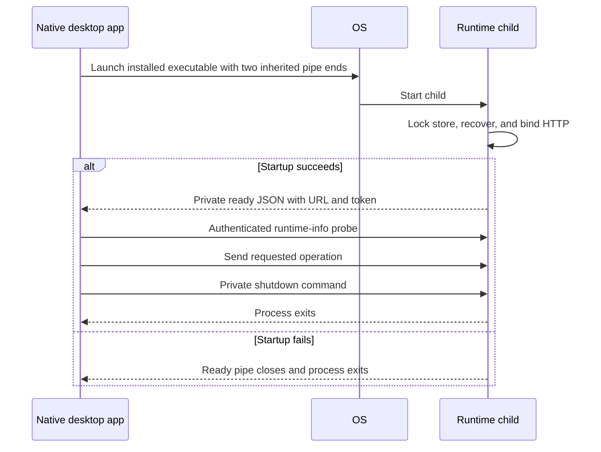

# Managed Runtime integration

## Overview

The native Studio or Launcher process owns the Runtime child it starts. The
child hands back its API address and bearer token after recovery and HTTP
startup. The parent checks the session before each operation and owns the
decision to replace a failed child. This protocol has been verified on Linux
with the Runtime test parent. Windows has a successful cross-build and still
requires a native parent acceptance run.



## Start the child

1. Resolve the trusted absolute executable path from the desktop installation.
   The packaging configuration supplies the location for each app and OS.
2. Create two anonymous pipes. Keep the command write end and readiness read
   end in the parent. Inherit only the command read end and readiness write end
   in the child. Close the parent's copies of the child ends after launch and
   prevent unrelated subprocesses from inheriting the retained ends.
3. Launch directly with an argument array. Supply the numeric descriptor or
   handle **as seen by the child**. Keep stdout and stderr separate from both
   pipes and drain or redirect them if captured.

```text
<absolute-runtime-executable>
  --owner-command-pipe <child-command-read-end>
  --owner-ready-pipe <child-readiness-write-end>
  --listen-address 127.0.0.1:6810
```

`--listen-address` is optional and defaults to `127.0.0.1:6810` in the
default configuration. An override must be a loopback IP and a nonzero port.
On Linux, pass the child descriptors through the process spawn API. The Runtime
repo's Linux acceptance harness is
`internal/discovery/testdata/managed_parent.py`. On Windows, the executable is
`a2matex-runtime.exe`. The native launcher must explicitly pass the two pipe
handles through process creation. Verify that path on Windows before shipping.

## Readiness and authentication

Read one bounded UTF-8 JSON line from the private readiness pipe within a
startup deadline. The current record has two fields and ends in LF.

```json
{"apiBaseUrl":"http://127.0.0.1:6810/api/v1","sessionToken":"<fresh bearer token>"}
```

Keep the address and token in native process memory. Check that the address
uses HTTP on a loopback IP with the `/api/v1` suffix before using it. Bypass
proxies and reject redirects for local requests. Keep the token out of logs,
URLs, and renderer state. Managed mode sends credentials through the pipe.
Standalone development uses the protected connection file.
See the [local authentication guide](local_authentication.md) for locating
the file and testing bearer requests on Linux and Windows.

For every operation, confirm the owned child and control channel are live, then
make a bounded authenticated `GET {apiBaseUrl}/runtime-info` request using
`Authorization: Bearer <sessionToken>`. Send the requested operation only
after a valid authenticated response. Check compatibility separately from
readiness. The readiness probe itself goes directly to the current address.

Use one native client per desktop app. Requests arriving while it starts or
replaces a child share that attempt. After replacement, each waiting operation
still passes the readiness gate before sending HTTP.

## Map the child lifecycle to app state

| Client state | What pending operations do |
|---|---|
| Stopped | Request one launch when work first needs Runtime and automatic launch is allowed. |
| Starting | Wait for the same launch attempt. Apply a startup deadline. |
| Ready | Check the child and control channel, then probe the authenticated session for this operation. |
| Replacing | Wait for the old child to exit and the new child to announce readiness. A stale child exit must only clear the session belonging to that child. |
| Stopping or explicitly stopped | Leave automatic work unsent. Allow a new launch after process exit and an explicit Runtime action. |

Observe child exit and pipe closure in native code independently of window
visibility, renderer reloads, and HTTP stream state. Cancel waiting work that
is no longer relevant to the app, such as validation of an older draft.

## Failure and shutdown

A clean owner stop cancels unfinished work before Runtime exits. After a crash
or forced exit, remaining work becomes INTERRUPTED before the next readiness
handoff. Restarting Runtime never dispatches old actions again. Verify these
paths with the [shutdown walkthrough](../../../../a2matex-runtime/examples/h14/README.md)
and your app's close/quit controls on each supported host.

| Signal | Parent behavior |
|---|---|
| Child exits with code `2` before readiness | Show **Runtime already in use**. Leave waiting requests unsent. |
| Child exits with another code before readiness, sends a malformed record, or exceeds the startup deadline | Report startup failure. Close the pipes and ensure the child exits. |
| Child exits unexpectedly, the control channel breaks, or the readiness probe fails | Discard that child's URL and token. For pending work, stop any surviving child and confirm exit within a deadline, then start one shared replacement and probe its fresh session. A failed replacement ends the attempt for all waiting requests. |
| User selects **Shut down Runtime** or exits the owning app | Suppress automatic launch, clear the session, send the exact bytes `shutdown\n` on the command pipe, and await process exit before displaying **Stopped**. Use bounded termination if the process fails to exit. Only an explicit Runtime action clears suppression. |
| Parent disappears | Closing the command pipe produces EOF in the child and triggers bounded cleanup. Unfinished execution records are marked INTERRUPTED at the next start. |
| API operation returns diagnostics or an ordinary error | Surface the result while retaining the healthy session. |

A transport failure after sending a request can leave an unknown outcome.
Validation and compilation can be retried after the session is ready again.
For an uncertain run-start response, reuse the original request ID and exact
payload. Use the [run-action guide](run_actions.md) for Cancel, Pause and Resume;
HTTP Cancel keeps Runtime alive, while owner shutdown exits the process.

To reproduce the verified Linux lifecycle from the Runtime repo, run
`make build`, then
`python3 internal/discovery/testdata/managed_parent.py bin/a2matex-runtime`.

See [Studio authoring](studio.md) and [Launcher ownership](launcher.md) for app
integration examples.

## Shared API reference

Build request URLs from the ready message. For example, an `apiBaseUrl`
ending in `/api/v1` becomes `{apiBaseUrl}/runtime-info`. Append the route
suffix once. Local responses carry `Cache-Control: no-store`. The [shared lifecycle-action guide](run_actions.md)
documents implemented group controls for both client developers. The
[attempt-history reference](#node-attempt-history-api) supplies committed node outputs.
[event streaming](#execution-event-stream) supplies continuous committed
state changes and cursor-based reconnect through the same native client.

### GET /api/v1/health

Use this unauthenticated request to diagnose HTTP liveness. It takes no query
parameters or body. The exact route returns HTTP 200 with `{"status":"UP"}`.
A query string returns HTTP 400. HTTP liveness alone does not confirm child
ownership, authentication, or execution compatibility.

### GET /api/v1/runtime-info

Use the bearer token from the current ready message. Send no query parameters
or body. HTTP 200 returns this shape, with the version coming from the build.

```json
{
  "runtimeVersion": "1.2.3",
  "runtimeIrFormatVersions": [1],
  "supportedNodes": []
}
```

`runtimeIrFormatVersions` describes IR format support. `supportedNodes`
advertises the node type/handler pairs registered in the running build. Read
the actual list for compatibility rather than assuming it is empty. Studio
can validate and compile with its owned Runtime. Treat a failed authenticated probe according
to the replacement policy above. A valid response with an incompatible
version is a compatibility result to display, independent of child readiness.

### HTTP error envelope

```json
{
  "error": {
    "code": "UNAUTHORIZED",
    "message": "local session token is missing or invalid",
    "retryable": false
  }
}
```

| HTTP status | Code | Meaning in the current API |
|---|---|---|
| 400 | `INVALID_REQUEST` | Unexpected query, malformed request envelope, or invalid request transport |
| 401 | `UNAUTHORIZED` | Missing or invalid bearer credential |
| 404 | `RESOURCE_NOT_FOUND` | Unknown route/method, missing saved run/artifact, or no active run |
| 409 | `RUNTIME_BUSY` | Another workflow group is active; no new run admitted |
| 409 | `INVALID_EXECUTION_STATE` | Lifecycle action conflicts; response includes the current snapshot |
| 422 | `VALIDATION_FAILED`, `RUNTIME_INCOMPATIBLE`, or a device availability code | New run rejected before admission; see start API |
| 413 | `PAYLOAD_TOO_LARGE` | A documented request size limit was exceeded |
| 500 | `INTERNAL_ERROR` | Unexpected Runtime failure with a generic response |
| 500 | `PERSISTENCE_FAILED` | Admission, execution snapshot, or artifact read persistence failed |
| 503 | `ADB_UNAVAILABLE` | Device refresh or admission preflight could not complete |
| 503 | `INTERNAL_ERROR` | Runtime is stopping before accepting new work |

ADB availability errors, RUNTIME_BUSY, and confirmed device-availability
rejections set retryable to true. Validation, persistence, transport, and
internal errors set it to false. Apply the lifecycle
and operation-specific retry rules when a request fails at the transport
level. The private shutdown command and managed launch exit codes are process
signals outside this HTTP error envelope.

### Device inventory API

Both device routes are available on the
Runtime build. Each request uses the owning app's current `apiBaseUrl` and
bearer token. Send no query parameters
or body, including on refresh. For example, run these calls from an authorized
development shell with `API_BASE_URL` and `SESSION_TOKEN` set from the current
Runtime handoff. Keep the token out of shell tracing and logs.

```sh
curl --noproxy '*' -fsS -H "Authorization: Bearer ${SESSION_TOKEN}" \
  "${API_BASE_URL}/runtime-info" >/dev/null &&
curl --noproxy '*' -sS -i -H "Authorization: Bearer ${SESSION_TOKEN}" \
  "${API_BASE_URL}/devices"
```

```sh
curl --noproxy '*' -fsS -H "Authorization: Bearer ${SESSION_TOKEN}" \
  "${API_BASE_URL}/runtime-info" >/dev/null &&
curl --noproxy '*' -sS -i -X POST -H "Authorization: Bearer ${SESSION_TOKEN}" \
  "${API_BASE_URL}/devices/refresh"
```

Both operations return `200` with the same JSON shape, for example
`{"devices":[{"adbSerial":"emulator-5554","status":"READY"}]}`. A cached
read can return `{"devices":[]}` before the first scan. Refresh queries ADB
and can return the same empty response when no devices are found. Entries
marked `UNAVAILABLE` carry an `error` with the device reason.

Handle `400 INVALID_REQUEST` by fixing the request, and `401 UNAUTHORIZED`
by rechecking the current owned session. A `503 ADB_UNAVAILABLE` after a
successful readiness probe is a refresh failure. It leaves the cached list
available and does not trigger child replacement. Show the refresh error
and let the user retry after addressing ADB availability. Allow enough time
for the 20-second refresh budget and process cleanup. If the child exits
during the operation, apply the managed readiness and replacement flow
before the next request. A replacement child starts with an empty list.

## Package input-schema API

`POST /api/v1/product-packages/input-schema` is available for Launcher to display
an installed Product's input form. It does not start a workflow or contact Backend.
Follow the [Launcher form guide](launcher.md#read-the-installed-packages-input-schema)
for complete Postman, Linux and Windows examples and installation requirements.

Send current local Runtime Bearer, `Content-Type: application/json`, and exactly
one `X-A2MaTeX-Package-Directory` containing the once percent-encoded absolute
native package root. Do not use a Backend token. The body is exactly:

```json
{
  "packageRef": "11111111-1111-4111-8111-111111111111/package.a2m",
  "launcherVersion": "0.1.0"
}
```

The relative reference is `<productId>/<local filename>.a2m`, normally ending
in `package.a2m`, and uses `/` on both hosts. The directory header names the
products root (OS Documents plus `a2matex/products` by default). Launcher resolves
redirected Documents, including OneDrive. Product ID is matched against the
folder; Release ID/version come from the validated manifest. No separate IDs, request hash, input values
or upload are accepted. Require one UTF-8 JSON object of at most 4 KiB, no query,
no duplicate/extra fields or nonempty Content-Encoding. The existing raw ZIP and
combined expanded-content budgets are 4 MiB and 2 MiB.

HTTP 200 returns `{package: {productId, releaseId, version, packageHash}, inputSchema}`
with no Backend wrapper. The schema uses the reduced input-schema vocabulary.
The hash identifies the exact current ZIP; it does not attest original Backend
origin. Launcher checks download length/SHA-256 before installing. Inspection
checks package containment, manifest identity/member hashes, schema, versions
and capabilities offline, without leases, decryption, sessions or execution writes.
An older compatible installed Release does not require a newest-version lookup.
Keep the form associated with the returned package identity/hash.

| HTTP | Code | Meaning |
| --- | --- | --- |
| 400 | `INVALID_REQUEST` | Invalid transport, body, location/reference/header or Launcher version. |
| 401 | `UNAUTHORIZED` | Missing/invalid local session; authenticate before package access. |
| 404 | `RESOURCE_NOT_FOUND` | Installed file/directory missing or unsupported route/method. |
| 413 | `PAYLOAD_TOO_LARGE` | Request body exceeds 4 KiB. |
| 422 | `VALIDATION_FAILED` | Invalid package, manifest, member hashes, identity or schema. |
| 422 | `RUNTIME_INCOMPATIBLE` | Runtime/Launcher version or required capability unsupported. |
| 503 | `INTERNAL_ERROR` | Temporarily unavailable/cancelled read; retryable true. |
| 500 | `INTERNAL_ERROR` | Unexpected server failure; retryable false. |

Failures use the standard generic error envelope; no raw filesystem details,
protected workflow or validation report is disclosed. All responses are no-store.
Runtime's own version is taken from its build, not this body; a `0.0.0-dev` build
cannot satisfy strict package version requirements. Prepared sessions and
protected start/monitoring APIs are still unavailable. Existing Development APIs
retain their current behavior.

## Run snapshot APIs

Runtime exposes two ordinary JSON reads. They return immediately during a run or
after completion; they do not wait for completion or stream logs. Both require
the current bearer token, take no query parameters or body, and return
`Cache-Control: no-store` for both success and errors.

| Route | Result |
|---|---|
| `GET {apiBaseUrl}/runs/active` | The one RUNNING/PAUSED RunGroup, including a newly admitted group whose devices are still QUEUED. Returns 404 when no non-terminal group exists. |
| `GET {apiBaseUrl}/runs/{runGroupId}` | The requested saved run, including terminal results. Requires a lowercase canonical UUID v4. Returns 404 for an unknown valid ID and 400 for an invalid ID. |

Keep the RunGroup ID returned by admission, not the request ID or a device
execution ID. When a run finishes, the active route stops returning it, while
its by-ID route remains available. If a newer run is active, reading an older
ID still returns the older run.

### Snapshot response

HTTP 200 returns the direct snapshot object below. This example is a queued run;
RUNNING is already the group's status before its first device starts.

```json
{
  "cursor": "2",
  "runGroup": {
    "id": "550e8400-e29b-41d4-a716-446655440001",
    "requestId": "550e8400-e29b-41d4-a716-446655440000",
    "status": "RUNNING",
    "createdAt": "2026-11-18T08:00:00.000Z",
    "finishedAt": null,
    "summary": {
      "total": 1,
      "queued": 1,
      "running": 0,
      "paused": 0,
      "succeeded": 0,
      "failed": 0,
      "cancelled": 0,
      "interrupted": 0
    }
  },
  "deviceExecutions": [
    {
      "id": "550e8400-e29b-41d4-a716-446655440002",
      "adbSerial": "emulator-5554",
      "status": "QUEUED",
      "nextNodeId": "start",
      "createdAt": "2026-11-18T08:00:00.000Z",
      "startedAt": null,
      "finishedAt": null,
      "terminalError": null
    }
  ]
}
```

| Field | Client interpretation |
|---|---|
| `cursor` | Decimal string containing the Runtime-wide event watermark read with this snapshot. Preserve it as a string; it is not progress percentage or this run's attempt count. Use it when subscribing after an authoritative snapshot through [the event stream](#execution-event-stream). |
| `runGroup` | Saved identity, originating request ID, status, UTC millisecond timestamps, and device counts. All summary fields remain present even when zero. |
| `deviceExecutions` | All admitted devices in admission order, with status, saved position, timestamps and terminal error. Reads include the complete stored membership, without a fixed device-count guard. Optional fields are explicitly null. |
| `nextNodeId` | Saved execution position; it may be an active node, retry node, or pending successor. It is not a separate live-handler measurement. |
| `terminalError` | Null or the existing safe `{code,message,retryable}` error. It contains no raw ADB output or workflow values. |

The state, device list, derived summary, and cursor come from one SQLite read
transaction. A simultaneous finish can yield the consistent earlier snapshot
or the later terminal/not-found result. Refresh for newer state; do not assume
that an already received snapshot continues changing. Snapshot GETs create no
records/events, invoke no ADB command, and do not change execution state.

### Snapshot errors

Use the [shared error envelope](#http-error-envelope).

| HTTP | Code | Meaning and next action |
|---|---|---|
| 400 | `INVALID_REQUEST` | Fix the ID, remove query parameters, and set the request body to none. Even `{}` or whitespace is forbidden. |
| 401 | `UNAUTHORIZED` | Credentials do not belong to the current process; apply the shared readiness/session replacement flow. |
| 404 | `RESOURCE_NOT_FOUND` | No active group or the requested saved ID does not exist. After a successful readiness probe this is a data result, not a reason to relaunch Runtime. |
| 500 | `PERSISTENCE_FAILED` | SQLite could not provide a safe snapshot. Message: `unable to read execution snapshot`. Show the read failure without inferring run completion. |
| 500 | `INTERNAL_ERROR` | Unexpected or cancelled read; the response remains generic. A disconnected client may receive no response. |

All these error envelopes set `retryable` to false. Read-only GETs have no
execution side effects; a later user refresh is possible after restoring the
session or fixing the failure. Do not retry a failed start or reconstruct
execution from snapshot data. Missing ADB/emulator connectivity does not prevent
these reads. Attempt history, node outputs, workflow inputs/IR, artifacts, and
live logs are not part of this response.

### Linux curl

First load credentials using the Linux example in the
[authentication guide](local_authentication.md#linux-terminal). That example
leaves `runtime_connection` in the shell. The server does not export shell
variables for you. Set the ID to a real saved RunGroup ID:

```bash
API_BASE_URL="${runtime_connection[0]}"
SESSION_TOKEN="${runtime_connection[1]}"
RUN_GROUP_ID="<saved RunGroup UUID>"

runtime_snapshot() {
  printf 'header = "Authorization: Bearer %s"\n' "$SESSION_TOKEN" |
    curl --config - --noproxy '*' --max-time 5 -fsS \
      "${API_BASE_URL}/runtime-info" >/dev/null || return
  printf 'header = "Authorization: Bearer %s"\n' "$SESSION_TOKEN" |
    curl --config - --noproxy '*' --max-time 5 -sS -i \
      "${API_BASE_URL}$1"
}
runtime_snapshot "/runs/active"
runtime_snapshot "/runs/${RUN_GROUP_ID}"
```

Each call probes actual authenticated readiness before the snapshot request.
The snapshot call prints headers and error bodies, including an expected idle
404. The helper stops on a failed probe; the native application's shared owner
client performs the actual replacement/relaunch policy. Keep tokens in local
memory, disable shell tracing, and do not export credential-bearing output.

### Windows PowerShell

Load `$Connection` using the Windows example in the
[authentication guide](local_authentication.md#windows-terminal), then:

```powershell
$APIBaseUrl = $Connection.apiBaseUrl
$SessionToken = $Connection.sessionToken
$RunGroupId = '<saved RunGroup UUID>'

function Get-RuntimeSnapshot([string]$Path) {
    $CurlConfig = 'header = "Authorization: Bearer {0}"' -f $SessionToken
    $CurlConfig | curl.exe --config - --noproxy '*' --max-time 5 -fsS "$APIBaseUrl/runtime-info" | Out-Null
    if ($LASTEXITCODE -ne 0) { throw 'Runtime readiness failed; refresh the owned session.' }
    $CurlConfig | curl.exe --config - --noproxy '*' --max-time 5 -sS -i "$APIBaseUrl$Path"
}
Get-RuntimeSnapshot '/runs/active'
Get-RuntimeSnapshot "/runs/$RunGroupId"
```

This uses Windows `curl.exe`, not PowerShell's older `curl` alias. These commands
follow the verified protocol and Windows store-path implementation; native
Windows command execution remains unverified. The Runtime agent and affected
API tests cross-compile for Windows amd64.

### Postman on either host

Use current local `API_BASE_URL` and `SESSION_TOKEN` values from the
[authentication guide](local_authentication.md#postman-on-linux-or-windows).
Before each operation, confirm `GET {{API_BASE_URL}}/runtime-info` succeeds.
Create GET requests to `{{API_BASE_URL}}/runs/active` and
`{{API_BASE_URL}}/runs/{{RUN_GROUP_ID}}`. Set Authorization to Bearer Token
`{{SESSION_TOKEN}}`, Body to none, and leave Params empty. apiBaseUrl already
includes `/api/v1`; append that prefix only once.

Expected checks: active/saved state returns 200, idle active returns 404,
`/runs/invalid` or `?limit=1` returns 400, and removing Authorization returns
401. Keep credential values local to Postman, not shared/exported collections.

### Optional saved-result fixture without Android

Runtime provides the [public start route](#workflow-start-api). To inspect
only saved cancellation data without an Android device,
use the optional local smoke tool, if present, from the repository root. Stop any other owner
of that demo store first. It prints a group ID and cancels its queued run before
releasing SQLite. Keep that printed RunGroup ID for the requests above.

Linux, terminal 1:

```bash
(cd test_demo/g12-smoke && go run .)
make build
XDG_STATE_HOME="$PWD/test_demo/g12-smoke/state" ./bin/a2matex-runtime
```

Windows PowerShell, terminal 1:

```powershell
Push-Location .\test_demo\g12-smoke
go run .
Pop-Location
$env:LOCALAPPDATA = (Resolve-Path '.\test_demo\g12-smoke\state').Path
New-Item -ItemType Directory -Force .\bin | Out-Null
go build -buildvcs=false -o .\bin\a2matex-runtime.exe .\cmd\agent
.\bin\a2matex-runtime.exe
```

Wait for Runtime readiness, then use a second terminal/Postman. On Windows, set
that same LOCALAPPDATA override in the second terminal before locating its
connection file; the variable is local to each terminal. Linux's state override
does not change its connection-file location. Read fresh credentials from
this running agent, not from the exited smoke tool. The normal Runtime database
is separate; the smoke's data stays in its readable `state` folder.

By-ID must return the saved CANCELLED group/device, and active must return
404. The demo SQLite node_attempts table remains empty; attempt history is not
a field in the snapshot response. Reading or replaying saved data must not add
attempts or events. Repeat the saved-result and shutdown checks on each supported
host, including native Windows.

## Workflow start API

### POST /api/v1/runs — Start a Development workflow

Use this endpoint when the publisher presses **Test Run** in Studio. It accepts
compiled Runtime IR and an ordered array of selected devices with per-device inputs, persists admission, hands the
execution to the Runtime owner, and returns a snapshot. The HTTP response waits
for admission/handoff, not workflow completion. Execution continues after the
request disconnects. Runtime admits the complete non-empty selection, with no fixed device-count ceiling.
Production package/path admission is not yet available.

Set Variable is executable through this same API. A newly created run receives
empty Flow/Global RAM scopes; Studio sends no variable seed map or persistence
fields. `config.scope` selects `FLOW` or `RUN_GROUP`, `config.name` is the key,
and `bindings.value` supplies the scalar before compilation. Assignment becomes
visible after its successful node checkpoint; its node output is `{}`. Missing
reads follow STOP/ERROR_BRANCH, and variables are released after all group workers and callbacks
join. Replay neither creates scopes nor executes again. Runtime restart
interrupts unfinished work and restores no variables. Multi-device scheduling is available;
HTTP Pause/Resume/Cancel is implemented; use the [action guide](run_actions.md).
Wait Variable is not yet supported. Use the
[Set Variable and Switch example](../../../../a2matex-runtime/examples/g18/README.md)
for the complete compile/start/poll scenario and expected saved results.

Screenshot is also executable through this API when Runtime Info advertises
`android.screenshot` with the same handler key. It supports FULL_SCREEN,
ABSOLUTE_PIXELS, and SCREEN_PERCENT through the existing catalog fields.
Successful output is only the committed artifactId; the PNG file and metadata
are stored by the Runtime. Run snapshots remain status-only and do not gain
image bytes or node-output fields. A replay takes no new capture. Runtime
provides [authenticated PNG downloads](#screenshot-artifact-download-api)
when the artifactId is known. [Attempt history](#node-attempt-history-api)
exposes committed attempt outputs and Screenshot IDs without SQL. The older
[screenshot walkthrough](../../../../a2matex-runtime/examples/g19/README.md) retains
its optional developer-only SQL inspection; use the attempt-history API for client integration.

| Request setting | Exact value |
|---|---|
| Method | POST |
| URL | `{apiBaseUrl}/runs`, normally `http://127.0.0.1:6810/api/v1/runs` |
| Authorization | Exactly one `Authorization: Bearer <current-session-token>` header |
| Content-Type | `application/json`, optionally `charset=utf-8` |
| Body | One raw JSON object with `requestId`, `runtimeIr`, and `devices` |
| Query parameters | None |
| Content encoding | None |

`apiBaseUrl` comes from the Runtime's private ready record or standalone
connection file and already includes `/api/v1`; append `/runs` once. The port
is configurable, so native clients use that published URL. Credentials stay
inside the trusted native client. See [readiness/authentication](#readiness-and-authentication)
for the process gate that runs before every request.

```mermaid
sequenceDiagram
    participant Studio as Studio native client
    participant Compile as Compilation API
    participant Runs as POST /runs
    participant Worker as Owned device execution
    Studio->>Compile: Editor Graph + Input Schema
    Compile-->>Studio: validation + runtimeIr
    Studio->>Runs: New requestId + runtimeIr + ordered device/input pairs
    alt New request passes admission
        Runs->>Worker: Persist and register owned work
        Runs-->>Studio: 201 + snapshot and runGroup.id
        Worker->>Worker: Execute asynchronously
    else RequestId was already admitted
        Runs-->>Studio: 200 + saved snapshot; no new execution
    else Invalid, unavailable, or busy
        Runs-->>Studio: Error; no new admission
    end
    Studio->>Runs: GET /runs/runGroupId
    Runs-->>Studio: Current committed result
```

### Prerequisites

Before starting, the owned Runtime must pass authenticated readiness, support
the compiled workflow's version/handlers, and see every selected device READY.
Studio first compiles the captured graph/schema and refreshes device selection;
admission still performs its own fresh device-readiness check.

For manual Linux testing from the Runtime repository root:

```bash
make build VERSION=0.1.0
A2MATEX_RUNTIME_ADB_EXECUTABLE_PATH="$HOME/Documents/platform-tools/adb" \
./bin/a2matex-runtime
```

For Windows PowerShell, use the installed Windows platform-tools directory:

```powershell
New-Item -ItemType Directory -Force .\bin | Out-Null
go build -buildvcs=false -ldflags "-X github.com/A2MaTex/a2matex-runtime/internal/buildinfo.Version=0.1.0" -o .\bin\a2matex-runtime.exe .\cmd\agent
$env:A2MATEX_RUNTIME_ADB_EXECUTABLE_PATH = Join-Path $HOME 'Documents\platform-tools\adb.exe'
.\bin\a2matex-runtime.exe
```

These are standalone examples. Desktop integration uses the [managed launch](#start-the-child),
not shell commands or a Postman environment script. Each restart supplies new
credentials. The shared version/ADB-default refactor is not implemented;
`0.0.0-dev` can serve authoring/read requests but run admission rejects execution with
`422 RUNTIME_INCOMPATIBLE`. The current catalog requires at least `0.1.0` for
this example. Check the actual `runtimeVersion` from Runtime Info.

### Request fields and where Studio obtains them

| JSON field | Type | Studio source and rule |
|---|---|---|
| `requestId` | String | Generate one canonical lowercase UUID v4 for a new Test Run intent. Retain it and the request through submission/retry. |
| `runtimeIr` | Object | Use `compilationResponse.runtimeIr` from a successful `POST /workflow-compilation` for the captured graph/schema revision. Require VALID or VALID_WITH_WARNINGS and non-null IR. |
| `devices` | Array | Non-empty ordered selection for a new run, with unique exact READY serials and no fixed count ceiling. |
| `devices[i].adbSerial` | String | Copy the exact selected READY serial from `POST /devices/refresh`, including `:5555` when present. |
| `devices[i].inputs` | Object | Values from Studio's workflow-input form matching the compiled `runtimeIr.inputSchema`. Use `{}` for an empty schema. |

Send the value of `runtimeIr`, not the entire compilation response containing
`validation`. It stays a JSON object, not a JSON-encoded string. Editor Graph
uses `bindings` with `kind`; compiled IR uses `inputs` with `source`. Studio
must use compiler output directly rather than rename fields or compile it itself.
Do not send editorGraph, inputSchema, sessionToken, runtimeVersion, concurrency,
or product-package fields at the root of this start request.

Limits are 1 MiB for the raw IR object and 4 MiB for the full UTF-8 body,
including envelope/whitespace. Unknown public fields, null/wrong types,
duplicate keys at any depth, invalid UTF-8, trailing JSON, unsupported
headers/query, and invalid request IDs are rejected. A fresh request requires at least one device; empty, duplicate or malformed
selections produce 400. A failed later member rejects the whole run.

### Complete single-device request example

This is a valid Start → Delay ten seconds → End request, also available as
[a readable JSON file](../../../../a2matex-runtime/examples/g14/start-delay-end.json).
Replace the serial with your READY device and generate a fresh requestId for a
new execution. The fixed UUID is illustrative: repeatedly sending it after
admission only reads its saved run. The graph performs no Android UI action;
its delay makes polling observable and device preflight still requires READY.

```json
{
  "requestId": "550e8400-e29b-41d4-a716-446655440000",
  "runtimeIr": {
    "formatVersion": 1,
    "minimumRuntimeVersion": "0.1.0",
    "metadata": {
      "sourceGraphSchemaVersion": 1
    },
    "entryNodeId": "start",
    "inputSchema": {
      "type": "object",
      "properties": {},
      "required": [],
      "additionalProperties": false
    },
    "nodes": [
      {
        "id": "start",
        "type": "flow.start",
        "runtimeHandler": "flow.start",
        "config": {},
        "inputs": {},
        "timeoutMs": 1000,
        "retryPolicy": {
          "maxAttempts": 1,
          "delayMs": 0
        },
        "errorPolicy": "STOP"
      },
      {
        "id": "wait",
        "type": "flow.delay",
        "runtimeHandler": "flow.delay",
        "config": {},
        "inputs": {
          "durationMs": {
            "source": "LITERAL",
            "value": 10000
          }
        },
        "timeoutMs": 15000,
        "retryPolicy": {
          "maxAttempts": 1,
          "delayMs": 0
        },
        "errorPolicy": "STOP"
      },
      {
        "id": "end",
        "type": "flow.end",
        "runtimeHandler": "flow.end",
        "config": {},
        "inputs": {},
        "timeoutMs": 1000,
        "retryPolicy": {
          "maxAttempts": 1,
          "delayMs": 0
        },
        "errorPolicy": "STOP"
      }
    ],
    "edges": [
      {
        "id": "e1",
        "sourceNodeId": "start",
        "sourcePort": "success",
        "targetNodeId": "wait"
      },
      {
        "id": "e2",
        "sourceNodeId": "wait",
        "sourcePort": "success",
        "targetNodeId": "end"
      }
    ],
    "requiredCapabilities": []
  },
  "devices": [
    {
      "adbSerial": "192.168.240.112:5555",
      "inputs": {}
    }
  ]
}
```

For a workflow with declared inputs, only `devices[i].inputs` contains their
runtime values. For example, a required integer input named `duration` receives
`{"duration": 1000}`. Its binding must already exist in the compiled IR; adding
arbitrary input properties to the empty schema above is a validation failure.

### New admission response: HTTP 201 Created

A new successful POST returns `Content-Type: application/json; charset=utf-8`
and `Cache-Control: no-store`, with this complete snapshot shape:

```json
{
  "cursor": "7",
  "runGroup": {
    "id": "550e8400-e29b-41d4-a716-446655440001",
    "requestId": "550e8400-e29b-41d4-a716-446655440000",
    "status": "RUNNING",
    "createdAt": "2026-11-19T08:00:00.000Z",
    "finishedAt": null,
    "summary": {
      "total": 1,
      "queued": 0,
      "running": 1,
      "paused": 0,
      "succeeded": 0,
      "failed": 0,
      "cancelled": 0,
      "interrupted": 0
    }
  },
  "deviceExecutions": [
    {
      "id": "550e8400-e29b-41d4-a716-446655440002",
      "adbSerial": "192.168.240.112:5555",
      "status": "RUNNING",
      "nextNodeId": "wait",
      "createdAt": "2026-11-19T08:00:00.000Z",
      "startedAt": "2026-11-19T08:00:00.004Z",
      "finishedAt": null,
      "terminalError": null
    }
  ]
}
```

These UUIDs, times, cursor, and RUNNING position are illustrative. The snapshot
is read after worker registration; its device can be QUEUED, RUNNING, or
terminal, while the group can be RUNNING or terminal. HTTP 201 means a new run
was admitted and owned. It does not mean
that all nodes succeeded, and it does not wait for the ten-second delay.

| Response field | Studio handling |
|---|---|
| `runGroup.id` | Store as the run identity and use it in subsequent GET paths. It differs from requestId and device-execution ID. |
| `runGroup.requestId` | Correlate the result with the pending Test Run intent. |
| `runGroup.status` | Display group progress/result. Terminal values are SUCCEEDED, FAILED, CANCELLED, and INTERRUPTED. |
| `runGroup.summary` | Render counts from the snapshot; do not infer success from the POST HTTP status. Current total is one. |
| `deviceExecutions` | Render the selected device's saved status, nextNodeId, timestamps, and terminalError. |
| `cursor` | Preserve as an opaque decimal string. It is Runtime-wide, not a per-run counter or progress percentage. |

A terminal device has `nextNodeId: null` and non-null finishedAt. Successful
execution has `terminalError: null`. For Android action handlers, success is
based on successful command completion; this snapshot supplies no assertion
that the application reached a particular visual/business state. Attempt
outputs and continuous logs are not included in this response.

### Poll until completion

After POST, send `GET {apiBaseUrl}/runs/{runGroup.id}` with the current Bearer
header and no body/query. Use the native readiness gate for each read, keep
one poll outstanding, and poll for example once per second while this run's
view is active. Stop on a terminal status, view closure, or a surfaced read
failure. Cancelling a poll does not cancel execution.

The ten-second example eventually returns HTTP 200 with:

```json
{
  "cursor": "13",
  "runGroup": {
    "id": "550e8400-e29b-41d4-a716-446655440001",
    "requestId": "550e8400-e29b-41d4-a716-446655440000",
    "status": "SUCCEEDED",
    "createdAt": "2026-11-19T08:00:00.000Z",
    "finishedAt": "2026-11-19T08:00:10.020Z",
    "summary": {
      "total": 1,
      "queued": 0,
      "running": 0,
      "paused": 0,
      "succeeded": 1,
      "failed": 0,
      "cancelled": 0,
      "interrupted": 0
    }
  },
  "deviceExecutions": [
    {
      "id": "550e8400-e29b-41d4-a716-446655440002",
      "adbSerial": "192.168.240.112:5555",
      "status": "SUCCEEDED",
      "nextNodeId": null,
      "createdAt": "2026-11-19T08:00:00.000Z",
      "startedAt": "2026-11-19T08:00:00.004Z",
      "finishedAt": "2026-11-19T08:00:10.020Z",
      "terminalError": null
    }
  ]
}
```

Use the by-ID route to retain this result. `GET /runs/active` returns 404 when
there is no active group; that does not delete the completed run. A broken GET
or 500 response is a read failure, not proof of a terminal workflow outcome.
[Paged attempt history](#node-attempt-history-api) and the
[event stream](#execution-event-stream) are implemented.

### Replay response: HTTP 200 OK

Resend the same admitted requestId and the server returns that existing run's
current snapshot with HTTP 200. If the example has finished, the complete
SUCCEEDED JSON above is also a valid replay response. The IDs and original
execution timestamps remain those of the existing run, while its current
status/cursor can advance if execution is still active.

**HTTP 200 from POST /runs does not execute the actions again.** This explains
a successful saved response with no new movement in Waydroid. To deliberately
run the workflow again, create a new requestId even when IR/device/inputs are
unchanged. Do not retry with the example's fixed ID expecting a fresh run.

| Situation | requestId rule |
|---|---|
| User starts a new Test Run | Create a fresh UUID once, after capturing its compilation/device/inputs. |
| Duplicate click or transport retry for that intended run | Reuse the original ID/request; never generate inside the network retry function. |
| POST response lost, Runtime replaced, or admission outcome uncertain | Retain the ID, restore actual readiness/current credentials, then replay it to resolve saved identity. |
| Existing run completed and user presses Run again | Generate a new ID. The old ID always resolves the old run. |
| HTTP 409 busy before admission | No new run for this ID; retry the same intent after the active group ends. |
| HTTP 400/413/422 | Surface/fix the definite request or semantic rejection. An explicit corrected new intent may create a new ID. |

A lookup replay ignores replacement executable/device semantics after strict
transport checks. Studio should still retain/resend the original body instead
of exploiting placeholder IR or an empty device list. Changing a body under an
admitted ID does not update or re-execute the saved workflow. Keep the pending
intent until a response resolves it; never silently replace it on a timeout.

### Error responses and Studio actions

Failure bodies contain the standard error envelope and optional workflow validation diagnostics.
They do not contain a partial successful snapshot or arbitrary inventory.
Readiness rejection includes the typed unavailableDevices array described below.
For example, HTTP 409 is:

```json
{
  "error": {
    "code": "RUNTIME_BUSY",
    "message": "another workflow run is active",
    "retryable": true
  }
}
```

An incompatible build returns HTTP 422 with:

```json
{
  "error": {
    "code": "RUNTIME_INCOMPATIBLE",
    "message": "run admission failed",
    "retryable": false
  },
  "validation": {
    "status": "INVALID",
    "errors": [
      {
        "code": "RUNTIME_VERSION_UNSUPPORTED",
        "message": "Runtime build does not satisfy workflow version requirements",
        "path": [
          "runtimeIr",
          "minimumRuntimeVersion"
        ]
      }
    ],
    "warnings": [],
    "truncated": false
  }
}
```

| HTTP / code | Studio action |
|---|---|
| 400 INVALID_REQUEST | Fix request transport/DTO or fix an empty, duplicate or malformed selection. Do not relaunch a healthy Runtime. |
| 401 UNAUTHORIZED | Check the owned child's actual readiness and current credential handoff; a token changes on restart. Do not put it in a query/body. Preserve pending run identity. |
| 409 RUNTIME_BUSY | Display the active run or wait; no new admission from this request. |
| 413 PAYLOAD_TOO_LARGE | Reduce the IR/body size. |
| 422 VALIDATION_FAILED | Display bounded validation diagnostics and let the publisher fix/recompile the captured workflow/input values. |
| 422 RUNTIME_INCOMPATIBLE | Check Runtime Info and install/build a compatible Runtime. A healthy incompatible process is not fixed by a relaunch loop. |
| 422 DEVICE_NOT_FOUND / DEVICE_UNAUTHORIZED / DEVICE_OFFLINE / DEVICE_NOT_READY | Refresh/fix device selection. No partial run; the body has only error. |
| 503 ADB_UNAVAILABLE | Preflight could not observe device state; inspect configuration/logs and retry the same intent after ADB is fixed. |
| 503 INTERNAL_ERROR | Runtime is stopping. Apply the managed owner lifecycle and reacquire credentials after replacement. |
| 500 PERSISTENCE_FAILED / INTERNAL_ERROR, connection loss, or client timeout | Do not assume rollback or send a new ID. Preserve the pending request and resolve identity by replay after readiness/recovery. |

The `retryable` flag describes the safety of that reported occurrence; it is
not an instruction to generate a new request ID or blindly repeat a possibly
accepted run. Capture HTTP status as well as the JSON body: POST 200 and 201
have the same response DTO but different admission meaning.

### Postman check without scripts

1. Start a compatible Runtime and read the current apiBaseUrl/sessionToken.
2. Confirm your selected serial is READY through POST /devices/refresh.
3. Create POST `{apiBaseUrl}/runs`; select Bearer Token and paste the token.
4. Select Body → raw → JSON, paste the complete example, replace its serial
   and generate a fresh requestId. Leave Params empty.
5. Send once. Expect 201, retain runGroup.id, and inspect progress through the
   bodyless authenticated GET /runs/{id}.
6. Send the unchanged POST again. Expect 200 with the same run identity and
   no second execution. For another deliberate execution, change requestId.

For a real Studio graph, compile it first and replace only the example's
runtimeIr object with the complete returned value. No Postman variable or
script is required. Android actions execute when a new start is accepted, not
when the graph is validated/compiled.

### Persistence, lifetime, and acceptance

The single-device example settles with one group, one device, three SUCCEEDED attempts, and
13 events attributable to that group. Outputs are {}, {"durationMs":10000},
and {}. GET/replay cause no additional writes; an active worker can independently
advance while a request is served. Observe progress through snapshot, attempt
history and event APIs; clients do not need direct SQLite access.

Closing the HTTP connection does not cancel owned execution. Intentional owner
shutdown settles unfinished work before SQLite closes. Crash/forced
exit marks unfinished work INTERRUPTED on restart, without automatic action replay.
HTTP Pause/Resume/Cancel is implemented; see the [action guide](run_actions.md).
Attempt history is implemented through [the history API](#node-attempt-history-api) and SSE
through [the event API](#execution-event-stream). The app's Stop and exit action
uses the private owner channel.

Verify admission, replay, intentional cancellation and crash/restart interruption
with your app-managed process. Native Windows needs its own execution checks;
a cross-build does not establish native acceptance.

### Multi-device request and observations

Use the complete readable
[two-device start file](../../../../a2matex-runtime/examples/h4/start-run.json)
and [compile graph](../../../../a2matex-runtime/examples/h4/compile-workflow.json),
with the [Postman/SQLite walkthrough](../../../../a2matex-runtime/examples/h4/README.md).
Replace serials and generate a fresh requestId; no Postman environment script
is needed. Each entry supplies its own `inputs.delayMs` (1000 and 3000 in the file).
All selected workers may execute concurrently; the example contains no Android
UI action and only uses ADB for admission readiness.

A two-device success has total=2, eventually succeeded=2, two device UUIDs in
request order, six attempts and 24 events scoped to the group. GET snapshots can
show one SUCCEEDED member alongside another RUNNING member. There is no separate
maximum-device preference, YAML/environment setting or restart for a new selection.
For a normal single Waydroid instance, keep one request entry; do not invent a
second serial. The unchanged one-device example above remains valid.

A missing/offline/unready selection returns 422 without partial admission:

```json
{
  "error": {"code":"DEVICE_OFFLINE","message":"run admission failed","retryable":true},
  "unavailableDevices": [
    {"index":1,"adbSerial":"emulator-5556","reason":{"code":"DEVICE_OFFLINE","message":"device is offline","retryable":true}}
  ]
}
```

Indices refer to the captured request array. Highlight every returned entry,
refresh and let the user correct the selection. Never automatically drop a
failed member, deduplicate different input objects or replay a corrected body
under an already-admitted ID expecting a different run. The first availability
code remains at the top level; all failing entries are returned in request order.
Input-schema failures identify `devices[i].inputs` in validation paths instead.
Duplicate/empty selection is 400; body/IR byte bounds remain 413.

Built-agent Linux acceptance verifies authenticated compile/start/GET, 2/33
selected devices, lost-response replay, whole-selection rejection, indexed
readiness errors, intentional shutdown and restart without redispatch, using
controlled ADB and isolated SQLite. This is not independent real-Android or
native Windows acceptance. Production encrypted-package start remains pending.

<a id="device-disconnect-after-admission--h5"></a>

### Device disconnect after admission

Runtime makes one bounded transport observation after a nonzero ADB command
result. A missing selected serial becomes `DEVICE_DISCONNECTED`; observed offline,
unauthorized or other unavailable states retain their corresponding device codes.
These execution errors are non-retryable. Only that device stops; siblings keep
running, and the normal GET snapshot includes its saved `terminalError`.

For a disconnected member, the error object is:

```json
{"code":"DEVICE_DISCONNECTED","message":"device disconnected during command execution","retryable":false}
```

The group can remain RUNNING with one FAILED member until its siblings finish,
then derive FAILED. This is different from pre-admission 422 rejection:
the run already exists, so inspect its saved snapshot rather than expect a new
HTTP error from the original POST. Do not automatically resubmit under a fresh
requestId, repeat the failed action or resume a reconnected member.

Successful commands add no observation. There is no background watcher: loss
during Delay/RAM-only work is noticed only by a later failing ADB operation.
An unsuccessful diagnosis preserves the original command failure; an expired
attempt follows timeout rules. Use the
[combined API walkthrough](../../../../a2matex-runtime/examples/h15/README.md)
to check independent device results, artifacts and group controls. Repeat
transport/disconnect checks with actual target devices and native Windows;
controlled Linux tests alone do not establish those outcomes.

<a id="group-lifecycle-action-api--h13"></a>

## Group lifecycle-action API

`POST {apiBaseUrl}/runs/{runGroupId}/actions` supports PAUSE, RESUME and
CANCEL with the current bearer token. See the shared [action API guide](run_actions.md)
for exact DTOs, complete 200/202/409 responses, errors, Linux curl, Windows
PowerShell, Postman and polling/reconnect rules. This route is Linux-verified
with controlled devices and the actual built agent; native Windows/live Android
control acceptance remains separate.

Pause/Resume retains live workers and Flow/Global RAM. Cancel interrupts the
current group, joins cleanup and leaves Runtime alive for another run. Stop and
exit still uses the private owner pipe and awaits process exit. Runtime restart
never resumes the old execution. Wait Variable remains unsupported.

<a id="node-attempt-history-api--i1"></a>

## Node-attempt history API

This endpoint exposes the committed steps of one device execution, including
saved outputs. No Android device is needed to inspect retained history. Use the
saved DeviceExecution ID and current Runtime session. Verify native Windows
behavior separately; a cross-build alone is not native acceptance.

```http
GET {apiBaseUrl}/device-executions/{deviceExecutionId}/attempts?afterSequence=0&limit=100
Authorization: Bearer <current sessionToken>
Accept: application/json
```

Obtain `deviceExecutionId` from `deviceExecutions[i].id` in the POST/GET run
snapshot. It is not a runGroupId, requestId, nodeId or ADB serial. The path uses
the canonical lowercase UUIDv4 spelling. The request has no body and needs no
Content-Type. Existing local authentication, actual-readiness checks and
`Cache-Control: no-store` apply. Reading retained history needs no live Android
endpoint and never starts or repeats a command.

| Parameter | Meaning / validation |
| --- | --- |
| `afterSequence` omitted | Start at 0. Return attempts with a greater sequence. |
| `afterSequence` supplied | Decimal ASCII digits, 0 through signed-int64 maximum. |
| `limit` omitted | 100. |
| `limit` supplied | Decimal ASCII digits, 1–100 inclusive. Explicit zero is invalid. |

Leading zeros are allowed. Reject empty values, signs, whitespace, fractions,
exponents, overflow, unknown parameters, duplicate/escaped-equivalent duplicate
keys and malformed query encoding. No filters, sort, offset or event cursor are
supported. Use a bounded page per selected device; this is unrelated to the
number of devices admitted to a run.

### Response, paging and live refresh

HTTP 200 returns exactly `attempts` and `nextAfterSequence`. Each attempt has
id/deviceExecutionId, sequence/nodeId/attemptNumber, status, startedAt,
finishedAt, output and error. Timestamps use UTC millisecond strings; null
fields remain explicit. Status is RUNNING, SUCCEEDED, FAILED, TIMED_OUT,
CANCELLED or INTERRUPTED. A retry is a distinct attempt with its own ID and
sequence; keep its attemptNumber and do not collapse by nodeId.

For example, reading a completed run with `afterSequence=7&limit=1` can return:

```json
{
  "attempts": [
    {
      "id": "550e8400-e29b-41d4-a716-446655440003",
      "deviceExecutionId": "550e8400-e29b-41d4-a716-446655440002",
      "sequence": 8,
      "nodeId": "capture",
      "attemptNumber": 1,
      "status": "SUCCEEDED",
      "startedAt": "2026-11-24T01:00:00.000Z",
      "finishedAt": "2026-11-24T01:00:00.100Z",
      "output": {"artifactId":"550e8400-e29b-41d4-a716-446655440004"},
      "error": null
    }
  ],
  "nextAfterSequence": 8
}
```

The IDs/timestamps are illustrative. Pass the returned continuation as the next
request's `afterSequence`, keeping the same device ID. The continuation is the
last returned sequence only when another row existed in that read transaction;
otherwise it is null, including an exactly-full final page. A known device with
no attempts or a boundary at/beyond its last attempt returns:

```json
{"attempts":[],"nextAfterSequence":null}
```

Every page is a committed read; separate pages may observe newer state. Null
continuation means no additional rows at that read, not a completed workflow.
Use the run snapshot to determine workflow completion.

**For active runs, refresh a window containing observed RUNNING attempts.** An
attempt can change from RUNNING to SUCCEEDED at the same sequence. Reading only
after that sequence will omit its update. Keep the current page's original
afterSequence while refreshing, and upsert by attempt ID. A short-run inspector
can refresh from zero; page through long history without an unbounded full-history
loop. Stop polling when the view closes or the terminal run's displayed history
has been refreshed. Cancelled HTTP reads do not cancel the workflow. Continuous
event delivery is available through [the event stream](#execution-event-stream), with
Studio reconciliation described in the [monitoring guide](studio_observability.md#3-live-events-and-reconnect). This attempt page has no event watermark.

### Errors and Screenshot discovery

| Response | Meaning |
| --- | --- |
| 400 INVALID_REQUEST | Invalid device ID/query or a nonempty body. Fix the request. |
| 401 UNAUTHORIZED | Missing/invalid local bearer; reload the current owned session. |
| 404 RESOURCE_NOT_FOUND | No DeviceExecution with that ID in this Runtime store. A known empty history is 200. |
| 500 PERSISTENCE_FAILED | Committed history could not be read; message is `unable to read node attempt history`. |
| 500 INTERNAL_ERROR | Unexpected read/configuration failure. Preserve the last displayed data and surface the failed read. |

Errors use the ordinary `{"error":{"code":"...","message":"...","retryable":false}}`
envelope, without a snapshot/validation or partial page. A failed read is not a
node execution failure. No new 408/499 contract or automatic operation retry is
introduced. The server emits contextual ERROR metadata without payloads/tokens.

For each SUCCEEDED `capture` attempt, take `output.artifactId` and request the
[existing PNG endpoint](#screenshot-artifact-download-api) with the current
bearer. Set Variable has output `{}`; its assigned value/Flow/Global RAM is not
exposed. Node outputs contain no screenshot file key/path or image bytes. Studio
and Launcher must not query SQLite for ID discovery.

### Postman, Linux and Windows examples

In Postman, set DEVICE_EXECUTION_ID manually from your actual run snapshot.
Create GET `{{API_BASE_URL}}/device-executions/{{DEVICE_EXECUTION_ID}}/attempts`
with Params afterSequence=0 and limit=1, Body none and Bearer SESSION_TOKEN.
For the completed Start/Delay/End graph, expect sequences1,2,3 over three
pages with continuation1,2,null. Increasing afterSequence to3 gives empty200.
Use the [attempt-history walkthrough](../../../../a2matex-runtime/examples/i1/README.md)
for compilation/start, active refresh, negative cases and Screenshot preview.

On Linux, using the `runtime_connection` array loaded by the
[authentication guide](local_authentication.md#linux-terminal), substitute the
actual device execution ID and confirm current readiness before the operation:

```bash
DEVICE_EXECUTION_ID='550e8400-e29b-41d4-a716-446655440002'
printf 'header = "Authorization: Bearer %s"\n' "${runtime_connection[1]}" |
  curl --config - --noproxy '*' --max-time 5 --get \
  --data-urlencode 'afterSequence=0' --data-urlencode 'limit=100' \
  "${runtime_connection[0]}/device-executions/$DEVICE_EXECUTION_ID/attempts"
```

On Windows PowerShell, use the current connection-file path from the same guide:

```powershell
$Connection = Get-Content -LiteralPath $ConnectionFile -Raw -ErrorAction Stop | ConvertFrom-Json -ErrorAction Stop
$Headers = @{ Authorization = "Bearer $($Connection.sessionToken)" }
$DeviceExecutionId = '550e8400-e29b-41d4-a716-446655440002'
Invoke-RestMethod -Uri "$($Connection.apiBaseUrl)/runtime-info" -Headers $Headers -NoProxy -MaximumRedirection 0 -TimeoutSec 5 -ErrorAction Stop | Out-Null
Invoke-RestMethod -Uri "$($Connection.apiBaseUrl)/device-executions/$DeviceExecutionId/attempts?afterSequence=0&limit=100" -Headers $Headers -NoProxy -MaximumRedirection 0 -TimeoutSec 5 -ErrorAction Stop
```

The PowerShell example is a client reference, not native Windows acceptance.
## Screenshot artifact download API

### GET /api/v1/artifacts/{artifactId}

Use this endpoint to read a committed Screenshot PNG. This is a read-only binary
request, independent of whether its workflow is still running, completed,
failed, cancelled, or interrupted. Downloads need no connected Android device
or ADB executable and never capture again or change run state.

| Request setting | Exact value |
|---|---|
| Method | GET |
| URL | `{apiBaseUrl}/artifacts/{artifactId}` |
| Authorization | Exactly one `Authorization: Bearer <current-session-token>` header |
| artifactId | Committed Screenshot output ID, a canonical lowercase UUIDv4 |
| Query/body | None; no Content-Type request header is needed |
| Optional cancellation | Client may cancel the HTTP request when closing its preview |

Use the existing actual-readiness gate before sending. On restart, obtain the
new session token; the same historical artifact ID remains valid if its stored
row/file survive. Runtime Info's supportedNodes list advertises executable
nodes, not API routes. Use a build that includes this artifact-download endpoint.

**ID discovery:** POST/GET run snapshots remain status-only. Read the selected
device's [attempt history](#node-attempt-history-api), then take the
SUCCEEDED Screenshot output.artifactId. Studio/Launcher need no SQLite lookup.
A known artifact ID is sufficient; no file path is accepted.

### Response and failure handling

A successful response is the stored PNG bytes, with these headers:

```http
HTTP/1.1 200 OK
Content-Type: image/png
Content-Length: <stored PNG byte count>
Cache-Control: no-store
```

There is no JSON success envelope, Base64, filename, path, digest, or dimensions
in the response. Range, If-Range, and conditional requests are ignored: the
Runtime returns the complete image with 200, without Accept-Ranges, ETag,
Last-Modified, or Content-Disposition. Do not expect 206 or 304.

| Result before PNG headers start | Meaning and client action |
|---|---|
| 400 `INVALID_REQUEST` | Malformed/uppercase/non-v4 ID, nonempty query, or body. Fix the request. |
| 401 `UNAUTHORIZED` | Missing/invalid/duplicate Bearer credential. Apply the shared session/readiness policy; do not put a token in the URL. |
| 404 `RESOURCE_NOT_FOUND` | Unknown ID, uncommitted artifact, missing stored PNG, or unknown method/route. Show image unavailable; do not recapture automatically. |
| 500 `PERSISTENCE_FAILED` | Storage/integrity failure; safe message `unable to read screenshot artifact`. Preserve workflow state and show a read error. |
| 500 `INTERNAL_ERROR` | Unexpected internal failure. Show the safe error and retain the artifact ID for diagnosis/retry. |

Failures before headers use the shared JSON error envelope, with
`retryable: false`. Once PNG headers start, a read/write failure or cancellation
aborts the connection; no JSON is appended and the already-started 200 cannot
change. A client must consume the complete body successfully before declaring
the preview/download complete. Discard partial bytes. Intentional cancellation
is not by itself evidence of lost readiness; do not relaunch because a user
closed a preview. For an unexpected transport failure, follow the shared
actual-readiness policy before retrying this side-effect-free GET. A failed
preview never changes the committed Screenshot result or run status.

### Postman on Linux or Windows

1. Start a Runtime build that includes artifact downloads. Follow the [authentication guide](local_authentication.md)
   to obtain its actual apiBaseUrl and current session token.
2. Run the [Screenshot example](../../../../a2matex-runtime/examples/g19/README.md)
   and obtain its committed artifact_id using the manual read-only query.
3. Create GET `{apiBaseUrl}/artifacts/<artifact_id>`. Select Authorization →
   Bearer Token, paste the current token, select Body → none, and clear Params.
4. Send. Expect 200 and an image/png body. Use Preview to inspect it, or Postman's
   save-response/download action to write a chosen host PNG. Saving a response
   is a client action; Runtime still stores its original in its managed folder.
5. Check Content-Length equals the query's byte_length and the saved file size;
   inspect the expected full-frame/cropped dimensions. Repeat the GET: same
   bytes, no new attempt or capture. The Android device may be disconnected.
6. Check missing token → 401; authenticated `not-an-id` → 400; a fresh unknown
   lowercase UUIDv4 → 404. Adding Range still returns the full 200 image.

The native client owns readiness/authentication and binary fetching. Pass
bytes or a managed asset handle/object URL to the UI; keep the token native.
A bare image URL cannot attach the required Bearer header. Attempt history supplies
committed output IDs; implement automatic preview in the Studio inspector as
described in the [monitoring guide](studio_observability.md#4-attempt-history-and-screenshot-inspection).

<a id="execution-event-stream--i4"></a>

## Execution event stream

**Implemented and Linux-verified.** Use `GET {apiBaseUrl}/events` to receive
committed execution-state changes continuously. This is one Runtime-wide stream,
not a request to run a workflow, a per-device feed or operational log output.
Keep the same connection across run completion when the app still needs updates.
Studio implements its reconnect/view behavior using the [monitoring guide](studio_observability.md); this section defines
the available Runtime API for both native client developers.

### Request and response contract

```http
GET /api/v1/events
Authorization: Bearer <current sessionToken>
Accept: text/event-stream
Last-Event-ID: 42
```

| Input | Required client behavior |
| --- | --- |
| Readiness | Before opening/reconnecting, use the native owner client's actual readiness gate and current URL/token. One native connection can supply multiple views. |
| Authorization | Current Bearer header only. Never put credentials in the URL, cookies, event data or renderer state. Use a native streaming client that supports headers. |
| Accept | Send exactly one `text/event-stream` value. Lists, wildcards, parameters and duplicate values are rejected. Matching ignores case/surrounding HTTP whitespace. |
| Last-Event-ID | Omit to follow only events after the connection-time watermark. To resume, send exactly one positive decimal cursor string from the last event the client processed. Zero, empty, signs, commas, spaces, decimals, overflow and duplicates are invalid. Leading zeros are accepted numerically. |
| Query and body | None. No `cursor` query, run/device filters, JSON body or token parameter. |

Successful headers are flushed immediately, including when no event is available:

```http
HTTP/1.1 200 OK
Content-Type: text/event-stream; charset=utf-8
Cache-Control: no-store
X-Accel-Buffering: no
```

There is no Content-Length or compression. The request stays open and carries
zero or more frames. Keep connect/header waits bounded, but do not reuse a
regular whole-request timeout for the open SSE body. Cancel it through the
view/app's lifetime instead. Read incrementally with a UTF-8 decoder and retain
partial lines/frames across network chunks; one TCP chunk is not one event.
Do not wait for the whole response body or parse it as one JSON document.
Each frame has exactly these fields and an empty final line:

```text
id: 42
event: NODE_ATTEMPT_STATE_CHANGED
data: {"cursor":"42","type":"NODE_ATTEMPT_STATE_CHANGED","occurredAt":"2026-11-24T03:00:00.000Z","runGroupId":"550e8400-e29b-41d4-a716-446655440001","deviceExecutionId":"550e8400-e29b-41d4-a716-446655440002","nodeAttemptId":"550e8400-e29b-41d4-a716-446655440003","nodeId":"wait","payload":{"status":"RUNNING","attemptNumber":1}}

```

`data` is complete single-line event JSON. `id` equals `data.cursor` and `event`
equals `data.type`. Possible types are `RUN_GROUP_STATE_CHANGED`,
`DEVICE_EXECUTION_STATE_CHANGED`, `NODE_ATTEMPT_STATE_CHANGED` and
`NODE_RETRY_SCHEDULED`; see [event payloads](../contracts/event_error_v1.md).
Optional correlation fields remain absent on events that do not require them.
Filter by run/device/attempt IDs in the native client, then update the correct
graph node. A device's nextNodeId is a candidate position, not proof that its
attempt has started; an attempt RUNNING event supplies that evidence. Snapshot
and attempt history remain the authoritative ways to repair/inspect a view.

After about 15 seconds without successful output, an idle connection receives:

```text
: heartbeat

```

This comment has no cursor or JSON and is not workflow progress. Event activity
resets the idle interval. Healthy SSE outlives ordinary HTTP WriteTimeout;
individual writes/flushes have a five-second limit. A slow reader is disconnected
without silently dropping events. Do not treat a single missing heartbeat as a
workflow failure or launch a second Runtime beside an owner that is still alive.

### Errors, reconnect and process ownership

| Response/signal | Meaning and next step |
| --- | --- |
| 400 `INVALID_REQUEST` | Fix Accept, cursor, query/body or an ahead-of-history cursor. Do not retry unchanged input or relaunch a healthy process. |
| 401 `UNAUTHORIZED` | Use the owned current session and actual readiness flow. Never reuse an old process's token after replacement. |
| 410 `EVENT_CURSOR_EXPIRED` | Before streaming, the requested history is no longer retained. Get authoritative snapshots for the monitored views and reconnect after the repaired watermarked cursor. |
| 500 `PERSISTENCE_FAILED` / `INTERNAL_ERROR` | Preparation failed before streaming; surface the safe error separately from the last displayed execution state. |
| EOF/error after HTTP 200 | Delivery ended after headers. There is no appended JSON/error event or retroactive 500. Restore readiness and resume from the client's processed cursor; if the cursor expired, the next request returns410. |
| Local monitor cancellation or explicit owner shutdown | Stop reading and suppress reconnect/relaunch. Stream cancellation does not cancel a workflow; owner shutdown uses the existing private command. |

The pre-stream failure body is the usual envelope, for example:

```json
{"error":{"code":"EVENT_CURSOR_EXPIRED","message":"event history has expired; refresh the execution snapshot","retryable":false}}
```

Apply each complete event before saving its cursor. Store it as a string, not a
JavaScript Number; int64 values may exceed exact Number precision. Heartbeats
never move it. A reconnect can repeat an ambiguously delivered event, so update
existing run/device/attempt records by identity rather than treating every frame
as another execution. Do not increment progress or redispatch commands from an
event. Cursors can have gaps and are not progress percentages.

To bootstrap a known run view, read its authoritative snapshot and subscribe
with that snapshot's cursor. Events committed between the GET and subscription
are replayed. For a fresh stream with no snapshot/cursor, omission intentionally
skips historical rows. When several views are monitored, the native client owns reconciliation
of all relevant views after expiry; do not repair one view while assuming the
global cursor makes every other cached view current.

After an unexpected stream closure, probe the owned process/session. If healthy,
reconnect with the same current credentials and processed cursor using bounded
backoff. On actual readiness failure, use the shared single-replacement policy
and obtain fresh credentials. A successful readiness probe plus an endpoint404
indicates a route/build mismatch, not permission to relaunch repeatedly. Before
explicit Stop and exit, cancel client reconnect work and suppress automatic
launch. Runtime independently cancels its stream handlers before HTTP drain.
Final shutdown events may be persisted without reaching this connection; read
saved results after the next intentional launch. Restart never resumes old runs.

### Linux, Windows and Postman check

Obtain credentials through the [authentication guide](local_authentication.md).
Managed apps read the owner pipe, while standalone development reads the file.
Populate shell/Postman variables yourself for manual testing; Runtime does not
export them into another process. API_BASE_URL already ends in `/api/v1`.

Linux:

```bash
curl -N --http1.1 "$API_BASE_URL/events" \
  -H "Authorization: Bearer $SESSION_TOKEN" \
  -H "Accept: text/event-stream"
```

Windows PowerShell:

```powershell
curl.exe -N --http1.1 "${env:API_BASE_URL}/events" `
  -H "Authorization: Bearer $env:SESSION_TOKEN" `
  -H "Accept: text/event-stream"
```

For reconnect, add `-H "Last-Event-ID: 42"` using your real processed cursor.
In Postman send GET `{{API_BASE_URL}}/events`, Bearer `{{SESSION_TOKEN}}`, one
Accept header `text/event-stream`, no body/query and initially no Last-Event-ID.
The request remains open. No Android target is needed to observe idle heartbeats.
Leave it open over 40 seconds, then run the existing compile/start flow in a
second tab to observe correlated node/device/group events. Disconnecting this
GET leaves the run active. Use [the event-stream walkthrough](../../../../a2matex-runtime/examples/i4/README.md)
for the complete sequence and expected checks.

Verify cursor replay, expiry handling, heartbeats, disconnect and owner shutdown
in the actual app on each supported host. Native Windows and Studio/Launcher UI
behavior require their own acceptance. Operational logs and protected Product
package admission are separate from this execution-state stream.
