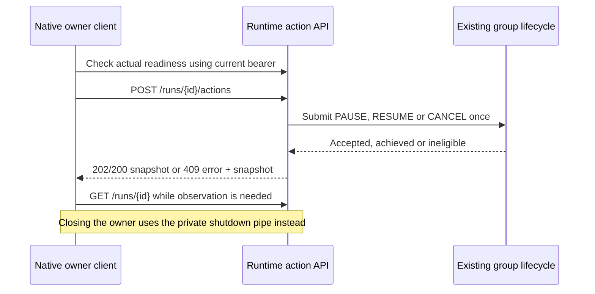

# Pause, Resume and Cancel a RunGroup

## Overview

Studio and Launcher control an existing group with one authenticated local API.
The response arrives after action submission and a snapshot read; it does not
wait for the workflow or action to finish. Use the same Runtime-owned group ID
and poll its by-ID snapshot to observe the committed result.



**The action endpoint is available.** Test Pause, Resume, Cancel and a fresh run
through the actual owner app. Verify real Android and native Windows behavior
separately; controlled Linux tests and cross-builds do not establish those outcomes.

This is the shared route reference for both client developers. Use
[managed process ownership](managed_runtime.md) and
[local authentication on Linux/Windows](local_authentication.md) for startup,
credential retrieval and readiness. [Studio](studio.md) uses current plaintext
Test Runs; [Launcher](launcher.md) will use the same group controls once protected package admission is available. This endpoint does not authorize a product.

## 1. Endpoint and request

```http
POST {apiBaseUrl}/runs/{runGroupId}/actions
Authorization: Bearer <current sessionToken>
Content-Type: application/json

{"action":"PAUSE"}
```

`apiBaseUrl` already includes `/api/v1`, for example
`http://127.0.0.1:6810/api/v1`. `runGroupId` is the exact ID returned by POST
/runs, not its requestId or a device execution ID. Do not generate a new ID for
an action. There are no query parameters.

| Field/action | Usage |
| --- | --- |
| `action` | The only required field; exact uppercase string PAUSE, RESUME or CANCEL. |
| PAUSE | Fence new attempts; permitted nodes and retry delays finish, then workers park. Active Delay is not frozen. |
| RESUME | Continue the same live workers after confirmed Resume, keeping inputs, committed outputs and RAM variables. |
| CANCEL | Interrupt unfinished work, settle and release the group, keeping Runtime alive for another run. Cannot undo an Android action already received. |

Valid bodies:

```json
{"action":"PAUSE"}
```

```json
{"action":"RESUME"}
```

```json
{"action":"CANCEL"}
```

Limit: 1,024 UTF-8 body bytes including whitespace. No extra fields, duplicate
keys, lowercase/padded action, null, arrays, trailing JSON or compression.
`application/json; charset=utf-8` is accepted. Every admitted device is affected;
there is no per-device control endpoint or forced-action flag.

## 2. Interpret the response

| Response | Body | Client behavior |
| --- | --- | --- |
| 202 Accepted | Exact ExecutionSnapshot at the root. | Submission accepted or same action still pending. Show pending locally and observe the same group. |
| 200 OK | Exact ExecutionSnapshot at the root. | Target was already achieved; no additional operation was created. |
| 409 Conflict | Exactly `error` and `snapshot`. | Display current state and conflict; reconcile intent rather than automatically repeating. |

202 remains 202 if the action completes before its response snapshot is read.
The snapshot may also reflect a later concurrent action or natural terminal
winner. The submission decision and snapshot are separate ordering points.
There is no actionId, pending flag, status endpoint or new PAUSING/CANCELLING enum.

Repeated pending PAUSE/RESUME/CANCEL returns 202. Repeating achieved PAUSE at
PAUSED or RESUME at RUNNING returns 200, unless an opposing action is pending.
RESUME during pending Pause, or PAUSE during pending Resume, conflicts even if
SQLite still shows a status that looks suitable. CANCEL supersedes either
pending action; Pause/Resume after accepted Cancel conflicts.

CANCEL can remain 202 during joined cleanup after SQLite is already CANCELLED.
After retirement, CANCEL against the saved CANCELLED group is 200. Controls on
SUCCEEDED, FAILED or INTERRUPTED groups are 409. A persisted non-terminal record
without its matching live worker owner cannot be resumed from SQLite.

## 3. Complete response examples


These illustrative responses use the Runtime action DTOs. IDs, timestamps and cursors are examples; use the actual values from your run.
For readability they use one selected device; multi-device bodies have the same
shape and include all selected members. Cursors are illustrative Runtime-wide
watermarks, never per-action IDs or progress percentages.

### 6.1 Accepted Pause — HTTP 202

Delay is still running, so this response does not yet confirm PAUSED.

```json
{
  "cursor": "42",
  "runGroup": {
    "id": "550e8400-e29b-41d4-a716-446655440001",
    "requestId": "550e8400-e29b-41d4-a716-446655440000",
    "status": "RUNNING",
    "createdAt": "2026-11-23T08:00:00.000Z",
    "finishedAt": null,
    "summary": {
      "total": 1, "queued": 0, "running": 1, "paused": 0,
      "succeeded": 0, "failed": 0, "cancelled": 0, "interrupted": 0
    }
  },
  "deviceExecutions": [{
    "id": "550e8400-e29b-41d4-a716-446655440002",
    "adbSerial": "emulator-5554",
    "status": "RUNNING",
    "nextNodeId": "delay",
    "createdAt": "2026-11-23T08:00:00.000Z",
    "startedAt": "2026-11-23T08:00:00.010Z",
    "finishedAt": null,
    "terminalError": null
  }]
}
```

### 6.2 Already paused — HTTP 200

Delay has committed and the retained worker is parked before Tap. Repeating
PAUSE has no additional effect. This is also the shape returned by a later GET.

```json
{
  "cursor": "47",
  "runGroup": {
    "id": "550e8400-e29b-41d4-a716-446655440001",
    "requestId": "550e8400-e29b-41d4-a716-446655440000",
    "status": "PAUSED",
    "createdAt": "2026-11-23T08:00:00.000Z",
    "finishedAt": null,
    "summary": {
      "total": 1, "queued": 0, "running": 0, "paused": 1,
      "succeeded": 0, "failed": 0, "cancelled": 0, "interrupted": 0
    }
  },
  "deviceExecutions": [{
    "id": "550e8400-e29b-41d4-a716-446655440002",
    "adbSerial": "emulator-5554",
    "status": "PAUSED",
    "nextNodeId": "tap",
    "createdAt": "2026-11-23T08:00:00.000Z",
    "startedAt": "2026-11-23T08:00:00.010Z",
    "finishedAt": null,
    "terminalError": null
  }]
}
```

### 6.3 Conflicting action — HTTP 409

RESUME is now pending, but SQLite still shows PAUSED. A new PAUSE conflicts;
that old persisted state cannot turn this request into an achieved duplicate.

```json
{
  "error": {
    "code": "INVALID_EXECUTION_STATE",
    "message": "action is not valid for the current execution state",
    "retryable": false
  },
  "snapshot": {
    "cursor": "47",
    "runGroup": {
      "id": "550e8400-e29b-41d4-a716-446655440001",
      "requestId": "550e8400-e29b-41d4-a716-446655440000",
      "status": "PAUSED",
      "createdAt": "2026-11-23T08:00:00.000Z",
      "finishedAt": null,
      "summary": {
        "total": 1, "queued": 0, "running": 0, "paused": 1,
        "succeeded": 0, "failed": 0, "cancelled": 0, "interrupted": 0
      }
    },
    "deviceExecutions": [{
      "id": "550e8400-e29b-41d4-a716-446655440002",
      "adbSerial": "emulator-5554",
      "status": "PAUSED",
      "nextNodeId": "tap",
      "createdAt": "2026-11-23T08:00:00.000Z",
      "startedAt": "2026-11-23T08:00:00.010Z",
      "finishedAt": null,
      "terminalError": null
    }]
  }
}
```

RESUME and CANCEL success bodies use the same exact SnapshotResponse. Confirmed
Resume sets group RUNNING and surviving devices QUEUED, possibly already RUNNING
by the read. Confirmed cancellation sets surviving devices CANCELLED with null
nextNodeId and finishedAt; already terminal siblings retain their outcomes.
Do not add `actionId`, `accepted`, `pending`, `success` or `operation` fields.

## 4. Other errors and lost responses

| HTTP/code | Meaning and next step |
| --- | --- |
| 400 INVALID_REQUEST | Fix path, media type or body. No action was submitted. |
| 401 UNAUTHORIZED | Load current owned-process credentials and verify readiness. Do not resend an old intent blindly. |
| 404 RESOURCE_NOT_FOUND | Requested group does not exist. Check the ID; never redirect the intent to another active group. |
| 413 PAYLOAD_TOO_LARGE | Reduce body to the exact action DTO. |
| 500 PERSISTENCE_FAILED | Control or snapshot persistence failed. The action might already be accepted; reconcile the exact group and Runtime state. |
| 500 INTERNAL_ERROR | Unexpected dependency or response-read failure. Do not assume the action was rejected. |
| 503 INTERNAL_ERROR | Runtime is stopping. Use the owner lifecycle; explicit shutdown must not trigger automatic relaunch. |

Errors other than 409 have only the normal error envelope. All listed failures
are non-retryable in their error DTO; this is not a command to retry mutations.

After a connection failure, timeout or response-read error, GET the exact group's
saved snapshot. Do not auto-repeat the action: a late duplicate after an
intervening opposite action can be a new action. RUNNING alone cannot reveal
every pending intent. For an explicit new user choice, submit that current choice.
If Runtime died, the owner client may replace it under the managed lifecycle;
Runtime marks unfinished work INTERRUPTED on the next startup, and no old action or RAM is reconstructed.

## 5. Linux curl example

For standalone manual testing, set CONNECTION_FILE using
[authentication step 2](local_authentication.md#2-find-the-connection-file).
Managed clients use the private readiness record in memory instead of the file.
Set RUN_GROUP_ID to the group returned by your actual POST /runs.

```bash
RUN_GROUP_ID='paste-the-existing-runGroup-id'

runtime_action() {
  local action="$1" values
  local -a connection
  case "$action" in PAUSE|RESUME|CANCEL) ;; *) return 1 ;; esac
  values=$(python3 - "$CONNECTION_FILE" <<'PYCONNECTION'
import json, sys
with open(sys.argv[1], encoding="utf-8") as source:
    c = json.load(source)
print(c["apiBaseUrl"])
print(c["sessionToken"])
PYCONNECTION
  ) || return 1
  mapfile -t connection <<< "$values"
  printf 'header = "Authorization: Bearer %s"\n' "${connection[1]}" |
    curl --config - --noproxy '*' --max-time 5 --fail --silent --show-error \
      "${connection[0]}/runtime-info" >/dev/null || return 1
  printf 'header = "Authorization: Bearer %s"\n' "${connection[1]}" |
    curl --config - --noproxy '*' --max-time 5 -i --request POST \
      --header 'Content-Type: application/json' --data "{\"action\":\"$action\"}" \
      "${connection[0]}/runs/$RUN_GROUP_ID/actions"
}

runtime_action PAUSE
# Observe GET /runs/{id} until PAUSED before intentionally continuing:
# runtime_action RESUME
# runtime_action CANCEL
```

The helper rereads credentials and probes readiness per operation, sends no
mutation retry and does not print the token. It demonstrates request handling,
not an automatic process owner/relaunch implementation.

## 6. Windows PowerShell example

Use PowerShell 7 for `-NoProxy`. Set ConnectionFile using the authentication
guide, or supply the current private readiness record in the native app.

```powershell
$ConnectionFile = Join-Path $env:LOCALAPPDATA 'A2MaTeX\Runtime\runtime-connection.json'
$RunGroupId = 'paste-the-existing-runGroup-id'

function Invoke-RuntimeAction {
    param([ValidateSet('PAUSE', 'RESUME', 'CANCEL')][string]$Action)
    $Connection = Get-Content -LiteralPath $ConnectionFile -Raw -ErrorAction Stop | ConvertFrom-Json -ErrorAction Stop
    $Headers = @{ Authorization = "Bearer $($Connection.sessionToken)" }
    Invoke-RestMethod -Uri "$($Connection.apiBaseUrl)/runtime-info" -Headers $Headers -NoProxy -MaximumRedirection 0 -TimeoutSec 5 -ErrorAction Stop | Out-Null
    $Body = @{ action = $Action } | ConvertTo-Json -Compress
    try {
        $Response = Invoke-WebRequest -Method Post -Uri "$($Connection.apiBaseUrl)/runs/$RunGroupId/actions" -Headers $Headers -ContentType 'application/json' -Body $Body -NoProxy -MaximumRedirection 0 -TimeoutSec 5 -ErrorAction Stop
        [int]$Response.StatusCode
        $Response.Content
    } catch {
        if ($_.Exception.Response) { [int]$_.Exception.Response.StatusCode }
        $_.ErrorDetails.Message
        throw
    }
}

Invoke-RuntimeAction PAUSE
# Invoke-RuntimeAction RESUME
# Invoke-RuntimeAction CANCEL
```

A 409 throws under PowerShell's HTTP convention; inspect its printed JSON
error/snapshot. The Windows example is a client reference; native Windows
acceptance must still be performed on a Windows host.

## 7. Postman scenario and expected history

1. Complete the [local-auth Postman setup](local_authentication.md#postman-on-linux-or-windows).
   Keep API_BASE_URL and SESSION_TOKEN current; do not add `/api/v1` twice.
2. Compile/start the readable [multi-device Delay workflow](../../../../a2matex-runtime/examples/h4/README.md)
   with one or two actual READY serials. Set each delayMs to 5000 for this manual
   scenario; retain the group's response ID. Compilation itself performs no action.
3. Probe `GET {{API_BASE_URL}}/runtime-info`. Then POST
   `{{API_BASE_URL}}/runs/<that-runGroupId>/actions`, Bearer Token
   `{{SESSION_TOKEN}}`, Body → raw → JSON: `{"action":"PAUSE"}`. Params empty.
4. Expect 202; poll `GET {{API_BASE_URL}}/runs/<id>` (Body none) every 500 ms,
   at most one read outstanding, until PAUSED or a terminal winner. Pause lets
   active Delay finish. For this graph, a stable PAUSED member has Start/Delay
   SUCCEEDED and End next; there is no active attempt.
5. Repeat PAUSE after full acknowledgement: 200. POST RESUME: 202; then observe
   SUCCEEDED with three successful attempts per device and unchanged execution IDs.
6. Start a distinct new request ID, Pause it, then CANCEL: 202; observe CANCELLED.
   Previously completed Start/Delay attempts remain SUCCEEDED; End never runs.
   Once cleanup retires, repeated CANCEL is 200. A new run can start in the same Runtime.
7. CANCEL against the earlier SUCCEEDED group returns 409 with error/snapshot;
   a random valid unknown group ID gives 404. Do not use a fresh ID to control an old run.

No Postman script is required. Exact counts in steps 4–6 require submitting
Pause before End is permitted; if the workflow naturally wins, retain its
terminal result and repeat with a new request/longer valid Delay. The deterministic
automated suite holds workers to verify pending-action races reliably.

## 8. Client process and UI responsibilities

Before each operation, use actual readiness and the current native-owned session,
sharing startup/replacement among callers. Readiness failure is not evidence
that a mutating request never reached Runtime. Reconcile accepted run/action
identity before deciding on an explicit new operation.

Show pending actions locally; stop polling on terminal outcome, view disposal
or owner exit, and discard stale reads for a different selected group. Pause
needs Runtime alive; Resume only continues that live process. Cancel keeps the
server alive. Closing the owning app or choosing Shut down Runtime sends the
private `shutdown\n` command and waits for process exit; it is not POST CANCEL.
Do not restart Runtime automatically after explicit user shutdown.

Runtime supplies the HTTP API; Studio and Launcher implement their own controls.
Use [attempt history and event streaming](managed_runtime.md#node-attempt-history-api)
to reconcile saved state. Launcher protected `.a2m` authorization/start is not yet
available; Development run actions do not supply that authorization.
