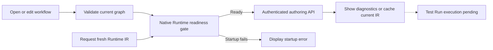

# Studio Runtime integration

## Overview

One native Runtime client serves Studio validation and compilation. The first
authoring request can start Runtime. Subsequent requests reuse the owned
process and check readiness before sending HTTP. This guide covers the current
authoring APIs. Test Run execution still depends on G1 and the runner.



## Validate and compile

Use the [managed lifecycle guide](managed_runtime.md) for launch and per-request
readiness. Opening the project list can leave Runtime stopped. Debounce
automatic editor validation and discard a response for a draft revision that
is no longer current.

| Operation | Request body | How to use the response |
|---|---|---|
| `POST {apiBaseUrl}/workflow-validation` | Object with `editorGraph` | Render the returned validation status and diagnostics for that graph revision. |
| `POST {apiBaseUrl}/workflow-compilation` | Object with `editorGraph` and `inputSchema` | Render `validation`. Cache a complete `runtimeIr` only if the same graph and schema revision is still current. Invalid source returns `runtimeIr: null`. |

Both requests use `Content-Type: application/json` and the current bearer
token. Capture the graph and schema as one source snapshot before compiling.
Once Test Run is available, send the exact successfully compiled IR through
the run API and let admission validate it. Studio owns the draft and cache.

## Shutdown

Keep **Shut down Runtime** available while Studio owns the process. Suspend
automatic validation after explicit shutdown. The user can explicitly request
a Runtime operation to start it again. During future active runs, closing
Studio will offer **Stop and exit** or **Stay open** once H6 is available.

## Current API inventory and examples

Use [shared health and Runtime Info](managed_runtime.md#shared-api-reference)
for process diagnostics and readiness. The two routes below belong to Studio
authoring. Studio should send them from its native client using the current
child's URL and token. Studio also uses the [shared device routes](#android-device-picker).

### POST /api/v1/workflow-validation

Validate an Editor Graph as the publisher edits. Send exactly one
`editorGraph` object in a UTF-8 JSON request. Do not send query parameters,
compressed bodies, or extra envelope fields. The graph has a 1,048,576-byte
limit and the full validation body has a 1,052,672-byte limit.

Example request body for a valid Start → End graph:

```json
{
  "editorGraph": {
    "schemaVersion": 1,
    "entryNodeId": "start",
    "nodes": [
      {"id":"start","type":"flow.start","config":{},"bindings":{},"errorPolicy":"STOP","editor":{"x":0,"y":0}},
      {"id":"end","type":"flow.end","config":{},"bindings":{},"errorPolicy":"STOP","editor":{"x":160,"y":0}}
    ],
    "edges": [
      {"id":"e1","sourceNodeId":"start","sourcePort":"success","targetNodeId":"end"}
    ]
  }
}
```

HTTP 200 returns `status`, `errors`, `warnings`, and `truncated`.

```json
{"status":"VALID","errors":[],"warnings":[],"truncated":false}
```

The status can also be `VALID_WITH_WARNINGS` or `INVALID`. Render diagnostics
using `code`, `message`, and the `path` array, with `nodeId` or `edgeId` when
present. A valid JSON envelope with invalid graph content returns HTTP 200
with diagnostics. A malformed envelope returns HTTP 400, invalid credentials
return HTTP 401, and an oversized body or graph returns HTTP 413. Use the
[shared error envelope](managed_runtime.md#http-error-envelope) for HTTP
failures. Validation does not modify the draft or execute it.

### POST /api/v1/workflow-compilation

Request fresh IR for a captured Editor Graph and Input Schema. Send exactly
the `editorGraph` from the example above plus the `inputSchema` object below
in the same JSON envelope. This route uses the same headers and transport rules
as validation. The graph limit is 1,048,576 bytes and the full request limit
is 2,097,152 bytes.

```json
{"type":"object","properties":{},"required":[],"additionalProperties":false}
```

A completed request returns HTTP 200 with the validation result under
`validation` and a complete Runtime IR object under `runtimeIr` on success.
Use the [Runtime IR contract](../contracts/runtime_ir_v1.md) to decode it. A
success with warnings can still supply complete IR. Cache that IR only for
the same source revision. An invalid source response includes diagnostics
and `runtimeIr: null`. For example, an empty Input Schema object produces
diagnostics for the missing schema fields. Do not use an old or partial IR
as the result of a failed compilation.

This call has no draft, execution, or device side effects. It uses the same
400, 401, 413, and 500 envelope semantics as validation. Both authoring calls
can be retried after restoring readiness. Recheck the current draft revision
before applying a retry result.

For a native development smoke test with credentials from the owned child,
save the validation body above as `validation.json`. Make the authenticated
readiness probe first, then send the operation with the same session.

```sh
curl --noproxy '*' -fsS -H "Authorization: Bearer ${SESSION_TOKEN}" \
  "${API_BASE_URL}/runtime-info" >/dev/null &&
curl --noproxy '*' -sS -H "Authorization: Bearer ${SESSION_TOKEN}" \
  -H 'Content-Type: application/json' --data-binary @validation.json \
  "${API_BASE_URL}/workflow-validation"
```

For the compilation smoke test, use the same session and create the request
with `jq` from the saved validation body. The probe must succeed before the
compilation call.

```sh
jq '. + {inputSchema: {type: "object", properties: {}, required: [], additionalProperties: false}}' \
  validation.json > compilation.json
curl --noproxy '*' -fsS -H "Authorization: Bearer ${SESSION_TOKEN}" \
  "${API_BASE_URL}/runtime-info" >/dev/null &&
curl --noproxy '*' -sS -H "Authorization: Bearer ${SESSION_TOKEN}" \
  -H 'Content-Type: application/json' --data-binary @compilation.json \
  "${API_BASE_URL}/workflow-compilation"
```

Keep the token local and avoid shell tracing.

## Android device picker

When the publisher opens the picker to prepare a draft test run, use the
native client's per-request readiness check and refresh the device list.
Use the cached read to render a snapshot already obtained in the same
session. Provide a **Refresh devices** action for after the publisher
connects or authorizes a device. See the [shared E7 requests and responses](managed_runtime.md#device-inventory-api).

Use `adbSerial` as the selection key. Enable selection for `READY` entries and
show the reason for unavailable ones. After a successful refresh, retain
selections that are still ready and flag any that disappeared or became
unavailable. If refresh fails, an already displayed list can remain visible
with its refresh failure. The future draft run API invokes E6 to recheck live
readiness at admission.
