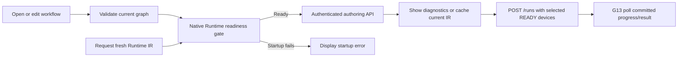

# Studio Runtime integration

## Overview

One native Runtime client serves Studio validation and compilation. The first
authoring request can start Runtime. Subsequent requests reuse the owned
process and check readiness before sending HTTP. This guide covers the current
authoring, multi-device Test Run, saved-run snapshots, I1 attempt history and
H13 lifecycle-action APIs.
Wait Variable remains deferred under H6–H8.

For the Studio developer, use the single
[I5–I7 integration handoff](studio_observability.md): events/reconnect, saved
attempts/screenshots, and run/process controls in one source-mapped guide.
Studio was inspected read-only; the handoff does not implement client code.
The user will pull the implementation and request I8 review/E2E later.



## Validate and compile

Use the [managed lifecycle guide](managed_runtime.md) for launch and per-request
readiness. Opening the project list can leave Runtime stopped. Debounce
automatic editor validation and discard a response for a draft revision that
is no longer current.

| Operation | Request body | How to use the response |
|---|---|---|
| `POST {apiBaseUrl}/workflow-validation` | Object with `editorGraph` | Render the returned validation status and diagnostics for that graph revision. |
| `POST {apiBaseUrl}/workflow-compilation` | Object with `editorGraph` and `inputSchema` | Render `validation`. Cache a complete `runtimeIr` only if the same graph and schema revision is still current. Invalid source returns `runtimeIr: null`. |

Both requests use `Content-Type: application/json` and the current bearer
token. Capture the graph and schema as one source snapshot before compiling.
For Test Run, send the exact successfully compiled IR through
the run API and let admission validate it. Studio owns the draft and cache.

## Shutdown

Keep **Shut down Runtime** available while Studio owns the process. Suspend
automatic validation after explicit shutdown. The user can explicitly request
a Runtime operation to start it again. During an active run group, closing
Studio should offer **Stop and exit** or **Stay open**. Stop and exit sends the
private shutdown command and waits for G11 cancellation/child exit; it does not
use the HTTP run-action API. Group Cancel keeps Runtime alive; Stop and exit does not.

## Current API inventory and examples

Use [shared health and Runtime Info](managed_runtime.md#shared-api-reference)
for process diagnostics and readiness. The two routes below belong to Studio
authoring. Studio should send them from its native client using the current
child's URL and token. Studio also uses the [shared device routes](#android-device-picker).

### POST /api/v1/workflow-validation

Validate an Editor Graph as the publisher edits. Send exactly one
`editorGraph` object in a UTF-8 JSON request. Do not send query parameters,
compressed bodies, or extra envelope fields. The graph has a 1,048,576-byte
limit and the full validation body has a 1,052,672-byte limit.

Example request body for a valid Start → End graph:

```json
{
  "editorGraph": {
    "schemaVersion": 1,
    "entryNodeId": "start",
    "nodes": [
      {"id":"start","type":"flow.start","config":{},"bindings":{},"errorPolicy":"STOP","editor":{"x":0,"y":0}},
      {"id":"end","type":"flow.end","config":{},"bindings":{},"errorPolicy":"STOP","editor":{"x":160,"y":0}}
    ],
    "edges": [
      {"id":"e1","sourceNodeId":"start","sourcePort":"success","targetNodeId":"end"}
    ]
  }
}
```

HTTP 200 returns `status`, `errors`, `warnings`, and `truncated`.

```json
{"status":"VALID","errors":[],"warnings":[],"truncated":false}
```

The status can also be `VALID_WITH_WARNINGS` or `INVALID`. Render diagnostics
using `code`, `message`, and the `path` array, with `nodeId` or `edgeId` when
present. A valid JSON envelope with invalid graph content returns HTTP 200
with diagnostics. A malformed envelope returns HTTP 400, invalid credentials
return HTTP 401, and an oversized body or graph returns HTTP 413. Use the
[shared error envelope](managed_runtime.md#http-error-envelope) for HTTP
failures. Validation does not modify the draft or execute it.

### POST /api/v1/workflow-compilation

Request fresh IR for a captured Editor Graph and Input Schema. Send exactly
the `editorGraph` from the example above plus the `inputSchema` object below
in the same JSON envelope. This route uses the same headers and transport rules
as validation. The graph limit is 1,048,576 bytes and the full request limit
is 2,097,152 bytes.

```json
{"type":"object","properties":{},"required":[],"additionalProperties":false}
```

A completed request returns HTTP 200 with the validation result under
`validation` and a complete Runtime IR object under `runtimeIr` on success.
Use the [Runtime IR contract](../contracts/runtime_ir_v1.md) to decode it. A
success with warnings can still supply complete IR. Cache that IR only for
the same source revision. An invalid source response includes diagnostics
and `runtimeIr: null`. For example, an empty Input Schema object produces
diagnostics for the missing schema fields. Do not use an old or partial IR
as the result of a failed compilation.

This call has no draft, execution, or device side effects. It uses the same
400, 401, 413, and 500 envelope semantics as validation. Both authoring calls
can be retried after restoring readiness. Recheck the current draft revision
before applying a retry result.

For a native development smoke test with credentials from the owned child,
save the validation body above as `validation.json`. Make the authenticated
readiness probe first, then send the operation with the same session.

```sh
curl --noproxy '*' -fsS -H "Authorization: Bearer ${SESSION_TOKEN}" \
  "${API_BASE_URL}/runtime-info" >/dev/null &&
curl --noproxy '*' -sS -H "Authorization: Bearer ${SESSION_TOKEN}" \
  -H 'Content-Type: application/json' --data-binary @validation.json \
  "${API_BASE_URL}/workflow-validation"
```

For the compilation smoke test, use the same session and create the request
with `jq` from the saved validation body. The probe must succeed before the
compilation call.

```sh
jq '. + {inputSchema: {type: "object", properties: {}, required: [], additionalProperties: false}}' \
  validation.json > compilation.json
curl --noproxy '*' -fsS -H "Authorization: Bearer ${SESSION_TOKEN}" \
  "${API_BASE_URL}/runtime-info" >/dev/null &&
curl --noproxy '*' -sS -H "Authorization: Bearer ${SESSION_TOKEN}" \
  -H 'Content-Type: application/json' --data-binary @compilation.json \
  "${API_BASE_URL}/workflow-compilation"
```

Keep the token local and avoid shell tracing.

## Android device picker

When the publisher opens the picker to prepare a draft test run, use the
native client's per-request readiness check and refresh the device list.
Use the cached read to render a snapshot already obtained in the same
session. Provide a **Refresh devices** action for after the publisher
connects or authorizes a device. See the [shared E7 requests and responses](managed_runtime.md#device-inventory-api).

Use `adbSerial` as the selection key. Enable selection for `READY` entries and
show the reason for unavailable ones. After a successful refresh, retain
selections that are still ready and flag any that disappeared or became
unavailable. If refresh fails, an already displayed list can remain visible
with its refresh failure. The draft run API invokes E6 to recheck live readiness at admission.
Allow one or more selected READY devices. Capture each exact serial with its
own workflow input object; do not silently deduplicate or filter the selection.

## Start a workflow Test Run

### POST /api/v1/runs

This is the implemented Development execution endpoint for Studio's **Test Run**
button. Send an authenticated JSON POST to `{apiBaseUrl}/runs` after compiling
and selecting READY devices. The shared [POST /runs reference](managed_runtime.md#workflow-start-api)
contains the complete runnable request, full responses, limits, errors, and
Postman steps together in one section. The request mapping is:

| Start field | Studio value |
|---|---|
| requestId | A fresh lowercase UUID v4 for this new Run button intent. Keep it outside any retry function. |
| runtimeIr | The successful compilation response's runtimeIr object for the captured graph/schema revision. |
| devices | Non-empty ordered array of selected READY serials with their own input objects; no fixed count ceiling. |
| devices[i].adbSerial | The exact selected serial returned by device refresh. |
| devices[i].inputs | Captured workflow-input form values matching that compiled input schema; {} when empty. |

Send the compiled object itself, without stringifying it separately or wrapping
it in the compilation response. Use `Content-Type: application/json`, the
current native-owned Bearer token, and no query parameters. The entire request
is limited to 4 MiB, and runtimeIr to 1 MiB. Validation/compilation do not execute
Android commands; a newly admitted POST /runs does.

Set Variable is now executable when Runtime Info advertises its exact pair.
Render one node with scope `FLOW` or `RUN_GROUP`, a name, and its value binding.
The Runtime creates empty RAM scopes for a new run; Studio supplies no variable
store DTO. Its output is `{}`, so it offers no Set Variable output field to
later nodes. Flow/Global bindings read current named values; absent values fail
through the node's error policy. These values disappear when the run finishes
or Runtime exits. Follow the [G18 example](../../../../a2matex-runtime/examples/g18/README.md)
to test Set Variable → Switch through the existing APIs. Multi-device scheduling is implemented; live
HTTP Pause/Resume/Cancel is implemented; [integrate the action route](run_actions.md).
Wait Variable remains deferred.

Screenshot Test Run is now supported when the exact Screenshot pair appears
in Runtime Info. Render its selected mode from the catalog: FULL_SCREEN has
no coordinate bindings; pixel/percentage regions require their four literal
start/end coordinates. Later nodes may bind the declared artifactId output
after the Screenshot succeeds. That ID is neither image data nor a local
path. GET run snapshots still expose state, not per-node output or images.
G20 now supports [authenticated PNG downloads](managed_runtime.md#screenshot-artifact-download-api)
by known artifactId. [I1 history](#inspect-node-attempts-and-screenshots--i1) now
delivers committed attempt outputs/artifact IDs; do not query SQLite from Studio. Use the
[G19/G20 example](../../../../a2matex-runtime/examples/g19/README.md) for manual
compile/start/poll, ID lookup, and download verification. Advertising Screenshot
in Runtime Info establishes node support, not REST route availability in an
older build; integrate against the verified G20 build.

To display a known artifact, the native bridge must check actual Runtime
readiness, attach the current Bearer token, GET `/artifacts/{artifactId}` with
no body/query, and consume the complete binary response. Check HTTP errors and
body-read errors before exposing PNG bytes or an asset handle to the renderer.
An incomplete body after 200 is a failed preview, not a successful image or a
JSON error. Use an object URL/host asset bridge; revoke temporary object URLs
when the view closes. A bare `` cannot attach the Bearer
header. Keep tokens native and out of query strings. Cancel an in-flight GET
when the preview closes; this neither cancels the workflow nor by itself
requires relaunching Runtime. Repeated reads do not recapture the screen.

### Expected native/UI sequence

1. Guard against duplicate Run clicks before the first asynchronous operation.
   Capture graph, Input Schema, per-device workflow-input values, and all selected serials as
   one intended test. Debounced authoring responses must not replace this capture.
2. Through the native readiness/auth gate, compile that graph/schema. Accept
   VALID or VALID_WITH_WARNINGS with non-null IR; show diagnostics otherwise.
3. Refresh devices and require every captured serial to be READY. Runtime still
   rechecks the whole selection at admission.
4. Create the requestId once and retain the prepared body in Studio state
   **before** calling POST. Keep the Run button disabled during preparation,
   submission, and while an unresolved/active run exists.
5. POST the retained body. On 201 or 200, immediately retain runGroup.id and
   render the returned snapshot. They use the same JSON shape; 201 means new
   admission, while 200 means an existing run with no new action dispatch.
6. Poll GET /runs/{runGroupId}, with readiness/auth checked for each request.
   Keep one poll outstanding, discard obsolete view responses, and stop on a
   terminal status. Do not wait for POST to hold the connection until completion.
7. If the start response is lost, retain the original body/requestId. Once
   readiness/current credentials are restored, submit that same body to resolve
   the run. Do not generate a new UUID inside a network retry handler.

### Framework-neutral TypeScript example

This is an integration example, not an installed SDK or existing Studio code.
Implement `NativeRuntime.request` in Studio's trusted native process/bridge
using the [managed lifecycle guide](managed_runtime.md). Before **each** call,
that adapter ensures actual readiness, uses the published base URL/current
token, and applies bounded transport timeouts. Its return value contains local
HTTP status plus parsed JSON; this is not an extra wire-response wrapper.
Non-2xx HTTP responses remain available for code-based handling; transport
failures reject the promise. Do not implement it as arbitrary browser-page
fetch with a token exposed to page code.

Paths passed to this adapter are relative to apiBaseUrl, such as `/runs`.
When body is undefined, omit the HTTP body entirely: GET snapshots and
POST /devices/refresh reject `{}`, `null`, and other nonempty bodies. The
adapter serializes a provided start/compilation object exactly once.

The snapshot type below lists only fields used by this flow. Studio's complete
wire DTO must also include the summary, device states, timestamps, and errors
shown in the shared full-response examples; preserve the complete response.

```typescript
type JsonObject = Record<string, unknown>;
type HttpReply<T> = { status: number; body: T };
interface NativeRuntime {
  request<T>(
    method: "GET" | "POST",
    path: string,
    body?: unknown,
  ): Promise<HttpReply<T>>;
}

type CompilationReply = {
  validation: { status: "VALID" | "VALID_WITH_WARNINGS" | "INVALID" };
  runtimeIr: JsonObject | null;
};
type InventoryReply = {
  devices: Array<{ adbSerial: string; status: "READY" | "UNAVAILABLE" }>;
};
type StartRequest = {
  requestId: string;
  runtimeIr: JsonObject;
  devices: Array<{ adbSerial: string; inputs: JsonObject }>;
};
type RunSnapshot = {
  cursor: string;
  runGroup: { id: string; requestId: string; status: string };
};
const TERMINAL_RUN_STATES = new Set([
  "SUCCEEDED", "FAILED", "CANCELLED", "INTERRUPTED",
]);
const POLL_INTERVAL_MS = 1000;

async function prepareTestRun(
  runtime: NativeRuntime,
  editorGraph: JsonObject,
  inputSchema: JsonObject,
  devices: Array<{ adbSerial: string; inputs: JsonObject }>,
): Promise<StartRequest> {
  const captured = structuredClone({ editorGraph, inputSchema, devices });
  const compiled = await runtime.request<CompilationReply>(
    "POST", "/workflow-compilation",
    { editorGraph: captured.editorGraph, inputSchema: captured.inputSchema },
  );
  if (compiled.status !== 200) throw compiled;
  if (
    !["VALID", "VALID_WITH_WARNINGS"].includes(compiled.body.validation.status) ||
    compiled.body.runtimeIr === null
  ) {
    throw { operation: "compile", validation: compiled.body.validation };
  }

  const inventory = await runtime.request<InventoryReply>(
    "POST", "/devices/refresh",
  );
  if (inventory.status !== 200) throw inventory;
  const ready = new Set(inventory.body.devices.filter(
    (device) => device.status === "READY",
  ).map((device) => device.adbSerial));
  const serials = captured.devices.map((device) => device.adbSerial);
  if (serials.length === 0 || new Set(serials).size !== serials.length) {
    throw new Error("Select one or more distinct READY Android devices");
  }
  if (!serials.every((serial) => ready.has(serial))) {
    throw new Error("A selected device is unavailable; correct the selection");
  }

  return {
    requestId: crypto.randomUUID(),
    runtimeIr: compiled.body.runtimeIr,
    devices: captured.devices,
  };
}

async function submitPreparedRun(
  runtime: NativeRuntime,
  pending: StartRequest,
): Promise<RunSnapshot> {
  // Retry this function with the same pending object after an uncertain result.
  const reply = await runtime.request<RunSnapshot>("POST", "/runs", pending);
  if (reply.status !== 201 && reply.status !== 200) throw reply;
  return reply.body;
}

async function pollRun(
  runtime: NativeRuntime,
  runGroupId: string,
  signal: AbortSignal,
  showSnapshot: (snapshot: RunSnapshot) => void,
): Promise<void> {
  while (!signal.aborted) {
    let reply: HttpReply<RunSnapshot>;
    try {
      reply = await runtime.request<RunSnapshot>(
        "GET", `/runs/${encodeURIComponent(runGroupId)}`,
      );
    } catch (error) {
      if (signal.aborted) return;
      throw error;
    }
    if (signal.aborted) return; // Ignore responses for a closed/obsolete view.
    if (reply.status !== 200) throw reply;
    showSnapshot(reply.body);
    if (TERMINAL_RUN_STATES.has(reply.body.runGroup.status)) return;
    await new Promise<void>((resolve) => setTimeout(resolve, POLL_INTERVAL_MS));
  }
}
```

Studio's controller owns the variables and calls these functions in order:

| Controller step | State to retain |
|---|---|
| `pending = await prepareTestRun(...)` | Keep the returned body in the current Test Run intent before submission. Do not mutate it when the editor changes. |
| `initial = await submitPreparedRun(runtime, pending)` | Store initial.runGroup.id immediately and render initial. Keep requestId linked to this result. |
| `await pollRun(runtime, initial.runGroup.id, viewSignal, showSnapshot)` | Stop/replace the polling view safely. If initial is already terminal, skip polling. |
| Start response uncertain | Keep pending and call submitPreparedRun with that same object after readiness; do not call prepareTestRun to retry. |
| Publisher deliberately starts another test after settlement | Call prepareTestRun again to capture new intent and create a fresh UUID. |

Do not clear pending unconditionally in a finally block. A transport failure or
500 can leave an admitted run executing. The adapter's owner/readiness recovery
must preserve that identity. Keep credentials in the native adapter, not in
pending, Editor Graph, Runtime IR, persisted draft data, or UI logs.

### Handle POST results in the UI

| Result | UI behavior |
|---|---|
| 201 | A new run exists. Render and poll it; never equate admission with success. |
| 200 | Existing run returned. Render its state; no actions executed again. A SUCCEEDED replay is an old completed result. |
| 400 / 413 | Show the request/selection/size problem and fix it. Do not relaunch a healthy process. |
| 401 | Refresh actual owner/session readiness and credentials; retain pending run identity. |
| 409 RUNTIME_BUSY | Show the active run or wait for it to settle before retrying the same pending intent. |
| 422 with validation | Render diagnostic message/path/node fields. Fix/recompile or use a compatible Runtime build. |
| 422 device-availability code | Refresh selection and highlight every unavailableDevices index/serial and safe reason. No run was admitted. |
| 503 ADB_UNAVAILABLE | Show device-subsystem failure; retry after ADB is fixed. |
| 503 INTERNAL_ERROR | Runtime is stopping. Follow owner replacement rules and obtain fresh credentials. |
| 500 or lost response | Keep pending. Restore actual readiness and resolve with the original ID; do not automatically create another run. |

Errors have the shared error envelope and may include bounded validation.
Preserve HTTP status and parsed error code instead of relying only on messages.
The default 0.0.0-dev build can compile but fails execution version admission;
show RUNTIME_INCOMPATIBLE and use a compatible versioned build. Neither a
semantic rejection nor an ordinary saved-result 404 is process-death evidence.

For local testing, follow the [script-free Postman steps](managed_runtime.md#postman-check-without-scripts).
A new UUID should return 201; the exact same POST returns 200 and the same
RunGroup ID; a deliberate new intent after completion gets a new UUID/group.
Include intentional owner shutdown during a delay and reopening the saved
terminal result in Studio's integration acceptance.

Attempt history is implemented under I1 and [SSE state events](#live-execution-events--i4)
under I4. Operational logs are separate. H13 exposes
[Pause/Resume/Cancel over HTTP](run_actions.md). Studio uses the existing group ID,
current bearer and exact action body; keep accepted actions pending locally,
poll the by-ID snapshot, and reconcile 409/lost responses without automatic
mutation retries. The shared guide provides complete examples for its developer.
The [I7 client section](studio_observability.md#5-i7-run-controls-and-owner-lifecycle)
and [I7 spec](../i_observability_apis/i7_studio_lifecycle_controls.md) define
the action bridge, conflict/uncertain-outcome handling, buttons and guarded
shutdown/exit integration. HTTP Cancel keeps Runtime alive; owner shutdown
suppresses automatic work and waits for process exit.
Multi-device Test Run is implemented in H4. Phase H's [expansion checklist](../g_workflow_engine/g14_start_run_api.md#15-phase-h-expansion-checklist)
records the delivered picker/admission/scheduling changes.

## Run progress and saved results

The two [shared snapshot APIs](managed_runtime.md#run-snapshot-apis) are available:

| Studio action | Request | Result handling |
|---|---|---|
| Find the current run after opening the execution view | `GET {apiBaseUrl}/runs/active` | 200 supplies the active snapshot; 404 means the view has no active run. |
| Refresh a known run or inspect retained history | `GET {apiBaseUrl}/runs/{runGroupId}` | 200 supplies that saved run, including its terminal result; 404 means that ID is absent from this store. |

Keep the RunGroup ID separate from the request ID, graph node IDs, and selected
device IDs. Use one native per-request readiness check and current bearer token
for each read. No body or query is accepted. Use the shared Linux/Windows/Postman
examples and [saved-result demo](managed_runtime.md#optional-saved-result-fixture-without-android).
Use POST /runs for the complete selected group; do not send a workflow to
either GET.

Render group status and summary counts, then per-device status, saved next-node
position, timestamps, and terminal error. Preserve device order and the cursor
string. Replacing a displayed snapshot is a client refresh operation; it changes
no workflow data. Keep at most one snapshot poll outstanding per execution view,
cancel obsolete reads on navigation, and discard responses belonging to another
selected run. Once the known run is terminal, stop automatic live polling and
retain its result for inspection. After active returns 404, a saved ID can still
retrieve the completed result.

A snapshot 404 after successful readiness is a data result and does not request
Runtime relaunch. Handle read failures separately from the last displayed run
state; a 500 or broken connection is not evidence that the workflow succeeded,
failed, or disappeared. Use the shared owner/session replacement policy for an
actual readiness failure. I1 provides paginated attempts and I4 provides
[continuous state events](#live-execution-events--i4). Group controls use the [implemented H13 action API](run_actions.md). Shared snapshot tests and built-agent checks
pass on Linux; native Windows usage is documented but not executed here.

## Live execution events — I4

The Runtime endpoint is implemented and Linux-verified. Studio's event client
and UI reconciliation remain I5, and the inspector remains I6. Use the
[I5 section of the shared Studio handoff](studio_observability.md#3-i5-live-events-and-reconnect) for source locations and client
implementation steps, the
[complete shared SSE reference](managed_runtime.md#execution-event-stream--i4)
and [readable I4 demo](../../../../a2matex-runtime/examples/i4/README.md) as the
integration contract rather than reading service implementation details.

1. After the native owner client's actual readiness check, open one GET
   `{apiBaseUrl}/events` with current Bearer, exactly
   `Accept: text/event-stream`, no query and no body. Use a native streaming
   HTTP client capable of setting Authorization; do not move the token to a
   renderer or query string for browser EventSource convenience.
2. For a known run, load the authoritative snapshot and pass its `cursor` as
   Last-Event-ID so events between snapshot and subscription are replayed. If
   following only new activity, omit the header; old history is not replayed.
3. Parse complete SSE frames. The JSON data is an existing A6 event, and its
   cursor/type match the frame id/event. Filter using run/device/attempt IDs,
   not node ID alone. The same graph can run on several devices.
4. Apply the event before saving the connection's processed cursor as a
   string. Heartbeat comments have no cursor. Do not use attempt sequence,
   array position, a JavaScript Number or a server-close log as replay state.
5. On reconnect use that processed cursor. Repeated events after ambiguous
   delivery must update the same record, not create another attempt or dispatch
   an action. If snapshots refresh while events are buffered, avoid applying
   an older buffered state over the newer watermarked view. I5 owns that client
   reconciliation and its tests.

| Event | Studio use |
| --- | --- |
| RUN_GROUP_STATE_CHANGED | Update the matching run status from committed data. A completed node on one device does not itself complete the group. |
| DEVICE_EXECUTION_STATE_CHANGED | Update that member's status/next position. nextNodeId alone does not prove a node is running. |
| NODE_ATTEMPT_STATE_CHANGED | Highlight the matching device's running node or display the saved terminal attempt/output/error. A Screenshot output supplies artifactId for the existing download API. |
| NODE_RETRY_SCHEDULED | Show the planned next attempt/delay for the same node. Do not implement a client-side retry dispatch. |

A 200 response is an open connection, not a completed JSON response. Initial
headers arrive even when idle. Use bounded connect/header deadlines, then read
incrementally without the normal whole-request timeout. Buffer partial UTF-8
lines/frames between network chunks and cancel the read when its owner/view
no longer needs it. A `: heartbeat` comment appears after roughly
15 seconds of inactivity; the Runtime's one-second observation fallback is
not a one-second heartbeat. The Runtime bounds each write and closes a stalled
reader. Keep node outputs/history and snapshot refresh available as independent
read operations through their existing readiness gates.

Handle initial400 as invalid input, 401 through current-session authentication,
and 410 by repairing monitored views from authoritative snapshots before
resuming after the repaired cursor. After streaming begins, failures close the
connection without JSON; re-establish readiness before reconnecting. A healthy
Runtime needs a stream reconnect, not a new process. On actual readiness
failure use the shared single-replacement path with fresh credentials.

Before explicit Runtime shutdown or Studio exit, suppress reconnect/relaunch
and cancel the local stream reader, then use the existing private owner command.
Runtime also cancels streams before HTTP drain; the UI must not interpret that
expected EOF as a request to restart it. Final cancellation/recovery changes
can be read from SQLite through the APIs after a later intentional launch.

For Postman: GET `{{API_BASE_URL}}/events`, Bearer `{{SESSION_TOKEN}}`, one Accept
header `text/event-stream`, Body none. Open it before starting a workflow in
another tab. Expect committed attempt/device/group events with matching IDs.
Disconnect, start another run, and reconnect with the last processed cursor to
see retained later events without repeating commands. The shared guide has
exact Linux/Windows curl commands, frames, errors and host verification limits.

## Inspect node attempts and screenshots — I1

Use the [shared I1 API reference](managed_runtime.md#node-attempt-history-api--i1)
and [Postman walkthrough](../../../../a2matex-runtime/examples/i1/README.md).
The Runtime endpoint is implemented and Linux-verified; the Studio inspector UI
remains I6. History can be used independently of the implemented I4 event stream.

The [I6 implementation spec](../i_observability_apis/i6_studio_execution_inspector.md)
and [I6 section of the shared Studio handoff](studio_observability.md#4-i6-attempt-history-and-screenshot-inspection) define the client work.
Reuse the existing getNodeAttempts bridge, replace full-history reloads with
selected-page reads, and add a dedicated binary preview operation. The current
Studio JSON client has a 2 MiB response cap; artifact retrieval needs its own
16 MiB limit and disposal policy, without raising every API's limit.

1. Keep the selected RunGroup and its snapshot. Take the chosen member's
   deviceExecutions[i].id, then request GET
   `/device-executions/{id}/attempts?afterSequence=0&limit=100` through the shared
   native readiness/auth client. Use no body and no new start request.
2. Render ordered attempts, preserving id, sequence, nodeId, attemptNumber,
   status, timestamps, output and error. Associate nodes with the graph captured
   for that run, rather than a later edited draft. Separate each device's list;
   a shared nodeId does not identify a shared attempt.
3. Use nextAfterSequence to load more pages. For live refresh, keep a window
   containing observed RUNNING attempts and upsert by attempt ID. Their status
   changes at the same sequence; an append-only boundary would miss completion.
   A null continuation is not a terminal-run signal. Keep one read outstanding
   per view and stop on disposal/terminal-history refresh; discard stale replies
   after switching run/device.
4. A successful Screenshot output supplies artifactId. Fetch the PNG with the
   existing native Bearer artifact request and preview/asset bridge. No SQL,
   output-discovery debug endpoint or image path is required. Set Variable still
   returns `{}`; scope maps are not exposed by history.
5. Show HTTP/read failures separately from execution errors. Known empty history
   is200; unknown execution404. Neither restarts work. A cancelled page request
   cancels that read only; Pause/Resume/Cancel remain separate H13 actions.

Windows client examples are in the shared guide; native Windows UI/Runtime
acceptance remains unverified. See the I1 evidence record for the separate Phase H/G22 regression gates.

## Device selection and execution capacity

Customers control resource usage by selecting devices for each run. There is no
separate **Maximum simultaneous devices** setting. Send the exact selected ADB
serials and corresponding inputs; Runtime validates syntax, uniqueness and fresh
readiness, then admits or rejects the complete selection. Do not silently filter
unavailable entries or deduplicate entries carrying different inputs.

Capacity equals admitted membership. The owner does not write capacity YAML,
inject a capacity environment variable or restart Runtime when the next run's
selection changes. There is no per-request concurrency field or settings API.
Hardware determines practical capacity; actual byte/schema/deadline failures
still apply independently of device count.

H4 public multi-device dispatch is implemented. Use the
[readable H4 example](../../../../a2matex-runtime/examples/h4/README.md) to test
201 admission, 200 replay, ordered per-device snapshots and whole-selection
rejection. Show the group summary and every device's state; do not render only
deviceExecutions[0]. Production package execution remains separate; group controls use
[H13](run_actions.md). See the [H4 spec](../h_multi_device_execution/h4_public_multi_device_start.md).

## Device loss during a Test Run

H5 diagnoses transport after a nonzero ADB process result. Render the affected
member's FAILED status and `terminalError` from the usual GET snapshot, including
`DEVICE_DISCONNECTED`, `DEVICE_OFFLINE` or `DEVICE_UNAUTHORIZED`. Other members
may still be RUNNING; preserve the complete list and derived group summary.
Do not treat a device execution failure as a local HTTP-server readiness failure
or restart Runtime because of that saved error.

There is no immediate disconnect notification during Delay/RAM-only nodes and no
automatic resume on reconnect. Keep the original requestId for uncertain POST
recovery; a replay never starts another execution. A deliberate new run after
the active group finishes uses a fresh requestId and refreshed selection.

See the [shared H5 behavior](managed_runtime.md#device-disconnect-after-admission--h5)
and [manual acceptance scenario](../h_multi_device_execution/h5_device_disconnect_handling.md#11-manual-acceptance-after-implementation).
H15 verifies Linux controlled two-device disconnect isolation and focused
transport classification/deadline/cancellation checks. Live target acceptance
remains pending; see the [combined acceptance pack](../../../../a2matex-runtime/examples/h15/README.md).
