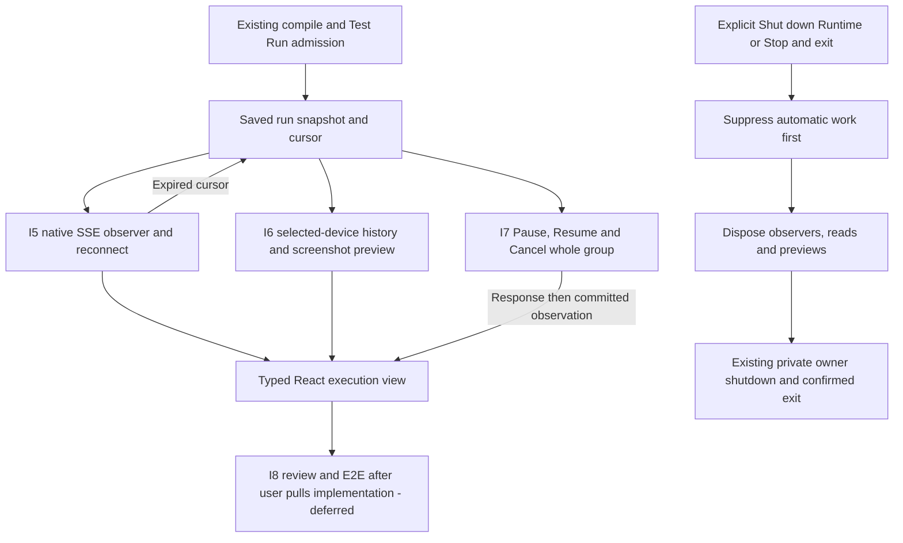

# Studio I5–I7 integration handoff

## Overview

This is the single Studio developer handoff for live execution monitoring
**I5**, saved attempt/screenshot inspection **I6**, and run/process controls
**I7**. The Runtime APIs already exist. Studio's Electron Main process owns
authentication, HTTP and the Runtime child; React receives typed view data.
The Runtime team supplies these documents and inspects Studio read-only.

The publisher starts a Test Run through the existing compile/admit flow.
Studio reads its saved snapshot and subscribes after that snapshot's cursor.
The publisher can inspect a device's attempt history and screenshots, control
the whole group, or explicitly shut down Runtime. Observation/read failures
do not themselves change execution outcomes or restart a healthy Runtime.



**Status:** implementation handoff only. Studio was inspected read-only on
2026-11-24 at revision `dd7c604172e7712d3de7dff6db9a1e3d84b1dba0`.
No Studio/Runtime code was edited or built for this delivery. Proposed methods,
channels and files below are not already installed features. The user will
pull the Studio implementation and request its review/E2E under I8 later.

Read in order, or jump directly to:

- [Shared source map and gaps](#1-shared-source-map-and-current-gaps).
- [Common native/API rules](#2-shared-native-client-and-api-rules).
- [I5 events and reconnect](#3-i5-live-events-and-reconnect).
- [I6 history and screenshots](#4-i6-attempt-history-and-screenshot-inspection).
- [I7 controls and shutdown](#5-i7-run-controls-and-owner-lifecycle).
- [Delivery checklist and deferred I8](#6-delivery-checklist-and-deferred-i8).

Normative specs: [I5](../i_observability_apis/i5_studio_event_reconnect_integration.md),
[I6](../i_observability_apis/i6_studio_execution_inspector.md),
[I7](../i_observability_apis/i7_studio_lifecycle_controls.md).
The general [Studio integration guide](studio.md) retains authoring/run-start
usage; [managed ownership](managed_runtime.md), [local authentication](local_authentication.md)
and [shared run actions](run_actions.md) remain common API references for both
Studio and Launcher. There are no separate I5/I6/I7 handoff files to follow.

## 1. Shared source map and current gaps

All paths are relative to `a2matex-ide/`. Linked files exist in the inspected
checkout. Reuse them before adding modules; the table describes future changes,
not edits performed by the Runtime team.

| Existing source                                                                                                                                                                                                                                                                                    | Current behavior                                                                                 | Work across I5–I7                                                                                             |
| -------------------------------------------------------------------------------------------------------------------------------------------------------------------------------------------------------------------------------------------------------------------------------------------------- | ------------------------------------------------------------------------------------------------ | ------------------------------------------------------------------------------------------------------------- |
| [runtime-process-manager.ts](../../../../a2matex-ide/electron/main/runtime/process/runtime-process-manager.ts)                                                                                                                                                                                     | Owns child/credentials, startup single-flight, actual readiness and replacement.                 | Main-only session generation, stop suppression, separate readiness recovery from operation retry.             |
| [runtime-http-client.ts](../../../../a2matex-ide/electron/main/runtime/http/runtime-http-client.ts)                                                                                                                                                                                                | Axios JSON APIs including snapshots/attempts; 10-second ordinary timeout and 2 MiB response cap. | Dedicated stream, dedicated binary artifact read, action-specific 200/202/409 decoding.                       |
| [create-runtime-services.ts](../../../../a2matex-ide/electron/main/runtime/create-runtime-services.ts)                                                                                                                                                                                             | Typed operations through the manager.                                                            | Compose observer, preview and action seams with the same owner.                                               |
| [runtime-run-coordinator.ts](../../../../a2matex-ide/electron/main/runtime/run/runtime-run-coordinator.ts)                                                                                                                                                                                         | Compile/persist/admit, exact pending-start retry and active-run exit guard.                      | Accept relevant committed/control snapshots and retain uncertain controls without corrupting admission state. |
| [runtime.types.ts](../../../../a2matex-ide/src/application/runtime/runtime.types.ts), [runtime.schema.ts](../../../../a2matex-ide/src/application/runtime/runtime.schema.ts), [runtime.error.ts](../../../../a2matex-ide/src/application/runtime/runtime.error.ts)                                 | Saved run/attempt DTOs, Zod schemas and safe RuntimeError metadata.                              | A6 event/live-view types, preview DTO and action disposition/conflict snapshot.                               |
| [register-runtime-handlers.ts](../../../../a2matex-ide/electron/main/ipc/register-runtime-handlers.ts)                                                                                                                                                                                             | Trusted-sender/ID validation and status/preparation publication.                                 | Narrow observer/preview/action handlers and sender-bound disposal.                                            |
| [channels.ts](../../../../a2matex-ide/electron/shared/channels.ts), [preload](../../../../a2matex-ide/electron/preload/index.cts), [studio-host-api.ts](../../../../a2matex-ide/src/infrastructure/electron/studio-host-api.ts)                                                                    | Existing named bridge methods and specific-listener cleanup.                                     | Update all three together; no generic HTTP/IPC or credential export.                                          |
| [useTestRunExecution.ts](../../../../a2matex-ide/src/presentation/features/test-run/useTestRunExecution.ts)                                                                                                                                                                                        | One-second snapshot poll; reloads all attempt pages for member `[0]`.                            | Native observation plus selected-page history, no competing whole-history poll.                               |
| [RunStatusPanel.tsx](../../../../a2matex-ide/src/presentation/features/test-run/RunStatusPanel.tsx)                                                                                                                                                                                                | Group/first-device timeline and read errors.                                                     | Member/attempt selection, details, observation health and run-action controls.                                |
| [MainWorkflowPage.tsx](../../../../a2matex-ide/src/presentation/pages/MainWorkflowPage.tsx)                                                                                                                                                                                                        | Test Run integration and explicit Runtime shutdown UI.                                           | Wire selection/actions and centralized intentional-stop policy.                                               |
| [bootstrap.ts](../../../../a2matex-ide/electron/main/bootstrap.ts)                                                                                                                                                                                                                                 | Composes services and performs guarded before-quit shutdown.                                     | Compose/dispose native controllers and guard window-close before window loss.                                 |
| [AndroidInspectorPanel.tsx](../../../../a2matex-ide/src/presentation/features/android-inspector/AndroidInspectorPanel.tsx), [ScreenshotViewport.tsx](../../../../a2matex-ide/src/presentation/features/android-inspector/ScreenshotViewport.tsx), [index.html](../../../../a2matex-ide/index.html) | Uint8Array → Blob URL with cleanup; interactive selector viewport; blob images permitted by CSP. | Reuse preview lifetime/styling, not live capture or nonexistent artifact hierarchy.                           |

Suggested small additions, not existing files: Main
`runtime/events/runtime-event-stream.ts` and `runtime-event-observer.ts`, a
selected-page inspector hook/components under `presentation/features/test-run`,
and a small action controller near the existing run coordinator if needed.
Keep framework-neutral DTOs in Application, sockets/processes in Electron
Main, and view state in Presentation. No dependency is expected; Electron,
React, TypeScript, Axios and Zod are already declared.

### Gaps the implementer must address

| Gap in the inspected checkout                          | Required handling                                                                                                                                                                                                                                                                                              |
| ------------------------------------------------------ | -------------------------------------------------------------------------------------------------------------------------------------------------------------------------------------------------------------------------------------------------------------------------------------------------------------- |
| JSON-only HTTP path                                    | SSE must have incremental/cancellable lifetime; PNG must use a separate binary path. Keep ordinary JSON timeouts/limits intact.                                                                                                                                                                                |
| Generic withReadyRuntime retries the whole operation   | Recover actual readiness without retrying a possibly sent control POST or replacing a healthy child after stream/preview cancellation.                                                                                                                                                                         |
| Status-only manager notifications                      | Add local child/session identity. READY with the same version is not proof of the same process.                                                                                                                                                                                                                |
| STOPPING/STOPPED without persistent native suppression | Prevent automatic reconnect, validation or reads from relaunching after user stop, including renderer remount/late callbacks.                                                                                                                                                                                  |
| Admission error schema rejects error-plus-snapshot     | Add action-specific validated 409 handling and preserve its snapshot through the bridge.                                                                                                                                                                                                                       |
| Snapshot summary/device-array caps at 32               | Remove obsolete device ceiling from these decoders; Runtime has no such count policy. Keep consistency and transport validation. Inventory's separate 1,000 cap is also a Studio constraint to reconcile.                                                                                                      |
| Start request is a one-device tuple                    | I5–I7 can read/control multi-device snapshots without expanding the start picker in this assignment. Do not assume `[0]`.                                                                                                                                                                                      |
| Managed Windows startup explicitly rejected            | Both [executable resolver](../../../../a2matex-ide/electron/main/runtime/process/runtime-executable.ts) and [pipe adapter](../../../../a2matex-ide/electron/main/runtime/process/runtime-pipes.ts) reject win32. Native Windows acceptance needs the Studio process/pipe prerequisite, not just a Runtime exe. |
| Older Studio implementation notes                      | Some still say SSE/actions are unavailable. Use current Runtime contracts; Studio owner reconciles its internal notes.                                                                                                                                                                                         |

## 2. Shared native client and API rules

Keep one native process manager. It starts the trusted Runtime executable with
the existing owner pipes and obtains `apiBaseUrl`/token privately. The managed
port is allocated dynamically in this Studio checkout; never assume 6810 or
read another process's standalone connection file. The base includes `/api/v1`.

Before every new operation/open attempt, confirm owned child/control lifetime
and make the bounded authenticated Runtime Info probe through the existing
readiness gate. Concurrent work shares startup/replacement. Replacements
invalidate old generations and require fresh snapshot bootstrap. Runtime does
not restart old runs or restore their RAM scopes.

| Operation            | Request                                                       | Normal result                                                              |
| -------------------- | ------------------------------------------------------------- | -------------------------------------------------------------------------- |
| Actual readiness     | GET runtime-info                                              | 200 JSON; current owned session, compatibility checked separately.         |
| Known-run snapshot   | GET runs/{runGroupId}                                         | 200 ExecutionSnapshot with consistent cursor; 404 means missing saved run. |
| Active-run discovery | GET runs/active                                               | 200 snapshot or normal RESOURCE_NOT_FOUND.                                 |
| I5 stream            | GET events                                                    | 200 SSE; optional Last-Event-ID header only.                               |
| I6 history           | GET device-executions/{id}/attempts?afterSequence=0&limit=100 | 200 attempts/continuation JSON.                                            |
| I6 PNG               | GET artifacts/{artifactId}                                    | 200 binary image/png.                                                      |
| I7 control           | POST runs/{runGroupId}/actions                                | 202/200 root snapshot; 409 error plus snapshot.                            |

All use current native Bearer and the fixed trusted base URL. Bypass proxies,
reject redirects and avoid body/query on GET except the two history parameters.
Tokens never enter URLs, renderer state, logs, image src, project storage or
shared Postman exports. Preserve safe HTTP status/Runtime error metadata rather
than exposing native error/request objects.

Keep child/session, native owned-run, selected-view and operation/request
generations independent. The ownership generation changes only on validated
admission/recovery/discovery, never view selection. Publication versions and
action submission versions have their own purposes. Bind IPC to the trusted
initiating WebContents. Old responses cannot overwrite a replacement child,
newer owned run, selected view or action. Renderer disposal cancels only
reads/subscriptions; accepted execution/actions remain Runtime-owned.

## 3. I5 live events and reconnect

### 3.1 Bootstrap, request and wire parsing

For a known run, cancel the old observation, load its by-ID snapshot, publish
its state and retain cursor W. Pass actual readiness for the stream opening
and subscribe after W. If the child changes between these operations,
bootstrap again rather than reuse the old watermark.

```http
GET {apiBaseUrl}/events
Authorization: Bearer <current native session token>
Accept: text/event-stream
Last-Event-ID: 42
```

Replace 42 with W or the last fully processed cursor. No query/body. Exactly
one Accept value is required. Omit Last-Event-ID only for an unselected monitor
of new activity; omission does not replay saved history. Never send zero.
An unexpected zero snapshot for a known saved run is a contract error.

Example A8 frame; the final blank line terminates it:

```text
id: 42
event: NODE_ATTEMPT_STATE_CHANGED
data: {"cursor":"42","type":"NODE_ATTEMPT_STATE_CHANGED","occurredAt":"2026-10-22T08:00:01.000Z","runGroupId":"550e8400-e29b-41d4-a716-446655440001","deviceExecutionId":"550e8400-e29b-41d4-a716-446655440002","nodeAttemptId":"550e8400-e29b-41d4-a716-446655440003","nodeId":"tap_01","payload":{"status":"RUNNING","attemptNumber":1}}

```

Heartbeat frame after about 15 idle seconds:

```text
: heartbeat

```

Read incrementally, preserving split UTF-8, LF/CRLF lines and frame terminators.
Never await/JSON-decode the entire connection. Validate the closed A6 union,
identity and payload; frame ID/type must match JSON cursor/type. Standard SSE
multiline-data joining is acceptable before validation. Comments/empty frames
produce no history or cursor; ignore unrecognized SSE fields and do not accept
server retry hints as client policy. A6 unknown/malformed events are a safe
protocol error, not something to silently acknowledge or retry forever.

Keep cursors as exact decimal strings (BigInt internally is an option), never
JavaScript Number or attempt sequence. Gaps are valid. Process/filter an event
before advancing the global cursor, including valid events from other runs.
Already processed duplicates do not mutate twice. Incomplete EOF is not
acknowledged. Bound one partial/frame buffer to 32 KiB for A6's 16 KiB JSON
plus framing; process large chunks of many complete frames incrementally.

### 3.2 Transport and bounded publication

Use a separate native streaming path. A small `node:http` adapter is sufficient
without a dependency; an Axios Node stream is an alternative if its lifetime
is verified. Override JSON Accept, inspect status before reading SSE, and
decode only a bounded safe JSON body for a non-200 response. Use a 10-second
opening/header budget, then a 45-second monotonic idle watchdog, with no total
body timeout. Keep ordinary Runtime request timeouts unchanged.

Do not await the full stream inside `withReadyRuntime`: it can turn body EOF/
timeout into child replacement and operation replay. Obtain a cancellable
stream handle and handle its later failures in the observer. Opening-specific
failures also need a readiness check rather than automatic healthy-child
replacement. Local cancellation is expected, not RUNTIME_TIMEOUT.

One observer owns one body read and retry timer. Publish coalesced current
view state, not an unbounded raw event queue. Use one unacknowledged bridge
envelope and one latest pending projection; owner acknowledgement releases the
next publication, never the SSE cursor or Runtime execution. Missing renderer
acknowledgement cannot block native stream consumption.

Required local bridge contract (to be implemented, not present yet):

```text
observeRun({runGroupId})
  -> HostResult<{observationId, initialView: ObservationEnvelope}>
selectObservedDevice({observationId, deviceExecutionId}) -> HostResult<void>
stopObserving({observationId}) -> HostResult<void>
onObservationChanged(listener) -> unsubscribe
ackObservation({observationId, version}) -> HostResult<void>
```

Generate/bind observation IDs in Main; validate sender and generations on
every control/publication. Dispose on owner WebContents destruction; preload
removes only its listener. Native envelopes carry local generation/version,
selected identity, projection, observation health, safe errors, stale flags
and the matching selected run's `controlState` from section 5.2. Concrete names
can follow Studio patterns; these payload and ordering rules are required.

#### Initial view and ACK sequence

1. React installs its listener before calling observeRun and records a local
   request generation. Controls remain loading until startup is acknowledged.
2. Main creates the observation, reads the snapshot and captures detached,
   immutable version 1 with the latest native controlState in its serial state
   owner. Subsequent reductions do not mutate that initial envelope. It returns
   this complete initialView in the invoke result. Never also push version 1
   through the event channel: it could precede the listener/returned ID.
3. Main may open/consume SSE while that invoke is delivered. Changes are
   reduced into one latest pending view, with no push before the initial ACK.
4. React verifies its request generation, stores the observation ID, applies
   the initial snapshot **and controlState**, then invokes ackObservation for
   version 1. If unmounted/replaced while awaiting observeRun, dispose that
   returned old observation instead; it must not become current.
5. Main accepts only the owner's exact outstanding version, then sends the
   latest pending view and permits one outstanding message again. Already
   acknowledged duplicates are harmless; future/unsent versions cannot release
   publication. React applies every complete new view before ACKing it.

Use a named 10-second initial-ACK deadline, armed just before returning the
successful invoke response. If its reply/ACK is lost, dispose only the abandoned
observation and its reader/timers. Clear the deadline on its valid initial ACK
or disposal. A new observeRun replaces an abandoned one
for that owner. Runtime execution and native action intent are unaffected.
Late/old-session ACK returns a safe local-state failure; React discards stale
startup and may bootstrap under the current permitted observation intent.
It never resends a run control. Subsequent publication ACK stalls keep only
one outstanding and one latest pending view until ACK/disposal, without
blocking SSE or inventing another per-event queue.

Publication version, action submissionVersion and Runtime event cursor have
different purposes. Native action transitions can publish with an unchanged
event cursor; React must not discard them by comparing only SSE cursors.

### 3.3 Applying changes and snapshots

| A6 event                       | View effect                                                                                              |
| ------------------------------ | -------------------------------------------------------------------------------------------------------- |
| RUN_GROUP_STATE_CHANGED        | Matching group status; coalesced refresh for exact summary/timestamps.                                   |
| DEVICE_EXECUTION_STATE_CHANGED | Matching member status/next position/error; no running highlight from nextNodeId alone.                  |
| NODE_ATTEMPT_STATE_CHANGED     | Latest live fact per device, keyed by attempt ID; RUNNING highlights, terminal clears that same attempt. |
| NODE_RETRY_SCHEDULED           | Planned retry for completed attempt; never a client dispatch or invented running attempt.                |

Filter selected run/member by IDs, not node ID or serial. Keep partial live
facts separate from saved history DTOs: events lack sequence and full attempt
timestamps. Clear pending retry when the next attempt starts and live activity
when its group/member becomes terminal. Paused retry remains suspended.

One snapshot refresh in flight, one dirty flag, 250 ms minimum refresh-start
interval. If response S is older than processed cursor at application time,
discard and refresh again. Otherwise accept its run/device fields and retain
S as snapshot watermark, without advancing the processed stream cursor.
Subsequent group/device events at or below S cannot regress snapshot fields;
attempt/retry events still need handling because snapshots contain no history.
An old RUNNING attempt cannot reopen a snapshot-confirmed terminal member.

Example: snapshot 50 arriving after event 51 cannot restore an old status.
Snapshot 60 arriving while processed cursor is 57 can update saved state,
but events 58 onward must still be consumed for attempt/retry facts. Exact
summary/timing stays visibly updating until final refresh converges.

Coalesced reads update the selected view, but may update Main's active-run guard
only for the matching owned group/session/ownership generation and a non-older
owned-state watermark. The inspected coordinator unconditionally accepts any
runById result and clears activeSnapshot for a terminal group. Do not reuse
that side effect unchanged: inspecting completed or missing B while A runs
must leave A's pending admission, control intent and exit guard intact.

Validated admission/recovery or current explicit active-run discovery establishes
ownership; merely selecting a view never does. An old A response cannot clear
a newer C admission, regardless of cursor value. Route owned-group events to
the native guard before selected-view filtering, with matching saved refreshes
when needed. If observation is closed, reconcile the owned group on next-run/
exit decisions; a failed read keeps the unresolved guard conservatively. The
full ownership table is in I7 section 6; no background watcher is required.

Changing device keeps the stream; changing run restarts bootstrap and clears
partial facts. Label node activity unsynchronized until a valid fact/loaded
history establishes it. Only captured source may label/highlight nodes;
changed drafts are not the executing graph.

### 3.4 Reconnect and failure policy

| Signal                              | Required action                                                                                                                        |
| ----------------------------------- | -------------------------------------------------------------------------------------------------------------------------------------- |
| Unexpected EOF/read error/watchdog  | Cancel/join reader, mark reconnecting, check actual readiness, resume after processed cursor on the same healthy child.                |
| 410 EVENT_CURSOR_EXPIRED            | Invalidate view generation, clear partial facts, read selected run snapshot and subscribe after fresh watermark.                       |
| 400                                 | Stop automatic retry; contract/future-cursor error is not repaired by silently dropping the header.                                    |
| 401                                 | Resolve current owned session through readiness; no token guessing or another child's file.                                            |
| 500                                 | Saved result remains visibly stale; check readiness and retry observation without declaring run failure or restarting a healthy child. |
| Known-run 404                       | Show missing result; no automatic different run or admission.                                                                          |
| Actual child loss/readiness failure | One shared owner replacement, fresh credentials/generation and snapshot bootstrap; never old-run restart.                              |
| Intentional stop/disposal           | Cancel reader, refreshes, timers and pending publications; no automatic relaunch.                                                      |

Retry failed connections with one cancellable 1/2/4/8/15-second capped schedule,
including repeated expiry repair. Reset after a valid event/heartbeat rather
than 200 headers alone. Keep connection health distinct from run state.

## 4. I6 attempt history and screenshot inspection

### 4.1 Selection, request and saved details

Select deviceExecutionId from the run snapshot; ADB serial is a label. The
existing bridge already supports:

```typescript
await window.studioHost.runtime.getNodeAttempts({
  deviceExecutionId: selectedDeviceExecutionId,
  afterSequence: 0,
  limit: 100,
});
```

Equivalent authenticated GET:

```http
GET {apiBaseUrl}/device-executions/{deviceExecutionId}/attempts?afterSequence=0&limit=100
Authorization: Bearer <current native session token>
Accept: application/json
```

200 contains exactly attempts and nextAfterSequence. Each saved row has id,
deviceExecutionId, sequence, nodeId, attemptNumber, status, startedAt,
finishedAt, output and error. Reuse the existing DTO/schema; validate member,
strictly increasing sequence, continuation progress and exact client numeric
representation. Limit is 1–100; zero is valid only for afterSequence. No body,
offset, node filter or SSE cursor.

Example completed Screenshot row, using synthetic IDs:

```json
{
  "attempts": [
    {
      "id": "550e8400-e29b-41d4-a716-446655440003",
      "deviceExecutionId": "550e8400-e29b-41d4-a716-446655440002",
      "sequence": 1,
      "nodeId": "screenshot",
      "attemptNumber": 1,
      "status": "SUCCEEDED",
      "startedAt": "2026-11-24T08:00:00.000Z",
      "finishedAt": "2026-11-24T08:00:00.200Z",
      "output": { "artifactId": "550e8400-e29b-41d4-a716-446655440004" },
      "error": null
    }
  ],
  "nextAfterSequence": null
}
```

Keep one page of up to 100 rows, selected attempt ID and one preview. First
page uses zero; Next uses the non-null returned boundary exactly, without
incrementing it. Page replacement releases prior outputs/preview. Do not reload
or retain every page after every run snapshot. Empty known-member page is
200; unknown member is 404. Null continuation means current page end, not run
completion or proof that no more attempts can be appended.

| Saved attempt status             | Details                                                  |
| -------------------------------- | -------------------------------------------------------- |
| RUNNING                          | finishedAt/output/error null; duration provisional.      |
| SUCCEEDED                        | Saved output object, including valid empty {}; no error. |
| FAILED / TIMED_OUT / INTERRUPTED | Saved safe error/timing, no success output.              |
| CANCELLED                        | Saved terminal timing and null output/error.             |

Do not invent PAUSED/QUEUED attempt rows, resolved inputs, stdout or variable
maps. Set Variable succeeds with {}. Preserve retries/loop visits by attempt
ID; node ID and attemptNumber alone are insufficient. Render JSON as text/tree,
never executable HTML. Historical labels require captured source; otherwise
show node ID/source unavailable without compile/re-run.

### 4.2 Same-sequence refresh and history races

A RUNNING row at sequence 5 becomes terminal at sequence 5. Refresh its page's
original boundary and upsert by ID; reading only afterSequence=5 misses the
change. Preserve row selection. Relevant selected-device I5 changes invalidate
one page read with a dirty flag and 250 ms minimum refresh-start interval;
heartbeats/unrelated members do not. At the tail, appended attempts invalidate
continuation availability too.

I1 pages have no event watermark. Capture a local selected-device change
revision when reading; if newer relevant facts arrive before application,
do not overwrite them with the stale response. Refresh again. Keep saved
DTOs separate from partial events, and never regress saved terminal rows to
RUNNING during replay. Generation guards are mandatory even when cancellation
is implemented; the existing getNodeAttempts bridge has no cancel argument.

Without I5, serialized one-second selected-page polling is an acceptable
temporary path for active members. Do not run both paths. Refresh once when
paused/terminal then suspend; observed Resume/manual Refresh can restart it.
Read errors preserve same-selection rows visibly stale with Retry. Selection
change clears old output and invalidates callbacks.

After reconnect/expiry/new session, rebuild against the current member snapshot.
The first 100 rows may not contain the current running attempt: remain visibly
unsynchronized until I5 or a loaded row establishes it. Automatic tail scans,
latest-first/search APIs and full-history caches are deferred.

### 4.3 Discover and fetch a committed screenshot

A selected successful Screenshot output is exactly a canonical artifact
reference, for example:

```json
{ "artifactId": "550e8400-e29b-41d4-a716-446655440004" }
```

Use captured node/output contract when known. Without historical source, the
exact reference may offer a stored-artifact preview without guessing node type.

```http
GET {apiBaseUrl}/artifacts/550e8400-e29b-41d4-a716-446655440004
Authorization: Bearer <current native session token>
Accept: image/png
```

200 is raw PNG with image/png, positive recorded Content-Length and no-store.
No query/body/path, JSON envelope, base64, filename, metadata or Range request.
The image is the saved full-frame/crop, not today's device screen. It remains
readable after later node failure, Cancel or device disconnect. Missing bytes
must not cause recapture or a new run.

Add a separate native binary operation and preserve ordinary JSON's 2 MiB cap.
Artifact encoded bytes are bounded to 16 MiB. Count bytes and reject wrong
MIME, oversized/truncated content or length mismatch. Validate PNG signature/
IHDR and dimensions: at most 4,096 per axis and 12,000,000 total pixels. Reuse
a finite request budget, decode bounded safe JSON on non-200, discard partial
bytes, and treat renderer decode errors as preview failure. Encoded byte limit
is not the decoded image's RAM footprint; retain just one preview.

### 4.4 Typed preview bridge and lifetime

Proposed additions, not existing bridge methods:

```text
getArtifactPreview({requestId, artifactId})
  -> HostResult<{mimeType: 'image/png', bytes: Uint8Array}>
cancelArtifactPreview({requestId}) -> HostResult<void>
```

Bind requests/cancellation to the trusted sender. Keep one active transfer
per inspector and cancel it on replacement, disposal or native stop. Do not
reuse the generic Axios ERR_CANCELED → RUNTIME_TIMEOUT mapping: intentional
preview cancellation must not replace/relaunch a child. A partial transfer is
an operation failure; check readiness before a later explicit retry.

Reuse AndroidInspectorPanel's byte-to-Blob URL/revoke pattern. No credentials,
native handles, local file path or Runtime URL crosses to an image element.
Revoke URL/release bytes on selection/page/image change, close or unmount,
including late decode callbacks. Do not synthesize InspectorSnapshot hierarchy/
selector overlays for an artifact; show actual stored crop dimensions. No
gallery, eager image preload, project database copy, export or disk cache.

History/preview errors stay separate from execution outcome. A 404 image keeps
its successful attempt/reference. A 500, wrong MIME or decode failure never
marks the workflow failed or undoes a success.

## 5. I7 run controls and owner lifecycle

### 5.1 Scope, exact request and response shapes

Pause/Resume/Cancel affect the complete RunGroup, regardless of the inspected
device. Use its original runGroupId, not a request/device ID or a new UUID.

```http
POST {apiBaseUrl}/runs/{runGroupId}/actions
Authorization: Bearer <current native session token>
Content-Type: application/json
Accept: application/json

{"action":"PAUSE"}
```

The other exact bodies are {"action":"RESUME"} and {"action":"CANCEL"}.
No query, force flag, extra fields, device list or action requestId. Strict
body limit is 1,024 UTF-8 bytes. Current API examples with complete bodies are
in the [shared action reference](run_actions.md#3-complete-response-examples).

| HTTP/body                         | Native/UI handling                                                                    |
| --------------------------------- | ------------------------------------------------------------------------------------- |
| 202, root ExecutionSnapshot       | ACCEPTED local disposition; request is pending, not proof of completion.              |
| 200, root ExecutionSnapshot       | ALREADY_TARGET local disposition; no extra action was created.                        |
| 409, exactly error plus snapshot  | Preserve INVALID_EXECUTION_STATE and validated snapshot; show conflict and reconcile. |
| Other status, error-only envelope | Preserve safe metadata; no fabricated snapshot or rejection certainty after dispatch. |

The snapshot shape is identical to GET runs/{id}: cursor, runGroup and complete
deviceExecutions. A 409 wraps that shape under snapshot alongside error; it
does not return validation diagnostics. HTTP disposition and snapshot status
are independent: action submission and subsequent read have different ordering
points. 202 may already show target/terminal, and 200 can show a later transition.

The current strict admission decoder rejects the 409 body and loses metadata.
Implement action-specific success/conflict schemas. Preserve safe conflict
snapshot through RuntimeError/HostError or a dedicated typed action failure.
Proposed success DTO: {disposition: ACCEPTED | ALREADY_TARGET, snapshot}; these
are client labels, never fields added to the Runtime HTTP body.

Proposed narrow bridge: submitRunAction({runGroupId, action}) through the
existing Runtime operations/handlers/preload pattern. Main, not React, owns
in-flight intent and the current session/group/submission generation.

#### Restore pending controls on subscribe and reopen

The shared observation envelope and initialView must contain `controlState`,
not just saved execution status. Use this local model from the I7 spec:

| Field                          | Required local meaning                                                                                           |
| ------------------------------ | ---------------------------------------------------------------------------------------------------------------- |
| runGroupId / sessionGeneration | Selected run and child owning the intent.                                                                        |
| submissionVersion              | Positive safe-integer version for each new admitted local action intent; zero when IDLE.                         |
| action                         | PAUSE, RESUME, CANCEL or null when IDLE.                                                                         |
| phase                          | IDLE, SUBMITTING, PENDING, UNCERTAIN or RESOLVED.                                                                |
| resolution                     | Null until RESOLVED; then TARGET_OBSERVED, ALREADY_TARGET, TERMINAL_WINNER, CONFLICT, REJECTED or SESSION_ENDED. |
| lastError                      | Null or allowlisted safe code/message/retryable and optional HTTP status/Runtime code; no raw native object.     |

Main retains this state for the owned/control group even with no observers.
An unrelated historical group receives its own IDLE state, never another
group's action. Before returning initialView, reconcile the selected saved
snapshot and capture the latest native intent in the same serial state owner.
React applies it before the initial ACK/buttons enable. Example: close the
panel during pending Pause and reopen while SQLite still says RUNNING. It
must restore Pause requested with Resume disabled, not infer IDLE from SQLite.

Native control transitions publish through the same bounded view channel even
without an SSE event, including a lost submitRunAction IPC response. I5 can
initially populate IDLE before I7 actions are enabled, but the DTO and startup
ordering must already exist. Later I7 uses SUBMITTING before send, PENDING for
202, UNCERTAIN for an unknown result and RESOLVED with its explicit resolution.
Saved run state remains separate; observed cancellation never proves cleanup
retirement. The I7 spec defines the exact DTO and transition rules.

Only the current group/session/submissionVersion callback can settle an intent.
A superseding Cancel gets a new version; a delayed Pause reply cannot clear
it. UI ACK affects publication only. A local duplicate/opposing request rejected
by Main must not reset the retained intent. Owner stop/replacement resolves
old intent as SESSION_ENDED, never replays it against a new child's workers.

### 5.2 Submit once, preserve intent and reconcile

One POST in flight for the active group; double-clicks do not dispatch twice.
Do not await a possibly sent mutation inside the current operation-retrying
withReadyRuntime path. Add a seam that recovers/probes readiness before sending
but never automatically repeats the action after transport starts. Ordinary
safe read recovery remains available. Actual child replacement invalidates
the action's worker session; bootstrap saved state instead of replaying Resume.

A timeout, lost response/IPC delivery, malformed reply or 500 can follow an
accepted action. Show Action outcome unknown and read the same group after
readiness. Do not infer rejection or send the opposite action automatically.
Retry same action is explicit after reconciliation, same group/current session,
subject to Runtime's pending/achieved/conflict rules. Cancel may explicitly
supersede pending Pause/Resume. No automatic opposing-action queue.

Closing a view does not roll back an action or erase Main's unresolved intent.
Keep native intent/exit guard for its original group; old replies cannot clear
a newer Cancel or modify another selected run. Route relevant response/read
snapshots through coordinator reconciliation without letting an older watermark
regress the I5 view or advance its processed cursor. A historical inspected
group must not replace the current active group's owner state; use the matching
ownership rules in section 3.3 rather than unconditional runById side effects.

### 5.3 Button and pending-state behavior

| Client condition                 | Available run controls                                                                                     |
| -------------------------------- | ---------------------------------------------------------------------------------------------------------- |
| RUNNING, no pending control      | Pause and Cancel run.                                                                                      |
| PAUSED, no pending control       | Resume and Cancel run.                                                                                     |
| Action POST still in flight      | Disable run-control submissions until that request settles.                                                |
| Pause or Resume accepted/pending | Show requested label, disable opposing control; allow explicit Cancel.                                     |
| Cancel accepted/pending          | Observe; disable new run controls for that group.                                                          |
| Unknown outcome/stale session    | Check state; Pause/Resume disabled until reconciliation. Explicit Cancel only after refreshed eligibility. |
| Terminal/no selected group       | Disable run controls; retained inspection remains available.                                               |

Keep Shut down Runtime available as an explicit owner decision during pending
controls. Separate connection health, saved execution status and local request
state. Never add PAUSING/CANCELLING to saved DTOs.

For 202, show Pause/Resume/Cancel requested and obtain follow-up committed
observation, even if its response already looks target-like. Pause is visibly
achieved at PAUSED or ends with a terminal winner; Resume observes RUNNING
(possibly QUEUED members) or a fast terminal winner; Cancel normally observes
CANCELLED. Preserve natural success/failure winners and terminal siblings.
Pause lets the active Delay/action/retry delay finish before parking; it does
not freeze Delay. Resume preserves this live process's RAM variables only.

Use I5 observation/by-ID reconciliation. Without it, one serialized 500 ms
by-ID check while confirmation is needed is sufficient; no second permanent
poller. Stop on observed outcome, visible read failure, view disposal or owner
stop, retaining Main intent where reconciliation remains necessary. A local
wait timeout is not proof the lifecycle operation failed.

409 may occur despite eligible-looking SQLite state when an opposing action
is pending. Repeating a pending action returns 202, achieved target 200; Pause/
Resume after accepted Cancel conflicts. Controls on SUCCEEDED/FAILED/INTERRUPTED
also conflict. Show the returned snapshot and do not loop the rejected request.

Saved CANCELLED does not independently prove joined cleanup has retired:
duplicate Cancel can still be 202, then 200 after retirement. Show Run cancelled
without a Cleanup complete claim. Normal next-run admission joins residual
cleanup; do not add an automatic Cancel loop or force Runtime shutdown first.

### 5.4 Explicit shutdown and app close

Cancel run keeps Runtime alive. Shut down Runtime and Stop and exit use the
existing private owner command and process wait, never POST CANCEL as a
replacement. Existing before-quit prompting is a starting point, not evidence
that window-close and pending-control races are already handled.

Implement one guarded native stop flow:

1. If work/admission/control is unresolved, obtain Stay open or Stop and exit
   before the owning window is irreversibly closed. Stay open preserves the
   window, Runtime and run. Route window close, system Quit and before-quit
   through one decision without duplicate prompts/recursive shutdown.
2. Set native automatic-work suppression synchronously before cancelling any
   reader or clearing a session. Gate I5 reconnect, I6 refresh/preview, queued
   controls and automatic workflow validation, including renderer remounts.
3. Invalidate generations and dispose read tasks/timers/previews/publications.
   An accepted action remains owned by Runtime while shutdown handles it.
4. Send exact private shutdown command bytes `shutdown\n` using the existing
   manager. Wait for bounded child exit/termination and report failures visibly.
   Show Stopped only after exit, clearing only that child's credentials.
5. For app exit, finish normal cleanup/quit. For Runtime shutdown alone, leave
   Studio open and automatic work suspended until a new explicit permitted
   Runtime action after the old child exits.

The current manager has status changes but no persistent suppression flag;
ensureReady can start a child later. Renderer validation currently suspends on
STOPPING, which alone does not guard native callbacks/remounts. Centralize stop
intent in the owner client rather than interpreting STOPPED/READY as consent.
Do not add background/tray behavior or ask users to kill a stray process.

### 5.5 Failures and safety boundaries

| Failure                        | Required handling                                                                                           |
| ------------------------------ | ----------------------------------------------------------------------------------------------------------- |
| 400/413                        | Safe contract/payload error, no automatic mutation retry.                                                   |
| 401                            | Current-session readiness policy; a possibly dispatched action stays uncertain.                             |
| 404                            | Target unavailable, no new group/admission or empty success.                                                |
| 409                            | Preserve typed conflict snapshot and reconcile.                                                             |
| 500/invalid reply after send   | Possibly accepted, read same group rather than claiming rejection.                                          |
| 503 stopping                   | Respect native stop intent; no relaunch during deliberate shutdown.                                         |
| Actual child loss while paused | Fresh readiness/saved result, ordinarily INTERRUPTED for unfinished work; no old-run Resume or RAM rebuild. |

Use safe operation/action/group/status/error logging; failed HTTP/control
operations use ERROR. Do not log tokens, PNG/output bodies, workflow contents,
raw native errors or private device data. Do not expose public shutdown,
raw shell/ADB controls or a generic command bridge.

## 6. Delivery checklist and deferred I8

### 6.1 Reviewable Studio implementation slices

| Order                | Deliverable                                                                                | Focused evidence                                                                              |
| -------------------- | ------------------------------------------------------------------------------------------ | --------------------------------------------------------------------------------------------- |
| Shared prerequisites | Local session identity, stop gate and non-replaying mutation seam; safe bridge extensions. | Replacement, stale-callback, explicit-stop and mutation-once tests.                           |
| I5                   | Parser/stream, selected-run reducer, bounded publication and React binding.                | I5-01 through I5-19, including snapshot race/expiry and no redispatch.                        |
| I6                   | Selected page/details, native PNG read, bridge and preview cleanup.                        | I6-01 through I6-14, including same-sequence updates and PNG above 2 MiB.                     |
| I7                   | Action DTO/HTTP/bridge, intent/buttons, centralized shutdown/close.                        | I7-01 through I7-16, including conflict snapshots, uncertain outcomes and cleanup/exit races. |

Discuss test additions through the Studio team's workflow. Its Vitest config
defines unit/contract/integration/component test patterns; the inspected
checkout contains tests/setup.ts, not an assumed complete test suite. Reuse
Runtime A8 fixtures/controlled streams and clocks; no Android is needed for
pure parser/DTO/race cases. After implementation run the existing scripts:

```bash
npm run typecheck
npm run test
npm run lint
npm run build:desktop
```

These are instructions, not commands executed during this documentation task.

### 6.2 Manual checks for the Studio developer

Build Runtime with `make build` in its repository so its embedded version meets
workflow requirements. Stop a standalone instance holding the same store lock.
The Studio development resolver uses the sibling bin/a2matex-runtime. From the
Studio shell, if using the documented Linux ADB installation:

```bash
export A2MATEX_RUNTIME_ADB_EXECUTABLE_PATH="$HOME/Documents/platform-tools/adb"
npm run dev:desktop
```

Studio still obtains private ready-pipe credentials and its allocated port;
do not substitute a standalone connection file. Use actual READY ADB targets.

| Scenario                                                 | Expected observation                                                                                                                                                            |
| -------------------------------------------------------- | ------------------------------------------------------------------------------------------------------------------------------------------------------------------------------- |
| Known run bootstrap then a long Delay                    | One stream after snapshot watermark, correlated RUNNING/terminal facts; idle stream survives over 40 seconds with heartbeats.                                                   |
| Disconnect only observer through controlled adapter      | Run continues; replay after processed cursor without child restart or node redispatch.                                                                                          |
| Delayed snapshot or 410 fixture                          | No status regression; new snapshot repairs view and partial node state is clearly unsynchronized.                                                                               |
| Same graph on two devices, repeated attempts             | Separate member/attempt identities; observer reads/control scope do not assume member zero. Multi-device API admission can supply the run without expanding Studio picker here. |
| More than 100 attempts                                   | First/Next page boundaries work; no full-history reload or permanent accumulated output array.                                                                                  |
| Screenshot before a later failure/device disconnect      | Stored PNG remains viewable; no recapture. Controlled fixtures cover above-2-MiB and wrong/truncated content.                                                                   |
| Pause during Delay then Resume                           | Delay finishes, next attempt parks, same group/scopes resume. Natural terminal winner is respected.                                                                             |
| Cancel active/paused/pending-control run                 | Saved completed work preserved; Runtime remains alive and fresh run admission handles cleanup.                                                                                  |
| Lost action response/409 fixture                         | Unknown/conflict view with saved snapshot, no blind mutation replay or healthy-child replacement.                                                                               |
| Selection/disposal and intentional Runtime shutdown      | No stale output/image, leaked reader/URL or automatic relaunch.                                                                                                                 |
| Stay open versus Stop and exit via close button and Quit | One decision preserves window when staying; confirmed bounded managed shutdown when exiting.                                                                                    |

Use controlled fixtures for race/retention/transfer faults. Never corrupt user
SQLite/artifacts or add production prune/fault endpoints for a demo. Existing
manual references: [I4 stream](../../../../a2matex-runtime/examples/i4/README.md),
[I1 history](../../../../a2matex-runtime/examples/i1/README.md),
[G20 PNG](../g_workflow_engine/g20_artifact_api.md#10-manual-acceptance-with-postman)
and [H13 actions](run_actions.md#7-postman-scenario-and-expected-history).
Standalone tests diagnose APIs but do not prove Studio-managed ownership.

Include the handoff-gap regression scenarios explicitly:

- Delay/loss of observeRun's invoke reply, updates before initial ACK, initial
  ACK timeout, duplicate/future ACK and a remount while startup is pending.
  Initial view is applied once and only the current outstanding ACK releases
  the latest publication; abandoned startup does not leak a stream.
- Keep run A active while inspecting completed/missing B, then deliver an old
  A response after a newer C admission. The owned guard still protects the
  actual active group and its exit confirmation.
- Close/reopen during pending Pause, Cancel or an uncertain submission,
  including a lost submitRunAction IPC reply and no subsequent SSE event.
  The initial view restores Main's intent before buttons enable; a stale
  Pause response cannot settle a newer Cancel.

### 6.3 I8 review occurs after the implementation is pulled

Use the [I8 gateway review and acceptance spec](../i_observability_apis/i8_studio_end_to_end_acceptance.md)
for entry conditions, the read-only gateway review checklist, business scenarios,
22 acceptance criteria and evidence/reporting rules. Every I8 criterion remains
NOT RUN until that verification session. This remains the single I5–I7 developer
handoff; I8 has an acceptance specification rather than another client guide.

The user will pull the Studio code and explicitly request the I8 review and
end-to-end acceptance later. This delivery does not implement or execute I8.
Do not mark I5–I7 client code or I8 complete from these plans/API tests.

At that later review, refresh the source baseline and return Studio/Runtime
revisions, host OS, focused test results, actual-app/device scenarios,
expected/observed data and open defects. Recheck current code rather than
treating the inspected revision in this guide as current implementation.
Record Linux and native Windows evidence separately. Windows managed startup
is presently rejected in Studio and needs its own prerequisite before native
acceptance; Runtime Windows cross-builds or curl examples are insufficient.
