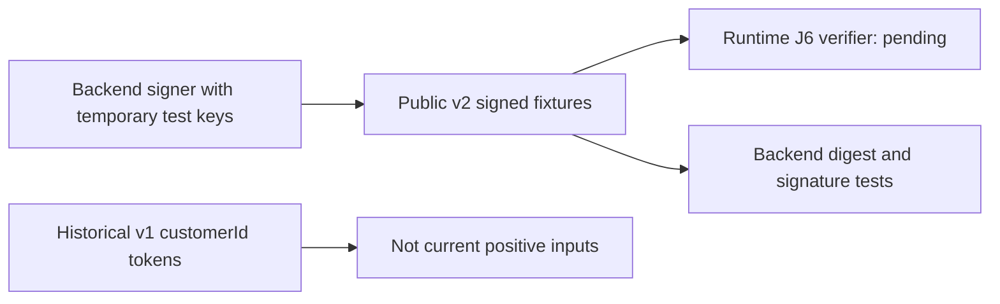

# Execution lease fixtures v2

## Overview

These public, synthetic fixtures exercise the current J1 closed lease claim set using **userId**.
They are generated by the Backend ExecutionAuthorizationSigner, not a running authorization HTTP
API. Runtime J6 must consume them to verify its implementation; fixture generation alone does not
prove Go/Backend parity. Initial issuer transactions have separate Backend PostgreSQL tests.



`manifest.json` pins protocol-vectors.json by SHA-256. Vendored Backend test bytes live at
`a2matex-be/test/fixtures/execution-authorization/v2`; consuming Runtime tests should vendor the
same pinned bytes without depending on the sibling Plan checkout.

## Contents and setup

- version 2, a fixed UTC clock, exact header/15 claims and trusted kid/public Ed25519 SPKI PEM;
- synthetic user/Entitlement/Product/Release/execution/session IDs and expected package/key bindings;
- the public Runtime RSA SPKI, whose DER thumbprint matches the signed binding; and
- 22 positive, negative, renewal/replay and boundary cases.

Use the [J6 test-clock setup](../../j6_lease_verification.md#101-clock-clarification-for-the-existing-vectors),
not today's wall time. Cases without current-grant setup use fixedClock plus any explicit
clockOffsetSeconds. The renewal/replay cases require an explicit 1200-second monotonic advance:
their signed renewal is issued later than fixedClock, but these v2 cases contain no clock offset.
Establish valid-initial at base time, then valid-renewal at that later instant when required;
do not derive verification time from arbitrary negative candidates. This clarifies the consuming
harness without changing accepted JSON bytes or their digest. `setup.currentLease`
means the consumer already accepted that grant. On the first grant, user/Entitlement identity comes
from Backend's verified signature; it is not an untrusted Launcher body field. The wrong-user case
is applied against an already accepted lease, so it tests binding preservation rather than
inventing an expected user in an unauthenticated pending Runtime session.

Valid renewal uses the same execution/family/session/key and an advancing sequence/deadlines.
Identical renewal replay is accepted without another mutation; superseded grants and changed claims
under the same sequence are rejected. Signature-correct negative cases require semantic rejection;
checking cryptographic validity alone is insufficient. The duplicate-claim case is intentionally
signed over raw duplicated JSON. The historical customerId-only payload is rejected by the current
closed claim schema; no compatibility alias is introduced.

The public key must be treated as **test trust only**. The generator creates fresh Ed25519/RSA keys
in RAM and saves neither private key nor any Release content key. There is no package encryption,
envelope or decrypted workflow in this set. Existing v1 ZIP/AES/OAEP bytes/digests remain unchanged.
Do not install fixture trust in production. After acceptance, do not edit this set in place.

## Generation and verification

From the Backend root, generate into a **new directory**:

```bash
node --import tsx src/routes/execution-authorization/execution-authorization.cli.ts fixtures /tmp/new-execution-lease-fixtures
```

Fixture generation requires no database or Backend .env: application/DB imports are deferred to
issue mode. Fresh generation changes signing trust and signatures; this is expected. The generator
refuses to overwrite files. To test the accepted set, run Backend's signer spec, which checks the
vendored digest, positive signatures/closed claims and representative negative material. Runtime
J6 and real exchange/package integration remain pending; no Production acceptance is claimed.
