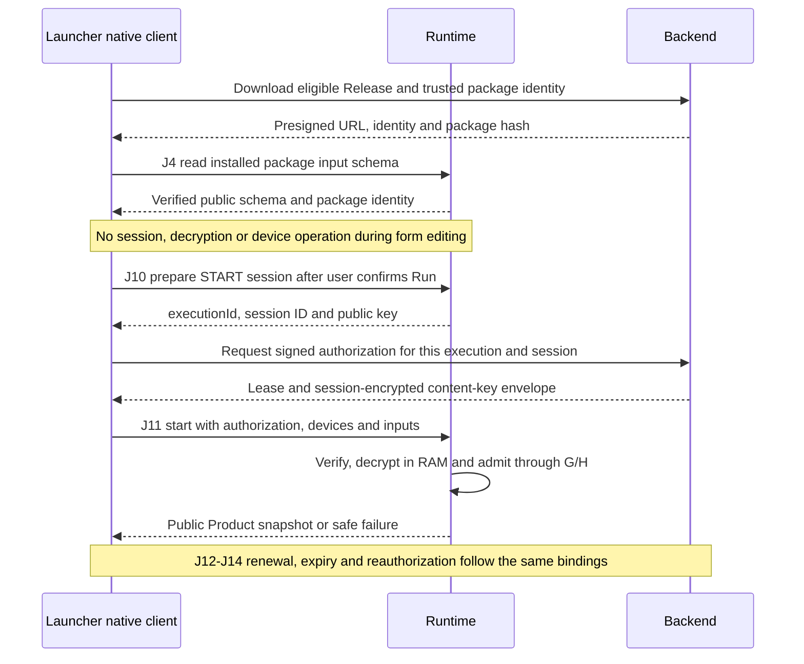
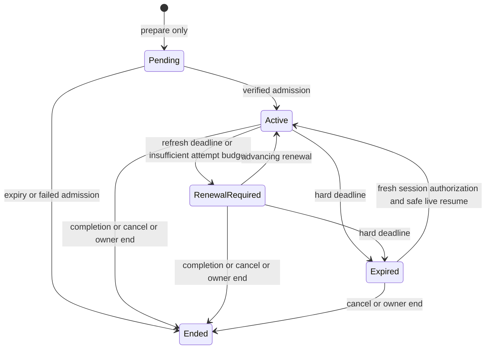

# J1 — Production package, authorization and API contracts

## Overview

J1 fixes the contract before the ordered Backend and Runtime implementations
begin. A customer first reads an installed package's public input schema. Only
after clicking Run does Launcher prepare a Runtime session, obtain Backend
authorization, and submit a protected execution. Runtime decrypts the workflow
in RAM and runs the existing G/H engine. Renewal extends that live authorization;
hard-expiry resume requires a new key pair and reauthorization.

Launcher supplies its selected absolute package directory in a header and the
Product/Release-relative path in JSON, preserving the Backend download filename.
One installed Release per Product is replaced safely after its live use ends.



**Status: specification and protocol fixtures delivered; implementation and
platform acceptance pending.** J1 introduces no handler, Backend endpoint,
migration, signing deployment, encryption service or Launcher code. The
[34-step implementation order](../../../phase_j_implementation.md) is the
execution order: J numbers belong only to Runtime. Backend, Launcher and manual
tasks between them remain separate deliveries. The replacement Runtime index
is [J1–J16](../phases/phase_j.md).

Read with [Production authorization](../../../specifications/production_execution_authorization_v1.md),
[key security](../../../specifications/cryptographic_key_security.md),
[package bytes](../../a2matex-backend/product_submission_release/product_release.md#6-zip-package-contract),
[A2](../contracts/runtime_ir_v1.md), [A5](../contracts/execution_state_v1.md),
[A6](../contracts/event_error_v1.md), and [A7](../contracts/local_api_v1.md).
This file owns the J1 wire decisions where earlier high-level text left choices
open. It does not change Editor Graph v1 or Runtime IR v1.

## 1. Delivery boundaries and existing implementation

| Owner    | Reuse                                                                                                                            | Required later work                                                                                    |
| -------- | -------------------------------------------------------------------------------------------------------------------------------- | ------------------------------------------------------------------------------------------------------ |
| Runtime  | Local Bearer authentication, private owner process, catalog/IR validation, G/H execution, SQLite checkpoints and I3/I4 streaming | J2–J16 package/session/authorization services, Production projections and native acceptance            |
| Backend  | KeyService, canonical package builder, private storage, EntitlementService and immutable Release data                            | Separate package consistency, customer download, lease persistence, issuer, envelope and renewal tasks |
| Launcher | Customer login and its native Runtime client                                                                                     | Installed-package form, Backend exchanges, Product API client, renewal, controls and exit UI           |
| Studio   | Existing Development authoring/run APIs                                                                                          | No code change in J1; Production APIs do not replace its APIs                                          |

The inspected Backend has `wrappedKey`, `contentKeyNonce`, `nonce` and
`algorithm` on ProductRelease. `contentKeyNonce` is the key-wrapping nonce;
`nonce` is the workflow nonce. References to the conceptual `keyNonce` mean
`contentKeyNonce` in that checkout. Do not interchange them or rename persisted
columns solely to match prose. Production authorization never exports those
stored wrapped fields. Backend step 2 now uses a fresh Static/R2 candidate per attempt and the existing
`packageStaticId` as a publication/failure/cleanup ownership guard. No migration
is required. A losing build cannot replace a published object, key/hash pair or
terminal state. Existing source tests pass; live PostgreSQL/R2 conflict acceptance
and an actual-service package fixture remain pending. Follow the
[manual Backend guide](../../../../a2matex-be/docs/product-release-build-concurrency.md)
before treating package-build integration as verified.

The Backend lease family is new persistence, not an existing implemented
module. Its migration is created/reviewed in the separate Backend task and
applied only by the user. No ExecutionReport module, installation licensing,
device-count limit or cloud per-node persistence is introduced here.

## 2. Common types, authentication and limits

All objects below are closed: reject unknown/duplicate fields, invalid UTF-8,
trailing JSON and incorrect scalar types. All API UUIDs are lowercase canonical
UUID v4. `Hash` is exactly 64 lowercase hexadecimal SHA-256 characters, without
`sha256:`. `UtcTime` is UTC RFC 3339 with exactly millisecond precision.
JSON integers must be safe integers; no floating-point timestamps/sequences.

Runtime routes use `/api/v1`, numeric loopback, current local Bearer, JSON and
`Cache-Control: no-store`. No query is accepted unless listed below; GETs have
no body. Native readiness is checked before requests. A local token grants API
access, not Product entitlement. Do not send customer access tokens to Runtime,
or send local Runtime tokens to Backend.

Backend route names below are relative to its configured API prefix. Customer
Bearer authentication and current active-customer eligibility are required.
Backend successes retain `{ "data": <typed inner response>, "statusCode": N }`;
Runtime successes are the typed object directly. Authorization/renewal responses
are explicit exceptions to Backend's ordinary create-only-`id` convention.
Never route these responses through request/body logging.

| Bound/default                                                | Contract and implementation owner                                                                                                                                          |
| ------------------------------------------------------------ | -------------------------------------------------------------------------------------------------------------------------------------------------------------------------- |
| ZIP file / expanded entry sum                                | 4 MiB / 2 MiB; J2 checks before allocation and during reads                                                                                                                |
| Entries                                                      | Exactly `manifest.json`, `workflow.enc`, `input-schema.json`; regular files only; no duplicate/directory/symlink/encrypted-ZIP entries                                     |
| Individual entries                                           | Manifest 16 KiB; schema 128 KiB; ciphertext at most 1 MiB + 16-byte GCM tag; plaintext IR retains A2's 1 MiB bound                                                         |
| Compression                                                  | STORE or DEFLATE; expanded-byte bounds are enforced irrespective of claimed ZIP sizes                                                                                      |
| Pending Runtime sessions                                     | At most four pending per process, 256 prepare receipts/tombstones and one concurrent key generation; 300-second monotonic pending/retry lifetime, never extended by replay |
| Prepare response metadata                                    | At most 16 KiB; request bodies at most 16 KiB                                                                                                                              |
| Lease / envelope ciphertext                                  | Compact lease at most 8 KiB; RSA ciphertext exactly 384 decoded bytes                                                                                                      |
| Backend authorize/renew and Runtime renew/reauthorize bodies | At most 32 KiB                                                                                                                                                             |
| Schema request / Runtime Product start                       | 4 KiB / 4 MiB, respectively                                                                                                                                                |
| Initial lease policy                                         | Backend default 1,800 seconds; renew 600 seconds before expiry; cap expiry at entitlement expiry when finite                                                               |
| Clock skew / attempt margin                                  | 30 seconds for future issuance/not-before checks; 2,000 ms attempt safety margin; expiry gets no added grace                                                               |

Resource bounds on pending keys and bytes are not device licensing. Device
selection is nonempty with unique exact serials and no count ceiling. The
existing single-active-RunGroup engine rule remains. Snapshot response readers
must accommodate the admitted device list rather than inherit Studio's fixed
2 MiB JSON-client cap as an accidental device limit.

The defaults become named constants/configuration only in their owning code
phases. Pending-session and archive bounds are fixed MVP resource bounds.
Backend duration/renewal lead and Runtime trusted signing keys/skew are explicit
configuration; invalid enabled authorization configuration fails closed. Public
package/schema reading is independent of signing-key availability and Backend
connectivity. Without configured authorization trust, protected preparation/
start/renewal are unavailable while Development and J4 schema reading continue;
there is no silently authorized fallback. No network key discovery or caller-
supplied verification key is accepted.

The configuration handoff is fixed here; owning phases add loading/validation:

| Configuration                                                                       | Wire/storage format and rule                                                                                                                                |
| ----------------------------------------------------------------------------------- | ----------------------------------------------------------------------------------------------------------------------------------------------------------- |
| Runtime `production.authorization_enabled`                                          | Boolean, default false; a feature-availability switch, never permission to bypass verification                                                              |
| Runtime `production.verification_keys`                                              | Map of allowed kid to Ed25519 SPKI `PUBLIC KEY` PEM; no certificates, private keys or downloaded key locations; required when authorization is enabled      |
| Runtime `production.clock_skew`                                                     | Go duration, default `30s`, from `0s` through `30s`; only future issuance/not-before tolerance, never expiry grace                                          |
| Backend `EXECUTION_AUTHORIZATION_ENABLED`                                           | Boolean, default false; customer download and existing Backend modules do not require an enabled issuer                                                     |
| Backend `EXECUTION_LEASE_SIGNING_KEY_ID` / `EXECUTION_LEASE_SIGNING_KEYS`           | Active kid and secret JSON map of kid to Ed25519 PKCS8 `PRIVATE KEY` PEM; retain old entries through receipt replay expiry; required when issuer is enabled |
| Backend `EXECUTION_LEASE_DURATION_SECONDS` / `EXECUTION_LEASE_RENEWAL_LEAD_SECONDS` | Defaults 1800 / 600; duration 2–604800 and lead 1 through duration minus one                                                                                |

Disabled issuer endpoints fail safely with 503. Enabled invalid configuration
is a startup configuration failure for that configured build. A signing-key
rollout publishes Runtime verification trust before Backend begins issuing
the new kid. Deployment procedures must preserve receipts' old signing key for
their replay window; no real key value or environment file is changed by J1.

## 3. Installed package identity and public schema

### 3.1 Directory header and relative package reference

Launcher owns download/install and the selected package directory; Runtime owns
safe reading. The default root is the user's OS Documents directory followed by
`A2MaTeX/launcher/product-packages`. Resolve Documents through the host's user-folder
mechanism (including relocated/localized folders), not Runtime's D1 state path or
the application's installation directory. Launcher may let the user choose a
different absolute directory. Runtime accepts that selected root; it is not
restricted to the default Documents location or a `production.package_root` setting.

The native Launcher client sends `X-A2MaTeX-Package-Directory` as a single header.
Its value is the UTF-8 absolute native directory percent-encoded with RFC 3986
unreserved characters left unchanged and all other bytes encoded as `%HH`.
Encode spaces as `%20`, not `+`; use uppercase hexadecimal when producing values.
Decode exactly once, accepting either case of hexadecimal, and reject malformed
escapes, invalid UTF-8, control/NUL characters, repeated headers or an empty value.
The encoded value is bounded to 4 KiB. The decoded directory must be a fully
qualified path on the Runtime host: Linux absolute path, or Windows drive-absolute
or fully qualified UNC path; no relative/drive-relative path, URL, shell variable,
tilde expansion or Windows device namespace. Do not log the raw directory.

Examples of the selected root, before and after transport encoding:

| Host    | Decoded directory                                           | Header value                                                              |
| ------- | ----------------------------------------------------------- | ------------------------------------------------------------------------- |
| Linux   | `/home/dino/Documents/A2MaTeX/launcher/product-packages`    | `%2Fhome%2Fdino%2FDocuments%2FA2MaTeX%2Flauncher%2Fproduct-packages`      |
| Windows | `C:\Users\Dino\Documents\A2MaTeX\launcher\product-packages` | `C%3A%5CUsers%5CDino%5CDocuments%5CA2MaTeX%5Clauncher%5Cproduct-packages` |

Require the header for J4 schema reading, J10 preparation (START and REAUTHORIZE),
J11 initial start and J14 reauthorization acceptance. Preparation freezes the
normalized absolute root together with the package selection in its replay
fingerprint. Start/reauthorization must send that same normalized root; a different
root is `400 INVALID_REQUEST`, not permission to relocate a pending session.
Reusing an operation ID with a changed root is `409 IDEMPOTENCY_CONFLICT`.
Saved admission replay is resolved before filesystem access, preserving existing
replay behavior even after the old package has been removed. Other Product
requests may carry the header through the common native client: validate its
encoding/bound when present, but do not open packages, rebind a live session or
make progress, renewal, controls or SSE depend on current directory availability.
Do not attach this local filesystem header to Backend or presigned R2 requests.

`PackageSelection` contains exactly:

```json
{
  "packageRef": "11111111-1111-4111-8111-111111111111/22222222-2222-4222-8222-222222222222/auto-farming-1.0.0.a2m",
  "productId": "11111111-1111-4111-8111-111111111111",
  "releaseId": "22222222-2222-4222-8222-222222222222",
  "packageHash": "<Hash from the authenticated Backend download response>",
  "launcherVersion": "0.1.0"
}
```

`packageRef` is exactly
`<productId>/<installedReleaseId>/<productSlug>-<releaseVersion>.a2m`, using `/`
on the wire. `installedReleaseId` is the `releaseId` in `PackageSelection`, not
another field. The last segment is the exact `fileName` supplied by the Backend
download response, sourced from `Static.originalFileName`; Launcher does not
reconstruct it from mutable listing metadata, a presigned URL or a UUID.
Product slug is the immutable build-snapshot slug and releaseVersion is that
Release's version. Do not rename the file to `product.a2m` or the UUID pair.

Parse exactly three nonempty segments, require the first two to match the body
IDs, and construct native path segments beneath the decoded root. Do not URL-
decode `packageRef`. Reject absolute paths, URLs, backslashes, `.`/`..`, alternate
streams, embedded separators/control characters and symlink/reparse escapes.
The final `.a2m` basename must be safe on both supported hosts, including Windows
reserved names/characters and trailing spaces/dots, and at most 255 UTF-8 bytes.
Backend download metadata must supply a portable basename; if historical metadata
is invalid, reject it rather than silently renaming it. Runtime cannot derive the
slug from the manifest: filename shape/location is not proof of authorization.

Runtime hashes the exact ZIP bytes, matches both manifest IDs and both minimum
versions, and checks each entry hash. Opening and verification must refer to
the same bounded bytes/handle; do not verify one pathname and later read an
unverified replacement. A prepared session owns its verified encrypted package
snapshot. Before initial admission, recheck the installed selection; replacement
requires a fresh schema/form/session. Reauthorization must verify the same
package hash and the original validated IR hash.

### 3.2 Single installed Release and safe replacement

Launcher keeps one installed Release per Product in the MVP. Its existing local
installation storage records `productId`, `installedReleaseId`, `fileName` and
verified `packageHash`; the selected root is a Launcher setting, not a new Runtime
database record. Resolve Run from this record, never by sorting files or UUIDs.
Compare the installed ID with Backend's selected `currentRelease.id` to detect
an update; merely publishing a Release does not select it. Recheck eligibility
through the authenticated package-download operation before downloading.

Download the replacement into staging, verify its expected hash/identity, then
install the exact server filename in the new Release folder. Activate it only
when this Product has no preparing session or active/paused execution. Switch
the local installation record and invalidate the old input form/session before
deleting the old Release folder. Until that switch succeeds, retain the existing
installation; failed downloads never remove the working package. Two files may
exist temporarily during replacement. Failed old-folder cleanup is retryable
housekeeping; the installation record still selects only the new Release.
Do not delete a customer-selected root or unrelated files during cleanup.

No permanent multi-version cache, customer version picker or rollback feature is
required. Backend retains immutable Release history, independently of local
cleanup, and SQLite execution history remains governed by existing retention.
Deleting a package does not resume, erase or rewrite historical runs. Changing
the selected root affects future schema/forms/preparations only; it cannot
redirect a live run or pending session. Wait for live/preparing use to finish
before moving/removing its package; live expiry reauthorization still needs it.

### 3.3 Public schema

`PublicPackage` is exactly `{productId, releaseId, version, packageHash}`.
The schema is the A2 reduced input schema, not arbitrary JSON Schema. Its
canonical hash must match the manifest; later decryption also checks equality
with `runtimeIr.inputSchema`. No credential values, injected defaults or
publisher-controlled HTML are returned/rendered. Input labels/forms follow the
approved schema vocabulary; no new form-metadata language is added here.

Schema read requires no execution lease or Backend connection. Its trusted
expected hash comes from download metadata; a manifest's own hashes do not
establish authenticity by themselves. The signed lease is checked again before
execution. Reading schema never authorizes a Product Run.

## 4. Runtime Production endpoint inventory

All paths here include the local `/api/v1` prefix. These are **planned routes**,
not endpoints available after writing J1. Product reads reuse existing
repositories and engine state; they are projections, not another execution store.

| Method and path                                                    | Owner             | Strict request                                                                              | Success                                                    |
| ------------------------------------------------------------------ | ----------------- | ------------------------------------------------------------------------------------------- | ---------------------------------------------------------- |
| `POST /api/v1/product-packages/input-schema`                       | J4                | `PackageSelection`                                                                          | 200 `{package: PublicPackage, inputSchema}`                |
| `POST /api/v1/product-sessions`                                    | J10 using J5      | `PrepareRequest` below                                                                      | 201 new / 200 identical pending replay: `PreparedSession`  |
| `POST /api/v1/product-runs`                                        | J11               | `StartRequest` below                                                                        | 201 admitted / 200 saved replay: `ProductSnapshot`         |
| `GET /api/v1/product-runs/active`                                  | J11               | No body/query                                                                               | 200 `ProductSnapshot`; 404 if no active Product run        |
| `GET /api/v1/product-runs/{runGroupId}`                            | J11               | Canonical UUID; no body/query                                                               | 200 saved/live `ProductSnapshot`                           |
| `POST /api/v1/product-runs/{runGroupId}/actions`                   | J11/J14 using H13 | Exactly `{action: "PAUSE"                                                                   | "RESUME"                                                   | "CANCEL"}` | Existing 202 accepted / 200 achieved / 409 `{error,snapshot}` semantics using Product projection |
| `POST /api/v1/product-runs/{runGroupId}/authorization/renew`       | J12               | `{requestId, runtimeSessionId, authorization: RenewalAuthorization}`                        | 200 `AuthorizationView`                                    |
| `GET /api/v1/product-runs/{runGroupId}/authorization`              | J13               | No body/query                                                                               | 200 `AuthorizationView`                                    |
| `GET /api/v1/product-events`                                       | J13 using I3/I4   | Exact `Accept: text/event-stream`, optional positive decimal `Last-Event-ID`; no body/query | 200 Product SSE; existing 400/410 pre-stream cursor errors |
| `POST /api/v1/product-runs/{runGroupId}/authorization/reauthorize` | J14               | `{requestId, runtimeSessionId, authorization: InitialAuthorization}`                        | 200 `ProductSnapshot`; does not create a new group         |

There is no HTTP upload, arbitrary unzip, plaintext decrypt, key export, session
listing or standalone device-command endpoint. Pending sessions expire without
needing a delete API. Local Runtime shutdown still uses the private owner channel.

### 4.1 Prepare a session and establish identity before admission

`PrepareRequest` is one of these closed objects:

```json
{
  "requestId": "33333333-3333-4333-8333-333333333333",
  "purpose": "START",
  "package": { "...": "complete PackageSelection" }
}
```

```json
{
  "requestId": "44444444-4444-4444-8444-444444444444",
  "purpose": "REAUTHORIZE",
  "runGroupId": "55555555-5555-4555-8555-555555555555",
  "package": { "...": "complete PackageSelection" }
}
```

The notation `...` in this spec denotes an explicitly named complete object,
not an accepted JSON field. Executable examples live in the fixture bundle.

For START, Runtime allocates `executionId` and `runtimeSessionId`; both are
UUID v4. **The future RunGroup ID equals executionId.** No RunGroup is persisted
until admission succeeds. For REAUTHORIZE, executionId is the existing group ID,
and the live group must be paused by authorization expiry. Never accept a
client-selected new execution identity on prepare.

`PreparedSession` contains exactly:

```json
{
  "requestId": "33333333-3333-4333-8333-333333333333",
  "purpose": "START",
  "executionId": "55555555-5555-4555-8555-555555555555",
  "runtimeSessionId": "66666666-6666-4666-8666-666666666666",
  "runtimePublicKey": "<padded Base64 DER SubjectPublicKeyInfo>",
  "runtimeKeyThumbprint": "<Hash>",
  "previousLeaseFamilyId": null,
  "package": { "...": "PublicPackage" },
  "expiresAt": "2026-11-25T00:05:00.000Z"
}
```

REAUTHORIZE returns the same shape with its purpose and the known previous
family UUID. The owner/client must not infer entitlement or run admission from
this response. The private key never leaves Runtime.

Prepare replay is process-local, scoped to owner generation and purpose.
Identical requestId/content and normalized directory return the same still-pending response/key, without
extending TTL; different content is `IDEMPOTENCY_CONFLICT`. Expired or consumed
session requests are unavailable, not new keys under an old ID. Keep bounded
tombstones for the 300-second retry window; if capacity cannot safely retain
them, reject new preparation with `RUNTIME_BUSY` rather than evict live identity.
After process replacement, session IDs are invalid; no pending key is restored.
The native client must not transparently rerun preparation against a replacement
child as if it were the same generation. If start was uncertain, resolve its
original saved start ID first. Only an explicit fresh intent prepares new keys
with new request IDs; an old in-memory preparation receipt is not durable proof.

### 4.2 Submit a protected start

`InitialAuthorization = {lease: string, keyEnvelope: KeyEnvelope, serverTime: UtcTime}`.
`StartRequest` is:

```json
{
  "requestId": "77777777-7777-4777-8777-777777777777",
  "runtimeSessionId": "66666666-6666-4666-8666-666666666666",
  "authorization": { "...": "InitialAuthorization" },
  "devices": [
    {
      "adbSerial": "192.168.240.112:5555",
      "inputs": { "packageName": "org.lineageos.jelly", "tapY": 100 }
    }
  ]
}
```

Package/IR/customer/lease identities come from the prepared session and signed
authorization, not replacement request fields. No `runtimeIr`, customer token,
mode, concurrency, raw path or plaintext key is accepted. Validate all selected
devices and input objects before one atomic group admission. A rejection creates
no partial run. Subsequent intentional runs require fresh prepare/authorization.

The start requestId differs from preparation and Backend authorization request
IDs. A saved Product admission is resolved by the original start requestId before
expired-session handling. Like G14, replay after strict transport decoding returns
the saved snapshot, never a new execution or replacement-body interpretation.
Persist requestId, executionId and Product provenance together. Do not persist
authorization bodies or inputs merely to compare retries. Lost/500 responses may
follow a commit: retry the retained start ID, not a new intent. If that saved ID
belongs to Development, return an idempotency conflict, never a Development view.

If no saved run exists and a start has a known pre-admission failure, destroy its
session material; the client uses new prepare/authorization/start IDs to correct
the request. A commit-unknown condition is not a proven failure or an invitation
to dispatch again. Admission/read-back and fatal-stop handling reuse G12/D4.

## 5. Matching Backend contracts

Backend owns these separate implementation-plan tasks. J1 specifies their wire
agreement; it does not implement their controller/service/repository/migration.
All responses below describe the inner `data` value. Customer eligibility is
checked on each issue/renew/reauthorize; a download decision is not reusable
execution permission. Never accept ADB serials, counts, entitlementId, customerId,
lease duration or signing keys as authorization request fields.

### 5.1 Customer download

`GET /products/{productId}/package-download` accepts only optional query
`releaseId=<UUID>`. When omitted, select the current eligible Release. An explicit
eligible older Release may be downloaded under the existing CURRENT_AND_SUPPORTED
entitlement policy. Product ARCHIVED blocks discovery/new purchases, not existing
access; do not accidentally reuse Publisher management permissions here.

200 inner response is exactly:

```json
{
  "package": { "...": "PublicPackage" },
  "fileName": "auto-farming-1.0.0.a2m",
  "packageSizeBytes": "12345",
  "downloadUrl": "https://storage.example.invalid/test-only-presigned-url",
  "expiresAt": "2026-11-25T00:15:00.000Z"
}
```

Check the current active customer, existing usable entitlement, non-deleted /
non-suspended Product, same-Product published non-disabled supported Release,
complete private package and hash. No key unwrap is needed for download.
`fileName` is the selected Static record's exact `originalFileName`, not the R2
object key or a filename inferred from its URL. Validate the portable basename
rules in section 3; the Launcher preserves this name on disk. The R2 key remains
the existing UUID-sharded `products/...` storage key, with no naming migration.
Return only the selected package metadata, not ProductRelease or Static records. Use the
existing presigner and its configured TTL. No API key/body logging or permanent
storage of the full signed URL. Download/install/hash comparison belongs to
Launcher and is a separate manual acceptance step before Runtime J2.

### 5.2 Issue initial or fresh-session authorization

`POST /execution-authorizations` request:

```json
{
  "requestId": "88888888-8888-4888-8888-888888888888",
  "purpose": "START",
  "executionId": "55555555-5555-4555-8555-555555555555",
  "productId": "11111111-1111-4111-8111-111111111111",
  "releaseId": "22222222-2222-4222-8222-222222222222",
  "packageHash": "<Hash>",
  "runtimeSessionId": "66666666-6666-4666-8666-666666666666",
  "runtimePublicKey": "<padded Base64 DER SPKI>",
  "runtimeKeyThumbprint": "<Hash>",
  "previousLeaseFamilyId": null
}
```

201 new / 200 identical replay inner response:
`{requestId, executionId, authorization: InitialAuthorization}`.
REAUTHORIZE requires the current family UUID instead of null. It retains
executionId/family/customer/entitlement/Product/Release/package, rotates session
and key binding, and advances sequence. It never creates a second family for the
same executionId or alters ownership. Backend can check its authorization has
expired; it cannot independently prove that a local worker is parked. Runtime
performs that live-owner/boundary check before prepare and resume.

For a grant, sample Backend time once and floor to Unix seconds. Set issuedAt
and notBefore to that instant; expiresAt is the earlier of policy duration and
the finite entitlement deadline, floored to seconds. If fewer than two seconds
remain, deny issuance. Let lifetime = expiresAt - issuedAt and renewal lead =
min(configured lead, floor(lifetime / 2)); refreshAfter = expiresAt - renewal lead.
This keeps the signed time invariant valid for short remaining entitlements.
Renewal must still advance both deadlines; if the finite entitlement cap makes
that impossible, return the safe expiry denial instead of issuing a duplicate
or nonadvancing grant.

Use the shared entitlement service plus current customer/Release/package checks;
do not mistake that service alone for complete authorization. Cap a finite lease
at entitlement expiry. A revoked entitlement or disabled/suspended resource
denies new issuance/renewal; a disconnected Runtime can continue only until its
already signed deadline. No instantaneous offline revocation is promised.

### 5.3 Renewal

`POST /execution-authorizations/{leaseFamilyId}/renew` accepts exactly
`{requestId, executionId, runtimeSessionId, currentLeaseId, sequence}`; sequence
is the caller's current sequence, not its desired next value. Return
`{requestId, executionId, authorization: RenewalAuthorization}` with 201 for a
new receipt and 200 for identical replay.

`RenewalAuthorization = {lease: string, serverTime: UtcTime}`; it has no envelope.
Keep session/key/package/family unchanged and advance sequence once. Require an
unexpired family; renewal cannot reactivate expiry or replace a key. An early
renewal triggered by insufficient attempt budget is allowed while valid, not
restricted to the scheduled refresh window. Bound normal client retry; do not
add machine/device/concurrent-run licensing.

### 5.4 Backend persistence, retries and safe failures

Use the planned ExecutionLease row as **one family per executionId**. Preserve
that unique identity across reauthorization. A row lock/conditional update owns
currentLeaseId, sequence, session/key binding, deadlines and state. Store safe
decision metadata only, not compact tokens, envelopes, content keys or Runtime
private keys. No signature/crypto/network call holds a DB transaction open.

Add a small authorization-request receipt keyed by `(customerId, requestId)` for
issue, renew and reauthorize. Store operation, request fingerprint, family,
lease claims/sequence/timestamps and signing-key ID; no signed token/envelope.
First reserve the identity, then compute crypto outside the transaction, recheck
eligibility and commit the decision atomically before returning it. A crashed
unfinished reservation can be reclaimed with owner-safe fencing; two concurrent
requests cannot grant two sequences. Use existing transaction/locking patterns,
not a generic jobs/outbox framework. The dedicated Backend persistence spec must
include the receipt's constraints and bounded cleanup with the family migration.

Request fingerprints cover normalized public request fields, excluding the
random ciphertext response. Exact retry reconstructs the same signed claims;
an initial envelope may be rewrapped with fresh OAEP randomness for the same
recorded session/key. Do not advance deadlines, sequence or ownership on retry.
Recheck current eligibility and whether the recorded grant is still current and
unexpired before returning material. Changed body/operation is a conflict; an
older superseded receipt is a conflict, never a replay that rolls back a newer
grant. Keep receipts through grant expiry plus five minutes, then purge only
expired receipts; retain family identity according to ordinary business-data
retention. No background deletion of user execution data is introduced.

Backend stable error keys are `Error.ProductPackageUnavailable` (404),
`Error.ExecutionAuthorizationDenied` (403),
`Error.AuthorizationRequestConflict` (409),
`Error.ExecutionAuthorizationExpired` (409), and
`Error.ExecutionAuthorizationUnavailable` (503). Existing authentication,
strict-Zod validation, rate-limit and unexpected-error envelopes remain Backend
conventions. Domain messages contain no private record or crypto details.
Launcher maps these typed errors, never string-parses raw OpenSSL/DB messages.

## 6. Exact cryptographic wire contract

### 6.1 Package encryption and hashes

Keep the existing three-entry package format and RFC 8785 canonical JSON.
`workflow.enc = AES-256-GCM(K, nonce, canonicalRuntimeIr, emptyAAD)` encoded as
raw `ciphertext || 16-byte tag`, with a fresh 12-byte nonce in the manifest.
Manifest/schema JSON is canonical UTF-8 without BOM/newline. Standard padded
RFC 4648 Base64 encodes nonce and binary envelope fields; hashes are lowercase
hex. Compare hashes of exact received bytes, not reserialized package entries.

The signed package hash authenticates the ZIP, which authenticates the schema
and ciphertext; successful GCM authenticates the plaintext. No nonexistent
plaintext-hash manifest field is required. At first successful decryption,
Runtime computes canonical `runtimeIrHash` for internal run provenance and
requires equality on expiry reauthorization, together with the same package.
It is never a customer-supplied hash or a plaintext workflow response.

### 6.2 Session key and envelope

RSA is exactly 3,072 bits with exponent 65,537. `runtimePublicKey` is canonical
padded Base64 of DER SubjectPublicKeyInfo, no PEM wrapper or extra certificates.
Thumbprint is `lowercaseHex(SHA-256(spkiDER))`; reject key shape/size/exponent or
thumbprint mismatches before wrapping. Runtime private keys remain memory-only.

`KeyEnvelope` has exactly:

```json
{
  "releaseId": "22222222-2222-4222-8222-222222222222",
  "algorithm": "RSA-OAEP-SHA256",
  "runtimeSessionId": "66666666-6666-4666-8666-666666666666",
  "runtimeKeyThumbprint": "<Hash>",
  "encryptedKey": "<padded Base64 of 384 bytes>"
}
```

OAEP and MGF1 both use SHA-256, with an empty label. The decoded plaintext is
exactly the 32-byte Release content key. Verify the lease before opening, require
all envelope identities to equal it and the session, and never fall back to
another algorithm, key or unauthenticated decrypt path. Do not expose unwrap
errors or a generic decrypt oracle.

### 6.3 Signed lease

Use compact JWS: three unpadded canonical base64url segments, ASCII `.`
separators. Signature input is the exact received `headerSegment.payloadSegment`;
verify it before trusting claims. Ed25519 signature is exactly 64 bytes.
Backend serializes header and claims with RFC 8785 for reproducible fixtures;
Runtime verifies the original bytes and rejects duplicate/unknown fields.
Reject padding, noncanonical base64url, invalid UTF-8, missing segments, embedded
keys, `jku`, `x5u`, `crit`, `b64`, `none` or caller-selected algorithm.

Protected header is exactly
`{alg: "EdDSA", kid: <configured key ID>, typ: "a2matex-execution-lease+jws"}`.
`kid` is 1–64 ASCII letters/digits/`.`/`_`/`-`, and selects only a configured
Ed25519 verification key. Signing uses a separate Backend key from login JWTs.
Retain verification keys at least through the leases/receipts they serve.

Claims are exactly:

| Field                                                   | Rule                                                                                                                      |
| ------------------------------------------------------- | ------------------------------------------------------------------------------------------------------------------------- |
| `leaseId`, `leaseFamilyId`                              | UUID v4; unique grant and stable family                                                                                   |
| `executionId`                                           | UUID v4 allocated by Runtime prepare, equal to eventual group ID                                                          |
| `sequence`                                              | Integer 1–2,147,483,647 (matching Backend INTEGER), starts at 1, advances on renewal and reauthorization; refuse overflow |
| `entitlementId`, `customerId`, `productId`, `releaseId` | Backend-authoritative UUID v4 identities                                                                                  |
| `packageHash`, `runtimeKeyThumbprint`                   | Exact `Hash` values                                                                                                       |
| `runtimeSessionId`                                      | UUID v4 of the prepared session                                                                                           |
| `issuedAt`, `notBefore`, `refreshAfter`, `expiresAt`    | Integer Unix **seconds** with `issuedAt <= notBefore < refreshAfter < expiresAt`                                          |

HTTP `serverTime`/deadline projections use `UtcTime`, not Unix seconds. This
removes millisecond/second ambiguity. `serverTime` is diagnostic synchronization
data, not authority to extend an expiry: Launcher cannot alter signed deadlines.
Signed seconds must be between zero and 253402300799 (year 9999), with grant
lifetime at most 604800 seconds. Check ordering, skew, expiry and that bound
before converting differences to durations; do not overflow Go duration or JS
date arithmetic on an authenticated but malformed timestamp.

Runtime anchors effective UTC to its startup wall-clock sample plus monotonic
elapsed time. Admission converts signed deadlines to monotonic instants using
that anchor, never repeatedly samples a user-adjustable wall clock. Reject
issuance/not-before more than 30 seconds in the future or already expired
grants; do not add skew to hard expiry. Incorrect host time requires correction
and a fresh Runtime session. Network delay consumes, rather than extends, the
remaining signed lifetime. Session TTL uses its own monotonic creation instant.

## 7. Renewal, expiry, reauthorization and RAM ownership



Authorization state is separate from A5 execution status. User Pause retains an
unexpired authorization and does not suspend its deadline. Ordinary H13 Resume
cannot resume EXPIRED authorization. An expiry resume uses J14 and the same live
owner, paused group, package, IR hash, inputs and RAM execution state.

Before **BeginAttempt**, require `node.timeoutMs + 2000 <= remainingLeaseMs`.
Apply the same rule after retry delay and Resume. If a valid lease cannot cover
the next attempt, emit one renewal-required transition with ATTEMPT_BUDGET and
park before beginning the attempt. Do not consume an attempt, dispatch, fail the
node or shorten its declared timeout. Scheduled refresh emits SCHEDULED.
Launcher may renew immediately in either case. If the initial lease cannot
cover the entry attempt, reject before admission with AUTHORIZATION_INVALID.

Renewal changes the active deadline once, preserving execution/session/key and
family. Identical currently accepted lease replay returns the current view;
lower sequences, same sequence with different grant claims, nonadvancing times,
wrong bindings or expired families fail. A successful HTTP 200 does not resume a
user-paused workflow. Launcher never creates a new start ID to renew.

At hard expiry fence new attempts/retries first, cancel cancellable work, join
its original bounded attempt, persist the unambiguous result and expiry pause,
then publish public state. Do not redispatch an uncertain action. If safe
checkpointing cannot be confirmed, take the existing fatal-stop path rather
than pretending the run can resume. EXPIRED is not a new A5 execution status.

Release all private keys, content keys, decrypted IR/config/binding references,
envelope/token buffers and temporary plaintext copies owned by the session.
Avoid hidden copies in runner closures or parked requests; J8/J9 must explicitly
trace their ownership. Best-effort overwriting is not a guarantee against a
privileged process reading managed-runtime memory.

For live reauthorization, retain the existing **execution** state: customer
inputs, Flow/RunGroup variables, confirmed outputs, pending retry position and
checkpoint ownership. These remain sensitive RAM data, are not another copy of
the complete workflow, and are cleaned on terminal/owner exit. Do not claim hard
expiry wipes every publisher-derived value while also promising variable-based
resume. No new SQLite persistence of these maps/inputs is authorized by J1.
Reauthorization reloads only the same IR and reattaches it to the parked owner;
it cannot reset variables, repeat a completed node, change devices/inputs, or
resume after Runtime restart.

J12/J14 retain safe local mutation receipts (operation/request ID, execution/
session identity and grant ID/sequence/fingerprint), never the raw authorization
body. Resolve an already accepted identical mutation before treating its pending
session as consumed. Return the current public view without applying it twice;
changed content conflicts and a superseded grant cannot replace a newer one.
Persistence/owner failures follow the existing commit-unknown/fatal-stop rule.

Backend reauthorization advances the **same family** sequence and rotates the
session/key binding on that row. An identical successful J14 request replays
the Product snapshot without parking/resuming twice. Reject a late response from
the old session, a different live owner, or a terminal run. Lease receipt replay
cannot revive a superseded key binding. Normal renewal needs neither a new RSA
pair nor a new envelope; hard-expiry reauthorization requires both.

## 8. Production projections, events and existing API compatibility

Production runs need durable classification before their first checkpoint.
J11 adds minimal SQLite provenance: Product execution kind, Product/Release /
version/package identity, validated IR hash and safe authorization metadata.
Existing rows remain Development. Do not persist IR, configs, bindings, request
inputs, compact leases, envelopes or keys. Internal checkpoint node IDs may
remain internal; they are not public workflow inspection permission.

`ProductSnapshot` has exactly `{cursor, runGroup, deviceExecutions, product,
authorization}`. `runGroup` reuses the public G13 group identity/status/timestamps/
summary. `product` is PublicPackage. Each device reuses G13 identity, selected
adbSerial, status and timestamps, but **omits nextNodeId**. Its terminalError is
null or a fixed generic safe error without protected node/config/value details.
Preserve only public selected-device failures and EXECUTION_INTERRUPTED where
applicable; otherwise project COMMAND_FAILED with `Product execution failed.`
and retryable false. Do not infer safe redispatch from that public projection.
`authorization` is the view below. Run completion is still established by the
saved group/device statuses, not by a lease response.

`AuthorizationView` is exactly `{executionId, state, runtimeSessionId,
leaseFamilyId, sequence, refreshAfter, expiresAt}`. State is ACTIVE,
RENEWAL_REQUIRED, EXPIRED or ENDED; timestamps are UtcTime, identifiers remain
safe metadata, and no field contains a token/key/envelope. On terminal/owner end
preserve the last safe identity/times with ENDED. Recovery marks unfinished runs
INTERRUPTED with ENDED before readiness; it never reconstructs authorization.

| Surface                                                        | Development                                | Product MVP                                                                               |
| -------------------------------------------------------------- | ------------------------------------------ | ----------------------------------------------------------------------------------------- |
| `/runs`, `/runs/active`, `/runs/{id}` and `/runs/{id}/actions` | Existing request/response shapes unchanged | Reject Product identity with 404; never expose the internal snapshot through these routes |
| `/product-runs/*`                                              | Reject Development identity with 404       | Public Product projection and controls only                                               |
| `/device-executions/{id}/attempts`                             | Existing I1 history                        | 404; no customer node-by-node inspection                                                  |
| `/artifacts/{id}`                                              | Existing G20/I1 download                   | 404 for Product-owned captures; screenshots may still be used internally by nodes         |
| `/events`                                                      | Existing four Development event types      | Filter **all** Product events before writing bytes                                        |
| `/product-events`                                              | Filter all Development events              | Public group/device states plus the two authorization types below                         |

This separate Product stream deliberately avoids teaching an existing Studio
observer new authorization event types or leaking Product node events into its
Runtime-wide feed. Both streams reuse I3/I4 and one durable global cursor;
filtering does not add another broker, repository or cursor sequence. Register
before read as before, advance the internal scan cursor across suppressed rows,
and preserve global IDs on delivered frames. Gaps are allowed. No public event
is fabricated to acknowledge a hidden attempt; ordinary heartbeats carry no ID.
Snapshot/Last-Event-ID/410 repair and write/cancellation bounds remain I4.

Public Product group events reuse `RUN_GROUP_STATE_CHANGED`. Product device
events reuse `DEVICE_EXECUTION_STATE_CHANGED` with exactly `{status}` and an
optional generic safe terminal error; neither nodeId nor nextNodeId is present.
Internal attempt/retry events are never delivered on either customer stream.
The A6 persistence union gains two **planned** Product-only events:

| Type                             | Exact payload; group correlation only                                                      |
| -------------------------------- | ------------------------------------------------------------------------------------------ |
| `AUTHORIZATION_STATE_CHANGED`    | `AuthorizationView`; commit on admission, accepted renewal/reauthorization, expiry and end |
| `AUTHORIZATION_RENEWAL_REQUIRED` | `{authorization: AuthorizationView, reason: "SCHEDULED"                                    | "ATTEMPT_BUDGET"}`; emit once per accepted grant when entering renewal-required |

These have the normal cursor/type/occurredAt/runGroupId envelope and no device,
node, input or private crypto correlation. Persist state/event atomically before
publication, and fail closed on unknown commit. A renewal can emit ACTIVE even
when the prior state was ACTIVE because sequence/deadlines changed. Product
projections must remain safe after a different owner launches Runtime or the
original RAM session has disappeared. Log sanitized operation/reason identifiers
at ERROR on failure, not raw Backend bodies, URLs, inputs, keys or graph data.

The public schema API is the sole intentional schema disclosure. Generic
Production validation failure does not return C diagnostics, while malformed
public request fields may still receive INVALID_REQUEST. J1 does not add public
Product artifact/export/node-inspector APIs; those require a later explicit
contract. J11 must deliver the privacy fences before enabling protected starts.

## 9. Runtime failures, retry and lifecycle response semantics

Production failures use the A6 `{error:{code,message,retryable}}` envelope only.
Only lifecycle conflicts add a safe Product `snapshot`. Never attach `validation`,
unavailable-node lists, raw paths or detailed decryption/lease findings.

| HTTP / code                                 | Fixed meaning and client action                                                                                        |
| ------------------------------------------- | ---------------------------------------------------------------------------------------------------------------------- |
| 400 INVALID_REQUEST / 413 PAYLOAD_TOO_LARGE | Invalid public transport shape/bound; correct request                                                                  |
| 401 UNAUTHORIZED                            | Invalid local credential; re-establish the owned Runtime session                                                       |
| 404 RESOURCE_NOT_FOUND                      | Missing package/run or prohibited cross-kind/history/artifact access; no path/owner details                            |
| 409 RUNTIME_BUSY                            | Existing active group or pending-session/key resource bound; no automatic replacement intent                           |
| 409 IDEMPOTENCY_CONFLICT                    | Prepare/request identity reused inconsistently or cross-kind admission collision                                       |
| 409 AUTHORIZATION_SESSION_UNAVAILABLE       | Pending session expired, consumed or belongs to a different process generation; fresh prepare required                 |
| 409 AUTHORIZATION_EXPIRED                   | Known live run needs fresh authorization, not ordinary Resume/renew                                                    |
| 409 INVALID_EXECUTION_STATE                 | Ineligible live control/reauthorization; actions alone include Product snapshot                                        |
| 422 VALIDATION_FAILED                       | Package/manifest/schema/decrypted-IR invalid or incompatible: `Product package could not be used.`                     |
| 422 AUTHORIZATION_INVALID                   | Invalid signature/time/envelope/binding or insufficient initial budget: `Product authorization could not be accepted.` |
| 410 EVENT_CURSOR_EXPIRED                    | Product SSE replay cursor expired; read Product snapshot then reconnect                                                |
| 500 PERSISTENCE_FAILED / INTERNAL_ERROR     | Outcome may be uncertain; retain identities, reconcile, do not mint another start                                      |
| 503 INTERNAL_ERROR                          | Enabled Product subsystem unavailable; safe generic response; no Development fallback                                  |

New codes are planned A6 extensions scoped to J5/J6/J11–J14. Their default
retryable is false. Read/session-resource failures may be retried by explicit
intent, but no producer marks an uncertain dispatch/admission safe. Existing
ADB preflight errors may be preserved when they describe selected public devices
without exposing protected findings; no partial admission is allowed.

Product controls retain H13 202 pending / 200 achieved / 409 conflict semantics.
Cancel stops the whole run and keeps Runtime alive. Ordinary Pause retains
live state but authorization continues aging. Expiry cannot be bypassed by
calling either family's actions. Native Stop and exit / owner loss fence work,
settle within the existing shutdown budget, clean secrets and exit. No tray/
background daemon or automatic old-run restart is introduced.

## 10. Shared fixtures and verification ownership

The canonical J1 fixture set is
[fixtures/v1/manifest.json](fixtures/v1/manifest.json) and its pinned
[protocol-vectors.json](fixtures/v1/protocol-vectors.json). See the
[fixture notes](fixtures/v1/README.md) for byte encodings, fixed clock and explicit
test-only keys. It is separate from immutable A8 fixtures/v1–v3; do not edit or
renumber those sets. Runtime/Backend tests later vendor applicable bytes with
their digest and do not require a sibling checkout at execution time.

J1 supplies a real signed/encrypted interoperability vector, exact public
request examples and mutation/state expectations. It does not claim that the
current Backend builder, Go verifier or Launcher consumes them. Backend-generated
service fixtures and consumer tests are delivered in the ordered later tasks.
No production signing trust may use the intentionally public fixture keys.

| Matrix                | Required consuming checks and owner                                                                                                                                 |
| --------------------- | ------------------------------------------------------------------------------------------------------------------------------------------------------------------- |
| Archive/schema        | Valid package; wrong outer/entry hash; traversal, duplicate/missing entry, truncation/bomb; public schema without session/ADB: J2–J4                                |
| Session               | Owner/TTL/resource bounds; replay same IDs/key; conflict; expired/lost child; fresh reauth key: J5/J10                                                              |
| Signed bytes          | Valid signature; changed segment; alg/kid/typ; duplicate claims; base64 canonicality; seconds versus milliseconds; fixed-clock future/expiry: Backend issuer and J6 |
| Envelope/decrypt      | Matching session; wrong key/thumbprint/Release; wrong OAEP/MGF/label; GCM tag/nonce; schema/IR mismatch: Backend envelope and J7/J8                                 |
| Persistence/replay    | Concurrent issue/renew, lost reply, superseded receipt, same-family fresh session, no secrets in storage: separate Backend tasks                                    |
| Attempt authorization | Budget fence before BeginAttempt, renewal while paused, expiry during Delay/ADB, uncertain checkpoint and no replay: J9/J12/J14                                     |
| Public boundaries     | Product/Development route isolation; old saved rows; SSE filter/cursors; no node/output/artifact leak after restart: J11/J13                                        |
| Real systems          | Actual entitled download/session/authorization/start, renewal/denial/expiry/resume/exit, Linux and Windows evidence: manual steps and J15/J16                       |

Adding later code tests follows each repository's approval rules. Documentation
checks here cover links/anchors, JSON parsing/digests, crypto-vector self-check,
phase numbering and stale-reference review; they do not execute any future
Runtime endpoint, alter a database or prove native host acceptance.

## 11. Implementation mapping and J1 acceptance

| Later owner    | Expected existing boundary to extend; no code added in J1                                                                                          |
| -------------- | -------------------------------------------------------------------------------------------------------------------------------------------------- |
| J2/J3          | New internal Product package reader/verifier; directory-header containment and strict A2 schema tools                                              |
| J4/J10/J11–J14 | Existing local router/authentication/request-log patterns with dedicated Product DTOs/controllers                                                  |
| J5–J9/J12/J14  | Internal Product authorization/session services; existing G1/G12 admission and H attempt-boundary/owner lifecycle hooks                            |
| J11/J13        | Goose provenance migration and existing repository reads/events; never create a parallel execution database                                        |
| Backend tasks  | Existing ProductRelease package/key/storage and Entitlement services; new customer download/ExecutionLease module plus SQL-first migration/receipt |
| Launcher tasks | One native owner client; separate Backend and Runtime adapters; package-bound form and retained operation identities                               |

J1 is complete as a contract delivery only when all of these checks hold:

| ID    | Acceptance                                                                                                                                        |
| ----- | ------------------------------------------------------------------------------------------------------------------------------------------------- |
| J1-01 | Overview clearly separates schema inspection, preparation, Backend authorization and execution; all later routes are labeled planned              |
| J1-02 | Runtime index/roadmap use exactly J1–J16 and link the ordered external/manual plan                                                                |
| J1-03 | Directory-header encoding, relative server-named package path, one installed Release and safe replacement rules are explicit on Linux and Windows |
| J1-04 | Exact request/response unions, statuses, body limits, Backend envelope differences and local/customer token separation are specified              |
| J1-05 | Runtime allocates executionId before Backend issue, eventual group ID is defined and no pre-admission group is created                            |
| J1-06 | Prepare/start/Backend receipt/renew/reauthorize retry and changed-body semantics cannot silently create duplicate work or extend deadlines        |
| J1-07 | Same-family reauthorization resolves the unique executionId model and requires a fresh key/session while preserving live execution state          |
| J1-08 | Package/AES/OAEP/SPKI/thumbprint/JWS exact encodings and algorithms have executable test-only vectors                                             |
| J1-09 | Signed Unix-second time, monotonic enforcement, skew, finite entitlement bound and early budget-triggered renewal are unambiguous                 |
| J1-10 | Protected IR/key cleanup and retained sensitive live execution RAM are distinguished; no restart resume or new variable persistence is implied    |
| J1-11 | Production persistence/read/action/SSE boundaries prevent Development APIs from disclosing protected details after restart                        |
| J1-12 | Schema-only disclosure and the summary-only Product MVP are explicit; no hidden new artifact/inspection API                                       |
| J1-13 | Backend required modules, actual key-field mapping and migration ownership are recorded without implementation claims                             |
| J1-14 | Fixtures parse, hashes match and signatures/envelopes/GCM self-check; consumer and manual acceptance remain pending                               |
| J1-15 | Shared authorization, A6/A7/A8 and Launcher planning references agree with this contract and the new numbering                                    |

MVP reductions are deliberate: one package format, one algorithm suite, one
existing engine, public schema plus summary-only Product monitoring, one lease
family per execution and no report/upload/export/key-discovery subsystem.
There is no prerequisite to complete the deferred Studio I8 acceptance before
contract/package work, and no protected start before J6–J9 are verified.

### J1 delivery verification — 2026-11-25

- Fifteen contract acceptance definitions and the fixture cases listed in the manifest are present.
- Both Runtime indexes contain J1–J16 in the saved order; the 34-step external/
  manual implementation order is retained; download/install deliverables now
  include the server filename and directory-header handoff.
- Relative file links/anchors, Markdown fences, JSON parsing, fixture digests,
  exact ZIP entries/CRCs and entry/package hashes pass documentation checks.
- Saved initial/renewal JWS signatures, modified-signature rejection, SPKI/RSA
  parameters, OAEP opening, GCM/plaintext/schema/hash equality and modified-tag
  rejection pass Node standard-crypto checks.
- New spec/index/fixture formatting and tracked/untracked whitespace checks pass.

These are documentation/protocol-vector checks only. None of J2–J16, Backend
services, live migrations, consumer parity, native Windows behavior or manual
Launcher acceptance is claimed executed. Next is the separate Backend
package-build consistency task, not Runtime J2.
