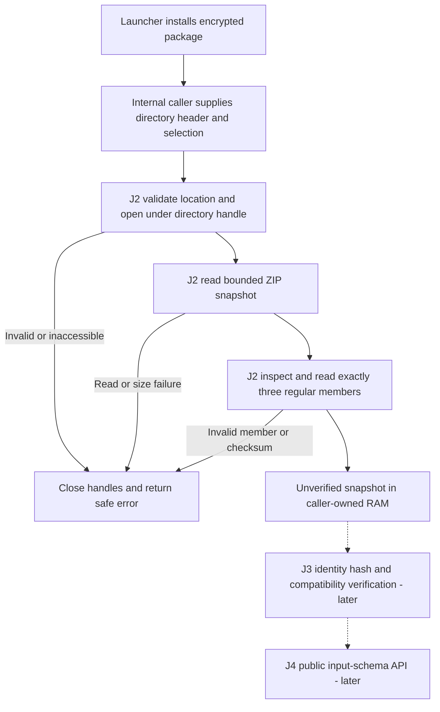

# J2 — Constrained package reading

## Overview

J2 reads the installed `.a2m` file selected by Launcher without extracting it to
disk. It validates the requested location, opens the file inside that directory,
and reads the three ZIP members with explicit byte limits. The result is an
**unverified in-memory snapshot**, ready for J3 to check against trusted package
identity, hashes and version requirements.

The directory comes from `X-A2MaTeX-Package-Directory`; the relative reference
uses `<productId>/<fileName>` with a safe `.a2m` basename, normally `package.a2m`.
The filename may be edited; no Release folder is required. Launcher owns
downloading/installing the file. Runtime owns safe reading. An unreadable,
escaping or malformed package produces a controlled failure and no partial result.



**Status: reader implemented; focused Linux acceptance passes. Native Windows
and Backend-downloaded-package acceptance remain pending.** This is Runtime step 5 in the
[ordered implementation plan](../../../phase_j_implementation.md). Backend
download acceptance remains step 4 and is not declared complete by this document.
The J1 public ZIP fixture allows reader development while that acceptance runs;
the actual downloaded Backend package is required later integration evidence.

Read with [J1 types, limits and location rules](j1_production_contracts.md),
[Phase J](../phases/phase_j.md), the
[Backend ZIP contract](../../a2matex-backend/product_submission_release/product_release.md#6-zip-package-contract),
and [Production authorization](../../../specifications/production_execution_authorization_v1.md).

## 1. Responsibility and handoff

| Owner    | Responsibility                                                                                                                      |
| -------- | ----------------------------------------------------------------------------------------------------------------------------------- |
| Launcher | Download/hash-check/install the locally named package and supply its location; replace an installed Release only when unused.        |
| J2       | Validate location, safely open one regular file, bound ZIP reads, enforce member structure and return unverified bytes.             |
| J3       | Parse manifest/schema; match the Product folder, obtain Release identity from the manifest, and compare package/entry hashes; check compatibility.                              |
| J4       | Authenticate/decode schema inspection; derive Product ID from packageRef and Release ID from the validated manifest; return public schema/identity and actual ZIP hash without a request hash. |
| J5/J10   | Bind prepared sessions to the normalized location and verified package; own retained snapshot lifetime and replay.                  |
| J7/J8    | Open the authorized key envelope and authenticate/decrypt protected IR in RAM.                                                      |

The ZIP container is ordinary ZIP. `workflow.enc` contains the encrypted workflow;
J2 reads that member unchanged. ZIP checksum success proves neither entitlement
nor package authenticity. No result from J2 alone is a verified Product or input
schema eligible for public disclosure.

J2 adds no router entry, HTTP DTO, startup component, SQLite record, network
client, key/session cache, execution admission or ADB operation. Do not add
placeholder implementations for the later responsibilities.

## 2. Internal entry point

Use one small `internal/platform/productpackage` package. The reader is a plain
function; it does not need a service class, repository, public `pkg` API or Wire
provider. Types and private helpers can live together in `reader.go`.

```go
type ReadRequest struct {
    DirectoryHeaderValues []string
    PackageRef            string
    ProductID             string
}

type Location struct {
    Directory  string
    PackageRef string
}

// Snapshot contains unverified bytes. Callers must not serialize it as an API DTO.
type Snapshot struct {
    Location         Location `json:"-"`
    ZIPBytes         []byte   `json:"-"`
    ManifestBytes    []byte   `json:"-"`
    WorkflowBytes    []byte   `json:"-"`
    InputSchemaBytes []byte   `json:"-"`
}

func Read(ctx context.Context, request ReadRequest) (*Snapshot, error)
```

Rules:

- `DirectoryHeaderValues` contains the original field values. Future HTTP
  callers use `Request.Header.Values`, not `Header.Get`, so duplicates are not lost.
- `ProductID` comes from the first reference segment. The reader validates its
  canonical shape and equality to that Product folder. It takes no Release ID;
  Release identity belongs to J3 manifest validation and later authorization.
- Expected `packageHash` and `launcherVersion` remain with the J3 caller. Do not
  introduce partial hash/version verification here or another five-field wire DTO.
- `Location.Directory` is the normalized native absolute root;
  `Location.PackageRef` retains its canonical forward-slash reference. Both are
  private Runtime data for later session binding, never response/log fields.
- Success returns one complete snapshot and nil error. Every failure returns
  nil snapshot, including cancellation and a member failure after earlier reads.
- The caller owns the returned buffers and treats them as immutable. They are
  not shared between calls. J3 must hash these exact `ZIPBytes`, not reopen a path.
- Snapshot fields are excluded from JSON as a guard against accidental response
  serialization. J4 still constructs its own explicit verified public DTO.
- All OS and ZIP handles are closed before success returns. The snapshot has no
  Close method, watcher, background worker or ongoing filesystem dependency.

An internal call can be made before J4 exists:

```go
snapshot, err := productpackage.Read(ctx, productpackage.ReadRequest{
    DirectoryHeaderValues: []string{
        "%2Fhome%2Fdino%2FDocuments%2Fa2matex%2Fproducts",
    },
    PackageRef: "11111111-1111-4111-8111-111111111111/package.a2m",
    ProductID:  "11111111-1111-4111-8111-111111111111",
})
```

This is an internal call example, not a new HTTP request or runnable command.

## 3. Directory-header validation

Validate the header before filesystem work:

1. Require exactly one nonempty value, at most 4 KiB of encoded bytes. A merged
   comma-separated value is invalid too; do not pick its first element.
2. Require ASCII unreserved characters or complete `%HH` escapes. Producers
   encode all other UTF-8 bytes; consumers accept either hexadecimal case.
   Reject literal spaces, `+`, separators, colon and other unescaped reserved bytes.
3. Decode once using path-percent semantics, never query/form decoding.
   `%20` is space; a decoded `+` remains a plus. Do not decode a second time.
4. Require valid UTF-8 without NUL/control characters. Do not trim the value,
   expand environment variables/tilde, parse a URL or silently repair encoding.
5. Require a fully qualified directory on the current host and normalize it with
   native `filepath` operations. No process working-directory fallback is allowed.

| Host    | Accepted root shape                                   | Rejected examples                                                                               |
| ------- | ----------------------------------------------------- | ----------------------------------------------------------------------------------------------- |
| Linux   | Absolute `/...` directory                             | Relative path, `~/Documents`, URL, Windows drive path                                           |
| Windows | Drive-absolute path or UNC path with server and share | `C:relative`, `\relative`, incomplete UNC, device/NT namespace such as `\\?\`, `\\.\` or `\??\` |

On Windows normalize native separators and drive-letter case; retain other
component spelling. On Linux retain case. Do not infer filesystem equivalence
between differently spelled roots or resolve aliases for session replay.
Trailing separators and ordinary root dot segments normalize through filepath
cleaning; this does not relax the relative-reference rules below.

The selected root may be outside Documents. Runtime must not substitute the D1
state directory, enforce the default Launcher root or create a missing directory.
Launcher resolves the OS Documents location; J2 simply reads the selected root.

## 4. Relative reference and filename validation

Validate `PackageRef` independently of the OS:

- Require exactly two nonempty segments separated by `/`; reject backslashes,
  leading/trailing separators, absolute/URL/volume syntax and `.`/`..` segments.
- Require lowercase canonical UUID v4 text for the supplied Product ID and
  first folder segment. Use existing google/uuid version/variant/canonical checks,
  then compare the folder to that ID. Do not introduce a UUID regex.
- The filename is a nonempty basename ending exactly in `.a2m`, with at most
  255 UTF-8 bytes. Preserve its bytes and case; do not derive it from Product ID,
  current Product slug, a URL or the manifest.
- Apply portable basename restrictions on both hosts: reject invalid UTF-8,
  controls, `/`, `\`, `:`, `<`, `>`, `"`, `|`, `?`, `*`, trailing ASCII spaces/dots
  and Windows reserved device basenames, case-insensitively. Include the Windows
  COM/LPT superscript-digit aliases. A slug such as `con-tools` is not `CON`.
- Do not URL-decode the JSON reference. A literal percent sequence in a safe
  basename is a filename character sequence, never another traversal layer.
- No independent full-reference length cap is needed: the validated Product UUID,
  one separator and filename cap already bound a valid reference. Split once;
  any additional separator remains in the basename and is rejected.

The local filename defaults to `package.a2m` and may be renamed to any safe
`.a2m` basename. No comparison to the server filename, slug or version occurs.
J2 ignores other files in the Product folder and opens only the exact reference.
Trusted identity checks remain with J3/later authorization.

## 5. Safe filesystem access on Linux and Windows

Use Go's root-relative filesystem API instead of a lexical prefix check followed
by unrestricted `os.Open`. The repository declares Go 1.25; no toolchain bump or
new dependency is required. Go's
[Root documentation](https://pkg.go.dev/os@go1.25.0#Root) defines its containment
and symlink behavior; [OpenRoot](https://pkg.go.dev/os@go1.25.0#OpenRoot) follows
links in the selected root itself.

Opening sequence:

1. Check `ctx.Err()`, validate/normalize the location and call `os.OpenRoot`.
2. Keep the root handle while opening the validated relative reference through
   `Root.OpenFile`. Construct native separators only after segment validation.
3. Inspect the opened file handle with Stat; require a regular file, positive
   size and the outer size bound. Never validate one handle and read another.
4. Read from that same file descriptor into the bounded snapshot, then close the
   file/root handles. Parse ZIP from memory, not from a second filename lookup.

Small native helpers handle the only OS-specific details:

- **Linux:** pass read-only and `unix.O_NONBLOCK` when opening the member through
  the root. This prevents a substituted FIFO from waiting for a writer before
  the regular-file check. Use existing `golang.org/x/sys/unix`; never open write,
  create, truncate or follow an unrestricted absolute path after checking it.
- **Windows:** root-relative read-only open, followed by regular-file checks and
  native disk-file-type verification using existing `golang.org/x/sys/windows`.
  Reject a handle that is not a disk file. Keep UNC handling within the same
  root-relative path; no fallback to a less constrained opener.
- **Other hosts:** fail closed with the classified unavailable error. An
  unsupported build must not silently switch to an unsafe path implementation.

Relative links that Go can resolve inside the opened root may be followed.
Outside-root and absolute-link escapes must fail. A root path that itself
resolves through a legitimate Documents link defines the selected directory
boundary once opened; its original normalized spelling remains Location.Directory.
Do not claim protection against privileged mount changes or use pathname-prefix
matching as a substitute for the root handle. File handles remain the authority
if directories or the final pathname are renamed after opening.

Do not copy ArtifactStore's creation/reconciliation behavior. Product packages
are Launcher-owned inputs; J2 creates no directory, lock file or output artifact.

## 6. Snapshot and byte budgets

Put named limits and entry names in the existing `pkg/constants` folder:

| Proposed constant                       | Value / rule                                         |
| --------------------------------------- | ---------------------------------------------------- |
| `ProductPackageDirectoryHeader`         | `X-A2MaTeX-Package-Directory`                        |
| `ProductPackageDirectoryHeaderMaxBytes` | 4 * 1024                                             |
| `ProductPackageFilenameMaxBytes`        | 255                                                  |
| `ProductPackageMaxBytes`                | 4 * 1024 * 1024                                      |
| `ProductPackageExpandedMaxBytes`        | 2 * 1024 * 1024                                      |
| `ProductPackageGCMTagBytes`             | 16, shared with later authenticated loading          |
| `ProductPackageEntryCount`              | 3                                                    |
| `ProductPackageReadChunkBytes`          | 32 * 1024, for cooperative read/cancellation checks  |
| `ProductPackageZIPEncryptionFlags`      | Named mask for ZIP general-purpose bits 0, 6 and 13  |
| Entry-name constants                    | `manifest.json`, `workflow.enc`, `input-schema.json` |

Reuse an existing exact constant when it already represents the same contract;
do not repurpose an unrelated HTTP payload limit just because its number matches.
ZIP compression/flag values use standard-library identifiers or named bit masks.
These are fixed J1 format/resource bounds, not user device-capacity settings.

For the outer file:

- Check the opened descriptor's size before a size-based allocation.
- Read at most `ProductPackageMaxBytes + 1`, checking context between chunks.
  The extra byte detects growth/oversize; it is not an accepted payload byte.
- Require actual byte count to equal the initial descriptor size. A truncated
  or grown file produces no snapshot. Same-size in-place changes are not proven
  absent by Stat: J3 must still authenticate the exact captured byte hash.
- Never size buffers from an unchecked ZIP count, uint64 member size or claimed
  decompression length. Convert to `int` only after comparison with small bounds.

J2 retains at most one raw archive plus the three bounded member buffers per
successful call. The nominal payload envelope is 4 MiB raw + at most 2 MiB
expanded, **not a total Go-heap ceiling**: ZIP metadata, slice capacity and codec
buffers add overhead. The outer cap also bounds metadata input to the standard
parser. Do not build a custom ZIP codec/central-directory parser for this phase.
No allocation may scale with a claimed uncompressed size beyond the caps.

Use only two package byte budgets: 4 MiB for the raw archive and 2 MiB for all
expanded members combined. A manifest, input schema or ciphertext member may
consume any portion of the shared expanded budget; there is no independent
member cap. Decrypted Runtime IR still has its existing 1 MiB validation limit.
This reader does not decrypt or apply that semantic limit to opaque ciphertext.

## 7. ZIP inspection and member reading

Use `archive/zip.NewReader(bytes.NewReader(raw), int64(len(raw)))`. Treat every
constructor error as failure, including ErrInsecurePath if returned. Independently
check member names: Go's default path warning depends on GODEBUG and is not the
application's policy. See the pinned
[ZIP reader API](https://pkg.go.dev/archive/zip@go1.25.0#NewReader).

Before opening a member, inspect the complete File list:

1. Require exactly three entries with the three exact names, each appearing once.
   ZIP member order need not be the builder's canonical order.
2. Reject directory names, nested paths, case variants, `../`, backslashes,
   duplicate/unknown members and every nonregular mode, including links/devices.
3. Permit only `zip.Store` and `zip.Deflate`. Do not register custom codecs.
4. Reject ZIP encryption flags, including traditional/strong/masked-header
   encryption. Backend AES encryption of the `workflow.enc` contents is distinct.
   Permit normal UTF-8 and data-descriptor flags used by the Backend ZIP writer.
5. Compare each uint64 declared expanded size with the remaining aggregate
   budget before allocation. Reject a declaration or combined sum over 2 MiB.

Then read each member in fixed application order (manifest, workflow, schema):

- Open its ZIP stream and read in bounded chunks with context checks.
- Limit each read to the remaining aggregate budget plus one detection byte.
  Reject overflow immediately without draining the bomb.
- Require successful true end-of-stream so ZIP length/CRC errors surface. An
  exact-boundary file still needs EOF/CRC validation, not a successful CopyN alone.
- Require actual expanded length to agree with the declared length. Charge
  actual bytes to the running total; compression ratio alone is not the limit.
- Close each member promptly, including failure paths. Close all opened resources
  on any error and discard earlier member buffers rather than returning a partial
  package. Do not collect defers inside a growing member loop.

Members remain opaque byte sequences here. An empty/invalid manifest or schema
can pass structural reading but must fail J3 parsing; malformed ciphertext must
fail later authenticated loading. J2 does not parse JSON, compare expected hashes,
interpret version strings or treat a `.enc` suffix as proof of encryption.

## 8. Errors, cancellation and diagnostics

Add only the necessary classified errors under existing `pkg/x-error`:

| Proposed sentinel              | Internal classification                                                                | Future HTTP owner/mapping                                                     |
| ------------------------------ | -------------------------------------------------------------------------------------- | ----------------------------------------------------------------------------- |
| `ErrProductPackageLocation`    | Header/reference/UUID/native-root syntax invalid                                       | J4/J10: 400 INVALID_REQUEST                                                   |
| `ErrProductPackageNotFound`    | A required directory/file does not exist                                               | J4/J10: 404 RESOURCE_NOT_FOUND                                                |
| `ErrProductPackageInvalid`     | Nonregular file, invalid ZIP, member/CRC/length/budget failure                         | J4/J10: 422 VALIDATION_FAILED                                                 |
| `ErrProductPackageUnavailable` | Safe opening refused/unavailable, permission or other OS I/O failure, unsupported host | J4/J10: safe 503 INTERNAL_ERROR                                               |
| Existing context errors        | Caller cancellation/deadline                                                           | Preserve errors.Is; future transport applies its existing cancellation policy |

Opening through Root can refuse an escaping link without exposing a portable
public cause. Treat that refusal as the safe opening failure above; do not parse
an OS error message or retry with unrestricted access to distinguish its reason.
When the platform helper explicitly detects a nonregular handle, use Invalid.
Use `errors.Is` for standard not-exist/permission/context classification.

Wrap classified errors using existing `xerror.WithOperation`, with stable names
such as `decode_package_location`, `open_package_root`, `open_package_file`,
`read_package_snapshot`, `open_package_zip` and `read_package_entry`. Preserve the
most specific operation. Strip raw PathError/ZIP errors from printable errors;
they can contain caller-controlled paths/member text. Log-safe Detail, if used,
contains only fixed reasons or an allowed member name.

The reader does not need its own logger dependency. J4/later service boundaries
log one contextual ERROR with allowed correlation IDs and operation/reason.
Do not log header values, native paths, raw ZIP bytes, schema/workflow data,
credentials or keys. No log or public error should contain arbitrary ZIP names.

Check context before opening, between chunk reads, between entries and before
success. Return no bytes after observed cancellation. Do not implement timeout
by abandoning a goroutine blocked on a file call. OS open/read calls, especially
UNC/network filesystem access, are not guaranteed to be interrupted by a Go
context; this is cooperative cancellation, not a new hard I/O deadline guarantee.
All handles are closed as control returns. Later caller shutdown keeps its
existing owner/process deadline; J2 adds no independent lifecycle worker.

## 9. Minimal implementation placement

| Location                                               | Purpose                                                                                                                |
| ------------------------------------------------------ | ---------------------------------------------------------------------------------------------------------------------- |
| `internal/platform/productpackage/reader.go`           | ReadRequest/Location/Snapshot, Read and small location/ZIP/bounded-read helpers. Keep one straight orchestration path. |
| `internal/platform/productpackage/open_linux.go`       | Thin root-relative nonblocking read-only regular-file opener.                                                          |
| `internal/platform/productpackage/open_windows.go`     | Thin root-relative disk-file opener/check.                                                                             |
| `internal/platform/productpackage/open_unsupported.go` | Fail-closed build-tag alternative, following ArtifactStore's platform pattern.                                         |
| `pkg/constants/product_package.go`                     | Named limits/header/entry names, shared with later J phases.                                                           |
| `pkg/x-error/product_package.go`                       | Classified errors; reuse existing OperationError.                                                                      |

Both native opening files implement the same private boundary:

```go
func openPackageFile(root *os.Root, reference string) (*os.File, error)
```

Keep the common Read function as location resolution → bounded file snapshot →
bounded ZIP reading → result assembly. Private helpers implement those steps;
no abstract reader factory, injectable filesystem or platform service is needed.

This is a responsibility-specific platform folder, not a new application module.
Do not split each helper/type into its own file or add repository/service/DTO
layers around this stateless operation. Reuse the existing UUID and x/sys
dependencies and Go's standard ZIP/root APIs. No go.mod/go.sum, database,
configuration, router or generated Wire change is expected.

## 10. Proposed tests and acceptance criteria

This matrix defines implementation acceptance. The user approved the focused J2
test scope with the implementation plan. The evidence below distinguishes checks
run on Linux from native Windows and Backend integration work still pending.

| ID    | Scenario                                                                  | Required observation                                                                                        |
| ----- | ------------------------------------------------------------------------- | ----------------------------------------------------------------------------------------------------------- |
| J2-01 | J1 valid installed ZIP                                                    | Exact raw ZIP and member bytes; normalized private location; complete result only.                          |
| J2-02 | Missing, duplicate/merged, oversized or malformed header                  | Location error before filesystem access; no partial snapshot.                                               |
| J2-03 | Encoded space/non-ASCII/percent, mixed escape hex case                    | One correct decode; no form-plus conversion or second decode.                                               |
| J2-04 | Relative/URL/device-namespace/incomplete native root                      | Location error; no working-directory/default-root fallback.                                                 |
| J2-05 | Wrong folder IDs, noncanonical UUID, traversal, unsafe/oversized basename | Location error on both host policies.                                                                       |
| J2-06 | Missing root/intermediate/file                                            | NotFound; no directory creation or fallback search.                                                         |
| J2-07 | Outside-root symlink/junction or replacement race                         | Closed failure or reading the already-opened contained file; never outside bytes.                           |
| J2-08 | Linux FIFO/special file and Windows non-disk handle                       | Prompt refusal without waiting for a FIFO writer; no snapshot.                                              |
| J2-09 | Outer cap and one byte over                                               | Cap enforced on actual reads, including file growth; oversized declarations do not drive allocation.        |
| J2-10 | Missing/duplicate/unknown/nested/directory/symlink ZIP entries            | Invalid; whitelist enforcement independent of GODEBUG.                                                      |
| J2-11 | STORE, DEFLATE and unsupported/encrypted members                          | Supported methods read unchanged; unsupported/encrypted ZIP fails.                                          |
| J2-12 | Shared expanded budget at 2 MiB and one byte over; dishonest size declarations | Any member may exceed its former individual cap. Combined declared and actual sizes remain bounded; no unchecked size allocation or draining. |
| J2-13 | Truncation, bad CRC, late error after earlier members                     | Invalid with nil snapshot and closed streams.                                                               |
| J2-14 | Opaque malformed JSON with otherwise valid ZIP                            | J2 returns its bytes unchanged; no claim that J3 validation succeeded.                                      |
| J2-15 | Already-cancelled and cancellation during chunk/entry work                | errors.Is context error, nil snapshot, resources released.                                                  |
| J2-16 | Concurrent/repeated calls and caller buffer ownership                     | Independent snapshots/handles; no retained cache or cross-call mutation.                                    |
| J2-17 | Path replacement after snapshot read                                      | Captured bytes remain stable; J3 can verify them without reopening.                                         |
| J2-18 | Diagnostic failures                                                       | Stable classified operation/reason; no supplied path, arbitrary member name or content in printable errors. |
| J2-19 | Native Windows drive root, UNC and reparse behavior                       | Supported-host evidence records actual outcomes; cross-build alone is not native acceptance.                |

When tests are approved, use real temporary directories/ZIP files for filesystem
behavior and generated in-memory malformed archives for ZIP cases. Do not add a
generic filesystem abstraction just to mock simple reads. A narrow private
bounded-read helper can exercise read/cancellation errors with controlled readers.

Vendor only the ZIP bytes needed from J1's
[public protocol vector](fixtures/v1/protocol-vectors.json) into Runtime testdata;
record its current expected package hash in the consuming test. Do not copy its
private test keys or require a sibling Plan checkout at test execution time.
Do not mutate the accepted Plan fixture to create negative cases. Later use an
actual Backend-downloaded `.a2m` as additional evidence after step 4 succeeds.

After implementation, the focused verification sequence is:

```bash
go test ./internal/platform/productpackage
go test -race ./internal/platform/productpackage
GOOS=windows GOARCH=amd64 go test -c -o bin/j2-windows.test.exe ./internal/platform/productpackage
make fmt
make build
git diff --check
```

Run the package suite natively on Windows for its filesystem cases. Record
unavailable share/reparse privileges or OS facilities rather than silently
counting skips as passes. Focused correctness/resource tests are required;
benchmarks, a new smoke CLI, Postman debug endpoint and a ZIP fuzzer are not MVP
prerequisites. Broaden regressions only when the implementation touches shared
behavior or discovers a failure.

### Implementation evidence — 2026-11-25

Runtime now provides `internal/platform/productpackage.Read` and the six
production files listed in section 9. There are no new dependencies, HTTP routes,
database changes or startup components. The reader returns only unverified bytes;
J3 must authenticate the captured archive before any public schema disclosure.

| Check | Result / evidence |
| --- | --- |
| Focused Linux suite | PASS: J1 ZIP bytes/members, strict location rules, missing/nonregular inputs, portable names, STORE/DEFLATE, ZIP whitelist/modes/flags, corrupt CRC and lengths, truncation, shared expanded and raw bounds, opaque JSON, cancellation, independent buffers and stable snapshots after path replacement. |
| Linux filesystem safety | PASS: contained/root-alias links, outside absolute/relative and parent-link escapes, concurrent link replacement, permission denial and FIFO refusal in a deadline-guarded subprocess. |
| Race detector | PASS: `go test -race ./internal/platform/productpackage`, including concurrent reads and link replacement. |
| Windows cross-build | PASS: `GOOS=windows GOARCH=amd64 go test -c -o /tmp/a2matex-j2-windows.test.exe ./internal/platform/productpackage`. This compiles the native opener and Windows tests; it does not run them. |
| Format/build/diff | PASS: `make fmt`, `make build`, `git diff --check`. The read-only default build cache required using `GOCACHE=/tmp/a2matex-d5-go-cache`; no repository configuration was changed. |
| Native Windows | NOT RUN: no Windows host. Run the package suite there; reparse-link tests report unavailable symlink privileges explicitly. Set `A2MATEX_J2_TEST_UNC_ROOT` to an accessible UNC share for the native share test; otherwise it explicitly skips. Disk opening, drive/UNC rules and reparse containment are not claimed accepted by a cross-build. |
| Real Backend download | PENDING: step 4 manual acceptance and an actual downloaded `.a2m` fixture. The vendored public J1 ZIP has SHA-256 `09ec3f0a6a578539e18362027fa907be68257a5590d6a8b8eb6072481ad71d01`; no fixture keys were copied. |

Tests live beside the reader/native helpers, with only the public ZIP under
`testdata/j1-valid.a2m`. They require no sibling Plan checkout, network, database
or Android device. Cooperative cancellation cannot interrupt a blocked native
filesystem call; the caveat in section 8 still applies. This evidence is focused
J2 verification, not a claim that the entire Runtime suite or production package
execution has passed.

### Resource-budget update — 2026-11-26

The approved simplification removes independent manifest, schema, ciphertext
and full-reference length constants/checks. The reader retains the 4 MiB raw
archive cap and shared 2 MiB expanded-content cap. The Product UUID folder, the portable
255-byte basename, safe opening, ZIP structure/checksums and cancellation rules
remain enforced. The existing 1 MiB decrypted Runtime IR limit is unchanged.

The revised boundary tests let each member consume the shared expanded budget,
including content larger than its former cap. Exactly 2 MiB combined passes;
one byte over fails. Focused Linux tests, race checks, `go vet`, Windows test
cross-build, `make fmt`, `make build` and whitespace checks pass. Native Windows
and actual Backend-download acceptance remain pending as recorded above.

## 11. Manual observability and integration gate

J2 has no end-user API. Before J4, direct reader tests or a separately approved
local driver are the observable interface. Do not advertise a new Postman route
or route public schema around J3 to make J2 demonstrable.

Once J3/J4 exist, use the installed Backend package, directory header and
PackageSelection through the schema endpoint. A valid package yields its public
form; changing location, contents or ZIP structure fails before session creation
or device work. Those later HTTP checks supplement, not replace, J2's native
containment and bounded-read acceptance.

J2 code can be reviewed independently while Backend manual acceptance runs, but
this spec does not waive that ordered integration gate or claim real package
interop. Code and focused Linux evidence are delivered; native Windows and the
actual Backend package remain explicit integration acceptance work.

## 12. MVP decisions and deferred work

Keep one installed package layout, one stateless reader, standard ZIP handling,
bounded memory and the three existing members. The selected root remains a
Launcher setting transported in the approved header. No second package cache,
extraction directory, package database, install manager or background scanner is
needed in Runtime.

Manifest/schema interpretation and authenticity remain J3; HTTP wiring J4/J10;
session/key lifetimes J5 onward; execution admission J11; and full Backend/Launcher
and native host acceptance J15/J16. Asset archives, alternative ZIP codecs,
arbitrary extraction, cross-host path interpretation and package-format upgrades
require later contracts rather than speculative implementation in J2.

### Installed-layout update — 2026-11-27

The active reader/verifier/session/API contract now uses a products-root header
and `<productId>/<local filename>.a2m`, normally `<productId>/package.a2m`.
The default Launcher root is OS Documents plus lowercase `a2matex/products`.
Release ID/version come from the validated manifest; renamed files and other
Launcher files beside the package do not change that identity. Old three-segment
references are rejected. ZIP contents, hashes, encryption and persistence are unchanged.

Existing tests were adapted without adding test functions/files. Linux reader,
verifier, session and API regressions pass; reader/verifier/session race tests,
formatting, build and targeted vet pass. The Windows amd64 agent and affected
reader/verifier/session/API test binaries cross-compile. Native Windows/OneDrive
execution and an actual downloaded Backend package remain acceptance items;
cross-compilation does not establish them. Accepted historical fixture JSON/ZIP
bytes and their digests remain unchanged.
