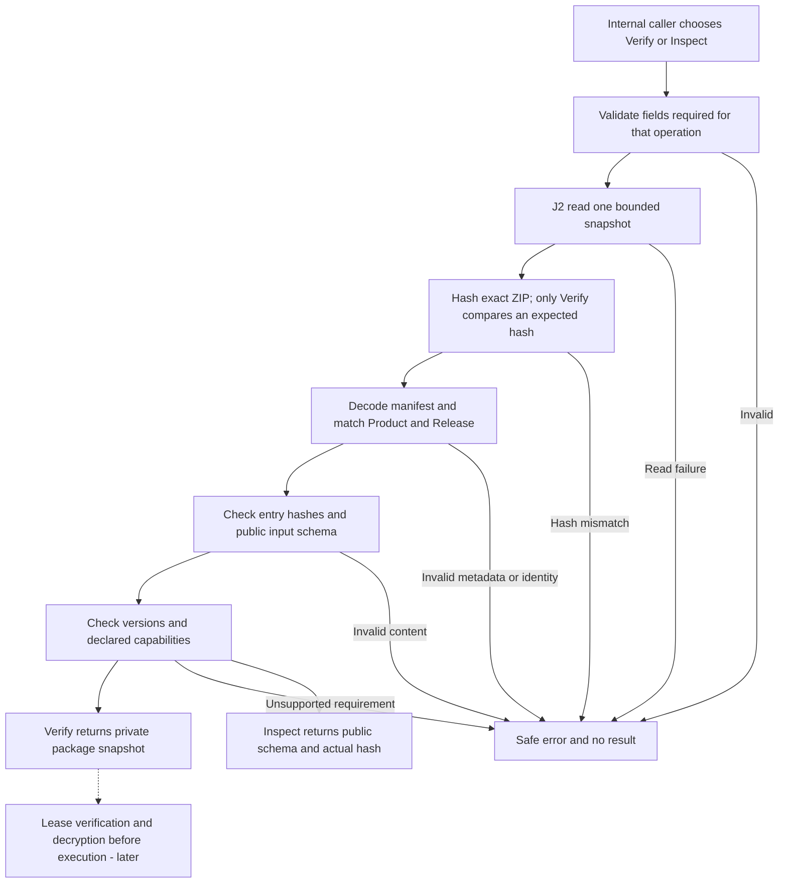

# J3 — Manifest and package verification

## Overview

J3 verifies that the installed package selected by Launcher contains the expected
Product release, has not changed from its expected download hash, and has public
metadata and an input schema that this Runtime can use. It reuses J2 to read one
bounded snapshot, then verifies those same bytes in memory. It never reopens the
file to obtain a second copy of an entry.

The result is an internal verified package containing public identity/schema and
the still-encrypted workflow. The implemented [J4 API](j4_package_input_schema_api.md)
uses a separate `Inspect` operation sharing the content checks to serve the input
form without requiring a caller-supplied outer hash. Verification
does not authorize execution: signed lease verification, key handling, decryption
and executable IR validation belong to later responsibilities.



**Status: verifier implemented; focused Linux tests, race checks and Windows
cross-build pass. Native Windows and actual Backend-download acceptance remain pending.**
This document is Runtime row 6 of the [ordered implementation plan](../../../phase_j_implementation.md).
It does not mark Backend download acceptance or native Windows acceptance complete.

Read with [J1](j1_production_contracts.md), [J2](j2_constrained_package_reading.md),
the [Backend package format](../../a2matex-backend/product_submission_release/product_release.md#6-zip-package-contract),
and the [Runtime IR/input-schema contract](../contracts/runtime_ir_v1.md).

## 1. Responsibility and boundaries

| Owner | Responsibility |
| --- | --- |
| Launcher | Obtain authenticated Backend download metadata, verify/install the download, and preserve its Product ID, Release ID, package hash and actual local filename. |
| J2 reader | Resolve the directory header/reference, enforce safe file access and ZIP structure, and return bounded unverified bytes. |
| J3 verifier | Compare expected package identity/hash; decode and validate manifest/schema; check member hashes, versions and declared capabilities. |
| J4 | Authenticate and decode the HTTP schema request, call the verifier, and construct the explicit public response. |
| J5/J10 | Retain and bind a verified package to a prepared owner/session; manage its lifetime and replay. |
| J6–J8 | Verify signed authorization, open the key envelope, authenticate/decrypt the workflow, and validate executable IR against manifest/schema. |

J3 adds no HTTP route, Backend client, SQLite table, migration, file cache,
background worker, key generation, lease request or ADB operation. A valid
schema can be read without Backend connectivity or any connected Android device.

J2 already checks the exact ZIP member inventory. J3 uses those captured members
and checks the manifest's references to them; it does not implement another ZIP
reader or repeat filesystem containment logic.

## 2. Trust and byte identity

The expected `packageHash` originates in the authenticated Backend download
response and is retained by Launcher. J3 compares it with SHA-256 of the exact
`Snapshot.ZIPBytes`; it does not trust a digest calculated from an arbitrary
local file by the caller, or look for a self-declared package hash in the manifest.

This is integrity relative to the supplied expected identity/hash. J3 cannot
independently prove the origin of a local caller's expectation. Later execution
must also bind this package to the Backend-signed lease. A matching hash never
proves entitlement or establishes permission to run.

Use the three captured byte sequences without modification:

| Hash | Input bytes | Expected value |
| --- | --- | --- |
| Package SHA-256 | Entire captured ZIP, including ZIP metadata | Request `PackageHash` |
| Workflow SHA-256 | Exact `workflow.enc` bytes, including its authentication tag | `manifest.workflow.sha256` |
| Schema SHA-256 | Exact `input-schema.json` bytes | `manifest.inputSchema.sha256` |

There is no manifest self-hash or plaintext IR hash in this package format.
The whole-package hash covers the manifest. Do not invent either field.

Backend emits RFC 8785 canonical manifest/schema JSON. The verifier hashes the
received bytes before interpreting them; it must not reserialize, trim, normalize
line endings, sort fields or substitute a decoded object before hashing. J3
needs no Go canonical-JSON serializer or new dependency. Canonical byte production
remains Backend's responsibility; parsing is not a second formatting validator.
Later IR provenance/equality checks have their own responsibility after decryption.

## 3. Internal API and ownership

Implement a small validation package at `internal/validation/productpackage`.
Its public boundary is an orchestrator over the existing platform reader, not
an API accepting independently caller-constructed raw ZIP/member buffers.

```go
type Request struct {
    ReadRequest     reader.ReadRequest
    PackageHash     string
    LauncherVersion string
}

func New(
    definitions *nodecontract.Registry,
    handlers *registry.Registry,
    runtimeVersion string,
) (*Verifier, error)

func (v *Verifier) Verify(ctx context.Context, request Request) (*VerifiedPackage, error)
```

Here `reader` aliases `internal/platform/productpackage`. `ReadRequest` already
contains original directory-header values, relative reference and expected
Product ID. Release ID is validated/read from the manifest. `Verify` keeps this
strict internal request and mandatory expected hash. J4 uses `InspectionRequest{DirectoryHeaderValues, PackageRef,
LauncherVersion}`; `Inspect` derives Product ID from the reference and Release ID
from the manifest and returns only
`Inspection{Package, InputSchema}`. It never passes an empty hash to `Verify`.
Both acquire one J2 snapshot and share private manifest/member/schema/compatibility
checks; only `Verify` compares the outer hash to a caller expectation. `Inspect`
calculates/reports that hash and makes no Backend-origin assertion. Do not add a
wire field, client-provided Runtime version, or supported-capability list. The Runtime version comes from existing build information.

`New` requires nonnil installed definitions/handlers. It computes an immutable
supported-capability set from those dependencies. It does not reject a development
build's version at construction: a build such as `0.0.0-dev` fails the strict
compatibility comparison when verifying a package, without breaking agent startup.

The verifier calls J2 once inside `Verify`, then keeps that snapshot local until
all checks pass. Do not export a `VerifySnapshot` entry point allowing callers to
mix the trusted ZIP from one snapshot with decoded members from another. Private
helpers can be tested in the same package without making this a public seam.

The result contains:

| Field | Internal meaning |
| --- | --- |
| `Package` | Typed `PublicPackage`: exactly `productId`, `releaseId`, `version`, `packageHash`. Use the matched Product ID and validated manifest Release ID/version and the matched ZIP digest. |
| `Manifest` | Validated typed manifest, preserving declared capability order and all encryption/version metadata needed later. |
| `InputSchema` | Original verified `json.RawMessage` for the public input schema. No injected defaults or execution input values. |
| `Nonce` | Decoded 12-byte workflow nonce, ready for the later authenticated loader; it is metadata, not a key. |
| `Snapshot` | The J2 snapshot that owns the exact ZIP/member bytes and normalized location. |

All result fields have `json:"-"`. `json.Marshal(result)` must not disclose
manifest, paths, encrypted bytes or schema accidentally. J4 explicitly creates its
public DTO; it never serializes this internal result. Keep the typed manifest and
result types beside the verifier instead of creating separate DTO/model layers.

Return nil result on every failure. Each successful call owns independent buffers;
the caller treats them as immutable and releases the entire result when finished.
Do not copy each buffer into another cache or share it across independent calls.
Do not retain the result in `Verifier`. Future prepared sessions, not J3, own any
longer lifetime. Concurrent calls may reuse only immutable registry/capability data.

## 4. Ordered verification flow

| Order | Operation | Failure |
| --- | --- | --- |
| 1 | Check context, require a canonical lowercase SHA-256 expectation and a strict Launcher release version. | Invalid selection; do not read the filesystem. |
| 2 | Call J2 with `ReadRequest`. | Preserve J2's classified error/operation; return no result. |
| 3 | Hash captured ZIP bytes and compare with the expected package hash. | Invalid package; stop before decoding metadata. |
| 4 | Strictly decode manifest, validate fields, match the Product folder ID and validate encryption metadata. | Invalid package. |
| 5 | Compare exact ciphertext and schema hashes with the manifest. | Invalid package. |
| 6 | Decode and validate the public reduced input schema. | Invalid package. |
| 7 | Compare minimum versions and check declared capabilities. | Incompatible package if requirements are well-formed but unsupported. |
| 8 | Check context again and assemble the complete internal result. | Context failure; no result. |

This order is deterministic: a malformed/hash-inconsistent package fails as invalid
before its compatibility requirements are considered. Do not accumulate unbounded
findings or return a partial schema with an error. Hash comparisons concern public
digests and do not need a secret-comparison or key-management abstraction.

## 5. Manifest contract

The current Backend builder writes exactly this shape:

```json
{
  "productId": "11111111-1111-4111-8111-111111111111",
  "releaseId": "22222222-2222-4222-8222-222222222222",
  "version": "1.0.0",
  "minimumLauncherVersion": "0.1.0",
  "minimumRuntimeVersion": "0.1.0",
  "entryNodeId": "start_01",
  "workflow": {
    "path": "workflow.enc",
    "sha256": "c588add2e071614fe1f98e0f09116d92736b981a4eca6fe4074569a9e2cfb940",
    "encryption": {
      "algorithm": "AES-256-GCM",
      "nonce": "AQIDBAUGBwgJCgsM",
      "authenticationTagBytes": 16
    }
  },
  "inputSchema": {
    "path": "input-schema.json",
    "sha256": "25814bb99c8bf06a7839eff26e667de1c79fdcacae47a6eb411d3a4b6e6e4384"
  },
  "requiredCapabilities": [
    "android.device.control",
    "android.screen.capture"
  ]
}
```

These example hashes belong to the public J1 vector, not arbitrary customer files.
The manifest has no schema-version, format-version, key, URL, signature, expected
ZIP hash or extra package member. Do not introduce one in J3.

| Field | Required validation |
| --- | --- |
| `productId`, `releaseId` | Canonical lowercase UUIDv4 using google/uuid. Product ID equals J2's selected Product folder; Release ID comes solely from the manifest and is later matched to signed authorization. |
| `version` | Strict release `major.minor.patch`, using the existing `ir.ValidVersion` grammar. Return it unchanged; never infer it from the filename. |
| `minimumLauncherVersion`, `minimumRuntimeVersion` | Same strict version grammar. Malformed requirements are invalid metadata, not an unsupported-version result. |
| `entryNodeId` | `ir.ValidIdentifier`. Its existence/type in the encrypted workflow is checked after decryption, not guessed here. |
| `workflow.path` | Exactly `workflow.enc`; it is an entry identifier, never a filesystem path to follow. |
| `inputSchema.path` | Exactly `input-schema.json`. |
| Both `sha256` fields | Exactly `2 * sha256.Size` lowercase hex characters; decode successfully to one SHA-256 digest. No uppercase, prefix, whitespace or normalization. |
| `workflow.encryption.algorithm` | Exactly `AES-256-GCM`. Unknown algorithms are unsupported package format and fail as invalid. |
| `nonce` | Canonical padded standard Base64, decoding to exactly 12 bytes. Strict decoding plus equality to re-encoded bytes rejects URL-safe/newline/alternate encodings. |
| `authenticationTagBytes` | JSON integer token exactly `16`, matching the existing GCM tag constant. Reject strings, null, fractions or alternative numeric spellings. |
| `requiredCapabilities` | Present, nonnull array of unique strings satisfying `ir.ValidCode`; empty array is valid. Preserve order; do not add a separate count limit. |

`workflow.enc` must contain at least the 16-byte tag. That is a minimum format
check, not a new member size cap. J3 does not validate the GCM tag or infer valid
plaintext from ciphertext length. A tag-only body with otherwise consistent
metadata can still fail authentication/IR decoding later.

### JSON decoding rules

Require valid UTF-8 and exactly one object per JSON member. Reject BOM, malformed
JSON, missing/unknown manifest keys, null in place of required typed values, and
duplicate object keys, including escaped-equivalent keys. Apply exact key sets at
the manifest root and each of `workflow`, `encryption` and `inputSchema`.

Use `json.Valid` followed by token-based duplicate-key inspection before decoding
objects with `json.RawMessage` or typed values. `internal/api/runs/decode.go` has
an existing iterative `uniqueKeys` pattern; adapt it privately with context checks.
Do not import API transport into validation, move unrelated API code, or create a
general JSON framework for this task. Do not rely on Go struct field matching
alone: it can accept case-insensitive keys and cannot establish required presence.

Preserve numeric tokens when checking literal format fields. The supported schema
decoder remains authoritative for schema numeric bounds; do not round those
values through an intermediate decoded/serialized object before hashing.

## 6. Public input-schema validation

After its exact byte hash matches, validate `input-schema.json` with
`nodecontract.DecodeWorkflowInputs(ctx, raw, validation.Path{"inputSchema"}, emit)`.
Require a nonnil decoded schema, zero emitted findings and no context error.
The callback need only record that a finding occurred; it must not retain/log
arbitrary publisher property names or build a second diagnostics report.

Run the single-object/UTF-8/duplicate-key checks before that existing decoder.
Reuse the reduced-schema vocabulary and its existing field/value bounds from
the [Runtime IR contract](../contracts/runtime_ir_v1.md#3-reduced-field-schema):
flat properties; string/integer/number/boolean fields; supported bounds; declared
required fields; and `additionalProperties: false`. Do not add full JSON Schema,
HTML labels, defaults, nested objects, arrays or value coercion.

There are no customer input values yet. J3 validates a form definition, not one
device's inputs. Preserve the original verified schema bytes for J4. Equality
with decrypted `runtimeIr.inputSchema` is a later loader check; do not call full
Runtime IR validation with a synthetic/fake workflow just to validate the schema.

## 7. Compatibility without decrypting

### Versions

Use existing `ir.CompareVersions`, which compares strict numeric version
components without integer overflow. Require both:

```text
running Runtime version >= manifest.minimumRuntimeVersion
request Launcher version >= manifest.minimumLauncherVersion
```

An equal version passes. `0.10.0` is newer than `0.9.0`; do not compare whole
strings lexically or parse components into fixed-width integers. Prerelease/build
suffixes and a `v` prefix are outside the existing release-version grammar.
An uncomparable running development version yields incompatible, not success.

### Capabilities

At construction, derive the supported set from enabled handlers:

1. Iterate `handlers.SupportedNodes()` once.
2. Get each type's `definitions.CompilationDefinition(type)`.
3. Require its installed handler key to match the enabled pair; inconsistent
   dependencies are constructor configuration failure, never package failure.
4. Add that definition's capability strings to the immutable supported set.

Every declared required capability must be in that set. Do not maintain a parallel
hardcoded capability list, accept a client-provided list, use all catalog nodes
regardless of enabled handlers, or derive support from currently connected devices.
A handler may be supported even while ADB is unconfigured or no devices are online.

This is a coarse manifest compatibility check. An available capability does not
prove that every encrypted node has an executable handler. The later decrypted
IR validator must still check actual node/handler pairs and recompute the exact
capability union/minimum Runtime requirement. J3 cannot verify that manifest
requirements truthfully describe encrypted content before decryption.

## 8. Resource use and cancellation

Retain the approved two package byte budgets: **4 MiB raw ZIP and 2 MiB combined
expanded members**, enforced by J2. No separate manifest/schema/ciphertext cap,
329-byte reference check, new capability-count policy or configurable limit is
introduced here. The existing 1 MiB plaintext Runtime IR limit remains for the
later authenticated loader/validator.

Hash each buffer once with standard `crypto/sha256`. Reuse the existing 32 KiB
read-chunk constant to check context between hash chunks; do not allocate another
archive-sized copy. Check context between stages, while traversing JSON tokens,
and during capability/schema work. Standard JSON decoding and native file calls
are not hard-interruptible; bounded inputs and cooperative checks are the promise,
not a new deadline worker or goroutine abandoned after cancellation.

Memory is J2's retained bytes plus bounded decoded metadata/schema/maps. The byte
budgets are not a total Go heap ceiling. Do not cache raw JSON trees after typed
decoding or retain schema diagnostics. All file/ZIP handles are already closed by
J2 before verification returns. No reconciliation write or disk operation occurs
inside hash/metadata/member loops.

## 9. Errors and diagnostics

Use existing `xerror.OperationError`/`WithOperation`. Preserve J2's most-specific
operation on reader failures. New classifications are limited to what the caller
needs; J3 owns no HTTP handler or public response DTO.

| Classification | Conditions | Future transport owner |
| --- | --- | --- |
| New `ErrProductPackageSelection` | Missing/malformed expected hash or Launcher version | J4/J10: 400 `INVALID_REQUEST` |
| Existing J2 errors | Invalid location, missing file, unsafe/unavailable opening or invalid ZIP | Preserve J2's existing mappings. |
| Existing `ErrProductPackageInvalid` | ZIP/member hash mismatch; manifest identity/shape/encryption metadata invalid; invalid schema | J4/J10: 422 `VALIDATION_FAILED` with a generic safe message. |
| New `ErrProductPackageIncompatible` | Valid package requires newer Runtime/Launcher or an unavailable capability | J4/J10: 422 `RUNTIME_INCOMPATIBLE`. |
| New `ErrProductPackageVerifierConfiguration` | Nil or inconsistent constructor dependencies | Internal construction/startup failure; no package result. |
| Context errors | Cancellation/deadline at any stage | Preserve `errors.Is`; transport applies existing cancellation policy. |

Use stable operations such as `decode_package_selection`, `verify_package_hash`,
`decode_package_manifest`, `verify_package_identity`, `verify_package_entries`,
`validate_package_schema`, `check_package_compatibility`, and
`create_package_verifier`. `Detail`, when needed, is a fixed reason such as
`workflow_hash_mismatch`, `schema_invalid`, `runtime_version_unsupported`,
`launcher_version_unsupported` or `capability_unavailable`.

Do not wrap raw JSON/parser errors, manifest strings, native paths or arbitrary
capability/property names into printable errors. Never expose the internal
diagnostics or manifest to Launcher. The later service/HTTP boundary logs one
contextual ERROR using safe correlation IDs and operation/reason; the verifier
needs no logger dependency. Do not log schema/workflow bytes, nonce, keys,
credentials, native paths or other protected metadata.

## 10. Implementation map and handoff

| File | Implemented responsibility |
| --- | --- |
| `internal/validation/productpackage/verifier.go` | Small `Verifier`, request/result/manifest types, ordered verification, strict private JSON helpers, capability derivation and hash/version/schema checks. |
| `internal/validation/productpackage/verifier_test.go` | Focused consuming tests with real temporary installed packages and existing registries. |
| `pkg/constants/product_package.go` | Only fixed format names still needed, such as algorithm and 12-byte nonce; reuse existing entry names/tag/chunk/budgets and `sha256.Size`. |
| `pkg/x-error/product_package.go` | Add the three required selection/compatibility/configuration sentinels; reuse existing invalid/read errors and OperationError. |

Reuse `platform/productpackage.Read`, google/uuid, `ir.ValidIdentifier`,
`ir.ValidVersion`, `ir.CompareVersions`, `ir.ValidCode`,
`nodecontract.DecodeWorkflowInputs` and the installed handler/catalog registries.
Do not duplicate schema or node-contract validation. A small private UUID helper
may repeat the same canonical UUID check; do not export platform internals or
refactor unrelated packages just to share a few lines.

No new dependency, Wire generation, startup component, router, config option,
database access or Backend change is expected. J4 will compose this verifier with
existing registries/version when adding its route. Keep types and private helpers
together; do not add a factory/repository/service layer for each operation.

Use J2's vendored public ZIP at `internal/platform/productpackage/testdata/j1-valid.a2m`
as a local fixture source in Runtime consuming tests; do not require a Plan sibling
checkout or copy test keys. Its expected package SHA-256 is
`09ec3f0a6a578539e18362027fa907be68257a5590d6a8b8eb6072481ad71d01`.
Generate mutated ZIPs in test code, never edit that fixture or the accepted Plan
vector. This vector was generated with Backend's format/dependencies, not by
calling the production build service; an actual downloaded package is still
required for later Backend integration acceptance.

## 11. Acceptance cases

The user approved focused J3 tests with the implementation plan. The cases below
are exercised by `verifier_test.go` and existing J2/schema/version regressions;
recorded evidence is in section 12. Tests reuse the public ZIP and installed
registries without a debug endpoint, decryption driver, database or emulator.

For a negative semantic case, regenerate the changed entry's checksum/hash and
the outer ZIP's expected hash as needed so it reaches the intended verifier stage.
Changing bytes while keeping the old package expectation tests only the outer
hash, not downstream decoding. Tests supply expectations directly; this is test
setup, not permission for Launcher to trust an arbitrary local recomputed hash.

| ID | Case | Required observation |
| --- | --- | --- |
| J3-01 | Public J1 ZIP with fixture IDs/hash and Runtime/Launcher `0.1.0` | Complete verified identity/schema/ciphertext/nonce; original bytes preserved; JSON serialization of internal result discloses nothing. |
| J3-02 | Missing/uppercase/nonhex/wrong-length expected hash; invalid Launcher version | Selection error before filesystem access; nil result. |
| J3-03 | Existing J2 missing/path/ZIP refusal | Same J2 classification and most-specific operation; no second opener or fallback. |
| J3-04 | Any ZIP-byte change, truncation, ZIP metadata change, or valid replacement package with old expectation | J2 format failure or exact ZIP hash mismatch; no schema result. |
| J3-05 | Empty/malformed/BOM/invalid UTF-8 manifest, trailing document, wrong object types | Invalid package with safe decode operation; no raw parser details. |
| J3-06 | Missing/unknown/null/case-variant manifest fields or duplicate keys, including escaped-equivalent names | Invalid; no last-value or case-insensitive-field acceptance. |
| J3-07 | Mismatched Product folder ID, malformed/missing Release ID, UUID spelling/version or invalid release/version/entry ID | Invalid; filename is not used to repair or infer identity/version. |
| J3-08 | Wrong entry references, algorithm/tag, noncanonical Base64 or nonce length, ciphertext shorter than tag | Invalid; no decryption attempt. |
| J3-09 | Well-formed wrong member hash, including changing JSON whitespace but retaining its old digest | Exact workflow/schema hash failure even if JSON meaning is unchanged. |
| J3-10 | Valid member hashes but unsupported/invalid reduced schema or duplicate schema keys | Invalid via existing schema rules; no invented defaults/coercion or public partial schema. |
| J3-11 | Equal/newer versions; `0.10.0` versus `0.9.0`; very large numeric version component | Existing strict version comparison behaves correctly without fixed-width overflow. |
| J3-12 | Older Runtime/Launcher; running `0.0.0-dev` | Incompatible with fixed safe reason; nil result; no agent startup rejection solely for dev build version. |
| J3-13 | Malformed/duplicate capability values versus valid but unsupported capability | Invalid syntax/duplicates versus incompatible support; empty array accepted. |
| J3-14 | Capability only in disabled catalog handlers; enabled handler union; no live devices | Disabled-only capability rejected; enabled support accepted without ADB discovery; ciphertext node support is not claimed. |
| J3-15 | Nil/inconsistent constructor dependencies | Configuration failure; no request accepted under a partial supported set. |
| J3-16 | Cancellation before read and during hashing/token work | `errors.Is` context error, nil result and no retained/background work. |
| J3-17 | Repeated/concurrent calls and caller-owned results | Independent buffers/results; immutable verifier state; race detector passes. |
| J3-18 | Installed path changes after J2 capture | Verification uses captured ZIP/member bytes; never mixes original ZIP with replacement members. |
| J3-19 | Diagnostic failures and known invalid schema property/capability text | Stable classified operation/reason only; no paths, nonce, content or arbitrary names in printable errors. |
| J3-20 | Shared budget and existing J2 regressions | Existing 4 MiB raw/2 MiB expanded checks remain; no removed individual/reference cap is restored. |

J3-18 can use an unexported captured-snapshot helper in same-package tests after
J2 returns, then replace the installed pathname before verification. The production
entry point must still acquire its own snapshot and never expose that helper.

## 12. Verification and completion

After implementation, run:

```bash
go test ./internal/validation/productpackage ./internal/platform/productpackage ./internal/execution/ir ./internal/validation/nodecontract
go test -race ./internal/validation/productpackage ./internal/platform/productpackage
go vet ./internal/validation/productpackage
GOOS=windows GOARCH=amd64 go test -c -o /tmp/a2matex-j3-windows.test.exe ./internal/validation/productpackage
make fmt
make build
git diff --check
```

Record exact test results and environment limitations. Broaden regressions only
if shared behavior is changed or a failure requires it. A Windows cross-build
is compilation evidence, not native file-access acceptance. Keep J2's outstanding
native Windows/UNC and actual Backend-download gates visible.

Implementation completion requires the verifier and focused acceptance evidence,
no new package byte caps, exact raw hashing, reuse of existing schema/version/
capability sources, no protected execution side effects, and synchronized status
in the phase index/roadmap. Specification delivery alone does not satisfy it.

J3 itself exposes no HTTP route. The implemented J4 inspection endpoint returns
public schema and the actual ZIP hash without a request hash. Identity, member
hash, metadata and compatibility failures remain safe errors without session
creation, Backend authorization, run records or device commands. Strict `Verify`
separately rejects a wrong/missing expected outer hash. See J4 for API evidence;
the historical J3 evidence below describes its original delivery.

### Implementation evidence — 2026-11-26

The four Runtime files in section 10 are implemented. `Verifier.Verify` reads
one J2 snapshot, checks hashes of exact bytes, validates metadata/schema, and
checks versions and the enabled-handler capability union. It returns the private
verified package without caching it or dispatching a node. No dependency, API,
database, Wire or Backend implementation changed.

| Check | Result / scope |
| --- | --- |
| Focused J3/J2/schema/version tests | PASS: the four-package `go test` command above. Protocol vector, selection/reader propagation, byte changes, malformed/duplicate metadata, identity/encryption fields, member hashes, schema rules, versions, capabilities, cancellation and ownership all pass. |
| Race detector | PASS: `go test -race` for both package verifier and reader, including concurrent independent results and existing J2 link-replacement checks. |
| Vet | PASS for `internal/validation/productpackage`. |
| Windows cross-build | PASS: the Windows test binary above compiles the verifier together with the native reader. It was not executed on Linux. |
| Format/build/whitespace | PASS: `make fmt`, `make build`, `git diff --check`, plus whitespace checks for new untracked Go/spec files. Build/test cache was supplied through `GOCACHE=/tmp/a2matex-d5-go-cache`; no project configuration changed. |
| Native Windows and actual Backend package | NOT RUN: Windows/UNC file access and a real Backend build/download remain integration acceptance requirements. The public J1 vector alone does not close them. |

| Acceptance cases | Executable coverage |
| --- | --- |
| J3-01 | `TestVerifyProtocolVector`: exact identity/member bytes and nonce, private result serialization. |
| J3-02–J3-04 | `TestVerifySelectionAndReaderFailures`, `TestVerifyWholePackageHash`. |
| J3-05–J3-08 | `TestVerifyStrictManifestJSON`, `TestVerifyManifestFields`, short-tag entry check. |
| J3-09–J3-10 | `TestVerifyEntryHashesAndSchema`: byte-level member changes and existing reduced-schema rejection. |
| J3-11–J3-14 | `TestVerifyCompatibility` and manifest capability cases: strict numeric versions, dev build, empty/unsupported/disabled capability requirements; no live devices. |
| J3-15 | `TestNewVerifier`: nil and inconsistent dependencies. |
| J3-16 | `TestVerifyCancellation`: cancelled/expired requests and controlled cancellation during hash/token work. |
| J3-17–J3-18 | `TestVerifySnapshotOwnership`: concurrent independent results and verification after installed-path replacement. |
| J3-19 | Shared failure assertions check classification, operation, fixed reason and absence of fixture private text/path/nonce in printable errors. |
| J3-20 | `TestVerifySharedBudgets` plus J2 regressions: larger-than-former-cap members pass within the shared budget; expanded/raw overflows fail. |

The tests use controlled handler registrations that fail if invoked. They do not
open ADB, verify a lease, decrypt GCM or prove public HTTP integration. The complete
Runtime test suite and native client/device acceptance are not claimed by these
focused results. Integration guides are unchanged because J3 adds no caller API.

## 13. MVP decisions and deferred work

Keep a stateless verifier, one read snapshot, standard hashing/JSON tools and
existing validators. No canonical serializer, signed-manifest format, node-catalog
sync, secondary capability registry, package database or configurable size system
is needed. Package limits remain the approved shared budgets.

J3 establishes integrity against the caller's expected Backend metadata and checks
public compatibility. Entitlement and signed lease authenticity are J6; key opening
J7; GCM authentication, plaintext IR/schema/manifest consistency and exact handler
validation J8. Session binding/lifetime is J5/J10, public schema transport J4,
protected start J11 and actual Backend/Launcher acceptance J15/J16. Do not add
placeholders for those responsibilities to make J3 appear end-to-end runnable.
