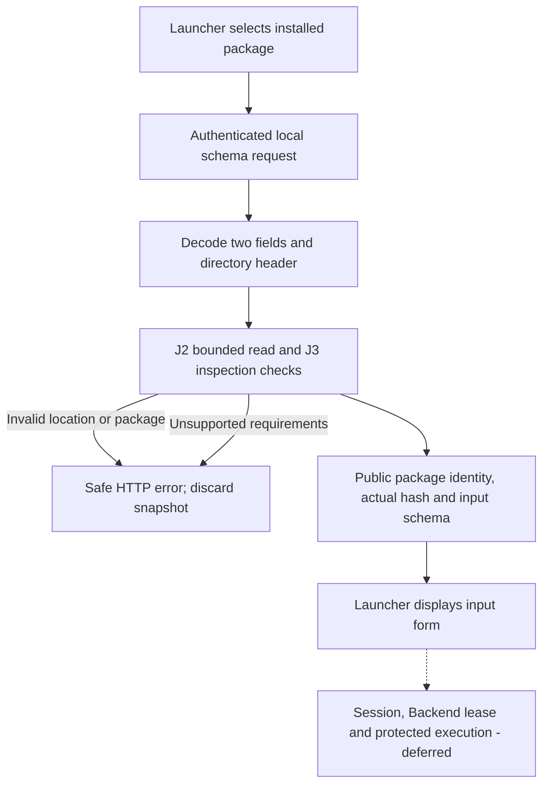

# J4 — Package input-schema API

## Overview

J4 lets Launcher display a Product's input form before requesting permission to
execute it. Launcher selects an installed `.a2m` package; Runtime reads it safely,
checks its public metadata and returns its input schema and actual package hash.
No Backend connection or Android device is needed to show the form.

The request has one package identity source: `packageRef`. Product ID
is derived from its folder and matched against the manifest; Release ID/version
come from the validated manifest. The directory
is a header; Launcher version is a compatibility input. There is no request hash.



**Implemented:** local HTTP endpoint, DTOs, stateless inspection, Wire assembly,
focused Linux/API/race checks and actual managed-agent verification. Windows
cross-compilation is checked; native Windows and real Backend-download acceptance
remain open. Protected session/execution endpoints remain deferred.

Read with [J1](j1_production_contracts.md), [J2](j2_constrained_package_reading.md),
[J3](j3_manifest_package_verification.md) and the standalone
[Launcher integration guide](../integration/launcher.md#read-the-installed-packages-input-schema).

## 1. Ownership and scope

| Component | Responsibility |
| --- | --- |
| Launcher | Verify Backend download length/SHA-256 before installation; record the actual local filename; select installed Release; send location/version; render reduced schema. |
| Existing middleware | Require current local Runtime Bearer, return no-store responses, log safe request results at ERROR for failures. |
| HTTP handler | Decode strict transport/body, pass original header values to inspection, map classified errors and explicitly project two response fields. |
| Package inspector | Derive IDs; read one snapshot; validate manifest, member hashes, schema, versions and supported capabilities; calculate actual ZIP SHA-256. |
| Later authorization | Bind execution to signed Backend Release/package claims, open keys, decrypt and admit the workflow. Schema inspection grants no execution permission. |

No package table, migration, session, worker, lease request, ADB command or run
record is added. Inspection has no side effect beyond bounded local reads and
ordinary request logging.

## 2. HTTP request

```http
POST /api/v1/product-packages/input-schema
Authorization: Bearer <current-local-session-token>
Content-Type: application/json
X-A2MaTeX-Package-Directory: %2Fhome%2Fdino%2FDocuments%2Fa2matex%2Fproducts
```

```json
{
  "packageRef": "11111111-1111-4111-8111-111111111111/package.a2m",
  "launcherVersion": "0.1.0"
}
```

| Input | Requirement |
| --- | --- |
| Authorization | Existing local Runtime session token; exactly one valid Bearer header. Authenticate before body parsing or file access. |
| Directory header | Exactly one original field value, at most 4 KiB, once percent-encoded UTF-8 native absolute root. J2 owns decoding/containment. |
| `packageRef` | Exactly `<canonical UUIDv4 productId>/<local filename>.a2m`; slash-separated on both hosts. No percent-decoding. |
| `launcherVersion` | Required strict numeric `major.minor.patch`; compared against manifest minimum. It describes Launcher, not Runtime. |
| Body | One UTF-8 JSON object, maximum 4 KiB, exactly the two fields, each a nonempty string. Reject unknown/missing/duplicate keys, including escaped duplicates. |
| Other transport | No query, including bare `?`; exactly one `application/json` Content-Type with optional UTF-8 charset only; no nonempty Content-Encoding. |

`productId`, `releaseId`, `packageHash`, plaintext workflows, input values and
Runtime version are not request fields. Do not add a hash through a query or
another header. The file's final basename remains at most 255 UTF-8 bytes and
portable to Linux/Windows; the removed total-reference/member-specific caps
remain removed. Runtime does not expand `~`, environment variables or URLs.

Windows example root `C:\Users\Admin\OneDrive\Documents\a2matex\products`
becomes `C%3A%5CUsers%5CAdmin%5COneDrive%5CDocuments%5Ca2matex%5Cproducts`.
The JSON reference stays slash-separated and identical on both hosts.

## 3. Ordered implementation

1. Existing router middleware authenticates and enables no-store/error logging.
2. Handler bounds/decodes the body and forwards the original directory-header
   values unchanged; repeated headers must not be collapsed into a valid value.
3. `Verifier.Inspect` validates Launcher version and splits the reference to obtain
   the internal Product ID. J2 validates the complete reference and location.
4. J2 opens one contained regular package and reads one bounded snapshot: at most
   4 MiB raw ZIP, exactly three regular entries, at most 2 MiB combined expansion.
5. Inspector calculates SHA-256 over those exact ZIP bytes. It performs no
   caller-expected outer-hash comparison.
6. Shared J3 checks decode strict manifest JSON, match the Product folder,
   validate the manifest Release ID, compare workflow/schema hashes against exact member bytes, validate GCM metadata/tag
   presence, validate reduced input schema and check minimum versions/capabilities.
7. Inspector returns only typed public identity and schema. Handler explicitly
   constructs the HTTP DTO. The encrypted snapshot and manifest are not retained.
8. Failure returns no partial schema; the response exposes only a generic error.

Both operations use the same private content checks. **`Verifier.Verify` remains
a separate strict operation with a mandatory expected SHA-256.** An empty hash
never selects an inspection mode or bypasses its comparison. J2's internal
`ReadRequest` retains its IDs; derivation is performed above that existing API.

## 4. Success and trust boundary

HTTP 200, `Cache-Control: no-store`, direct Runtime DTO without Backend wrapping:

```json
{
  "package": {
    "productId": "11111111-1111-4111-8111-111111111111",
    "releaseId": "22222222-2222-4222-8222-222222222222",
    "version": "1.0.0",
    "packageHash": "09ec3f0a6a578539e18362027fa907be68257a5590d6a8b8eb6072481ad71d01"
  },
  "inputSchema": {
    "type": "object",
    "properties": {
      "packageName": {"type": "string", "minLength": 3, "maxLength": 255},
      "tapY": {"type": "integer", "minimum": 0, "maximum": 100000}
    },
    "required": ["packageName", "tapY"],
    "additionalProperties": false
  }
}
```

The example uses the immutable public J1 fixture. Real packages return their own
version, hash and schema. Exactly four package fields are exposed; no manifest,
nonce, paths, ciphertext, node graph, keys, lease or runtime session is returned.
No user inputs/defaults are inserted. JSON whitespace/property order is not a
wire guarantee; member verification hashes original bytes before interpretation.

The returned hash identifies the current file. This API **does not attest that it
is the original authenticated Backend download**. Repacking internally consistent
members can produce a new valid inspection/hash. Launcher verifies the download
once during installation; later execution must bind the actual package to a
Backend-signed authorization. Inspecting an older compatible installed Release
does not compare it with the newest Release or force an update.

Keep the input form associated with the returned Product/Release/hash. If the
installation/root changes, discard that form and inspect again before submitting
its values through the future protected execution flow.

## 5. Errors and logging

Every failure uses `{ "error": { "code", "message", "retryable" } }`, with no
validation report, schema fragment or filesystem error text.

| HTTP | Code | Message / cause | Retryable |
| --- | --- | --- | --- |
| 400 | `INVALID_REQUEST` | `request is invalid`: malformed transport/body/version/location/header. | false |
| 401 | `UNAUTHORIZED` | Existing missing/invalid local session response, before package access. | false |
| 404 | `RESOURCE_NOT_FOUND` | `resource was not found`: missing selected file/directory or unsupported route/method. | false |
| 413 | `PAYLOAD_TOO_LARGE` | `request payload is too large`: JSON body exceeds 4 KiB, including unknown-length bodies. | false |
| 422 | `VALIDATION_FAILED` | `product package is invalid`: malformed/oversized ZIP, identity, manifest, member hash or schema failure. | false |
| 422 | `RUNTIME_INCOMPATIBLE` | `product package requirements are unsupported`: Runtime/Launcher version or declared capability unavailable. | false |
| 503 | `INTERNAL_ERROR` | `unable to inspect product package`: temporary read failure, cancellation/deadline. | true |
| 500 | `INTERNAL_ERROR` | `internal server error`: unexpected failure or invalid server dependency/result. | false |

Existing request logs include route/status/duration plus classified operation and
fixed reason. Never log the token, directory/reference, body, schema, manifest,
nonce, ciphertext, arbitrary JSON names or raw OS error. Do not add duplicate
per-layer error records. Cancellation returns no success result and retains no
request-owned snapshot; a disconnected caller may not receive the error body.

## 6. Lifecycle, efficiency and implementation map

The inspector stores only immutable runtime version/capability data. Independent
requests own independent buffers; there is no cache invalidation or package
lifetime manager. Files close before returning. Only the schema/public projection
survives until response serialization; garbage collection reclaims request data.
No claim of cryptographic memory erasure is made, and decryption is absent.

One file read, bounded ZIP expansion and linear hashing/JSON/schema checks are
sufficient. Do not reopen the pathname between hash and member checks. Do not add
per-entry size policies, a new configuration subsystem or a Backend freshness
check. Existing build information supplies Runtime version through Wire.

| Runtime file | Change |
| --- | --- |
| `internal/validation/productpackage/verifier.go` | Add `InspectionRequest`, safe `Inspection`, `Inspect`; share private snapshot checks while preserving strict `Verify`. |
| `internal/api/productpackages/dto.go` | Exact request/response DTOs. |
| `internal/api/productpackages/handler.go` | Decode, inspect and map generic responses. |
| `internal/api/router.go` | Register POST inside existing `/api/v1` group; inject handler. |
| `cmd/agent/wire.go`, generated `wire_gen.go` | Construct inspector with installed registries/build version; bind interface. |
| `pkg/constants/product_package.go` | Fixed HTTP body bound and safe response messages. |
| Existing verifier/API tests | Inspection/trust split, strict/auth/error contract, real package and router regressions. |

## 7. Acceptance and verification

| Case | Expected result / evidence |
| --- | --- |
| Valid installed fixture, no ADB/Backend | 200 with derived IDs, original schema and actual ZIP hash. Repeat gives same result without execution writes. |
| Repack identical members | Inspection reports new hash; strict Verify with old expectation rejects; empty expected hash remains invalid. |
| Change a member without its manifest hash | Inspection fails; no partial response. |
| Missing/wrong/duplicate local auth | 401; inspector never invoked. |
| Duplicate/extra/missing/wrong-type body keys, invalid UTF-8/JSON, query/type/encoding errors | 400; inspector never invoked. |
| JSON body over 4 KiB with/without Content-Length | 413; no package access. |
| Invalid/missing/repeated directory, traversal, malformed IDs/reference | 400; no escaping file read. |
| Missing file | 404; malformed ZIP yields 422. |
| Old Launcher/dev Runtime/missing declared capability | 422 incompatible; no node dispatch. |
| Reader cancellation/temporary failure/unexpected failure | Classified generic 503/500; no paths/content in response or logs. |
| Successful/failing inspections and managed shutdown | No run/device/attempt/event/artifact rows; no decryption/session/ADB dependency. |
| Windows | Cross-build passes; native Windows, UNC and actual Launcher acceptance remain pending. |

Implemented tests: `TestInspectPackageWithoutExpectedHash`,
`TestInspectSelectionAndCompatibility`, `TestPackageSchemaStrictTransport`,
`TestPackageSchemaFailures`, `TestPackageSchemaRealPackage`, plus existing
reader/verifier/router regressions. Run focused package/API tests, race checks,
`go vet`, Windows API test cross-compilation, `make wire`, `make fmt`, `make build`
and `git diff --check`. Native Windows execution is a separate acceptance gate.

An actual built-agent Linux check also exercises private managed readiness,
authenticated real HTTP inspection, 400/401/404/422 results, repeat inspection,
zero execution/artifact/event records and clean owner shutdown with an intentionally
unavailable ADB path. It uses only a temporary state directory and the public
fixture; it does not prove a real Backend package/download or client integration.

The [Launcher guide](../integration/launcher.md#read-the-installed-packages-input-schema)
contains Postman and Linux/Windows request examples for manual acceptance.

## 8. Deferred work

Prepared sessions/ephemeral keys, leases/key envelopes, authenticated decryption,
protected run admission, customer-safe monitoring and real Backend/Launcher
acceptance remain J5–J16. Existing Development `/runs`, history and `/events`
retain their current contracts. This endpoint does not make those routes a
Production execution or protected monitoring API.
