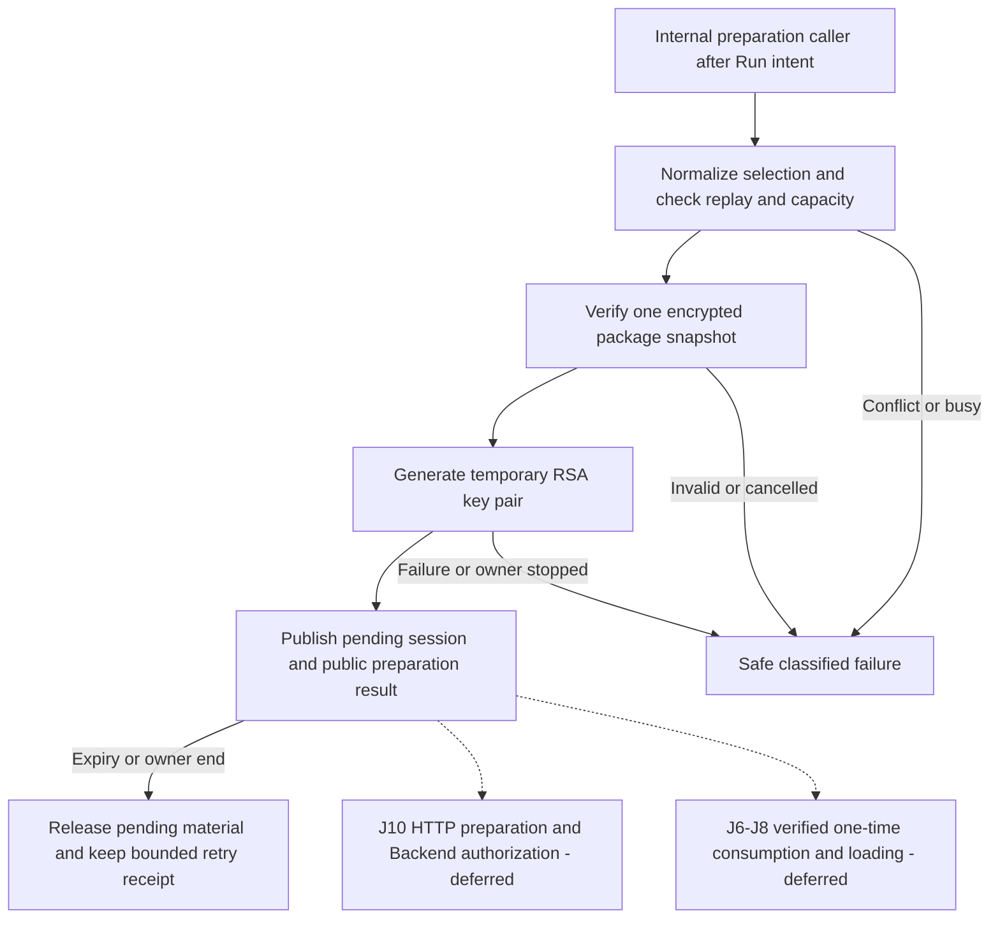

# J5 — Authorization sessions

## Overview

J5 creates a short-lived, process-owned authorization session after the customer
confirms Run. It verifies the selected installed package, allocates the future
execution identity, generates a temporary RSA key pair and holds the encrypted
package/private key in RAM. Its public result lets a later Launcher request ask
Backend for authorization bound to this exact Runtime session and package.

The public input-schema API remains unchanged: opening a form creates no session
or key. A prepared session proves neither customer entitlement nor run admission.
The existing local HTTP Bearer token authenticates the app's Runtime requests;
this new session binds future Product execution to a package and temporary key.



**Status: internal service implemented.** Focused Linux session/package/API tests,
race checks, vet, build and Windows cross-compilation pass. Native Windows remains
unverified. J5 adds no HTTP route, Backend authorization, decryption, run, SQLite
change or Launcher integration. J10 will compose the service into Runtime
startup/shutdown and expose the API; its process-level integration is deferred.

Read with [J1 session contracts](j1_production_contracts.md#41-prepare-a-session-and-establish-identity-before-admission),
[J2 location/snapshot ownership](j2_constrained_package_reading.md),
[J3 strict verification](j3_manifest_package_verification.md),
[J4 inspection boundary](j4_package_input_schema_api.md),
[key security](../../../specifications/cryptographic_key_security.md), and the
[ordered implementation plan](../../../phase_j_implementation.md).

## 1. Scope and ownership

| Owner | Responsibility |
| --- | --- |
| J5 | Pending-session identity, package/key ownership, preparation replay, bounds, monotonic expiry, one-time transfer and pending-owner cleanup. |
| Existing J2/J3 | Normalize safe locations and verify exact encrypted package bytes, identity, expected outer hash, member hashes, public schema and compatibility. |
| J6 | Verify Backend signature/claims/time and match the lease to J5's session metadata. |
| J7/J8 | Consume session material after authorization checks, open the envelope, decrypt/validate IR and release temporary material on every outcome. |
| J9/J14 | Supply authoritative live authorization-expired run eligibility for reauthorization; preserve existing execution state and enforce final owner gates. |
| J10 | HTTP DTO/auth/trust-configuration gate, service composition and owner shutdown integration. |
| J11 | Saved start replay, final admission/installed-selection checks, persistence and execution ownership. |

J5 uses one in-memory service per Runtime process generation. It does not add a
repository, database migration, device ceiling, execution scheduler, Backend
client, signing trust configuration, public key-export API or application mode.
No plaintext workflow, customer inputs or device selection enters preparation.

Implement START and the session machinery for REAUTHORIZE. Reauthorization
requires an injected trusted live-run source; without it that purpose fails
closed. Testing that seam does not implement the later live engine adapter.

## 2. Internal service boundary

Use `internal/services/productsession`, following existing constructor injection
and `Start/Wait/Shutdown` lifecycle patterns. The conceptual Go API below fixes
responsibilities; types can be arranged within the small package, without a
separate factory, transport or model hierarchy.

```go
func New(verifier PackageVerifier, reauthorization ReauthorizationSource, logger *slog.Logger) (*Service, error)
func (s *Service) Start(ownerContext context.Context) error
func (s *Service) Wait() error
func (s *Service) Shutdown(ctx context.Context) error

func (s *Service) Prepare(ctx context.Context, request Request) (Prepared, error)
func (s *Service) Lookup(ctx context.Context, runtimeSessionID string) (Binding, error)
func (s *Service) Consume(ctx context.Context, expected Binding) (*Material, error)

func (m *Material) Use(ctx context.Context, operation func(*rsa.PrivateKey, *packagevalidation.VerifiedPackage) error) error
func (m *Material) Close()
```

The injected interfaces are narrow internal contracts:

```go
type PackageVerifier interface {
    Verify(context.Context, packagevalidation.Request) (*packagevalidation.VerifiedPackage, error)
}

type ReauthorizationSource interface {
    Resolve(context.Context, string) (ReauthorizationTarget, error) // existing runGroupId
}

type ReauthorizationTarget struct {
    ExecutionID           string
    PreviousLeaseFamilyID string
    Package               packagevalidation.PublicPackage
    RuntimeIRHash         string
    Revision              uint64
}
```

These are not inspection or caller-supplied raw snapshot APIs. Production passes
the installed J3 verifier. Nil/malformed required
dependencies fail configuration; a nil reauthorization source disables only that
purpose. Test clock/key/UUID seams stay private to the package; production always
uses the standard cryptographic generators.

`Request` contains exactly the internal equivalents of J1 preparation inputs:

| Field | Requirement |
| --- | --- |
| `RequestID` | Canonical lowercase UUID v4; supplied by the preparation caller. |
| `Purpose` | START or REAUTHORIZE, using shared constants. |
| `RunGroupID` | Empty for START; canonical UUID v4 for REAUTHORIZE. |
| `DirectoryHeaderValues` | Original directory header values; copy the slice at entry. No collapsed duplicate header. |
| `PackageRef` | `<productId>/<local filename>.a2m`; Product ID comes from the folder and Release ID from the validated manifest. |
| `PackageHash` | Mandatory canonical lowercase SHA-256 expectation identifying the selected package/form. |
| `LauncherVersion` | Existing strict numeric release version. Runtime version comes from J3's installed build dependency. |

No owner ID, new execution ID, key material, previous lease family, caller clock,
trust key, inputs or ADB serials can be supplied by an HTTP client. J10 performs
strict wire decoding; J5 validates these typed invariants before allocating work.
A hash identifies selected bytes here; it does not independently prove Backend
origin. Signed authorization must later match the Backend Release package hash.

`Prepared` is the explicit safe public result with J1's exact field set:

```json
{
  "requestId": "33333333-3333-4333-8333-333333333333",
  "purpose": "START",
  "executionId": "55555555-5555-4555-8555-555555555555",
  "runtimeSessionId": "66666666-6666-4666-8666-666666666666",
  "runtimePublicKey": "<padded Base64 DER SubjectPublicKeyInfo>",
  "runtimeKeyThumbprint": "<lowercase SHA-256 hex of DER bytes>",
  "previousLeaseFamilyId": null,
  "package": {
    "productId": "11111111-1111-4111-8111-111111111111",
    "releaseId": "22222222-2222-4222-8222-222222222222",
    "version": "1.0.0",
    "packageHash": "<actual verified ZIP SHA-256>"
  },
  "expiresAt": "2026-11-26T00:05:00.000Z"
}
```

The placeholders describe encoding, not executable crypto vectors. Use existing
public fixtures for exact encodings. `previousLeaseFamilyId` is JSON null for
START and the trusted previous family UUID for REAUTHORIZE; never omit it.
Format `expiresAt` with existing `constants.ExecutionTimestampLayout` in UTC.
Return independent value copies, including any nullable pointer, so mutation of
one response cannot change stored replay state.

`Binding` is immutable internal metadata: owner generation, purpose, request /
execution/session IDs, normalized location/reference, verified package identity,
key thumbprint, previous family and reauthorization target revision where used.
Use explicit fields: `OwnerGeneration`, `Purpose`, `RequestID`, `ExecutionID`,
`RuntimeSessionID`, `Location` (existing reader.Location), `Package` (PublicPackage),
`RuntimeKeyThumbprint`, `PreviousLeaseFamilyID`, `RuntimeIRHash` and
`TargetRevision`. START has empty previous family/IR hash and zero target revision;
REAUTHORIZE uses the trusted target values and a nonzero revision. These are
comparable value fields, with no mutable buffers or nullable pointers.

Binding excludes private key/snapshot buffers. All its fields use `json:"-"`.
`Lookup` returns a defensive value copy only for a currently pending session.
Binding lookup is not authorization and does not reserve consumption.

## 3. Identity and package binding

`Start` creates a cryptographically random, internal owner-generation UUID and
attaches the service to the supplied process/owner context through a derived,
service-owned context. Shutdown cancels this derived context without cancelling
the caller's parent. Pending records and consumed material use this owner lifetime,
not the original HTTP caller lifetime. It is not the local Bearer token and is never accepted from a request. The service cannot be started
again after shutdown; a replacement process constructs a fresh service.

For START, generate independent UUID v4 execution/session IDs. The future
RunGroup ID must equal this execution ID, but no execution row is created now.
For REAUTHORIZE, retain the existing run's execution ID and allocate a fresh
session ID/key. Detect collisions with retained service identities and fail
without publication; do not create an unbounded UUID retry loop or query SQLite.
Final persisted execution-ID uniqueness remains J11's admission responsibility.

Derive Product ID from `PackageRef` and reuse J2's location validation. Read
Release ID/version from the validated J3 result, never from a filename.
Replay must normalize the directory without opening the file. Expose the existing
reader's location resolver as a narrow `ResolveLocation(ReadRequest)` function
when implementing J5, and have `Read` reuse it. Keep its current behavior: original
header cardinality/encoding, platform-native path validation, `filepath.Clean`,
Windows drive normalization and portable basename checks. Do not add another
normalizer, resolve filesystem aliases, or weaken actual open-time containment.

Call strict `Verifier.Verify` for a new preparation. Pass its derived Product ID and
mandatory expected hash; never pass an empty hash or use `Inspect` as a bypass.
A nil verifier result/snapshot or inconsistent returned identity/location/hash
is a dependency contract failure, not a panic or permission to generate keys.
Require its snapshot location/reference, Product ID and verified package hash
to equal the normalized selection; require a canonical manifest Release ID.
Freeze that Release ID/version in Binding.Package. No directory or filename
comparison can replace manifest Release validation. Retain that same verified snapshot; do not reopen the path
or copy it into a second file/cache. Package replacement after capture cannot
change this session's bytes. Initial admission must separately recheck the
installed selection in J11, and reauthorization must satisfy J14's original IR
hash binding. Neither later check is implemented in J5.

## 4. Preparation algorithm and concurrency

Use one mutex for service state/maps/reservations. File I/O, package verification,
RSA generation and reauthorization callbacks happen outside it. The mutex is
never held while calling another service or waiting for context/crypto work.
Blocking dependencies receive a work context cancelled by either the caller or
the service owner, with cancellation hooks stopped when that operation ends.
Request cancellation after successful publication does not destroy a valid pending
session; later replay must still find it while the owner/lifetime remains valid.

1. Check caller/owner context and service started/open state. Validate typed
   fields and resolve the location without reading the package. Construct the
   preparation fingerprint described below.
2. Under the mutex, expire due records and resolve an existing receipt first.
   Identical pending replay returns its copied response without filesystem access
   or RSA work. Conflicting content fails before package/key work. See the state
   table for preparing/terminal records.
3. For a new request, atomically reserve one receipt, one pending slot and the
   single preparation/key-generation permit. If unavailable, return busy before
   reading a package. Record the monotonic creation instant and fixed deadlines.
   No queue, per-request waiter goroutine or second preparation is created.
4. Outside the mutex, resolve eligible REAUTHORIZE targets if needed and call
   J3 once. Generate IDs, one RSA pair and its public metadata. Check caller and
   owner cancellation between stages and after crypto returns.
5. For REAUTHORIZE, recheck the live target and its revision before publishing.
   No longer eligible or changed target means discard the candidate.
6. Under the mutex, publish only if the same reservation remains preparing,
   both contexts are live, service is open and its pending lifetime has not
   expired. Store one private pending record and a copied public response.
7. On every exit, release the preparation permit. Failure after reservation
   turns its receipt unavailable and drops all candidate material; no partial
   result escapes. A busy/invalid request rejected before reservation consumes
   no receipt. A late completion after shutdown/expiry must never publish.

One preparation permit serializes the expensive verify/generate path as well as
RSA generation. This is the smaller MVP implementation of J1's one concurrent
key-generation rule. Existing pending replays/lookups/consumption/expiry remain
available while another preparation performs I/O/crypto.

Do not detach RSA generation merely to return a timeout early. Go's RSA generator
has no context argument: check before/after it, keep the permit until it returns,
discard cancelled results and include it in shutdown draining. An OS entropy or
crypto stall can outlast a deadline; it cannot be advertised as instantly
cancellable. The existing process owner may ultimately terminate the process.

## 5. Replay, receipts and expiry

Receipt key is `(owner generation, purpose, requestId)`. Store a SHA-256 digest
of deterministic JSON encoding of a fixed-field struct containing purpose,
normalized root, exact reference, expected hash, Launcher version and optional
runGroupId. Do not hash an unordered map or raw JSON/header spelling. Equivalent
accepted header escaping/normalized roots replay; a different normalized root,
filename, hash, version or target run conflicts. No user inputs/secrets belong in
this fingerprint. A reused UUID for another purpose is a separate scope under J1.

| Existing record | Same fingerprint | Different fingerprint |
| --- | --- | --- |
| Preparing | Busy; first preparation continues, no queued/coalesced key generation. | Idempotency conflict. |
| Pending and live | Same IDs, public key, package and original expiry; no file read. For REAUTHORIZE, live-target eligibility must still hold. | Idempotency conflict. |
| Unavailable / consumed / expired receipt within retention | Session unavailable; do not generate another key. | Idempotency conflict. |
| Service closed or different process's session ID | Session unavailable. | No cross-generation replay promise. |

A request's pending lifetime is 300 seconds from reservation, including verification
and generation time; successful publication does not restart it. Retain the Go
monotonic component for all local expiry comparisons. At elapsed time `>= 300s`,
lookup/replay/consume must fail even before the background cleanup pass.
`expiresAt` is creation wall time plus 300 seconds for display; Backend server
time and operating-system wall adjustments do not extend the local deadline.

After failure, consumption or pending expiry, retain only a small terminal
receipt for another 300 monotonic seconds from that transition. It contains the
fingerprint, identifiers, terminal classification and retention deadline, not the
private key, snapshot, public-key body or full response. Transition once; another
lookup/retry/sweep must not extend retention. Prune only after its deadline.
Generating work that outlives its deadline is marked unavailable and still owns
the one permit until its epilogue releases it; it cannot publish into a pruned
or superseded reservation.

The bounded retry guarantee lasts while a receipt is retained. Clients must
always use a new random request ID for a fresh intent and never reuse old IDs
after timeout, consumption or expiry. A finite 256-entry store is not an
indefinite history of every UUID ever used. After receipt retirement/process
replacement, old request-ID reuse is unsupported; an unknown session ID always
remains unavailable. This states the finite window behind J1's bounded receipts,
not a new promise of durable or unlimited preparation replay.

## 6. Resource limits and idle cleanup

| Named constant in `pkg/constants/product_session.go` | Fixed MVP value / meaning |
| --- | --- |
| `ProductSessionPendingLimit` | 4 total preparing + pending sessions, per process. |
| `ProductSessionReceiptLimit` | 256 total preparing/pending/terminal receipts. |
| `ProductSessionPreparationLimit` | 1 active verify/generate operation. |
| `ProductSessionPendingLifetime` | 300 seconds from reservation, never sliding. |
| `ProductSessionReceiptLifetime` | 300 seconds from a terminal transition, never sliding. |
| `ProductSessionSweepInterval` | 1 second; idle cleanup scheduling, not expiry grace. |
| `ProductSessionRSAKeyBits` / `ProductSessionRSAExponent` | 3072 / 65537. |
| Purpose/state constants | Typed START/REAUTHORIZE and internal states, not magic strings spread through services. |

Live replays resolve before capacity checks. Do not evict a still-required receipt
or pending session to make room. Receipt capacity can remain busy after private
pending bytes are released; that is deliberate replay protection. These bounds
protect pending keys/work only and do not impose a device or paid execution cap.
Use the existing raw ZIP/expanded budgets. Four retained snapshots have at most
approximately 24 MiB of raw/member payload; allocation/decoded metadata and future
consumed material are additional, so this is not a total RSS guarantee.

`Start` launches one process-owned cleanup loop with a ticker and stop/done
signals. On each tick, expire due pending/preparing records, release private
pending material and prune due terminal receipts under bounded map work.
API methods also expire synchronously before acting. Use a private clock seam
for current wall time and elapsed monotonic duration
(production uses `time.Now`/`time.Since`) and a directly callable private sweep
helper for deterministic tests, including wall-clock jumps. No new timer library
is required. Idle cleanup normally follows within one sweep period,
subject to scheduling; no hard real-time memory-wipe guarantee is made.

## 7. Session keys and private material

Generate RSA with `crypto/rsa.GenerateKey(crypto/rand.Reader, 3072)`. Check key
validity, exact modulus size and exponent before publishing, including results
returned by test seams. Never reuse the RSA key from a previous session, generate
a content key, load `MASTER_KEY` or install fixture private keys as runtime data.

Use `x509.MarshalPKIXPublicKey(&privateKey.PublicKey)` for DER SubjectPublicKeyInfo,
standard padded Base64 for `runtimePublicKey`, and lowercase hexadecimal SHA-256
of **DER bytes** for `runtimeKeyThumbprint`. Do not hash PEM/Base64 text or use
PKCS#1 encoding. J7, not J5, applies RSA-OAEP-SHA256/MGF1-SHA256 and the empty label
to open the later 32-byte content-key envelope.

Public prepared data is separate from an unexported pending record. Keep private
key/snapshot fields unexported or `json:"-"`; JSON of `Binding`/`Material` must not
expose them. Do not provide a general key getter, exported PEM/private DER, raw
package response, debugging dump or plaintext endpoint. A diagnostic struct
formatter is not a safe logger.

`Consume` is the single atomic transfer of a pending record into `Material`:

1. Validate expected binding shape and check both contexts/open state/deadline.
2. Recheck REAUTHORIZE target eligibility/revision outside the manager lock.
3. Under the mutex, compare the complete expected binding with the same live
   pending record, including generation, purpose, execution/session, location,
   package/hash, thumbprint and target fields. Changed/stale bindings fail.
4. Mark its receipt consumed and remove private pending ownership before returning
   the one material handle. A concurrent second consume receives unavailable.

It does not verify a lease or decrypt anything. J6 must precede consumption in
actual admission. `Material.Use` gives trusted internal crypto/loading code a
borrowed key/snapshot only while an operation holds that handle's own lock.
Check context/closed state before use and cancellation again afterward. Callbacks
must not retain or mutate borrowed key/snapshot references, reenter Use/Close on
that handle, or perform unrelated blocking I/O. No service-global mutex is held across the callback.

`Material.Close` is idempotent and excludes concurrent use; afterward Use fails.
Release private integer/precomputed key material best-effort, remove references
and drop snapshot buffers. Do not serialize private keys to wipe them or claim
that Go garbage collection/BigInt overwriting guarantees physical erasure.

Ownership after consumption belongs to the consuming pipeline: it must defer
Close immediately, close on every failure/cancellation, and transfer any required
plaintext/content-key lifetime explicitly to the later active owner. The manager
never retains a second copy of consumed private material. Owner cancellation
makes a consumed handle unusable for new operations, but J10/J11's joined consumer
cleanup is required to release material already transferred. J5 standalone tests
cannot claim that future active-run shutdown integration has been implemented.

## 8. Reauthorization seam and later integration

The injected `ReauthorizationSource` resolves a runGroupId to an internal target
only when that same process has a live run parked for hard authorization expiry.
A trusted target contains the existing execution ID, previous lease-family ID,
original public package identity/hash, original IR hash and a live-target revision.
None comes from Launcher besides its requested runGroupId/package selection.

For a new preparation, the source returns existing `ErrExecutionNotFound` for
an unknown live run and `ErrExecutionControlState` for terminal/user-paused/
non-expired runs, owner loss or another ineligible state. A failure rechecking
an already pending target instead invalidates that session as unavailable.
Validate returned UUID/hash fields, execution ID equality with the requested run,
and a nonzero revision as an internal dependency contract. Compare package identity/hash after verification. Resolve
again before pending replay/publication/consumption and require the original
revision; an ineligible/changed pending target becomes unavailable and is cleaned.
Concurrent lookups must recheck the pending record after the callback returns.

A nil source fails REAUTHORIZE with invalid execution state before filesystem or
key work. J5 tests supply a controlled source; production J9/J10/J14 later supply
the live authorization adapter. Do not invent an `authorizationExpired` field on
HTTP requests or read SQLite to reconstruct a runnable owner. J14 must hold its
final execution/authorization gate across live admission; a J5 eligibility check
alone cannot close a race between cancellation and later resume.

J10 will install the service as an owner-bound lifecycle dependency before HTTP
preparation becomes available, and arrange stop/drain/cleanup before process
exit. It must gate protected preparation on configured signing trust and add the
strict header/body/response rules. START saved replay and installed-path checks
remain J11's responsibility. Normal lease renewal uses the active session and
needs no J5 preparation/key; hard-expiry reauthorization uses a new session/key.

## 9. Shutdown and failure semantics

The service is usable only after successful Start. Before Start, operations
return session unavailable. Start is one-shot; duplicate/failed start never
creates another generation or reaper in that instance. Shutdown before Start
is safe and leaves it permanently closed.

`Shutdown` first fences new operations, cancels service-owned preparation context,
marks pending/preparing sessions unavailable and releases material still owned by
the manager. Stop the reaper and wait for admitted preparation epilogues to drop
late candidates. Cancellation of `Start`'s owner context triggers the same close
path even if Shutdown is not called explicitly. Repeated Shutdown is safe.
`Wait` completes after the cleanup loop and admitted preparations finish.

Use one shared done signal rather than spawning a waiter per shutdown/replay.
An expired shutdown context returns its cancellation/deadline error while the
service stays fenced. It never reports successful drain while RSA/file work still
owns a candidate. Future supervisor wiring applies existing bounded termination;
J5 adds no restart/background daemon policy. Never resurrect a closed service or
restore keys/receipts from disk after process replacement.

| Internal classification | Future boundary projection / action |
| --- | --- |
| Existing package selection/location errors; new invalid session input | 400 INVALID_REQUEST; no key work. |
| Existing package missing / invalid / incompatible errors | Preserve classified cause for J10's generic J1 Product response; no J4 contract change. |
| New `ErrProductSessionBusy` | 409 RUNTIME_BUSY: capacity, preparation permit or identical in-progress prepare; explicit bounded retry, no extra worker. |
| New `ErrProductSessionConflict` | 409 IDEMPOTENCY_CONFLICT: changed content under retained scoped request ID. |
| New `ErrProductSessionUnavailable` | 409 AUTHORIZATION_SESSION_UNAVAILABLE: absent, expired, consumed, stale generation/binding or closed owner. |
| Existing `ErrExecutionNotFound` | 404 RESOURCE_NOT_FOUND for an unknown new reauthorization target. |
| Existing `ErrExecutionControlState` | 409 INVALID_EXECUTION_STATE for ineligible new reauthorization. |
| New `ErrProductSessionConfiguration` | Constructor/lifecycle configuration failure is returned to composition; an unexpected runtime dependency contract failure maps to generic 500 INTERNAL_ERROR in J10. |
| New `ErrProductSessionKeyGeneration` | Generic 500 INTERNAL_ERROR in J10, retryable false. Keep the failed receipt unavailable; caller needs fresh explicit preparation intent. |
| Caller/owner cancellation or deadline | Preserve `errors.Is` classification; no result, candidate publication or TTL extension. |

Define the new sentinels in `pkg/x-error/product_session.go`, not beside service
logic; define `ErrProductSessionInvalid` for malformed internal requests. Use
existing `OperationError`/`WithOperation` with stable operations such as
`prepare_product_session`, `verify_session_package`, `generate_product_session_key`,
`consume_product_session`, `expire_product_session` and `shutdown_product_sessions`.
Reasons are fixed strings, never paths, JSON values or crypto error text. Replace
untrusted generator/provider error messages with the fixed key-generation sentinel
and reason; do not embed them in printable errors. Preserve context cancellation
classification and the existing already-sanitized package error classifications.

Do not log a returned error at every layer. Future HTTP middleware emits the
single ERROR request record, with safe operation/reason. Lifecycle/background
failures have one ERROR owner log. Optional preparation/expiry/drain lifecycle
records may include safe IDs, outcome and bounded counts only. Never log key
material, key bodies/thumbprints, directory/reference, schema/workflow bytes,
Bearer, signed lease/envelope or customer inputs. No panic is an expected result.

## 10. Implementation map and MVP decisions

| File / area | Implemented J5 responsibility |
| --- | --- |
| `internal/services/productsession/service.go` | Constructor/dependency guards, state/reservations, monotonic expiry/reaper, owner context and bounded drain lifecycle. |
| `internal/services/productsession/preparation.go` | Typed requests/public results, normalized fingerprints, replay/capacity, strict package verification, ID/key generation and publication. |
| `internal/services/productsession/session.go` | Private Binding and reauthorization source, live-target checks, lookup and atomic consume. |
| `internal/services/productsession/keys.go` | RSA/public encodings, material borrow/close ownership and best-effort cleanup. |
| `internal/services/productsession/service_test.go` | Real package/key, replay, limits, monotonic/idle expiry, ownership, lifecycle and privacy tests with existing fixture/registries. |
| `internal/services/productsession/races_test.go` | Channel-controlled cancellation, permit, consume/close, shutdown and reauthorization-target races. |
| `pkg/constants/product_session.go` | Named limits, durations, purpose/state/key parameters. |
| `pkg/x-error/product_session.go` | Session sentinels; reuse package/control/context classifications. |
| `internal/platform/productpackage/reader.go` and existing tests | Expose/reuse existing location normalization only, so replay need not open the file. Preserve all J2 safety behavior. |

Reuse standard crypto/encoding/synchronization tools and existing google/uuid,
package verifier, timestamp layout and error/log patterns. No new dependency,
JSON canonicalizer, configurable cache, repository, migration or generic secret
vault is required. Keep default seams private; this is not a plugin system.
Do not modify API handlers, Wire/generated files, supervisor/execution lifecycle,
Backend or Launcher source merely to instantiate an unused J5 service now.
Their composition changes belong to the first consuming phases described above.

## 11. Acceptance criteria and proposed tests

The user approved focused J5 tests before code edits. The criteria below are
implemented by the focused tests and existing regressions listed in the evidence
section; full consuming HTTP/engine/native Windows acceptance remains separate.
Reuse the vendored public J1 ZIP and existing J3 registries; never require a Plan
sibling at test runtime or modify immutable protocol/encryption fixtures.

| ID | Scenario | Required result |
| --- | --- | --- |
| J5-01 | Valid START preparation | Canonical independent IDs, future execution identity, exact package binding and full safe result; no run/database/ADB/backend work. |
| J5-02 | Real RSA sessions | Fresh distinct 3072-bit keys, exponent 65537, valid SPKI/Base64 and SHA-256 of DER; round-trip public encoding. |
| J5-03 | Malformed typed selection and location | Fail before verification/key generation; original repeated headers/path safety preserved. |
| J5-04 | Wrong expected package hash, malformed ZIP/schema or incompatibility | Preserve J3 failure, no session result/private retained state; failure receipt bounded. |
| J5-05 | Same request replay and normalized equivalent root | Same public IDs/key/expiry, verifier and generator called once, including after installed file removal. |
| J5-06 | Changed root/ref/hash/version/run under same scoped ID | Conflict before I/O/key work; original session unchanged. Purpose is its own scope. |
| J5-07 | Concurrent duplicate / competing preparation | Identical in-progress is busy, changed in-progress conflicts; no second generator or wait queue. Pending replays still work. |
| J5-08 | Four preparing/pending or 256 retained receipts | New preparation busy without eviction/read/generation; existing pending replay works. Prune only due terminal receipts. |
| J5-09 | Before/at/after deadline, replay and idle cleanup | Usable before 300s, unusable at 300s, no sliding TTL or wall-clock extension; idle sweep drops private material; fixed display expiry. |
| J5-10 | Terminal retry retention | Same unavailable/changed conflict through terminal +300s; repeated failure/retry never extends retention; expired records pruned without claiming indefinite UUID history. |
| J5-11 | UUID/random/RSA/verification failures and malformed dependency result | No publication, pending slot/permit released, safe error and bounded receipt; no leaked private references. |
| J5-12 | Cancel before/during stages or while generator is blocked | No late success or second generator; discard candidate after generator returns, shutdown drain respects its deadline. |
| J5-13 | Lookup, stale binding and concurrent Consume | Lookup exposes no material; one consume winner only; wrong generation/location/hash/key/target fails. |
| J5-14 | Material Use/Close, serialization and response mutation | Exclusive borrow, idempotent close, no use after close/owner stop; no key/snapshot JSON, no response aliasing. |
| J5-15 | REAUTHORIZE through trusted source | Existing execution/family and fresh session/key; matching package/IR metadata; source nil, user pause, terminal/changed revision rejected. |
| J5-16 | Target changes while prepare/replay/consume is in flight | Recheck catches stale target, releases pending/candidate and never resumes/dispatches a workflow. |
| J5-17 | Owner cancellation / duplicate Shutdown / service replacement | Reaper stops, pending keys/candidates released, no resurrection, old session IDs unavailable in fresh manager. Caller closes transferred material. |
| J5-18 | Privacy and cross-platform regressions | Safe fixed error/log fields; existing J2/J3/J4 tests remain green; native Windows evidence not inferred from a cross-build. |

Use actual RSA generation only for crypto freshness/encoding acceptance; reuse
explicit test-only key fixtures for state/race tests. Use channels/barriers and a
fake private clock for transitions, not arbitrary sleeps or thousands of keys.
Give each candidate an independent parsed test-key object, never one shared
private-key pointer that Close could wipe while another session owns it.
Exercise races under the Go race detector and check no cleanup worker survives
test shutdown. No benchmark suite or new harness/dependency is required.

After code implementation, run focused service and existing package/API tests,
race tests, vet, Windows cross-compilation, `make fmt`, `make build` and
`git diff --check`. Record exact commands/results in this spec only when run.
Windows cross-compilation is not native Windows acceptance.

### Implementation evidence — 2026-11-26

The internal service and focused tests were reapplied after the J4 commit.
All commands below were rerun for the restored checkout; test runs used
`-count=1` to bypass cached results. All 18 J5 test functions pass. No new
dependency was introduced.
The existing J2 location resolver is one public `ResolveLocation` function,
shared directly by Read and J5. Its policy and actual file-opening checks are
unchanged. The committed J4 behavior was preserved. API handlers, Wire/supervisor, SQLite, Backend and Launcher
source were not changed for J5.

| Check | Result / scope |
| --- | --- |
| Focused Linux tests | PASS: `go test -count=1 ./internal/services/productsession ./internal/platform/productpackage ./internal/validation/productpackage ./internal/api/...`. |
| Race detector | PASS: `go test -race -count=1` for the same package set, including all session lifecycle/key/replay/expiry/reauthorization race cases and package/API regressions. |
| Vet | PASS: `go vet ./internal/services/productsession ./internal/platform/productpackage ./internal/validation/productpackage`. |
| Windows cross-build | PASS: `GOOS=windows GOARCH=amd64 go test -c -o /tmp/a2matex-j5-windows.test.exe ./internal/services/productsession`. Not executed on Windows. |
| Format/build/whitespace | PASS: `make fmt`, `make build`, `git diff --check`, plus checks on new untracked source files and Markdown links/examples. |
| Native/process integration | NOT RUN / DEFERRED: native Windows, real Backend authorization and session HTTP/engine ownership are not part of J5's internal service delivery. |

Go commands used the installed toolchain with
`GOCACHE=/tmp/a2matex-d5-go-cache`. Existing SSE regressions needed local loopback
listeners, so the package/API run was executed with the sandbox socket restriction
lifted. No project configuration, customer store or deployment was changed.

| Acceptance cases | Executable evidence |
| --- | --- |
| J5-01–J5-02 | `TestPrepareBindingReplayAndPrivateOwnership`, `TestRealKeyFreshness`: real ZIP verification, UUIDs, distinct real RSA keys, public encoding and thumbprint. |
| J5-03–J5-06 | `TestPreparationValidationAndConflict`, `TestActualPackageFailuresArePreserved` and the replay/ownership test: malformed selection/location, changed fields, old Launcher, bad/missing ZIP/hash and replay after file removal. Existing J3 regressions cover schema/manifest/capability failures. |
| J5-07–J5-08 | `TestPreparationPermitCancellationExpiryAndShutdown`, `TestReceiptCapacityAndConsumedRetry`, `TestExpiryRetentionCapacityAndWallClock`: single permit, in-progress duplicates/conflicts, all four pending slots and all 256 receipts, replay before capacity gates. |
| J5-09–J5-10 | Expiry/retention test and `TestIdleReaperReleasesMaterial`: exact deadline, wall-clock change, non-sliding receipts, pruning and actual ticker-driven idle release without another request. |
| J5-11–J5-12 | `TestFailureAndCancellationDoNotPublish`, `TestPreparationCancellationStagesAndOwnerLoss` and blocked-generator tests: bad dependencies/key/UUID, cancellation between stages, no late publication, cleanup and bounded drain. |
| J5-13–J5-14 | `TestConcurrentConsumeAndMaterialClose`, replay/ownership test and `TestTypedNilDependenciesAndOwnerCancellationDuringUse`: one winner, binding mismatch, private serialization, response independence and no success after owner cancellation. |
| J5-15–J5-16 | `TestReauthorizationIdentityReplayAndTargetChanges`, `TestReauthorizationSourceFailuresAndPublicationRace`: source eligibility/package/revision, stable previous family, separate purpose scope and rejection during publication/replay/consume. |
| J5-17 | `TestServiceLifecycle`, owner-loss and `TestCallerEndsAfterPublicationAndDuplicateShutdown`: shutdown before Start, fresh-manager isolation, cleanup-loop completion and published sessions independent of caller cancellation. `TestStartupFailureAndShutdownDuringOwnerGeneration` covers cancelled/failed startup and shutdown during owner-ID allocation. |
| J5-18 | `TestSessionLogsContainNoPrivateData`, existing reader/verifier/API regressions and Windows test-binary compilation. |

## 12. Completion and deferred work

J5 code completion requires the internal service, real key/ownership evidence,
replay/capacity/expiry/shutdown race coverage, preserved J2/J3/J4 behavior and
accurate status in all three indexes. Documentation delivery alone does not
satisfy code completion. There is no J5 Postman endpoint or active-run acceptance.

J6/J7/J8 consume the verified binding/material, J9 supplies authorization-state
rules, J10 installs the HTTP/lifecycle/trust gate, J11 admits protected runs and
owns consumed/active material, and J14 joins the reauthorization adapter to the
live paused execution. No separate integration guide is added for a nonexistent
API. Keep the existing Launcher guide's availability inventory unchanged until
an endpoint is actually implemented and verified.
