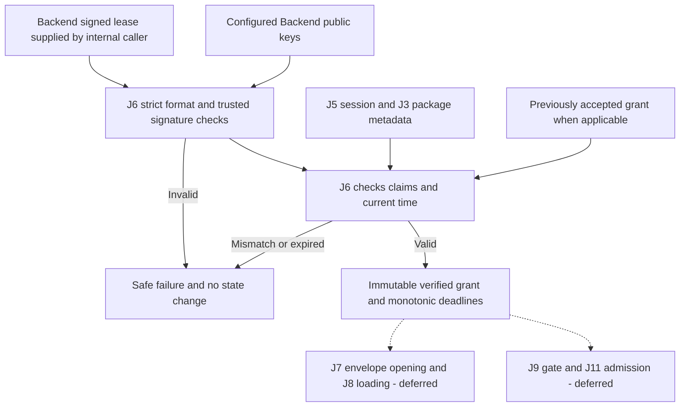

# J6 — Lease verification

## Overview

J6 answers one question: **did the trusted Backend authorize this exact package,
execution and Runtime session, and is that authorization valid now?** Backend
already issues signed initial leases. J6 adds their internal Go verifier, using
J5's prepared session metadata and the actual package identity from J3.

A successful result is immutable verified authorization metadata with local
monotonic deadlines. It is not an admitted run or permission to skip later
checks. A failed check returns a safe classified error and leaves J5's pending
session untouched. No database, network request, device command, HTTP endpoint
or workflow decryption is added in this phase.



**Status: specified, not implemented.** This document defines the implementation
and proposed test scope. Creating it does not verify Go/Backend interoperability.
J5's internal session service and Backend's internal START issuer exist; public
preparation/authorization/start integration is still incomplete.

Read with [J1 wire and trust contracts](j1_production_contracts.md#63-signed-lease),
[J5 session ownership](j5_authorization_sessions.md),
[Backend issuance](../../a2matex-backend/commerce_entitlement_execution/execution_authorization.md),
[Backend-signed v2 fixtures](fixtures/v2/README.md), and the
[ordered implementation plan](../../../phase_j_implementation.md).

## 1. Scope and ownership

| Owner | Responsibility |
| --- | --- |
| J6 | Strict compact-JWS parsing, configured Ed25519 trust, exact claims, package/session binding, time checks, immutable verification results and pure sequence/replay decisions. |
| Existing J3/J5 | Verify package bytes; generate and retain session/key material; provide a current owner-bound session snapshot; expire and consume that material. |
| J7/J8 | Match/open the content-key envelope and decrypt/validate the workflow in RAM. |
| J9 | Enforce deadlines and attempt budgets against live execution, including hard-expiry cleanup. |
| J10 | Load Product trust settings through existing configuration; instantiate this verifier at process startup; connect preparation and owner lifecycle. |
| J11 | Compose verification, one-time consumption, loading and final admission; check owner/session/installed-selection races; persist minimal provenance. |
| J12/J14 | Atomically apply renewal/reauthorization to live authorization state, preserve execution identity and enforce lifecycle eligibility. |
| Backend | Authenticate the user, check current entitlement/Release eligibility, sign grants and later deliver envelopes/renewals. |

J6 includes the **pure validation predicates** needed by later renewal and
reauthorization consumers, so they reuse one signature/claim implementation.
It does not create a renewal service, advance live sequences, resume a paused
run, add an event or implement those later APIs.

There is no new dependency, SQLite table/migration, repository, background
worker, token cache, online key discovery or per-device verification loop.
A lease covers the execution group, not one grant per selected Android device.

## 2. Existing code and implementation location

The current checkout already provides:

- `internal/services/productsession/session.go`: `Binding`, `Lookup` and
  one-time `Consume`; Binding contains no user/Entitlement identity.
- `internal/validation/productpackage/verifier.go`: bounded package checks,
  lowercase identity/hash validation and duplicate-aware JSON patterns.
- `pkg/x-error/operation.go`: safe `OperationError` context and `WithOperation`.
- `pkg/constants`: protocol enums and named limits belong here.
- `github.com/google/uuid`: parse UUIDs with the installed package, then check
  RFC variant, v4 and canonical lowercase spelling; do not introduce UUID regexes.

Implement a small `internal/validation/executionlease` package. It depends on
standard cryptography and shared constants/errors, not API handlers, services,
SQLite or the engine. Do not import `productsession` from validation: the later
calling service projects its trusted Binding into the expected fields below.

J3's JSON helper is package-private and handles arbitrary nested package JSON.
For J6's two flat objects, use a small exact-field token decoder following the
existing pattern. Do not move/refactor unrelated decoders or create a general
JSON framework as part of this phase.

## 3. Internal API and immutable results

The following fixes responsibilities and field meanings; arrange the small
package into files by responsibility rather than adding interface layers.

```go
type Options struct {
    VerificationKeys map[string]string // kid -> Ed25519 SPKI PUBLIC KEY PEM
    ClockSkew        time.Duration
}

type Expected struct {
    ExecutionID          string
    ProductID            string
    ReleaseID            string
    PackageHash          string
    RuntimeSessionID     string
    RuntimeKeyThumbprint string
}

type Request struct {
    Compact  string
    Mode     constants.LeaseVerificationMode
    Expected Expected
    Current  *Verified
}

type Result struct {
    Grant    *Verified
    Replayed bool
}

func New(options Options) (*Verifier, error)
func (v *Verifier) Verify(ctx context.Context, request Request) (Result, error)
```

Modes are internal shared constants `INITIAL`, `RENEW` and `REAUTHORIZE`, with
an invalid zero value. They are not a new caller-controlled HTTP field.
`INITIAL` requires no Current; the other modes require a result previously
produced by the **same verifier instance**. A nil/zero/foreign Current is a
configuration/caller-contract error, not a way to trust supplied claims.

`Verified` has private fields and no public construction or JSON wire form.
Expose value-copy accessors for its typed Claims, signing key ID and monotonic
refresh/expiry instants. Claims contain exactly the fifteen fields in section 5,
with signed times as int64 and sequence in a checked integer representation.
No mutable maps, byte slices, key material or caller-owned pointers escape.
A private verifier-instance marker prevents fabricated/foreign Current values.
The instance marker is not persisted or accepted from requests.

All internal request/result/claim containers must exclude authorization data
from automatic JSON serialization, using private fields and/or `json:"-"`.
Later API projections explicitly select approved public fields. Do not store
or return the original compact lease in Verified; J6 needs only authenticated
claims, kid, instance identity and fixed deadlines after checking it.

`Verify` never mutates Request, Expected, Current, session state or live grant
state. On failure, return an empty Result with no partially decoded Grant.
A Result is evidence from one check, not an irrevocable right to execute later.

### 3.1 Trusted inputs from callers

For initial verification, Expected is copied from the current J5 Lookup result:
execution ID, Product/Release IDs, actual verified ZIP hash, session ID and RSA
thumbprint. Release ID is the manifest-derived value captured in Binding.Package,
not a reference segment or filename. None may be empty. Never accept these expectations from a second
unverified Launcher body or derive them from the candidate lease itself.

User and Entitlement IDs on the **first** lease come from Backend's verified
signature. J5 has no authenticated cloud user identity to compare against.
Do not invent a Launcher-supplied expected user, alias `customerId`, or require
local Backend login state inside the verifier. Later updates preserve the
already accepted user and Entitlement identities.

Owner generation, session purpose, normalized path, previous family and target
revision remain the calling service's checks. J6 does not open files or look up
sessions. J11/J14 recheck session/owner eligibility when consuming or installing
material; J6 cannot make a prior Lookup atomic with later consumption.

## 4. Trust configuration and bounded parsing

### 4.1 Constructor contract

`New` validates and copies its trust map once:

| Setting | Rule |
| --- | --- |
| VerificationKeys | Nonempty map; key IDs are 1–64 ASCII letters, digits, `.`, `_` or `-`. No trimming, key URLs or embedded-token trust. |
| Key value | Exactly one SPKI `PUBLIC KEY` PEM block, no PEM headers/non-whitespace prefix or suffix, parsed by `x509.ParsePKIXPublicKey`, containing an Ed25519 public key. Reject certificates, RSA and private keys. |
| ClockSkew | Inclusive 0–30 seconds. Zero deliberately means no tolerance; the later configuration loader supplies J1's default 30 seconds. |

Copy parsed Ed25519 key bytes into a private immutable map. Mutating Options or
its source map after New must not alter trust. No hot reload, filesystem reads,
remote fetch or certificate validation is needed on Verify. A new deployment
retains old trusted kids until their grants/replays are no longer usable.

J10 owns `production.authorization_enabled`, `production.verification_keys`
and `production.clock_skew` loading. Enabled construction with invalid trust
fails startup; disabled Product authorization must not construct an empty-trust
verifier or accept unsigned grants. Development/J4 remain usable under J1.
J6 itself adds no config.yaml loader, environment bindings, Wire changes or
real deployment keys. Tests directly inject Options with test trust.

### 4.2 Compact-JWS algorithm

1. Check context and trusted Request shape. Reject an empty or over-8192-byte
   Compact string before decoding or allocating proportional buffers.
2. Require exactly three nonempty ASCII base64url segments separated by two
   dots. Reject surrounding whitespace, `=`, standard-base64 `+`/`/`, newline,
   trailing segments and noncanonical trailing bits. Use strict raw-url decoding
   and re-encoding equality; do not normalize the received string.
3. Decode the header as an exact flat UTF-8 JSON object. Require each of its
   three decoded keys once, with string values: `alg`, `kid`, `typ`. Reject
   unknown fields, nulls, duplicate keys including escaped-equivalent names,
   missing keys, arrays/nested objects and trailing JSON.
4. Require `alg = EdDSA`, `typ = a2matex-execution-lease+jws` and a configured
   valid kid. No `none`, algorithm negotiation, `jku`, `x5u`, `jwk`, `crit`, `b64`
   or token-supplied verification key is accepted.
5. Require the decoded signature to be exactly 64 bytes. Verify Ed25519 over
   the **original ASCII header segment, dot and payload segment**. Do not
   reserialize JSON before checking the signature. Payload bytes remain
   untrusted until this succeeds.
6. After signature success, decode/check the exact payload using section 5,
   then perform trusted-binding, timing and sequence checks.
7. Check context again before returning a complete result. Standard Ed25519
   verification is synchronous; do not launch a goroutine to simulate cancellation.

The Backend emits RFC 8785 canonical JSON. Runtime verifies received bytes and
field semantics; it does not need a canonicalization library or require the
same key order/whitespace in every otherwise valid signed object.

## 5. Closed claims and field validation

Require all **15 fields**, each exactly once and non-null. Match decoded names
case-sensitively; Go struct decoding's case-insensitive matching is insufficient.
Reject any extra field, including historical `customerId`, and any object/array
value. Use `json.Number`/raw scalar parsing, not float64 coercion.

| Signed fields | Validation |
| --- | --- |
| `leaseId`, `leaseFamilyId`, `executionId` | Canonical lowercase RFC UUID v4. |
| `entitlementId`, `userId`, `productId`, `releaseId`, `runtimeSessionId` | Same UUID rule. They identify Backend access and the prepared package/session. |
| `packageHash`, `runtimeKeyThumbprint` | Exactly 64 lowercase hexadecimal characters; compare exact strings. |
| `sequence` | JSON integer token, 1–2147483647 inclusive. Reject strings, fractions, exponent notation, booleans and overflow. |
| `issuedAt`, `notBefore`, `refreshAfter`, `expiresAt` | JSON integer tokens, 0–253402300799 inclusive, in Unix **seconds**. Same scalar/overflow rules. |

Use valid UTF-8 JSON with one root object. Detect duplicate decoded keys before
putting values into a map; a last-value-wins decoder is prohibited. Header and
payload have fixed field counts and scalar values, so parsing needs no arbitrary
recursive traversal or new configurable JSON-depth limit.

Require `issuedAt <= notBefore < refreshAfter < expiresAt` and
`expiresAt - issuedAt <= 604800` seconds. The current Backend derives notBefore
from issuedAt; Runtime follows J1's ordering contract without maintaining a
second copy of Backend duration/renewal-lead policy.

Expected's six fields must each equal the candidate's authenticated claims.
Reject a mismatch even if its signature is genuine. No version/current-release
lookup, license count or Backend eligibility query is performed here.

## 6. Effective time and monotonic deadlines

On constructor invocation at Runtime startup, capture one time.Now sample with
both its wall UTC value and monotonic component. Later effective UTC is that
fixed wall value plus monotonic elapsed time. Do not resample an adjustable
wall clock to determine validity, and do not accept HTTP serverTime as authority.
J10 must construct/reuse one verifier at startup, not a fresh verifier per lease.
Tests use private clock seams; callers cannot supply a public `now` argument.

For each Verify, use one coherent trusted time sample for its policy checks,
then sample the same anchored clock again at the final return fence:

- Reject issuedAt or notBefore later than effective now plus configured skew.
  Equality at the skew boundary is allowed. The tolerance permits that small
  future window; it is not added to the signed lifetime.
- Reject when effective now is **at or after expiresAt**, including replay.
- Passing refreshAfter is not expiry. A still-live grant may be accepted with
  an already-due refresh instant; J9/J13 decide how to signal renewal.
- Validate numeric range, ordering and maximum lifetime before duration
  conversion. Only after freshness checks derive bounded time differences;
  do not multiply arbitrary year-9999 timestamps into time.Duration.
- Convert refreshAfter/expiresAt to fixed local monotonic instants using the
  startup anchor. Preserve a past refresh instant as already due; do not
  replace it or expiry with a fresh arrival-relative deadline. The lifetime
  and freshness checks bound these differences. Future issuance can make the
  maximum remaining duration seven days plus the allowed skew.

Expose these same instants in Verified. Replaying an accepted grant returns its
original instants, not a fresh duration starting on arrival. Verification that
finishes after expiry fails on its final time check. Checks using Current also
respect section 7's active/expired-family rule at the final sample.

Use the full precision of effective now when comparing integer-second signed
deadlines; do not floor now and accidentally accept an expired fraction of a
second. For example, the valid-initial fixture expires at 12:30:00 UTC. Arrival
at 12:29:50 leaves ten seconds; replay at 12:29:55 leaves five, and arrival at
12:30:00 is rejected even with 30-second clock skew. A renewal verified at
12:20:00 can extend that signed expiry to 12:50:00. These are fixture times,
not permission to reset the host clock.

J9 is responsible for timers, node-timeout budgets, retries and cancellation at
expiry. J6 creates no timer/worker and does not alter the 300-second J5 session TTL.
Moving the host clock after startup cannot extend a deadline. An incorrect
startup clock still requires host correction and a new Runtime process/session;
this MVP is not hardware anti-tamper protection against a machine administrator.

## 7. Initial, renewal and reauthorization predicates

Signature, exact claims, six Expected bindings and candidate freshness apply to
every mode. Current is immutable metadata, not reverified old compact text.
The caller must pass the actual current grant from its authoritative live state.
J6 has no token history store capable of discovering that choice itself.

| Mode | Additional rules | Result |
| --- | --- | --- |
| INITIAL | Current absent; sequence exactly 1. | New verified grant, Replayed false. It does not consume J5 or create an execution. |
| RENEW, identical current grant | Current still unexpired; all fifteen claims and signing kid equal Current. | Return Current with Replayed true and unchanged deadlines. |
| RENEW, advancing grant | Current still unexpired; preserve execution/family/user/Entitlement/Product/Release/hash/session/thumbprint; new leaseId, strictly higher sequence and advancing grant times. | New candidate result; installing it into live state is J12. |
| REAUTHORIZE | Current has expired; preserve execution/family/user/Entitlement/Product/Release/hash; use a different session ID and key thumbprint, a new leaseId, higher sequence and advancing grant times. | New candidate result; live paused-run eligibility and application are J14. |

Advancing deadlines mean refreshAfter and expiresAt strictly increase;
issuedAt and notBefore must not decrease. Issuance within the same Unix second
is allowed when both deadlines actually advance. A higher sequence may skip numbers: require `>`
without computing Current.Sequence + 1, and enforce the signed maximum first.
Do not require +1 after missed responses. Same sequence with any changed claim
or kid, lower sequence, reused leaseId with changed claims, changed family or
identity, or nonadvancing times fails. Key rotation may change kid for an
advancing grant only when the new kid is already trusted.

An expired Current cannot be revived through RENEW, even if the new candidate
would be valid. REAUTHORIZE requires the fresh J5 session purpose and previous
family to be checked by its later caller; its Expected values identify the new
session. J14 must also verify original IR hash, owner, paused status and target
revision. J6 implements the pure comparison without implementing that lifecycle.
Successful J14-request replay is resolved by its orchestration receipt, not by
weakening fresh-session rules or applying a grant twice here.

### 7.1 Validation versus application races

Two concurrent calls may both produce valid advancing candidates against the
same Current. This is acceptable for a stateless verifier. J12/J14 must compare
and install under the live authorization owner's lock/revision check, recheck
expiry and reject a candidate that has become stale. Do not add a mutex/token
registry to J6 to duplicate that future authoritative state.

Similarly, J5 may expire or the owner may stop after Lookup while verification
is running. J6 does not mutate or keep the session alive. Later exact-Binding
Consume and final admission checks close that race. A signature success alone
must never bypass those fences.

## 8. Errors, logging and failure cleanup

Define errors in `pkg/x-error/execution_lease.go` and protocol constants/enums in
`pkg/constants/execution_lease.go`; do not put sentinel errors or magic limits
beside verifier business logic.

| Internal result | Meaning / future boundary projection |
| --- | --- |
| `ErrExecutionLeaseInvalid` | Untrusted encoding/signature/claims/binding/time/sequence rejection; future 422 AUTHORIZATION_INVALID with fixed J1 message. |
| `ErrExecutionLeaseConfiguration` | Invalid trust/Options or impossible trusted Expected/Current/mode; constructor/composition error or generic internal failure, not detailed public validation. |
| context cancellation/deadline | Preserve errors.Is semantics; no grant or state mutation. |
| Existing J5 lookup/consume error | Remains owned by the calling session/admission service; J6 does not translate it into bad signature. |

The future public message for invalid authorization is exactly
`Product authorization could not be accepted.`, retryable false. J6 adds no HTTP
status writer or route mapping. A bad initial token is not the known-live-run
AUTHORIZATION_EXPIRED lifecycle response; J9/J14 own that state distinction.

Wrap failures with `OperationError`, using fixed operations such as
`parse_execution_lease`, `verify_execution_signature`, `validate_execution_claims`,
`match_execution_binding` and `check_execution_sequence`. Detail is a fixed safe
reason such as `signature_invalid`, `time_invalid` or `binding_mismatch`, never
raw JSON, a provider error, caller key ID or decoded claims.

Follow the existing single-boundary logging pattern: validation returns safe
context; its calling service/API logs one ERROR with operation/reason/duration.
Do not log at every parser return or require an unused logger dependency solely
to duplicate that event. Constructor errors use the startup boundary. No lease,
key PEM, input map, filesystem path, decrypted workflow, signature segment,
private-key detail or stack is logged. Tests verify that invalid material cannot
appear in Error(), OperationError detail or logs at the exercised boundary.

Drop local token buffers and intermediate allocations on return. J6 owns no
private key or long-lived material to destroy. Failure never calls Consume,
closes a J5 Material, deletes a receipt or discards another operation's session.
Go may retain temporary immutable strings until garbage collection; do not claim
secure erasure of compact text or all process memory.

## 9. Efficiency and supported hosts

Each new verification scans at most 8192 bytes, performs one Ed25519 verification,
checks fixed fields and creates one small immutable value. Public keys parse
once at construction. Do not verify once per node or device, query SQLite,
read/re-hash a package, generate RSA, call Backend or add a grant cache.

The read-only trust map and constructor anchor support concurrent Verify calls.
There is no Start/Wait/Shutdown component or background cleanup to wire in J6.
Context checks surround bounded parsing/crypto; synchronous crypto is not
advertised as interruptible mid-call. No new worker/semaphore or business limit
on concurrent devices is introduced.

Use standard `crypto/ed25519`, `crypto/x509`, `encoding/pem`, `encoding/base64`,
`encoding/json` and installed UUID support. The implementation is common Go code
for Linux and Windows. Native Windows verification remains an explicit evidence
item, separate from cross-compilation success.

## 10. Backend fixture consumption and test-clock setup

Vendor the exact accepted v2 `manifest.json` and `protocol-vectors.json` under
`internal/validation/executionlease/testdata/v2`. Tests load local files; no
sibling checkout, network, real account, database or current date is required.
Pin case count 22 and verify SHA-256 before parsing vectors:

```text
6ff448a7578d9bcb0aee22e200f5f60dcc68e0ad4265f103170380bbbe8521cb
```

Never edit/re-sign the accepted fixture bytes to make Go pass. Historical v1
customerId leases are not current positives. `expectedBindings.userId` and
entitlementId are fixture assertions about verified claims, not initial-session
inputs to Expected. Current must be built through real verification, not by
unmarshalling fixture claims directly into a fabricated Verified.

### 10.1 Clock clarification for the existing vectors

The base fixedClock is `2026-11-26T12:00:00.000Z`. The renewal grant is issued
1200 seconds later, but the current fixture does **not** contain explicit clock
advances for its renewal cases. Running all cases at the base clock would
incorrectly reject the valid renewal as future-issued. Use this explicit setup
without changing signed bytes or silently relaxing the future-time check:

| Fixture cases | Setup and candidate verification time |
| --- | --- |
| Cases with no setup.currentLease | Fresh verifier at base fixedClock, plus explicit clockOffsetSeconds if present. Use INITIAL. The intentionally future-issued negative remains at base time. |
| wrong-user | Verify valid-initial at base time, pass it as Current to RENEW at base time; candidate is rejected for identity change. |
| valid-renewal | Verify valid-initial at base time; advance monotonic/effective time by 1200 seconds; verify the candidate with RENEW. |
| identical-renewal-replay, superseded-grant, same-sequence-changed-claims | Verify valid-initial at base time, advance 1200 seconds and accept valid-renewal; use that as Current and verify the case candidate at that same advanced time. |

Assert setup.currentLease matches the grant established by that setup. Do not
advance time based on every candidate's issuedAt: that would hide the intentional
future-issuance rejection. Reuse the same verifier/anchor throughout each case's
setup; every case gets independent trust/state. Record this clock adaptation in
test names/comments so future fixture versions can replace it explicitly.

### 10.2 Proposed focused tests

Discuss test scope before implementation as required by Runtime AGENTS.md.
This spec defines cases; it neither adds tests now nor assumes test approval.
Use existing package/session fixtures and test conventions where applicable.

| Area | Required checks |
| --- | --- |
| Backend parity | All 22 named v2 cases match expected ACCEPT/REJECT; checksum and exact accepted claims checked. |
| Trust | Empty/invalid kid, malformed/multiple PEM, private/RSA/certificate key, map mutation, unknown kid, two trusted rotation keys, invalid skew. |
| Transport/parser | Empty/8192/8193-byte boundary, segment count, URL alphabet/padding/trailing bits/newline, signature length, wrong typ/alg, unknown/missing/null/duplicate/escaped-equivalent/case-changed fields, invalid UTF-8/trailing JSON. |
| Scalar contracts | UUID v4/variant/case, lowercase hash, sequence/timestamp boundaries, fractions/exponents/numeric strings, milliseconds beyond range and overflow. |
| Time | Skew 0/30 seconds, exact boundary and one unit beyond, expiresAt equality, delayed arrival, passed refreshAfter, seven-day lifetime limit, safe distant timestamp rejection, wall changes after startup, final-check expiry. |
| Binding | Independently change all six Expected-bound values in correctly signed candidates; first identity comes from signature, later identity must match Current. |
| Updates | Initial sequence not 1; advancing renewal; immutable replay deadlines; superseded/lower/same-sequence changed claims or kid; changed family/Entitlement/user; nonadvancing times; new trusted signing kid; maximum sequence without addition overflow. |
| Reauthorization predicates | Expired Current plus fresh session/key and advancing same-family grant succeeds; old session/key, active Current, changed package/family/user/Entitlement fails. No live resume is claimed. |
| Concurrency and failure | Concurrent checks on one verifier under race detector, no caller-map/current mutation, invalid/foreign Current, cancellation before/after crypto, no partial result or sensitive error text. |
| J5 seam | Using a genuine pending Binding to project Expected does not consume it; invalid and valid verification leave Lookup usable; consumed/owner-ended eligibility remains the orchestrator's final check. |

For additional signed cases generate disposable Ed25519 keys in tests, not real
Backend credentials. Keep malformed signature tests distinct from correctly
signed semantic negatives. Reuse accepted signed bytes for v2 parity. No generic
HTTP endpoint or production clock override may be added to make tests convenient.

## 11. Implementation map and review order

| Location | Planned change |
| --- | --- |
| `internal/validation/executionlease/verifier.go` | Small constructor, immutable trust and main verification pipeline. |
| `internal/validation/executionlease/claims.go` | Exact field decoding, typed comparable Claims and immutable Verified/Result values; keep private helpers local. |
| `internal/validation/executionlease/policy.go` | Effective-time conversion and pure initial/renewal/reauthorization comparisons; no live state or timers. |
| `pkg/constants/execution_lease.go` | Header values, numeric/size/skew limits, fixed field counts and verification modes. |
| `pkg/x-error/execution_lease.go` | Two classified sentinels; reuse OperationError. |
| Package-local focused test files and `testdata/v2` | Parser/policy/trust/clock tests and exact fixture bytes after test-scope approval. |
| J6 spec and Runtime indexes | Replace specified status only after implementation evidence exists; list actual verification/host limitations. |

Split only where responsibility helps review; do not create a file for every
claim/operator, a shared crypto framework, service wrapper or generated DTO.
No Backend, Studio or Launcher source change is required by J6.

Implement/review in this order: typed contracts/constants/errors; constructor and
strict signed-byte pipeline; binding/time/update predicates; fixture parity and
focused tests; documentation evidence. Failures remain small local validation
changes, not reasons to implement downstream APIs early.

Planned verification after code exists: focused package tests, race tests,
existing J3/J5/API regressions relevant to changed imports, `make fmt`, `make
build`, `go vet` for touched packages, Windows cross-build and `git diff --check`.
Record native-host execution separately. Unit/fixture verification completes
J6's internal acceptance; actual package/customer HTTP exchange remains J15.

## 12. Acceptance criteria

| ID | Required observable evidence |
| --- | --- |
| J6-01 | This phase adds one internal verifier with no new endpoint, SQLite/network/device activity or dependency. |
| J6-02 | Valid Ed25519 trust is copied once; malformed keys/options fail closed and mutable input maps cannot change installed trust. |
| J6-03 | Strict 8192-byte compact parsing verifies the original signing bytes and rejects unsupported algorithms/headers, duplicate/unknown fields and invalid scalar encodings. |
| J6-04 | Exactly the current fifteen userId claims are accepted; historical customerId is rejected without a compatibility alias. |
| J6-05 | Every package/execution/session/key expectation is compared to authenticated claims; initial user/Entitlement identity is Backend-authoritative. |
| J6-06 | Startup-anchored monotonic timing enforces skew and exact hard expiry without arrival-time renewal, overflow or trust in caller serverTime. |
| J6-07 | Initial sequence is 1; valid renewal advances; identical replay preserves current deadlines; stale/conflicting claims fail. |
| J6-08 | Pure reauthorization requires expired same-family Current and a fresh session/key; J14 lifecycle/application is explicitly deferred. |
| J6-09 | Current/results cannot be fabricated through normal public construction, belong to the same verifier and do not expose mutable internals or default JSON claims. |
| J6-10 | All 22 pinned Backend v2 cases pass with the documented independent clock/setup sequence; no fixture token or digest is changed. |
| J6-11 | Context, race, clock, malformed-input and J5 nonconsumption checks pass; no partial grant or sensitive diagnostic escapes failure. |
| J6-12 | Linux tests/build and Windows cross-build evidence are recorded accurately; unexecuted native Windows and real HTTP integration are left pending. |
| J6-13 | Later-phase handoffs name their final owner/session/state checks, avoiding claims that signature verification alone admits or resumes execution. |

## 13. Deferred work and integration handoff

| Consumer | What it receives from J6 | What remains its responsibility |
| --- | --- | --- |
| Backend envelope/API task | Current fifteen-claim lease format is verified against Backend-signed fixtures. | Wrap the Release key for the prepared RSA session; return lease/envelope/time after atomic commit. |
| J7/J8 | Verified claims and fixed deadline metadata. | Check envelope identities, open/decrypt/authenticate in RAM, validate IR/schema and clean secret material. |
| J9 | Monotonic refresh/expiry instants and authenticated bindings. | Attempt budget checks, renewal signals, hard-expiry pause/fences/cleanup. |
| J10/J11 | Constructor and pure Verify seam. | Trusted config/composition, strict HTTP decoding, exact live J5 Lookup/Consume, installed selection checks and final admission. |
| J12/J14 | Shared advancing/replay predicates against immutable Current. | Lock/recheck/apply live changes, preserve IR/inputs/checkpoint, enforce fresh-session reauthorization and resume rules. |
| Launcher developer | No new callable API in this phase. | Follow existing implemented download/schema guidance; public authorization/start integration arrives with verified APIs. |
| J15/J16 | Local fixture-consumer evidence. | Real Backend-issued package/lease/envelope exchange and actual Launcher/native-host acceptance. |

Runtime verifies a time-bounded Backend decision offline; it cannot learn an
entitlement revocation before the next Backend decision or expiry. J6 does not
add polling/revocation push. Local administrator tamper resistance, secure
hardware time, dynamic key discovery and unattended restart recovery remain
outside this MVP.
