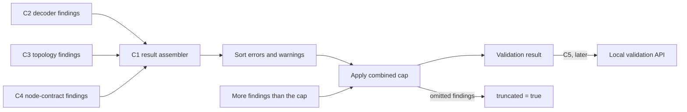

# C1 — Validation Contracts

**Status:** Implemented and verified in Runtime
**Phase:** C1 — Local workflow validation

## Overview

C1 defines the stable result language shared by every Runtime Editor Graph
validation step. C2 decodes the document, C3 checks graph topology, and C4
checks Runtime-supported node contracts; C1 turns their findings into one
bounded, deterministic response that Studio can render without interpreting Go
errors or message text.

This phase is needed before individual rules are implemented because otherwise
each validator could invent its own status, ordering, limit, or error shape.
C1 does not decide whether a graph violates a C2, C3, or C4 rule. It defines how
those violations are represented and combined.



The smallest complete flow is: a validator creates diagnostics using C1's
closed codes and safe messages, the assembler orders them, errors consume the
response budget before warnings, and the assembler derives the final status.
C1 is complete at the contract and pure result-assembly layer; HTTP handling is
owned by C5.

## 1. Responsibility

C1 owns:

- validation result, status, and diagnostic types;
- the closed diagnostic-code set and safe default messages;
- resource-limit constants shared by C2–C5;
- deterministic diagnostic ordering;
- the combined diagnostic cap and `truncated` calculation;
- final status derivation; and
- tests proving the result is bounded and repeatable.

C1 does not own:

- Editor Graph decoding or contract issue discovery, which belongs to C2;
- topology rules, which belong to C3;
- supported-node, port, or static-config rules, which belong to C4;
- request authentication, body reading, or HTTP status mapping, which belongs
  to C5;
- Backend/Runtime test-case response comparison, which belongs to C6; or
- Runtime IR admission, compilation, persistence, run creation, device
  discovery, or command execution.

## 2. Result contract

The internal result and the later C5 JSON body have the same logical shape:

```json
{
  "status": "INVALID",
  "errors": [
    {
      "code": "EDGE_TARGET_NODE_NOT_FOUND",
      "message": "Edge target node does not exist",
      "nodeId": "missing_node",
      "edgeId": "edge_01",
      "path": ["edges", 0, "targetNodeId"]
    }
  ],
  "warnings": [],
  "truncated": false
}
```

### Status

| Status                | Required condition                                                |
| --------------------- | ----------------------------------------------------------------- |
| `INVALID`             | At least one returned error exists                                |
| `VALID_WITH_WARNINGS` | No returned error exists and at least one returned warning exists |
| `VALID`               | No returned error or warning exists                               |

Status is derived by the assembler. Callers and individual validators must not
set it independently.

The MVP defines no warning-producing rule, but `warnings` remains a required
array to preserve the accepted A7 and Backend result contract. An empty warning
list must not be omitted or encoded as `null`.

### Diagnostic

Each diagnostic contains:

| Field     | Required | Rule                                                                           |
| --------- | -------: | ------------------------------------------------------------------------------ |
| `code`    |      Yes | One value from the closed C1 diagnostic-code set                               |
| `message` |      Yes | Non-empty safe default message associated with `code`                          |
| `nodeId`  |       No | Bounded graph identifier only when one node is relevant                        |
| `edgeId`  |       No | Bounded graph identifier only when one edge is relevant                        |
| `path`    |      Yes | Location in the Editor Graph; empty only when no narrower safe location exists |

`path` contains only non-negative integer indexes and bounded property-name
strings. It must never contain graph values, configuration values, binding
values, credentials, raw parser text, Go type names, stack traces, or local
paths.

The diagnostic message is presentation text, not a control value. Studio must
branch on `code`. C6 compares the complete normalized functional result,
including status, ordered diagnostics, references, typed paths, warnings, and
truncation; it removes only message wording and implementation-specific
transport details.

## 3. Closed diagnostic-code set

C1 freezes the following MVP codes and default messages:

| Code                               | Default message                                               | Finding owner |
| ---------------------------------- | ------------------------------------------------------------- | ------------- |
| `EDITOR_GRAPH_CONTRACT_INVALID`    | Editor Graph does not match the required contract             | C2            |
| `GRAPH_SCHEMA_VERSION_UNSUPPORTED` | Editor Graph schema version is not supported                  | C2            |
| `NODE_ID_DUPLICATED`               | Node ID must be unique                                        | C3            |
| `EDGE_ID_DUPLICATED`               | Edge ID must be unique                                        | C3            |
| `START_NODE_COUNT_INVALID`         | Graph must contain exactly one Start node                     | C3            |
| `ENTRY_NODE_INVALID`               | Entry node must reference the single Start node               | C3            |
| `END_NODE_UNREACHABLE`             | Graph must contain at least one End node reachable from Start | C3            |
| `EDGE_SOURCE_NODE_NOT_FOUND`       | Edge source node does not exist                               | C3            |
| `EDGE_TARGET_NODE_NOT_FOUND`       | Edge target node does not exist                               | C3            |
| `EDGE_SOURCE_PORT_NOT_FOUND`       | Edge source port does not exist on the source node definition | C4            |
| `END_NODE_HAS_OUTGOING_EDGE`       | End node cannot have outgoing edges                           | C3            |
| `NODE_UNREACHABLE`                 | Node is not reachable from Start                              | C3            |
| `GRAPH_CYCLE_DETECTED`             | Graph contains an uncontrolled cycle                          | C3            |
| `NODE_TYPE_NOT_ACTIVE`             | Node type does not exist in the active Node Catalog           | C4            |
| `NODE_CONFIG_INVALID`              | Node configuration does not match its definition              | C4            |
| `NODE_BINDINGS_INVALID`            | Node bindings do not match the selected targeting mode        | C4            |
| `NODE_VALUE_BINDING_INVALID`       | Node input binding is invalid or its source is unavailable    | C4            |
| `NODE_PORT_EDGE_COUNT_INVALID` | Node port must have exactly one outgoing edge | C4 |
| `SWITCH_PORT_EDGE_COUNT_INVALID`  | Switch port must have exactly one outgoing edge              | C4            |
| `GRAPH_NODE_LIMIT_EXCEEDED`        | Graph exceeds the maximum node count                          | C3            |
| `GRAPH_EDGE_LIMIT_EXCEEDED`        | Graph exceeds the maximum edge count                          | C3            |

The Runtime retains the Backend code and message for `NODE_TYPE_NOT_ACTIVE` for
client parity. Locally, this means that the type is absent from the installed
Runtime's immutable supported-node registry; the Runtime does not query the
Backend's active database catalog. Adding, renaming, or removing a code changes
the shared validation contract and requires review across C1, C6, Backend, and
Studio.

Expected invalid authoring content uses these diagnostics. It is not converted
into a transport error or logged as an internal Runtime failure.

## 4. Limits

| Limit                            |                                                         Value | Enforcement owner              |
| -------------------------------- | ------------------------------------------------------------: | ------------------------------ |
| Serialized `editorGraph` content |                                         1,048,576 UTF-8 bytes | C5 before C2 decoding          |
| Nodes                            |                                                           500 | C3 before indexes or traversal |
| Edges                            |                                                         1,000 | C3 before indexes or traversal |
| Returned diagnostics             |                              100 errors and warnings combined | C1 assembler                   |
| Graph identifier                 | 100 UTF-16 code units after JSON decoding and trim validation | C2                             |
| Node type                        |  255 ASCII characters matching the approved node-type pattern | C2                             |

The byte limit applies to the exact JSON bytes representing `editorGraph`, not
the surrounding C5 request envelope and not a reserialized Go value. C5 must
retain the raw graph bytes long enough to enforce this rule. C1 defines the
constant; it does not read an HTTP body.

Node and edge count violations are ordinary validation errors. A graph that
exceeds either count must not proceed into C3 traversal or C4 registry checks.
The HTTP behavior for a byte-limit violation remains C5 scope and follows A7's
`413 PAYLOAD_TOO_LARGE` contract.

## 5. Deterministic result assembly

The same diagnostic set must produce the same ordered response regardless of
map iteration, traversal implementation, or validator execution order.

The assembler performs these steps:

1. Copy the supplied error and warning slices so caller-owned slices are not
   mutated.
2. Sort errors and warnings separately by:
   1. `code`;
   2. `nodeId`, treating absence as an empty string;
   3. `edgeId`, treating absence as an empty string; and
   4. `path`, comparing segments from left to right, with integer segments
      ordered numerically before string segments, strings ordered by UTF-8
      bytes, and a shorter equal-prefix path first.
3. Take up to 100 errors.
4. Use only the remaining capacity for warnings.
5. Set `truncated` when the original combined count exceeds 100.
6. Derive `status` from the capped result.

All string comparison is ordinal and locale-independent. Implementations must
not use a host locale or Go map iteration as ordering input. This makes the
ordering portable between Go and TypeScript; C6 verifies the exact order for
every ported Backend reference case before Phase C can claim parity.

Errors always consume the budget before warnings so a warning cannot hide a
more important error. The assembler does not deduplicate diagnostics: separate
violations at separate paths remain separate evidence. A validator must avoid
emitting the exact same finding twice.

## 6. Security and logging

- Diagnostic construction must use the closed message table rather than parser
  or dependency error text.
- No diagnostic may copy rejected values from `config` or `bindings`.
- C1 performs no logging. C5 request logging records method, route, status, and
  bounded duration through the existing B4 middleware, not validation content.
- Validation results contain no session token, Runtime configuration, device
  data, local path, Node Definition record, or stack trace.
- Limits are constants owned by the validation package; they are not startup
  configuration because clients and cross-language fixtures depend on them.

## 7. Proposed Go implementation mapping

The exact names remain subject to implementation review, but C1 should map to a
small internal package such as:

```text
internal/validation/
├── contract.go       # Status, Code, Diagnostic, Result
├── limits.go         # Shared validation limits
├── messages.go       # Closed safe-message table
└── result.go         # Deterministic ordering, cap, status derivation
```

The package should use concrete types and pure functions. C1 needs no interface,
constructor, goroutine, configuration field, database dependency, HTTP type, or
new third-party dependency. JSON tags are required on fields emitted later by
C5, but C1 must remain usable without Gin.

Codes and statuses should be named Go string constants with compile-time-safe
types. Zero values must not represent a successful validation status. Result
construction goes through one assembler so an unvalidated zero-value result is
not returned accidentally.

## 8. Verification plan

Focused tests should cover:

- empty findings produce `VALID` with non-null empty arrays;
- warnings only produce `VALID_WITH_WARNINGS`;
- any error produces `INVALID`;
- shuffled input produces the same ordered result;
- missing node/edge IDs sort consistently;
- mixed numeric/string path segments follow the specified comparator;
- exactly 100 diagnostics are not truncated;
- 101 diagnostics return 100 and set `truncated`;
- errors consume capacity before warnings;
- caller-owned slices are not mutated;
- every closed code has one non-empty safe message; and
- marshaled output matches the accepted A7 field names and omission rules.

Tests must not require the Backend, a database, HTTP listener, filesystem,
network, ADB, or device.

## 9. Acceptance criteria

C1 is complete when:

1. The Go contract represents the exact A7 validation result shape.
2. Only the closed statuses and codes can be emitted.
3. Limit constants have one Runtime owner and match the approved Backend
   values.
4. Result assembly is deterministic, locale-independent, bounded, and tested.
5. Invalid authoring content remains a normal validation result rather than a
   process error.
6. No diagnostic or log path exposes workflow values or sensitive data.
7. C2–C4 can create findings without importing HTTP, persistence, or device
   packages.

The Go implementation and focused C1 verification are complete.

## 10. Deferred work

C1 does not add warning rules, localization, advanced graph semantics, Runtime
IR admission errors, execution errors, or dynamic diagnostic registration.
Future codes require a reviewed contract revision and C6 parity coverage; they
must not be introduced ad hoc by a later validator.
