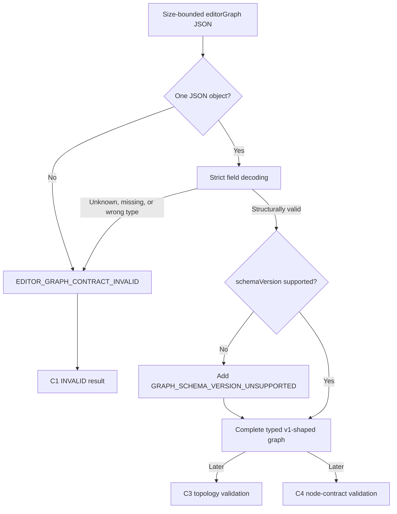

# C2 — Editor Graph Decoder

**Status:** Implemented and verified in Runtime
**Phase:** C2 — Local workflow validation

## Overview

C2 converts untrusted Editor Graph JSON into a bounded typed Go value that C3
and C4 can validate safely. It rejects unknown fields and invalid field shapes,
but it treats those problems as normal authoring diagnostics rather than HTTP or
process failures.

C2 exists because `encoding/json` successfully decoding into a Go struct is not
enough by itself: unknown fields, trailing JSON, whitespace-only identifiers,
unsupported numbers, and arbitrary JSON values need explicit rules. Later
validators must receive one predictable representation instead of repeatedly
checking malformed input.



The smallest complete flow is: C5 supplies size-bounded raw graph bytes, C2
decodes exactly one strict JSON object, contract issues become C1 diagnostics,
and a structurally valid v1-shaped graph proceeds to C3 and C4. An unsupported
positive version adds its dedicated diagnostic but does not hide other safely
discoverable Studio authoring findings. C2 does not decide whether graph topology or
node configuration is semantically valid.

## 1. Responsibility

C2 owns:

- strict Editor Graph v1 DTOs and internal typed representation;
- JSON object, field-presence, field-type, enum, numeric, string, and unknown-
  field validation;
- safe deterministic paths for contract diagnostics;
- supported `schemaVersion` classification; and
- pure decoder tests, including A8 Editor Graph decoding fixtures.

C2 does not own:

- reading the request body, authentication, or byte-limit HTTP responses (C5);
- node/edge count enforcement, duplicate IDs, Start/entry rules, endpoints,
  reachability, cycles, or End behavior (C3);
- whether a node type, source port, or static config is supported (C4);
- result sorting, capping, messages, or status derivation (C1); or
- Runtime IR, bindings resolution, compilation, persistence, ADB, or execution.

## 2. Input and output

The decoder accepts the exact raw JSON bytes of the `editorGraph` value after
C5 has verified that the bytes do not exceed C1's 1 MiB limit. It must not
accept a decoded `map[string]any` from the HTTP layer because that would lose the
original number and duplicate-field representation before C2 applies its rules.

The decoder returns one of:

- a typed Editor Graph v1 value and no diagnostics; or
- one or more `EDITOR_GRAPH_CONTRACT_INVALID` diagnostics and no graph; or
- a typed v1-shaped diagnostic candidate plus one
  `GRAPH_SCHEMA_VERSION_UNSUPPORTED` diagnostic.

An unsupported positive integer version is structurally meaningful authoring
content, so it receives the dedicated unsupported-version diagnostic. A
missing, non-integer, non-positive, or numerically unsafe version is a contract
error.

C2 does not return a partially valid graph after a structural contract failure.
The diagnostic candidate is complete under the v1 field contract; it retains
the received positive safe-integer version and exists only so C3 and C4 can
produce Publisher-facing authoring diagnostics. It is not version normalization,
compilation, Runtime IR, or execution admission.

## 3. Editor Graph v1 contract

The root object contains exactly:

| Field | Type | Rule |
|---|---|---|
| `schemaVersion` | JSON number | Positive safe integer; supported value is `1` |
| `entryNodeId` | string | Editor Graph identifier |
| `nodes` | array | Required; elements are strict node objects |
| `edges` | array | Required; elements are strict edge objects |

### Node object

A node contains exactly:

| Field | Type | Rule |
|---|---|---|
| `id` | string | Editor Graph identifier |
| `type` | string | Trimmed node type, maximum 255 characters, matching the node-type pattern |
| `config` | object | Required JSON object; values remain opaque until C4 |
| `bindings` | object | Required JSON object; values remain opaque until later binding validation |
| `errorPolicy` | string | `STOP` or `ERROR_BRANCH` |
| `editor` | object | Strict object containing finite numeric `x` and `y` |

The node-type pattern is:

```text
^[a-z][a-z0-9_]*(?:\.[a-z][a-z0-9_]*)+$
```

Examples include `flow.start`, `flow.delay`, and `android.input_text`.

### Edge object

An edge contains exactly:

| Field | Type | Rule |
|---|---|---|
| `id` | string | Editor Graph identifier |
| `sourceNodeId` | string | Editor Graph identifier; existence is checked by C3 |
| `sourcePort` | string | Editor Graph identifier; support is checked by C4 |
| `targetNodeId` | string | Editor Graph identifier; existence is checked by C3 |

### Editor Graph identifier

An identifier:

- must be a JSON string;
- is validated after removing leading and trailing Unicode whitespace;
- must contain at least one Unicode scalar value after trimming;
- must contain at most 100 UTF-16 code units after trimming, matching the
  approved TypeScript contract; and
- is stored in its trimmed form for every later comparison and diagnostic.

C2 must use one shared identifier validator for root, node, and edge identifier
fields. C2 does not require UUID syntax because these are Studio-local graph
identifiers.

## 4. Strict JSON rules

The root, node, edge, and `editor` objects reject every unknown field. `config`
and `bindings` deliberately allow arbitrary property names because their
contents have different later owners.

All required fields must be present. The decoder rejects:

- `null` where any required object, array, string, number, or enum is expected;
- multiple top-level JSON values or non-whitespace trailing content;
- non-object root values;
- invalid UTF-8 JSON input;
- JSON numbers that cannot satisfy the exact target rule;
- non-finite editor coordinates after numeric conversion;
- values inside `config` or `bindings` that are not valid JSON values.

Duplicate JSON property names use last-write-wins decoding, matching the
Backend's current JSON transport behavior. Producers must not rely on duplicate
names, and a future contract may reject them only through a reviewed
cross-language change. C2 must ensure that the Go decoder and its tests apply
the same last-value rule at strict and opaque object levels.

`config` and `bindings` may contain JSON null, booleans, strings, numbers,
arrays, and objects. C2 preserves their JSON meaning but does not interpret
credentials, references, node inputs, or static schema rules. Go values must use
`json.RawMessage` or another representation that does not silently coerce large
JSON integers through `float64`.

## 5. Contract diagnostics

Every shape or field violation uses:

```json
{
  "code": "EDITOR_GRAPH_CONTRACT_INVALID",
  "message": "Editor Graph does not match the required contract",
  "path": ["nodes", 2, "editor", "x"]
}
```

The path points to the narrowest safe location known by the decoder. Root
problems use an empty path. To preserve the Backend Zod response, an unknown
property produces one diagnostic at its containing strict object rather than
including the unknown property name: root `[]`, node `['nodes', i]`, edge
`['edges', i]`, or editor `['nodes', i, 'editor']`. C2 must not copy the
rejected key, value, or raw parser message into the diagnostic.

When the input cannot be traversed safely after a root-level failure, C2 may
return the root diagnostic without attempting recovery. For independently
discoverable field issues within a structurally traversable object, C2 should
collect all issues up to C1's diagnostic cap rather than stopping after the
first field. Collection order is not externally significant because C1 owns the
final sort.

The current graph shape is validated before version classification, matching
the approved Backend pipeline. When that shape is valid and `schemaVersion` is
a positive safe integer other than `1`, C2 adds:

```json
{
  "code": "GRAPH_SCHEMA_VERSION_UNSUPPORTED",
  "message": "Editor Graph schema version is not supported",
  "path": ["schemaVersion"]
}
```

The complete v1-shaped diagnostic candidate then proceeds to C3 and C4 so an
unsupported-version finding does not hide topology, installed node-contract,
static-config, or source-port findings. This is Studio authoring diagnostics only.
G1 must reject an unsupported executable Runtime IR version before run creation,
and future Editor Graph versions still require an approved decoder before they
can be compiled or executed.

## 6. Bounded behavior

C2 assumes C5 has already enforced the 1 MiB raw graph limit, but its public
decode function must still accept only a bounded byte slice supplied by the
validation service. It must not read from an unbounded stream itself.

C2 may allocate DTO slices for the decoded `nodes` and `edges`, but it does not
perform graph traversal or build adjacency indexes. C3 checks the 500-node and
1,000-edge limits before constructing those additional structures.

To keep malformed input processing bounded:

- contract diagnostics stop once further findings cannot change C1's capped
  response;
- recursion through arbitrary `config` and `bindings` is limited by the HTTP
  JSON decoder/body policy selected in C5; C2 does not recursively validate
  their semantics; and
- error messages are constants, not copies of arbitrary field values.

No database, filesystem, network, or goroutine is involved.

## 7. Security and privacy

- Never log the raw graph, `config`, `bindings`, rejected values, or decoder
  errors containing source excerpts.
- Do not deserialize workflow data into executable types or accept executable,
  shell, ADB, target-serial, or artifact-path instructions.
- Reject unknown fields so a newer or misspelled contract cannot be silently
  ignored.
- Preserve numeric values without architecture-dependent coercion.
- C2 performs no environment expansion, template evaluation, expression
  evaluation, file access, URL access, or command execution.

## 8. Proposed Go implementation mapping

The exact names remain subject to implementation review, but C2 should remain
inside the internal validation boundary:

```text
internal/validation/editorgraph/
├── model.go       # Typed Graph, Node, Edge, EditorPosition, ErrorPolicy
├── decoder.go     # Strict JSON decoding and trailing-content rejection
└── contract.go    # Field validation and C1 diagnostic construction
```

The decoder uses the Go standard library. No schema-validation or alternative
JSON dependency is justified for the current bounded contract.

The typed graph should use concrete structs with explicit JSON tags. `config`
and `bindings` remain named raw JSON-object types rather than `map[string]any`.
The C2 package imports the C1 contract package; C1 must not import C2.

The HTTP request envelope is not defined here. C5 owns extracting the raw
`editorGraph` member, rejecting unknown envelope fields, authentication, and
mapping malformed transport input to A7 HTTP errors.

## 9. Verification plan

Focused table-driven tests should cover:

- the A8 valid minimal graph decodes successfully;
- the A8 unknown root field produces `EDITOR_GRAPH_CONTRACT_INVALID` at the
  containing root-object path;
- missing and `null` required fields;
- unknown fields at root, node, edge, and editor levels;
- unknown fields remain allowed inside `config` and `bindings`;
- empty, whitespace-only, overlength, and trim-normalized identifiers;
- valid and invalid node-type patterns and the 255-character limit;
- both error policies and an unknown policy;
- finite integer and fractional coordinates, plus overflow/non-finite cases;
- invalid version types and values;
- a positive unsupported version produces
  `GRAPH_SCHEMA_VERSION_UNSUPPORTED` and still permits applicable C3/C4
  findings from the complete v1-shaped diagnostic candidate;
- multiple JSON values and trailing non-whitespace content;
- duplicate object properties use the final value at strict and opaque object
  levels, matching the Backend transport behavior;
- nested arrays, objects, booleans, numbers, strings, and null in `config` and
  `bindings` without semantic interpretation;
- input and diagnostics never expose rejected values; and
- repeated decoding produces the same typed value and ordered C1 result.

C2 tests do not assert topology, catalog, HTTP, persistence, or execution
behavior. The cycle fixture becomes meaningful in C3, although C2 must decode
its valid v1 shape successfully.

## 10. Acceptance criteria

C2 is complete when:

1. A size-bounded Editor Graph v1 JSON object decodes into one typed immutable-
   by-convention Go value.
2. Unknown, missing, null, or wrongly typed fields fail closed with safe C1
   diagnostics; duplicate properties follow the documented last-value rule.
3. Unsupported positive schema versions receive the dedicated diagnostic and
   a complete v1-shaped diagnostic candidate continues to C3/C4 without gaining
   compilation or execution meaning.
4. `config` and `bindings` remain opaque valid JSON objects.
5. C3 and C4 never receive a structurally partial graph; an unsupported-version
   candidate is explicitly marked and usable only for Studio authoring diagnostics.
6. Decoding uses no new dependency and performs no I/O beyond the supplied
   bytes.
7. Focused tests cover the contract boundary and applicable A8 fixtures.

The Go implementation and focused C2 verification are complete.

## 11. Deferred work

C2 does not resolve bindings, validate static config, check graph topology,
compile Runtime IR, normalize a future graph version, or interpret advanced
condition/loop/error semantics. Those behaviors remain with C3, C4, later
binding/compiler phases, or a separately approved format-version decoder.
