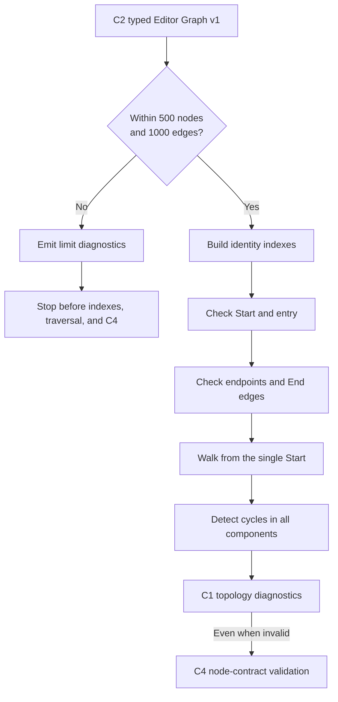

# C3 — Topology Validator

**Status:** Implemented and verified in Runtime
**Phase:** C3 — Local workflow validation

## Overview

C3 determines whether a C2-decoded Editor Graph has a bounded, unambiguous,
connected, acyclic control-flow structure. It checks graph-wide relationships
that cannot be decided while decoding one field: unique identities, the single
Start and matching entry, edge endpoints, terminal End behavior, reachability,
and cycles.

C3 is required before node-contract validation because malformed topology must
never cause an unsafe lookup or unbounded traversal. It builds only bounded
in-memory indexes, produces C1 diagnostics, and performs no I/O or execution.



The smallest complete flow is: C3 rejects excessive work first, builds
first-occurrence identity and adjacency indexes, checks the entry and every
edge, walks from the single Start, detects cycles across the whole graph, and
returns all bounded findings to C1. Only node or edge limit violations prevent
C4 from running; other topology findings can coexist with node-contract
findings so Studio receives one useful validation result.

## 1. Responsibility

C3 owns:

- node and edge count enforcement;
- duplicate node and edge identity diagnostics;
- exactly one `flow.start` and a matching `entryNodeId`;
- source and target endpoint existence;
- the rule that `flow.end` has no outgoing edge;
- reachability from the single Start;
- the requirement for at least one reachable `flow.end`;
- rejection of every directed cycle in the MVP graph language;
- bounded `O(V + E)` indexes and traversals; and
- the decision whether C4 may continue after topology validation.

C3 does not own:

- JSON shape, identifiers, schema version, enums, or typed decoding (C2);
- diagnostic messages, final ordering, capping, truncation, or status (C1);
- whether a node type or source port is supported, or whether static `config`
  is valid (C4);
- HTTP, authentication, or request byte limits (C5);
- cross-language fixture execution (C6); or
- Runtime IR, bindings, persistence, ADB, devices, scheduling, or execution.

## 2. Preconditions and output

C3 accepts only a complete v1-shaped Editor Graph value returned by C2,
including the explicitly marked unsupported-version diagnostic candidate. It
may assume:

- all required fields exist and have their declared types;
- identifiers are trimmed and bounded;
- `schemaVersion` is a positive safe integer; C2 owns the unsupported-version
  diagnostic and C3 remains version-agnostic for this authoring pass;
- nodes and edges contain no unknown fields; and
- `config` and `bindings` are valid opaque JSON objects.

C3 must not accept raw JSON or repeat C2 field validation. It returns a slice of
C1 error diagnostics and a continuation decision for the validation pipeline.
It emits no warnings.

| Result | Continue to C4? |
|---|---:|
| No topology errors | Yes |
| Duplicate, Start, entry, endpoint, End, reachability, or cycle errors | Yes |
| Node or edge limit exceeded | No |

Continuing to C4 does not make the graph valid. It only allows independent
node-type, port, and config findings to be included in the same C1 result.

## 3. Validation sequence

C3 runs the following passes in order. Final public ordering remains C1's
responsibility, so C3 must not depend on Go map iteration order.

### Pass 1 — Work limits

- More than 500 nodes emits `GRAPH_NODE_LIMIT_EXCEEDED` at `['nodes']`.
- More than 1,000 edges emits `GRAPH_EDGE_LIMIT_EXCEEDED` at `['edges']`.
- Exactly 500 nodes or 1,000 edges is allowed.
- If both limits are exceeded, C3 emits both diagnostics.
- Any limit violation stops C3 before allocating indexes or walking the graph
  and prevents C4 from running.

This early return bounds all later CPU and memory work. These are graph
validation findings, not C5 payload errors.

### Pass 2 — Identity indexes

C3 scans nodes and edges in their original array order.

For nodes:

- `nodeByID` stores the first node with each ID;
- `uniqueNodeIDs` records those first IDs in input order for deterministic
  traversal; and
- every later occurrence emits `NODE_ID_DUPLICATED` with the duplicate ID and
  path `['nodes', nodeIndex, 'id']`.

For edges:

- an edge-ID set records the first occurrence; and
- every later occurrence emits `EDGE_ID_DUPLICATED` with the duplicate ID and
  path `['edges', edgeIndex, 'id']`.

The first node remains the deterministic representative for endpoint and
adjacency lookup. C3 reports duplicate identities but continues safely so
independent findings are not hidden. It must not modify, reorder, or deduplicate
the C2 graph.

### Pass 3 — Start and entry

C3 counts every node whose type is exactly `flow.start`.

- A count other than one emits `START_NODE_COUNT_INVALID` at `['nodes']`.
- `entryNodeId` must equal the ID of that single Start.
- If there is no unique Start or the IDs differ, C3 emits
  `ENTRY_NODE_INVALID` at `['entryNodeId']` with `nodeId` equal to the supplied
  `entryNodeId`.

When there are zero or multiple Start nodes, C3 does not choose one for
reachability. When there is exactly one Start but `entryNodeId` is wrong,
reachability still begins from the actual Start so the entry error does not hide
other graph findings.

C3 does not require the Start to be the first array element and does not reject
incoming edges to Start; neither rule exists in the approved MVP contract.

### Pass 4 — Endpoints, End rules, and adjacency

C3 preallocates one adjacency slice for every first-occurrence node ID. It then
scans edges in their original order.

For each edge:

1. Missing source emits `EDGE_SOURCE_NODE_NOT_FOUND` at
   `['edges', edgeIndex, 'sourceNodeId']`, with the edge ID and missing source
   ID.
2. Missing target emits `EDGE_TARGET_NODE_NOT_FOUND` at
   `['edges', edgeIndex, 'targetNodeId']`, with the edge ID and missing target
   ID.
3. If the resolved source node is `flow.end`, emit
   `END_NODE_HAS_OUTGOING_EDGE` at
   `['edges', edgeIndex, 'sourceNodeId']`, with the edge and source-node IDs.
4. Add the indexed edge to adjacency only when both endpoints resolve.

An edge with both endpoints missing emits both endpoint diagnostics. An outgoing
edge from End is reported even when its target is missing. Edges with a missing
endpoint never participate in reachability or cycle detection. Source-port
existence remains C4 scope.

### Pass 5 — Reachability and reachable End

When there is exactly one Start, C3 performs an iterative depth-first or
breadth-first traversal from its ID through valid adjacency edges. A visited set
ensures each indexed node ID is processed at most once.

When there is no unique Start, the reachable set remains empty. C3 then scans
the original node array:

- every node whose ID is absent from the reachable set emits
  `NODE_UNREACHABLE` at `['nodes', nodeIndex]`, with its node ID; and
- if no original `flow.end` node has a reachable ID, emit
  `END_NODE_UNREACHABLE` at `['nodes']`.

Reachability is identity-based. Duplicate node entries sharing one reachable ID
share the same reachability result while still receiving their separate
duplicate-ID diagnostic.

An End existing somewhere in the graph is insufficient; at least one End must
be reachable from the single Start. C3 does not require every execution branch
to reach an End because that stronger rule is not in the approved Backend
behavior.

### Pass 6 — Directed-cycle detection

The MVP rejects every directed cycle, including:

- a self-loop;
- a cycle reachable from Start; and
- a cycle in an unreachable component.

C3 runs a three-color depth-first search across every first-occurrence node ID,
not only the reachable set:

- unseen: the node has not been entered;
- visiting: the node is on the current DFS path; and
- visited: the node and its descendants are complete.

Each edge whose target is `visiting` is a back edge and emits
`GRAPH_CYCLE_DETECTED` at `['edges', edgeIndex]`, with `edgeId` equal to that
back edge and `nodeId` equal to its target. Valid adjacency edges retain their
original edge indexes for this path.

The Go implementation should use an explicit stack of node/next-edge frames.
The graph is already bounded, but an iterative traversal keeps stack ownership
visible and avoids coupling safety to goroutine stack growth. Roots follow
`uniqueNodeIDs` order and adjacency follows input edge order; C1 still owns the
final public diagnostic order.

## 4. Diagnostic mapping

| Rule | Code | Path | References |
|---|---|---|---|
| Node count above 500 | `GRAPH_NODE_LIMIT_EXCEEDED` | `['nodes']` | None |
| Edge count above 1,000 | `GRAPH_EDGE_LIMIT_EXCEEDED` | `['edges']` | None |
| Later duplicate node ID | `NODE_ID_DUPLICATED` | `['nodes', i, 'id']` | `nodeId` |
| Later duplicate edge ID | `EDGE_ID_DUPLICATED` | `['edges', i, 'id']` | `edgeId` |
| Start count is not one | `START_NODE_COUNT_INVALID` | `['nodes']` | None |
| Entry does not identify unique Start | `ENTRY_NODE_INVALID` | `['entryNodeId']` | supplied `nodeId` |
| Missing edge source | `EDGE_SOURCE_NODE_NOT_FOUND` | `['edges', i, 'sourceNodeId']` | `edgeId`, missing `nodeId` |
| Missing edge target | `EDGE_TARGET_NODE_NOT_FOUND` | `['edges', i, 'targetNodeId']` | `edgeId`, missing `nodeId` |
| Outgoing edge from End | `END_NODE_HAS_OUTGOING_EDGE` | `['edges', i, 'sourceNodeId']` | `edgeId`, source `nodeId` |
| Node not reachable | `NODE_UNREACHABLE` | `['nodes', i]` | `nodeId` |
| No reachable End | `END_NODE_UNREACHABLE` | `['nodes']` | None |
| DFS back edge | `GRAPH_CYCLE_DETECTED` | `['edges', i]` | `edgeId`, target `nodeId` |

C3 creates diagnostics through C1 helpers so it cannot supply ad hoc messages.
It reports all bounded findings rather than stopping at C1's 100-diagnostic
output cap. Stopping early could change which diagnostics survive C1's final
sort. The graph limits bound the complete internal finding set.

## 5. Efficiency and data structures

For `V` decoded nodes and `E` decoded edges, C3 must use:

- `map[string]int` or an equivalent first-occurrence node index, preallocated
  for `V`;
- a duplicate edge-ID set, preallocated for `E`;
- adjacency slices with total capacity proportional to valid edges;
- visited and DFS-state maps, preallocated for unique node IDs; and
- slices as the traversal stack or queue.

The complete validator is `O(V + E)` time and `O(V + E)` additional memory.
There must be no node-by-edge nested scan, repeated full-array lookup, generic
graph-library dependency, goroutine, channel, lock, cache, or global mutable
state. The standard library is sufficient.

Input slices and nested JSON values remain caller-owned and read-only. C3 may
copy edge indexes into its private adjacency representation but must not retain
state after the call returns.

## 6. Failure and security behavior

- Expected topology problems are C1 diagnostics, not Go errors, panics, or HTTP
  failures.
- C3 must not log graph content, identifiers, config, bindings, or diagnostics.
- The pure validator needs no expected Go error path: every C2-produced graph is
  safe to inspect, even when its topology is invalid. Programming defects remain
  test failures and must not be recovered into authoring diagnostics.
- C3 performs no database, filesystem, network, process, environment, or device
  access.
- C3 sends no command and creates no run, event, checkpoint, or artifact.

## 7. Proposed Go implementation mapping

The exact names remain subject to implementation review, but C3 should extend
the C2 package without creating a second graph model:

```text
internal/validation/editorgraph/
├── model.go          # C2 typed Graph, Node, Edge
├── decoder.go        # C2 strict decoder
├── contract.go       # C2 field diagnostics
├── topology.go       # C3 passes and continuation decision
└── topology_test.go  # C3 focused tests
```

One pure function such as `ValidateTopology` should accept the typed graph and
return a small concrete result containing diagnostics and whether node-contract
validation may continue. C3 needs no interface or constructor because it has no
dependency or state. Any helper interface would be premature.

The function imports C1 contract types but no Gin, persistence, configuration,
logging, device, or execution package. It does not register with the B3
supervisor because it owns no lifecycle or goroutine.

## 8. Verification plan

Focused table-driven tests should cover:

- the A8 minimal Start-to-End graph has no topology diagnostics;
- exactly 500 nodes and 1,000 edges are accepted by the work-limit pass;
- 501 nodes, 1,001 edges, and both limits together emit only the applicable
  limit diagnostics and prevent continuation to C4;
- every later duplicate node and edge ID is reported at its array index while
  the first occurrence remains the lookup representative;
- zero, one, and multiple Start nodes;
- correct and incorrect `entryNodeId` values;
- missing source, missing target, and both endpoints missing;
- an outgoing edge from End with valid and missing targets;
- unreachable nodes and a graph with no reachable End;
- a reachable End plus a separate unreachable node;
- a self-loop, the A8 multi-node cycle, multiple back edges, and an unreachable
  cyclic component;
- missing-endpoint edges do not affect reachability or cycle detection;
- topology findings other than limits still allow C4 continuation;
- repeated calls produce the same C1-assembled result;
- input graph slices and values are unchanged after validation; and
- a near-limit valid acyclic graph completes without quadratic work or panic.

The tests use in-memory typed graphs or C2-decoded fixtures. They require no
Backend, HTTP listener, database, filesystem outside test fixtures, network,
ADB, or device. C6 remains responsible for porting the Backend topology cases
and comparing their complete normalized results across Go and TypeScript.

## 9. Acceptance criteria

C3 is complete when:

1. All approved topology rules produce the exact C1 codes, paths, and
   references defined above.
2. Node and edge limits short-circuit before indexes, traversal, and C4.
3. Every non-limit topology error can coexist safely with C4 findings.
4. Reachability starts only from one unambiguous Start, while cycle detection
   covers every valid-endpoint component.
5. Traversals are deterministic, iterative, and `O(V + E)` within C1 limits.
6. Validation is pure, leaves the graph unchanged, and performs no external
   operation or logging.
7. Focused tests cover rule combinations, boundaries, and the applicable A8
   cycle fixture.

The Go implementation and focused C3 verification are complete.

## 10. Deferred work

C3 does not validate node types, ports, static config, bindings, error-policy
semantics beyond the decoded enum, conditions, controlled loops, parallel/join
behavior, retries, Runtime IR transitions, or whether every branch eventually
terminates. C4 and later approved phases own those behaviors. The MVP continues
to reject every directed cycle until a future graph language defines explicit
bounded loop semantics.
