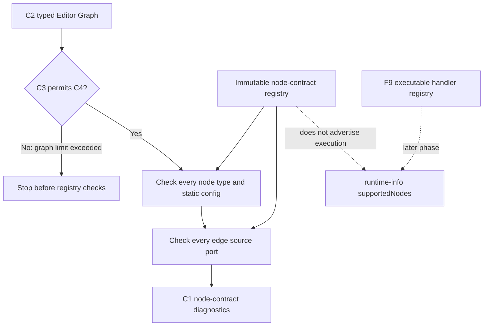

# C4 — Node-Contract Validator

**Status:** Implemented and verified in Runtime

**Phase:** C4 — Local workflow validation

## Overview

C4 determines whether every C2-decoded node uses a contract installed in this
Runtime, whether each edge names an output port declared by its source-node
contract, and whether every node's static `config` satisfies that contract.
It runs after C3 unless C3 rejected the graph's node or edge count.

C4 is needed because a structurally valid graph can still name an unavailable
node type, invent a source port, or contain static configuration the Runtime
does not understand. The Runtime performs these checks from a compiled,
immutable validation registry. It does not query or trust the Backend's mutable
Node Catalog at request time.



The smallest complete flow is: look up each node type, validate its static
configuration only when the type exists, resolve each edge's source node, check
the named source port only when both source node and contract exist, and return
all findings to C1. C4 validates authoring content only. It does not register a
handler, claim that a node can execute, populate `runtime-info.supportedNodes`,
or authorize a run.

## 1. Responsibility

C4 owns:

- the immutable registry projection needed by local Editor Graph validation;
- installed node-type lookup;
- source output-port lookup;
- the reduced static-config schema language;
- required, additional-property, scalar-type, range, length, and pattern
  validation for `config`;
- mode-specific literal binding checks for explicit Android targeting;
- exact C1 diagnostic paths and references for these checks; and
- focused tests for registry invariants and node-contract validation.

C4 does not own:

- raw JSON, graph shape, identifiers, enums, or schema-version decoding (C2);
- topology, endpoint existence, reachability, or cycles (C3);
- diagnostic messages, final ordering, capping, truncation, or status (C1);
- authentication, request bytes, or HTTP handling (C5);
- Backend/Runtime validation-test parity (C6);
- general binding references or resolved node input/output values;
- node-specific error-policy compatibility or control-flow cardinality;
- executable handler registration or `runtime-info.supportedNodes` (F9);
- Runtime IR admission (G1); or
- persistence, ADB, devices, processes, commands, and execution.

## 2. Validation registry boundary

### 2.1 Validation contracts are not executable capabilities

C4 uses a `NodeContractRegistry` containing only the data it consumes:

```text
NodeContract
├── type
├── config schema
└── output-port key set
```

The registry must not contain handler functions, database records, editor
labels, icons, capabilities, input schemas, output schemas, default timeouts,
or mutable catalog state. `runtimeHandler` may appear beside the contract in
source documentation for traceability, but C4 does not use it to validate an
Editor Graph.

This registry is separate from the F9 executable handler registry. C4 may
validate a graph against reviewed contracts before those handlers are built,
but that must not cause B6's `supportedNodes` response to become non-empty.
Only real F9 registrations may advertise executable `{type, runtimeHandler}`
pairs. G1 will still validate the exact Runtime IR and handler availability for
every run.

### 2.2 Source of truth and updates

The initial entries are copied from the approved Backend Node Definitions used
by the reference workflow validator at commit
`f7e6ef8b89c8d1b5a70e1d921fdae022b8aa75e8`. Backend Node Definitions are the
source of truth for this initial Runtime package. Runtime does not fetch them
from the Backend, PostgreSQL, a configuration file, an environment variable, or
the network while running.

Phase C does not implement automatic Node Definition synchronization or upgrade
management. Changing a node type, config schema, or port after the initial
runnable product is later release work. Such a change will require a new
Runtime package and matching ecosystem contracts, but that lifecycle does not
block the initial C4 implementation.

The Runtime registry is authoritative for local C4 results. Consequently, a
node can be active in the Backend catalog but receive `NODE_TYPE_NOT_ACTIVE`
from an older installed Runtime. This is expected compatibility feedback, not
a database synchronization error.

### 2.3 Construction and immutability

The registry is constructed explicitly during composition and then treated as
read-only. Construction must copy caller-owned slices and maps so later
mutation cannot change validation behavior. Lookup methods must not expose
mutable internal collections.

Construction fails with a Go error when system-owned definitions contain:

- no definitions;
- an empty or duplicate node type;
- an empty or duplicate output-port key;
- a required field that is duplicated or absent from `properties`;
- an unsupported field-schema type;
- an invalid minimum/maximum or minimum greater than maximum;
- an invalid string length or minimum length greater than maximum length; or
- a pattern that cannot be compiled by the approved portable regexp subset.

These are application assembly defects, not authoring diagnostics. They must
fail startup before the local API becomes ready; they must not be converted to
`NODE_CONFIG_INVALID`, hidden through `init()`, recovered from a panic, or
discovered differently per request.

## 3. Initial installed contracts

The C4 registry contains 15 authoring contracts. The table lists the
configuration accepted for each node.

| Node type | Backend runtime handler | Static `config` | Allowed source ports |
|---|---|---|---|
| `flow.start` | `flow.start` | `{}` only | `success` |
| `flow.end` | `flow.end` | `{}` only | None |
| `flow.delay` | `flow.delay` | `{}` only | `success`, `error` |
| `flow.set_variable` | `flow.set_variable` | Required `name`, optional `scope` (`FLOW` or `RUN_GROUP`) | `success`, `error` |
| `flow.switch` | `flow.switch` | Ordered `rules` | Instance rule IDs, `default`, conditional `error` |
| `flow.wait_variable` | `flow.wait_variable` | Required Global key `name` and integer `timeoutMs` (1–600,000) | `success`, `error` |
| `utility.log` | `utility.log` | `{}` only | `success`, `error` |
| `android.launch_app` | `android.launch_app` | `{}` only | `success`, `error` |
| `android.tap` | `android.tap` | Required `targetMode` | `success`, `error` |
| `android.swipe` | `android.swipe` | Required `targetMode` | `success`, `error` |
| `android.long_press` | `android.long_press` | Required `targetMode` | `success`, `error` |
| `android.input_text` | `android.input_text` | `{}` only | `success`, `error` |
| `android.press_back` | `android.press_back` | `{}` only | `success`, `error` |
| `android.press_home` | `android.press_home` | `{}` only | `success`, `error` |
| `android.screenshot` | `android.screenshot` | `{}` only | `success`, `error` |

### Workflow bindings

Stage 3 validates direct output references, Flow reads, and Set Variable's
authoring shape. See the [workflow binding contract](../contracts/workflow_bindings.md).

### Explicit targeting

C4 validates the [Backend targeting matrix](../../a2matex-backend/studio_project_workflow/node_catalog.md#planned-targeting-modes-and-long-press).
Tap and Long Press support pixels, percentages, and selector IDs. Swipe
supports pixels and percentages. Each explicit mode requires exactly its own
binding fields as strict `{ "kind": "literal", "value": ... }` objects. Swipe
duration is 1–60,000 ms. Long Press requires a positive safe integer at
authoring time. Its execution cap belongs to Stage 2. Tap, Swipe, and Long
Press require `targetMode`, including `ABSOLUTE_PIXELS` for pixel bindings.

A missing or invalid mode produces `NODE_CONFIG_INVALID` at `config.targetMode`.
Invalid literal members identify their field and member. Extra binding keys
produce one `NODE_BINDINGS_INVALID` at the containing object. Long Press
catalog membership establishes authoring support only.

Port kind and label are Backend catalog concerns for this phase. C4 needs only
the unique port key because the Editor Graph edge contains only `sourcePort`.
There is no target-port field to validate.

The reduced schema interpreter remains specified even though current config
schemas are empty. This keeps the validation behavior explicit when a reviewed
node later adds static configuration; adding such a schema does not silently
invent a new interpretation.

## 4. Reduced static-config schema

Every config schema is a closed object with:

- a property map;
- an ordered list of required property names; and
- `additionalProperties: false` semantics.

Each property uses exactly one supported scalar type:

| Type | Supported constraints | Value rule |
|---|---|---|
| `string` | `minLength`, `maxLength`, `pattern` | JSON string satisfying every declared constraint |
| `integer` | `minimum`, `maximum` | Finite JSON number with no fractional value and within both inclusive bounds |
| `number` | `minimum`, `maximum` | Finite JSON number within both inclusive bounds |
| `boolean` | None | JSON boolean |

JSON `null`, arrays, and objects do not satisfy any supported scalar property.
An unknown schema type is a registry-construction failure and must not accept a
graph value by default.

String lengths use UTF-16 code units, matching JavaScript `String.length` and
C2's identifier compatibility rule. Go must not use UTF-8 byte length or rune
count for these constraints. Patterns are system-owned registry data, never
graph-supplied expressions. They are compiled once during registry
construction, not once per node or value. New patterns must stay in the
reviewed subset with equivalent JavaScript and Go RE2 behavior and require C6
boundary fixtures.

Numeric validation follows the Backend's finite IEEE-754 binary64 behavior at
the C4 comparison boundary. The C2 representation may preserve the original
JSON number, but C4 must reject values that cannot be represented as a finite
binary64 number before applying integer or inclusive range checks. Numeric
boundary fixtures are required whenever a config schema introduces a number.

## 5. Validation sequence

C4 runs only for a complete supported graph returned by C2 and only when C3's
continuation decision is true. Other C3 errors do not suppress C4 findings.

### Pass 1 — Node type and config

C4 scans `graph.nodes` in original array order.

For each node:

1. Look up its exact, case-sensitive `type` in the registry.
2. If absent, emit `NODE_TYPE_NOT_ACTIVE` at
   `['nodes', nodeIndex, 'type']` with `nodeId`, then skip config validation for
   that node because no trusted schema exists.
3. If present, visit every required field in schema order. Each absent own
   property emits `NODE_CONFIG_INVALID` at
   `['nodes', nodeIndex, 'config', field]` with `nodeId`.
4. Visit every supplied config property. An undeclared property or a value that
   fails its declared scalar constraints emits the same field-level
   `NODE_CONFIG_INVALID` diagnostic.

Presence is different from truthiness: `false`, `0`, and `""` are present and
then validated normally. A field that is required and present but invalid
receives one value diagnostic, not both a missing and value diagnostic.

The validator must never echo a property value, pattern, bound, or complete
schema in a diagnostic. Current empty schemas therefore accept only `{}` and
emit one field-level diagnostic for every supplied property.

### Pass 2 — Edge source port

C4 builds one node-ID lookup in `O(V)` and scans `graph.edges` in original
array order.

For Backend parity, this C4 lookup uses the last node occurrence for a duplicate
ID, matching JavaScript `new Map(graph.nodes.map(...))`. C3 deliberately uses
the first occurrence for topology. The graph is already invalid when an ID is
duplicated, but retaining the Backend's C4 rule keeps the additional port
diagnostics stable until a reviewed shared-contract change says otherwise.

For each edge:

1. If its source node is absent, emit nothing; C3 already owns
   `EDGE_SOURCE_NODE_NOT_FOUND`.
2. If the resolved source node type is absent from the registry, emit nothing;
   Pass 1 already owns `NODE_TYPE_NOT_ACTIVE`, and no port contract is trusted.
3. If the source contract does not contain the exact, case-sensitive
   `sourcePort`, emit `EDGE_SOURCE_PORT_NOT_FOUND` at
   `['edges', edgeIndex, 'sourcePort']` with `edgeId` and the resolved source
   `nodeId`.

The port check is independent of target existence. An edge with an existing
supported source and a missing target may therefore receive both C3's target
diagnostic and C4's source-port diagnostic.

## 6. Diagnostic mapping

| Rule | Code | Path | References |
|---|---|---|---|
| Node type absent from installed registry | `NODE_TYPE_NOT_ACTIVE` | `['nodes', i, 'type']` | `nodeId` |
| Required config property absent | `NODE_CONFIG_INVALID` | `['nodes', i, 'config', field]` | `nodeId` |
| Config property unknown or value invalid | `NODE_CONFIG_INVALID` | `['nodes', i, 'config', field]` | `nodeId` |
| Source port absent from resolved source contract | `EDGE_SOURCE_PORT_NOT_FOUND` | `['edges', i, 'sourcePort']` | `edgeId`, source `nodeId` |

C4 creates diagnostics through C1 helpers and emits no warnings. It produces
all findings allowed by the size-bounded graph rather than stopping after 100;
C1 owns global sorting, the combined cap, `truncated`, and status. Processing
order must not be used as public result order.

## 7. Efficiency and bounded behavior

For `V` nodes, `E` edges, and `F` supplied config properties, C4 uses:

- one immutable registry map keyed by node type;
- one node-ID map built per validation call, preallocated for `V`;
- output-port sets precomputed at registry construction; and
- config-property lookup maps stored in the immutable contracts.

Validation must run in `O(V + E + F)` time with `O(V)` per-call index memory,
excluding diagnostics. There must be no node-by-edge scan, registry rebuild per
request, regexp compilation per value, database query, cache refresh,
goroutine, channel, lock, reflection-based schema engine, or generic graph
library.

C5's 1 MiB graph limit and C3's 500-node/1,000-edge limits bound the work.
C4 does not mutate or retain the graph, config values, or caller-owned slices
after validation returns.

## 8. Failure, security, and logging

- Invalid graph content produces C1 diagnostics, not Go errors, panics, HTTP
  failures, or startup failures.
- Invalid system-owned registry definitions produce construction errors before
  readiness, not graph diagnostics.
- C4 performs no logging. It must not log node IDs, edge IDs, config, bindings,
  schemas, patterns, or diagnostics.
- No raw config or binding value may enter a diagnostic or error intended for
  a client.
- Patterns come only from compiled Runtime source; the graph cannot supply or
  select a regexp.
- C4 performs no database, filesystem, network, environment, process, or
  device access.
- C4 never resolves a binding, evaluates an expression, expands a template,
  opens a URL or path, sends a command, or creates a run.

## 9. Proposed Go implementation mapping

The exact names remain subject to implementation review. C4 should extend the
existing validation boundary without introducing an executable handler API:

```text
internal/validation/nodecontract/
├── contract.go          # Contract and reduced field-schema types
├── registry.go          # Explicit construction, invariant checks, immutable lookup
├── definitions.go       # Installed authoring contracts
├── config.go            # Pure reduced-schema value checks
├── validator.go         # Node type, config, and source-port passes
├── registry_test.go     # Construction and immutability tests
└── validator_test.go    # C4 diagnostics and parity-focused cases
```

`Validate` should accept the C2 typed graph and a concrete registry pointer and
return C1 diagnostics. A provider interface is premature: the registry has one
in-process immutable implementation and no external I/O. The constructor
returns a concrete registry and an error.

The package uses only the Go standard library and C1/C2 internal types. It must
not import Gin, Wire, configuration, persistence, Backend clients, devices,
process execution, or future handler packages. The composition root constructs
the default registry explicitly and later injects it into the C5 service; no
generated Wire file is edited manually.

## 10. Verification plan

Focused table-driven tests should cover:

- default-registry construction and the exact 15 types above;
- exact allowed port sets for Start, End, and every remaining node;
- all current contracts accept `{}` and reject every supplied config field;
- unknown and case-mismatched node types;
- unknown types skip config and source-port interpretation;
- a synthetic reviewed schema covering missing required fields, additional
  properties, string lengths and patterns, integer and number bounds, boolean
  values, and invalid JSON scalar kinds;
- UTF-16 string boundaries containing supplementary Unicode characters;
- finite binary64 and integer boundary behavior compatible with Backend
  fixtures;
- valid, unknown, and case-mismatched source ports;
- `flow.end` rejects every source port;
- missing source nodes are skipped by C4 while C3 retains ownership;
- missing target nodes do not suppress a source-port finding;
- duplicate node IDs use the last occurrence for C4 source-port lookup;
- every invalid registry invariant returns a construction error;
- construction copies input collections and lookup cannot mutate registry
  state;
- repeated validation returns the same C1-assembled result;
- the graph and opaque JSON values remain unchanged; and
- a near-limit graph completes with linear work and no external operation.

C4 tests use in-memory contracts and C2-decoded graphs. They require no HTTP
listener, Backend, database, filesystem outside fixtures, network, ADB, or
device. C6 remains responsible for porting the Backend validation cases to Go
and comparing the complete normalized functional responses from both
implementations.

## 11. Acceptance criteria

C4 is complete when:

1. The explicitly constructed immutable registry contains the exact approved
   validation contracts and rejects invalid system definitions.
2. Every decoded node receives the specified type and static-config checks.
3. Every edge with a resolvable supported source receives the specified
   source-port check.
4. Diagnostics use the exact C1 codes, paths, safe messages, and references.
5. Backend-compatible UTF-16, numeric, pattern, and duplicate-ID behaviors are
   covered by focused tests.
6. Validation is deterministic, read-only, and
   `O(V + E + config properties)`.
7. C4 adds no external I/O, executable handler, advertised capability, or new
   dependency.

The Go implementation and focused C4 verification are complete.

## 12. Deferred work

C4 does not validate general binding references, resolved input/output values,
node-specific error-policy support, edge cardinality, conditional or loop
semantics, Runtime IR, minimum Runtime versions, capabilities, handler
availability, devices, assets, credentials, or execution. F9 owns executable
handler registration and non-empty `runtime-info.supportedNodes`; G1 and later
engine phases own executable-document admission and runtime values.
