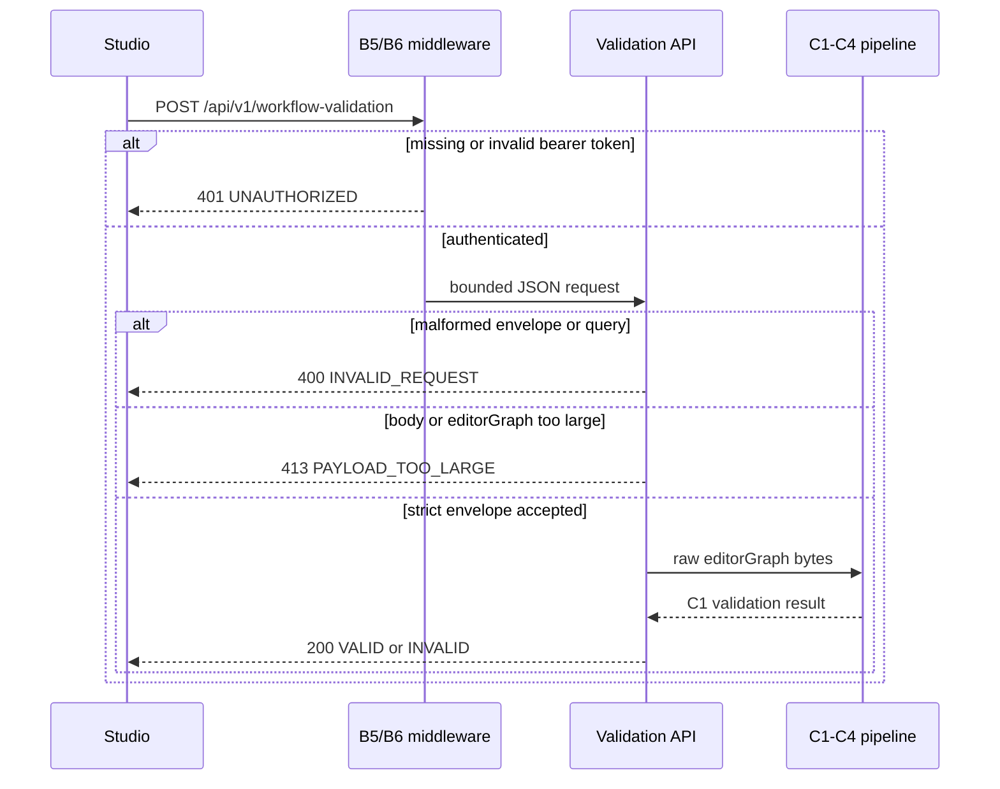

# C5 — Local Validation API

**Status:** Implemented and verified in Runtime

**Phase:** C5 — Local workflow validation

## Overview

C5 exposes the C1–C4 validation pipeline through the authenticated loopback
Runtime API. Studio sends one plaintext Editor Graph to
`POST /api/v1/workflow-validation`; C5 validates the request envelope and byte
limits, passes the untouched graph JSON to C2, runs the bounded semantic passes,
and returns the C1 result.

C5 is the transport boundary, not another validator. Malformed HTTP or envelope
content receives an A7 transport error. A well-formed envelope always receives
HTTP `200` when validation completes, including when the graph result is
`INVALID`.



The smallest complete flow is: authenticate before reading the body, enforce
the endpoint body ceiling, strictly extract one raw `editorGraph` object,
enforce its exact 1 MiB limit, run C2–C4, and serialize the C1 result. The
request stops there: no save, compilation, run creation, ADB discovery, device
command, or executable admission occurs.

The same Runtime may concurrently expose the later Production package API
family. Product runs do not use this endpoint: they use I2 authorization and G1
admission, which return a generic failure without Phase C diagnostics. A failed
Product admission stops the run, not the Runtime Agent process.

## 1. Responsibility

C5 owns:

- registration of exact `POST /api/v1/workflow-validation`;
- JSON media-type, query, request-body, and outer-envelope validation;
- a hard HTTP-body ceiling before full decoding;
- extraction and byte measurement of the raw `editorGraph` value;
- orchestration of C2, C3, C4, and C1 in the approved stop/continue order;
- A7 HTTP status and transport-error mapping;
- response serialization through the existing protected API boundary; and
- focused handler and pipeline-integration tests.

C5 does not own:

- bearer-token creation or verification (B5/B6);
- listener binding, readiness, shutdown, or panic recovery (B3/B6);
- result types, diagnostic ordering, caps, or statuses (C1);
- graph decoding and version classification (C2);
- topology or continuation decisions (C3);
- node contracts, source ports, or static config (C4);
- Backend/Runtime validation-test parity (C6); or
- persistence, compilation, Runtime IR, devices, ADB, runs, or execution.

## 2. Endpoint contract

```http
POST /api/v1/workflow-validation
Authorization: Bearer <local-session-token>
Content-Type: application/json
```

The request object contains exactly one field:

```json
{
  "editorGraph": {}
}
```

The successful response is the direct C1 result with no `data` wrapper:

```json
{
  "status": "INVALID",
  "errors": [
    {
      "code": "EDGE_TARGET_NODE_NOT_FOUND",
      "message": "Edge target node does not exist",
      "nodeId": "missing_node",
      "edgeId": "edge_01",
      "path": ["edges", 0, "targetNodeId"]
    }
  ],
  "warnings": [],
  "truncated": false
}
```

Rules:

- authentication is required through the existing B6 middleware;
- no query parameter is accepted;
- `Content-Type` must parse as `application/json`; an optional `charset=utf-8`
  parameter is accepted, while other media types, charsets, or parameters are
  invalid requests;
- non-empty `Content-Encoding` is rejected; compressed request bodies are not
  part of Local API v1;
- the envelope must be exactly one JSON object and one top-level JSON value;
- `editorGraph` must be present once and its value must be a JSON object;
- unknown or duplicate envelope fields are rejected;
- empty bodies, invalid UTF-8, malformed JSON, and trailing values are rejected;
  and
- credentials are accepted only from the authorization header, never from the
  request body.

An unsupported method is handled by the existing authenticated not-found
behavior. C5 does not introduce a `405` contract.

## 3. Raw JSON and duplicate-field boundary

C5 must extract `editorGraph` as `json.RawMessage` or an equivalent exact byte
slice. It must not first decode the graph into `map[string]any`, because doing
so would coerce numbers and discard the byte representation needed by C2 and
the graph-size rule.

The duplicate-field rules differ intentionally by boundary:

- duplicate `editorGraph` fields in the outer request envelope are a C5
  `400 INVALID_REQUEST`; and
- duplicate properties inside the raw Editor Graph remain untouched for C2,
  whose approved Backend-compatible behavior is last-write-wins.

Therefore C5 cannot use a recursive duplicate-key rejection helper over the
whole request. Its strict envelope parser tracks only root envelope keys and
decodes the nested graph value directly into raw bytes. Separator whitespace
outside the value is envelope overhead; whitespace and syntax inside the graph
value are part of the measured graph bytes.

Envelope validation happens before C2. Once the envelope is accepted, every
graph-shape problem—including an unknown graph field—is normal validation
content and returns a C1 `INVALID` result with HTTP `200`.

## 4. Byte limits

C5 enforces two related limits:

| Limit | Value | Purpose |
|---|---:|---|
| Raw `editorGraph` value | 1,048,576 bytes | Accepted C1 graph-content limit |
| Complete C5 request body | 1,052,672 bytes | Graph limit plus 4 KiB bounded envelope allowance |

The complete request body must be wrapped with `http.MaxBytesReader` or an
equivalent hard reader before JSON decoding. The 4 KiB allowance is a named C5
transport constant, not configurable business logic. It permits a graph at the
exact content limit plus the fixed field syntax and reasonable envelope
whitespace while preventing an arbitrarily large whitespace-only or unknown-
field request.

Both body-ceiling overflow and a raw graph value above 1 MiB return:

```json
{
  "error": {
    "code": "PAYLOAD_TOO_LARGE",
    "message": "request payload is too large",
    "retryable": false
  }
}
```

with HTTP `413`. C5 must distinguish the reader's size error from malformed
JSON without exposing the decoder error. A declared `Content-Length` above the
body ceiling may be rejected before reading; chunked and misleading lengths
remain bounded by the reader.

An exact 1,048,576-byte graph value is allowed when the complete request stays
within the endpoint ceiling. Byte counts use the received UTF-8 JSON bytes, not
a reserialized Go value.

## 5. Validation orchestration

After transport and envelope acceptance, C5 invokes one in-process validation
service in this order:

1. C2 strictly decodes the raw graph.
2. If C2 returns contract diagnostics, C1 assembles and returns them; C3 and C4
   do not run because no complete diagnostic candidate exists.
3. If C2 returns a complete v1-shaped candidate with an unsupported-version
   diagnostic, continue so C3 and C4 can add every applicable Studio authoring
   finding.
4. C3 validates graph limits and topology.
5. If C3 reports a node or edge limit violation, C1 assembles the C2/C3
   findings; C4 does not run.
6. Otherwise C4 validates node types, static config, and source ports even when
   other C3 topology findings exist.
7. C1 combines all C2, C3, and C4 findings, sorts them, applies the shared cap,
   derives status, and returns the result.

Every expected graph problem is represented by C1. The pure pipeline has no
expected I/O error and must not translate invalid authoring content into HTTP
`400`, `422`, or `500`.

The service receives the immutable C4 registry through explicit construction.
It must not rebuild definitions per request or reach the Backend Node Catalog.

## 6. HTTP status and error mapping

| Outcome | HTTP | Body |
|---|---:|---|
| Validation completed as `VALID` | `200` | C1 result |
| Validation completed as `VALID_WITH_WARNINGS` | `200` | C1 result |
| Validation completed as `INVALID` | `200` | C1 result |
| Query, media type, encoding, JSON, or envelope invalid | `400` | `INVALID_REQUEST` A7 error |
| Authentication missing or invalid | `401` | Existing indistinguishable `UNAUTHORIZED` error |
| Request or raw graph byte limit exceeded | `413` | `PAYLOAD_TOO_LARGE` A7 error |
| Unexpected panic | `500` | Existing generic `INTERNAL_ERROR` recovery response |

The invalid-request body reuses the current Runtime message `request is
invalid`. Transport messages are safe constants; parser text and graph content
must not be returned. C5 does not use `422`: semantic Editor Graph findings are
the successful validation operation represented by HTTP `200`.

Authentication runs before content-type checks, body reads, or parsing, so an
unauthenticated caller receives the same `401` regardless of body validity or
size. Every response from this endpoint inherits `Cache-Control: no-store`.

## 7. Security and privacy

- The listener remains loopback-only and the route remains behind B6
  authentication.
- The body is bounded before full decoding or allocation.
- C5 never logs or echoes the request body, raw graph, config, bindings,
  diagnostics, authorization header, or session token.
- Existing B4 middleware may log only its approved method, normalized route,
  status, and bounded duration fields.
- The endpoint does not enable CORS or accept browser credentials.
- Raw JSON remains data. C5 performs no template, expression, path, URL,
  executable, shell, ADB, or environment interpretation.
- A validation success is authoring feedback only and must never be treated as
  execution authorization.
- C5 never accepts a Product package reference, lease, key envelope, encrypted
  workflow, or decrypted Runtime IR. Those inputs belong only to I2/G1.

## 8. Efficiency and lifecycle

The handler performs one bounded body read, one strict envelope pass, and one
C1–C4 pipeline invocation. It creates no goroutine, queue, lock, cache, retry,
database transaction, or filesystem artifact.

Validation work remains bounded by:

- the 1 MiB raw graph limit;
- 500 nodes and 1,000 edges;
- C3 and C4 linear traversals; and
- the 100-diagnostic public result cap.

The handler shares the existing HTTP server lifecycle. It does not register as
a B3 component and has no separate start, readiness, wait, or stop method.

## 9. Proposed Go implementation mapping

The exact names remain subject to implementation review. C5 should extend the
current packages without creating a second API stack:

```text
internal/validation/
└── service.go                       # C2-C4 orchestration and C1 assembly

internal/api/workflowvalidation/
├── handler.go                       # Gin adapter and HTTP mapping
├── request.go                       # Root-only strict envelope extraction
└── handler_test.go                  # httptest transport/integration cases

internal/api/router.go               # Register exact protected POST route
pkg/constants/api.go                 # Path, body ceiling, 413 code/message
cmd/agent/wire.go                    # Inject validation service/registry
```

The validation service and registry are concrete types. A provider interface is
not required because there is one in-process implementation and no external
adapter. HTTP tests should use the real pure validation service where practical
rather than mock its implementation details.

Use the standard library's `encoding/json`, `mime`, `net/http`, and
`http/httptest` with the already installed Gin router. No JSON-schema, HTTP,
authentication, or test dependency is added. Constructor changes are made in
`wire.go`; generated `wire_gen.go` is regenerated with `make wire` and never
edited manually.

## 10. Verification plan

Focused table-driven tests should cover:

- authorization runs before every body check;
- exact authenticated POST with the A8 minimal graph returns `200 VALID`;
- a valid envelope containing the A8 unknown graph field returns `200 INVALID`;
- a topology and C4 finding coexist in one C1 result;
- no query parameters, including empty-valued parameters, are accepted;
- missing, wrong, malformed, duplicate, or body-supplied tokens fail through
  the existing B6 behavior;
- absent, wrong, malformed, or unsupported content types and encodings;
- missing, null, array, scalar, duplicate, and unknown envelope fields;
- empty body, invalid UTF-8, malformed JSON, and trailing values;
- graph-internal duplicate fields reach C2 unchanged;
- exact graph and request-body boundaries, including chunked overflow and a
  misleading `Content-Length`;
- both size failures return the exact `413 PAYLOAD_TOO_LARGE` envelope;
- all completed validation statuses use HTTP `200` and non-null arrays;
- all responses carry `Cache-Control: no-store`;
- unsupported methods retain authenticated `404` behavior;
- the authoring route and a later Production API family can coexist without
  changing each other's request or response contract;
- request logging contains no token or graph value;
- repeated identical requests return identical response bodies; and
- validation creates no file, run, database write, ADB call, or process.

Repository verification for the later implementation includes:

```text
make wire
make fmt
go test ./...
go test -race ./...
make build
git diff --check
```

A manual black-box check should start the real Runtime, read the protected B5
connection file, send valid and invalid graphs with the published token, and
confirm old-token rejection after restart. It must not require a Backend,
database, ADB installation, or connected device.

## 11. Acceptance criteria

C5 is complete when:

1. The exact protected POST route accepts only the strict A7 plaintext Editor
   Graph envelope and JSON transport rules.
2. Authentication precedes every body read and failure classification.
3. The complete body and raw graph are independently bounded and oversized
   content returns the exact `413` error.
4. The raw graph reaches C2 without map decoding, reserialization, or recursive
   envelope duplicate rejection.
5. C2–C4 run in the approved stop/continue order, including safe continuation
   after an unsupported Editor Graph version, and C1 owns the response.
6. Every completed validation, including `INVALID`, returns HTTP `200`.
7. The endpoint performs no external operation, logging of protected content,
   or execution admission.
8. Focused, race, build, and manual loopback verification pass.

The Go implementation, focused transport tests, and authenticated loopback
verification are complete.

## 12. Deferred work

C5 does not define the separate Production package API, authorization
transport, decrypted in-memory session, or G1 admission behavior. It also does
not add Studio client behavior, request debouncing, background
validation, persisted summaries, Backend fallback, remote access, rate
limiting, CORS, compilation, Runtime IR admission, device discovery, run APIs,
events, artifacts, or execution. Those remain with I1, I2, G1, or their owning
later phases.
