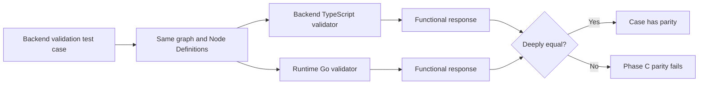

# C6 — Backend Validation Test Parity

**Status:** Backend and Runtime 28-case exact-result suites implemented and passing in the current working trees; delivery commits pending

**Phase:** C6 — Local workflow validation

## Overview

C6 ports the implemented Backend workflow-validation test cases to Runtime and
requires both validators to return the same functional validation response for
the same graph and Node Definition inputs. The Backend implementation at commit
`f7e6ef8b89c8d1b5a70e1d921fdae022b8aa75e8` is the reference behavior for the
first Runtime implementation.

C6 is test-only. It adds no production endpoint, runtime dependency, database
query, or cross-process call. Each repository runs its own validator in process.



The smallest complete flow is: identify one existing Backend validation case,
give Runtime the same base fixture and mutation, execute the corresponding real
decoder, topology, catalog, or service layer with the same validation-only Node
Definitions, assemble a C1-shaped result where the Backend case assembles one,
remove presentation message text, and deeply compare the remaining result.
Every reference case must pass before C6 is complete.

## 1. Reference implementation and scope

The initial fixture and behavior reference is the implemented Backend workflow validator at:

```text
repository: a2matex-be
commit:     f7e6ef8b89c8d1b5a70e1d921fdae022b8aa75e8
directory:  src/routes/workflow-validation/
```

C6 mirrors public validation behavior covered by:

- `test/editor-graph.validator.spec.ts`;
- `test/workflow-validation.model.spec.ts`; and
- `test/workflow-validation.service.spec.ts`.

The Backend now also owns
`test/workflow-validation.parity.spec.ts`, which gives every case in section 3
the shared stable ID and an exact normalized expected result. During parity
hardening, this suite exposed that the original Backend path comparison used
locale-aware JSON-text ordering. The Backend comparator was aligned with C1's
portable segment comparator so an empty path, numeric segments, string
segments, and shorter equal-prefix paths have the same order in TypeScript and
Go.

The Backend controller and repository suites remain required, but are not
cross-language response cases:

- controller tests verify Nest routing and transport-envelope behavior owned by
  Backend and C5 respectively; and
- repository tests verify PostgreSQL query shape, while Runtime C4 has no
  repository.

Runtime must provide its own C5 handler tests and C4 registry tests for those
boundaries. C6 must not pretend that Gin and Nest or an immutable map and
PostgreSQL are the same component.

## 2. Equality contract

For every validation-result case, C6 compares:

```json
{
  "status": "INVALID",
  "errors": [
    {
      "code": "EDGE_TARGET_NODE_NOT_FOUND",
      "nodeId": "missing_node",
      "edgeId": "edge_01",
      "path": ["edges", 0, "targetNodeId"]
    }
  ],
  "warnings": [],
  "truncated": false
}
```

Equality includes:

- exact status;
- error and warning counts;
- public diagnostic order;
- each diagnostic code;
- presence and value of `nodeId` and `edgeId`;
- exact typed path segments and order; and
- `truncated`.

Only diagnostic `message` text is removed before comparison because message
language is presentation, not functional behavior. Neither harness may sort,
deduplicate, add, or remove diagnostics during normalization.

For a pre-result failure such as the graph-content byte limit, parity compares
the stable outcome classification and error code, for example
`PAYLOAD_TOO_LARGE`. HTTP status and transport envelopes remain C5/Backend
controller tests unless a later API contract explicitly requires byte-identical
transport.

## 3. Required reference case matrix

Every case below is required. Stable case IDs are shared by the Backend and Go
tests so a failure identifies the same scenario in either repository.

### 3.1 Contract and service cases

| Case ID | Backend behavior to reproduce |
|---|---|
| `valid.minimal` | Minimal Start-to-End graph returns `VALID` with empty diagnostics |
| `version.unsupported` | Positive unsupported version returns `GRAPH_SCHEMA_VERSION_UNSUPPORTED` and continues safe validation |
| `contract.missing_version` | Missing version returns contract diagnostics and skips catalog lookup |
| `contract.non_integer_version` | Non-integer version returns contract diagnostics |
| `contract.unknown_field` | Unknown graph field returns contract diagnostics |
| `contract.invalid_json_safe_fields` | Invalid identifier, node type, config shape, or editor shape returns all discoverable contract diagnostics |
| `contract.malformed_service_input` | The Backend service's `{nodes: [], unexpected: true}` case returns the same complete contract result and skips catalog lookup |
| `limit.content_bytes` | Graph content above 1 MiB returns `PAYLOAD_TOO_LARGE` before catalog access |

Values that cannot cross JSON transport, such as JavaScript `Infinity`, remain
a Backend model-boundary test. Runtime must test its corresponding JSON decoder
boundary, but no JSON fixture can carry a non-JSON value.

### 3.2 Topology cases

| Case ID | Backend behavior to reproduce |
|---|---|
| `identity.duplicate_node_and_edge` | Duplicate node and edge IDs produce the same ordered diagnostics on repeated calls |
| `start.none` | Missing Start produces Start, entry, and reachable-End findings |
| `start.wrong_entry` | Entry not pointing to the Start produces `ENTRY_NODE_INVALID` |
| `start.multiple` | Multiple Starts produce the same bounded combined findings |
| `edge.missing_endpoints` | Missing source and target endpoints are both reported without traversal failure |
| `end.outgoing_edge` | An outgoing edge from End is rejected |
| `reachability.disconnected_end` | Unreachable nodes and lack of a reachable End are reported |
| `cycle.self` | Self-cycle is rejected |
| `cycle.multiple_nodes` | Multi-node cycle is rejected |
| `limit.nodes` | More than 500 nodes returns only the node-limit finding and stops later passes |
| `limit.edges` | More than 1,000 edges returns only the edge-limit finding and stops later passes |
| `limit.diagnostics` | More than 100 findings returns exactly 100 in public order with `truncated: true` |

### 3.3 Node-contract cases

| Case ID | Backend behavior to reproduce |
|---|---|
| `catalog.node_and_port` | Missing active type and invalid source port produce the same ordered findings |
| `config.required_missing` | Missing required config field points to that field |
| `config.integer_type` | Fractional value for an integer field is rejected |
| `config.integer_maximum` | Value above the maximum is rejected |
| `config.string_constraints` | String failing declared length or pattern constraints is rejected |
| `config.boolean_type` | Non-boolean value is rejected |
| `config.additional_property` | Unknown config property is rejected |
| `config.empty_property_name` | Empty unknown property name retains the exact diagnostic path |

The config cases use the same test-only `test.config` contract as the Backend
suite: required integer `requiredValue` from 1 through 10, optional uppercase
`name` of length 2 through 4, optional boolean `enabled`, and no additional
properties. This test-only definition does not become a production Runtime
node.

## 4. Test data and case construction

Runtime vendors the Backend's current base fixtures byte-for-byte:

```text
internal/validation/testdata/backend-reference/f7e6ef8/
├── valid-minimal.json
└── invalid-cycle.json
```

Cases that the Backend test constructs by mutation must be constructed from the
same base fixture in Go. The Go test must reproduce the resulting graph value,
not TypeScript implementation details. Large node, edge, and diagnostic cases
are generated deterministically with the same limits and identifier patterns.

Each language keeps a table keyed by the stable IDs in section 3. A case records:

- base fixture;
- deterministic mutation or generated input;
- validation-only Node Definitions;
- expected functional result or pre-result error code; and
- whether catalog validation must be skipped.

The exact expected result is committed and reviewed. Tests must not update a
golden response automatically. If Backend behavior intentionally changes, its
test and expected result change first; Runtime parity is then updated in the
same compatibility work.

## 5. Harness execution

### 5.1 Backend

The Backend harness invokes the real model, topology, catalog, configuration,
and result-assembly functions. Service cases use a deterministic test repository
containing the supplied Node Definitions. It must not query a developer database
or call Runtime.

Existing Backend assertions that use `arrayContaining`, `toContain`, or partial
object matching do not establish response parity by themselves. C6 strengthens
the reference cases with exact normalized-result assertions while retaining the
existing focused tests.

### 5.2 Runtime

The Go harness invokes the real Runtime layer corresponding to the Backend case:
C2 for model/contract cases, C3 plus C1 assembly for topology cases, C4 plus C1
assembly for catalog/config cases, and the same C1–C4 service used by C5 for
service cases. It must not duplicate validation logic in test code. It
constructs the immutable C4 registry from the case definitions, including the
test-only config definition where required.

Table-driven Go subtests use the exact shared case IDs. Each subtest compares
the complete normalized functional result or stable pre-result error code.

### 5.3 No live cross-repository dependency

Neither suite calls the other repository, executes another language runtime,
uses a network service, or reads a sibling checkout. Runtime vendors the two
reference fixtures so its tests work from a standalone clone. The reference
Backend commit is recorded in the testdata directory and test failure output.

## 6. Initial Node Definition boundary

The original C6 baseline uses the 11 Node Definitions copied from the implemented Backend
validator's approved catalog snapshot. Phase C does not implement automatic
catalog synchronization or node upgrades.

Parity cases use either:

- those copied production contracts; or
- the explicit test-only `test.config` contract used by the Backend tests.

The test-only contract must never appear in `runtime-info`, the production C4
registry, or an execution handler registry. Later Node Definition upgrades own
their own Runtime package and parity changes.

## 7. Failure handling

C6 fails when:

- a required stable case ID is absent in either language;
- a vendored base fixture differs from the reference Backend bytes;
- status, diagnostic count, order, code, reference, path, or truncation differs;
- one implementation returns a validation result and the other returns a
  pre-result failure;
- stable pre-result error codes differ; or
- a case unexpectedly performs catalog access after a contract or graph-limit
  stop condition.

Failure output identifies the Backend reference commit, case ID, expected
normalized result, and actual normalized result. It must not print raw config,
bindings, protected workflows, credentials, or stack traces containing request
content.

A mismatch is resolved in the owning validator or contract. Neither harness may
special-case a case ID, reorder output, or weaken an expected result merely to
make parity pass.

## 8. Security, isolation, and efficiency

- Tests read only fixed files below their repository testdata root.
- No database, HTTP listener, network, ADB, device, shell command, or production
  package is required.
- Fixtures contain no credentials, private workflows, device data, or paths.
- Cases are independent and do not share mutable registry state.
- Locale, timezone, map iteration, and execution order cannot change results.
- No snapshot-testing or schema dependency is added.
- Work is bounded by the same graph, edge, content, and diagnostic limits as
  production validation.

## 9. Proposed implementation mapping

Runtime:

```text
internal/validation/
├── backend_parity_test.go
└── testdata/backend-reference/f7e6ef8/
    ├── REFERENCE
    ├── valid-minimal.json
    └── invalid-cycle.json
```

Backend:

```text
src/routes/workflow-validation/test/
├── editor-graph.validator.spec.ts
├── workflow-validation.model.spec.ts
├── workflow-validation.service.spec.ts
└── workflow-validation.parity.spec.ts
```

The additional Backend parity file may share existing test helpers, but
production validation code must not import testdata or parity metadata.

## 10. Verification plan

Before claiming C6 complete:

- confirm the two Runtime fixture copies match the reference Backend bytes;
- run every stable case in the Backend exact-result suite;
- run every stable case in the Runtime table-driven suite;
- compare the executed case-ID sets exactly;
- repeat both suites to detect unstable order or shared state;
- run the normal Backend and Runtime test suites;
- run Runtime race tests and both builds; and
- run `git diff --check` in each changed repository.

The implementation report records the Backend reference commit, Runtime commit,
commands, passed case count, unavailable tools, and any deliberately deferred
transport-only coverage.

## 11. Acceptance criteria

Stage 1 adds 21 targeting cases in identical `targeting-parity.json` fixtures
in Backend and Runtime. Both suites compare the full result against explicit
expected paths. The cases cover missing modes, every supported mode, invalid
or mixed fields, and strict literal binding shapes. Backend sorts paths by
typed segments and puts a parent before its descendants, matching C1.

C6 is complete when:

1. Every functional validation case listed in section 3 exists under the same
   stable ID in Backend and Runtime tests.
2. Both validators receive equivalent graph values and validation-only Node
   Definitions.
3. Every case produces the same normalized functional result, including public
   diagnostic order, references, paths, and truncation, or the same stable
   pre-result error code.
4. Only presentation message text and implementation-specific transport details
   are excluded from equality.
5. Runtime and Backend tests use their corresponding real decoder, topology,
   catalog, result-assembly, and service layers rather than test validators.
6. Tests require no sibling checkout, database, network, HTTP listener, ADB, or
   device and add no new dependency.
7. Test evidence identifies the reference Backend and Runtime commits.

The Backend and Runtime exact-result suites and immutable reference fixtures
are implemented and verified in the current working trees. The fixture source
remains pinned to the Backend commit above. Delivery commit IDs must replace the
working-tree evidence before release sign-off.

## 12. Current verification evidence

Verification completed on 2026-10-28:

- Backend exact parity suite: 28 of 28 shared stable IDs passed;
- Runtime exact parity suite: 28 of 28 shared stable IDs passed;
- the executed Backend and Runtime ID sets matched section 3 exactly;
- Runtime `go test -count=1 ./...` passed;
- Runtime `go test -race -count=1 ./...` passed;
- Backend `npm test` passed with 22 files and 130 tests;
- both Runtime and Backend builds passed; and
- the two vendored Runtime fixtures matched the Backend fixture bytes.

The functional gate is green in the current working trees. Git delivery
commits were deliberately not created by the implementation agent and remain a
release handoff action.

## 13. Deferred work

C6 does not compare Production package authorization, Runtime IR admission,
execution, events, devices, persistence, Studio rendering, or Launcher behavior.
New Backend workflow-validation cases must be ported to Runtime before a later
release claims parity with that Backend validator version.
