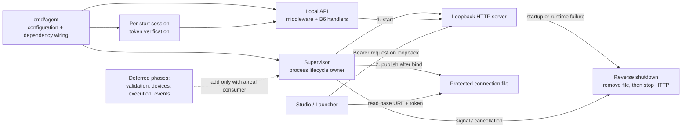

# Phase B — Runtime Process Foundation

## Overview

Phase B implements the Go process shell required by every later Runtime
subsystem. It turns the accepted Phase A contracts into a runnable,
authenticated, loopback-only agent foundation, but it does not execute a
workflow or communicate with an Android device.

In the completed foundation, `cmd/agent` constructs one process graph. The
supervisor starts the loopback HTTP listener before publishing a protected
connection file containing the address and per-start session token. Studio or
Launcher reads that file, uses the token for authenticated Local API requests,
and loses access when the Runtime stops and removes the file. A startup failure
rolls back already-started components; a process stop shuts them down in reverse
order within one configured deadline.

Phase B owns only process startup and shutdown, configuration, safe structured
logging, local discovery and authentication, and the minimal Local API. Workflow
validation, persistence, Android/ADB control, node execution, artifacts, and
event streaming remain owned by later phases.

### Maintainer map

| Area | Current code owner | Maintenance responsibility |
|---|---|---|
| Process construction | `cmd/agent` | Load configuration and connect constructors through Wire; it must not own component behavior. |
| Lifecycle | `internal/supervisor` | Start components in dependency order, detect terminal failures, and stop started components in reverse order under one deadline. |
| Listener | `internal/platform/httpserver` | Bind before reporting startup success, serve the supplied handler, and release the listener during shutdown. |
| API assembly | `internal/api` | Define middleware order, public/protected routing, stable responses, and request-level logging. |
| Local identity | `internal/auth` | Create the per-process session secret and verify bearer credentials without exposing the token. |
| Client discovery | `internal/discovery` | Atomically publish the protected connection document after HTTP is ready and remove only the document owned by this process. |
| Configuration | `internal/config` | Parse and validate only settings that have a current Runtime consumer. |
| Logging | `internal/logging` | Construct the shared structured logger and apply the B4 redaction boundary. |
| Shared protocol values | `pkg/constants`, `pkg/x-error` | Hold reusable stable values and shared errors without taking ownership of feature behavior. |

The main invariants to preserve are:

- the HTTP listener must bind before the connection file is visible;
- the same session instance must be used by discovery and API authentication;
- the connection file must be removed before the HTTP server stops;
- credentials and sensitive request data must never enter logs;
- a component publishes its terminal result before cancelling the supervisor,
  so a real failure is not replaced by a secondary cancellation error; and
- new supervised components are added only when a later phase implements a
  real lifecycle resource. Their `Start` must report readiness synchronously,
  `Wait` must report termination, and `Shutdown` must cause `Wait` to return.

## Progress

| ID | Module | Status |
|---|---|---|
| B1 | Go project foundation | Implemented and verified; lint pending |
| B2 | Configuration | Implemented and verified; lint pending |
| B3 | Supervisor | Implemented and focused verification passed; lint pending |
| B4 | Logging and redaction | Implemented; focused logger test skipped by review decision; lint pending |
| B5 | Local authentication | Implemented; Windows verification and lint pending |
| B6 | Minimal Local API | Implemented and verified; lint pending |

Each sub-phase is specified, approved, implemented, and verified separately.
Documentation approval does not mark its Go implementation complete.

## B1 — Go Project Foundation

**Status:** Implemented and verified; lint pending

B1 reconciles the existing scaffold without adding Runtime features. It keeps
one `cmd/agent` binary, private `internal` packages, explicit constructors, and
Google Wire at the composition root. It corrects project identity, build
metadata, generation workflow, developer commands, and documentation before
later foundation behavior is changed.

Reference:

- [B1 — Go Project Foundation](../runtime_process_foundation/b1_go_project_foundation.md)

## B2 — Configuration

**Status:** Implemented and verified; lint pending

B2 defines deterministic startup configuration for the components implemented
in B3–B6. It keeps only shutdown, loopback HTTP, and logging settings; applies
strict precedence and validation; and defers every setting without an
implemented consumer. It exposes no mode setting or fixed mode response field;
Production behavior remains I2 scope.

Reference:

- [B2 — Configuration](../runtime_process_foundation/b2_configuration.md)

## B3 — Runtime Supervisor

**Status:** Implemented and focused verification passed; lint pending

B3 makes `internal/supervisor.App` the sole process-lifecycle owner. It defines
synchronous readiness, ordered startup, startup rollback, unexpected-failure
propagation, reverse shutdown, and one B2-bounded cleanup deadline. The current
implementation manages the preliminary Local HTTP Server and the B5 connection
file publisher. Later phases add components only when their behavior exists.
This matters because components own different resources or background
activities: each implements its own preparation and cleanup, while the
supervisor guarantees safe process-wide ordering and completion.

Reference:

- [B3 — Runtime Supervisor](../runtime_process_foundation/b3_supervisor.md)

## B4 — Logging and Redaction

**Status:** Implemented; focused logger test skipped by review decision; lint pending

B4 makes the existing `log/slog` path a safe operational boundary. It defines
stable lifecycle and Local API fields, central key-based redaction, safe panic
reporting, bounded request records, and reserved execution-correlation names.
It adds no logging dependency or unused execution infrastructure.

Reference:

- [B4 — Logging and Redaction](../runtime_process_foundation/b4_logging_and_redaction.md)

## B5 — Local Authentication

**Status:** Implemented; Windows verification and lint pending

B5 creates one cryptographically random local session per Runtime start,
verifies strict bearer credentials in constant time, and publishes the complete
A7 base URL and token document through a protected per-user connection file.
The publisher starts after the loopback listener and is removed before HTTP
shutdown. B6 remains responsible for applying the verifier to routes and
returning the exact A7 unauthorized response.

Reference:

- [B5 — Local Authentication](../runtime_process_foundation/b5_local_authentication.md)

## B6 — Minimal Local API

**Status:** Implemented and verified; lint pending

B6 connects the B5 session verifier to the existing HTTP server. Exact health
remains public, while every other request requires the per-start bearer token.
It replaces the preliminary handlers with the accepted A7 health and
Runtime-information shapes without adding future validation, device, execution,
or node-handler infrastructure.

Reference:

- [B6 — Minimal Local API](../runtime_process_foundation/b6_minimal_local_api.md)

Database, artifact, ADB, SSE, and execution-concurrency settings stay with
their later owning phases instead of becoming unused Phase B fields.

## Phase B gate

Phase B is complete when the agent starts, publishes protected connection
information only after the loopback listener is ready, serves the exact B6 API,
rejects unauthenticated requests, and exits within its shutdown deadline
without leaking owned goroutines or credentials.

## Completion against the original Phase B documents

**Implementation status: completed.** The current Runtime source implements the
approved responsibilities and boundaries from the original B1–B6 documents:

- B1 provides the buildable Go agent and dependency-composition foundation;
- B2 supplies the validated settings consumed by this phase;
- B3 owns ordered startup, failure propagation, rollback, and bounded reverse
  shutdown;
- B4 supplies structured operational logging and sensitive-field redaction;
- B5 supplies the per-start session and protected local connection publication;
  and
- B6 exposes the public health route and authenticated Runtime information route
  through the loopback-only server.

No Phase B behavior has been intentionally moved to a future phase. Later
phases extend this foundation with validation, devices, execution, artifacts,
and events instead of redefining its lifecycle or authentication boundary.

This completion statement records implementation against the approved Phase B
specifications. The progress table remains the verification record: the
explicitly skipped focused logger test, unavailable lint run, and unexecuted
Windows runtime behavior remain visible review exceptions and are not presented
as completed verification.
