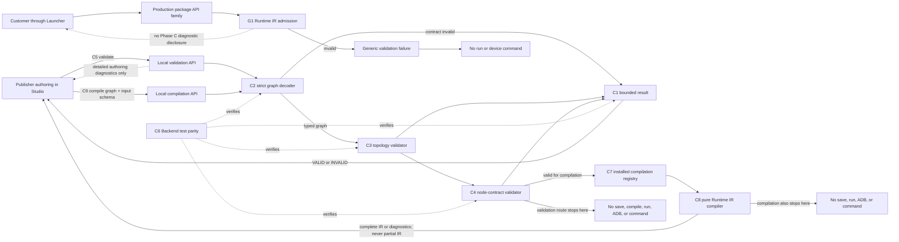

# Phase C — Local Workflow Validation and Compilation

Phase C adds deterministic Editor Graph validation and content-only Runtime IR
compilation to the local Runtime Agent. Studio supplies `editorGraph` and
`inputSchema`; it does not reproduce compiler rules. The Runtime validates
against its installed contracts, then either returns one complete Runtime IR or
no IR. Both operations happen before persistence, run creation, ADB discovery,
or device commands.

The validation flow remains C1–C5. C7–C9 add a separate compilation flow that
reuses C1–C4, resolves installed node semantics and defaults, and emits the A2
contract. C5 is not converted into a compiler. A successful validation or
compilation does not authorize execution; G1 must still admit the exact Runtime
IR supplied for a run.

## Operating contexts and disclosure boundary

Phase C is a Publisher-facing Studio authoring capability. Its detailed diagnostics
exist so Studio can identify and correct every independently discoverable
authoring problem in one bounded response, consistent with the Backend
workflow validator. When malformed structure makes a later check unsafe, the
pipeline reports the structural findings and does not invent downstream
results.

Production execution uses a separate API family rather than changing C5's
behavior. Launcher submits a protected Product package reference and later
authorization material to the I2/G1 flow. If
admission fails, the customer receives the generic A6
`VALIDATION_FAILED` failure defined by the
[Production Execution Authorization v1](../../../specifications/production_execution_authorization_v1.md)
contract; the response must not reveal Phase C codes, paths, node or edge identifiers,
handler names, registry contents, or schema details. Failure prevents run
creation and device commands, but does not normally terminate the Runtime Agent.

| Context | Input and validator | External result | Stop boundary |
|---|---|---|---|
| Studio validation | Plaintext Editor Graph through C1–C5 | Bounded detailed diagnostics | No save, compile, run, ADB, or command |
| Studio compilation | Plaintext Editor Graph and Input Schema through C1–C4 and C7–C9 | Bounded diagnostics plus complete Runtime IR on success | No save, run, ADB, or command |
| Launcher Product run | Protected package through I2 and exact decrypted Runtime IR through G1 | Generic `VALIDATION_FAILED` | No run creation or device command |

Both API families may be registered concurrently. Runtime does not need a
global Development/Production mode switch: the selected endpoint and input
contract determine the operation. C5 accepts only a plaintext Editor Graph and
never accepts a Product package. The later Production endpoints accept only
their constrained package reference and authorization inputs and never expose
the decrypted workflow or Phase C diagnostics.

## Progress

| ID | Module | Status |
|---|---|---|
| C1 | Validation contracts | Implemented and verified in Runtime |
| C2 | Editor Graph decoder | Implemented with node-level timeout and retry overrides |
| C3 | Topology validator | Implemented and verified in Runtime |
| C4 | Node-contract validator | Implemented with updated Wait Variable and binding checks |
| C5 | Local validation API | Implemented and verified in Runtime |
| C6 | Backend validation test parity | Binding and targeting parity fixtures updated and passing in Runtime |
| C7 | Installed compilation registry | Implemented and verified in Runtime |
| C8 | Pure Runtime IR compiler | Implemented and verified in Runtime |
| C9 | Local compilation API | Implemented and verified in Runtime |

Each sub-phase is specified, approved, implemented, and verified separately.
The status below reflects the current Runtime code and verification evidence,
not documentation approval alone.

## C1 — Validation Contracts

**Status:** Implemented and verified in Runtime

C1 owns the result envelope, closed status and diagnostic values, safe messages,
validation limits, locale-independent ordering, combined diagnostic cap,
truncation, and status derivation. It gives C2–C4 one bounded result language
without introducing HTTP, persistence, device, or execution dependencies.

Reference:

- [C1 — Validation Contracts](../local_workflow_validation/c1_validation_contracts.md)

## C2 — Editor Graph Decoder

**Status:** Implemented and verified in Runtime

C2 strictly converts size-bounded Editor Graph JSON into a typed Go value. It
rejects unknown, missing, null, and wrongly typed fields; preserves opaque valid
JSON in `config` and `bindings`; and separates malformed v1 content from a
structurally meaningful but unsupported schema version. Duplicate JSON property
names follow the Backend's last-write-wins transport behavior. Nodes also
accept optional `timeoutMs` and optional `retryPolicy.maxAttempts` and
`retryPolicy.delayMs`. C2 returns no
partial graph after a structural contract failure. A structurally valid
v1-shaped document with an unsupported positive version continues to C3 and C4
for Studio so the Publisher receives that version finding beside every
other safely discoverable finding.

Reference:

- [C2 — Editor Graph Decoder](../local_workflow_validation/c2_editor_graph_decoder.md)

## C3 — Topology Validator

**Status:** Implemented and verified in Runtime

C3 enforces node and edge count limits, unique identities, the single Start and
matching entry, edge endpoints, terminal End behavior, reachability, a reachable
End, and acyclicity through bounded `O(V + E)` traversals. Limit violations stop
before indexes and C4; other topology findings continue safely so Studio can
receive node-contract findings in the same result.

Reference:

- [C3 — Topology Validator](../local_workflow_validation/c3_topology_validator.md)

## C4 — Node-Contract Validator

**Status:** Implemented with updated Wait Variable and binding checks

C4 defines an immutable installed node-contract registry and validates node
types, source ports, and static `config` in bounded linear work. The Runtime
registry, not the Backend database, is authoritative for local authoring
validation. It remains separate from the executable handler registry and the C7
compilation registry. `flow.wait_variable.config` contains only `name`; its
deadline comes from the effective node-level timeout. The validator also
checks ordinary-node success and error edge counts against Backend rules.

Reference:

- [C4 — Node-Contract Validator](../local_workflow_validation/c4_node_contract_validator.md)

## C5 — Local Validation API

**Status:** Implemented and verified in Runtime

C5 defines authenticated `POST /api/v1/workflow-validation`, strict root-only
envelope decoding, bounded request and raw-graph bytes, A7 transport failures,
and the C1–C4 orchestration order. Completed validation always returns HTTP
`200`, including an `INVALID` graph, and performs no external operation.

Reference:

- [C5 — Local Validation API](../local_workflow_validation/c5_local_validation_api.md)

## C6 — Cross-Language Parity

**Status:** Updated and verified in Runtime against the checked-out Backend fixtures

C6 gives every functional validation-result case from the implemented Backend
workflow-validation model, validator, and service tests the same stable ID and
an exact normalized expected result in both repositories. Backend and Runtime
receive equivalent graphs and validation-only Node Definitions, then compare
status, ordered diagnostic codes, references, paths, warnings, and truncation.
Only presentation message text and implementation-specific transport behavior
are excluded. The exact suite also aligned the Backend result sorter with C1's
portable path-segment ordering after it exposed a real empty-path ordering
difference. The updated shared binding and targeting fixtures cover uppercase
binding kinds and the revised Wait Variable config. The compilation fixture set
records complete Backend IR and diagnostics and compares the same JSON values
in Runtime. Shared port-count cases verify both authoring routes on valid and
invalid ordinary transitions.

Reference:

- [C6 — Cross-Language Validation Parity](../local_workflow_validation/c6_cross_language_parity.md)

## C7 — Installed Compilation Registry

**Status:** Implemented and verified in Runtime

C7 is an immutable Runtime-owned registry used only to compile source content.
For every supported node type it provides the `runtimeHandler`, default timeout,
minimum Runtime version, capabilities, input/output contracts, ports, and other
semantics required by A2. Studio cannot submit or override these definitions.
The Backend compiler instead uses the exact frozen Node Definitions selected for
the Workflow Revision. C7 may reuse immutable values with C4, but it must remain
distinguishable from authoring validation and from the registry of handlers that
are actually executable.

## C8 — Pure Runtime IR Compiler

**Status:** Implemented and verified in Runtime

C8 accepts a successfully decoded Editor Graph, an Input Schema, and C7. It
performs the complete validation required for compilation, maps uppercase
Editor Graph binding `kind` values to uppercase Runtime IR input `source`
values, resolves node-level timeout and retry defaults, derives minimum Runtime
version and deduplicated capabilities, removes editor-only fields, and strictly
validates the produced A2 document. It preserves source node and edge order;
sorting is not required. Any error diagnostic returns no Runtime IR; warnings
may accompany a complete IR. Input values are never mutated.

## C9 — Local Compilation API

**Status:** Implemented and verified in Runtime

C9 exposes authenticated `POST /api/v1/workflow-compilation`. The request
contains exactly `editorGraph` and `inputSchema`; it contains no Project Draft
ID, expected version, Node Definitions, or execution data. A completed request
returns the bounded validation result and either a complete `runtimeIr` or
`null`. It performs no Project Draft, SQLite, run, device, ADB, or queue write.
Studio may cache a successful result in the same local Project Draft shape used
for cloud sync, but that cache ownership is outside Runtime.

## Phase boundary

The Stage 1 targeting extension adds mode-specific literal checks and Long
Press authoring support to C4. C7–C9 compile those validated targeting fields;
Android execution remains a later phase.

Phase C answers whether an Editor Graph is valid for local authoring and can
produce a local Test Run IR against the installed Runtime's supported
contracts. The same Runtime may also expose the separate later Production API
family, but Phase C does not:

- save a Project or Draft;
- persist or admit Runtime IR;
- create a RunGroup or execution record;
- inspect device availability;
- invoke ADB or any device command;
- resolve bindings or validate runtime input values;
- process assets or credentials; or
- authorize Production execution.

A stored `validationSummary` is evidence of a previous check, not a trusted
Runtime decision. Later changes to the graph, Runtime version, supported-node
registry, or executable package require their owning validation again.

## Phase C gate

Phase C is complete when Studio can validate and compile plaintext source
through separate authenticated endpoints; the same accepted source produces
the exact expected Runtime IR; invalid source produces deterministic bounded
diagnostics and no partial IR; and C6 plus the new compiler fixtures pass in all
consumers. Neither endpoint may write a database, create a run, or invoke ADB.

Runtime implements and tests both routes and the checked-out Backend fixture
baseline. The installed definition snapshot includes the Backend
`feat/node-binding-kind` staged rules. Release the matching snapshot with the
final Backend catalog. Studio integration and G1 run admission are separate
milestones.
