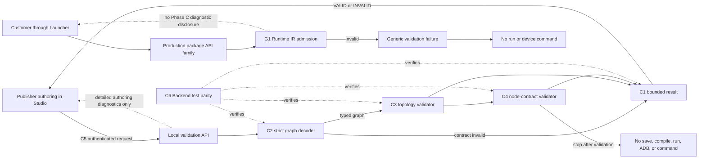

# Phase C — Local Workflow Validation

Phase C adds deterministic Editor Graph validation to the local Runtime Agent.
It lets Studio identify authoring problems before compilation, persistence, run
creation, ADB discovery, or device commands. The Runtime implements the
approved validation behavior independently in Go and validates against the
contracts supported by that installed Runtime.

The smallest end-to-end flow is: Studio submits one graph through the protected
loopback API, C2 establishes a strict typed document, C3 and C4 produce findings,
and C1 returns a stable bounded result. C5 exposes that pipeline and C6 verifies
its Backend-reference behavior. A successful validation is authoring feedback only; it does
not authorize execution, and G1 must still admit the exact Runtime IR supplied
for a run.

## Operating contexts and disclosure boundary

Phase C is a Publisher-facing Studio authoring capability. Its detailed diagnostics
exist so Studio can identify and correct every independently discoverable
authoring problem in one bounded response, consistent with the Backend
workflow validator. When malformed structure makes a later check unsafe, the
pipeline reports the structural findings and does not invent downstream
results.

Production execution uses a separate API family rather than changing C5's
behavior. Launcher submits a protected Product package reference and later
authorization material to the I2/G1 flow. If
admission fails, the customer receives the generic A6
`VALIDATION_FAILED` failure defined by the
[Production Execution Authorization v1](../../../specifications/production_execution_authorization_v1.md)
contract; the response must not reveal Phase C codes, paths, node or edge identifiers,
handler names, registry contents, or schema details. Failure prevents run
creation and device commands, but does not normally terminate the Runtime Agent.

| Context | Input and validator | External result | Stop boundary |
|---|---|---|---|
| Studio authoring | Plaintext Editor Graph through C1-C5 | Bounded detailed diagnostics | No save, compile, run, ADB, or command |
| Launcher Product run | Protected package through I2 and exact decrypted Runtime IR through G1 | Generic `VALIDATION_FAILED` | No run creation or device command |

Both API families may be registered concurrently. Runtime does not need a
global Development/Production mode switch: the selected endpoint and input
contract determine the operation. C5 accepts only a plaintext Editor Graph and
never accepts a Product package. The later Production endpoints accept only
their constrained package reference and authorization inputs and never expose
the decrypted workflow or Phase C diagnostics.

## Progress

| ID | Module | Status |
|---|---|---|
| C1 | Validation contracts | Implemented and verified in Runtime |
| C2 | Editor Graph decoder | Implemented and verified in Runtime |
| C3 | Topology validator | Implemented and verified in Runtime |
| C4 | Node-contract validator | Implemented and verified in Runtime |
| C5 | Local validation API | Implemented and verified in Runtime |
| C6 | Backend validation test parity | 28 shared exact-result cases passing in Backend and Runtime working trees; delivery commits pending |

Each sub-phase is specified, approved, implemented, and verified separately.
The status below reflects the current Runtime code and verification evidence,
not documentation approval alone.

## C1 — Validation Contracts

**Status:** Implemented and verified in Runtime

C1 owns the result envelope, closed status and diagnostic values, safe messages,
validation limits, locale-independent ordering, combined diagnostic cap,
truncation, and status derivation. It gives C2–C4 one bounded result language
without introducing HTTP, persistence, device, or execution dependencies.

Reference:

- [C1 — Validation Contracts](../local_workflow_validation/c1_validation_contracts.md)

## C2 — Editor Graph Decoder

**Status:** Implemented and verified in Runtime

C2 strictly converts size-bounded Editor Graph JSON into a typed Go value. It
rejects unknown, missing, null, and wrongly typed fields; preserves opaque valid
JSON in `config` and `bindings`; and separates malformed v1 content from a
structurally meaningful but unsupported schema version. Duplicate JSON property
names follow the Backend's last-write-wins transport behavior. C2 returns no
partial graph after a structural contract failure. A structurally valid
v1-shaped document with an unsupported positive version continues to C3 and C4
for Studio so the Publisher receives that version finding beside every
other safely discoverable finding.

Reference:

- [C2 — Editor Graph Decoder](../local_workflow_validation/c2_editor_graph_decoder.md)

## C3 — Topology Validator

**Status:** Implemented and verified in Runtime

C3 enforces node and edge count limits, unique identities, the single Start and
matching entry, edge endpoints, terminal End behavior, reachability, a reachable
End, and acyclicity through bounded `O(V + E)` traversals. Limit violations stop
before indexes and C4; other topology findings continue safely so Studio can
receive node-contract findings in the same result.

Reference:

- [C3 — Topology Validator](../local_workflow_validation/c3_topology_validator.md)

## C4 — Node-Contract Validator

**Status:** Implemented and verified in Runtime

C4 defines an immutable installed node-contract registry and validates node
types, source ports, and static `config` in bounded linear work. The Runtime
registry, not the Backend database, is authoritative for local authoring
validation. It remains separate from the later executable handler registry, so
C4 does not populate `runtime-info.supportedNodes` or claim execution support.

Reference:

- [C4 — Node-Contract Validator](../local_workflow_validation/c4_node_contract_validator.md)

## C5 — Local Validation API

**Status:** Implemented and verified in Runtime

C5 defines authenticated `POST /api/v1/workflow-validation`, strict root-only
envelope decoding, bounded request and raw-graph bytes, A7 transport failures,
and the C1–C4 orchestration order. Completed validation always returns HTTP
`200`, including an `INVALID` graph, and performs no external operation.

Reference:

- [C5 — Local Validation API](../local_workflow_validation/c5_local_validation_api.md)

## C6 — Cross-Language Parity

**Status:** Backend and Runtime parity suites implemented and verified in the current working trees; delivery commits pending

C6 gives every functional validation-result case from the implemented Backend
workflow-validation model, validator, and service tests the same stable ID and
an exact normalized expected result in both repositories. Backend and Runtime
receive equivalent graphs and validation-only Node Definitions, then compare
status, ordered diagnostic codes, references, paths, warnings, and truncation.
Only presentation message text and implementation-specific transport behavior
are excluded. The exact suite also aligned the Backend result sorter with C1's
portable path-segment ordering after it exposed a real empty-path ordering
difference.

Reference:

- [C6 — Cross-Language Validation Parity](../local_workflow_validation/c6_cross_language_parity.md)

## Phase boundary

Phase C answers whether an Editor Graph is valid for local authoring against the
installed Runtime's supported contracts. The same Runtime may also expose the
separate later Production API family, but Phase C does not:

- save a Project or Draft;
- compile or admit Runtime IR;
- create a RunGroup or execution record;
- inspect device availability;
- invoke ADB or any device command;
- resolve bindings or validate runtime input values;
- process assets or credentials; or
- authorize Production execution.

A stored `validationSummary` is evidence of a previous check, not a trusted
Runtime decision. Later changes to the graph, Runtime version, supported-node
registry, or executable package require their owning validation again.

## Phase C gate

Phase C is complete when Studio can submit plaintext Editor Graphs through the
authenticated local endpoint and every required C6 Backend reference case
returns the same normalized functional response from Backend and Runtime.
Validation must perform no database write, create no run, and invoke no ADB
command.

The functional gate is implemented and verified in the current Backend and
Runtime working trees. Both exact suites pass all 28 shared stable IDs; focused
C1-C5 tests cover result assembly, strict decoding, topology, node contracts,
and the Runtime-specific transport boundary. Full Runtime normal and race tests,
the full Backend test suite, and both builds pass. An authenticated loopback
black-box check verified `VALID`, detailed `INVALID`, session-token rotation,
old-token rejection after restart, and new-token acceptance.

The two immutable fixtures remain pinned to Backend commit
`f7e6ef8b89c8d1b5a70e1d921fdae022b8aa75e8`. Delivery commit IDs are still
pending because the implementation agent did not create Git commits; this is a
release-handoff item rather than a functional Phase C gap.
