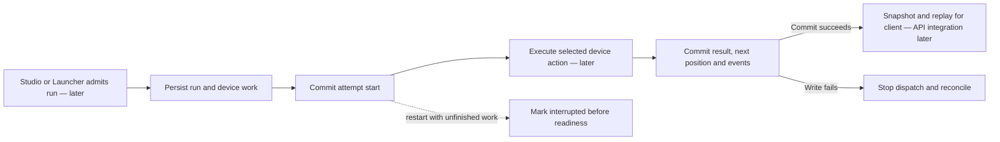

# Phase D — Persistence and observability

## Overview

Phase D gives Runtime a local record of a run that stays consistent when a
client disconnects, a write fails, or the agent restarts. It starts after a
request has been admitted and records what later device handlers and the
workflow engine report.

Phase D does not store Studio Project Drafts or compiler caches. C9 compilation
is a stateless content operation and performs no SQLite write. Studio owns the
local draft and may place a successful compiled IR in that draft; Phase D starts
only when G1 admits an exact IR for execution.

**Status:** D1–D4 and D6 are implemented. D5 is scheduled with F7 Screenshot.
Native Windows storage checks and the real-device integration remain open.

| Sub-phase | Specification | Suggested delivery |
|---|---|---|
| D1 | [SQLite schema and migrations](../d_persistence/d1_sqlite_schema.md) | Implemented. Linux verified and Windows cross-built. |
| D2 | [Execution repository](../d_persistence/d2_execution_repository.md) | Implemented. File-backed repository tests pass. |
| D3 | [Execution event repository](../d_persistence/d3_event_repository.md) | Implemented. Atomic append, durable replay, commit wakeups, and supervised retention are covered by SQLite and simulated publisher tests. A7 transport integration remains later. |
| D4 | [Atomic checkpoint writer](../d_persistence/d4_atomic_checkpoint.md) | Implemented. Atomic attempt start and finish, rollback, and commit read-back are covered by file-backed SQLite tests. |
| D5 | [Screenshot artifact store](../d_persistence/d5_artifact_store.md) | Deliver with Phase F Screenshot |
| D6 | [Startup recovery](../d_persistence/d6_startup_recovery.md) | Implemented. Reopen and startup failure tests verify recovery before HTTP readiness. |

Contracts governing the baseline include [Execution State A5](../contracts/execution_state_v1.md),
[Events and Errors A6](../contracts/event_error_v1.md), and the
[Local API A7](../contracts/local_api_v1.md). The
[Runtime plan](plan.md) owns the cross-phase gates.

## First runnable milestone

The first Development milestone is one device running `Start → Tap → End`
with a coordinate Tap. Validate and admit the workflow, record the
checkpoints, and show the committed result after reconnecting. A failed
Tap ends the run. Restart during an unfinished Tap reports `INTERRUPTED`
without sending the Tap again.

Before client integration, verify one UI owner per Runtime launch and the
H6 **Stop and exit** path. A confirmed stop commits terminal state before
SQLite closes. D6 handles any unfinished work left by an unexpected exit.

| Keep in the first runnable slice | Reduce or deliver later |
|---|---|
| SQLite with run, device, and attempt identity. Admission is atomic and request retries cannot duplicate runs. | One local database and one serialized write path. Derive counts and summaries. Defer generalized storage adapters, archival, and historical search. |
| Checkpoints and durable ordered events. Reconnect uses a cursor and a consistent snapshot on expiry. | One event stream and a simple bounded retention policy. Use the event table for replay and a lightweight wakeup. Defer a separate broker and per-device subscriptions. |
| Recovery before readiness. Preserve uncertain attempts and mark active work interrupted. | Defer crash resume and automatic replay. Keep resolved inputs and protected Runtime IR out of SQLite. |
| A known run can be inspected from its committed attempts. | Deliver D5 with Screenshot. Defer artifact listing, upload, export, and configurable retention. Include D5 before calling Screenshot shippable. |
| Preserve the future Flow, Global, Switch, and Wait authoring contracts. | Deliver variable storage and chosen-port persistence alongside the executable nodes. Defer waiter scheduling to H. |

Follow the first run with automatic retries, error routes, and multi-device
scheduling. Deliver D5 and F7 together for Screenshot. The [Runtime roadmap](plan.md#phase-g--workflow-engine)
tracks the full execution gate, including the remaining Android nodes and
Production integration.

## Runtime integration evaluation

| Boundary | Current evidence | Integration gate |
|---|---|---|
| **A → B/C** | Runtime exposes loopback Health, Runtime Info, and authoring validation. Installed catalog rules and Backend parity are covered by the current test suites. | Keep authoring validation distinct from G1 executable admission and advertise only registered executable handlers. |
| **B → D** | D1 opens and migrates SQLite under exclusive ownership. D6 commits recovery before D3 retention, HTTP startup, and connection publication. A composed-agent test verifies rollback, lock release, and a closed startup on failure. | Verify native Windows behavior and interruption after real device dispatch. |
| **C → Studio → G** | Editor Graph validation exists. C7–C9 local compilation and executable run admission remain open. | Runtime compiles source content without persistence; Studio supplies that exact IR to G1, which revalidates bindings, handler support, inputs, and device selection before committing any run. |
| **D → E/F/G** | SQLite, the execution repository, event replay, and retention are implemented. The current router has no run, device, event, or artifact endpoints. | Run a single real Android action through typed dispatch. Commit start and result, reconnect the client, and test interruption without a second dispatch. |
| **D/G → H** | Authoring supports scoped variables and Wait. Execution and scheduling remain open. | Verify device isolation, atomic Global visibility and last-committed-write-wins, then a two-device wait with one worker slot. |
| **D–H → I/J** | Studio and Launcher execution integration and device release evidence remain open. | Prove Studio Test Run and reconnect first. Separately verify authorized Production package execution and safe error disclosure. Complete release checks on supported hosts and real devices. |

## Decisions before implementation

1. D1 uses embedded Goose migrations and a pinned SQLite driver. D3
   sets event limits. A proactive capacity guard is deferred.
2. Deliver the first single-device Tap run after D6. Schedule D5 with F7 Screenshot.
3. Before enabling Flow, Global, or Switch execution, update the accepted
   A5 execution-state contract. It currently excludes mutable variables.
   Specify key ownership, limits, retention, sensitive-data policy, and the
   selected-route representation before adding their migrations.
4. Verify the delivery sequence with a temporary SQLite database and a
   simulated handler first. Real-device acceptance follows at the G/I
   integration boundary.

Compiler implementation requires no D1 migration or D2–D6 repository change.
Flow and Global variable execution will require their separately approved
execution-state extension later; local compilation alone does not create those
tables or move that work into Phase D.

## Main business flow and acceptance evidence

| Step | Business expectation | Owners | Evidence needed |
|---|---|---|---|
| Publisher checks a draft | Invalid authoring receives detailed diagnostics without creating a run or touching a device | Studio, C | Valid and invalid requests through the authenticated local validator, with no execution effects |
| Publisher starts Test Run | Compiled IR, handlers, and selected devices are checked before admission. A lost response can be retried safely. | Studio, E, G1, D2, H | Invalid admission creates no rows or commands. An admitted request ID returns the same run on retry. |
| Runtime executes an action | One typed command goes to the selected serial after the attempt start commits | E, F, G, D4 | A real device receives one action and its result agrees with the durable state |
| Client reconnects | The latest result is visible and later changes can be replayed | D2, D3, A7 transport, I | Disconnect during execution, reconnect, and repeat with an expired cursor |
| Agent restarts mid-attempt | The user can see interrupted work | B3, D1, D4, D6 | Terminate after dispatch and before completion. Verify interruption events and no automatic second dispatch. |
| Publisher inspects a screenshot | A successful screenshot reference resolves to a PNG | F7, D5, D4, I1 | Capture on a real device and retrieve through authenticated A7. Verify a missing-file response. |
| Customer starts an installed product | Launcher supplies authorized package context and Runtime uses the same durable execution lifecycle | Backend release and authorization, Launcher, I2, D–H | Verify package and lease admission, expiry, and protection of workflow data in storage and diagnostics |

Use a linear workflow and one device for the first delivery. A Tap is
enough to exercise admission, checkpointing, observation, and interruption.
Fake device and SQL tests establish component behavior. Real-device and
client evidence establishes the integrated flow.

## Why these MVP cuts help

| Proposal | Complexity removed | Tradeoff or trigger |
|---|---|---|
| Deliver D5 with F7 | Keeps file/SQLite reconciliation and PNG validation out of the first execution milestone | Screenshot inspection waits for the capture and retrieval slice |
| Keep one stream with SQLite replay | Avoids a broker, acknowledgments, and two sources of event payloads | The stream still needs bounded pages and slow-client handling |
| Derive summaries from device rows | Avoids mutable totals that can drift during transitions and recovery | Snapshot work is bounded by the admitted device count |
| Preserve run history initially and bound event retention | Avoids history cleanup races and request-ID tombstones | A storage growth policy is needed before broad rollout |
| Add variable tables and route fields with executable nodes | Avoids storage before sensitivity and lifetime are agreed | The A5 extension must land before enabling these nodes |
| Interrupt on restart | Avoids rebuilding workers, runtime inputs, and uncertain side effects | The user intentionally starts a new run after interruption |

Keep idempotent admission, atomic result-plus-event writes, exclusive store
ownership, and recovery before readiness. Each protects the business flow
with a single device. The single-device milestone preserves the full
release plan for multi-device and Production execution.

## Integration test sequence

1. **Storage component.** Exercise D1–D4 and D6 with an on-disk store and
   simulated handler. Inject failures around commit boundaries and verify
   the durable rows and event cursors after reopening.
2. **Runtime process.** Start the composed agent and test readiness,
   ownership contention, failed database open, and orderly shutdown.
   Verify a failed initialization does not publish a connection handoff.
3. **Studio Development.** Run `Start → Tap → End` on one real device. Verify
   success, terminal failure, reconnect from the last cursor, and a restart
   after dispatch with no second Tap. Also test cursor expiry and a lost
   start response before full client acceptance.
4. **Multi-device.** Test isolation and cancellation, then committed Global
   visibility and the one-worker Wait handoff when the nodes can execute.
5. **Launcher and release.** Reuse the run path with an authorized package.
   Verify authorization expiry, safe error disclosure, supported host
   builds, and the Phase J device matrix.

The current Runtime Info response lists no executable handlers. A passing
current Runtime suite establishes the existing authoring and process
baseline. D storage, device dispatch, and client execution gates require
their own evidence.

## Shared run and restart fixture

Use a fresh on-disk store, a fixed UTC clock, and a simulated handler.
Substitute deterministic UUID v4 strings for aliases R (request), G
(group), D (device), and A1–A3 (attempts). The selected serial is
`emulator-5554` and the workflow is `start_01 → tap_01 → end_01`.
Each attempt number is 1. Device sequences are 1, 2, and 3. Successful
outputs are `{}`. Each row is one transaction with a distinct timestamp.

| Transaction | Committed rows | A6 events in order |
|---|---|---|
| Admit R | G RUNNING. D QUEUED at start_01 with ordinal 0. | 1 group RUNNING, 2 device QUEUED at start_01 |
| Begin A1 | D RUNNING with start timestamp. A1 RUNNING. | 3 device RUNNING at start_01, 4 attempt A1 RUNNING |
| Finish A1 | A1 SUCCEEDED. D next node tap_01. | 5 attempt A1 SUCCEEDED, 6 device RUNNING at tap_01 |
| Begin A2 | A2 RUNNING. D stays at tap_01. | 7 attempt A2 RUNNING |
| Finish A2 | A2 SUCCEEDED. D next node end_01. | 8 attempt A2 SUCCEEDED, 9 device RUNNING at end_01 |
| Begin A3 | A3 RUNNING. D stays at end_01. | 10 attempt A3 RUNNING |
| Finish A3 | A3 SUCCEEDED. D and G SUCCEEDED with finish time. D next node null. | 11 attempt A3 SUCCEEDED, 12 device SUCCEEDED with null next node, 13 group SUCCEEDED |

Use A6 envelope and payload fields. Event 7 has cursor `"7"`, type
`NODE_ATTEMPT_STATE_CHANGED`, correlation G/D/A2/tap_01, and payload
`{"status":"RUNNING","attemptNumber":1}`. Set `occurredAt` to the
transaction timestamp. Successful attempt events add `"output":{}`.
Device events contain `nextNodeId` and group payloads contain only status.

- **Lost admission response.** Retry R with another valid envelope
  before the next transaction. Return HTTP 200 with G, D, cursor `"2"`,
  and one queued device. No new rows, events, or scheduling.
- **Success and reconnect.** After event 13, reading G returns cursor
  `"13"`, one succeeded device, and null next node. Active-run lookup
  returns missing. History lists A1, A2, A3. Cursor `"7"` replays 8–13.
- **Crash branch.** Use the prefix through event 7. Invoke Tap once and
  terminate before completion. On reopen, a single transaction marks
  A2, D, and G INTERRUPTED with finish timestamps. Keep A1 SUCCEEDED
  with `{}`, clear D's next node, and leave A2 output absent. Append
  8 attempt INTERRUPTED with the safe error, 9 device INTERRUPTED with
  null next node and safe error, then 10 group INTERRUPTED. A3 does not
  exist. G's snapshot reports cursor `"10"` and one interrupted device.
  Cursor `"7"` replays 8–10. A second restart adds no events and the
  dispatch count stays one.
- **Prune branch.** From the successful database retain the last five
  events using test settings. Cursor `"7"` expires, `"8"` replays
  9–13, and `"14"` is a future cursor. History and request identity remain.
- **Commit between read and wait.** Pause a subscriber after an empty
  page at cursor 7. Commit the Tap result before the subscriber waits.
  It must emit 8 and 9, even if the wakeup is deliberately dropped and
  the fallback recheck is needed.
