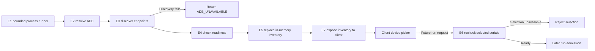

# Phase E — Android device subsystem

## Overview

Phase E gives Runtime a current view of Android endpoints it can reach through
ADB. Studio and Launcher can refresh and select ready devices. Later run admission checks
the selected serials again before recording a run. The inventory is held in
memory. Execution history keeps the serial used for each admitted device.



**Status** — E1–E7 are implemented and covered by Linux tests. E1–E6 passed an
integrated Waydroid check. E7 passed managed HTTP smoke tests on Linux and the
Windows agent cross-build. Native Windows, packaged ADB, and live-device E7
acceptance remain pending.

| Step | Responsibility | Specification |
|---|---|---|
| E1 | Run a trusted executable with explicit arguments, bounded output, and cancellation. | [Safe process runner](../e_device_subsystem/e1_process_runner.md) |
| E2 | Select and validate the ADB executable for the Runtime process. | [ADB toolchain resolver](../e_device_subsystem/e2_adb_toolchain_resolver.md) |
| E3 | Parse `adb devices -l` into current endpoints and connection states. | [ADB device discovery](../e_device_subsystem/e3_adb_discovery.md) |
| E4 | Probe boot and readiness for each applicable endpoint. | [Android device readiness](../e_device_subsystem/e4_device_readiness.md) |
| E5 | Maintain the latest inventory in memory. | [Session device inventory](../e_device_subsystem/e5_session_inventory.md) |
| E6 | Reject duplicate serials and recheck selected devices before admission. | [Device selection preflight](../e_device_subsystem/e6_selection_preflight.md) |
| E7 | Expose authenticated inventory reads and refreshes. | [Local device inventory API](../e_device_subsystem/e7_device_api.md) |

## Integration boundaries

- A3 defines how Runtime identifies devices by their current ADB serial. A7
  defines the inventory response, including unavailable reasons and discovery
  failures. See [A3](phase_a.md#a3--session-device-selection-rules) and the
  [Local API](../contracts/local_api_v1.md#7-session-device-inventory).
- An endpoint still visible to ADB can appear as unavailable. If a selected
  serial disappears, a new inventory and the admission recheck expose the
  loss. Remembered-device history is outside the current inventory contract.
- A5 permits one active RunGroup with one or more selected devices. The later
  run UI disables Run and device selection while that group is running or
  paused. Admission independently enforces the active slot. ADB discovery
  does not report occupancy by external tools.
- Phase F uses the selected serial for typed Android actions. G/H connect
  preflight to run admission and execution lifecycle.

## Phase gate

Verify the shared ADB path on a physical Android device and an ADB-visible
emulator through the [E7 HTTP routes](../e_device_subsystem/e7_device_api.md#6-verification-and-handoff).
Show a ready endpoint, an unavailable endpoint with its reason, and
a selected serial that disappears before admission. Verify that restarting
Runtime clears the inventory and preserves existing execution history.

### Integration evidence

Run the controlled E1–E6 integration test from the Runtime checkout:

```bash
go test -race -tags=integration -count=1 -run '^TestDeviceSubsystemIntegration$' ./internal/services
```

The test runs a controlled ADB executable through the real process runner,
resolver, discovery, readiness, inventory, and preflight code. It checks two
ready devices, an offline device, request-order selection, rejection after a
selected device disappears, preservation of the last snapshot on a failed
refresh, and replacement by a successful empty refresh.

For a live check, connect a booted device to the local ADB server, then run
the opt-in test with its absolute ADB path and exact serial:

```bash
A2MATEX_TEST_ADB_PATH=/usr/bin/adb \
A2MATEX_TEST_ADB_SERIAL=192.168.240.112:5555 \
go test -tags=integration -count=1 -run '^TestLiveDeviceSubsystemIntegration$' ./internal/services
```

Both checks passed on Linux. The live check used Waydroid and verified a
ready inventory entry and successful preflight. The agent and E1–E6 integration
test binary cross-built for Windows.

For E7, `go test -race ./...` passed on Linux. A managed Linux process passed
HTTP checks for authentication, empty startup inventory, missing ADB, ready
and offline device responses from a controlled executable, and retention of
the prior snapshot after a failed refresh. The installed Android Platform
Tools ADB returned a successful empty inventory in the same HTTP check.
Native Windows, packaged ADB, and E7 HTTP checks with an ADB-visible emulator
and physical device remain open.
