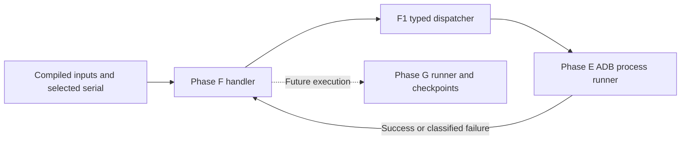

# Phase F — Real device commands and current handlers

## Overview

Phase F lets Runtime carry out a supported node on the selected Android
device. Phase C supplies compiled inputs and Phase E supplies the ADB
toolchain and device selection. Phase F defines and implements the handler
boundary. Phase G will call that boundary in workflow order.

## Specifications

| Step | Responsibility | Status |
|---|---|---|
| F1 | [Typed ADB command dispatcher](../f_device_commands/f1_command_dispatcher.md) | Specified |
| F2 | [Launch App on a selected Android device](../f_device_commands/f2_launch_app.md) | Specified |
| F3 | [Tap on a selected Android device](../f_device_commands/f3_tap.md) | Specified |
| F4 | [Swipe on a selected Android device](../f_device_commands/f4_swipe.md) | Specified |
| F5 | [Type text into the focused Android field](../f_device_commands/f5_input_text.md) | Specified |
| F6 | [Press Back and Press Home](../f_device_commands/f6_key_events.md) | Specified |
| F7 | [Capture a full screen or percentage region](../f_device_commands/f7_screenshot.md) | Specified. Delivers with D5. |
| F8 | [Start, End, and Delay](../f_device_commands/f8_flow_handlers.md) | Specified. Log is conditional. |
| F9 | [Executable node handler registry](../f_device_commands/f9_handler_registry.md) | Specified |
| F10 | [Long Press on a selected Android device](../f_device_commands/f10_long_press.md) | Specified |

Start with the F3 pixel slice, use it to exercise F9, and add F8 Start and End
for the first Phase G workflow. F4 reuses F3's display read and percentage
conversion. Advertise Tap or Swipe after the respective targeting modes
pass their acceptance checks.

The [Runtime roadmap](plan.md#phase-f--real-device-commands-and-current-handlers)
lists each remaining subphase and the handoff to Phase G.
